# Polyglot Codebase Knowledge Graph

> Generated offline by **readmenator**. 64 files, 1082 symbols, 649 imports. Supports C, C++, Python, Go, Rust, JS/TS, Java, C#, Shell, PHP, Dart, GDScript, Nim, ASM, Ruby, Swift, Kotlin, Scala, Lua, Elixir.
> No LLMs. No tokens. Pure static analysis. See more [here](https://github.com/grisuno/ReadMenator)

**Start here:** Statistics Dashboard for scope, God Nodes for blast radius, Architecture Reference for per-file API. Agents: prefer `readmenator-agent/INDEX.md` + `SYMBOLS.md`.

**Wiki:** prefer `readmenator-wiki/index.md` for progressive disclosure: one synthesis page per community, `connections.json` with EXTRACTED vs INFERRED confidence, `queries.md` log, `REPORT.md` audit.

**Confidence:** EXTRACTED = parsed from source, INFERRED = heuristic bridge, AMBIGUOUS = reported, never hidden. See `readmenator-wiki/REPORT.md`.

**Total Files Parsed:** 64 | **Total Symbols Extracted:** 1082 | **Total Imports:** 649
 | **Resolved Imports:** 153

<!-- ranking_model: v1.0 | weights: {ppr:0.45,auth:0.2,test:0.15,doc:0.1,fresh:0.1} | alpha:0.85 | commit:aab73bf | date:2026-07-18 -->


## Table of Contents

1. [Statistics Dashboard](#statistics-dashboard)
2. [Architectural Layers](#architectural-layers)
3. [Architecture Overview](#architecture-overview)
4. [Execution Flows](#execution-flows)
5. [Ranked Context](#ranked-context)
6. [God Nodes](#god-nodes)
7. [Community Analysis](#community-analysis)
8. [Surprising Connections](#surprising-connections)
9. [Suggested Questions](#suggested-questions)
10. [Force-Graph Explorer](#force-graph-explorer)
11. [Corpus Analytics](#corpus-analytics)
12. [Taint Propagation Map](#taint-propagation-map)
13. [Hotspot Analysis](#hotspot-analysis)
14. [Change Impact Analysis](#change-impact-analysis)
15. [Architecture Violations](#architecture-violations)
16. [Suggested Linting Rules](#suggested-linting-rules)
17. [Dataflow Analysis](#dataflow-analysis)
18. [Concept Graph](#concept-graph)
19. [Orphans](#orphans)
20. [Query Recipes](#query-recipes)
21. [Structural Knowledge Map](#structural-knowledge-map)
22. [UML Class Diagram](#uml-class-diagram)
23. [Code Property Graph](#code-property-graph)
24. [Architecture Reference](#architecture-reference)
    - [C (1 files)](#c-1-files)
    - [PY (61 files)](#py-61-files)
    - [SH (2 files)](#sh-2-files)

---

## Statistics Dashboard

| Metric | Value |
|--------|-------|
| Total Files | 64 |
| Total Symbols | 1082 |
| Total Imports | 649 |
| Call Edges | 6758 |
| Inheritance Edges | 34 |
| Languages | 3 |
| Avg Symbols/File | 16.9 |
| Avg Imports/File | 10.1 |
| Resolved Imports | 153 |

### Top Files by Import Count (Fan-Out)

| File | Imports | Symbols | Language |
|------|---------|---------|----------|
| `api_server.py` | 37 | 63 | py |
| `model.py` | 28 | 188 | py |
| `synthetic_dataset.py` | 24 | 35 | py |
| `train.py` | 21 | 62 | py |
| `harness.py` | 19 | 12 | py |
| `tasks.py` | 18 | 15 | py |
| `train_agent.py` | 18 | 2 | py |
| `tokenizer_tools.py` | 17 | 10 | py |
| `train_grpo.py` | 17 | 2 | py |
| `repair.py` | 16 | 6 | py |

---

## Architectural Layers

Auto-detected from path patterns, naming conventions, and imported frameworks.

| Layer | Files |
|-------|-------|
| utility | 52 |
| testing | 8 |
| business_logic | 2 |
| data_access | 1 |
| presentation | 1 |

### utility

- `app.py` (py, 5 symbols)
- `convert_weights.py` (py, 2 symbols)
- `convert_weights_minios.py` (py, 1 symbols)
- `encode_tokens.py` (py, 1 symbols)
- `analyze.py` (py, 5 symbols)
- `analyze_results.py` (py, 4 symbols)
- `diag_static.py` (py, 5 symbols)
- `governor.py` (py, 20 symbols)
- `governor_smoke.py` (py, 7 symbols)
- `harness.py` (py, 12 symbols)
- `integration_smoke.py` (py, 1 symbols)
- `noise_analysis.py` (py, 3 symbols)
- `noise_sweep.py` (py, 4 symbols)
- `repair.py` (py, 6 symbols)
- `report.py` (py, 6 symbols)
- *... and 37 more*

### data_access

- `synthetic_dataset.py` (py, 35 symbols)

### testing

- `test_checkpoint_meta.py` (py, 4 symbols)
- `test_data_pipeline.py` (py, 6 symbols)
- `test_eval_tasks.py` (py, 4 symbols)
- `test_fallback.py` (py, 23 symbols)
- `test_heritage.py` (py, 9 symbols)
- `test_jlens.py` (py, 51 symbols)
- `test_lens_model.py` (py, 34 symbols)
- `test_structured_output.py` (py, 26 symbols)

### presentation

- `api_server.py` (py, 63 symbols)

### business_logic

- `lens_model.py` (py, 29 symbols)
- `model.py` (py, 188 symbols)

---

## Architecture Overview

9 components stacked in 4 dependency tiers (weighted Eades-Lin-Smyth ordering: arrows point from dependent to dependency, top to bottom). Labels are import counts, thick arrows the top quartile; 4 transitively implied edges are omitted. Dashed red arrows are upward dependencies: the smallest set of imports that closes every cycle and breaks the layering. Cyan components hold entry points. Interactive version: `readmenator-apidocs/index.html#/flows`.

Upward dependencies to fix first: `topogpt3: tasks` -> `topogpt3: model` (3 imports); `topogpt3: model` -> `eval` (2 imports); `topogpt3: tasks` -> `topogpt3: inference_hrm` (2 imports); `topogpt3: inference_hrm` -> `topogpt3: model` (2 imports); `topogpt3: jlens` -> `topogpt3: model` (2 imports); `topogpt3: tasks` -> `eval` (1 imports)

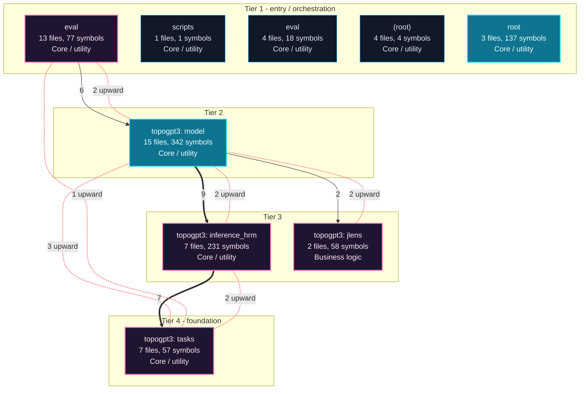

---

## Execution Flows

Entry points are scored from `__main__` guards, `main` functions, entry-style names and files, and call-graph sources. Each flow walks resolved calls in call-site order (depth <= 4, <= 40 steps); numbers give the call order, dashed arrows revisit an already expanded callee, red arrows are recursion. Interactive version with zoom and per-node docs: `readmenator-apidocs/index.html#/flows`.

### `topogpt3.main`

`topogpt3.c:1885`, score 11: `main` in a compiled-language file; entry-style name `main`.

Call tree:

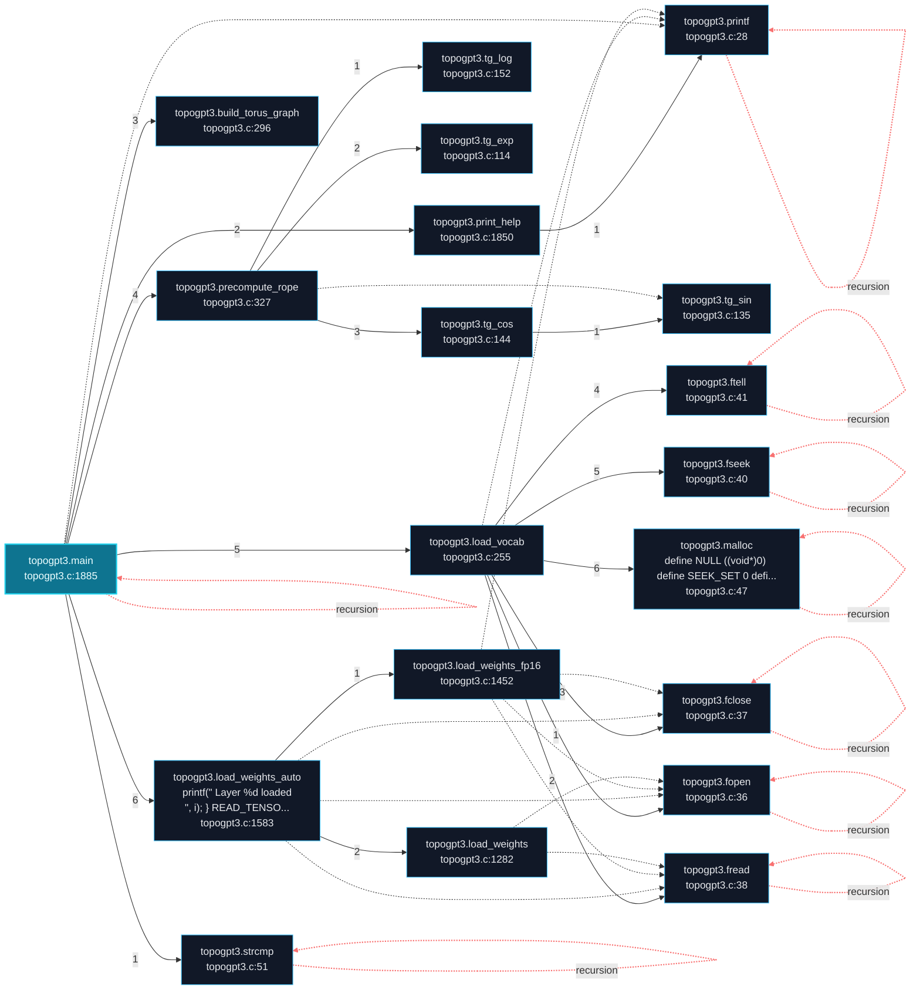

### `model.ProgressiveSeqLenTrainer.run`

`topogpt3/model.py:2324`, score 10: entry-style name `run`; call-graph source with 10 calls.

Control flow:

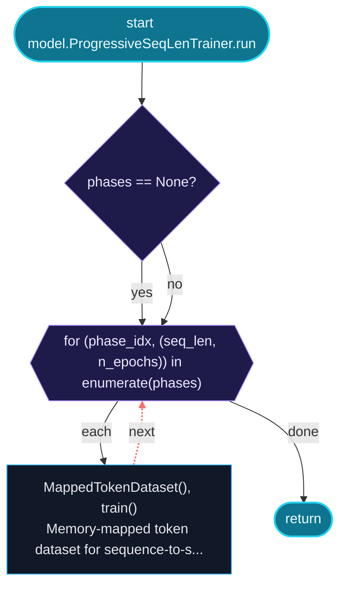

Call tree:

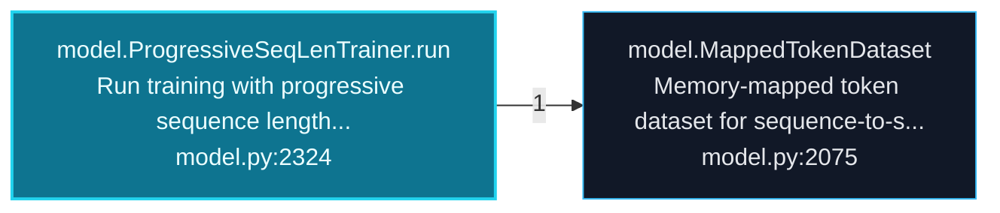

### `app.main`

`app.py:159`, score 9: entry-style name `main`; defined in entry file `app.py`; called from the `__main__` guard.

Control flow:

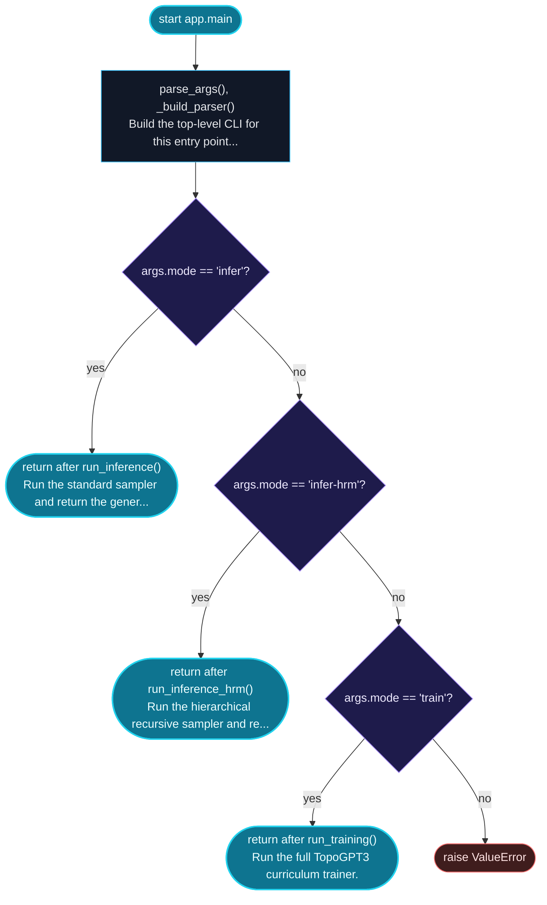

Call tree:

```mermaid
flowchart LR
    classDef default fill:#111827,stroke:#38bdf8,color:#e5e7eb;
    classDef entry fill:#0e7490,stroke:#22d3ee,color:#ecfeff,stroke-width:2px;
    classDef external fill:#1a1530,stroke:#a78bfa,color:#ede9fe;
    n_app_py__main["app.main<br/>Entry point invoked when the file is executed...<br/>app.py:159"]:::entry
    n_app_py___build_parser["app._build_parser<br/>Build the top-level CLI for this entry point...<br/>app.py:121"]:::default
    n_app_py__run_inference["app.run_inference<br/>Run the standard sampler and return the gener...<br/>app.py:46"]:::default
    n_topogpt3_inference_py__InferenceSettings["inference.InferenceSettings<br/>Centralized configuration container for the i...<br/>inference.py:44"]:::external
    n_topogpt3_inference_py__InferencePipeline["inference.InferencePipeline<br/>Orchestrator wiring loader, builder, engine a...<br/>inference.py:612"]:::external
    n_topogpt3_inference_py__execute["inference.InferencePipeline.execute<br/>Run the full inference pipeline end-to-end an...<br/>inference.py:622"]:::external
    n_topogpt3_inference_py__SourceModuleLoader["inference.SourceModuleLoader<br/>Resolves the TopoGPT3 runtime module via the...<br/>inference.py:218"]:::external
    n_topogpt3_inference_py__load["inference.SourceModuleLoader.load<br/>Return the topogpt3.train module which re-exp...<br/>inference.py:225"]:::external
    n_topogpt3_inference_py__SeedSynchronizer["inference.SeedSynchronizer<br/>Applies deterministic seeds across torch, CUD...<br/>inference.py:461"]:::external
    n_topogpt3_inference_py__apply["inference.SeedSynchronizer.apply<br/>Seed all relevant RNGs using the model packag...<br/>inference.py:471"]:::external
    n_topogpt3_inference_py__GaussPatchApplier["inference.GaussPatchApplier<br/>Applies the idempotent Gauss complex-multiply...<br/>inference.py:403"]:::external
    n_topogpt3_inference_py__apply_if_enabled["inference.GaussPatchApplier.apply_if_enabled<br/>Patch QuaternionSpectralLayer to use the 3-mu...<br/>inference.py:413"]:::external
    n_topogpt3_inference_py__CheckpointPaths["inference.CheckpointPaths<br/>Computes and validates checkpoint file paths...<br/>inference.py:236"]:::external
    n_topogpt3_inference_py__assert_ready["inference.CheckpointPaths.assert_ready<br/>Verify weights exist and the on-disk size lie...<br/>inference.py:266"]:::external
    n_topogpt3_inference_py__model_file["inference.CheckpointPaths.model_file<br/>Resolved path to the safetensors weights file...<br/>inference.py:252"]:::external
    n_topogpt3_inference_py__require_existing_file["inference.SecurePathResolver.require_existing_file<br/>Validate #96;path#96; points to an existing regular...<br/>inference.py:205"]:::external
    n_topogpt3_inference_py__WeightShapeProbe["inference.WeightShapeProbe<br/>Reads tensor metadata from safetensors to inf...<br/>inference.py:284"]:::external
    n_topogpt3_inference_py__detect_n_kv_heads["inference.WeightShapeProbe.detect_n_kv_heads<br/>Recover N_KV_HEADS used at training by inspec...<br/>inference.py:291"]:::external
    n_topogpt3_inference_py__resolve_under["inference.SecurePathResolver.resolve_under<br/>Join #96;parts#96; under #96;root#96; and return the cano...<br/>inference.py:189"]:::external
    n_topogpt3_inference_py__TokenizerFactory["inference.TokenizerFactory<br/>Builds a BPETokenizer instance using the conf...<br/>inference.py:390"]:::external
    n_topogpt3_inference_py__build_397["inference.TokenizerFactory.build<br/>Return an instance of BPETokenizer bound to t...<br/>inference.py:397"]:::external
    n_topogpt3_inference_py__TopoGPT2ConfigAligner["inference.TopoGPT2ConfigAligner<br/>Builds a TopoGPT2Config matching the loaded c...<br/>inference.py:331"]:::external
    n_topogpt3_inference_py__build_341["inference.TopoGPT2ConfigAligner.build<br/>Return a TopoGPT2Config dataclass ready to in...<br/>inference.py:341"]:::external
    n_topogpt3_checkpoint_meta_py__config_from_checkpoint["checkpoint_meta.config_from_checkpoint<br/>Build a #96;#96;TopoGPT2Config#96;#96; that matches the c...<br/>checkpoint_meta.py:81"]:::external
    n_topogpt3_inference_py__ModelAssembler["inference.ModelAssembler<br/>Instantiates the model and loads weights from...<br/>inference.py:422"]:::external
    n_topogpt3_inference_py__assemble["inference.ModelAssembler.assemble<br/>Build the TopoGPT2 graph, load weights into i...<br/>inference.py:432"]:::external
    n_topogpt3_inference_py__GenerationEngine["inference.GenerationEngine<br/>Runs autoregressive sampling against a loaded...<br/>inference.py:521"]:::external
    n_topogpt3_inference_py__run["inference.GenerationEngine.run<br/>Generate a completion for #96;prompt#96; and return...<br/>inference.py:529"]:::external
    n_topogpt3_inference_py__GenerationReport["inference.GenerationReport<br/>Quantitative summary of a single generation c...<br/>inference.py:507"]:::external
    n_topogpt3_inference_py__from_settings["inference.SamplingPolicy.from_settings<br/>Construct a SamplingPolicy from inference set...<br/>inference.py:496"]:::external
    n_topogpt3_inference_py__ResultRenderer["inference.ResultRenderer<br/>Prints a GenerationReport to stdout using set...<br/>inference.py:586"]:::external
    n_topogpt3_inference_py__render["inference.ResultRenderer.render<br/>Emit a banner with prompt and completion, plu...<br/>inference.py:593"]:::external
    n_topogpt3_inference_py__tokens_per_second["inference.GenerationReport.tokens_per_second<br/>Return throughput in tokens/sec, clamped to a...<br/>inference.py:516"]:::external
    n_app_py__run_inference_hrm["app.run_inference_hrm<br/>Run the hierarchical recursive sampler and re...<br/>app.py:71"]:::default
    n_topogpt3_inference_hrm_py__RecursiveReasoningConfig["inference_hrm.RecursiveReasoningConfig<br/>Hyperparameters governing the hierarchical re...<br/>inference_hrm.py:66"]:::external
    n_topogpt3_inference_hrm_py__HRMInferenceSettings["inference_hrm.HRMInferenceSettings<br/>Centralized configuration for the TopoGPT3.1...<br/>inference_hrm.py:136"]:::external
    n_topogpt3_inference_hrm_py__HRMInferencePipeline["inference_hrm.HRMInferencePipeline<br/>Orchestrator wiring loader, builder, reasoner...<br/>inference_hrm.py:1336"]:::external
    n_topogpt3_inference_hrm_py__execute["inference_hrm.HRMInferencePipeline.execute<br/>Run the full inference pipeline end-to-end an...<br/>inference_hrm.py:1346"]:::external
    n_app_py__main -->|"1"| n_app_py___build_parser
    n_app_py__main -->|"2"| n_app_py__run_inference
    n_app_py__run_inference -->|"1"| n_topogpt3_inference_py__InferenceSettings
    n_app_py__run_inference -->|"2"| n_topogpt3_inference_py__InferencePipeline
    n_app_py__run_inference -->|"3"| n_topogpt3_inference_py__execute
    n_topogpt3_inference_py__execute -->|"1"| n_topogpt3_inference_py__SourceModuleLoader
    n_topogpt3_inference_py__execute -->|"2"| n_topogpt3_inference_py__load
    n_topogpt3_inference_py__execute -->|"3"| n_topogpt3_inference_py__SeedSynchronizer
    n_topogpt3_inference_py__execute -->|"4"| n_topogpt3_inference_py__apply
    n_topogpt3_inference_py__execute -->|"5"| n_topogpt3_inference_py__GaussPatchApplier
    n_topogpt3_inference_py__execute -->|"6"| n_topogpt3_inference_py__apply_if_enabled
    n_topogpt3_inference_py__execute -->|"7"| n_topogpt3_inference_py__CheckpointPaths
    n_topogpt3_inference_py__execute -->|"8"| n_topogpt3_inference_py__assert_ready
    n_topogpt3_inference_py__assert_ready -->|"1"| n_topogpt3_inference_py__model_file
    n_topogpt3_inference_py__assert_ready -->|"2"| n_topogpt3_inference_py__require_existing_file
    n_topogpt3_inference_py__execute -->|"9"| n_topogpt3_inference_py__WeightShapeProbe
    n_topogpt3_inference_py__execute -->|"10"| n_topogpt3_inference_py__detect_n_kv_heads
    n_topogpt3_inference_py__execute -->|"11"| n_topogpt3_inference_py__model_file
    n_topogpt3_inference_py__model_file -->|"1"| n_topogpt3_inference_py__resolve_under
    n_topogpt3_inference_py__execute -->|"12"| n_topogpt3_inference_py__TokenizerFactory
    n_topogpt3_inference_py__execute -->|"13"| n_topogpt3_inference_py__build_397
    n_topogpt3_inference_py__execute -->|"14"| n_topogpt3_inference_py__TopoGPT2ConfigAligner
    n_topogpt3_inference_py__execute -->|"15"| n_topogpt3_inference_py__build_341
    n_topogpt3_inference_py__build_341 -->|"1"| n_topogpt3_checkpoint_meta_py__config_from_checkpoint
    n_topogpt3_inference_py__execute -->|"16"| n_topogpt3_inference_py__ModelAssembler
    n_topogpt3_inference_py__execute -->|"17"| n_topogpt3_inference_py__assemble
    n_topogpt3_inference_py__assemble -.-> n_topogpt3_inference_py__model_file
    n_topogpt3_inference_py__execute -->|"18"| n_topogpt3_inference_py__GenerationEngine
    n_topogpt3_inference_py__execute -->|"19"| n_topogpt3_inference_py__run
    n_topogpt3_inference_py__run -->|"1"| n_topogpt3_inference_py__GenerationReport
    n_topogpt3_inference_py__execute -->|"20"| n_topogpt3_inference_py__from_settings
    n_topogpt3_inference_py__execute -->|"21"| n_topogpt3_inference_py__ResultRenderer
    n_topogpt3_inference_py__execute -->|"22"| n_topogpt3_inference_py__render
    n_topogpt3_inference_py__render -->|"1"| n_topogpt3_inference_py__tokens_per_second
    n_app_py__main -->|"3"| n_app_py__run_inference_hrm
    n_app_py__run_inference_hrm -->|"1"| n_topogpt3_inference_hrm_py__RecursiveReasoningConfig
    n_app_py__run_inference_hrm -->|"2"| n_topogpt3_inference_hrm_py__HRMInferenceSettings
    n_app_py__run_inference_hrm -->|"3"| n_topogpt3_inference_hrm_py__HRMInferencePipeline
    n_app_py__run_inference_hrm -->|"4"| n_topogpt3_inference_hrm_py__execute
    n_topogpt3_inference_hrm_py__execute -.-> n_topogpt3_inference_py__load
```

Cross-file sequence:

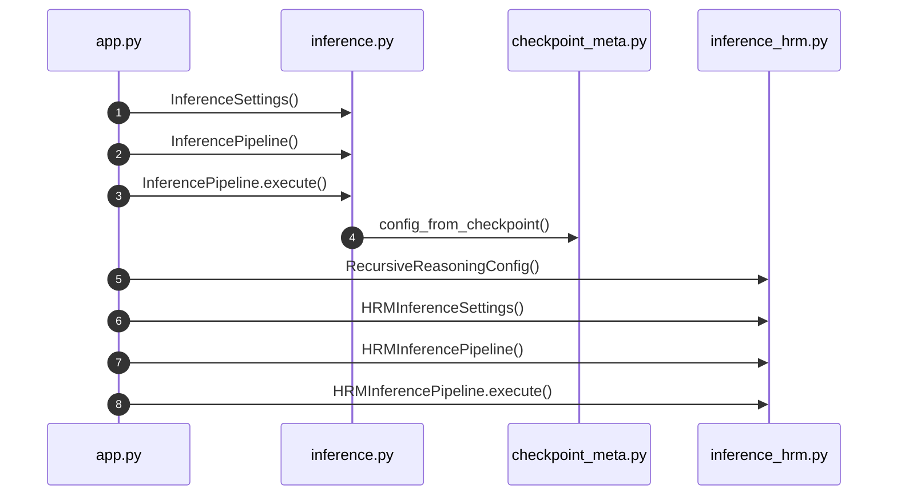

---

## Ranked Context

Files ranked by composite score for the current query context. The ranking combines Personalized PageRank (query relevance), global authority, test coverage, documentation coverage, and code freshness. Model: v1.0.

| Rank | File | Composite | PPR | Authority | Test | Doc |
|------|------|-----------|-----|-----------|------|-----|
| 1 | `yarn.py` | 0.1303 | 0.0467 | 0.0467 | 0.00 | 1.00 |
| 2 | `gradio_app.py` | 0.1302 | 0.0079 | 0.0079 | 0.00 | 1.25 |
| 3 | `model.py` | 0.1297 | 0.1242 | 0.1242 | 0.00 | 0.49 |
| 4 | `app.py` | 0.1252 | 0.0079 | 0.0079 | 0.00 | 1.20 |
| 5 | `checkpoint_meta.py` | 0.1133 | 0.0512 | 0.0512 | 0.00 | 0.80 |
| 6 | `continuation.py` | 0.1118 | 0.0489 | 0.0489 | 0.00 | 0.80 |
| 7 | `tools_agent.py` | 0.1104 | 0.0160 | 0.0160 | 0.00 | 1.00 |
| 8 | `train_agent.py` | 0.1055 | 0.0084 | 0.0084 | 0.00 | 1.00 |
| 9 | `train_distill.py` | 0.1055 | 0.0084 | 0.0084 | 0.00 | 1.00 |
| 10 | `integration_smoke.py` | 0.1052 | 0.0079 | 0.0079 | 0.00 | 1.00 |

---

## God Nodes

Most architecturally central files ranked by combined import/export degree and symbol richness.

| File | Score | Connections | PageRank |
|------|-------|-------------|----------|
| `model.py` | 62.8 | | 0.1242 |
| `__init__.py` | 42.0 | | 0.0000 |
| `checkpoint_meta.py` | 28.5 | | 0.0512 |
| `__main__.py` | 28.1 | | 0.0000 |
| `chat.py` | 22.8 | | 0.0000 |
| `api_server.py` | 22.3 | | 0.0000 |
| `rewards.py` | 19.2 | | 0.0000 |
| `fallback.py` | 17.5 | | 0.0000 |
| `test_heritage.py` | 16.9 | | 0.0000 |
| `topogpt3.c` | 16.8 | | 0.0000 |

---

## Community Analysis

Files grouped by import-based community detection. Cohesion measures how tightly connected each community is internally.

### topogpt3: model (Cohesion: 0.45)

**15 files** in this community:

- `diag_static.py` (py, 5 symbols)
- `synthetic_dataset.py` (py, 35 symbols)
- `__main__.py` (py, 1 symbols)
- `convert.py` (py, 3 symbols)
- `export_chat.py` (py, 5 symbols)
- `lora.py` (py, 12 symbols)
- `model.py` (py, 188 symbols)
- `rollout.py` (py, 10 symbols)
- `train.py` (py, 62 symbols)
- `train_distill.py` (py, 1 symbols)
- `train_dpo.py` (py, 2 symbols)
- `train_grpo.py` (py, 2 symbols)
- `train_lora.py` (py, 2 symbols)
- `train_ppo.py` (py, 4 symbols)
- `trainer_utils_topo.py` (py, 10 symbols)

### eval (Cohesion: 0.44)

**13 files** in this community:

- `governor.py` (py, 20 symbols)
- `governor_smoke.py` (py, 7 symbols)
- `harness.py` (py, 12 symbols)
- `integration_smoke.py` (py, 1 symbols)
- `noise_sweep.py` (py, 4 symbols)
- `repair.py` (py, 6 symbols)
- `samplers.py` (py, 7 symbols)
- `sandbox.py` (py, 9 symbols)
- `sandbox_smoke.py` (py, 1 symbols)
- `smoke.py` (py, 2 symbols)
- `temp_sweep.py` (py, 5 symbols)
- `__init__.py` (py, 0 symbols)
- `yarn.py` (py, 3 symbols)

### topogpt3: tasks (Cohesion: 0.51)

**10 files** in this community:

- `tasks.py` (py, 15 symbols)
- `test_eval_tasks.py` (py, 4 symbols)
- `test_fallback.py` (py, 23 symbols)
- `test_heritage.py` (py, 9 symbols)
- `chat.py` (py, 8 symbols)
- `eval_toolcall.py` (py, 2 symbols)
- `fallback.py` (py, 15 symbols)
- `rewards.py` (py, 12 symbols)
- `tools_agent.py` (py, 3 symbols)
- `train_agent.py` (py, 2 symbols)

### topogpt3: inference_hrm (Cohesion: 0.34)

**9 files** in this community:

- `test_checkpoint_meta.py` (py, 4 symbols)
- `test_structured_output.py` (py, 26 symbols)
- `api_server.py` (py, 63 symbols)
- `checkpoint_meta.py` (py, 5 symbols)
- `continuation.py` (py, 5 symbols)
- `inference.py` (py, 54 symbols)
- `inference_hrm.py` (py, 76 symbols)
- `structured_output.py` (py, 18 symbols)
- `tokenizer_tools.py` (py, 10 symbols)

### topogpt3: jlens (Cohesion: 0.45)

**4 files** in this community:

- `test_jlens.py` (py, 51 symbols)
- `test_lens_model.py` (py, 34 symbols)
- `jlens.py` (py, 29 symbols)
- `lens_model.py` (py, 29 symbols)

### root (Cohesion: 1.00)

**3 files** in this community:

- `app.py` (py, 5 symbols)
- `gradio_app.py` (py, 4 symbols)
- `topogpt3.c` (c, 128 symbols)

---

## Surprising Connections

Files in different communities connected through 3+ indirect hops.

- `governor.py` <-> `test_checkpoint_meta.py` (5 hops, across 2 communities)
- `governor.py` <-> `structured_output.py` (5 hops, across 3 communities)
- `governor.py` <-> `tokenizer_tools.py` (5 hops, across 2 communities)
- `sandbox_smoke.py` <-> `synthetic_dataset.py` (5 hops, across 2 communities)
- `sandbox_smoke.py` <-> `test_jlens.py` (5 hops, across 2 communities)

---

## Suggested Questions

Auto-generated exploration prompts based on graph structure:

- What does model.py depend on, and what depends on it? (22 connections)
- What does __init__.py depend on, and what depends on it? (21 connections)
- What does checkpoint_meta.py depend on, and what depends on it? (14 connections)
- How are the 15 files in 'topogpt3: model' related to each other?
- Why are governor.py and test_checkpoint_meta.py connected through 5 hops across 2 communities?

---

## Force-Graph Explorer

Heterogeneous explorer payload (files, communities, layers, externals) rendered with force-graph physics, stable family colors, log2 node sizing, and convex-hull community overlays. Open `readmenator-maps/graph-force.html` (linked from the maps gallery) or run `explorer`.

- Nodes: 144 (community: 6, external: 69, file: 64, layer: 5)
- Edges: 767

---

## Corpus Analytics

Attribution funnel and distributions for the explorer dashboard.

- Files: 64 | With symbols: 62 | Attributed: 54 | God nodes: 10 | Symbols: 1082

- Layer `utility`: 52 files
- Layer `testing`: 8 files
- Layer `business_logic`: 2 files
- Layer `data_access`: 1 files
- Layer `presentation`: 1 files

- Language `py`: 61 files
- Language `sh`: 2 files
- Language `c`: 1 files

---

## Taint Propagation Map

Taint analysis traces how dangerous imports propagate through the codebase via transitive dependencies. Source files import dangerous modules directly; sink files receive the danger indirectly.

**Taint Sources:** 1 | **Taint Sinks:** 21 | **Propagation Paths:** 20

- `governor_smoke.py` imports `eval` (0 hop to `governor_smoke.py`) [critical]
  Path: governor_smoke.py
- `governor_smoke.py` imports `eval` (1 hop to `governor.py`) [critical]
  Path: governor_smoke.py -> governor.py
- `governor_smoke.py` imports `eval` (1 hop to `__init__.py`) [critical]
  Path: governor_smoke.py -> __init__.py
- `governor_smoke.py` imports `eval` (2 hops to `inference_hrm.py`) [critical]
  Path: governor_smoke.py -> __init__.py -> inference_hrm.py
- `governor_smoke.py` imports `eval` (2 hops to `lora.py`) [critical]
  Path: governor_smoke.py -> __init__.py -> lora.py
- `governor_smoke.py` imports `eval` (2 hops to `trainer_utils_topo.py`) [critical]
  Path: governor_smoke.py -> __init__.py -> trainer_utils_topo.py
- `governor_smoke.py` imports `eval` (2 hops to `eval_toolcall.py`) [critical]
  Path: governor_smoke.py -> __init__.py -> eval_toolcall.py
- `governor_smoke.py` imports `eval` (2 hops to `yarn.py`) [critical]
  Path: governor_smoke.py -> __init__.py -> yarn.py
- `governor_smoke.py` imports `eval` (2 hops to `chat.py`) [critical]
  Path: governor_smoke.py -> __init__.py -> chat.py
- `governor_smoke.py` imports `eval` (2 hops to `rollout.py`) [critical]
  Path: governor_smoke.py -> __init__.py -> rollout.py
- `governor_smoke.py` imports `eval` (2 hops to `train.py`) [critical]
  Path: governor_smoke.py -> __init__.py -> train.py
- `governor_smoke.py` imports `eval` (2 hops to `tools_agent.py`) [critical]
  Path: governor_smoke.py -> __init__.py -> tools_agent.py
- `governor_smoke.py` imports `eval` (2 hops to `jlens.py`) [critical]
  Path: governor_smoke.py -> __init__.py -> jlens.py
- `governor_smoke.py` imports `eval` (2 hops to `rewards.py`) [critical]
  Path: governor_smoke.py -> __init__.py -> rewards.py
- `governor_smoke.py` imports `eval` (2 hops to `model.py`) [critical]
  Path: governor_smoke.py -> __init__.py -> model.py
- `governor_smoke.py` imports `eval` (2 hops to `lens_model.py`) [critical]
  Path: governor_smoke.py -> __init__.py -> lens_model.py
- `governor_smoke.py` imports `eval` (2 hops to `inference.py`) [critical]
  Path: governor_smoke.py -> __init__.py -> inference.py
- `governor_smoke.py` imports `eval` (3 hops to `checkpoint_meta.py`) [critical]
  Path: governor_smoke.py -> __init__.py -> inference_hrm.py -> checkpoint_meta.py
- `governor_smoke.py` imports `eval` (3 hops to `continuation.py`) [critical]
  Path: governor_smoke.py -> __init__.py -> inference_hrm.py -> continuation.py
- `governor_smoke.py` imports `eval` (3 hops to `fallback.py`) [critical]
  Path: governor_smoke.py -> __init__.py -> eval_toolcall.py -> fallback.py

---

## Hotspot Analysis

Files ranked by combined complexity (symbol count) and centrality (connection count). High-scoring files are architecturally critical and may need refactoring attention.

| File | Complexity | Centrality | Combined | Symbols | Connections |
|------|-----------|------------|----------|---------|-------------|
| `yarn.py` | 0.016 | 0.130 | 0.084 | 3 | 7 |
| `gradio_app.py` | 0.021 | 0.167 | 0.108 | 4 | 9 |
| `model.py` | 1.000 | 0.982 | 0.989 | 188 | 53 |
| `app.py` | 0.027 | 0.130 | 0.088 | 5 | 7 |
| `checkpoint_meta.py` | 0.027 | 0.389 | 0.244 | 5 | 21 |
| `continuation.py` | 0.027 | 0.111 | 0.077 | 5 | 6 |
| `tools_agent.py` | 0.016 | 0.333 | 0.206 | 3 | 18 |
| `train_agent.py` | 0.011 | 0.463 | 0.282 | 2 | 25 |
| `train_distill.py` | 0.005 | 0.370 | 0.224 | 1 | 20 |
| `integration_smoke.py` | 0.005 | 0.074 | 0.047 | 1 | 4 |
| `api_server.py` | 0.335 | 1.000 | 0.734 | 63 | 54 |
| `train.py` | 0.330 | 0.481 | 0.421 | 62 | 26 |
| `__init__.py` | 0.000 | 0.667 | 0.400 | 0 | 36 |
| `inference_hrm.py` | 0.404 | 0.352 | 0.373 | 76 | 19 |
| `synthetic_dataset.py` | 0.186 | 0.463 | 0.352 | 35 | 25 |

---

## Dataflow Analysis

Procedural intra-function dataflow findings (zero tokens, regex-based heuristics, all INFERRED). Each lead is grounded at file:line for manual review.

**5 findings** (UNCHECKED_ALLOC: 5).

| File | Function | Line | Kind | Variable | Description |
|------|----------|------|------|----------|-------------|
| `eval/repair.py` | `main` | 140 | `UNCHECKED_ALLOC` | `base` | Result of allocator stored in `base` is never checked against NULL. |
| `topogpt3/export_chat.py` | `main` | 105 | `UNCHECKED_ALLOC` | `sft` | Result of allocator stored in `sft` is never checked against NULL. |
| `topogpt3/export_chat.py` | `main` | 106 | `UNCHECKED_ALLOC` | `rla` | Result of allocator stored in `rla` is never checked against NULL. |
| `topogpt3/export_chat.py` | `main` | 107 | `UNCHECKED_ALLOC` | `dpo` | Result of allocator stored in `dpo` is never checked against NULL. |
| `topogpt3/export_chat.py` | `main` | 132 | `UNCHECKED_ALLOC` | `pre` | Result of allocator stored in `pre` is never checked against NULL. |

---

## Concept Graph

Semantic second-brain layer: nouns are concept nodes, verbs are edges. Each noun maps atomically to a file set (EXTRACTED); each verb aggregates structural imports, calls, and inherits into consumes, invokes, extends, depends_on, or bridges (INFERRED).

**50 concepts, 100 relations.**

| Concept | Files | Mentions |
|---------|-------|----------|
| `topo` | 40 | 122 |
| `topogpt3` | 37 | 62 |
| `gpt3` | 36 | 68 |
| `model` | 29 | 179 |
| `eval` | 25 | 78 |
| `load` | 25 | 46 |
| `prompt` | 22 | 68 |
| `run` | 21 | 59 |
| `checkpoint` | 20 | 81 |
| `token` | 18 | 102 |
| `build` | 18 | 40 |
| `call` | 18 | 33 |
| `only` | 18 | 25 |
| `python` | 18 | 25 |
| `per` | 17 | 57 |
| `code` | 17 | 34 |
| `one` | 17 | 29 |
| `returns` | 16 | 50 |
| `weights` | 16 | 39 |
| `quaternion` | 16 | 37 |
| `json` | 16 | 35 |
| `when` | 16 | 30 |
| `text` | 15 | 42 |
| `gpt2` | 15 | 37 |
| `output` | 15 | 29 |
| `generate` | 15 | 28 |
| `return` | 14 | 53 |
| `config` | 14 | 51 |
| `max` | 14 | 41 |
| `spectral` | 14 | 35 |

### Verb Edges

| Source | Verb | Target | Strength | Evidence |
|--------|------|--------|----------|----------|
| `topo` | `depends_on` | `topogpt3` | 1.00 | 10 |
| `gpt3` | `depends_on` | `topogpt3` | 0.96 | 10 |
| `gpt3` | `depends_on` | `topo` | 0.91 | 10 |
| `topogpt3` | `depends_on` | `topo` | 0.85 | 10 |
| `topo` | `depends_on` | `model` | 0.70 | 10 |
| `gpt3` | `depends_on` | `model` | 0.66 | 10 |
| `topo` | `depends_on` | `gpt3` | 0.63 | 10 |
| `topo` | `depends_on` | `json` | 0.59 | 10 |
| `topogpt3` | `depends_on` | `model` | 0.59 | 10 |
| `gpt3` | `depends_on` | `json` | 0.57 | 10 |
| `quaternion` | `depends_on` | `topogpt3` | 0.57 | 10 |
| `model` | `depends_on` | `topogpt3` | 0.56 | 10 |
| `quaternion` | `depends_on` | `topo` | 0.56 | 10 |
| `topo` | `depends_on` | `when` | 0.56 | 10 |
| `topo` | `depends_on` | `checkpoint` | 0.55 | 10 |
| `topo` | `depends_on` | `weights` | 0.55 | 10 |
| `topogpt3` | `depends_on` | `gpt3` | 0.55 | 10 |
| `topogpt3` | `depends_on` | `json` | 0.55 | 10 |
| `gpt3` | `depends_on` | `checkpoint` | 0.54 | 10 |
| `gpt3` | `depends_on` | `weights` | 0.54 | 10 |
| `gpt3` | `depends_on` | `when` | 0.53 | 10 |
| `model` | `depends_on` | `topo` | 0.53 | 10 |
| `topo` | `depends_on` | `prompt` | 0.53 | 10 |
| `topo` | `depends_on` | `only` | 0.51 | 10 |
| `topo` | `depends_on` | `spectral` | 0.51 | 10 |
| `gpt3` | `depends_on` | `prompt` | 0.50 | 10 |
| `topo` | `depends_on` | `gpt2` | 0.50 | 10 |
| `topogpt3` | `depends_on` | `when` | 0.50 | 10 |
| `train` | `depends_on` | `topogpt3` | 0.50 | 10 |
| `gpt3` | `depends_on` | `only` | 0.49 | 10 |

### Dialectic Prompts

- Thesis: `all` centralizes 13 files; Antithesis: `apply` pulls 12 files with 7 shared (Jaccard 0.39); Synthesis: should they merge, split by layer, or keep `bridges` explicit?
- Thesis: `all` centralizes 13 files; Antithesis: `checkpoint` pulls 20 files with 8 shared (Jaccard 0.32); Synthesis: should they merge, split by layer, or keep `bridges` explicit?
- Thesis: `all` centralizes 13 files; Antithesis: `config` pulls 14 files with 8 shared (Jaccard 0.42); Synthesis: should they merge, split by layer, or keep `bridges` explicit?
- Thesis: `all` centralizes 13 files; Antithesis: `error` pulls 12 files with 7 shared (Jaccard 0.39); Synthesis: should they merge, split by layer, or keep `bridges` explicit?
- Thesis: `all` centralizes 13 files; Antithesis: `file` pulls 13 files with 8 shared (Jaccard 0.44); Synthesis: should they merge, split by layer, or keep `bridges` explicit?
- Thesis: `all` centralizes 13 files; Antithesis: `layers` pulls 11 files with 7 shared (Jaccard 0.41); Synthesis: should they merge, split by layer, or keep `bridges` explicit?
- Thesis: `all` centralizes 13 files; Antithesis: `max` pulls 14 files with 7 shared (Jaccard 0.35); Synthesis: should they merge, split by layer, or keep `bridges` explicit?
- Thesis: `all` centralizes 13 files; Antithesis: `name` pulls 13 files with 6 shared (Jaccard 0.30); Synthesis: should they merge, split by layer, or keep `bridges` explicit?
- Thesis: `all` centralizes 13 files; Antithesis: `new` pulls 14 files with 8 shared (Jaccard 0.42); Synthesis: should they merge, split by layer, or keep `bridges` explicit?
- Thesis: `all` centralizes 13 files; Antithesis: `per` pulls 17 files with 7 shared (Jaccard 0.30); Synthesis: should they merge, split by layer, or keep `bridges` explicit?

---

## Change Impact Analysis

Files sorted by how many other files would be affected if they changed. High-impact files should be changed with caution.

| File | Direct Dependents | Transitive Dependents | Total Impact |
|------|------------------|----------------------|--------------|
| `synthetic_dataset.py` | 1 | 34 | 35 |
| `continuation.py` | 3 | 32 | 35 |
| `yarn.py` | 3 | 32 | 35 |
| `model.py` | 19 | 15 | 34 |
| `chat.py` | 11 | 15 | 26 |
| `checkpoint_meta.py` | 13 | 12 | 25 |
| `fallback.py` | 7 | 18 | 25 |
| `rewards.py` | 7 | 10 | 17 |
| `trainer_utils_topo.py` | 7 | 10 | 17 |
| `sandbox.py` | 3 | 13 | 16 |
| `lens_model.py` | 5 | 9 | 14 |
| `lora.py` | 4 | 10 | 14 |
| `rollout.py` | 4 | 10 | 14 |
| `tools_agent.py` | 4 | 10 | 14 |
| `jlens.py` | 4 | 9 | 13 |

---

## Architecture Violations

Violations of architectural layer rules detected in the import graph. **5 strict violations, 0 warnings.**

| Source | Source Layer | Target | Target Layer | Description | Severity |
|--------|-------------|--------|-------------|-------------|----------|
| `test_structured_output.py` | testing | `api_server.py` | presentation | testing must not import presentation | strict |
| `test_structured_output.py` | testing | `api_server.py` | presentation | testing must not import presentation | strict |
| `test_structured_output.py` | testing | `api_server.py` | presentation | testing must not import presentation | strict |
| `test_structured_output.py` | testing | `api_server.py` | presentation | testing must not import presentation | strict |
| `test_structured_output.py` | testing | `api_server.py` | presentation | testing must not import presentation | strict |

---

## Suggested Linting Rules

Automatically suggested linting and security rules based on patterns detected in the codebase. These can be exported as Semgrep rules using the `--export-rules` flag.

| Rule ID | Severity | Description | Language | Matches |
|---------|----------|-------------|----------|---------|
| `RM001` | info | Large number of functions in py: 806 total | py | 806 |
| `RM002` | info | Large number of functions in c: 80 total | c | 80 |
| `RM003` | info | Print statement found (consider logging instead) | python | 219 |

---

## Orphans

Files with no documentation or low connectivity. These are candidates for documentation investment or cleanup.

- `install.sh` (0 symbols, no doc)

---

## Query Recipes

Example queries you can run against this knowledge base using the ranking engine:

```
# Find files most relevant to a concept
readmenator query "Where is the import resolver implemented?"

# Rank files by relevance to a topic
readmenator query "How does documentation generation work?"

# Explain why a file ranks highly
readmenator query "explain readmenator/_documentation.py"

# Trace dependency paths with ranked context
readmenator query "path from CLI to exporter"
```

The ranking model uses the following signals:

- **Personalized PageRank** (45% weight): query-specific relevance via seed propagation
- **Global Authority** (20% weight): structural importance via standard PageRank
- **Test Coverage** (15% weight): fraction of symbols referenced in test files
- **Doc Coverage** (10% weight): presence of docstrings and file-level docs
- **Freshness** (10% weight): recent modification activity

Results include score decomposition and justification paths for each ranked item.

---

## Structural Knowledge Map

> **Note:** The visual graph below has been intelligently pruned to the top 300 most relevant nodes to prevent rendering crashes. Full details of all files are documented in the Architecture Reference.

```mermaid
graph LR
    classDef mod fill:#1e1e1e,stroke:#ff6666,stroke-width:2px,color:#fff;
    classDef cls fill:#2d2d2d,stroke:#4ec9b0,stroke-width:2px,color:#fff;
    classDef fn fill:#333,stroke:#dcdcaa,stroke-width:1px,color:#dcdcaa;
    classDef ext fill:#111,stroke:#666,stroke-dasharray:5 5,color:#aaa;
    subgraph community_3 ["topogpt3: inference_hrm"]
    topogpt3_api_server_py["api_server.py (py)"]
    class topogpt3_api_server_py mod;
    topogpt3_api_server_py__setup_logging["_setup_logging"]
    class topogpt3_api_server_py__setup_logging fn;
    topogpt3_api_server_py --> topogpt3_api_server_py__setup_logging
    topogpt3_api_server_py_ApiKey["ApiKey"]
    class topogpt3_api_server_py_ApiKey cls;
    topogpt3_api_server_py --> topogpt3_api_server_py_ApiKey
    topogpt3_api_server_py_AuthState["AuthState"]
    class topogpt3_api_server_py_AuthState cls;
    topogpt3_api_server_py --> topogpt3_api_server_py_AuthState
    topogpt3_api_server_py__parse_keys["_parse_keys"]
    class topogpt3_api_server_py__parse_keys fn;
    topogpt3_api_server_py --> topogpt3_api_server_py__parse_keys
    topogpt3_api_server_py__sha256["_sha256"]
    class topogpt3_api_server_py__sha256 fn;
    topogpt3_api_server_py --> topogpt3_api_server_py__sha256
    end
    subgraph community_0 ["topogpt3: model"]
    topogpt3_model_py["model.py (py)"]
    class topogpt3_model_py mod;
    topogpt3___main___py["__main__.py (py)"]
    class topogpt3___main___py mod;
    end
    subgraph community_1 ["eval"]
    topogpt3___init___py["__init__.py (py)"]
    class topogpt3___init___py mod;
    synthetic_dataset_py["synthetic_dataset.py (py)"]
    class synthetic_dataset_py mod;
    end
    subgraph community_2 ["topogpt3: tasks"]
    eval_tasks_py["tasks.py (py)"]
    class eval_tasks_py mod;
    eval_harness_py["harness.py (py)"]
    class eval_harness_py mod;
    topogpt3_train_agent_py["train_agent.py (py)"]
    class topogpt3_train_agent_py mod;
    topogpt3_train_py["train.py (py)"]
    class topogpt3_train_py mod;
    topogpt3_train_grpo_py["train_grpo.py (py)"]
    class topogpt3_train_grpo_py mod;
    topogpt3_train_ppo_py["train_ppo.py (py)"]
    class topogpt3_train_ppo_py mod;
    tests_test_heritage_py["test_heritage.py (py)"]
    class tests_test_heritage_py mod;
    tests_test_structured_output_py["test_structured_output.py (py)"]
    class tests_test_structured_output_py mod;
    topogpt3_train_distill_py["train_distill.py (py)"]
    class topogpt3_train_distill_py mod;
    end
    subgraph community_4 ["topogpt3: jlens"]
    tests_test_lens_model_py["test_lens_model.py (py)"]
    class tests_test_lens_model_py mod;
    topogpt3_tokenizer_tools_py["tokenizer_tools.py (py)"]
    class topogpt3_tokenizer_tools_py mod;
    topogpt3_train_dpo_py["train_dpo.py (py)"]
    class topogpt3_train_dpo_py mod;
    topogpt3_train_lora_py["train_lora.py (py)"]
    class topogpt3_train_lora_py mod;
    topogpt3_inference_hrm_py["inference_hrm.py (py)"]
    class topogpt3_inference_hrm_py mod;
    eval_repair_py["repair.py (py)"]
    class eval_repair_py mod;
    eval_noise_sweep_py["noise_sweep.py (py)"]
    class eval_noise_sweep_py mod;
    topogpt3_jlens_py["jlens.py (py)"]
    class topogpt3_jlens_py mod;
    topogpt3_lens_model_py["lens_model.py (py)"]
    class topogpt3_lens_model_py mod;
    eval_diag_static_py["diag_static.py (py)"]
    class eval_diag_static_py mod;
    topogpt3_inference_py["inference.py (py)"]
    class topogpt3_inference_py mod;
    topogpt3_tools_agent_py["tools_agent.py (py)"]
    class topogpt3_tools_agent_py mod;
    eval_temp_sweep_py["temp_sweep.py (py)"]
    class eval_temp_sweep_py mod;
    topogpt3_export_chat_py["export_chat.py (py)"]
    class topogpt3_export_chat_py mod;
    eval_sandbox_py["sandbox.py (py)"]
    class eval_sandbox_py mod;
    eval_governor_smoke_py["governor_smoke.py (py)"]
    class eval_governor_smoke_py mod;
    topogpt3_convert_py["convert.py (py)"]
    class topogpt3_convert_py mod;
    topogpt3_rewards_py["rewards.py (py)"]
    class topogpt3_rewards_py mod;
    topogpt3_trainer_utils_topo_py["trainer_utils_topo.py (py)"]
    class topogpt3_trainer_utils_topo_py mod;
    topogpt3_fallback_py["fallback.py (py)"]
    class topogpt3_fallback_py mod;
    eval_report_py["report.py (py)"]
    class eval_report_py mod;
    end
    subgraph community_5 ["root"]
    gradio_app_py["gradio_app.py (py)"]
    class gradio_app_py mod;
    eval_noise_analysis_py["noise_analysis.py (py)"]
    class eval_noise_analysis_py mod;
    eval_governor_py["governor.py (py)"]
    class eval_governor_py mod;
    eval_analyze_py["analyze.py (py)"]
    class eval_analyze_py mod;
    topogpt3_checkpoint_meta_py["checkpoint_meta.py (py)"]
    class topogpt3_checkpoint_meta_py mod;
    topogpt3_eval_toolcall_py["eval_toolcall.py (py)"]
    class topogpt3_eval_toolcall_py mod;
    tests_test_jlens_py["test_jlens.py (py)"]
    class tests_test_jlens_py mod;
    topogpt3_rollout_py["rollout.py (py)"]
    class topogpt3_rollout_py mod;
    app_py["app.py (py)"]
    class app_py mod;
    tests_test_eval_tasks_py["test_eval_tasks.py (py)"]
    class tests_test_eval_tasks_py mod;
    topogpt3_structured_output_py["structured_output.py (py)"]
    class topogpt3_structured_output_py mod;
    convert_weights_minios_py["convert_weights_minios.py (py)"]
    class convert_weights_minios_py mod;
    tests_test_fallback_py["test_fallback.py (py)"]
    class tests_test_fallback_py mod;
    topogpt3_chat_py["chat.py (py)"]
    class topogpt3_chat_py mod;
    eval_samplers_py["samplers.py (py)"]
    class eval_samplers_py mod;
    eval_analyze_results_py["analyze_results.py (py)"]
    class eval_analyze_results_py mod;
    convert_weights_py["convert_weights.py (py)"]
    class convert_weights_py mod;
    topogpt3_lora_py["lora.py (py)"]
    class topogpt3_lora_py mod;
    topogpt3_yarn_py["yarn.py (py)"]
    class topogpt3_yarn_py mod;
    eval_smoke_py["smoke.py (py)"]
    class eval_smoke_py mod;
    encode_tokens_py["encode_tokens.py (py)"]
    class encode_tokens_py mod;
    eval_integration_smoke_py["integration_smoke.py (py)"]
    class eval_integration_smoke_py mod;
    eval_sandbox_smoke_py["sandbox_smoke.py (py)"]
    class eval_sandbox_smoke_py mod;
    topogpt3_c["topogpt3.c (c)"]
    class topogpt3_c mod;
    topogpt3_continuation_py["continuation.py (py)"]
    class topogpt3_continuation_py mod;
    tests_test_checkpoint_meta_py["test_checkpoint_meta.py (py)"]
    class tests_test_checkpoint_meta_py mod;
    tests_test_data_pipeline_py["test_data_pipeline.py (py)"]
    class tests_test_data_pipeline_py mod;
    scripts_serve_fallback_sh["serve_fallback.sh (sh)"]
    class scripts_serve_fallback_sh mod;
    install_sh["install.sh (sh)"]
    class install_sh mod;
    end
    topogpt3_api_server_py ~~~ topogpt3_structured_output_py
    tests_test_structured_output_py ~~~ topogpt3_continuation_py
    topogpt3_tokenizer_tools_py ~~~ tests_test_checkpoint_meta_py
    topogpt3_model_py ~~~ topogpt3_train_distill_py
    topogpt3___main___py ~~~ topogpt3_train_dpo_py
    synthetic_dataset_py ~~~ topogpt3_train_lora_py
    topogpt3_train_py ~~~ eval_diag_static_py
    topogpt3_train_grpo_py ~~~ topogpt3_export_chat_py
    topogpt3_train_ppo_py ~~~ topogpt3_convert_py
    topogpt3_train_distill_py ~~~ topogpt3_trainer_utils_topo_py
    topogpt3_train_dpo_py ~~~ topogpt3_rollout_py
    topogpt3_train_lora_py ~~~ topogpt3_lora_py
    topogpt3___init___py ~~~ eval_governor_smoke_py
    eval_harness_py ~~~ eval_governor_py
    eval_repair_py ~~~ eval_samplers_py
    eval_noise_sweep_py ~~~ topogpt3_yarn_py
    eval_temp_sweep_py ~~~ eval_smoke_py
    eval_sandbox_py ~~~ eval_integration_smoke_py
    eval_governor_smoke_py ~~~ eval_sandbox_smoke_py
    eval_tasks_py ~~~ topogpt3_eval_toolcall_py
    topogpt3_train_agent_py ~~~ tests_test_eval_tasks_py
    tests_test_heritage_py ~~~ tests_test_fallback_py
    topogpt3_tools_agent_py ~~~ topogpt3_chat_py
    eval_report_py ~~~ encode_tokens_py
    eval_noise_analysis_py ~~~ tests_test_data_pipeline_py
    eval_analyze_py ~~~ scripts_serve_fallback_sh
    convert_weights_minios_py ~~~ install_sh
    app_py -- resolved_imports --> topogpt3_c
    eval_diag_static_py -- resolved_imports --> topogpt3___init___py
    eval_diag_static_py -- resolved_imports --> topogpt3_model_py
    eval_diag_static_py -- resolved_imports --> topogpt3_train_py
    eval_governor_smoke_py -- resolved_imports --> eval_governor_py
    eval_governor_smoke_py -- resolved_imports --> topogpt3___init___py
    eval_harness_py -- resolved_imports --> eval_samplers_py
    eval_harness_py -- resolved_imports --> topogpt3___init___py
    eval_harness_py -- resolved_imports --> eval_sandbox_py
    eval_harness_py -- resolved_imports --> eval_samplers_py
    eval_harness_py -- resolved_imports --> topogpt3_checkpoint_meta_py
    eval_integration_smoke_py -- resolved_imports --> eval_harness_py
    eval_noise_sweep_py -- resolved_imports --> topogpt3___init___py
    eval_noise_sweep_py -- resolved_imports --> topogpt3_model_py
    eval_noise_sweep_py -- resolved_imports --> eval_harness_py
    eval_repair_py -- resolved_imports --> topogpt3___init___py
    eval_samplers_py -- resolved_imports --> topogpt3___init___py
    eval_sandbox_smoke_py -- resolved_imports --> eval_sandbox_py
    eval_smoke_py -- resolved_imports --> topogpt3___init___py
    eval_tasks_py -- resolved_imports --> topogpt3_chat_py
    eval_tasks_py -- resolved_imports --> topogpt3_fallback_py
    eval_tasks_py -- resolved_imports --> topogpt3_checkpoint_meta_py
    eval_tasks_py -- resolved_imports --> topogpt3_model_py
    eval_tasks_py -- resolved_imports --> topogpt3_fallback_py
    eval_tasks_py -- resolved_imports --> topogpt3_chat_py
    eval_temp_sweep_py -- resolved_imports --> eval_noise_sweep_py
    eval_temp_sweep_py -- resolved_imports --> eval_harness_py
    gradio_app_py -- resolved_imports --> topogpt3_c
    tests_test_checkpoint_meta_py -- resolved_imports --> topogpt3_checkpoint_meta_py
    tests_test_eval_tasks_py -- resolved_imports --> eval_tasks_py
    tests_test_eval_tasks_py -- resolved_imports --> topogpt3_chat_py
    tests_test_eval_tasks_py -- resolved_imports --> topogpt3_fallback_py
    tests_test_fallback_py -- resolved_imports --> topogpt3_chat_py
    tests_test_fallback_py -- resolved_imports --> topogpt3_fallback_py
    tests_test_heritage_py -- resolved_imports --> topogpt3_chat_py
    tests_test_heritage_py -- resolved_imports --> topogpt3_lora_py
    tests_test_heritage_py -- resolved_imports --> topogpt3_model_py
    tests_test_heritage_py -- resolved_imports --> topogpt3_rewards_py
    tests_test_heritage_py -- resolved_imports --> topogpt3_rollout_py
    tests_test_heritage_py -- resolved_imports --> topogpt3_yarn_py
    tests_test_heritage_py -- resolved_imports --> topogpt3_tools_agent_py
    tests_test_heritage_py -- resolved_imports --> topogpt3_eval_toolcall_py
    tests_test_heritage_py -- resolved_imports --> topogpt3_model_py
    tests_test_jlens_py -- resolved_imports --> topogpt3_lens_model_py
    tests_test_jlens_py -- resolved_imports --> topogpt3_jlens_py
    tests_test_lens_model_py -- resolved_imports --> topogpt3_lens_model_py
    tests_test_lens_model_py -- resolved_imports --> topogpt3_model_py
    tests_test_lens_model_py -- resolved_imports --> topogpt3_model_py
    tests_test_lens_model_py -- resolved_imports --> topogpt3_jlens_py
    tests_test_lens_model_py -- resolved_imports --> topogpt3_jlens_py
    tests_test_lens_model_py -- resolved_imports --> topogpt3_jlens_py
    tests_test_lens_model_py -- resolved_imports --> topogpt3_jlens_py
    tests_test_structured_output_py -- resolved_imports --> topogpt3_structured_output_py
    tests_test_structured_output_py -- resolved_imports --> topogpt3_model_py
    tests_test_structured_output_py -- resolved_imports --> topogpt3_api_server_py
    tests_test_structured_output_py -- resolved_imports --> topogpt3_api_server_py
    tests_test_structured_output_py -- resolved_imports --> topogpt3_api_server_py
    tests_test_structured_output_py -- resolved_imports --> topogpt3_api_server_py
    tests_test_structured_output_py -- resolved_imports --> topogpt3_api_server_py
    topogpt3___init___py -- resolved_imports --> topogpt3_model_py
    topogpt3___init___py -- resolved_imports --> topogpt3_train_py
    topogpt3___init___py -- resolved_imports --> topogpt3_inference_py
    topogpt3___init___py -- resolved_imports --> topogpt3_inference_hrm_py
    topogpt3___init___py -- resolved_imports --> topogpt3_lens_model_py
    topogpt3___init___py -- resolved_imports --> topogpt3_jlens_py
    topogpt3___init___py -- resolved_imports --> topogpt3_yarn_py
    topogpt3___init___py -- resolved_imports --> topogpt3_chat_py
    topogpt3___init___py -- resolved_imports --> topogpt3_lora_py
    topogpt3___init___py -- resolved_imports --> topogpt3_rewards_py
    topogpt3___init___py -- resolved_imports --> topogpt3_rollout_py
    topogpt3___init___py -- resolved_imports --> topogpt3_trainer_utils_topo_py
    topogpt3___init___py -- resolved_imports --> topogpt3_tools_agent_py
    topogpt3___init___py -- resolved_imports --> topogpt3_eval_toolcall_py
    topogpt3___main___py -- resolved_imports --> topogpt3_jlens_py
    topogpt3___main___py -- resolved_imports --> topogpt3_lens_model_py
    topogpt3___main___py -- resolved_imports --> topogpt3_api_server_py
    topogpt3___main___py -- resolved_imports --> topogpt3_inference_py
    topogpt3___main___py -- resolved_imports --> topogpt3_inference_hrm_py
    topogpt3___main___py -- resolved_imports --> topogpt3_train_py
    topogpt3___main___py -- resolved_imports --> topogpt3_train_lora_py
    topogpt3___main___py -- resolved_imports --> topogpt3_train_dpo_py
    topogpt3___main___py -- resolved_imports --> topogpt3_train_grpo_py
    topogpt3___main___py -- resolved_imports --> topogpt3_train_ppo_py
    topogpt3___main___py -- resolved_imports --> topogpt3_train_distill_py
    topogpt3___main___py -- resolved_imports --> topogpt3_train_agent_py
    topogpt3___main___py -- resolved_imports --> topogpt3_convert_py
    topogpt3___main___py -- resolved_imports --> topogpt3_export_chat_py
    topogpt3_api_server_py -- resolved_imports --> topogpt3_checkpoint_meta_py
    topogpt3_api_server_py -- resolved_imports --> topogpt3_fallback_py
    topogpt3_api_server_py -- resolved_imports --> topogpt3_model_py
    topogpt3_api_server_py -- resolved_imports --> topogpt3_structured_output_py
    topogpt3_api_server_py -- resolved_imports --> topogpt3_chat_py
    topogpt3_api_server_py -- resolved_imports --> topogpt3_chat_py
    topogpt3_api_server_py -- resolved_imports --> topogpt3_fallback_py
    topogpt3_api_server_py -- resolved_imports --> topogpt3_chat_py
    topogpt3_api_server_py -- resolved_imports --> topogpt3_continuation_py
    topogpt3_api_server_py -- resolved_imports --> topogpt3_chat_py
    topogpt3_api_server_py -- resolved_imports --> topogpt3_fallback_py
    topogpt3_checkpoint_meta_py -- resolved_imports --> topogpt3_model_py
    topogpt3_convert_py -- resolved_imports --> topogpt3_model_py
    ext___future__["__future__"]
    class ext___future__ ext;
    app_py -.->|imports| ext___future__
    ext_argparse["argparse"]
    class ext_argparse ext;
    app_py -.->|imports| ext_argparse
    ext_sys["sys"]
    class ext_sys ext;
    app_py -.->|imports| ext_sys
    ext_typing["typing"]
    class ext_typing ext;
    app_py -.->|imports| ext_typing
    ext_torch["torch"]
    class ext_torch ext;
    app_py -.->|imports| ext_torch
    ext_topogpt3["topogpt3"]
    class ext_topogpt3 ext;
    app_py -.->|imports| ext_topogpt3
    ext_struct["struct"]
    class ext_struct ext;
    convert_weights_py -.->|imports| ext_struct
    convert_weights_py -.->|imports| ext_sys
    convert_weights_py -.->|imports| ext_argparse
    ext_pathlib["pathlib"]
    class ext_pathlib ext;
    convert_weights_py -.->|imports| ext_pathlib
    ext_safetensors["safetensors"]
    class ext_safetensors ext;
    convert_weights_py -.->|imports| ext_safetensors
    convert_weights_minios_py -.->|imports| ext_argparse
    convert_weights_minios_py -.->|imports| ext_struct
    ext_numpy["numpy"]
    class ext_numpy ext;
    convert_weights_minios_py -.->|imports| ext_numpy
    convert_weights_minios_py -.->|imports| ext_sys
    convert_weights_minios_py -.->|imports| ext_safetensors
    ext_os["os"]
    class ext_os ext;
    convert_weights_minios_py -.->|imports| ext_os
    encode_tokens_py -.->|imports| ext_sys
    encode_tokens_py -.->|imports| ext_struct
    encode_tokens_py -.->|imports| ext_argparse
    ext_tiktoken["tiktoken"]
    class ext_tiktoken ext;
    encode_tokens_py -.->|imports| ext_tiktoken
    eval_analyze_py -.->|imports| ext___future__
    eval_analyze_py -.->|imports| ext_argparse
    ext_json["json"]
    class ext_json ext;
    eval_analyze_py -.->|imports| ext_json
    ext_math["math"]
    class ext_math ext;
    eval_analyze_py -.->|imports| ext_math
    ext_re["re"]
    class ext_re ext;
    eval_analyze_py -.->|imports| ext_re
    ext_collections["collections"]
    class ext_collections ext;
    eval_analyze_py -.->|imports| ext_collections
    eval_analyze_py -.->|imports| ext_pathlib
    eval_analyze_py -.->|imports| ext_typing
    eval_analyze_results_py -.->|imports| ext___future__
    eval_analyze_results_py -.->|imports| ext_argparse
    eval_analyze_results_py -.->|imports| ext_json
    eval_analyze_results_py -.->|imports| ext_collections
    eval_analyze_results_py -.->|imports| ext_pathlib
    eval_diag_static_py -.->|imports| ext___future__
    eval_diag_static_py -.->|imports| ext_argparse
    eval_diag_static_py -.->|imports| ext_json
    eval_diag_static_py -.->|imports| ext_math
    eval_diag_static_py -.->|imports| ext_sys
    ext_time["time"]
    class ext_time ext;
    eval_diag_static_py -.->|imports| ext_time
    eval_diag_static_py -.->|imports| ext_pathlib
    eval_diag_static_py -.->|imports| ext_typing
    eval_diag_static_py -.->|imports| ext_torch
    eval_diag_static_py -.->|imports| ext_topogpt3
    ext_topogpt3_model["topogpt3.model"]
    class ext_topogpt3_model ext;
    eval_diag_static_py -.->|imports| ext_topogpt3_model
    ext_safetensors_torch["safetensors.torch"]
    class ext_safetensors_torch ext;
    eval_diag_static_py -.->|imports| ext_safetensors_torch
    ext_topogpt3_train["topogpt3.train"]
    class ext_topogpt3_train ext;
    eval_diag_static_py -.->|imports| ext_topogpt3_train
    eval_governor_py -.->|imports| ext___future__
    ext_threading["threading"]
    class ext_threading ext;
    eval_governor_py -.->|imports| ext_threading
    eval_governor_py -.->|imports| ext_time
    ext_dataclasses["dataclasses"]
    class ext_dataclasses ext;
    eval_governor_py -.->|imports| ext_dataclasses
    ext_enum["enum"]
    class ext_enum ext;
    eval_governor_py -.->|imports| ext_enum
    eval_governor_py -.->|imports| ext_typing
    eval_governor_py -.->|imports| ext_torch
    ext_torch_nn_functional["torch.nn.functional"]
    class ext_torch_nn_functional ext;
    eval_governor_py -.->|imports| ext_torch_nn_functional
    eval_governor_smoke_py -.->|imports| ext_sys
    eval_governor_smoke_py -.->|imports| ext_threading
    eval_governor_smoke_py -.->|imports| ext_time
    eval_governor_smoke_py -.->|imports| ext_pathlib
    eval_governor_smoke_py -.->|imports| ext_torch
```

---

## UML Class Diagram

Auto-generated Mermaid class diagrams from parsed class-level symbols, split into groups of at most 6 classes so each diagram stays readable. Per-module class diagrams with exact members live in `readmenator-apidocs/modules/`.

#### `eval/governor.py`, `eval/harness.py`, `eval/sandbox.py`

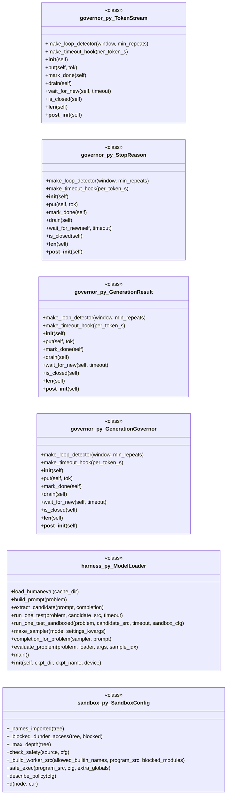

#### `synthetic_dataset.py`

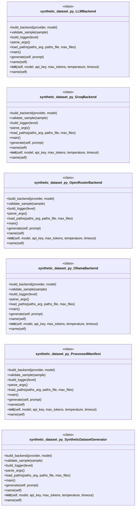

#### `tests/test_fallback.py`

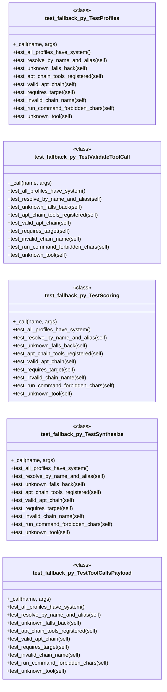

#### `tests/test_jlens.py`

```mermaid
classDiagram
  direction LR
  class test_jlens_py_TestValidPositionMask {
    <<class>>
    +test_basic_mask(self)
    +test_too_short_raises(self)
    +test_negative_skip_raises(self)
    +test_all_positions_valid(self)
    +test_exact_minimum_length(self)
    +model(self)
    +test_returns_jacobians_for_source_layers(self, model)
    +test_late_layer_jacobian_close_to_identity(self, model)
    +test_earlier_layers_further_from_identity(self, model)
    +test_exact_jacobian_for_last_block(self, model)
  }
  class test_jlens_py_TestJacobianForPrompt {
    <<class>>
    +test_basic_mask(self)
    +test_too_short_raises(self)
    +test_negative_skip_raises(self)
    +test_all_positions_valid(self)
    +test_exact_minimum_length(self)
    +model(self)
    +test_returns_jacobians_for_source_layers(self, model)
    +test_late_layer_jacobian_close_to_identity(self, model)
    +test_earlier_layers_further_from_identity(self, model)
    +test_exact_jacobian_for_last_block(self, model)
  }
  class test_jlens_py_TestFit {
    <<class>>
    +test_basic_mask(self)
    +test_too_short_raises(self)
    +test_negative_skip_raises(self)
    +test_all_positions_valid(self)
    +test_exact_minimum_length(self)
    +model(self)
    +test_returns_jacobians_for_source_layers(self, model)
    +test_late_layer_jacobian_close_to_identity(self, model)
    +test_earlier_layers_further_from_identity(self, model)
    +test_exact_jacobian_for_last_block(self, model)
  }
  class test_jlens_py_TestJacobianLens {
    <<class>>
    +test_basic_mask(self)
    +test_too_short_raises(self)
    +test_negative_skip_raises(self)
    +test_all_positions_valid(self)
    +test_exact_minimum_length(self)
    +model(self)
    +test_returns_jacobians_for_source_layers(self, model)
    +test_late_layer_jacobian_close_to_identity(self, model)
    +test_earlier_layers_further_from_identity(self, model)
    +test_exact_jacobian_for_last_block(self, model)
  }
  class test_jlens_py_TestFitCheckpoint {
    <<class>>
    +test_basic_mask(self)
    +test_too_short_raises(self)
    +test_negative_skip_raises(self)
    +test_all_positions_valid(self)
    +test_exact_minimum_length(self)
    +model(self)
    +test_returns_jacobians_for_source_layers(self, model)
    +test_late_layer_jacobian_close_to_identity(self, model)
    +test_earlier_layers_further_from_identity(self, model)
    +test_exact_jacobian_for_last_block(self, model)
  }
  class test_jlens_py_TestConfig {
    <<class>>
    +test_basic_mask(self)
    +test_too_short_raises(self)
    +test_negative_skip_raises(self)
    +test_all_positions_valid(self)
    +test_exact_minimum_length(self)
    +model(self)
    +test_returns_jacobians_for_source_layers(self, model)
    +test_late_layer_jacobian_close_to_identity(self, model)
    +test_earlier_layers_further_from_identity(self, model)
    +test_exact_jacobian_for_last_block(self, model)
  }
  class test_jlens_py_TestTopoGPT3JLensAppConfig {
    <<class>>
    +test_basic_mask(self)
    +test_too_short_raises(self)
    +test_negative_skip_raises(self)
    +test_all_positions_valid(self)
    +test_exact_minimum_length(self)
    +model(self)
    +test_returns_jacobians_for_source_layers(self, model)
    +test_late_layer_jacobian_close_to_identity(self, model)
    +test_earlier_layers_further_from_identity(self, model)
    +test_exact_jacobian_for_last_block(self, model)
  }
```

#### `tests/test_lens_model.py`

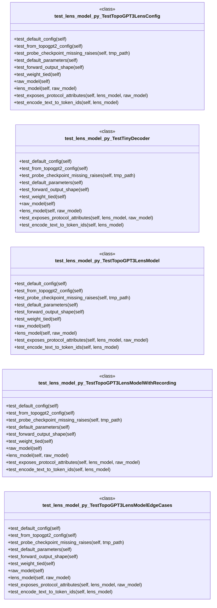

#### `tests/test_structured_output.py`

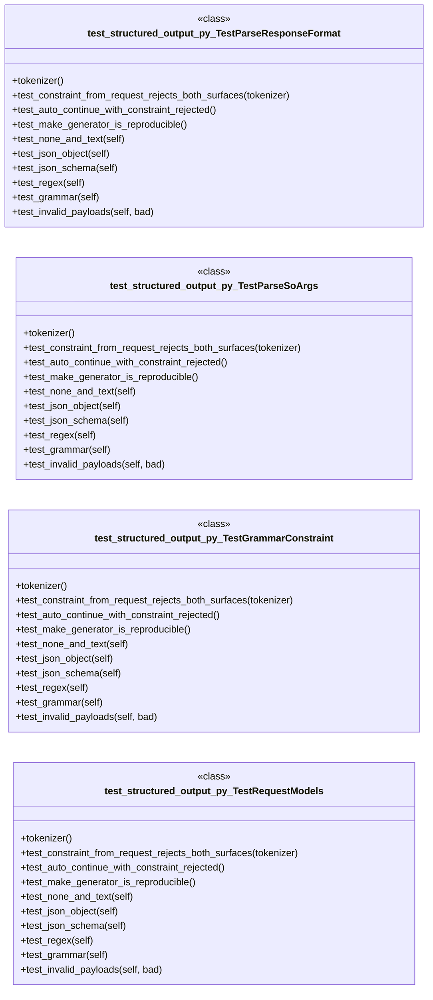

#### `topogpt3.c`

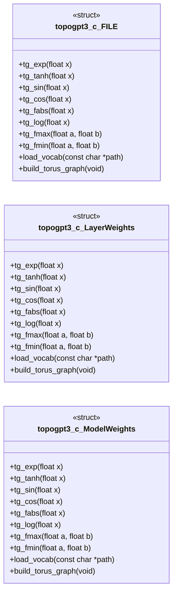

#### `topogpt3/api_server.py`

```mermaid
classDiagram
  direction LR
  class api_server_py_ApiKey {
    <<class>>
    +_setup_logging(verbose)
    +_parse_keys(raw)
    +_sha256(raw)
    +_sanitize_stop(stop)
    +_fit_context(ids, max_ctx, tail)
    +_make_generator(seed, device)
    +_resolve_device(device)
    +load_model(checkpoint, device)
    +lifespan(app)
    +_security_middleware(request, call_next)
  }
  class api_server_py_AuthState {
    <<class>>
    +_setup_logging(verbose)
    +_parse_keys(raw)
    +_sha256(raw)
    +_sanitize_stop(stop)
    +_fit_context(ids, max_ctx, tail)
    +_make_generator(seed, device)
    +_resolve_device(device)
    +load_model(checkpoint, device)
    +lifespan(app)
    +_security_middleware(request, call_next)
  }
  class api_server_py_TokenBucket {
    <<class>>
    +_setup_logging(verbose)
    +_parse_keys(raw)
    +_sha256(raw)
    +_sanitize_stop(stop)
    +_fit_context(ids, max_ctx, tail)
    +_make_generator(seed, device)
    +_resolve_device(device)
    +load_model(checkpoint, device)
    +lifespan(app)
    +_security_middleware(request, call_next)
  }
  class api_server_py_RateLimiter {
    <<class>>
    +_setup_logging(verbose)
    +_parse_keys(raw)
    +_sha256(raw)
    +_sanitize_stop(stop)
    +_fit_context(ids, max_ctx, tail)
    +_make_generator(seed, device)
    +_resolve_device(device)
    +load_model(checkpoint, device)
    +lifespan(app)
    +_security_middleware(request, call_next)
  }
  class api_server_py_IpBanner {
    <<class>>
    +_setup_logging(verbose)
    +_parse_keys(raw)
    +_sha256(raw)
    +_sanitize_stop(stop)
    +_fit_context(ids, max_ctx, tail)
    +_make_generator(seed, device)
    +_resolve_device(device)
    +load_model(checkpoint, device)
    +lifespan(app)
    +_security_middleware(request, call_next)
  }
  class api_server_py_CompletionRequest {
    <<class>>
    +_setup_logging(verbose)
    +_parse_keys(raw)
    +_sha256(raw)
    +_sanitize_stop(stop)
    +_fit_context(ids, max_ctx, tail)
    +_make_generator(seed, device)
    +_resolve_device(device)
    +load_model(checkpoint, device)
    +lifespan(app)
    +_security_middleware(request, call_next)
  }
  class api_server_py_Message {
    <<class>>
    +_setup_logging(verbose)
    +_parse_keys(raw)
    +_sha256(raw)
    +_sanitize_stop(stop)
    +_fit_context(ids, max_ctx, tail)
    +_make_generator(seed, device)
    +_resolve_device(device)
    +load_model(checkpoint, device)
    +lifespan(app)
    +_security_middleware(request, call_next)
  }
  class api_server_py_ChatCompletionRequest {
    <<class>>
    +_setup_logging(verbose)
    +_parse_keys(raw)
    +_sha256(raw)
    +_sanitize_stop(stop)
    +_fit_context(ids, max_ctx, tail)
    +_make_generator(seed, device)
    +_resolve_device(device)
    +load_model(checkpoint, device)
    +lifespan(app)
    +_security_middleware(request, call_next)
  }
  class api_server_py_ServerModel {
    <<class>>
    +_setup_logging(verbose)
    +_parse_keys(raw)
    +_sha256(raw)
    +_sanitize_stop(stop)
    +_fit_context(ids, max_ctx, tail)
    +_make_generator(seed, device)
    +_resolve_device(device)
    +load_model(checkpoint, device)
    +lifespan(app)
    +_security_middleware(request, call_next)
  }
```

#### `topogpt3/fallback.py`

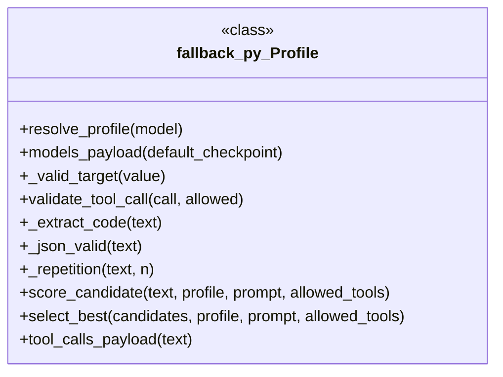

#### `topogpt3/inference.py`

```mermaid
classDiagram
  direction LR
  class inference_py_ScalePreset {
    <<class>>
    +main(argv)
    +scale_presets()
    +preset(self)
    +validate(self)
    +build(settings)
    +resolve_under(root)
    +require_existing_file(path, expected_suffix)
    +__init__(self, settings, logger)
    +load(self)
    +__init__(self, settings)
  }
  class inference_py_InferenceSettings {
    <<class>>
    +main(argv)
    +scale_presets()
    +preset(self)
    +validate(self)
    +build(settings)
    +resolve_under(root)
    +require_existing_file(path, expected_suffix)
    +__init__(self, settings, logger)
    +load(self)
    +__init__(self, settings)
  }
  class inference_py_InferenceLoggerFactory {
    <<class>>
    +main(argv)
    +scale_presets()
    +preset(self)
    +validate(self)
    +build(settings)
    +resolve_under(root)
    +require_existing_file(path, expected_suffix)
    +__init__(self, settings, logger)
    +load(self)
    +__init__(self, settings)
  }
  class inference_py_SecurePathResolver {
    <<class>>
    +main(argv)
    +scale_presets()
    +preset(self)
    +validate(self)
    +build(settings)
    +resolve_under(root)
    +require_existing_file(path, expected_suffix)
    +__init__(self, settings, logger)
    +load(self)
    +__init__(self, settings)
  }
  class inference_py_SourceModuleLoader {
    <<class>>
    +main(argv)
    +scale_presets()
    +preset(self)
    +validate(self)
    +build(settings)
    +resolve_under(root)
    +require_existing_file(path, expected_suffix)
    +__init__(self, settings, logger)
    +load(self)
    +__init__(self, settings)
  }
  class inference_py_CheckpointPaths {
    <<class>>
    +main(argv)
    +scale_presets()
    +preset(self)
    +validate(self)
    +build(settings)
    +resolve_under(root)
    +require_existing_file(path, expected_suffix)
    +__init__(self, settings, logger)
    +load(self)
    +__init__(self, settings)
  }
  class inference_py_WeightShapeProbe {
    <<class>>
    +main(argv)
    +scale_presets()
    +preset(self)
    +validate(self)
    +build(settings)
    +resolve_under(root)
    +require_existing_file(path, expected_suffix)
    +__init__(self, settings, logger)
    +load(self)
    +__init__(self, settings)
  }
  class inference_py_TopoGPT2ConfigAligner {
    <<class>>
    +main(argv)
    +scale_presets()
    +preset(self)
    +validate(self)
    +build(settings)
    +resolve_under(root)
    +require_existing_file(path, expected_suffix)
    +__init__(self, settings, logger)
    +load(self)
    +__init__(self, settings)
  }
  class inference_py_TokenizerFactory {
    <<class>>
    +main(argv)
    +scale_presets()
    +preset(self)
    +validate(self)
    +build(settings)
    +resolve_under(root)
    +require_existing_file(path, expected_suffix)
    +__init__(self, settings, logger)
    +load(self)
    +__init__(self, settings)
  }
  class inference_py_GaussPatchApplier {
    <<class>>
    +main(argv)
    +scale_presets()
    +preset(self)
    +validate(self)
    +build(settings)
    +resolve_under(root)
    +require_existing_file(path, expected_suffix)
    +__init__(self, settings, logger)
    +load(self)
    +__init__(self, settings)
  }
  class inference_py_ModelAssembler {
    <<class>>
    +main(argv)
    +scale_presets()
    +preset(self)
    +validate(self)
    +build(settings)
    +resolve_under(root)
    +require_existing_file(path, expected_suffix)
    +__init__(self, settings, logger)
    +load(self)
    +__init__(self, settings)
  }
  class inference_py_SeedSynchronizer {
    <<class>>
    +main(argv)
    +scale_presets()
    +preset(self)
    +validate(self)
    +build(settings)
    +resolve_under(root)
    +require_existing_file(path, expected_suffix)
    +__init__(self, settings, logger)
    +load(self)
    +__init__(self, settings)
  }
  class inference_py_SamplingPolicy {
    <<class>>
    +main(argv)
    +scale_presets()
    +preset(self)
    +validate(self)
    +build(settings)
    +resolve_under(root)
    +require_existing_file(path, expected_suffix)
    +__init__(self, settings, logger)
    +load(self)
    +__init__(self, settings)
  }
  class inference_py_GenerationReport {
    <<class>>
    +main(argv)
    +scale_presets()
    +preset(self)
    +validate(self)
    +build(settings)
    +resolve_under(root)
    +require_existing_file(path, expected_suffix)
    +__init__(self, settings, logger)
    +load(self)
    +__init__(self, settings)
  }
  class inference_py_GenerationEngine {
    <<class>>
    +main(argv)
    +scale_presets()
    +preset(self)
    +validate(self)
    +build(settings)
    +resolve_under(root)
    +require_existing_file(path, expected_suffix)
    +__init__(self, settings, logger)
    +load(self)
    +__init__(self, settings)
  }
  class inference_py_ResultRenderer {
    <<class>>
    +main(argv)
    +scale_presets()
    +preset(self)
    +validate(self)
    +build(settings)
    +resolve_under(root)
    +require_existing_file(path, expected_suffix)
    +__init__(self, settings, logger)
    +load(self)
    +__init__(self, settings)
  }
  class inference_py_InferencePipeline {
    <<class>>
    +main(argv)
    +scale_presets()
    +preset(self)
    +validate(self)
    +build(settings)
    +resolve_under(root)
    +require_existing_file(path, expected_suffix)
    +__init__(self, settings, logger)
    +load(self)
    +__init__(self, settings)
  }
  class inference_py_CliArgumentParser {
    <<class>>
    +main(argv)
    +scale_presets()
    +preset(self)
    +validate(self)
    +build(settings)
    +resolve_under(root)
    +require_existing_file(path, expected_suffix)
    +__init__(self, settings, logger)
    +load(self)
    +__init__(self, settings)
  }
```

---

## Code Property Graph

Machine-readable Code Property Graph (CPG) in JSON-LD format. This block allows AI agents to parse the full structural graph without additional file reads. Compatible with GraphRAG pipelines.

```json
{"@context": "https://schema.org", "analysis": {"communities": [{"cohesion": 0.453, "id": 0, "label": "topogpt3: model", "size": 15}, {"cohesion": 0.441, "id": 1, "label": "eval", "size": 13}, {"cohesion": 0.512, "id": 2, "label": "topogpt3: tasks", "size": 10}, {"cohesion": 0.345, "id": 3, "label": "topogpt3: inference_hrm", "size": 9}, {"cohesion": 0.455, "id": 4, "label": "topogpt3: jlens", "size": 4}, {"cohesion": 1.0, "id": 5, "label": "root", "size": 3}], "god_nodes": [{"node_id": "topogpt3/model.py", "score": 62.8}, {"node_id": "topogpt3/__init__.py", "score": 42.0}, {"node_id": "topogpt3/checkpoint_meta.py", "score": 28.5}, {"node_id": "topogpt3/__main__.py", "score": 28.1}, {"node_id": "topogpt3/chat.py", "score": 22.8}, {"node_id": "topogpt3/api_server.py", "score": 22.3}, {"node_id": "topogpt3/rewards.py", "score": 19.2}, {"node_id": "topogpt3/fallback.py", "score": 17.5}, {"node_id": "tests/test_heritage.py", "score": 16.9}, {"node_id": "topogpt3.c", "score": 16.8}], "surprising_connections": [{"hops": 5, "source": "eval/governor.py", "target": "tests/test_checkpoint_meta.py"}, {"hops": 5, "source": "eval/governor.py", "target": "topogpt3/structured_output.py"}, {"hops": 5, "source": "eval/governor.py", "target": "topogpt3/tokenizer_tools.py"}, {"hops": 5, "source": "eval/sandbox_smoke.py", "target": "synthetic_dataset.py"}, {"hops": 5, "source": "eval/sandbox_smoke.py", "target": "tests/test_jlens.py"}]}, "edges": [{"confidence": "EXTRACTED", "relation": "imports", "source": "app.py", "target": "__future__"}, {"confidence": "EXTRACTED", "relation": "imports", "source": "app.py", "target": "argparse"}, {"confidence": "EXTRACTED", "relation": "imports", "source": "app.py", "target": "sys"}, {"confidence": "EXTRACTED", "relation": "imports", "source": "app.py", "target": "typing"}, {"confidence": "EXTRACTED", "relation": "imports", "source": "app.py", "target": "torch"}, {"confidence": "EXTRACTED", "relation": "imports", "source": "app.py", "target": "topogpt3"}, {"confidence": "EXTRACTED", "relation": "imports", "source": "convert_weights.py", "target": "struct"}, {"confidence": "EXTRACTED", "relation": "imports", "source": "convert_weights.py", "target": "sys"}, {"confidence": "EXTRACTED", "relation": "imports", "source": "convert_weights.py", "target": "argparse"}, {"confidence": "EXTRACTED", "relation": "imports", "source": "convert_weights.py", "target": "pathlib"}, {"confidence": "EXTRACTED", "relation": "imports", "source": "convert_weights.py", "target": "safetensors"}, {"confidence": "EXTRACTED", "relation": "imports", "source": "convert_weights_minios.py", "target": "argparse"}, {"confidence": "EXTRACTED", "relation": "imports", "source": "convert_weights_minios.py", "target": "struct"}, {"confidence": "EXTRACTED", "relation": "imports", "source": "convert_weights_minios.py", "target": "numpy"}, {"confidence": "EXTRACTED", "relation": "imports", "source": "convert_weights_minios.py", "target": "sys"}, {"confidence": "EXTRACTED", "relation": "imports", "source": "convert_weights_minios.py", "target": "safetensors"}, {"confidence": "EXTRACTED", "relation": "imports", "source": "convert_weights_minios.py", "target": "os"}, {"confidence": "EXTRACTED", "relation": "imports", "source": "encode_tokens.py", "target": "sys"}, {"confidence": "EXTRACTED", "relation": "imports", "source": "encode_tokens.py", "target": "struct"}, {"confidence": "EXTRACTED", "relation": "imports", "source": "encode_tokens.py", "target": "argparse"}, {"confidence": "EXTRACTED", "relation": "imports", "source": "encode_tokens.py", "target": "tiktoken"}, {"confidence": "EXTRACTED", "relation": "imports", "source": "eval/analyze.py", "target": "__future__"}, {"confidence": "EXTRACTED", "relation": "imports", "source": "eval/analyze.py", "target": "argparse"}, {"confidence": "EXTRACTED", "relation": "imports", "source": "eval/analyze.py", "target": "json"}, {"confidence": "EXTRACTED", "relation": "imports", "source": "eval/analyze.py", "target": "math"}, {"confidence": "EXTRACTED", "relation": "imports", "source": "eval/analyze.py", "target": "re"}, {"confidence": "EXTRACTED", "relation": "imports", "source": "eval/analyze.py", "target": "collections"}, {"confidence": "EXTRACTED", "relation": "imports", "source": "eval/analyze.py", "target": "pathlib"}, {"confidence": "EXTRACTED", "relation": "imports", "source": "eval/analyze.py", "target": "typing"}, {"confidence": "EXTRACTED", "relation": "imports", "source": "eval/analyze_results.py", "target": "__future__"}, {"confidence": "EXTRACTED", "relation": "imports", "source": "eval/analyze_results.py", "target": "argparse"}, {"confidence": "EXTRACTED", "relation": "imports", "source": "eval/analyze_results.py", "target": "json"}, {"confidence": "EXTRACTED", "relation": "imports", "source": "eval/analyze_results.py", "target": "collections"}, {"confidence": "EXTRACTED", "relation": "imports", "source": "eval/analyze_results.py", "target": "pathlib"}, {"confidence": "EXTRACTED", "relation": "imports", "source": "eval/diag_static.py", "target": "__future__"}, {"confidence": "EXTRACTED", "relation": "imports", "source": "eval/diag_static.py", "target": "argparse"}, {"confidence": "EXTRACTED", "relation": "imports", "source": "eval/diag_static.py", "target": "json"}, {"confidence": "EXTRACTED", "relation": "imports", "source": "eval/diag_static.py", "target": "math"}, {"confidence": "EXTRACTED", "relation": "imports", "source": "eval/diag_static.py", "target": "sys"}, {"confidence": "EXTRACTED", "relation": "imports", "source": "eval/diag_static.py", "target": "time"}, {"confidence": "EXTRACTED", "relation": "imports", "source": "eval/diag_static.py", "target": "pathlib"}, {"confidence": "EXTRACTED", "relation": "imports", "source": "eval/diag_static.py", "target": "typing"}, {"confidence": "EXTRACTED", "relation": "imports", "source": "eval/diag_static.py", "target": "torch"}, {"confidence": "EXTRACTED", "relation": "imports", "source": "eval/diag_static.py", "target": "topogpt3"}, {"confidence": "EXTRACTED", "relation": "imports", "source": "eval/diag_static.py", "target": "topogpt3.model"}, {"confidence": "EXTRACTED", "relation": "imports", "source": "eval/diag_static.py", "target": "safetensors.torch"}, {"confidence": "EXTRACTED", "relation": "imports", "source": "eval/diag_static.py", "target": "topogpt3.train"}, {"confidence": "EXTRACTED", "relation": "imports", "source": "eval/governor.py", "target": "__future__"}, {"confidence": "EXTRACTED", "relation": "imports", "source": "eval/governor.py", "target": "threading"}, {"confidence": "EXTRACTED", "relation": "imports", "source": "eval/governor.py", "target": "time"}, {"confidence": "EXTRACTED", "relation": "imports", "source": "eval/governor.py", "target": "dataclasses"}, {"confidence": "EXTRACTED", "relation": "imports", "source": "eval/governor.py", "target": "enum"}, {"confidence": "EXTRACTED", "relation": "imports", "source": "eval/governor.py", "target": "typing"}, {"confidence": "EXTRACTED", "relation": "imports", "source": "eval/governor.py", "target": "torch"}, {"confidence": "EXTRACTED", "relation": "imports", "source": "eval/governor.py", "target": "torch.nn.functional"}, {"confidence": "EXTRACTED", "relation": "imports", "source": "eval/governor_smoke.py", "target": "sys"}, {"confidence": "EXTRACTED", "relation": "imports", "source": "eval/governor_smoke.py", "target": "threading"}, {"confidence": "EXTRACTED", "relation": "imports", "source": "eval/governor_smoke.py", "target": "time"}, {"confidence": "EXTRACTED", "relation": "imports", "source": "eval/governor_smoke.py", "target": "pathlib"}, {"confidence": "EXTRACTED", "relation": "imports", "source": "eval/governor_smoke.py", "target": "torch"}, {"confidence": "EXTRACTED", "relation": "imports", "source": "eval/governor_smoke.py", "target": "eval.governor"}, {"confidence": "EXTRACTED", "relation": "imports", "source": "eval/governor_smoke.py", "target": "topogpt3"}, {"confidence": "EXTRACTED", "relation": "imports", "source": "eval/governor_smoke.py", "target": "safetensors"}, {"confidence": "EXTRACTED", "relation": "imports", "source": "eval/governor_smoke.py", "target": "safetensors.torch"}, {"confidence": "EXTRACTED", "relation": "imports", "source": "eval/harness.py", "target": "__future__"}, {"confidence": "EXTRACTED", "relation": "imports", "source": "eval/harness.py", "target": "argparse"}, {"confidence": "EXTRACTED", "relation": "imports", "source": "eval/harness.py", "target": "contextlib"}, {"confidence": "EXTRACTED", "relation": "imports", "source": "eval/harness.py", "target": "io"}, {"confidence": "EXTRACTED", "relation": "imports", "source": "eval/harness.py", "target": "json"}, {"confidence": "EXTRACTED", "relation": "imports", "source": "eval/harness.py", "target": "os"}, {"confidence": "EXTRACTED", "relation": "imports", "source": "eval/harness.py", "target": "re"}, {"confidence": "EXTRACTED", "relation": "imports", "source": "eval/harness.py", "target": "time"}, {"confidence": "EXTRACTED", "relation": "imports", "source": "eval/harness.py", "target": "traceback"}, {"confidence": "EXTRACTED", "relation": "imports", "source": "eval/harness.py", "target": "pathlib"}, {"confidence": "EXTRACTED", "relation": "imports", "source": "eval/harness.py", "target": "torch"}, {"confidence": "EXTRACTED", "relation": "imports", "source": "eval/harness.py", "target": "safetensors.torch"}, {"confidence": "EXTRACTED", "relation": "imports", "source": "eval/harness.py", "target": "torch"}, {"confidence": "EXTRACTED", "relation": "imports", "source": "eval/harness.py", "target": "eval.samplers"}, {"confidence": "EXTRACTED", "relation": "imports", "source": "eval/harness.py", "target": "topogpt3"}, {"confidence": "EXTRACTED", "relation": "imports", "source": "eval/harness.py", "target": "datasets"}, {"confidence": "EXTRACTED", "relation": "imports", "source": "eval/harness.py", "target": "eval.sandbox"}, {"confidence": "EXTRACTED", "relation": "imports", "source": "eval/harness.py", "target": "eval.samplers"}, {"confidence": "EXTRACTED", "relation": "imports", "source": "eval/harness.py", "target": "topogpt3.checkpoint_meta"}, {"confidence": "EXTRACTED", "relation": "imports", "source": "eval/integration_smoke.py", "target": "sys"}, {"confidence": "EXTRACTED", "relation": "imports", "source": "eval/integration_smoke.py", "target": "pathlib"}, {"confidence": "EXTRACTED", "relation": "imports", "source": "eval/integration_smoke.py", "target": "eval.harness"}, {"confidence": "EXTRACTED", "relation": "imports", "source": "eval/noise_analysis.py", "target": "__future__"}, {"confidence": "EXTRACTED", "relation": "imports", "source": "eval/noise_analysis.py", "target": "argparse"}, {"confidence": "EXTRACTED", "relation": "imports", "source": "eval/noise_analysis.py", "target": "ast"}, {"confidence": "EXTRACTED", "relation": "imports", "source": "eval/noise_analysis.py", "target": "json"}, {"confidence": "EXTRACTED", "relation": "imports", "source": "eval/noise_analysis.py", "target": "re"}, {"confidence": "EXTRACTED", "relation": "imports", "source": "eval/noise_analysis.py", "target": "sys"}, {"confidence": "EXTRACTED", "relation": "imports", "source": "eval/noise_analysis.py", "target": "collections"}, {"confidence": "EXTRACTED", "relation": "imports", "source": "eval/noise_analysis.py", "target": "pathlib"}, {"confidence": "EXTRACTED", "relation": "imports", "source": "eval/noise_analysis.py", "target": "typing"}, {"confidence": "EXTRACTED", "relation": "imports", "source": "eval/noise_sweep.py", "target": "__future__"}, {"confidence": "EXTRACTED", "relation": "imports", "source": "eval/noise_sweep.py", "target": "argparse"}, {"confidence": "EXTRACTED", "relation": "imports", "source": "eval/noise_sweep.py", "target": "json"}, {"confidence": "EXTRACTED", "relation": "imports", "source": "eval/noise_sweep.py", "target": "math"}, {"confidence": "EXTRACTED", "relation": "imports", "source": "eval/noise_sweep.py", "target": "sys"}, {"confidence": "EXTRACTED", "relation": "imports", "source": "eval/noise_sweep.py", "target": "time"}, {"confidence": "EXTRACTED", "relation": "imports", "source": "eval/noise_sweep.py", "target": "pathlib"}, {"confidence": "EXTRACTED", "relation": "imports", "source": "eval/noise_sweep.py", "target": "typing"}, {"confidence": "EXTRACTED", "relation": "imports", "source": "eval/noise_sweep.py", "target": "torch"}, {"confidence": "EXTRACTED", "relation": "imports", "source": "eval/noise_sweep.py", "target": "topogpt3"}, {"confidence": "EXTRACTED", "relation": "imports", "source": "eval/noise_sweep.py", "target": "topogpt3.model"}, {"confidence": "EXTRACTED", "relation": "imports", "source": "eval/noise_sweep.py", "target": "safetensors.torch"}, {"confidence": "EXTRACTED", "relation": "imports", "source": "eval/noise_sweep.py", "target": "safetensors"}, {"confidence": "EXTRACTED", "relation": "imports", "source": "eval/noise_sweep.py", "target": "eval.harness"}, {"confidence": "EXTRACTED", "relation": "imports", "source": "eval/repair.py", "target": "__future__"}, {"confidence": "EXTRACTED", "relation": "imports", "source": "eval/repair.py", "target": "argparse"}, {"confidence": "EXTRACTED", "relation": "imports", "source": "eval/repair.py", "target": "contextlib"}, {"confidence": "EXTRACTED", "relation": "imports", "source": "eval/repair.py", "target": "io"}, {"confidence": "EXTRACTED", "relation": "imports", "source": "eval/repair.py", "target": "json"}, {"confidence": "EXTRACTED", "relation": "imports", "source": "eval/repair.py", "target": "re"}, {"confidence": "EXTRACTED", "relation": "imports", "source": "eval/repair.py", "target": "time"}, {"confidence": "EXTRACTED", "relation": "imports", "source": "eval/repair.py", "target": "traceback"}, {"confidence": "EXTRACTED", "relation": "imports", "source": "eval/repair.py", "target": "collections"}, {"confidence": "EXTRACTED", "relation": "imports", "source": "eval/repair.py", "target": "pathlib"}, {"confidence": "EXTRACTED", "relation": "imports", "source": "eval/repair.py", "target": "typing"}, {"confidence": "EXTRACTED", "relation": "imports", "source": "eval/repair.py", "target": "torch"}, {"confidence": "EXTRACTED", "relation": "imports", "source": "eval/repair.py", "target": "safetensors"}, {"confidence": "EXTRACTED", "relation": "imports", "source": "eval/repair.py", "target": "safetensors.torch"}, {"confidence": "EXTRACTED", "relation": "imports", "source": "eval/repair.py", "target": "topogpt3"}, {"confidence": "EXTRACTED", "relation": "imports", "source": "eval/repair.py", "target": "datasets"}, {"confidence": "EXTRACTED", "relation": "imports", "source": "eval/report.py", "target": "__future__"}, {"confidence": "EXTRACTED", "relation": "imports", "source": "eval/report.py", "target": "argparse"}, {"confidence": "EXTRACTED", "relation": "imports", "source": "eval/report.py", "target": "json"}, {"confidence": "EXTRACTED", "relation": "imports", "source": "eval/report.py", "target": "math"}, {"confidence": "EXTRACTED", "relation": "imports", "source": "eval/report.py", "target": "re"}, {"confidence": "EXTRACTED", "relation": "imports", "source": "eval/report.py", "target": "shutil"}, {"confidence": "EXTRACTED", "relation": "imports", "source": "eval/report.py", "target": "statistics"}, {"confidence": "EXTRACTED", "relation": "imports", "source": "eval/report.py", "target": "collections"}, {"confidence": "EXTRACTED", "relation": "imports", "source": "eval/report.py", "target": "pathlib"}, {"confidence": "EXTRACTED", "relation": "imports", "source": "eval/samplers.py", "target": "__future__"}, {"confidence": "EXTRACTED", "relation": "imports", "source": "eval/samplers.py", "target": "os"}, {"confidence": "EXTRACTED", "relation": "imports", "source": "eval/samplers.py", "target": "typing"}, {"confidence": "EXTRACTED", "relation": "imports", "source": "eval/samplers.py", "target": "topogpt3"}, {"confidence": "EXTRACTED", "relation": "imports", "source": "eval/sandbox.py", "target": "__future__"}, {"confidence": "EXTRACTED", "relation": "imports", "source": "eval/sandbox.py", "target": "ast"}, {"confidence": "EXTRACTED", "relation": "imports", "source": "eval/sandbox.py", "target": "os"}, {"confidence": "EXTRACTED", "relation": "imports", "source": "eval/sandbox.py", "target": "subprocess"}, {"confidence": "EXTRACTED", "relation": "imports", "source": "eval/sandbox.py", "target": "sys"}, {"confidence": "EXTRACTED", "relation": "imports", "source": "eval/sandbox.py", "target": "tempfile"}, {"confidence": "EXTRACTED", "relation": "imports", "source": "eval/sandbox.py", "target": "textwrap"}, {"confidence": "EXTRACTED", "relation": "imports", "source": "eval/sandbox.py", "target": "dataclasses"}, {"confidence": "EXTRACTED", "relation": "imports", "source": "eval/sandbox.py", "target": "pathlib"}, {"confidence": "EXTRACTED", "relation": "imports", "source": "eval/sandbox.py", "target": "typing"}, {"confidence": "EXTRACTED", "relation": "imports", "source": "eval/sandbox.py", "target": "json"}, {"confidence": "EXTRACTED", "relation": "imports", "source": "eval/sandbox_smoke.py", "target": "sys"}, {"confidence": "EXTRACTED", "relation": "imports", "source": "eval/sandbox_smoke.py", "target": "pathlib"}, {"confidence": "EXTRACTED", "relation": "imports", "source": "eval/sandbox_smoke.py", "target": "eval.sandbox"}, {"confidence": "EXTRACTED", "relation": "imports", "source": "eval/smoke.py", "target": "time"}, {"confidence": "EXTRACTED", "relation": "imports", "source": "eval/smoke.py", "target": "torch"}, {"confidence": "EXTRACTED", "relation": "imports", "source": "eval/smoke.py", "target": "topogpt3"}, {"confidence": "EXTRACTED", "relation": "imports", "source": "eval/tasks.py", "target": "__future__"}, {"confidence": "EXTRACTED", "relation": "imports", "source": "eval/tasks.py", "target": "argparse"}, {"confidence": "EXTRACTED", "relation": "imports", "source": "eval/tasks.py", "target": "ast"}, {"confidence": "EXTRACTED", "relation": "imports", "source": "eval/tasks.py", "target": "json"}, {"confidence": "EXTRACTED", "relation": "imports", "source": "eval/tasks.py", "target": "re"}, {"confidence": "EXTRACTED", "relation": "imports", "source": "eval/tasks.py", "target": "sys"}, {"confidence": "EXTRACTED", "relation": "imports", "source": "eval/tasks.py", "target": "time"}, {"confidence": "EXTRACTED", "relation": "imports", "source": "eval/tasks.py", "target": "collections.abc"}, {"confidence": "EXTRACTED", "relation": "imports", "source": "eval/tasks.py", "target": "pathlib"}, {"confidence": "EXTRACTED", "relation": "imports", "source": "eval/tasks.py", "target": "typing"}, {"confidence": "EXTRACTED", "relation": "imports", "source": "eval/tasks.py", "target": "topogpt3.chat"}, {"confidence": "EXTRACTED", "relation": "imports", "source": "eval/tasks.py", "target": "topogpt3.fallback"}, {"confidence": "EXTRACTED", "relation": "imports", "source": "eval/tasks.py", "target": "torch"}, {"confidence": "EXTRACTED", "relation": "imports", "source": "eval/tasks.py", "target": "topogpt3.checkpoint_meta"}, {"confidence": "EXTRACTED", "relation": "imports", "source": "eval/tasks.py", "target": "topogpt3.model"}, {"confidence": "EXTRACTED", "relation": "imports", "source": "eval/tasks.py", "target": "safetensors.torch"}, {"confidence": "EXTRACTED", "relation": "imports", "source": "eval/tasks.py", "target": "topogpt3.fallback"}, {"confidence": "EXTRACTED", "relation": "imports", "source": "eval/tasks.py", "target": "topogpt3.chat"}, {"confidence": "EXTRACTED", "relation": "imports", "source": "eval/temp_sweep.py", "target": "__future__"}, {"confidence": "EXTRACTED", "relation": "imports", "source": "eval/temp_sweep.py", "target": "argparse"}, {"confidence": "EXTRACTED", "relation": "imports", "source": "eval/temp_sweep.py", "target": "json"}, {"confidence": "EXTRACTED", "relation": "imports", "source": "eval/temp_sweep.py", "target": "math"}, {"confidence": "EXTRACTED", "relation": "imports", "source": "eval/temp_sweep.py", "target": "sys"}, {"confidence": "EXTRACTED", "relation": "imports", "source": "eval/temp_sweep.py", "target": "time"}, {"confidence": "EXTRACTED", "relation": "imports", "source": "eval/temp_sweep.py", "target": "pathlib"}, {"confidence": "EXTRACTED", "relation": "imports", "source": "eval/temp_sweep.py", "target": "typing"}, {"confidence": "EXTRACTED", "relation": "imports", "source": "eval/temp_sweep.py", "target": "torch"}, {"confidence": "EXTRACTED", "relation": "imports", "source": "eval/temp_sweep.py", "target": "eval.noise_sweep"}, {"confidence": "EXTRACTED", "relation": "imports", "source": "eval/temp_sweep.py", "target": "eval.harness"}, {"confidence": "EXTRACTED", "relation": "imports", "source": "gradio_app.py", "target": "__future__"}, {"confidence": "EXTRACTED", "relation": "imports", "source": "gradio_app.py", "target": "os"}, {"confidence": "EXTRACTED", "relation": "imports", "source": "gradio_app.py", "target": "sys"}, {"confidence": "EXTRACTED", "relation": "imports", "source": "gradio_app.py", "target": "pathlib"}, {"confidence": "EXTRACTED", "relation": "imports", "source": "gradio_app.py", "target": "torch"}, {"confidence": "EXTRACTED", "relation": "imports", "source": "gradio_app.py", "target": "gradio"}, {"confidence": "EXTRACTED", "relation": "imports", "source": "gradio_app.py", "target": "topogpt3"}, {"confidence": "EXTRACTED", "relation": "imports", "source": "gradio_app.py", "target": "huggingface_hub"}, {"confidence": "EXTRACTED", "relation": "imports", "source": "synthetic_dataset.py", "target": "os"}, {"confidence": "EXTRACTED", "relation": "imports", "source": "synthetic_dataset.py", "target": "sys"}, {"confidence": "EXTRACTED", "relation": "imports", "source": "synthetic_dataset.py", "target": "json"}, {"confidence": "EXTRACTED", "relation": "imports", "source": "synthetic_dataset.py", "target": "time"}, {"confidence": "EXTRACTED", "relation": "imports", "source": "synthetic_dataset.py", "target": "hashlib"}, {"confidence": "EXTRACTED", "relation": "imports", "source": "synthetic_dataset.py", "target": "logging"}, {"confidence": "EXTRACTED", "relation": "imports", "source": "synthetic_dataset.py", "target": "argparse"}, {"confidence": "EXTRACTED", "relation": "imports", "source": "synthetic_dataset.py", "target": "tempfile"}, {"confidence": "EXTRACTED", "relation": "imports", "source": "synthetic_dataset.py", "target": "pathlib"}, {"confidence": "EXTRACTED", "relation": "imports", "source": "synthetic_dataset.py", "target": "typing"}, {"confidence": "EXTRACTED", "relation": "imports", "source": "synthetic_dataset.py", "target": "dataclasses"}, {"confidence": "EXTRACTED", "relation": "imports", "source": "synthetic_dataset.py", "target": "datetime"}, {"confidence": "EXTRACTED", "relation": "imports", "source": "synthetic_dataset.py", "target": "threading"}, {"confidence": "EXTRACTED", "relation": "imports", "source": "synthetic_dataset.py", "target": "queue"}, {"confidence": "EXTRACTED", "relation": "imports", "source": "synthetic_dataset.py", "target": "concurrent.futures"}, {"confidence": "EXTRACTED", "relation": "imports", "source": "synthetic_dataset.py", "target": "torch"}, {"confidence": "EXTRACTED", "relation": "imports", "source": "synthetic_dataset.py", "target": "numpy"}, {"confidence": "EXTRACTED", "relation": "imports", "source": "synthetic_dataset.py", "target": "tiktoken"}, {"confidence": "EXTRACTED", "relation": "imports", "source": "synthetic_dataset.py", "target": "requests"}, {"confidence": "EXTRACTED", "relation": "imports", "source": "synthetic_dataset.py", "target": "requests"}, {"confidence": "EXTRACTED", "relation": "imports", "source": "synthetic_dataset.py", "target": "requests"}, {"confidence": "EXTRACTED", "relation": "imports", "source": "synthetic_dataset.py", "target": "requests"}, {"confidence": "EXTRACTED", "relation": "imports", "source": "synthetic_dataset.py", "target": "requests"}, {"confidence": "EXTRACTED", "relation": "imports", "source": "synthetic_dataset.py", "target": "requests"}, {"confidence": "EXTRACTED", "relation": "imports", "source": "tests/test_checkpoint_meta.py", "target": "pytest"}, {"confidence": "EXTRACTED", "relation": "imports", "source": "tests/test_checkpoint_meta.py", "target": "topogpt3.checkpoint_meta"}, {"confidence": "EXTRACTED", "relation": "imports", "source": "tests/test_data_pipeline.py", "target": "json"}, {"confidence": "EXTRACTED", "relation": "imports", "source": "tests/test_data_pipeline.py", "target": "topogpt3.data_pipeline"}, {"confidence": "EXTRACTED", "relation": "imports", "source": "tests/test_eval_tasks.py", "target": "json"}, {"confidence": "EXTRACTED", "relation": "imports", "source": "tests/test_eval_tasks.py", "target": "eval.tasks"}, {"confidence": "EXTRACTED", "relation": "imports", "source": "tests/test_eval_tasks.py", "target": "topogpt3.chat"}, {"confidence": "EXTRACTED", "relation": "imports", "source": "tests/test_eval_tasks.py", "target": "topogpt3.fallback"}, {"confidence": "EXTRACTED", "relation": "imports", "source": "tests/test_fallback.py", "target": "json"}, {"confidence": "EXTRACTED", "relation": "imports", "source": "tests/test_fallback.py", "target": "topogpt3.chat"}, {"confidence": "EXTRACTED", "relation": "imports", "source": "tests/test_fallback.py", "target": "topogpt3.fallback"}, {"confidence": "EXTRACTED", "relation": "imports", "source": "tests/test_heritage.py", "target": "torch"}, {"confidence": "EXTRACTED", "relation": "imports", "source": "tests/test_heritage.py", "target": "topogpt3.chat"}, {"confidence": "EXTRACTED", "relation": "imports", "source": "tests/test_heritage.py", "target": "topogpt3.lora"}, {"confidence": "EXTRACTED", "relation": "imports", "source": "tests/test_heritage.py", "target": "topogpt3.model"}, {"confidence": "EXTRACTED", "relation": "imports", "source": "tests/test_heritage.py", "target": "topogpt3.rewards"}, {"confidence": "EXTRACTED", "relation": "imports", "source": "tests/test_heritage.py", "target": "topogpt3.rollout"}, {"confidence": "EXTRACTED", "relation": "imports", "source": "tests/test_heritage.py", "target": "topogpt3.yarn"}, {"confidence": "EXTRACTED", "relation": "imports", "source": "tests/test_heritage.py", "target": "topogpt3.tools_agent"}, {"confidence": "EXTRACTED", "relation": "imports", "source": "tests/test_heritage.py", "target": "topogpt3.eval_toolcall"}, {"confidence": "EXTRACTED", "relation": "imports", "source": "tests/test_heritage.py", "target": "os"}, {"confidence": "EXTRACTED", "relation": "imports", "source": "tests/test_heritage.py", "target": "topogpt3.model"}, {"confidence": "EXTRACTED", "relation": "imports", "source": "tests/test_jlens.py", "target": "__future__"}, {"confidence": "EXTRACTED", "relation": "imports", "source": "tests/test_jlens.py", "target": "pytest"}, {"confidence": "EXTRACTED", "relation": "imports", "source": "tests/test_jlens.py", "target": "torch"}, {"confidence": "EXTRACTED", "relation": "imports", "source": "tests/test_jlens.py", "target": "topogpt3.lens_model"}, {"confidence": "EXTRACTED", "relation": "imports", "source": "tests/test_jlens.py", "target": "topogpt3.jlens"}, {"confidence": "EXTRACTED", "relation": "imports", "source": "tests/test_lens_model.py", "target": "__future__"}, {"confidence": "EXTRACTED", "relation": "imports", "source": "tests/test_lens_model.py", "target": "pytest"}, {"confidence": "EXTRACTED", "relation": "imports", "source": "tests/test_lens_model.py", "target": "torch"}, {"confidence": "EXTRACTED", "relation": "imports", "source": "tests/test_lens_model.py", "target": "topogpt3.lens_model"}, {"confidence": "EXTRACTED", "relation": "imports", "source": "tests/test_lens_model.py", "target": "topogpt3.model"}, {"confidence": "EXTRACTED", "relation": "imports", "source": "tests/test_lens_model.py", "target": "topogpt3.model"}, {"confidence": "EXTRACTED", "relation": "imports", "source": "tests/test_lens_model.py", "target": "types"}, {"confidence": "EXTRACTED", "relation": "imports", "source": "tests/test_lens_model.py", "target": "topogpt3.jlens"}, {"confidence": "EXTRACTED", "relation": "imports", "source": "tests/test_lens_model.py", "target": "topogpt3.jlens"}, {"confidence": "EXTRACTED", "relation": "imports", "source": "tests/test_lens_model.py", "target": "topogpt3.jlens"}, {"confidence": "EXTRACTED", "relation": "imports", "source": "tests/test_lens_model.py", "target": "topogpt3.jlens"}, {"confidence": "EXTRACTED", "relation": "imports", "source": "tests/test_structured_output.py", "target": "json"}, {"confidence": "EXTRACTED", "relation": "imports", "source": "tests/test_structured_output.py", "target": "pytest"}, {"confidence": "EXTRACTED", "relation": "imports", "source": "tests/test_structured_output.py", "target": "torch"}, {"confidence": "EXTRACTED", "relation": "imports", "source": "tests/test_structured_output.py", "target": "topogpt3.structured_output"}, {"confidence": "EXTRACTED", "relation": "imports", "source": "tests/test_structured_output.py", "target": "topogpt3.model"}, {"confidence": "EXTRACTED", "relation": "imports", "source": "tests/test_structured_output.py", "target": "fastapi"}, {"confidence": "EXTRACTED", "relation": "imports", "source": "tests/test_structured_output.py", "target": "topogpt3.api_server"}, {"confidence": "EXTRACTED", "relation": "imports", "source": "tests/test_structured_output.py", "target": "topogpt3.api_server"}, {"confidence": "EXTRACTED", "relation": "imports", "source": "tests/test_structured_output.py", "target": "topogpt3.api_server"}, {"confidence": "EXTRACTED", "relation": "imports", "source": "tests/test_structured_output.py", "target": "topogpt3.api_server"}, {"confidence": "EXTRACTED", "relation": "imports", "source": "tests/test_structured_output.py", "target": "pydantic"}, {"confidence": "EXTRACTED", "relation": "imports", "source": "tests/test_structured_output.py", "target": "topogpt3.api_server"}, {"confidence": "EXTRACTED", "relation": "imports", "source": "topogpt3/__init__.py", "target": "__future__"}, {"confidence": "EXTRACTED", "relation": "imports", "source": "topogpt3/__init__.py", "target": "model"}, {"confidence": "EXTRACTED", "relation": "imports", "source": "topogpt3/__init__.py", "target": "train"}, {"confidence": "EXTRACTED", "relation": "imports", "source": "topogpt3/__init__.py", "target": "inference"}, {"confidence": "EXTRACTED", "relation": "imports", "source": "topogpt3/__init__.py", "target": "inference_hrm"}, {"confidence": "EXTRACTED", "relation": "imports", "source": "topogpt3/__init__.py", "target": "lens_model"}, {"confidence": "EXTRACTED", "relation": "imports", "source": "topogpt3/__init__.py", "target": "jlens"}, {"confidence": "EXTRACTED", "relation": "imports", "source": "topogpt3/__init__.py", "target": "yarn"}, {"confidence": "EXTRACTED", "relation": "imports", "source": "topogpt3/__init__.py", "target": "chat"}, {"confidence": "EXTRACTED", "relation": "imports", "source": "topogpt3/__init__.py", "target": "lora"}, {"confidence": "EXTRACTED", "relation": "imports", "source": "topogpt3/__init__.py", "target": "rewards"}, {"confidence": "EXTRACTED", "relation": "imports", "source": "topogpt3/__init__.py", "target": "rollout"}, {"confidence": "EXTRACTED", "relation": "imports", "source": "topogpt3/__init__.py", "target": "trainer_utils_topo"}, {"confidence": "EXTRACTED", "relation": "imports", "source": "topogpt3/__init__.py", "target": "tools_agent"}, {"confidence": "EXTRACTED", "relation": "imports", "source": "topogpt3/__init__.py", "target": "eval_toolcall"}, {"confidence": "EXTRACTED", "relation": "imports", "source": "topogpt3/__main__.py", "target": "__future__"}, {"confidence": "EXTRACTED", "relation": "imports", "source": "topogpt3/__main__.py", "target": "sys"}, {"confidence": "EXTRACTED", "relation": "imports", "source": "topogpt3/__main__.py", "target": "jlens"}, {"confidence": "EXTRACTED", "relation": "imports", "source": "topogpt3/__main__.py", "target": "lens_model"}, {"confidence": "EXTRACTED", "relation": "imports", "source": "topogpt3/__main__.py", "target": "api_server"}, {"confidence": "EXTRACTED", "relation": "imports", "source": "topogpt3/__main__.py", "target": "inference"}, {"confidence": "EXTRACTED", "relation": "imports", "source": "topogpt3/__main__.py", "target": "inference_hrm"}, {"confidence": "EXTRACTED", "relation": "imports", "source": "topogpt3/__main__.py", "target": "train"}, {"confidence": "EXTRACTED", "relation": "imports", "source": "topogpt3/__main__.py", "target": "train_lora"}, {"confidence": "EXTRACTED", "relation": "imports", "source": "topogpt3/__main__.py", "target": "train_dpo"}, {"confidence": "EXTRACTED", "relation": "imports", "source": "topogpt3/__main__.py", "target": "train_grpo"}, {"confidence": "EXTRACTED", "relation": "imports", "source": "topogpt3/__main__.py", "target": "train_ppo"}, {"confidence": "EXTRACTED", "relation": "imports", "source": "topogpt3/__main__.py", "target": "train_distill"}, {"confidence": "EXTRACTED", "relation": "imports", "source": "topogpt3/__main__.py", "target": "train_agent"}, {"confidence": "EXTRACTED", "relation": "imports", "source": "topogpt3/__main__.py", "target": "convert"}, {"confidence": "EXTRACTED", "relation": "imports", "source": "topogpt3/__main__.py", "target": "export_chat"}, {"confidence": "EXTRACTED", "relation": "imports", "source": "topogpt3/api_server.py", "target": "__future__"}, {"confidence": "EXTRACTED", "relation": "imports", "source": "topogpt3/api_server.py", "target": "argparse"}, {"confidence": "EXTRACTED", "relation": "imports", "source": "topogpt3/api_server.py", "target": "asyncio"}, {"confidence": "EXTRACTED", "relation": "imports", "source": "topogpt3/api_server.py", "target": "hashlib"}, {"confidence": "EXTRACTED", "relation": "imports", "source": "topogpt3/api_server.py", "target": "json"}, {"confidence": "EXTRACTED", "relation": "imports", "source": "topogpt3/api_server.py", "target": "logging"}, {"confidence": "EXTRACTED", "relation": "imports", "source": "topogpt3/api_server.py", "target": "os"}, {"confidence": "EXTRACTED", "relation": "imports", "source": "topogpt3/api_server.py", "target": "re"}, {"confidence": "EXTRACTED", "relation": "imports", "source": "topogpt3/api_server.py", "target": "secrets"}, {"confidence": "EXTRACTED", "relation": "imports", "source": "topogpt3/api_server.py", "target": "sys"}, {"confidence": "EXTRACTED", "relation": "imports", "source": "topogpt3/api_server.py", "target": "threading"}, {"confidence": "EXTRACTED", "relation": "imports", "source": "topogpt3/api_server.py", "target": "time"}, {"confidence": "EXTRACTED", "relation": "imports", "source": "topogpt3/api_server.py", "target": "collections"}, {"confidence": "EXTRACTED", "relation": "imports", "source": "topogpt3/api_server.py", "target": "collections.abc"}, {"confidence": "EXTRACTED", "relation": "imports", "source": "topogpt3/api_server.py", "target": "contextlib"}, {"confidence": "EXTRACTED", "relation": "imports", "source": "topogpt3/api_server.py", "target": "dataclasses"}, {"confidence": "EXTRACTED", "relation": "imports", "source": "topogpt3/api_server.py", "target": "pathlib"}, {"confidence": "EXTRACTED", "relation": "imports", "source": "topogpt3/api_server.py", "target": "typing"}, {"confidence": "EXTRACTED", "relation": "imports", "source": "topogpt3/api_server.py", "target": "torch"}, {"confidence": "EXTRACTED", "relation": "imports", "source": "topogpt3/api_server.py", "target": "safetensors.torch"}, {"confidence": "EXTRACTED", "relation": "imports", "source": "topogpt3/api_server.py", "target": "checkpoint_meta"}, {"confidence": "EXTRACTED", "relation": "imports", "source": "topogpt3/api_server.py", "target": "fallback"}, {"confidence": "EXTRACTED", "relation": "imports", "source": "topogpt3/api_server.py", "target": "model"}, {"confidence": "EXTRACTED", "relation": "imports", "source": "topogpt3/api_server.py", "target": "structured_output"}, {"confidence": "EXTRACTED", "relation": "imports", "source": "topogpt3/api_server.py", "target": "uvicorn"}, {"confidence": "EXTRACTED", "relation": "imports", "source": "topogpt3/api_server.py", "target": "fastapi"}, {"confidence": "EXTRACTED", "relation": "imports", "source": "topogpt3/api_server.py", "target": "fastapi.middleware.cors"}, {"confidence": "EXTRACTED", "relation": "imports", "source": "topogpt3/api_server.py", "target": "fastapi.middleware.gzip"}, {"confidence": "EXTRACTED", "relation": "imports", "source": "topogpt3/api_server.py", "target": "fastapi.responses"}, {"confidence": "EXTRACTED", "relation": "imports", "source": "topogpt3/api_server.py", "target": "pydantic"}, {"confidence": "EXTRACTED", "relation": "imports", "source": "topogpt3/api_server.py", "target": "chat"}, {"confidence": "EXTRACTED", "relation": "imports", "source": "topogpt3/api_server.py", "target": "chat"}, {"confidence": "EXTRACTED", "relation": "imports", "source": "topogpt3/api_server.py", "target": "fallback"}, {"confidence": "EXTRACTED", "relation": "imports", "source": "topogpt3/api_server.py", "target": "chat"}, {"confidence": "EXTRACTED", "relation": "imports", "source": "topogpt3/api_server.py", "target": "continuation"}, {"confidence": "EXTRACTED", "relation": "imports", "source": "topogpt3/api_server.py", "target": "chat"}, {"confidence": "EXTRACTED", "relation": "imports", "source": "topogpt3/api_server.py", "target": "fallback"}, {"confidence": "EXTRACTED", "relation": "imports", "source": "topogpt3/chat.py", "target": "__future__"}, {"confidence": "EXTRACTED", "relation": "imports", "source": "topogpt3/chat.py", "target": "json"}, {"confidence": "EXTRACTED", "relation": "imports", "source": "topogpt3/chat.py", "target": "random"}, {"confidence": "EXTRACTED", "relation": "imports", "source": "topogpt3/chat.py", "target": "re"}, {"confidence": "EXTRACTED", "relation": "imports", "source": "topogpt3/chat.py", "target": "typing"}, {"confidence": "EXTRACTED", "relation": "imports", "source": "topogpt3/checkpoint_meta.py", "target": "__future__"}, {"confidence": "EXTRACTED", "relation": "imports", "source": "topogpt3/checkpoint_meta.py", "target": "json"}, {"confidence": "EXTRACTED", "relation": "imports", "source": "topogpt3/checkpoint_meta.py", "target": "dataclasses"}, {"confidence": "EXTRACTED", "relation": "imports", "source": "topogpt3/checkpoint_meta.py", "target": "pathlib"}, {"confidence": "EXTRACTED", "relation": "imports", "source": "topogpt3/checkpoint_meta.py", "target": "typing"}, {"confidence": "EXTRACTED", "relation": "imports", "source": "topogpt3/checkpoint_meta.py", "target": "safetensors"}, {"confidence": "EXTRACTED", "relation": "imports", "source": "topogpt3/checkpoint_meta.py", "target": "model"}, {"confidence": "EXTRACTED", "relation": "imports", "source": "topogpt3/continuation.py", "target": "__future__"}, {"confidence": "EXTRACTED", "relation": "imports", "source": "topogpt3/continuation.py", "target": "re"}, {"confidence": "EXTRACTED", "relation": "imports", "source": "topogpt3/continuation.py", "target": "typing"}, {"confidence": "EXTRACTED", "relation": "imports", "source": "topogpt3/convert.py", "target": "__future__"}, {"confidence": "EXTRACTED", "relation": "imports", "source": "topogpt3/convert.py", "target": "argparse"}, {"confidence": "EXTRACTED", "relation": "imports", "source": "topogpt3/convert.py", "target": "json"}, {"confidence": "EXTRACTED", "relation": "imports", "source": "topogpt3/convert.py", "target": "os"}, {"confidence": "EXTRACTED", "relation": "imports", "source": "topogpt3/convert.py", "target": "torch"}, {"confidence": "EXTRACTED", "relation": "imports", "source": "topogpt3/convert.py", "target": "safetensors.torch"}, {"confidence": "EXTRACTED", "relation": "imports", "source": "topogpt3/convert.py", "target": "sys"}, {"confidence": "EXTRACTED", "relation": "imports", "source": "topogpt3/convert.py", "target": "topogpt3.model"}, {"confidence": "EXTRACTED", "relation": "imports", "source": "topogpt3/convert.py", "target": "topogpt3.lora"}, {"confidence": "EXTRACTED", "relation": "imports", "source": "topogpt3/eval_toolcall.py", "target": "__future__"}, {"confidence": "EXTRACTED", "relation": "imports", "source": "topogpt3/eval_toolcall.py", "target": "json"}, {"confidence": "EXTRACTED", "relation": "imports", "source": "topogpt3/eval_toolcall.py", "target": "chat"}, {"confidence": "EXTRACTED", "relation": "imports", "source": "topogpt3/eval_toolcall.py", "target": "fallback"}, {"confidence": "EXTRACTED", "relation": "imports", "source": "topogpt3/eval_toolcall.py", "target": "tools_agent"}, {"confidence": "EXTRACTED", "relation": "imports", "source": "topogpt3/export_chat.py", "target": "__future__"}, {"confidence": "EXTRACTED", "relation": "imports", "source": "topogpt3/export_chat.py", "target": "argparse"}, {"confidence": "EXTRACTED", "relation": "imports", "source": "topogpt3/export_chat.py", "target": "json"}, {"confidence": "EXTRACTED", "relation": "imports", "source": "topogpt3/export_chat.py", "target": "logging"}, {"confidence": "EXTRACTED", "relation": "imports", "source": "topogpt3/export_chat.py", "target": "os"}, {"confidence": "EXTRACTED", "relation": "imports", "source": "topogpt3/export_chat.py", "target": "sys"}, {"confidence": "EXTRACTED", "relation": "imports", "source": "topogpt3/export_chat.py", "target": "typing"}, {"confidence": "EXTRACTED", "relation": "imports", "source": "topogpt3/export_chat.py", "target": "topogpt3.train"}, {"confidence": "EXTRACTED", "relation": "imports", "source": "topogpt3/export_chat.py", "target": "topogpt3.model"}, {"confidence": "EXTRACTED", "relation": "imports", "source": "topogpt3/export_chat.py", "target": "datasets"}, {"confidence": "EXTRACTED", "relation": "imports", "source": "topogpt3/fallback.py", "target": "__future__"}, {"confidence": "EXTRACTED", "relation": "imports", "source": "topogpt3/fallback.py", "target": "ast"}, {"confidence": "EXTRACTED", "relation": "imports", "source": "topogpt3/fallback.py", "target": "json"}, {"confidence": "EXTRACTED", "relation": "imports", "source": "topogpt3/fallback.py", "target": "re"}, {"confidence": "EXTRACTED", "relation": "imports", "source": "topogpt3/fallback.py", "target": "collections.abc"}, {"confidence": "EXTRACTED", "relation": "imports", "source": "topogpt3/fallback.py", "target": "dataclasses"}, {"confidence": "EXTRACTED", "relation": "imports", "source": "topogpt3/fallback.py", "target": "typing"}, {"confidence": "EXTRACTED", "relation": "imports", "source": "topogpt3/fallback.py", "target": "chat"}, {"confidence": "EXTRACTED", "relation": "imports", "source": "topogpt3/inference.py", "target": "__future__"}, {"confidence": "EXTRACTED", "relation": "imports", "source": "topogpt3/inference.py", "target": "argparse"}, {"confidence": "EXTRACTED", "relation": "imports", "source": "topogpt3/inference.py", "target": "logging"}, {"confidence": "EXTRACTED", "relation": "imports", "source": "topogpt3/inference.py", "target": "sys"}, {"confidence": "EXTRACTED", "relation": "imports", "source": "topogpt3/inference.py", "target": "time"}, {"confidence": "EXTRACTED", "relation": "imports", "source": "topogpt3/inference.py", "target": "collections.abc"}, {"confidence": "EXTRACTED", "relation": "imports", "source": "topogpt3/inference.py", "target": "dataclasses"}, {"confidence": "EXTRACTED", "relation": "imports", "source": "topogpt3/inference.py", "target": "pathlib"}, {"confidence": "EXTRACTED", "relation": "imports", "source": "topogpt3/inference.py", "target": "typing"}, {"confidence": "EXTRACTED", "relation": "imports", "source": "topogpt3/inference.py", "target": "torch"}, {"confidence": "EXTRACTED", "relation": "imports", "source": "topogpt3/inference.py", "target": "safetensors"}, {"confidence": "EXTRACTED", "relation": "imports", "source": "topogpt3/inference.py", "target": "safetensors.torch"}, {"confidence": "EXTRACTED", "relation": "imports", "source": "topogpt3/inference.py", "target": "checkpoint_meta"}, {"confidence": "EXTRACTED", "relation": "imports", "source": "topogpt3/inference_hrm.py", "target": "__future__"}, {"confidence": "EXTRACTED", "relation": "imports", "source": "topogpt3/inference_hrm.py", "target": "argparse"}, {"confidence": "EXTRACTED", "relation": "imports", "source": "topogpt3/inference_hrm.py", "target": "logging"}, {"confidence": "EXTRACTED", "relation": "imports", "source": "topogpt3/inference_hrm.py", "target": "sys"}, {"confidence": "EXTRACTED", "relation": "imports", "source": "topogpt3/inference_hrm.py", "target": "time"}, {"confidence": "EXTRACTED", "relation": "imports", "source": "topogpt3/inference_hrm.py", "target": "collections.abc"}, {"confidence": "EXTRACTED", "relation": "imports", "source": "topogpt3/inference_hrm.py", "target": "dataclasses"}, {"confidence": "EXTRACTED", "relation": "imports", "source": "topogpt3/inference_hrm.py", "target": "pathlib"}, {"confidence": "EXTRACTED", "relation": "imports", "source": "topogpt3/inference_hrm.py", "target": "typing"}, {"confidence": "EXTRACTED", "relation": "imports", "source": "topogpt3/inference_hrm.py", "target": "torch"}, {"confidence": "EXTRACTED", "relation": "imports", "source": "topogpt3/inference_hrm.py", "target": "torch.nn.functional"}, {"confidence": "EXTRACTED", "relation": "imports", "source": "topogpt3/inference_hrm.py", "target": "safetensors"}, {"confidence": "EXTRACTED", "relation": "imports", "source": "topogpt3/inference_hrm.py", "target": "safetensors.torch"}, {"confidence": "EXTRACTED", "relation": "imports", "source": "topogpt3/inference_hrm.py", "target": "checkpoint_meta"}, {"confidence": "EXTRACTED", "relation": "imports", "source": "topogpt3/inference_hrm.py", "target": "continuation"}, {"confidence": "EXTRACTED", "relation": "imports", "source": "topogpt3/jlens.py", "target": "__future__"}, {"confidence": "EXTRACTED", "relation": "imports", "source": "topogpt3/jlens.py", "target": "logging"}, {"confidence": "EXTRACTED", "relation": "imports", "source": "topogpt3/jlens.py", "target": "math"}, {"confidence": "EXTRACTED", "relation": "imports", "source": "topogpt3/jlens.py", "target": "os"}, {"confidence": "EXTRACTED", "relation": "imports", "source": "topogpt3/jlens.py", "target": "time"}, {"confidence": "EXTRACTED", "relation": "imports", "source": "topogpt3/jlens.py", "target": "collections.abc"}, {"confidence": "EXTRACTED", "relation": "imports", "source": "topogpt3/jlens.py", "target": "dataclasses"}, {"confidence": "EXTRACTED", "relation": "imports", "source": "topogpt3/jlens.py", "target": "typing"}, {"confidence": "EXTRACTED", "relation": "imports", "source": "topogpt3/jlens.py", "target": "torch"}, {"confidence": "EXTRACTED", "relation": "imports", "source": "topogpt3/jlens.py", "target": "torch"}, {"confidence": "EXTRACTED", "relation": "imports", "source": "topogpt3/jlens.py", "target": "lens_model"}, {"confidence": "EXTRACTED", "relation": "imports", "source": "topogpt3/jlens.py", "target": "argparse"}, {"confidence": "EXTRACTED", "relation": "imports", "source": "topogpt3/jlens.py", "target": "lens_model"}, {"confidence": "EXTRACTED", "relation": "imports", "source": "topogpt3/jlens.py", "target": "huggingface_hub"}, {"confidence": "EXTRACTED", "relation": "imports", "source": "topogpt3/lens_model.py", "target": "__future__"}, {"confidence": "EXTRACTED", "relation": "imports", "source": "topogpt3/lens_model.py", "target": "json"}, {"confidence": "EXTRACTED", "relation": "imports", "source": "topogpt3/lens_model.py", "target": "collections.abc"}, {"confidence": "EXTRACTED", "relation": "imports", "source": "topogpt3/lens_model.py", "target": "dataclasses"}, {"confidence": "EXTRACTED", "relation": "imports", "source": "topogpt3/lens_model.py", "target": "pathlib"}, {"confidence": "EXTRACTED", "relation": "imports", "source": "topogpt3/lens_model.py", "target": "types"}, {"confidence": "EXTRACTED", "relation": "imports", "source": "topogpt3/lens_model.py", "target": "typing"}, {"confidence": "EXTRACTED", "relation": "imports", "source": "topogpt3/lens_model.py", "target": "torch"}, {"confidence": "EXTRACTED", "relation": "imports", "source": "topogpt3/lens_model.py", "target": "torch"}, {"confidence": "EXTRACTED", "relation": "imports", "source": "topogpt3/lens_model.py", "target": "safetensors.torch"}, {"confidence": "EXTRACTED", "relation": "imports", "source": "topogpt3/lens_model.py", "target": "time"}, {"confidence": "EXTRACTED", "relation": "imports", "source": "topogpt3/lens_model.py", "target": "torch"}, {"confidence": "EXTRACTED", "relation": "imports", "source": "topogpt3/lens_model.py", "target": "model"}, {"confidence": "EXTRACTED", "relation": "imports", "source": "topogpt3/lens_model.py", "target": "model"}, {"confidence": "EXTRACTED", "relation": "imports", "source": "topogpt3/lora.py", "target": "__future__"}, {"confidence": "EXTRACTED", "relation": "imports", "source": "topogpt3/lora.py", "target": "typing"}, {"confidence": "EXTRACTED", "relation": "imports", "source": "topogpt3/lora.py", "target": "torch"}, {"confidence": "EXTRACTED", "relation": "imports", "source": "topogpt3/lora.py", "target": "torch"}, {"confidence": "EXTRACTED", "relation": "imports", "source": "topogpt3/model.py", "target": "argparse"}, {"confidence": "EXTRACTED", "relation": "imports", "source": "topogpt3/model.py", "target": "hashlib"}, {"confidence": "EXTRACTED", "relation": "imports", "source": "topogpt3/model.py", "target": "json"}, {"confidence": "EXTRACTED", "relation": "imports", "source": "topogpt3/model.py", "target": "logging"}, {"confidence": "EXTRACTED", "relation": "imports", "source": "topogpt3/model.py", "target": "math"}, {"confidence": "EXTRACTED", "relation": "imports", "source": "topogpt3/model.py", "target": "os"}, {"confidence": "EXTRACTED", "relation": "imports", "source": "topogpt3/model.py", "target": "sys"}, {"confidence": "EXTRACTED", "relation": "imports", "source": "topogpt3/model.py", "target": "time"}, {"confidence": "EXTRACTED", "relation": "imports", "source": "topogpt3/model.py", "target": "warnings"}, {"confidence": "EXTRACTED", "relation": "imports", "source": "topogpt3/model.py", "target": "collections"}, {"confidence": "EXTRACTED", "relation": "imports", "source": "topogpt3/model.py", "target": "dataclasses"}, {"confidence": "EXTRACTED", "relation": "imports", "source": "topogpt3/model.py", "target": "datetime"}, {"confidence": "EXTRACTED", "relation": "imports", "source": "topogpt3/model.py", "target": "pathlib"}, {"confidence": "EXTRACTED", "relation": "imports", "source": "topogpt3/model.py", "target": "typing"}, {"confidence": "EXTRACTED", "relation": "imports", "source": "topogpt3/model.py", "target": "numpy"}, {"confidence": "EXTRACTED", "relation": "imports", "source": "topogpt3/model.py", "target": "torch"}, {"confidence": "EXTRACTED", "relation": "imports", "source": "topogpt3/model.py", "target": "torch.nn.functional"}, {"confidence": "EXTRACTED", "relation": "imports", "source": "topogpt3/model.py", "target": "safetensors.torch"}, {"confidence": "EXTRACTED", "relation": "imports", "source": "topogpt3/model.py", "target": "safetensors.torch"}, {"confidence": "EXTRACTED", "relation": "imports", "source": "topogpt3/model.py", "target": "torch"}, {"confidence": "EXTRACTED", "relation": "imports", "source": "topogpt3/model.py", "target": "torch.utils.checkpoint"}, {"confidence": "EXTRACTED", "relation": "imports", "source": "topogpt3/model.py", "target": "yarn"}, {"confidence": "EXTRACTED", "relation": "imports", "source": "topogpt3/model.py", "target": "collections"}, {"confidence": "EXTRACTED", "relation": "imports", "source": "topogpt3/model.py", "target": "synthetic_dataset"}, {"confidence": "EXTRACTED", "relation": "imports", "source": "topogpt3/model.py", "target": "math"}, {"confidence": "EXTRACTED", "relation": "imports", "source": "topogpt3/model.py", "target": "continuation"}, {"confidence": "EXTRACTED", "relation": "imports", "source": "topogpt3/model.py", "target": "tiktoken"}, {"confidence": "EXTRACTED", "relation": "imports", "source": "topogpt3/model.py", "target": "shutil"}, {"confidence": "EXTRACTED", "relation": "imports", "source": "topogpt3/rewards.py", "target": "__future__"}, {"confidence": "EXTRACTED", "relation": "imports", "source": "topogpt3/rewards.py", "target": "re"}, {"confidence": "EXTRACTED", "relation": "imports", "source": "topogpt3/rewards.py", "target": "torch"}, {"confidence": "EXTRACTED", "relation": "imports", "source": "topogpt3/rewards.py", "target": "torch.nn.functional"}, {"confidence": "EXTRACTED", "relation": "imports", "source": "topogpt3/rewards.py", "target": "chat"}, {"confidence": "EXTRACTED", "relation": "imports", "source": "topogpt3/rewards.py", "target": "fallback"}, {"confidence": "EXTRACTED", "relation": "imports", "source": "topogpt3/rewards.py", "target": "ast"}, {"confidence": "EXTRACTED", "relation": "imports", "source": "topogpt3/rewards.py", "target": "json"}, {"confidence": "EXTRACTED", "relation": "imports", "source": "topogpt3/rollout.py", "target": "__future__"}, {"confidence": "EXTRACTED", "relation": "imports", "source": "topogpt3/rollout.py", "target": "abc"}, {"confidence": "EXTRACTED", "relation": "imports", "source": "topogpt3/rollout.py", "target": "dataclasses"}, {"confidence": "EXTRACTED", "relation": "imports", "source": "topogpt3/rollout.py", "target": "typing"}, {"confidence": "EXTRACTED", "relation": "imports", "source": "topogpt3/rollout.py", "target": "torch"}, {"confidence": "EXTRACTED", "relation": "imports", "source": "topogpt3/rollout.py", "target": "torch.nn.functional"}, {"confidence": "EXTRACTED", "relation": "imports", "source": "topogpt3/rollout.py", "target": "torch.nn.parallel"}, {"confidence": "EXTRACTED", "relation": "imports", "source": "topogpt3/structured_output.py", "target": "__future__"}, {"confidence": "EXTRACTED", "relation": "imports", "source": "topogpt3/structured_output.py", "target": "json"}, {"confidence": "EXTRACTED", "relation": "imports", "source": "topogpt3/structured_output.py", "target": "threading"}, {"confidence": "EXTRACTED", "relation": "imports", "source": "topogpt3/structured_output.py", "target": "dataclasses"}, {"confidence": "EXTRACTED", "relation": "imports", "source": "topogpt3/structured_output.py", "target": "typing"}, {"confidence": "EXTRACTED", "relation": "imports", "source": "topogpt3/structured_output.py", "target": "xgrammar"}, {"confidence": "EXTRACTED", "relation": "imports", "source": "topogpt3/tokenizer_tools.py", "target": "__future__"}, {"confidence": "EXTRACTED", "relation": "imports", "source": "topogpt3/tokenizer_tools.py", "target": "argparse"}, {"confidence": "EXTRACTED", "relation": "imports", "source": "topogpt3/tokenizer_tools.py", "target": "json"}, {"confidence": "EXTRACTED", "relation": "imports", "source": "topogpt3/tokenizer_tools.py", "target": "os"}, {"confidence": "EXTRACTED", "relation": "imports", "source": "topogpt3/tokenizer_tools.py", "target": "sys"}, {"confidence": "EXTRACTED", "relation": "imports", "source": "topogpt3/tokenizer_tools.py", "target": "collections.abc"}, {"confidence": "EXTRACTED", "relation": "imports", "source": "topogpt3/tokenizer_tools.py", "target": "pathlib"}, {"confidence": "EXTRACTED", "relation": "imports", "source": "topogpt3/tokenizer_tools.py", "target": "typing"}, {"confidence": "EXTRACTED", "relation": "imports", "source": "topogpt3/tokenizer_tools.py", "target": "safetensors"}, {"confidence": "EXTRACTED", "relation": "imports", "source": "topogpt3/tokenizer_tools.py", "target": "tokenizers"}, {"confidence": "EXTRACTED", "relation": "imports", "source": "topogpt3/tokenizer_tools.py", "target": "torch"}, {"confidence": "EXTRACTED", "relation": "imports", "source": "topogpt3/tokenizer_tools.py", "target": "safetensors.torch"}, {"confidence": "EXTRACTED", "relation": "imports", "source": "topogpt3/tokenizer_tools.py", "target": "topogpt3.checkpoint_meta"}, {"confidence": "EXTRACTED", "relation": "imports", "source": "topogpt3/tokenizer_tools.py", "target": "tokenizers"}, {"confidence": "EXTRACTED", "relation": "imports", "source": "topogpt3/tokenizer_tools.py", "target": "tokenizers.models"}, {"confidence": "EXTRACTED", "relation": "imports", "source": "topogpt3/tokenizer_tools.py", "target": "tiktoken"}, {"confidence": "EXTRACTED", "relation": "imports", "source": "topogpt3/tokenizer_tools.py", "target": "tiktoken"}, {"confidence": "EXTRACTED", "relation": "imports", "source": "topogpt3/tools_agent.py", "target": "__future__"}, {"confidence": "EXTRACTED", "relation": "imports", "source": "topogpt3/tools_agent.py", "target": "json"}, {"confidence": "EXTRACTED", "relation": "imports", "source": "topogpt3/tools_agent.py", "target": "math"}, {"confidence": "EXTRACTED", "relation": "imports", "source": "topogpt3/tools_agent.py", "target": "sys"}, {"confidence": "EXTRACTED", "relation": "imports", "source": "topogpt3/tools_agent.py", "target": "pathlib"}, {"confidence": "EXTRACTED", "relation": "imports", "source": "topogpt3/tools_agent.py", "target": "typing"}, {"confidence": "EXTRACTED", "relation": "imports", "source": "topogpt3/tools_agent.py", "target": "chat"}, {"confidence": "EXTRACTED", "relation": "imports", "source": "topogpt3/tools_agent.py", "target": "fallback"}, {"confidence": "EXTRACTED", "relation": "imports", "source": "topogpt3/tools_agent.py", "target": "eval.sandbox"}, {"confidence": "EXTRACTED", "relation": "imports", "source": "topogpt3/tools_agent.py", "target": "chat"}, {"confidence": "EXTRACTED", "relation": "imports", "source": "topogpt3/train.py", "target": "__future__"}, {"confidence": "EXTRACTED", "relation": "imports", "source": "topogpt3/train.py", "target": "argparse"}, {"confidence": "EXTRACTED", "relation": "imports", "source": "topogpt3/train.py", "target": "json"}, {"confidence": "EXTRACTED", "relation": "imports", "source": "topogpt3/train.py", "target": "logging"}, {"confidence": "EXTRACTED", "relation": "imports", "source": "topogpt3/train.py", "target": "math"}, {"confidence": "EXTRACTED", "relation": "imports", "source": "topogpt3/train.py", "target": "os"}, {"confidence": "EXTRACTED", "relation": "imports", "source": "topogpt3/train.py", "target": "sys"}, {"confidence": "EXTRACTED", "relation": "imports", "source": "topogpt3/train.py", "target": "time"}, {"confidence": "EXTRACTED", "relation": "imports", "source": "topogpt3/train.py", "target": "collections"}, {"confidence": "EXTRACTED", "relation": "imports", "source": "topogpt3/train.py", "target": "dataclasses"}, {"confidence": "EXTRACTED", "relation": "imports", "source": "topogpt3/train.py", "target": "datetime"}, {"confidence": "EXTRACTED", "relation": "imports", "source": "topogpt3/train.py", "target": "pathlib"}, {"confidence": "EXTRACTED", "relation": "imports", "source": "topogpt3/train.py", "target": "typing"}, {"confidence": "EXTRACTED", "relation": "imports", "source": "topogpt3/train.py", "target": "numpy"}, {"confidence": "EXTRACTED", "relation": "imports", "source": "topogpt3/train.py", "target": "torch"}, {"confidence": "EXTRACTED", "relation": "imports", "source": "topogpt3/train.py", "target": "torch.nn"}, {"confidence": "EXTRACTED", "relation": "imports", "source": "topogpt3/train.py", "target": "torch.nn.functional"}, {"confidence": "EXTRACTED", "relation": "imports", "source": "topogpt3/train.py", "target": "model"}, {"confidence": "EXTRACTED", "relation": "imports", "source": "topogpt3/train.py", "target": "safetensors.torch"}, {"confidence": "EXTRACTED", "relation": "imports", "source": "topogpt3/train.py", "target": "safetensors.torch"}, {"confidence": "EXTRACTED", "relation": "imports", "source": "topogpt3/train.py", "target": "datasets"}, {"confidence": "EXTRACTED", "relation": "imports", "source": "topogpt3/train_agent.py", "target": "__future__"}, {"confidence": "EXTRACTED", "relation": "imports", "source": "topogpt3/train_agent.py", "target": "argparse"}, {"confidence": "EXTRACTED", "relation": "imports", "source": "topogpt3/train_agent.py", "target": "copy"}, {"confidence": "EXTRACTED", "relation": "imports", "source": "topogpt3/train_agent.py", "target": "os"}, {"confidence": "EXTRACTED", "relation": "imports", "source": "topogpt3/train_agent.py", "target": "sys"}, {"confidence": "EXTRACTED", "relation": "imports", "source": "topogpt3/train_agent.py", "target": "torch"}, {"confidence": "EXTRACTED", "relation": "imports", "source": "topogpt3/train_agent.py", "target": "torch.nn.functional"}, {"confidence": "EXTRACTED", "relation": "imports", "source": "topogpt3/train_agent.py", "target": "torch"}, {"confidence": "EXTRACTED", "relation": "imports", "source": "topogpt3/train_agent.py", "target": "torch.utils.data"}, {"confidence": "EXTRACTED", "relation": "imports", "source": "topogpt3/train_agent.py", "target": "safetensors.torch"}, {"confidence": "EXTRACTED", "relation": "imports", "source": "topogpt3/train_agent.py", "target": "topogpt3.chat"}, {"confidence": "EXTRACTED", "relation": "imports", "source": "topogpt3/train_agent.py", "target": "topogpt3.checkpoint_meta"}, {"confidence": "EXTRACTED", "relation": "imports", "source": "topogpt3/train_agent.py", "target": "topogpt3.datasets_chat"}, {"confidence": "EXTRACTED", "relation": "imports", "source": "topogpt3/train_agent.py", "target": "topogpt3.model"}, {"confidence": "EXTRACTED", "relation": "imports", "source": "topogpt3/train_agent.py", "target": "topogpt3.rewards"}, {"confidence": "EXTRACTED", "relation": "imports", "source": "topogpt3/train_agent.py", "target": "topogpt3.tools_agent"}, {"confidence": "EXTRACTED", "relation": "imports", "source": "topogpt3/train_agent.py", "target": "topogpt3.trainer_utils_topo"}, {"confidence": "EXTRACTED", "relation": "imports", "source": "topogpt3/train_agent.py", "target": "json"}, {"confidence": "EXTRACTED", "relation": "imports", "source": "topogpt3/train_distill.py", "target": "__future__"}, {"confidence": "EXTRACTED", "relation": "imports", "source": "topogpt3/train_distill.py", "target": "argparse"}, {"confidence": "EXTRACTED", "relation": "imports", "source": "topogpt3/train_distill.py", "target": "os"}, {"confidence": "EXTRACTED", "relation": "imports", "source": "topogpt3/train_distill.py", "target": "sys"}, {"confidence": "EXTRACTED", "relation": "imports", "source": "topogpt3/train_distill.py", "target": "torch"}, {"confidence": "EXTRACTED", "relation": "imports", "source": "topogpt3/train_distill.py", "target": "torch"}, {"confidence": "EXTRACTED", "relation": "imports", "source": "topogpt3/train_distill.py", "target": "torch.utils.data"}, {"confidence": "EXTRACTED", "relation": "imports", "source": "topogpt3/train_distill.py", "target": "safetensors.torch"}, {"confidence": "EXTRACTED", "relation": "imports", "source": "topogpt3/train_distill.py", "target": "topogpt3.checkpoint_meta"}, {"confidence": "EXTRACTED", "relation": "imports", "source": "topogpt3/train_distill.py", "target": "topogpt3.model"}, {"confidence": "EXTRACTED", "relation": "imports", "source": "topogpt3/train_distill.py", "target": "topogpt3.rewards"}, {"confidence": "EXTRACTED", "relation": "imports", "source": "topogpt3/train_distill.py", "target": "topogpt3.trainer_utils_topo"}, {"confidence": "EXTRACTED", "relation": "imports", "source": "topogpt3/train_distill.py", "target": "topogpt3.datasets_chat"}, {"confidence": "EXTRACTED", "relation": "imports", "source": "topogpt3/train_distill.py", "target": "copy"}, {"confidence": "EXTRACTED", "relation": "imports", "source": "topogpt3/train_distill.py", "target": "transformers"}, {"confidence": "EXTRACTED", "relation": "imports", "source": "topogpt3/train_dpo.py", "target": "__future__"}, {"confidence": "EXTRACTED", "relation": "imports", "source": "topogpt3/train_dpo.py", "target": "argparse"}, {"confidence": "EXTRACTED", "relation": "imports", "source": "topogpt3/train_dpo.py", "target": "copy"}, {"confidence": "EXTRACTED", "relation": "imports", "source": "topogpt3/train_dpo.py", "target": "os"}, {"confidence": "EXTRACTED", "relation": "imports", "source": "topogpt3/train_dpo.py", "target": "sys"}, {"confidence": "EXTRACTED", "relation": "imports", "source": "topogpt3/train_dpo.py", "target": "torch"}, {"confidence": "EXTRACTED", "relation": "imports", "source": "topogpt3/train_dpo.py", "target": "safetensors.torch"}, {"confidence": "EXTRACTED", "relation": "imports", "source": "topogpt3/train_dpo.py", "target": "torch"}, {"confidence": "EXTRACTED", "relation": "imports", "source": "topogpt3/train_dpo.py", "target": "torch.utils.data"}, {"confidence": "EXTRACTED", "relation": "imports", "source": "topogpt3/train_dpo.py", "target": "topogpt3.checkpoint_meta"}, {"confidence": "EXTRACTED", "relation": "imports", "source": "topogpt3/train_dpo.py", "target": "topogpt3.datasets_chat"}, {"confidence": "EXTRACTED", "relation": "imports", "source": "topogpt3/train_dpo.py", "target": "topogpt3.model"}, {"confidence": "EXTRACTED", "relation": "imports", "source": "topogpt3/train_dpo.py", "target": "topogpt3.rewards"}, {"confidence": "EXTRACTED", "relation": "imports", "source": "topogpt3/train_dpo.py", "target": "topogpt3.trainer_utils_topo"}, {"confidence": "EXTRACTED", "relation": "imports", "source": "topogpt3/train_grpo.py", "target": "__future__"}, {"confidence": "EXTRACTED", "relation": "imports", "source": "topogpt3/train_grpo.py", "target": "argparse"}, {"confidence": "EXTRACTED", "relation": "imports", "source": "topogpt3/train_grpo.py", "target": "copy"}, {"confidence": "EXTRACTED", "relation": "imports", "source": "topogpt3/train_grpo.py", "target": "os"}, {"confidence": "EXTRACTED", "relation": "imports", "source": "topogpt3/train_grpo.py", "target": "sys"}, {"confidence": "EXTRACTED", "relation": "imports", "source": "topogpt3/train_grpo.py", "target": "torch"}, {"confidence": "EXTRACTED", "relation": "imports", "source": "topogpt3/train_grpo.py", "target": "torch.nn.functional"}, {"confidence": "EXTRACTED", "relation": "imports", "source": "topogpt3/train_grpo.py", "target": "torch"}, {"confidence": "EXTRACTED", "relation": "imports", "source": "topogpt3/train_grpo.py", "target": "torch.optim.lr_scheduler"}, {"confidence": "EXTRACTED", "relation": "imports", "source": "topogpt3/train_grpo.py", "target": "torch.utils.data"}, {"confidence": "EXTRACTED", "relation": "imports", "source": "topogpt3/train_grpo.py", "target": "safetensors.torch"}, {"confidence": "EXTRACTED", "relation": "imports", "source": "topogpt3/train_grpo.py", "target": "topogpt3.checkpoint_meta"}, {"confidence": "EXTRACTED", "relation": "imports", "source": "topogpt3/train_grpo.py", "target": "topogpt3.datasets_chat"}, {"confidence": "EXTRACTED", "relation": "imports", "source": "topogpt3/train_grpo.py", "target": "topogpt3.model"}, {"confidence": "EXTRACTED", "relation": "imports", "source": "topogpt3/train_grpo.py", "target": "topogpt3.rewards"}, {"confidence": "EXTRACTED", "relation": "imports", "source": "topogpt3/train_grpo.py", "target": "topogpt3.rollout"}, {"confidence": "EXTRACTED", "relation": "imports", "source": "topogpt3/train_grpo.py", "target": "topogpt3.trainer_utils_topo"}, {"confidence": "EXTRACTED", "relation": "imports", "source": "topogpt3/train_lora.py", "target": "__future__"}, {"confidence": "EXTRACTED", "relation": "imports", "source": "topogpt3/train_lora.py", "target": "argparse"}, {"confidence": "EXTRACTED", "relation": "imports", "source": "topogpt3/train_lora.py", "target": "os"}, {"confidence": "EXTRACTED", "relation": "imports", "source": "topogpt3/train_lora.py", "target": "sys"}, {"confidence": "EXTRACTED", "relation": "imports", "source": "topogpt3/train_lora.py", "target": "torch"}, {"confidence": "EXTRACTED", "relation": "imports", "source": "topogpt3/train_lora.py", "target": "safetensors.torch"}, {"confidence": "EXTRACTED", "relation": "imports", "source": "topogpt3/train_lora.py", "target": "torch"}, {"confidence": "EXTRACTED", "relation": "imports", "source": "topogpt3/train_lora.py", "target": "torch.nn.parallel"}, {"confidence": "EXTRACTED", "relation": "imports", "source": "topogpt3/train_lora.py", "target": "torch.utils.data"}, {"confidence": "EXTRACTED", "relation": "imports", "source": "topogpt3/train_lora.py", "target": "topogpt3.checkpoint_meta"}, {"confidence": "EXTRACTED", "relation": "imports", "source": "topogpt3/train_lora.py", "target": "topogpt3.datasets_chat"}, {"confidence": "EXTRACTED", "relation": "imports", "source": "topogpt3/train_lora.py", "target": "topogpt3.lora"}, {"confidence": "EXTRACTED", "relation": "imports", "source": "topogpt3/train_lora.py", "target": "topogpt3.model"}, {"confidence": "EXTRACTED", "relation": "imports", "source": "topogpt3/train_lora.py", "target": "topogpt3.trainer_utils_topo"}, {"confidence": "EXTRACTED", "relation": "imports", "source": "topogpt3/train_ppo.py", "target": "__future__"}, {"confidence": "EXTRACTED", "relation": "imports", "source": "topogpt3/train_ppo.py", "target": "argparse"}, {"confidence": "EXTRACTED", "relation": "imports", "source": "topogpt3/train_ppo.py", "target": "copy"}, {"confidence": "EXTRACTED", "relation": "imports", "source": "topogpt3/train_ppo.py", "target": "os"}, {"confidence": "EXTRACTED", "relation": "imports", "source": "topogpt3/train_ppo.py", "target": "sys"}, {"confidence": "EXTRACTED", "relation": "imports", "source": "topogpt3/train_ppo.py", "target": "torch"}, {"confidence": "EXTRACTED", "relation": "imports", "source": "topogpt3/train_ppo.py", "target": "torch.nn.functional"}, {"confidence": "EXTRACTED", "relation": "imports", "source": "topogpt3/train_ppo.py", "target": "torch"}, {"confidence": "EXTRACTED", "relation": "imports", "source": "topogpt3/train_ppo.py", "target": "torch.utils.data"}, {"confidence": "EXTRACTED", "relation": "imports", "source": "topogpt3/train_ppo.py", "target": "safetensors.torch"}, {"confidence": "EXTRACTED", "relation": "imports", "source": "topogpt3/train_ppo.py", "target": "topogpt3.checkpoint_meta"}, {"confidence": "EXTRACTED", "relation": "imports", "source": "topogpt3/train_ppo.py", "target": "topogpt3.datasets_chat"}, {"confidence": "EXTRACTED", "relation": "imports", "source": "topogpt3/train_ppo.py", "target": "topogpt3.model"}, {"confidence": "EXTRACTED", "relation": "imports", "source": "topogpt3/train_ppo.py", "target": "topogpt3.rewards"}, {"confidence": "EXTRACTED", "relation": "imports", "source": "topogpt3/train_ppo.py", "target": "topogpt3.rollout"}, {"confidence": "EXTRACTED", "relation": "imports", "source": "topogpt3/train_ppo.py", "target": "topogpt3.trainer_utils_topo"}, {"confidence": "EXTRACTED", "relation": "imports", "source": "topogpt3/trainer_utils_topo.py", "target": "__future__"}, {"confidence": "EXTRACTED", "relation": "imports", "source": "topogpt3/trainer_utils_topo.py", "target": "math"}, {"confidence": "EXTRACTED", "relation": "imports", "source": "topogpt3/trainer_utils_topo.py", "target": "os"}, {"confidence": "EXTRACTED", "relation": "imports", "source": "topogpt3/trainer_utils_topo.py", "target": "random"}, {"confidence": "EXTRACTED", "relation": "imports", "source": "topogpt3/trainer_utils_topo.py", "target": "typing"}, {"confidence": "EXTRACTED", "relation": "imports", "source": "topogpt3/trainer_utils_topo.py", "target": "numpy"}, {"confidence": "EXTRACTED", "relation": "imports", "source": "topogpt3/trainer_utils_topo.py", "target": "torch"}, {"confidence": "EXTRACTED", "relation": "imports", "source": "topogpt3/trainer_utils_topo.py", "target": "torch.distributed"}, {"confidence": "EXTRACTED", "relation": "imports", "source": "topogpt3/trainer_utils_topo.py", "target": "torch.utils.data"}, {"confidence": "EXTRACTED", "relation": "imports", "source": "topogpt3/trainer_utils_topo.py", "target": "torch.nn.parallel"}, {"confidence": "EXTRACTED", "relation": "imports", "source": "topogpt3/yarn.py", "target": "__future__"}, {"confidence": "EXTRACTED", "relation": "imports", "source": "topogpt3/yarn.py", "target": "math"}, {"confidence": "EXTRACTED", "relation": "imports", "source": "topogpt3/yarn.py", "target": "dataclasses"}, {"confidence": "EXTRACTED", "relation": "imports", "source": "topogpt3/yarn.py", "target": "torch"}, {"confidence": "EXTRACTED", "relation": "imports", "source": "topogpt3.c", "target": "stdio.h"}, {"confidence": "EXTRACTED", "relation": "imports", "source": "topogpt3.c", "target": "string.h"}, {"confidence": "EXTRACTED", "relation": "imports", "source": "topogpt3.c", "target": "stdlib.h"}, {"confidence": "EXTRACTED", "relation": "resolved_imports", "source": "app.py", "target": "topogpt3.c"}, {"confidence": "EXTRACTED", "relation": "resolved_imports", "source": "eval/diag_static.py", "target": "topogpt3/__init__.py"}, {"confidence": "EXTRACTED", "relation": "resolved_imports", "source": "eval/diag_static.py", "target": "topogpt3/model.py"}, {"confidence": "EXTRACTED", "relation": "resolved_imports", "source": "eval/diag_static.py", "target": "topogpt3/train.py"}, {"confidence": "EXTRACTED", "relation": "resolved_imports", "source": "eval/governor_smoke.py", "target": "eval/governor.py"}, {"confidence": "EXTRACTED", "relation": "resolved_imports", "source": "eval/governor_smoke.py", "target": "topogpt3/__init__.py"}, {"confidence": "EXTRACTED", "relation": "resolved_imports", "source": "eval/harness.py", "target": "eval/samplers.py"}, {"confidence": "EXTRACTED", "relation": "resolved_imports", "source": "eval/harness.py", "target": "topogpt3/__init__.py"}, {"confidence": "EXTRACTED", "relation": "resolved_imports", "source": "eval/harness.py", "target": "eval/sandbox.py"}, {"confidence": "EXTRACTED", "relation": "resolved_imports", "source": "eval/harness.py", "target": "eval/samplers.py"}, {"confidence": "EXTRACTED", "relation": "resolved_imports", "source": "eval/harness.py", "target": "topogpt3/checkpoint_meta.py"}, {"confidence": "EXTRACTED", "relation": "resolved_imports", "source": "eval/integration_smoke.py", "target": "eval/harness.py"}, {"confidence": "EXTRACTED", "relation": "resolved_imports", "source": "eval/noise_sweep.py", "target": "topogpt3/__init__.py"}, {"confidence": "EXTRACTED", "relation": "resolved_imports", "source": "eval/noise_sweep.py", "target": "topogpt3/model.py"}, {"confidence": "EXTRACTED", "relation": "resolved_imports", "source": "eval/noise_sweep.py", "target": "eval/harness.py"}, {"confidence": "EXTRACTED", "relation": "resolved_imports", "source": "eval/repair.py", "target": "topogpt3/__init__.py"}, {"confidence": "EXTRACTED", "relation": "resolved_imports", "source": "eval/samplers.py", "target": "topogpt3/__init__.py"}, {"confidence": "EXTRACTED", "relation": "resolved_imports", "source": "eval/sandbox_smoke.py", "target": "eval/sandbox.py"}, {"confidence": "EXTRACTED", "relation": "resolved_imports", "source": "eval/smoke.py", "target": "topogpt3/__init__.py"}, {"confidence": "EXTRACTED", "relation": "resolved_imports", "source": "eval/tasks.py", "target": "topogpt3/chat.py"}, {"confidence": "EXTRACTED", "relation": "resolved_imports", "source": "eval/tasks.py", "target": "topogpt3/fallback.py"}, {"confidence": "EXTRACTED", "relation": "resolved_imports", "source": "eval/tasks.py", "target": "topogpt3/checkpoint_meta.py"}, {"confidence": "EXTRACTED", "relation": "resolved_imports", "source": "eval/tasks.py", "target": "topogpt3/model.py"}, {"confidence": "EXTRACTED", "relation": "resolved_imports", "source": "eval/tasks.py", "target": "topogpt3/fallback.py"}, {"confidence": "EXTRACTED", "relation": "resolved_imports", "source": "eval/tasks.py", "target": "topogpt3/chat.py"}, {"confidence": "EXTRACTED", "relation": "resolved_imports", "source": "eval/temp_sweep.py", "target": "eval/noise_sweep.py"}, {"confidence": "EXTRACTED", "relation": "resolved_imports", "source": "eval/temp_sweep.py", "target": "eval/harness.py"}, {"confidence": "EXTRACTED", "relation": "resolved_imports", "source": "gradio_app.py", "target": "topogpt3.c"}, {"confidence": "EXTRACTED", "relation": "resolved_imports", "source": "tests/test_checkpoint_meta.py", "target": "topogpt3/checkpoint_meta.py"}, {"confidence": "EXTRACTED", "relation": "resolved_imports", "source": "tests/test_eval_tasks.py", "target": "eval/tasks.py"}, {"confidence": "EXTRACTED", "relation": "resolved_imports", "source": "tests/test_eval_tasks.py", "target": "topogpt3/chat.py"}, {"confidence": "EXTRACTED", "relation": "resolved_imports", "source": "tests/test_eval_tasks.py", "target": "topogpt3/fallback.py"}, {"confidence": "EXTRACTED", "relation": "resolved_imports", "source": "tests/test_fallback.py", "target": "topogpt3/chat.py"}, {"confidence": "EXTRACTED", "relation": "resolved_imports", "source": "tests/test_fallback.py", "target": "topogpt3/fallback.py"}, {"confidence": "EXTRACTED", "relation": "resolved_imports", "source": "tests/test_heritage.py", "target": "topogpt3/chat.py"}, {"confidence": "EXTRACTED", "relation": "resolved_imports", "source": "tests/test_heritage.py", "target": "topogpt3/lora.py"}, {"confidence": "EXTRACTED", "relation": "resolved_imports", "source": "tests/test_heritage.py", "target": "topogpt3/model.py"}, {"confidence": "EXTRACTED", "relation": "resolved_imports", "source": "tests/test_heritage.py", "target": "topogpt3/rewards.py"}, {"confidence": "EXTRACTED", "relation": "resolved_imports", "source": "tests/test_heritage.py", "target": "topogpt3/rollout.py"}, {"confidence": "EXTRACTED", "relation": "resolved_imports", "source": "tests/test_heritage.py", "target": "topogpt3/yarn.py"}, {"confidence": "EXTRACTED", "relation": "resolved_imports", "source": "tests/test_heritage.py", "target": "topogpt3/tools_agent.py"}, {"confidence": "EXTRACTED", "relation": "resolved_imports", "source": "tests/test_heritage.py", "target": "topogpt3/eval_toolcall.py"}, {"confidence": "EXTRACTED", "relation": "resolved_imports", "source": "tests/test_heritage.py", "target": "topogpt3/model.py"}, {"confidence": "EXTRACTED", "relation": "resolved_imports", "source": "tests/test_jlens.py", "target": "topogpt3/lens_model.py"}, {"confidence": "EXTRACTED", "relation": "resolved_imports", "source": "tests/test_jlens.py", "target": "topogpt3/jlens.py"}, {"confidence": "EXTRACTED", "relation": "resolved_imports", "source": "tests/test_lens_model.py", "target": "topogpt3/lens_model.py"}, {"confidence": "EXTRACTED", "relation": "resolved_imports", "source": "tests/test_lens_model.py", "target": "topogpt3/model.py"}, {"confidence": "EXTRACTED", "relation": "resolved_imports", "source": "tests/test_lens_model.py", "target": "topogpt3/model.py"}, {"confidence": "EXTRACTED", "relation": "resolved_imports", "source": "tests/test_lens_model.py", "target": "topogpt3/jlens.py"}, {"confidence": "EXTRACTED", "relation": "resolved_imports", "source": "tests/test_lens_model.py", "target": "topogpt3/jlens.py"}, {"confidence": "EXTRACTED", "relation": "resolved_imports", "source": "tests/test_lens_model.py", "target": "topogpt3/jlens.py"}, {"confidence": "EXTRACTED", "relation": "resolved_imports", "source": "tests/test_lens_model.py", "target": "topogpt3/jlens.py"}, {"confidence": "EXTRACTED", "relation": "resolved_imports", "source": "tests/test_structured_output.py", "target": "topogpt3/structured_output.py"}, {"confidence": "EXTRACTED", "relation": "resolved_imports", "source": "tests/test_structured_output.py", "target": "topogpt3/model.py"}, {"confidence": "EXTRACTED", "relation": "resolved_imports", "source": "tests/test_structured_output.py", "target": "topogpt3/api_server.py"}, {"confidence": "EXTRACTED", "relation": "resolved_imports", "source": "tests/test_structured_output.py", "target": "topogpt3/api_server.py"}, {"confidence": "EXTRACTED", "relation": "resolved_imports", "source": "tests/test_structured_output.py", "target": "topogpt3/api_server.py"}, {"confidence": "EXTRACTED", "relation": "resolved_imports", "source": "tests/test_structured_output.py", "target": "topogpt3/api_server.py"}, {"confidence": "EXTRACTED", "relation": "resolved_imports", "source": "tests/test_structured_output.py", "target": "topogpt3/api_server.py"}, {"confidence": "EXTRACTED", "relation": "resolved_imports", "source": "topogpt3/__init__.py", "target": "topogpt3/model.py"}, {"confidence": "EXTRACTED", "relation": "resolved_imports", "source": "topogpt3/__init__.py", "target": "topogpt3/train.py"}, {"confidence": "EXTRACTED", "relation": "resolved_imports", "source": "topogpt3/__init__.py", "target": "topogpt3/inference.py"}, {"confidence": "EXTRACTED", "relation": "resolved_imports", "source": "topogpt3/__init__.py", "target": "topogpt3/inference_hrm.py"}, {"confidence": "EXTRACTED", "relation": "resolved_imports", "source": "topogpt3/__init__.py", "target": "topogpt3/lens_model.py"}, {"confidence": "EXTRACTED", "relation": "resolved_imports", "source": "topogpt3/__init__.py", "target": "topogpt3/jlens.py"}, {"confidence": "EXTRACTED", "relation": "resolved_imports", "source": "topogpt3/__init__.py", "target": "topogpt3/yarn.py"}, {"confidence": "EXTRACTED", "relation": "resolved_imports", "source": "topogpt3/__init__.py", "target": "topogpt3/chat.py"}, {"confidence": "EXTRACTED", "relation": "resolved_imports", "source": "topogpt3/__init__.py", "target": "topogpt3/lora.py"}, {"confidence": "EXTRACTED", "relation": "resolved_imports", "source": "topogpt3/__init__.py", "target": "topogpt3/rewards.py"}, {"confidence": "EXTRACTED", "relation": "resolved_imports", "source": "topogpt3/__init__.py", "target": "topogpt3/rollout.py"}, {"confidence": "EXTRACTED", "relation": "resolved_imports", "source": "topogpt3/__init__.py", "target": "topogpt3/trainer_utils_topo.py"}, {"confidence": "EXTRACTED", "relation": "resolved_imports", "source": "topogpt3/__init__.py", "target": "topogpt3/tools_agent.py"}, {"confidence": "EXTRACTED", "relation": "resolved_imports", "source": "topogpt3/__init__.py", "target": "topogpt3/eval_toolcall.py"}, {"confidence": "EXTRACTED", "relation": "resolved_imports", "source": "topogpt3/__main__.py", "target": "topogpt3/jlens.py"}, {"confidence": "EXTRACTED", "relation": "resolved_imports", "source": "topogpt3/__main__.py", "target": "topogpt3/lens_model.py"}, {"confidence": "EXTRACTED", "relation": "resolved_imports", "source": "topogpt3/__main__.py", "target": "topogpt3/api_server.py"}, {"confidence": "EXTRACTED", "relation": "resolved_imports", "source": "topogpt3/__main__.py", "target": "topogpt3/inference.py"}, {"confidence": "EXTRACTED", "relation": "resolved_imports", "source": "topogpt3/__main__.py", "target": "topogpt3/inference_hrm.py"}, {"confidence": "EXTRACTED", "relation": "resolved_imports", "source": "topogpt3/__main__.py", "target": "topogpt3/train.py"}, {"confidence": "EXTRACTED", "relation": "resolved_imports", "source": "topogpt3/__main__.py", "target": "topogpt3/train_lora.py"}, {"confidence": "EXTRACTED", "relation": "resolved_imports", "source": "topogpt3/__main__.py", "target": "topogpt3/train_dpo.py"}, {"confidence": "EXTRACTED", "relation": "resolved_imports", "source": "topogpt3/__main__.py", "target": "topogpt3/train_grpo.py"}, {"confidence": "EXTRACTED", "relation": "resolved_imports", "source": "topogpt3/__main__.py", "target": "topogpt3/train_ppo.py"}, {"confidence": "EXTRACTED", "relation": "resolved_imports", "source": "topogpt3/__main__.py", "target": "topogpt3/train_distill.py"}, {"confidence": "EXTRACTED", "relation": "resolved_imports", "source": "topogpt3/__main__.py", "target": "topogpt3/train_agent.py"}, {"confidence": "EXTRACTED", "relation": "resolved_imports", "source": "topogpt3/__main__.py", "target": "topogpt3/convert.py"}, {"confidence": "EXTRACTED", "relation": "resolved_imports", "source": "topogpt3/__main__.py", "target": "topogpt3/export_chat.py"}, {"confidence": "EXTRACTED", "relation": "resolved_imports", "source": "topogpt3/api_server.py", "target": "topogpt3/checkpoint_meta.py"}, {"confidence": "EXTRACTED", "relation": "resolved_imports", "source": "topogpt3/api_server.py", "target": "topogpt3/fallback.py"}, {"confidence": "EXTRACTED", "relation": "resolved_imports", "source": "topogpt3/api_server.py", "target": "topogpt3/model.py"}, {"confidence": "EXTRACTED", "relation": "resolved_imports", "source": "topogpt3/api_server.py", "target": "topogpt3/structured_output.py"}, {"confidence": "EXTRACTED", "relation": "resolved_imports", "source": "topogpt3/api_server.py", "target": "topogpt3/chat.py"}, {"confidence": "EXTRACTED", "relation": "resolved_imports", "source": "topogpt3/api_server.py", "target": "topogpt3/chat.py"}, {"confidence": "EXTRACTED", "relation": "resolved_imports", "source": "topogpt3/api_server.py", "target": "topogpt3/fallback.py"}, {"confidence": "EXTRACTED", "relation": "resolved_imports", "source": "topogpt3/api_server.py", "target": "topogpt3/chat.py"}, {"confidence": "EXTRACTED", "relation": "resolved_imports", "source": "topogpt3/api_server.py", "target": "topogpt3/continuation.py"}, {"confidence": "EXTRACTED", "relation": "resolved_imports", "source": "topogpt3/api_server.py", "target": "topogpt3/chat.py"}, {"confidence": "EXTRACTED", "relation": "resolved_imports", "source": "topogpt3/api_server.py", "target": "topogpt3/fallback.py"}, {"confidence": "EXTRACTED", "relation": "resolved_imports", "source": "topogpt3/checkpoint_meta.py", "target": "topogpt3/model.py"}, {"confidence": "EXTRACTED", "relation": "resolved_imports", "source": "topogpt3/convert.py", "target": "topogpt3/model.py"}, {"confidence": "EXTRACTED", "relation": "resolved_imports", "source": "topogpt3/convert.py", "target": "topogpt3/lora.py"}, {"confidence": "EXTRACTED", "relation": "resolved_imports", "source": "topogpt3/eval_toolcall.py", "target": "topogpt3/chat.py"}, {"confidence": "EXTRACTED", "relation": "resolved_imports", "source": "topogpt3/eval_toolcall.py", "target": "topogpt3/fallback.py"}, {"confidence": "EXTRACTED", "relation": "resolved_imports", "source": "topogpt3/eval_toolcall.py", "target": "topogpt3/tools_agent.py"}, {"confidence": "EXTRACTED", "relation": "resolved_imports", "source": "topogpt3/export_chat.py", "target": "topogpt3/train.py"}, {"confidence": "EXTRACTED", "relation": "resolved_imports", "source": "topogpt3/export_chat.py", "target": "topogpt3/model.py"}, {"confidence": "EXTRACTED", "relation": "resolved_imports", "source": "topogpt3/fallback.py", "target": "topogpt3/chat.py"}, {"confidence": "EXTRACTED", "relation": "resolved_imports", "source": "topogpt3/inference.py", "target": "topogpt3/checkpoint_meta.py"}, {"confidence": "EXTRACTED", "relation": "resolved_imports", "source": "topogpt3/inference_hrm.py", "target": "topogpt3/checkpoint_meta.py"}, {"confidence": "EXTRACTED", "relation": "resolved_imports", "source": "topogpt3/inference_hrm.py", "target": "topogpt3/continuation.py"}, {"confidence": "EXTRACTED", "relation": "resolved_imports", "source": "topogpt3/jlens.py", "target": "topogpt3/lens_model.py"}, {"confidence": "EXTRACTED", "relation": "resolved_imports", "source": "topogpt3/jlens.py", "target": "topogpt3/lens_model.py"}, {"confidence": "EXTRACTED", "relation": "resolved_imports", "source": "topogpt3/lens_model.py", "target": "topogpt3/model.py"}, {"confidence": "EXTRACTED", "relation": "resolved_imports", "source": "topogpt3/lens_model.py", "target": "topogpt3/model.py"}, {"confidence": "EXTRACTED", "relation": "resolved_imports", "source": "topogpt3/model.py", "target": "topogpt3/yarn.py"}, {"confidence": "EXTRACTED", "relation": "resolved_imports", "source": "topogpt3/model.py", "target": "synthetic_dataset.py"}, {"confidence": "EXTRACTED", "relation": "resolved_imports", "source": "topogpt3/model.py", "target": "topogpt3/continuation.py"}, {"confidence": "EXTRACTED", "relation": "resolved_imports", "source": "topogpt3/rewards.py", "target": "topogpt3/chat.py"}, {"confidence": "EXTRACTED", "relation": "resolved_imports", "source": "topogpt3/rewards.py", "target": "topogpt3/fallback.py"}, {"confidence": "EXTRACTED", "relation": "resolved_imports", "source": "topogpt3/tokenizer_tools.py", "target": "topogpt3/checkpoint_meta.py"}, {"confidence": "EXTRACTED", "relation": "resolved_imports", "source": "topogpt3/tools_agent.py", "target": "topogpt3/chat.py"}, {"confidence": "EXTRACTED", "relation": "resolved_imports", "source": "topogpt3/tools_agent.py", "target": "topogpt3/fallback.py"}, {"confidence": "EXTRACTED", "relation": "resolved_imports", "source": "topogpt3/tools_agent.py", "target": "eval/sandbox.py"}, {"confidence": "EXTRACTED", "relation": "resolved_imports", "source": "topogpt3/tools_agent.py", "target": "topogpt3/chat.py"}, {"confidence": "EXTRACTED", "relation": "resolved_imports", "source": "topogpt3/train.py", "target": "topogpt3/model.py"}, {"confidence": "EXTRACTED", "relation": "resolved_imports", "source": "topogpt3/train_agent.py", "target": "topogpt3/chat.py"}, {"confidence": "EXTRACTED", "relation": "resolved_imports", "source": "topogpt3/train_agent.py", "target": "topogpt3/checkpoint_meta.py"}, {"confidence": "EXTRACTED", "relation": "resolved_imports", "source": "topogpt3/train_agent.py", "target": "topogpt3/model.py"}, {"confidence": "EXTRACTED", "relation": "resolved_imports", "source": "topogpt3/train_agent.py", "target": "topogpt3/rewards.py"}, {"confidence": "EXTRACTED", "relation": "resolved_imports", "source": "topogpt3/train_agent.py", "target": "topogpt3/tools_agent.py"}, {"confidence": "EXTRACTED", "relation": "resolved_imports", "source": "topogpt3/train_agent.py", "target": "topogpt3/trainer_utils_topo.py"}, {"confidence": "EXTRACTED", "relation": "resolved_imports", "source": "topogpt3/train_distill.py", "target": "topogpt3/checkpoint_meta.py"}, {"confidence": "EXTRACTED", "relation": "resolved_imports", "source": "topogpt3/train_distill.py", "target": "topogpt3/model.py"}, {"confidence": "EXTRACTED", "relation": "resolved_imports", "source": "topogpt3/train_distill.py", "target": "topogpt3/rewards.py"}, {"confidence": "EXTRACTED", "relation": "resolved_imports", "source": "topogpt3/train_distill.py", "target": "topogpt3/trainer_utils_topo.py"}, {"confidence": "EXTRACTED", "relation": "resolved_imports", "source": "topogpt3/train_dpo.py", "target": "topogpt3/checkpoint_meta.py"}, {"confidence": "EXTRACTED", "relation": "resolved_imports", "source": "topogpt3/train_dpo.py", "target": "topogpt3/model.py"}, {"confidence": "EXTRACTED", "relation": "resolved_imports", "source": "topogpt3/train_dpo.py", "target": "topogpt3/rewards.py"}, {"confidence": "EXTRACTED", "relation": "resolved_imports", "source": "topogpt3/train_dpo.py", "target": "topogpt3/trainer_utils_topo.py"}, {"confidence": "EXTRACTED", "relation": "resolved_imports", "source": "topogpt3/train_grpo.py", "target": "topogpt3/checkpoint_meta.py"}, {"confidence": "EXTRACTED", "relation": "resolved_imports", "source": "topogpt3/train_grpo.py", "target": "topogpt3/model.py"}, {"confidence": "EXTRACTED", "relation": "resolved_imports", "source": "topogpt3/train_grpo.py", "target": "topogpt3/rewards.py"}, {"confidence": "EXTRACTED", "relation": "resolved_imports", "source": "topogpt3/train_grpo.py", "target": "topogpt3/rollout.py"}, {"confidence": "EXTRACTED", "relation": "resolved_imports", "source": "topogpt3/train_grpo.py", "target": "topogpt3/trainer_utils_topo.py"}, {"confidence": "EXTRACTED", "relation": "resolved_imports", "source": "topogpt3/train_lora.py", "target": "topogpt3/checkpoint_meta.py"}, {"confidence": "EXTRACTED", "relation": "resolved_imports", "source": "topogpt3/train_lora.py", "target": "topogpt3/lora.py"}, {"confidence": "EXTRACTED", "relation": "resolved_imports", "source": "topogpt3/train_lora.py", "target": "topogpt3/model.py"}, {"confidence": "EXTRACTED", "relation": "resolved_imports", "source": "topogpt3/train_lora.py", "target": "topogpt3/trainer_utils_topo.py"}, {"confidence": "EXTRACTED", "relation": "resolved_imports", "source": "topogpt3/train_ppo.py", "target": "topogpt3/checkpoint_meta.py"}, {"confidence": "EXTRACTED", "relation": "resolved_imports", "source": "topogpt3/train_ppo.py", "target": "topogpt3/model.py"}, {"confidence": "EXTRACTED", "relation": "resolved_imports", "source": "topogpt3/train_ppo.py", "target": "topogpt3/rewards.py"}, {"confidence": "EXTRACTED", "relation": "resolved_imports", "source": "topogpt3/train_ppo.py", "target": "topogpt3/rollout.py"}, {"confidence": "EXTRACTED", "relation": "resolved_imports", "source": "topogpt3/train_ppo.py", "target": "topogpt3/trainer_utils_topo.py"}], "generator": "readmenator", "metadata": {"edge_count": 7594, "file_count": 64, "language_count": 3, "symbol_count": 1082}, "nodes": [{"doc": "Drop-in entry point that demonstrates how to use the topogpt3 package.  This file lives outside the package on purpose. Copy it (or its sections) into your own project after running ``pip install topogpt3``. Three usage patterns are shown:  1. ``run_inference`` calls the standard autoregressive sampler. 2. ``run_inference_hrm`` calls the hierarchical recursive reasoning sampler that reuses the same checkpoint with no extra trained parameters. 3. ``run_training`` launches the full curriculum trainer.  The script's main() exposes them through a tiny ``--mode`` CLI so the file is runnable as-is for a quick smoke test once a checkpoint exists.", "id": "app.py", "kind": "module", "label": "app.py", "language": "py", "sha256": "d456da403bd5058f", "symbol_count": 5, "symbols": [{"doc": "Run the standard sampler and return the generated completion text.", "kind": "function", "line": 46, "name": "run_inference", "signature": "def run_inference(prompt, checkpoint_dir, checkpoint_name, max_new_tokens, temperature, top_k, repetition_penalty, device)"}, {"doc": "Run the hierarchical recursive sampler and return the completion.", "kind": "function", "line": 71, "name": "run_inference_hrm", "signature": "def run_inference_hrm(prompt, checkpoint_dir, checkpoint_name, max_new_tokens, temperature, top_k, repetition_penalty, high_level_iters, low_level_iters, low_level_window, device)"}, {"doc": "Run the full TopoGPT3 curriculum trainer.", "kind": "function", "line": 105, "name": "run_training", "signature": "def run_training(scale, start_tier, device, prepare_data)"}, {"doc": "Build the top-level CLI for this entry point script.", "kind": "function", "line": 121, "name": "_build_parser", "signature": "def _build_parser()"}, {"doc": "Entry point invoked when the file is executed as a script.", "kind": "function", "line": 159, "name": "main", "signature": "def main(argv)"}]}, {"doc": "TopoGPT3 Weight Converter: safetensors -> flat float32 binary.  Usage: python convert_weights.py [--input model.safetensors] [--output topogpt3.weights]  Output format: Header: \"TG3W\" + uint32 version(1) + uint32 n_tensors For each tensor: uint32 name_len + char[name_len] + uint32 ndim + uint32 dims[ndim] + float32[data]  The C inference engine loads this file sequentially.", "id": "convert_weights.py", "kind": "module", "label": "convert_weights.py", "language": "py", "sha256": "5e41f9845fd9a3c4", "symbol_count": 2, "symbols": [{"kind": "function", "line": 102, "name": "convert", "signature": "def convert(input_path, output_path)"}, {"kind": "function", "line": 160, "name": "main", "signature": "def main()"}]}, {"doc": "Convert TopoGPT3 safetensors weights to float16 binary for MiniOS.  Produces a compact weight file (~47MB vs 94MB float32) that fits on MiniFS. The C engine loads float16 and converts to float32 on the fly.  Usage: python convert_weights_minios.py -i checkpoint.safetensors -o topogpt3.fp16  Binary format (TG16): 4 bytes: magic \"TG16\" 4 bytes: version (2) 4 bytes: number of tensors For each tensor: 4 bytes: name length N bytes: name (UTF-8) 4 bytes: ndim 4 bytes × ndim: dimensions 2 bytes × total_elements: float16 data (little-endian IEEE 754)", "id": "convert_weights_minios.py", "kind": "module", "label": "convert_weights_minios.py", "language": "py", "sha256": "c9b5b4c0a63a6bff", "symbol_count": 1, "symbols": [{"kind": "function", "line": 85, "name": "main", "signature": "def main()"}]}, {"doc": "Tokenize text using GPT-2 BPE and output binary token IDs.  Usage: python tokenize.py \"text to tokenize\" -o tokens.bin echo \"text\" | python tokenize.py - -o tokens.bin python tokenize.py -f input.txt -o tokens.bin  The binary format is: 4 bytes: magic \"TKID\" 4 bytes: number of tokens (uint32 LE) N * 4 bytes: token IDs (int32 LE)", "id": "encode_tokens.py", "kind": "module", "label": "encode_tokens.py", "language": "py", "sha256": "499b0ef3c8c17b8c", "symbol_count": 1, "symbols": [{"kind": "function", "line": 19, "name": "main", "signature": "def main()"}]}, {"doc": "Aggregate HumanEval result JSONL files into a summary table.  Reads one or more .jsonl files produced by harness.py and computes: - pass@1, pass@k (using the unbiased estimator from the HumanEval paper when k > 1) - mean latency, mean generation length, tok/s - per-error classification", "id": "eval/analyze.py", "kind": "module", "label": "analyze.py", "language": "py", "sha256": "351b50620aa106b7", "symbol_count": 5, "symbols": [{"doc": "Unbiased estimator from the HumanEval paper.\n\npass@k = 1 - C(n-c, k) / C(n, k)   if n - c >= k else 1.0\nn = total samples, c = correct samples, k = target", "kind": "function", "line": 21, "name": "pass_at_k", "signature": "def pass_at_k(n, c, k)"}, {"doc": "Heuristic single-label error classifier.", "kind": "function", "line": 32, "name": "classify_error", "signature": "def classify_error(msg, candidate_src)"}, {"kind": "function", "line": 56, "name": "load_jsonl", "signature": "def load_jsonl(path)"}, {"kind": "function", "line": 61, "name": "summarize", "signature": "def summarize(paths)"}, {"kind": "function", "line": 103, "name": "main", "signature": "def main()"}]}, {"doc": "Analyze a HumanEval JSONL produced by harness.py.  For each failed problem the report shows: - the prompt fed to the model - the generated candidate after extraction - the hidden test that failed - the captured stdout/stderr and traceback  This makes it easy to see *how* and *why* a candidate failed without re-running the harness.  Usage: python eval/analyze_results.py eval/runs/run.jsonl python eval/analyze_results.py eval/runs/run.jsonl --summary python eval/analyze_results.py eval/runs/run.jsonl --task-id HumanEval/0", "id": "eval/analyze_results.py", "kind": "module", "label": "analyze_results.py", "language": "py", "sha256": "aed01199698beec6", "symbol_count": 4, "symbols": [{"kind": "function", "line": 26, "name": "load_records", "signature": "def load_records(path)"}, {"kind": "function", "line": 31, "name": "summarize", "signature": "def summarize(records)"}, {"kind": "function", "line": 44, "name": "show_failures", "signature": "def show_failures(records, task_id)"}, {"kind": "function", "line": 82, "name": "main", "signature": "def main()"}]}, {"doc": "Diagnostico estatico de un checkpoint TopoGPT3 congelado.  Calcula sobre los pesos espectrales congelados (sin reentrenar):  kappa_F   = sigma_max / sigma_min  del kernel espectral apilado (proxy del condition number de la Grassmanniana) delta     = max |theta - round(theta)|  sobre los arg det de overlaps (cuantifica cuanto se \"discretizan\" las fases complejas) W         = (1/2pi) sum arg det <U_n | U_{n+1}>  (winding acumulado sobre barridos en frecuencia — sin trayectoria temporal real, usamos un barrido sintetico sobre los modos FFT) r         = rango dominante por elbow de los valores singulares sigma_*   = valores singulares principales  NOTA IMPORTANTE: Este script NO reentrena. Trabaja unicamente con los kernels espectrales cuaternionicos ya aprendidos. La \"trayectoria\" W se define barriendo sobre los modos de frecuencia (no sobre pasos de entrenamiento), asi que W aqui mide coherencia de fase intra-modelo, no winding temporal. Esta distincion se reporta explicitamente en el JSONL de salida.  Salida: eval/runs/diag_static_<timestamp>.jsonl", "id": "eval/diag_static.py", "kind": "module", "label": "diag_static.py", "language": "py", "sha256": "80ab610c55205ed7", "symbol_count": 5, "symbols": [{"doc": "Muestrea n_samples overlaps aleatorios <u_i | u_j> sobre los vectores\nsingulares de K y mide cuanto se aleja su fase arg del reticulo 2*pi*Z.\n\ndelta = max |theta/2pi - round(theta/2pi)| sobre la muestra.\n\nTambien devuelve:\n  delta_mean, delta_median, frac_near_integer (|.| < 0.05)", "kind": "function", "line": 49, "name": "phase_discretization", "signature": "def phase_discretization(K, n_samples, seed)"}, {"doc": "Como el checkpoint es estatico, no hay trayectoria temporal.\nConstruimos una pseudo-trayectoria deslizando una ventana sobre\nlos modos de frecuencia (filas de K) y acumulando arg det del\noverlap entre ventanas consecutivas.\n\nW = (1/2pi) sum_n arg det <U_{n} | U_{n+1}>", "kind": "function", "line": 95, "name": "synthetic_winding", "signature": "def synthetic_winding(K, n_windows, window_size)"}, {"kind": "function", "line": 144, "name": "static_kappa", "signature": "def static_kappa(K)"}, {"kind": "function", "line": 171, "name": "context_length_diagnostic", "signature": "def context_length_diagnostic(model, tracker, device, lengths)"}, {"kind": "function", "line": 248, "name": "main", "signature": "def main()"}]}, {"doc": "Streaming + governance for autoregressive generation.  Two classes that fix two real problems with the existing `topogpt3.inference` pipeline:  - `TokenStream` — a thread-safe queue that captures raw token IDs as they are produced by the model. Enables post-hoc prefix agreement and exact-match metrics that need the *raw* token stream (the current harness only stores the post-extracted candidate text, losing that information).  - `GenerationGovernor` — wraps `model.generate` and exposes stop hooks: per-token timeout, loop detection (last K tokens repeat), and a user-callable cancel. Returns a `GenerationResult` with the stop reason so callers can distinguish \"ran out of tokens\" from \"hit the safety hook\" from \"user aborted\".  This is a Python port of the patterns in `claude-code-main/src/utils/stream.ts` (Stream<T> AsyncIterator wrapper) and `claude-code-main/src/query/stopHooks.ts` (AsyncGenerator with `preventContinuation`). The TypeScript originals are 76 and 473 lines respectively; this module is ~150 lines because Python's GIL lets us avoid the manual promise queueing.  NOTE: This module does NOT modify `topogpt3/model.py`. The generation loop is replicated here (not monkey-patched) so the original `generate` remains the single source of truth for the production sampler.", "id": "eval/governor.py", "kind": "module", "label": "governor.py", "language": "py", "sha256": "4a7ee83e800a3e96", "symbol_count": 20, "symbols": [{"doc": "Thread-safe single-producer / single-consumer queue of token IDs.\n\nThe producer (the generation loop) calls `put(tok)` for each new\ntoken. Consumers can iterate via `iter_tokens(block=True)` or\n`drain()` to get everything emitted so far.\n\nThe stream tracks a monotonic counter so consumers can detect\n\"no new tokens since last call\" cheaply.", "kind": "class", "line": 45, "name": "TokenStream", "signature": "class TokenStream"}, {"kind": "class", "line": 99, "name": "StopReason", "signature": "class StopReason(str, Enum)"}, {"doc": "Outcome of a governed generation.", "kind": "class", "line": 109, "name": "GenerationResult", "signature": "class GenerationResult"}, {"doc": "Run a model's autoregressive generation loop with optional stop\nhooks and a streaming interface.\n\nUsage:\n    ts = TokenStream()\n    governor = GenerationGovernor(\n        model=model,\n        ctx=prompt_tensor,\n        stream=ts,\n        max_new_tokens=256,\n        temperature=0.2,\n        top_k=40,\n        repetition_penalty=1.1,\n    )\n    result = governor.run(stop_hooks=[loop_detector, timeout_hook])\n    if result.stop_reason == StopReason.LOOP:\n        ...", "kind": "class", "line": 134, "name": "GenerationGovernor", "signature": "class GenerationGovernor"}, {"doc": "Return True if the last `window` tokens contain a sub-sequence\nof length >= `min_repeats` that repeats consecutively.\n\nCatches the \"model is stuck in a loop\" pathology where a 24M-param\nmodel emits the same 4-token pattern indefinitely.", "kind": "function", "line": 285, "name": "make_loop_detector", "signature": "def make_loop_detector(window, min_repeats)"}, {"doc": "Return True if the per-token wall time exceeds `per_token_s`.\nUseful for catching token-generation stalls (rare on CPU, but\nhappens under memory pressure).", "kind": "function", "line": 314, "name": "make_timeout_hook", "signature": "def make_timeout_hook(per_token_s)"}, {"kind": "method", "line": 56, "name": "__init__", "signature": "def __init__(self)"}, {"kind": "method", "line": 62, "name": "put", "signature": "def put(self, tok)"}, {"kind": "method", "line": 67, "name": "mark_done", "signature": "def mark_done(self)"}, {"doc": "Return all tokens emitted so far, atomic snapshot.", "kind": "method", "line": 72, "name": "drain", "signature": "def drain(self)"}, {"doc": "Block up to `timeout` seconds for a new token. Returns True\nif a new token arrived (or stream closed), False on timeout.", "kind": "method", "line": 77, "name": "wait_for_new", "signature": "def wait_for_new(self, timeout)"}, {"kind": "method", "line": 86, "name": "is_closed", "signature": "def is_closed(self)"}, {"kind": "method", "line": 90, "name": "__len__", "signature": "def __len__(self)"}, {"kind": "method", "line": 117, "name": "__post_init__", "signature": "def __post_init__(self)"}, {"kind": "method", "line": 156, "name": "__init__", "signature": "def __init__(self, model, ctx, stream, max_new_tokens, temperature, top_k, repetition_penalty, max_seq_len)"}, {"doc": "Asynchronously stop the generation. Safe to call from any\nthread (e.g. a watchdog thread or the main UI loop).", "kind": "method", "line": 177, "name": "cancel", "signature": "def cancel(self)"}, {"kind": "method", "line": 182, "name": "_should_cancel", "signature": "def _should_cancel(self)"}, {"doc": "Execute the generation loop. Returns when the model emits\nEOS, hits max_new_tokens, a hook returns True, or cancel() is\ncalled.", "kind": "method", "line": 185, "name": "run", "signature": "def run(self, stop_hooks)"}, {"kind": "function", "line": 292, "name": "hook", "signature": "def hook(generated)"}, {"kind": "function", "line": 320, "name": "hook", "signature": "def hook(generated)"}]}, {"doc": "Smoke test for eval.governor (TokenStream + GenerationGovernor).  Verifies: - TokenStream threadsafety with a producer/consumer scenario - GenerationGovernor emits one StopReason per call - Loop detector actually fires - User cancel() works", "id": "eval/governor_smoke.py", "kind": "module", "label": "governor_smoke.py", "language": "py", "sha256": "6adca837aa8182c8", "symbol_count": 7, "symbols": [{"kind": "function", "line": 30, "name": "load_model", "signature": "def load_model()"}, {"kind": "function", "line": 49, "name": "test_tokenstream_threadsafety", "signature": "def test_tokenstream_threadsafety()"}, {"kind": "function", "line": 79, "name": "test_governor_basic", "signature": "def test_governor_basic()"}, {"kind": "function", "line": 98, "name": "test_loop_detector", "signature": "def test_loop_detector()"}, {"kind": "function", "line": 118, "name": "test_cancel", "signature": "def test_cancel()"}, {"kind": "function", "line": 53, "name": "producer", "signature": "def producer()"}, {"kind": "function", "line": 59, "name": "consumer", "signature": "def consumer()"}]}, {"doc": "Harness for evaluating TopoGPT3 on HumanEval (164 problems).  Faithful to the official HumanEval protocol: for each problem we feed the model the function signature and docstring, let it produce a completion, extract the candidate function (everything from `def` up to a sentinel), and run the hidden test against it. We do NOT use `entry_point` from the dataset because the prompt we feed the model already contains it.  Two sampler modes are supported: - \"standard\" -> topogpt3.InferencePipeline - \"hrm\"      -> topogpt3.HRMInferencePipeline  Results are written to JSONL so multiple sampler configurations can share a single HumanEval cache and be compared later.", "id": "eval/harness.py", "kind": "module", "label": "harness.py", "language": "py", "sha256": "6b94b23ba4969e1d", "symbol_count": 12, "symbols": [{"kind": "function", "line": 54, "name": "load_humaneval", "signature": "def load_humaneval(cache_dir)"}, {"doc": "Return the exact prompt text fed to the model.\n\nHumanEval's `prompt` field already contains the function signature and\ndocstring, with the body to be completed starting on the next line.", "kind": "function", "line": 72, "name": "build_prompt", "signature": "def build_prompt(problem)"}, {"doc": "Combine prompt + completion into a single Python source string.\n\nThe completion may itself start with whitespace/indentation that\nbelongs inside the function body. We strip leading blank lines and\nthen concatenate; we also stop at the first top-level `def ` or\n`class ` to avoid the model continuing with extra functions.\n\nRobustness fixes:\n  - Strip the special <|endoftext|> (GPT-2 EOT) token that the model\n    emits at the end of every generation. Leaving it in the candidate\n    produces a SyntaxError and zeroes the pass rate.\n  - Drop any training-format delimiters (### Response, <|assistant|>,\n    <|user|>) that leak from the instruction-tuning corpus.\n  - Cut at the first top-level def/class/__main__ guard after the\n    function body has started.", "kind": "function", "line": 97, "name": "extract_candidate", "signature": "def extract_candidate(prompt, completion)"}, {"doc": "Execute the candidate against the hidden test.\n\nReturns (passed, message, stdout, stderr, traceback). We follow HumanEval's\n`evaluate` function: build namespace, exec the candidate, exec the test,\nexpect `check(candidate) == None`.", "kind": "function", "line": 154, "name": "run_one_test", "signature": "def run_one_test(problem, candidate_src, timeout)"}, {"doc": "Sandboxed variant of `run_one_test`. Runs the candidate in a\nsubprocess with stripped builtins, AST pre-check, and OS-enforced\ntimeout. Drop-in replacement: same 5-tuple return.\n\nEnable by passing `--sandbox` to `harness.py` (not yet wired) or\nby calling this function directly from your own evaluation script.", "kind": "function", "line": 178, "name": "run_one_test_sandboxed", "signature": "def run_one_test_sandboxed(problem, candidate_src, timeout, sandbox_cfg)"}, {"doc": "Backwards-compatible shim. The real implementation lives in\n`eval.samplers` as a decorator-based registry. We re-export here\nso existing imports of `from eval.harness import make_sampler`\nkeep working. New code should import from `eval.samplers`.", "kind": "function", "line": 205, "name": "make_sampler", "signature": "def make_sampler(mode, settings_kwargs)"}, {"doc": "Run a single completion and return (raw_output_text, metrics_dict).", "kind": "function", "line": 215, "name": "completion_for_problem", "signature": "def completion_for_problem(sampler, prompt)"}, {"doc": "Build the model and tokenizer once, run many generations.", "kind": "class", "line": 229, "name": "ModelLoader", "signature": "class ModelLoader"}, {"kind": "function", "line": 290, "name": "evaluate_problem", "signature": "def evaluate_problem(problem, loader, args, sample_idx)"}, {"kind": "function", "line": 343, "name": "main", "signature": "def main()"}, {"kind": "method", "line": 232, "name": "__init__", "signature": "def __init__(self, ckpt_dir, ckpt_name, device)"}, {"kind": "method", "line": 257, "name": "generate", "signature": "def generate(self, prompt, max_new_tokens, temperature, top_k, repetition_penalty)"}]}, {"doc": "End-to-end smoke test of all P0+P1 components working together.  Verifies that `run_one_test_sandboxed` can run a *valid* HumanEval candidate through the sandbox and get a pass=True result. This exercises the integration of: - sandbox.py (P0) - harness.py integration (the new run_one_test_sandboxed) - HumanEval canonical protocol (prompt + completion + test)", "id": "eval/integration_smoke.py", "kind": "module", "label": "integration_smoke.py", "language": "py", "sha256": "d23b6c8473c4cf4b", "symbol_count": 1, "symbols": [{"kind": "function", "line": 18, "name": "main", "signature": "def main()"}]}, {"doc": "Analisis post-hoc del noise sweep.  Generaciones del MISMO prompt bajo distintos niveles de ruido -> comparar con metricas que NO son pass@1 (porque los problemas triviales saturan):  - generation_exact_match:  % de generaciones que matchean exactamente el baseline (token por token) - prefix_agreement@50:    % de pares (baseline, noisy) que comparten el mismo prefijo de 50 tokens - levenshtein_dist:       distancia de edicion normalizada al baseline - token_jaccard:          interseccion / union de tokens generados - bleu_1:                 unigrama precision - syntax_ok_rate:         % que pasa ast.parse (sintaxis Python valida)  Salida: eval/runs/noise_analysis_<tag>.json", "id": "eval/noise_analysis.py", "kind": "module", "label": "noise_analysis.py", "language": "py", "sha256": "ab6bbc133fa88eb1", "symbol_count": 3, "symbols": [{"kind": "function", "line": 43, "name": "_load", "signature": "def _load(p)"}, {"doc": "Para cada problema, mira si pasa consistentemente a traves de los\n4 niveles de ruido. Devuelve:\n  - always_pass, always_fail, mixed (count)\n  - per_sigma_pass_lists: {sigma: {task_id: bool}}", "kind": "function", "line": 47, "name": "consistency_across_runs", "signature": "def consistency_across_runs(per_run)"}, {"kind": "function", "line": 83, "name": "main", "signature": "def main()"}]}, {"doc": "Barrido de ruido en los pesos espectrales del checkpoint TopoGPT3.  Para cada nivel sigma en --sigmas: 1. Carga el checkpoint base (NO modifica el archivo, solo los pesos en RAM) 2. Inyecta ruido gaussiano N(0, sigma) en los kernels espectrales cuaternionicos (kr_w/x/y/z, ki_w/x/y/z) y solo en ellos. Asi aislamos el efecto del ruido sobre la parte que el marco teorico dice que esta protegida topologicamente. 3. Genera pass@1 (greedy, T=0) sobre los primeros N problemas de HumanEval (subset para mantener tiempo de pared manejable) 4. Ejecuta los tests canonicos y mide pass rate  Salida: eval/runs/noise_<sigma>_<tag>.jsonl eval/runs/noise_sweep_<timestamp>.jsonl (resumen agregado)", "id": "eval/noise_sweep.py", "kind": "module", "label": "noise_sweep.py", "language": "py", "sha256": "0cbc44aa54b2844b", "symbol_count": 4, "symbols": [{"doc": "Anade N(0, sigma) a TODOS los kernels espectrales (kr_*, ki_*).\nRetorna un dict con conteo de tensores ruidosos y de parametros\nmodificados.", "kind": "function", "line": 46, "name": "inject_noise", "signature": "def inject_noise(model, sigma, seed)"}, {"doc": "Reconstruye TopoGPT2 alineado con el checkpoint, sin acceso a\nharness.ModelLoader (queremos un loader limpio que no comparta\nestado con corridas paralelas).", "kind": "function", "line": 74, "name": "load_model", "signature": "def load_model(ckpt_dir, ckpt_name, device)"}, {"kind": "function", "line": 99, "name": "generate_one", "signature": "def generate_one(model, tok, prompt, max_new_tokens, device)"}, {"kind": "function", "line": 117, "name": "main", "signature": "def main()"}]}, {"doc": "Self-repair loop on top of a greedy JSONL.  Takes the failed problems from --input, builds a rejection-feedback prompt that contains: - the original HumanEval prompt (signature + docstring) - the candidate the model wrote on its first attempt - the traceback from the hidden test - a \"# fix:\" cue  and re-prompts the model to rewrite the function. Runs N rounds. Each problem's *best* outcome across rounds is recorded.  Output: a new JSONL with the same shape as harness.py.", "id": "eval/repair.py", "kind": "module", "label": "repair.py", "language": "py", "sha256": "826f80ea70d53790", "symbol_count": 6, "symbols": [{"kind": "function", "line": 36, "name": "_new_loader", "signature": "def _new_loader(ckpt_dir, ckpt_name)"}, {"kind": "function", "line": 49, "name": "extract_candidate", "signature": "def extract_candidate(prompt, completion)"}, {"kind": "function", "line": 75, "name": "run_test", "signature": "def run_test(problem, candidate_src)"}, {"kind": "function", "line": 89, "name": "build_repair_prompt", "signature": "def build_repair_prompt(prompt, candidate, err, entry_point)"}, {"kind": "function", "line": 104, "name": "gen", "signature": "def gen(model, tok, text, max_new_tokens, temperature, top_k, rep_penalty)"}, {"kind": "function", "line": 119, "name": "main", "signature": "def main()"}]}, {"doc": "Aggregate every JSONL in eval/runs into a final report.  Reads runs from the original pass@k runs, the HRM run, the repair run, and produces: - pass@1 / pass@k tables - error-class breakdowns - wall-clock / throughput - a comparison standard vs HRM - a self-repair impact summary - emits REPORT.md next to the runs/", "id": "eval/report.py", "kind": "module", "label": "report.py", "language": "py", "sha256": "87956c8496bab9b5", "symbol_count": 6, "symbols": [{"kind": "function", "line": 25, "name": "pass_at_k", "signature": "def pass_at_k(n, c, k)"}, {"kind": "function", "line": 31, "name": "classify_error", "signature": "def classify_error(msg)"}, {"kind": "function", "line": 52, "name": "load_jsonl", "signature": "def load_jsonl(p)"}, {"kind": "function", "line": 56, "name": "summarize_run", "signature": "def summarize_run(p)"}, {"kind": "function", "line": 90, "name": "repair_summary", "signature": "def repair_summary(repair_path, baseline_path)"}, {"kind": "function", "line": 117, "name": "main", "signature": "def main()"}]}, {"doc": "Registry of sampler constructors for the HumanEval harness.  Replaces the hardcoded `if mode == \"standard\": ... elif mode == \"hrm\": ...` chain in `eval.harness.make_sampler` with a decorator-based registry that mirrors the pattern in `claude-code-main/src/tools.ts`.  The pattern: - `@register_sampler(\"name\")` decorates a factory function that takes a `settings_kwargs` dict (already filtered for sampler-specific keys) and returns an object with a `run()` method (or just a sampler object that `harness.evaluate_problem` knows how to drive). - `build_sampler(\"name\", settings_kwargs)` is the public entry point. - `list_samplers()` returns the registered names for `--help` output.  Adding a new sampler is then a one-decorator change, not an edit to the harness's control flow.", "id": "eval/samplers.py", "kind": "module", "label": "samplers.py", "language": "py", "sha256": "60f441ded1682d30", "symbol_count": 7, "symbols": [{"doc": "Decorator. Register a factory under `name`. If `enabled_env` is set,\nthe factory is only registered when that env var is truthy. This\nmirrors the `feature('XXX')` gating in claude-code-main/src/tools.ts.", "kind": "function", "line": 36, "name": "register_sampler", "signature": "def register_sampler(name)"}, {"kind": "function", "line": 55, "name": "_is_env_truthy", "signature": "def _is_env_truthy(name)"}, {"kind": "function", "line": 64, "name": "_make_standard", "signature": "def _make_standard(settings_kwargs)"}, {"kind": "function", "line": 69, "name": "_make_hrm", "signature": "def _make_hrm(settings_kwargs)"}, {"kind": "function", "line": 86, "name": "list_samplers", "signature": "def list_samplers()"}, {"doc": "Construct a sampler. Drop-in replacement for the old\n`make_sampler(mode, settings_kwargs)` in `eval.harness`.", "kind": "function", "line": 90, "name": "build_sampler", "signature": "def build_sampler(mode, settings_kwargs)"}, {"kind": "function", "line": 42, "name": "deco", "signature": "def deco(fn)"}]}, {"doc": "Sandbox for executing model-generated code during HumanEval evaluation.  This module replaces the bare `exec()` call in `eval/harness.py:run_one_test` with a defence-in-depth check inspired by Claude Code's BashTool permission gates (see `claude-code-main/src/tools/BashTool/bashSecurity.ts`).  The threat model: - A language model emits Python source as a \"candidate function\". - The candidate is `exec()`'d alongside a hidden test. - Without protection, the model can `import os; os.system('rm -rf /')`, read secrets, fork-bomb, or hang the evaluator forever.  Layered defences (each can be disabled independently for debugging): 1. AST pre-check: parse the candidate, reject anything that imports dangerous modules, calls dangerous builtins, or shadows `__builtins__`. 2. Builtin whitelist: even if the candidate parses, `safe_exec` provides a stripped `__builtins__` without `open`, `exec`, `eval`, `__import__`, `compile`, `getattr` (controversial but standard). 3. Subprocess isolation: `safe_exec` runs the program in a child process so the OS enforces the timeout (vs. signal-based which the main thread can swallow). 4. Output capture: stdout/stderr are piped, not inherited from the parent terminal.  Usage: from eval.sandbox import safe_exec, check_safety, SandboxConfig  cfg = SandboxConfig(timeout=10.0, dry_run=False) ok, reason = check_safety(candidate_src, cfg) if not ok:", "id": "eval/sandbox.py", "kind": "module", "label": "sandbox.py", "language": "py", "sha256": "961ac9bce6451d5c", "symbol_count": 9, "symbols": [{"doc": "One knob per defence layer. Defaults match HumanEval-style eval.", "kind": "class", "line": 53, "name": "SandboxConfig", "signature": "class SandboxConfig"}, {"doc": "Return the set of top-level names brought into scope by imports.", "kind": "function", "line": 100, "name": "_names_imported", "signature": "def _names_imported(tree)"}, {"doc": "Find Attribute nodes whose attr is in `blocked`. Returns attr names found.", "kind": "function", "line": 114, "name": "_blocked_dunder_access", "signature": "def _blocked_dunder_access(tree, blocked)"}, {"doc": "Compute max nesting depth of the AST. Catches obfuscated huge trees.", "kind": "function", "line": 123, "name": "_max_depth", "signature": "def _max_depth(tree)"}, {"doc": "Return (ok, reason). `reason` is \"\" when ok, else a human-readable\none-line explanation. Reasons are stable (used in test fixtures).", "kind": "function", "line": 133, "name": "check_safety", "signature": "def check_safety(source, cfg)"}, {"kind": "function", "line": 254, "name": "_build_worker_src", "signature": "def _build_worker_src(allowed_builtin_names, program_src, blocked_modules)"}, {"doc": "Execute `program_src` in a sandboxed child process. Returns the same\n5-tuple as `eval.harness.run_one_test` for drop-in compatibility.\n\nThe child is killed (SIGKILL) by the OS after `cfg.timeout` seconds.", "kind": "function", "line": 270, "name": "safe_exec", "signature": "def safe_exec(program_src, cfg, extra_globals)"}, {"kind": "function", "line": 373, "name": "describe_policy", "signature": "def describe_policy(cfg)"}, {"kind": "function", "line": 125, "name": "d", "signature": "def d(node, cur)"}]}, {"doc": "Smoke test for eval.sandbox.  Verifies all four defence layers: L1 (AST pre-check): blocked imports & dunder attrs are rejected L2 (builtin whitelist): open/exec/etc raise NameError in the child L3 (subprocess isolation): infinite loops are killed at OS level L4 (output capture): stdout/stderr from the candidate are returned", "id": "eval/sandbox_smoke.py", "kind": "module", "label": "sandbox_smoke.py", "language": "py", "sha256": "89cee69fb565fbe9", "symbol_count": 1, "symbols": [{"kind": "function", "line": 15, "name": "main", "signature": "def main()"}]}, {"doc": "Smoke test: load the TopoGPT3 checkpoint and produce a small completion.  Used as the first gate: if this fails we abort HumanEval.", "id": "eval/smoke.py", "kind": "module", "label": "smoke.py", "language": "py", "sha256": "94ee21110f91e4c2", "symbol_count": 2, "symbols": [{"kind": "function", "line": 17, "name": "run_standard", "signature": "def run_standard()"}, {"kind": "function", "line": 36, "name": "run_hrm", "signature": "def run_hrm()"}]}, {"doc": "Generic task eval: JSONL cases + safe verifiers.  Case schema (one JSON object per line): {\"id\": \"...\", \"prompt\": \"user text\", \"profile\": \"topoexploit-apt-chain\",     # optional, forwarded as model/profile \"verifier\": { \"type\": \"apt_chain|tool_call|json|regex|exact|contains|python_ast\", ...type-specific fields... }}  Verifiers are deterministic and never execute model output; ``python_ast`` only parses. Execution-based scoring belongs to the caller's sandbox.", "id": "eval/tasks.py", "kind": "module", "label": "tasks.py", "language": "py", "sha256": "4961a6e5f18775c8", "symbol_count": 15, "symbols": [{"kind": "function", "line": 34, "name": "_extract_code", "signature": "def _extract_code(text)"}, {"kind": "function", "line": 39, "name": "_extract_json", "signature": "def _extract_json(text)"}, {"kind": "function", "line": 50, "name": "verify_tool_call", "signature": "def verify_tool_call(case, completion)"}, {"kind": "function", "line": 78, "name": "verify_json", "signature": "def verify_json(case, completion)"}, {"kind": "function", "line": 90, "name": "verify_regex", "signature": "def verify_regex(case, completion)"}, {"kind": "function", "line": 97, "name": "verify_exact", "signature": "def verify_exact(case, completion)"}, {"kind": "function", "line": 105, "name": "verify_contains", "signature": "def verify_contains(case, completion)"}, {"kind": "function", "line": 114, "name": "verify_python_ast", "signature": "def verify_python_ast(case, completion)"}, {"kind": "function", "line": 133, "name": "load_cases", "signature": "def load_cases(path)"}, {"kind": "function", "line": 145, "name": "evaluate_case", "signature": "def evaluate_case(case, generate_fn)"}, {"kind": "function", "line": 174, "name": "evaluate_cases", "signature": "def evaluate_cases(cases, generate_fn, limit)"}, {"kind": "function", "line": 187, "name": "summary", "signature": "def summary(results)"}, {"kind": "function", "line": 197, "name": "build_generate_fn", "signature": "def build_generate_fn(ckpt_dir, ckpt_name, device, max_new_tokens)"}, {"kind": "function", "line": 251, "name": "main", "signature": "def main()"}, {"kind": "function", "line": 221, "name": "generate", "signature": "def generate(prompt, profile_name)"}]}, {"doc": "Barrido de temperatura x top-k sobre HumanEval.  Mide pass@1 en modo greedy (T=0) y pass@5 a temperaturas crecientes para mapear la \"fase\" de generacion del modelo:  - cristal: pass@1 alto, poca varianza entre samples - vidrio:  pass@1 bajo, alta varianza - caotico: pass@1 ~= 0, alta diversidad pero sin aciertos  Salida: eval/runs/temp_sweep_<tag>.jsonl (resumen) eval/runs/temp_<T>_top<k>_<tag>.jsonl (detalle por config)", "id": "eval/temp_sweep.py", "kind": "module", "label": "temp_sweep.py", "language": "py", "sha256": "61dea99f11f6e36b", "symbol_count": 5, "symbols": [{"kind": "function", "line": 39, "name": "generate_one", "signature": "def generate_one(model, tok, prompt, max_new_tokens, temperature, top_k, device, seed_offset)"}, {"kind": "function", "line": 58, "name": "evaluate_problems", "signature": "def evaluate_problems(model, tok, problems, max_new_tokens, temperature, top_k, n_samples, device)"}, {"kind": "function", "line": 88, "name": "pass_at_k_unbiased", "signature": "def pass_at_k_unbiased(n, c, k)"}, {"kind": "function", "line": 96, "name": "summarize", "signature": "def summarize(results, n_samples)"}, {"kind": "function", "line": 116, "name": "main", "signature": "def main()"}]}, {"doc": "TopoGPT3 Gradio Interface for Hugging Face Spaces.  Drop-in Gradio app exposing both standard and HRM inference modes. Designed for deployment on Hugging Face Spaces with automatic checkpoint download from the Hub.  Usage: python gradio_app.py                          # local launch gradio_app.py  (as HF Spaces entry point)     # auto-detected", "id": "gradio_app.py", "kind": "module", "label": "gradio_app.py", "language": "py", "sha256": "f8f1e1e9e50419e6", "symbol_count": 4, "symbols": [{"doc": "Return the path to the checkpoint directory, downloading if needed.", "kind": "function", "line": 35, "name": "ensure_checkpoint", "signature": "def ensure_checkpoint()"}, {"doc": "Run standard autoregressive inference.", "kind": "function", "line": 59, "name": "run_standard_inference", "signature": "def run_standard_inference(prompt, max_new_tokens, temperature, top_k, repetition_penalty, auto_continue)"}, {"doc": "Run hierarchical recursive reasoning inference.", "kind": "function", "line": 95, "name": "run_hrm_inference", "signature": "def run_hrm_inference(prompt, max_new_tokens, temperature, top_k, repetition_penalty, high_level_iters, low_level_iters, low_level_window, thinking, auto_continue)"}, {"doc": "Construct the Gradio Blocks interface.", "kind": "function", "line": 144, "name": "build_ui", "signature": "def build_ui()"}]}, {"id": "install.sh", "kind": "module", "label": "install.sh", "language": "sh", "sha256": "c907d80fd6734993", "symbol_count": 0, "symbols": []}, {"doc": "Serve TopoGPT3 (code) + TopoExploit (red-team) as OpenAI-compatible fallback endpoints for LazyOwn / TopoSwarm. No changes needed in those repositories: they only need an OpenAI-compatible base URL.  TopoGPT3    -> http://127.0.0.1:8800/v1 TopoExploit -> http://127.0.0.1:8801/v1  Env: TOPOGPT3_REPO   (default /home/grisun0/src_note/py/TopoGPT3) TOPOEXPLOIT_REPO (default /home/grisun0/src_note/py/TopoExploit/repo/TopoExploit) TOPOGPT3_PORT (8800), TOPOEXPLOIT_PORT (8801) TOPOGPT3_API_KEYS (empty => no auth; set e.g. \"sk-local\" to require Bearer) SERVE_DEVICE (\"cpu\" | \"cuda\")", "id": "scripts/serve_fallback.sh", "kind": "module", "label": "serve_fallback.sh", "language": "sh", "sha256": "8373ac639ce65277", "symbol_count": 1, "symbols": [{"kind": "function", "line": 24, "name": "start_one"}]}, {"doc": "Synthetic Dataset Generator for TopoGPT2.  Generates high-quality code instruction-tuning data from existing source files using a multi-stage LLM pipeline:  file → analysis → spec → chain-of-thought → vague question → JSONL  Each sample (JSONL line) contains: { \"instruction\":  \"vague natural question\", \"thinking\":     \"chain-of-thought reasoning\", \"spec\":         \"detailed spec-driven prompt\", \"todo\":         [\"task 1\", \"task 2\", ...], \"response\":     \"```language\\noriginal clean code\\n```\", \"file_path\":    \"src/foo/bar.py\", \"lang\":         \"python\", \"checksum\":     \"sha256 of original code\", }  Pipeline is designed for efficiency: - One LLM call per file (master prompt, one-shot) - Streaming JSONL writes (never holds full dataset in memory) - SHA256 dedup across the full corpus - Resumable: tracks processed files in a manifest - Batch-friendly: process N files per run  Backend: Groq API (Llama-3.3-70B, fastest/cheapest) or OpenRouter.", "id": "synthetic_dataset.py", "kind": "module", "label": "synthetic_dataset.py", "language": "py", "sha256": "612c09ea8a78a076", "symbol_count": 35, "symbols": [{"doc": "Abstract LLM backend. Subclass for each provider.", "kind": "class", "line": 61, "name": "LLMBackend", "signature": "class LLMBackend"}, {"doc": "Groq API backend using requests.\n\nSupports models: llama-3.3-70b-versatile, deepseek-r1.\nSet GROQ_API_KEY env var.", "kind": "class", "line": 71, "name": "GroqBackend", "signature": "class GroqBackend(LLMBackend)"}, {"doc": "OpenRouter unified API backend.\n\nSupports any OpenRouter model:\n    anthropic/claude-3.5-sonnet,\n    openai/gpt-4o,\n    deepseek/deepseek-chat,\n    google/gemini-2.0-flash-thinking,\nSet OPENROUTER_API_KEY env var.", "kind": "class", "line": 121, "name": "OpenRouterBackend", "signature": "class OpenRouterBackend(LLMBackend)"}, {"doc": "Ollama local inference backend.\n\nSupports any local model: llama3.1:8b, granite4.1:3b, etc.\nConnects to Ollama server at OLLAMA_HOST (default: http://localhost:11434).", "kind": "class", "line": 177, "name": "OllamaBackend", "signature": "class OllamaBackend(LLMBackend)"}, {"doc": "Factory for LLM backends.", "kind": "function", "line": 227, "name": "build_backend", "signature": "def build_backend(provider, model)"}, {"doc": "Validate that a generated sample meets quality bar.\n\nReturns (is_valid, reason).", "kind": "function", "line": 330, "name": "validate_sample", "signature": "def validate_sample(sample)"}, {"doc": "Tracks processed files for resumability.", "kind": "class", "line": 364, "name": "ProcessedManifest", "signature": "class ProcessedManifest"}, {"doc": "Generates synthetic instruction-tuning data from source files.\n\nPipeline (one LLM call per file):\n    file → MASTER_PROMPT → LLM → validate → dedup → JSONL\n\nFeatures:\n- Streaming JSONL writes (bounded RAM)\n- SHA256 dedup across corpus\n- Resumable (manifest tracks progress)\n- Threaded request batching for throughput\n- Configurable quality thresholds", "kind": "class", "line": 399, "name": "SyntheticDatasetGenerator", "signature": "class SyntheticDatasetGenerator"}, {"kind": "function", "line": 614, "name": "build_logger", "signature": "def build_logger(level)"}, {"kind": "function", "line": 625, "name": "parse_args", "signature": "def parse_args()"}, {"doc": "Load file paths from CLI args or file.", "kind": "function", "line": 652, "name": "load_paths", "signature": "def load_paths(paths_arg, paths_file, max_files)"}, {"kind": "function", "line": 667, "name": "main", "signature": "def main()"}, {"kind": "method", "line": 64, "name": "generate", "signature": "def generate(self, prompt)"}, {"kind": "method", "line": 67, "name": "name", "signature": "def name(self)"}, {"kind": "method", "line": 78, "name": "__init__", "signature": "def __init__(self, model, api_key, max_tokens, temperature, timeout)"}, {"kind": "method", "line": 95, "name": "name", "signature": "def name(self)"}, {"kind": "method", "line": 98, "name": "generate", "signature": "def generate(self, prompt)"}, {"kind": "method", "line": 132, "name": "__init__", "signature": "def __init__(self, model, api_key, max_tokens, temperature, timeout)"}, {"kind": "method", "line": 151, "name": "name", "signature": "def name(self)"}, {"kind": "method", "line": 154, "name": "generate", "signature": "def generate(self, prompt)"}, {"kind": "method", "line": 184, "name": "__init__", "signature": "def __init__(self, model, host, max_tokens, temperature, timeout)"}, {"kind": "method", "line": 198, "name": "name", "signature": "def name(self)"}, {"kind": "method", "line": 201, "name": "generate", "signature": "def generate(self, prompt)"}, {"kind": "method", "line": 374, "name": "load", "signature": "def load(path)"}, {"kind": "method", "line": 387, "name": "save", "signature": "def save(self, path)"}, {"kind": "method", "line": 418, "name": "__init__", "signature": "def __init__(self, backend, output_path, manifest_path, logger, max_workers, max_file_chars)"}, {"doc": "Background thread that drains the queue and writes JSONL lines.", "kind": "method", "line": 447, "name": "_jsonl_writer", "signature": "def _jsonl_writer(self)"}, {"kind": "method", "line": 465, "name": "_enqueue_sample", "signature": "def _enqueue_sample(self, sample)"}, {"kind": "method", "line": 468, "name": "_flush_writer", "signature": "def _flush_writer(self)"}, {"doc": "Read file content and detect language. Truncate if needed.", "kind": "method", "line": 477, "name": "_read_file", "signature": "def _read_file(self, path)"}, {"kind": "method", "line": 490, "name": "_build_prompt", "signature": "def _build_prompt(self, content, lang)"}, {"doc": "Call LLM with retry logic.", "kind": "method", "line": 496, "name": "_generate_sample", "signature": "def _generate_sample(self, content, lang)"}, {"doc": "Process a single file. Returns True if a sample was written.", "kind": "method", "line": 533, "name": "process_file", "signature": "def process_file(self, path)"}, {"doc": "Process a batch of files in parallel using thread pool.", "kind": "method", "line": 568, "name": "process_batch", "signature": "def process_batch(self, paths)"}, {"doc": "Signal end of processing and flush writer.", "kind": "method", "line": 590, "name": "finish", "signature": "def finish(self)"}]}, {"doc": "Checkpoint architecture discovery tests.", "id": "tests/test_checkpoint_meta.py", "kind": "module", "label": "test_checkpoint_meta.py", "language": "py", "sha256": "f0e6a810dccca2d5", "symbol_count": 4, "symbols": [{"kind": "function", "line": 12, "name": "test_read_state_missing", "signature": "def test_read_state_missing(tmp_path)"}, {"kind": "function", "line": 16, "name": "test_probe_t3_small", "signature": "def test_probe_t3_small()"}, {"kind": "function", "line": 24, "name": "test_probe_exploitgym_meta", "signature": "def test_probe_exploitgym_meta()"}, {"kind": "function", "line": 31, "name": "test_config_matches_weights", "signature": "def test_config_matches_weights()"}]}, {"doc": "Data pipeline tests: dedup, filters, teacher/verify/export (offline).", "id": "tests/test_data_pipeline.py", "kind": "module", "label": "test_data_pipeline.py", "language": "py", "sha256": "fffd1eff2b3642d4", "symbol_count": 6, "symbols": [{"kind": "function", "line": 15, "name": "test_normalize_strips_control_and_collapses_space", "signature": "def test_normalize_strips_control_and_collapses_space()"}, {"kind": "function", "line": 23, "name": "test_dedup_exact_and_fuzzy", "signature": "def test_dedup_exact_and_fuzzy()"}, {"kind": "function", "line": 35, "name": "test_quality_filter_bounds", "signature": "def test_quality_filter_bounds()"}, {"kind": "function", "line": 44, "name": "test_verify_python_ast_and_sandbox", "signature": "def test_verify_python_ast_and_sandbox()"}, {"kind": "function", "line": 51, "name": "test_write_jsonl_roundtrip", "signature": "def test_write_jsonl_roundtrip(tmp_path)"}, {"kind": "function", "line": 58, "name": "test_to_chat_row", "signature": "def test_to_chat_row()"}]}, {"doc": "Generic task eval tests (no model load).", "id": "tests/test_eval_tasks.py", "kind": "module", "label": "test_eval_tasks.py", "language": "py", "sha256": "7bab5ce2721e8deb", "symbol_count": 4, "symbols": [{"kind": "function", "line": 16, "name": "_gen", "signature": "def _gen(prompt, profile_name)"}, {"kind": "function", "line": 21, "name": "test_apt_chain_cases_full_pass", "signature": "def test_apt_chain_cases_full_pass()"}, {"kind": "function", "line": 30, "name": "test_regex_verifier", "signature": "def test_regex_verifier()"}, {"kind": "function", "line": 36, "name": "test_tool_call_verifier_rejects_wrong_target", "signature": "def test_tool_call_verifier_rejects_wrong_target()"}]}, {"doc": "Fallback profiles, apt_chain validation and candidate reranking tests.", "id": "tests/test_fallback.py", "kind": "module", "label": "test_fallback.py", "language": "py", "sha256": "67f1839274d23868", "symbol_count": 23, "symbols": [{"kind": "function", "line": 19, "name": "_call", "signature": "def _call(name, args)"}, {"kind": "class", "line": 23, "name": "TestProfiles", "signature": "class TestProfiles"}, {"kind": "class", "line": 38, "name": "TestValidateToolCall", "signature": "class TestValidateToolCall"}, {"kind": "class", "line": 72, "name": "TestScoring", "signature": "class TestScoring"}, {"kind": "class", "line": 103, "name": "TestSynthesize", "signature": "class TestSynthesize"}, {"kind": "class", "line": 122, "name": "TestToolCallsPayload", "signature": "class TestToolCallsPayload"}, {"kind": "function", "line": 131, "name": "test_all_profiles_have_system", "signature": "def test_all_profiles_have_system()"}, {"kind": "method", "line": 24, "name": "test_resolve_by_name_and_alias", "signature": "def test_resolve_by_name_and_alias(self)"}, {"kind": "method", "line": 29, "name": "test_unknown_falls_back", "signature": "def test_unknown_falls_back(self)"}, {"kind": "method", "line": 32, "name": "test_apt_chain_tools_registered", "signature": "def test_apt_chain_tools_registered(self)"}, {"kind": "method", "line": 39, "name": "test_valid_apt_chain", "signature": "def test_valid_apt_chain(self)"}, {"kind": "method", "line": 48, "name": "test_requires_target", "signature": "def test_requires_target(self)"}, {"kind": "method", "line": 52, "name": "test_invalid_chain_name", "signature": "def test_invalid_chain_name(self)"}, {"kind": "method", "line": 61, "name": "test_run_command_forbidden_chars", "signature": "def test_run_command_forbidden_chars(self)"}, {"kind": "method", "line": 67, "name": "test_unknown_tool", "signature": "def test_unknown_tool(self)"}, {"kind": "method", "line": 73, "name": "test_tool_profile_prefers_valid_call", "signature": "def test_tool_profile_prefers_valid_call(self)"}, {"kind": "method", "line": 84, "name": "test_require_tool_penalizes_prose", "signature": "def test_require_tool_penalizes_prose(self)"}, {"kind": "method", "line": 89, "name": "test_code_profile_scores_parseable_code", "signature": "def test_code_profile_scores_parseable_code(self)"}, {"kind": "method", "line": 95, "name": "test_rank_candidates_sorted", "signature": "def test_rank_candidates_sorted(self)"}, {"kind": "method", "line": 104, "name": "test_ip_prompt", "signature": "def test_ip_prompt(self)"}, {"kind": "method", "line": 111, "name": "test_playbook_extraction", "signature": "def test_playbook_extraction(self)"}, {"kind": "method", "line": 118, "name": "test_no_target_no_call", "signature": "def test_no_target_no_call(self)"}, {"kind": "method", "line": 123, "name": "test_openai_shape", "signature": "def test_openai_shape(self)"}]}, {"doc": "Advanced-training tests: LoRA/RL/chat modules preserve quaternionic identity.", "id": "tests/test_heritage.py", "kind": "module", "label": "test_heritage.py", "language": "py", "sha256": "7fa2672a0508cea1", "symbol_count": 9, "symbols": [{"kind": "function", "line": 18, "name": "_micro", "signature": "def _micro()"}, {"kind": "function", "line": 24, "name": "test_chat_template_tools_think", "signature": "def test_chat_template_tools_think()"}, {"kind": "function", "line": 37, "name": "test_yarn_changes_freqs_only", "signature": "def test_yarn_changes_freqs_only()"}, {"kind": "function", "line": 47, "name": "test_lora_zero_init_and_quaternion_targets", "signature": "def test_lora_zero_init_and_quaternion_targets()"}, {"kind": "function", "line": 64, "name": "test_lora_save_load", "signature": "def test_lora_save_load(tmp_path)"}, {"kind": "function", "line": 76, "name": "test_dpo_grpo_losses_finite", "signature": "def test_dpo_grpo_losses_finite()"}, {"kind": "function", "line": 96, "name": "test_distill_loss_finite", "signature": "def test_distill_loss_finite()"}, {"kind": "function", "line": 106, "name": "test_rollout_engine_micro", "signature": "def test_rollout_engine_micro()"}, {"kind": "function", "line": 123, "name": "test_tools_and_eval", "signature": "def test_tools_and_eval()"}]}, {"id": "tests/test_jlens.py", "kind": "module", "label": "test_jlens.py", "language": "py", "sha256": "3fd9fb4a583778eb", "symbol_count": 51, "symbols": [{"doc": "Feature: valid_position_mask excludes attention-sink and final positions.", "kind": "class", "line": 17, "name": "TestValidPositionMask", "signature": "class TestValidPositionMask"}, {"doc": "Feature: jacobian_for_prompt computes J_l for one prompt.", "kind": "class", "line": 52, "name": "TestJacobianForPrompt", "signature": "class TestJacobianForPrompt"}, {"doc": "Feature: fit() averages Jacobians over multiple prompts.", "kind": "class", "line": 172, "name": "TestFit", "signature": "class TestFit"}, {"doc": "Feature: JacobianLens saves, loads, applies, and merges.", "kind": "class", "line": 210, "name": "TestJacobianLens", "signature": "class TestJacobianLens"}, {"doc": "Feature: fit() with checkpoint resume works correctly.", "kind": "class", "line": 367, "name": "TestFitCheckpoint", "signature": "class TestFitCheckpoint"}, {"doc": "Feature: Config classes centralize all tunable parameters.", "kind": "class", "line": 473, "name": "TestConfig", "signature": "class TestConfig"}, {"doc": "Feature: Application config controls readout behavior.", "kind": "class", "line": 494, "name": "TestTopoGPT3JLensAppConfig", "signature": "class TestTopoGPT3JLensAppConfig"}, {"doc": "Scenario: Correct mask for a standard-length prompt.", "kind": "method", "line": 20, "name": "test_basic_mask", "signature": "def test_basic_mask(self)"}, {"doc": "Scenario: Too-short prompt raises ValueError.", "kind": "method", "line": 29, "name": "test_too_short_raises", "signature": "def test_too_short_raises(self)"}, {"doc": "Scenario: Negative skip_first raises ValueError.", "kind": "method", "line": 34, "name": "test_negative_skip_raises", "signature": "def test_negative_skip_raises(self)"}, {"doc": "Scenario: skip_first=0 includes all but final position.", "kind": "method", "line": 39, "name": "test_all_positions_valid", "signature": "def test_all_positions_valid(self)"}, {"doc": "Scenario: Exact minimum length (skip_first + 2) works.", "kind": "method", "line": 45, "name": "test_exact_minimum_length", "signature": "def test_exact_minimum_length(self)"}, {"kind": "method", "line": 56, "name": "model", "signature": "def model(self)"}, {"doc": "Scenario: Returns Jacobians for all requested source layers.", "kind": "method", "line": 63, "name": "test_returns_jacobians_for_source_layers", "signature": "def test_returns_jacobians_for_source_layers(self, model)"}, {"doc": "Scenario: J_{n_layers-2} has diag ~= 1 (identity property).", "kind": "method", "line": 76, "name": "test_late_layer_jacobian_close_to_identity", "signature": "def test_late_layer_jacobian_close_to_identity(self, model)"}, {"doc": "Scenario: Earlier layers compound deviations from identity.", "kind": "method", "line": 85, "name": "test_earlier_layers_further_from_identity", "signature": "def test_earlier_layers_further_from_identity(self, model)"}, {"doc": "Scenario: J_{n_layers-2} equals I + W_{last} exactly.\n\nFor TinyDecoder with block = h + 0.1*W*h, J_{n_layers-2} = I + W.", "kind": "method", "line": 95, "name": "test_exact_jacobian_for_last_block", "signature": "def test_exact_jacobian_for_last_block(self, model)"}, {"doc": "Scenario: Negative layer indices are normalized correctly.", "kind": "method", "line": 110, "name": "test_negative_layer_indices", "signature": "def test_negative_layer_indices(self, model)"}, {"doc": "Scenario: Out-of-range layers raise ValueError.", "kind": "method", "line": 133, "name": "test_out_of_range_layers_rejected", "signature": "def test_out_of_range_layers_rejected(self, model)"}, {"doc": "Scenario: source_layers must be below target_layer.", "kind": "method", "line": 145, "name": "test_source_below_target_enforced", "signature": "def test_source_below_target_enforced(self, model)"}, {"doc": "Scenario: target_layer out of range raises ValueError.", "kind": "method", "line": 158, "name": "test_target_out_of_range_raises", "signature": "def test_target_out_of_range_raises(self, model)"}, {"kind": "method", "line": 176, "name": "model", "signature": "def model(self)"}, {"doc": "Scenario: fit() returns JacobianLens with correct metadata.", "kind": "method", "line": 183, "name": "test_fit_returns_lens_with_correct_attributes", "signature": "def test_fit_returns_lens_with_correct_attributes(self, model)"}, {"doc": "Scenario: No valid prompts raises ValueError.", "kind": "method", "line": 191, "name": "test_fit_empty_prompts_raises", "signature": "def test_fit_empty_prompts_raises(self, model)"}, {"doc": "Scenario: Too-short prompts are skipped.", "kind": "method", "line": 196, "name": "test_fit_skips_short_prompts", "signature": "def test_fit_skips_short_prompts(self, model)"}, {"doc": "Scenario: Default source_layers covers all layers below target.", "kind": "method", "line": 202, "name": "test_fit_with_default_source_layers", "signature": "def test_fit_with_default_source_layers(self, model)"}, {"kind": "method", "line": 214, "name": "model", "signature": "def model(self)"}, {"kind": "method", "line": 222, "name": "fitted_lens", "signature": "def fitted_lens(self, model)"}, {"doc": "Scenario: save/load preserves jacobians (fp16 tolerance).", "kind": "method", "line": 226, "name": "test_save_and_load_round_trip", "signature": "def test_save_and_load_round_trip(self, fitted_lens, tmp_path)"}, {"doc": "Scenario: apply() returns correct logit shapes.", "kind": "method", "line": 242, "name": "test_apply_returns_correct_shapes", "signature": "def test_apply_returns_correct_shapes(self, fitted_lens, model)"}, {"doc": "Scenario: Transported late-layer logits match model logits.", "kind": "method", "line": 254, "name": "test_fitted_late_layer_matches_model", "signature": "def test_fitted_late_layer_matches_model(self, fitted_lens, model)"}, {"doc": "Scenario: Explicit positions return correct subset.", "kind": "method", "line": 263, "name": "test_apply_with_explicit_positions", "signature": "def test_apply_with_explicit_positions(self, fitted_lens, model)"}, {"doc": "Scenario: use_jacobian=False returns untransported logits.", "kind": "method", "line": 274, "name": "test_logit_lens_baseline", "signature": "def test_logit_lens_baseline(self, fitted_lens, model)"}, {"doc": "Scenario: Unfitted layer raises ValueError.", "kind": "method", "line": 281, "name": "test_unfitted_layer_rejected", "signature": "def test_unfitted_layer_rejected(self, fitted_lens, model)"}, {"doc": "Scenario: Out-of-range layer raises ValueError.", "kind": "method", "line": 286, "name": "test_out_of_range_layer_rejected", "signature": "def test_out_of_range_layer_rejected(self, fitted_lens, model)"}, {"doc": "Scenario: merge() computes n_prompts-weighted mean.", "kind": "method", "line": 291, "name": "test_merge_weighted_mean", "signature": "def test_merge_weighted_mean(self)"}, {"doc": "Scenario: Mismatched lenses raise ValueError.", "kind": "method", "line": 319, "name": "test_merge_mismatch_raises", "signature": "def test_merge_mismatch_raises(self)"}, {"doc": "Scenario: Empty merge raises ValueError.", "kind": "method", "line": 326, "name": "test_merge_empty_raises", "signature": "def test_merge_empty_raises(self)"}, {"doc": "Scenario: transport() maps residual to final-layer basis.", "kind": "method", "line": 331, "name": "test_transport_produces_correct_shape", "signature": "def test_transport_produces_correct_shape(self, fitted_lens)"}, {"doc": "Scenario: Loading non-lens file raises ValueError.", "kind": "method", "line": 337, "name": "test_load_invalid_file_raises", "signature": "def test_load_invalid_file_raises(self, tmp_path)"}, {"doc": "Scenario: from_pretrained resolves a local file.", "kind": "method", "line": 344, "name": "test_from_pretrained_local_file", "signature": "def test_from_pretrained_local_file(self, fitted_lens, tmp_path)"}, {"doc": "Scenario: from_pretrained resolves a local directory.", "kind": "method", "line": 351, "name": "test_from_pretrained_local_directory", "signature": "def test_from_pretrained_local_directory(self, fitted_lens, tmp_path)"}, {"doc": "Scenario: repr contains key metadata.", "kind": "method", "line": 359, "name": "test_repr", "signature": "def test_repr(self, fitted_lens)"}, {"kind": "method", "line": 371, "name": "model", "signature": "def model(self)"}, {"doc": "Scenario: Resumed fit matches fresh fit.", "kind": "method", "line": 378, "name": "test_checkpoint_resume_produces_same_result", "signature": "def test_checkpoint_resume_produces_same_result(self, model, tmp_path)"}, {"doc": "Scenario: Resume after a skipped prompt does not double-count.\n\nRegression: a skipped prompt must not desync success-count from\nlist-position.", "kind": "method", "line": 408, "name": "test_resume_after_skip_no_double_count", "signature": "def test_resume_after_skip_no_double_count(self, model, tmp_path)"}, {"doc": "Scenario: Mismatched checkpoint settings raise ValueError.", "kind": "method", "line": 450, "name": "test_checkpoint_mismatch_raises", "signature": "def test_checkpoint_mismatch_raises(self, model, tmp_path)"}, {"doc": "Scenario: Default fit config has sensible defaults.", "kind": "method", "line": 476, "name": "test_fit_config_defaults", "signature": "def test_fit_config_defaults(self)"}, {"doc": "Scenario: Default app config has sensible defaults.", "kind": "method", "line": 485, "name": "test_app_config_defaults", "signature": "def test_app_config_defaults(self)"}, {"doc": "Scenario: Default app config uses all positions.", "kind": "method", "line": 497, "name": "test_default_config", "signature": "def test_default_config(self)"}, {"doc": "Scenario: Custom app config overrides specific layers.", "kind": "method", "line": 505, "name": "test_custom_config", "signature": "def test_custom_config(self)"}]}, {"id": "tests/test_lens_model.py", "kind": "module", "label": "test_lens_model.py", "language": "py", "sha256": "479f36e827cda9ce", "symbol_count": 34, "symbols": [{"doc": "Feature: TopoGPT3LensConfig provides centralized adapter configuration.", "kind": "class", "line": 13, "name": "TestTopoGPT3LensConfig", "signature": "class TestTopoGPT3LensConfig"}, {"doc": "Feature: TinyDecoder provides a minimal test model.", "kind": "class", "line": 41, "name": "TestTinyDecoder", "signature": "class TestTinyDecoder"}, {"doc": "Feature: TopoGPT3LensModel wraps a model to implement LensModel protocol.", "kind": "class", "line": 65, "name": "TestTopoGPT3LensModel", "signature": "class TestTopoGPT3LensModel"}, {"doc": "Feature: ActivationRecorder works with TopoGPT3LensModel.", "kind": "class", "line": 214, "name": "TestTopoGPT3LensModelWithRecording", "signature": "class TestTopoGPT3LensModelWithRecording"}, {"doc": "Feature: Edge cases are handled gracefully.", "kind": "class", "line": 278, "name": "TestTopoGPT3LensModelEdgeCases", "signature": "class TestTopoGPT3LensModelEdgeCases"}, {"doc": "Scenario: Default config matches small scale preset.", "kind": "method", "line": 16, "name": "test_default_config", "signature": "def test_default_config(self)"}, {"doc": "Scenario: Build lens config from TopoGPT2Config.", "kind": "method", "line": 25, "name": "test_from_topogpt2_config", "signature": "def test_from_topogpt2_config(self)"}, {"doc": "Scenario: Missing state.json raises FileNotFoundError.", "kind": "method", "line": 35, "name": "test_probe_checkpoint_missing_raises", "signature": "def test_probe_checkpoint_missing_raises(self, tmp_path)"}, {"doc": "Scenario: TinyDecoder has correct default shape.", "kind": "method", "line": 44, "name": "test_default_parameters", "signature": "def test_default_parameters(self)"}, {"doc": "Scenario: Forward pass produces correct logit shape.", "kind": "method", "line": 51, "name": "test_forward_output_shape", "signature": "def test_forward_output_shape(self)"}, {"doc": "Scenario: Embedding and LM head share weights.", "kind": "method", "line": 59, "name": "test_weight_tied", "signature": "def test_weight_tied(self)"}, {"kind": "method", "line": 69, "name": "raw_model", "signature": "def raw_model(self)"}, {"kind": "method", "line": 77, "name": "lens_model", "signature": "def lens_model(self, raw_model)"}, {"doc": "Scenario: LensModel attributes match underlying model.", "kind": "method", "line": 80, "name": "test_exposes_protocol_attributes", "signature": "def test_exposes_protocol_attributes(self, lens_model, raw_model)"}, {"doc": "Scenario: encode() returns tensor of shape [1, seq_len].", "kind": "method", "line": 87, "name": "test_encode_text_to_token_ids", "signature": "def test_encode_text_to_token_ids(self, lens_model)"}, {"doc": "Scenario: encode() uses BPETokenizer when available.", "kind": "method", "line": 95, "name": "test_encode_with_tokenizer", "signature": "def test_encode_with_tokenizer(self)"}, {"doc": "Scenario: encode() truncates at max_length.", "kind": "method", "line": 107, "name": "test_encode_respects_max_length", "signature": "def test_encode_respects_max_length(self, lens_model)"}, {"doc": "Scenario: forward() returns hidden states with d_model dim, not vocab.\n\nThe lens model forward should stop before final_norm and lm_head.\nThe output should have d_model as last dimension, not vocab_size.", "kind": "method", "line": 113, "name": "test_forward_returns_residual_only", "signature": "def test_forward_returns_residual_only(self)"}, {"doc": "Scenario: Residual forward shape differs from full model logits.", "kind": "method", "line": 128, "name": "test_forward_differs_from_full_model", "signature": "def test_forward_differs_from_full_model(self)"}, {"doc": "Scenario: unembed() maps residual to logits.", "kind": "method", "line": 141, "name": "test_unembed_produces_logits", "signature": "def test_unembed_produces_logits(self, lens_model)"}, {"doc": "Scenario: residual forward + unembed == model forward logits.\n\nThis validates that our split forward matches the original model's\nfull forward pass.", "kind": "method", "line": 150, "name": "test_forward_plus_unembed_matches_model_logits", "signature": "def test_forward_plus_unembed_matches_model_logits(self, lens_model, raw_model)"}, {"doc": "Scenario: Gradient flows through residual layers when grads enabled.", "kind": "method", "line": 163, "name": "test_autograd_graph_tracks_through_layers", "signature": "def test_autograd_graph_tracks_through_layers(self)"}, {"doc": "Scenario: input_device returns the embedding weight device.", "kind": "method", "line": 180, "name": "test_input_device_property", "signature": "def test_input_device_property(self, lens_model)"}, {"doc": "Scenario: input_device can be overridden.", "kind": "method", "line": 185, "name": "test_input_device_setter", "signature": "def test_input_device_setter(self, lens_model)"}, {"doc": "Scenario: tokenizer can be set after construction.", "kind": "method", "line": 191, "name": "test_tokenizer_setter", "signature": "def test_tokenizer_setter(self, lens_model)"}, {"doc": "Scenario: from_checkpoint with missing directory raises.", "kind": "method", "line": 198, "name": "test_from_checkpoint_missing_raises", "signature": "def test_from_checkpoint_missing_raises(self)"}, {"doc": "Scenario: Multiple forward passes with same input are deterministic.", "kind": "method", "line": 205, "name": "test_grad_enabled_deterministic", "signature": "def test_grad_enabled_deterministic(self, lens_model)"}, {"kind": "method", "line": 218, "name": "lens_model", "signature": "def lens_model(self)"}, {"doc": "Scenario: ActivationRecorder captures all requested layer outputs.", "kind": "method", "line": 225, "name": "test_recorder_captures_layer_outputs", "signature": "def test_recorder_captures_layer_outputs(self, lens_model)"}, {"doc": "Scenario: start_graph_at roots the autograd graph.", "kind": "method", "line": 238, "name": "test_recorder_with_start_graph_at", "signature": "def test_recorder_with_start_graph_at(self, lens_model)"}, {"doc": "Scenario: Hooks are removed even if construction fails.", "kind": "method", "line": 252, "name": "test_recorder_cleanup_on_exception", "signature": "def test_recorder_cleanup_on_exception(self, lens_model)"}, {"doc": "Scenario: Activations can be detached after recorder exits.", "kind": "method", "line": 264, "name": "test_recorder_detach_after_forward", "signature": "def test_recorder_detach_after_forward(self, lens_model)"}, {"doc": "Scenario: Empty input produces error or minimal output.", "kind": "method", "line": 281, "name": "test_empty_sequence", "signature": "def test_empty_sequence(self)"}, {"doc": "Scenario: Single token input works.", "kind": "method", "line": 291, "name": "test_single_token", "signature": "def test_single_token(self)"}]}, {"doc": "Tests for DeepInfer-style structured outputs and deterministic seeds.", "id": "tests/test_structured_output.py", "kind": "module", "label": "test_structured_output.py", "language": "py", "sha256": "e6c9bf911467a987", "symbol_count": 26, "symbols": [{"kind": "function", "line": 19, "name": "tokenizer", "signature": "def tokenizer()"}, {"kind": "class", "line": 29, "name": "TestParseResponseFormat", "signature": "class TestParseResponseFormat"}, {"kind": "class", "line": 70, "name": "TestParseSoArgs", "signature": "class TestParseSoArgs"}, {"kind": "class", "line": 95, "name": "TestGrammarConstraint", "signature": "class TestGrammarConstraint"}, {"kind": "function", "line": 154, "name": "test_constraint_from_request_rejects_both_surfaces", "signature": "def test_constraint_from_request_rejects_both_surfaces(tokenizer)"}, {"kind": "class", "line": 163, "name": "TestRequestModels", "signature": "class TestRequestModels"}, {"kind": "function", "line": 195, "name": "test_auto_continue_with_constraint_rejected", "signature": "def test_auto_continue_with_constraint_rejected()"}, {"kind": "function", "line": 211, "name": "test_make_generator_is_reproducible", "signature": "def test_make_generator_is_reproducible()"}, {"kind": "method", "line": 30, "name": "test_none_and_text", "signature": "def test_none_and_text(self)"}, {"kind": "method", "line": 34, "name": "test_json_object", "signature": "def test_json_object(self)"}, {"kind": "method", "line": 39, "name": "test_json_schema", "signature": "def test_json_schema(self)"}, {"kind": "method", "line": 48, "name": "test_regex", "signature": "def test_regex(self)"}, {"kind": "method", "line": 52, "name": "test_grammar", "signature": "def test_grammar(self)"}, {"kind": "method", "line": 65, "name": "test_invalid_payloads", "signature": "def test_invalid_payloads(self, bad)"}, {"kind": "method", "line": 71, "name": "test_json_string_schema", "signature": "def test_json_string_schema(self)"}, {"kind": "method", "line": 77, "name": "test_regex", "signature": "def test_regex(self)"}, {"kind": "method", "line": 82, "name": "test_ebnf", "signature": "def test_ebnf(self)"}, {"kind": "method", "line": 86, "name": "test_requires_schema", "signature": "def test_requires_schema(self)"}, {"kind": "method", "line": 90, "name": "test_unknown_schema_type", "signature": "def test_unknown_schema_type(self)"}, {"kind": "method", "line": 96, "name": "test_json_schema_accepts_and_terminates", "signature": "def test_json_schema_accepts_and_terminates(self, tokenizer)"}, {"kind": "method", "line": 122, "name": "test_regex_masks_illegal_first_token", "signature": "def test_regex_masks_illegal_first_token(self, tokenizer)"}, {"kind": "method", "line": 136, "name": "test_reset_restores_initial_state", "signature": "def test_reset_restores_initial_state(self, tokenizer)"}, {"kind": "method", "line": 148, "name": "test_invalid_regex_raises", "signature": "def test_invalid_regex_raises(self, tokenizer)"}, {"kind": "method", "line": 164, "name": "test_chat_accepts_seed_and_response_format", "signature": "def test_chat_accepts_seed_and_response_format(self)"}, {"kind": "method", "line": 176, "name": "test_completion_accepts_so_args", "signature": "def test_completion_accepts_so_args(self)"}, {"kind": "method", "line": 185, "name": "test_negative_seed_rejected", "signature": "def test_negative_seed_rejected(self)"}]}, {"doc": "TopoGPT3: complex-valued spectral language model for code.  This package bundles:  - ``topogpt3.model``: the base TopoGPT2 architecture (quaternion spectral layers, BPE tokenizer, helpers). - ``topogpt3.train``: the curriculum trainer with Grassmannian / Fisher / phase diagnostics. - ``topogpt3.inference``: a standard autoregressive sampler that loads a trained safetensors checkpoint. - ``topogpt3.inference_hrm``: a hierarchical recursive reasoning sampler that reuses the same checkpoint with no extra trained parameters. - ``topogpt3.lens_model``: the Jacobian-lens model adapter (LensModel protocol + TopoGPT3LensModel wrapper). - ``topogpt3.jlens``: Jacobian lens fitting, application, and the ActivationRecorder / JacobianLens infrastructure.  Typical usage from a downstream project::  from topogpt3 import InferenceSettings, InferencePipeline  settings = InferenceSettings( checkpoint_dir=\"checkpoints_topogpt3\", prompt=\"def fibonacci(\", max_new_tokens=200, ) InferencePipeline(settings).execute()  Jacobian lens usage::", "id": "topogpt3/__init__.py", "kind": "module", "label": "__init__.py", "language": "py", "sha256": "f0c0693661707d14", "symbol_count": 0, "symbols": []}, {"id": "topogpt3/__main__.py", "kind": "module", "label": "__main__.py", "language": "py", "sha256": "1019f2b8207d812f", "symbol_count": 1, "symbols": [{"doc": "TopoGPT3 entry point. Delegates to subcommands.", "kind": "function", "line": 6, "name": "main", "signature": "def main()"}]}, {"doc": "OpenAI-compatible HTTP API server so TopoGPT3 can be used as a backend for coding agents (e.g. Pi, Aider, Continue, Codex CLI, etc.).  Security Posture ---------------- - **Authentication**: Bearer token (``Authorization: Bearer <key>``). Keys are loaded from ``--keys`` (comma-separated) or the ``TOPOGPT3_API_KEYS`` env var. Admin keys (prefixed ``admin:``) get higher rate limits. Constant-time comparison prevents timing leaks. - **Authorization**: token-bucket rate limiter per-key and per-IP with configurable thresholds. After ``max_failures`` bad auth attempts an IP is banned for ``ban_window`` seconds. - **Input hardening**: Pydantic schemas enforce strict types, min/max bounds, and length limits. Request body is capped server-side. Error responses never leak stack traces. - **Headers**: ``X-Content-Type-Options: nosniff``, ``X-Frame-Options: DENY``, ``X-XSS-Protection: 1; mode=block``, ``Content-Security-Policy: default-src 'none'`` on every response. CORS policy allows nothing by default (configurable allow-origins). - **Audit**: structured JSON log lines for every request (truncated bodies, no secrets).  Usage::  TOPOGPT3_API_KEYS=\"sk-secret-key,admin:sk-admin-key\" \\\\ python -m topogpt3 api_server \\\\ --checkpoint checkpoints_topogpt3/last \\\\ --port 8800  Pi / agent config::", "id": "topogpt3/api_server.py", "kind": "module", "label": "api_server.py", "language": "py", "sha256": "3f15f11ed46f8c67", "symbol_count": 63, "symbols": [{"kind": "function", "line": 132, "name": "_setup_logging", "signature": "def _setup_logging(verbose)"}, {"kind": "class", "line": 153, "name": "ApiKey", "signature": "class ApiKey"}, {"kind": "class", "line": 159, "name": "AuthState", "signature": "class AuthState"}, {"doc": "Accept ``key1,admin:key2,key3``. The ``admin:`` prefix marks an\nadmin-level key; everything else is a regular user key.", "kind": "function", "line": 180, "name": "_parse_keys", "signature": "def _parse_keys(raw)"}, {"kind": "function", "line": 211, "name": "_sha256", "signature": "def _sha256(raw)"}, {"kind": "class", "line": 221, "name": "TokenBucket", "signature": "class TokenBucket"}, {"kind": "class", "line": 238, "name": "RateLimiter", "signature": "class RateLimiter"}, {"kind": "class", "line": 269, "name": "IpBanner", "signature": "class IpBanner"}, {"kind": "function", "line": 306, "name": "_sanitize_stop", "signature": "def _sanitize_stop(stop)"}, {"kind": "class", "line": 316, "name": "CompletionRequest", "signature": "class CompletionRequest(BaseModel)"}, {"kind": "class", "line": 343, "name": "Message", "signature": "class Message(BaseModel)"}, {"kind": "class", "line": 353, "name": "ChatCompletionRequest", "signature": "class ChatCompletionRequest(BaseModel)"}, {"doc": "Truncado que conserva cabeza (system/tools) y cola (contexto reciente).", "kind": "function", "line": 387, "name": "_fit_context", "signature": "def _fit_context(ids, max_ctx, tail)"}, {"doc": "Per-request RNG so a fixed ``seed`` reproduces the exact same sample.", "kind": "function", "line": 395, "name": "_make_generator", "signature": "def _make_generator(seed, device)"}, {"kind": "class", "line": 410, "name": "ServerModel", "signature": "class ServerModel"}, {"kind": "function", "line": 765, "name": "_resolve_device", "signature": "def _resolve_device(device)"}, {"kind": "function", "line": 771, "name": "load_model", "signature": "def load_model(checkpoint, device)"}, {"kind": "function", "line": 806, "name": "lifespan", "signature": "def lifespan(app)"}, {"doc": "Global middleware: rate-limit, IP-ban, security headers, audit log.", "kind": "function", "line": 846, "name": "_security_middleware", "signature": "def _security_middleware(request, call_next)"}, {"doc": "Best-effort real client IP. We trust no proxy headers by default.", "kind": "function", "line": 884, "name": "_real_ip", "signature": "def _real_ip(request)"}, {"kind": "function", "line": 895, "name": "_json_error", "signature": "def _json_error(status, detail)"}, {"doc": "FastAPI dependency: extract & validate Bearer token.", "kind": "function", "line": 907, "name": "_authenticate", "signature": "def _authenticate(request)"}, {"doc": "Rate limit per-key (with admin exemption / higher limit).", "kind": "function", "line": 927, "name": "_check_rate_limit", "signature": "def _check_rate_limit(api_key, request)"}, {"kind": "function", "line": 946, "name": "health", "signature": "def health(request)"}, {"kind": "function", "line": 953, "name": "list_models", "signature": "def list_models(request)"}, {"kind": "function", "line": 960, "name": "_resolve_generation", "signature": "def _resolve_generation(req)"}, {"kind": "function", "line": 995, "name": "_finish_reason", "signature": "def _finish_reason(text, completion_tokens, max_tokens)"}, {"kind": "function", "line": 1004, "name": "completions", "signature": "def completions(req, request)"}, {"kind": "function", "line": 1109, "name": "chat_completions", "signature": "def chat_completions(req, request)"}, {"kind": "function", "line": 1244, "name": "_check_model", "signature": "def _check_model()"}, {"kind": "function", "line": 1249, "name": "_request_constraint", "signature": "def _request_constraint(req)"}, {"kind": "function", "line": 1265, "name": "_short_id", "signature": "def _short_id()"}, {"doc": "Render the full OpenAI history, including tools and tool results.", "kind": "function", "line": 1269, "name": "_build_chat_prompt", "signature": "def _build_chat_prompt(messages, tools, open_thinking)"}, {"kind": "function", "line": 1298, "name": "_merge_tools", "signature": "def _merge_tools(profile, request_tools)"}, {"kind": "function", "line": 1318, "name": "_profile_messages", "signature": "def _profile_messages(profile, messages)"}, {"kind": "function", "line": 1324, "name": "_allowed_tool_names", "signature": "def _allowed_tool_names(tools)"}, {"kind": "function", "line": 1333, "name": "_locked", "signature": "def _locked(func)"}, {"kind": "function", "line": 1338, "name": "_locked_stream", "signature": "def _locked_stream(generator)"}, {"kind": "function", "line": 1343, "name": "_iter_in_thread", "signature": "def _iter_in_thread(generator)"}, {"kind": "function", "line": 1353, "name": "_extract_text", "signature": "def _extract_text(content)"}, {"kind": "function", "line": 1367, "name": "_stream_completion", "signature": "def _stream_completion(prompt, max_tokens, temperature, top_k, repetition_penalty, stop, auto_continue, max_continuations, seed, constraint, min_new_tokens, model_name)"}, {"doc": "Yield chat chunks, converting <tool_call> blocks into deltas.\n\nContent is held back while a tool-call block is streaming so partial\nmarkers never leak into the content channel.", "kind": "function", "line": 1427, "name": "_tool_call_stream_chunks", "signature": "def _tool_call_stream_chunks(text_stream, allowed_tools, model_name, t0_ms)"}, {"kind": "function", "line": 1504, "name": "_stream_chat", "signature": "def _stream_chat(t0_ms, prompt, max_tokens, temperature, top_k, repetition_penalty, stop, auto_continue, max_continuations, seed, constraint, min_new_tokens, allowed_tools, model_name)"}, {"kind": "function", "line": 1546, "name": "main", "signature": "def main()"}, {"kind": "method", "line": 164, "name": "validate", "signature": "def validate(self, raw)"}, {"kind": "method", "line": 227, "name": "consume", "signature": "def consume(self, n)"}, {"kind": "method", "line": 239, "name": "__init__", "signature": "def __init__(self, user_rps, admin_rps, capacity)"}, {"kind": "method", "line": 246, "name": "_cleanup", "signature": "def _cleanup(self)"}, {"kind": "method", "line": 252, "name": "allow", "signature": "def allow(self, key, role)"}, {"kind": "method", "line": 270, "name": "__init__", "signature": "def __init__(self, max_failures, window)"}, {"kind": "method", "line": 278, "name": "record_failure", "signature": "def record_failure(self, ip)"}, {"kind": "method", "line": 290, "name": "is_banned", "signature": "def is_banned(self, ip)"}, {"kind": "method", "line": 339, "name": "_normalize_stop", "signature": "def _normalize_stop(cls, v)"}, {"kind": "method", "line": 378, "name": "_normalize_stop", "signature": "def _normalize_stop(cls, v)"}, {"kind": "method", "line": 418, "name": "_seeded", "signature": "def _seeded(self, seed)"}, {"kind": "method", "line": 433, "name": "_generate", "signature": "def _generate(self, token_ids)"}, {"kind": "method", "line": 507, "name": "_finish_text", "signature": "def _finish_text(self, text, stop)"}, {"kind": "method", "line": 516, "name": "complete_candidates", "signature": "def complete_candidates(self, prompt)"}, {"kind": "method", "line": 572, "name": "complete", "signature": "def complete(self, prompt)"}, {"kind": "method", "line": 601, "name": "stream_complete", "signature": "def stream_complete(self, prompt)"}, {"kind": "method", "line": 740, "name": "_eos_id", "signature": "def _eos_id(self)"}, {"kind": "method", "line": 746, "name": "_is_eos", "signature": "def _is_eos(self, token_id)"}, {"kind": "function", "line": 1449, "name": "emit", "signature": "def emit(delta, finish)"}]}, {"doc": "Chat template + special tokens for TopoGPT3.  Identity preserved: TopoGPT3 keeps its tiktoken GPT-2 BPE tokenizer. These helpers work at the *string* level, so no vocab retraining is needed. `<tool_call>`, `<tool_response>`, `<think>` and `<|bufferN|>` are plain text markers that the existing BPE encodes as ordinary subwords; the SFT mask, the API parser and the agent rollout understand them structurally.", "id": "topogpt3/chat.py", "kind": "module", "label": "chat.py", "language": "py", "sha256": "d2f9650428e8a55f", "symbol_count": 8, "symbols": [{"doc": "Randomly prepend a system prompt (skip when tools present).", "kind": "function", "line": 43, "name": "pre_processing_chat", "signature": "def pre_processing_chat(conversations, add_system_ratio)"}, {"kind": "function", "line": 54, "name": "post_processing_chat", "signature": "def post_processing_chat(prompt, empty_think_ratio)"}, {"kind": "function", "line": 60, "name": "_fmt_tool_defs", "signature": "def _fmt_tool_defs(tools)"}, {"kind": "function", "line": 85, "name": "_tool_calls_text", "signature": "def _tool_calls_text(tc)"}, {"doc": "Render messages with tool definitions, thinking and tool-call blocks.\n\nSupports roles: system/user/assistant/tool + reasoning_content,\ntool_calls (list or json str), open_thinking switch.", "kind": "function", "line": 112, "name": "apply_chat_template", "signature": "def apply_chat_template(messages, tools, add_generation_prompt, open_thinking)"}, {"kind": "function", "line": 160, "name": "parse_tool_calls", "signature": "def parse_tool_calls(text)"}, {"kind": "function", "line": 170, "name": "parse_thinking", "signature": "def parse_thinking(text)"}, {"doc": "Split generated text into reasoning_content / content / tool_calls (API).", "kind": "function", "line": 178, "name": "split_reasoning_content", "signature": "def split_reasoning_content(text)"}]}, {"doc": "Checkpoint architecture discovery shared by inference, API and trainers.  The checkpoints store architecture in two places: ``state.json`` (scale only for some trainers) and the safetensors shapes. Relying on a hardcoded scale silently loads a wrong model, so every entrypoint should use this module.", "id": "topogpt3/checkpoint_meta.py", "kind": "module", "label": "checkpoint_meta.py", "language": "py", "sha256": "e66bd31fa65a5fd3", "symbol_count": 5, "symbols": [{"kind": "function", "line": 24, "name": "read_state", "signature": "def read_state(checkpoint_dir)"}, {"doc": "Infer scale, dimensions and KV heads from ``state.json`` + weights.", "kind": "function", "line": 35, "name": "probe_checkpoint", "signature": "def probe_checkpoint(checkpoint_dir)"}, {"doc": "Build a ``TopoGPT2Config`` that matches the checkpoint on disk.", "kind": "function", "line": 81, "name": "config_from_checkpoint", "signature": "def config_from_checkpoint(checkpoint_dir, device, scale)"}, {"doc": "Small JSON-friendly summary for logs and /v1/models metadata.", "kind": "function", "line": 120, "name": "state_summary", "signature": "def state_summary(checkpoint_dir)"}, {"kind": "function", "line": 129, "name": "config_dict", "signature": "def config_dict(cfg)"}]}, {"doc": "Auto-continuation engine: detects truncated responses and feeds the last incomplete lines back so the model can resume where it left off.  Used by both the standard inference pipeline and the HRM \"thinking\" mode.", "id": "topogpt3/continuation.py", "kind": "module", "label": "continuation.py", "language": "py", "sha256": "9d0c4e1576ec926a", "symbol_count": 5, "symbols": [{"kind": "function", "line": 25, "name": "_count_unclosed_brackets", "signature": "def _count_unclosed_brackets(text)"}, {"kind": "function", "line": 36, "name": "_count_unclosed_fences", "signature": "def _count_unclosed_fences(text)"}, {"doc": "Heuristic to decide whether a model response looks finished.\n\nReturns True when the response seems naturally complete (no need to\ncontinue), False when it appears truncated and continuation may help.", "kind": "function", "line": 45, "name": "is_response_complete", "signature": "def is_response_complete(text, min_chars)"}, {"doc": "Return the last N lines (or up to tail_chars) of `text` as a\ncontinuation prefix to feed back into the model.\n\nThe returned string can be prepended as context for the model's next\ngeneration call so it continues naturally from that point.", "kind": "function", "line": 75, "name": "extract_tail_for_continuation", "signature": "def extract_tail_for_continuation(text, tail_lines, tail_chars)"}, {"doc": "Split `text` at the last newline.\n\nReturns (prefix_without_last_line, last_line).\nUseful for discarding a trailing incomplete line before continuation.", "kind": "function", "line": 105, "name": "split_at_last_newline", "signature": "def split_at_last_newline(text)"}]}, {"doc": "Export / convert utilities for TopoGPT3 checkpoints.  TopoGPT3 keeps its own safetensors slot; this adds: - merge_lora CLI (base + LoRA -> merged safetensors dir) - export_hf_stub: writes config.json + tokenizer stub for HF/vLLM loaders - export_gguf_note: real-valued projection note for llama.cpp/C-engine path No architecture rewrite: weights are preserved verbatim.", "id": "topogpt3/convert.py", "kind": "module", "label": "convert.py", "language": "py", "sha256": "d8ff14ebe40a5580", "symbol_count": 3, "symbols": [{"kind": "function", "line": 19, "name": "merge_base_lora", "signature": "def merge_base_lora(base_dir, lora_path, out_dir)"}, {"kind": "function", "line": 38, "name": "export_hf_stub", "signature": "def export_hf_stub(ckpt_dir, out_dir)"}, {"kind": "function", "line": 49, "name": "main", "signature": "def main()"}]}, {"doc": "Tool-call evaluation for TopoGPT3 agents.  Runs TOOLS cases through a generate_fn and checks name/args parsing, including apt_chain cases (LazyOwn fallback contract).", "id": "topogpt3/eval_toolcall.py", "kind": "module", "label": "eval_toolcall.py", "language": "py", "sha256": "acd198429f77a4d9", "symbol_count": 2, "symbols": [{"kind": "function", "line": 36, "name": "run_case", "signature": "def run_case(generate_fn, prompt, expect_tool, expect_args)"}, {"kind": "function", "line": 91, "name": "evaluate", "signature": "def evaluate(generate_fn)"}]}, {"doc": "Export the real 4-tier curriculum (HF) to chat JSONL for the heritage trainers.  Reuses CodeCurriculumLoader's dataset IDs + fallback chain, but emits conversations instead of token bins:  - sft_all.jsonl      tiers 0..2 (instruction -> user/assistant) - rlaif_all.jsonl    tiers 0..2 prompts (assistant left open) - dpo_all.jsonl      chosen=ground truth, rejected=truncated 50% (weak but honest bootstrap signal; replace with human prefs when available) - pretrain_tier3.jsonl  raw code (tier 3 has no instructions)  Usage: python -m topogpt3 export-chat --out-dir data/chat --max-per-tier 20000", "id": "topogpt3/export_chat.py", "kind": "module", "label": "export_chat.py", "language": "py", "sha256": "69b65e9cd78407c9", "symbol_count": 5, "symbols": [{"kind": "function", "line": 28, "name": "_pairs_codealpaca", "signature": "def _pairs_codealpaca(ex)"}, {"kind": "function", "line": 38, "name": "_pairs_code_feedback", "signature": "def _pairs_code_feedback(ex)"}, {"kind": "function", "line": 55, "name": "_pairs_magicoder", "signature": "def _pairs_magicoder(ex)"}, {"kind": "function", "line": 65, "name": "_iter_pairs", "signature": "def _iter_pairs(loader, tier, cap)"}, {"kind": "function", "line": 81, "name": "main", "signature": "def main()"}]}, {"doc": "Local-fallback profiles, apt_chain tooling and deterministic reranking.  Everything here is model-side: LazyOwn/TopoSwarm only need to point their OpenAI-compatible client at ``/v1``. No changes in those repositories.", "id": "topogpt3/fallback.py", "kind": "module", "label": "fallback.py", "language": "py", "sha256": "752945d57889f1bd", "symbol_count": 15, "symbols": [{"kind": "class", "line": 110, "name": "Profile", "signature": "class Profile"}, {"kind": "function", "line": 221, "name": "resolve_profile", "signature": "def resolve_profile(model)"}, {"kind": "function", "line": 227, "name": "models_payload", "signature": "def models_payload(default_checkpoint)"}, {"kind": "function", "line": 250, "name": "_valid_target", "signature": "def _valid_target(value)"}, {"kind": "function", "line": 256, "name": "validate_tool_call", "signature": "def validate_tool_call(call, allowed)"}, {"kind": "function", "line": 300, "name": "_extract_code", "signature": "def _extract_code(text)"}, {"kind": "function", "line": 305, "name": "_json_valid", "signature": "def _json_valid(text)"}, {"kind": "function", "line": 317, "name": "_repetition", "signature": "def _repetition(text, n)"}, {"doc": "Deterministic, dependency-free candidate score (higher is better).", "kind": "function", "line": 325, "name": "score_candidate", "signature": "def score_candidate(text, profile, prompt, allowed_tools)"}, {"kind": "function", "line": 404, "name": "select_best", "signature": "def select_best(candidates, profile, prompt, allowed_tools)"}, {"doc": "Convert parsed calls into OpenAI ``tool_calls`` response objects.", "kind": "function", "line": 418, "name": "tool_calls_payload", "signature": "def tool_calls_payload(text)"}, {"kind": "function", "line": 435, "name": "split_response", "signature": "def split_response(text)"}, {"doc": "Score and sort candidates (best first) preserving original indices.", "kind": "function", "line": 441, "name": "rank_candidates", "signature": "def rank_candidates(candidates, profile, prompt, allowed_tools)"}, {"doc": "Deterministic last-resort call for require_tool profiles.\n\nThe base checkpoints are not instruction-tuned, so a constrained profile\nmay finish without emitting a valid call. For fallback deployments the\nAPI synthesizes a conservative call from the prompt instead of failing.", "kind": "function", "line": 456, "name": "synthesize_tool_call", "signature": "def synthesize_tool_call(profile, prompt)"}, {"kind": "method", "line": 125, "name": "tool_names", "signature": "def tool_names(self)"}]}, {"doc": "TopoGPT3 inference engine.  Production-grade autoregressive code completion pipeline for TopoGPT3 checkpoints. Loads weights from safetensors, aligns the underlying TopoGPT2 architecture against the stored tensors, optionally applies the Gauss complex-multiply patch for numerical parity with training, and performs sampling with repetition penalty and top-k filtering.  The pipeline is decomposed into single-responsibility collaborators wired by an orchestrator. All paths, sampling parameters, safety bounds and string identifiers live inside InferenceSettings so that business logic contains no magic numbers or hardcoded constants.", "id": "topogpt3/inference.py", "kind": "module", "label": "inference.py", "language": "py", "sha256": "32c450c34acf0c5b", "symbol_count": 54, "symbols": [{"doc": "Immutable architecture preset for a named model scale.", "kind": "class", "line": 34, "name": "ScalePreset", "signature": "class ScalePreset"}, {"doc": "Centralized configuration container for the inference pipeline.\n\nEvery value consumed downstream resides here. Adding a new tunable means\nextending this class; no other module should embed literals.", "kind": "class", "line": 44, "name": "InferenceSettings", "signature": "class InferenceSettings"}, {"doc": "Builds a stdout-attached logger from inference settings.", "kind": "class", "line": 163, "name": "InferenceLoggerFactory", "signature": "class InferenceLoggerFactory"}, {"doc": "Resolves filesystem paths while rejecting traversal outside their root.", "kind": "class", "line": 185, "name": "SecurePathResolver", "signature": "class SecurePathResolver"}, {"doc": "Resolves the TopoGPT3 runtime module via the package import system.", "kind": "class", "line": 218, "name": "SourceModuleLoader", "signature": "class SourceModuleLoader"}, {"doc": "Computes and validates checkpoint file paths under a single root.", "kind": "class", "line": 236, "name": "CheckpointPaths", "signature": "class CheckpointPaths"}, {"doc": "Reads tensor metadata from safetensors to infer architecture details.", "kind": "class", "line": 284, "name": "WeightShapeProbe", "signature": "class WeightShapeProbe"}, {"doc": "Builds a TopoGPT2Config matching the loaded checkpoint and tokenizer.", "kind": "class", "line": 331, "name": "TopoGPT2ConfigAligner", "signature": "class TopoGPT2ConfigAligner"}, {"doc": "Builds a BPETokenizer instance using the configured encoding.", "kind": "class", "line": 390, "name": "TokenizerFactory", "signature": "class TokenizerFactory"}, {"doc": "Applies the idempotent Gauss complex-multiply patch when enabled.", "kind": "class", "line": 403, "name": "GaussPatchApplier", "signature": "class GaussPatchApplier"}, {"doc": "Instantiates the model and loads weights from safetensors.", "kind": "class", "line": 422, "name": "ModelAssembler", "signature": "class ModelAssembler"}, {"doc": "Applies deterministic seeds across torch, CUDA and the model package.", "kind": "class", "line": 461, "name": "SeedSynchronizer", "signature": "class SeedSynchronizer"}, {"doc": "Immutable sampling parameters consumed by the generation engine.", "kind": "class", "line": 487, "name": "SamplingPolicy", "signature": "class SamplingPolicy"}, {"doc": "Quantitative summary of a single generation call.", "kind": "class", "line": 507, "name": "GenerationReport", "signature": "class GenerationReport"}, {"doc": "Runs autoregressive sampling against a loaded model and tokenizer.", "kind": "class", "line": 521, "name": "GenerationEngine", "signature": "class GenerationEngine"}, {"doc": "Prints a GenerationReport to stdout using settings-defined formatting.", "kind": "class", "line": 586, "name": "ResultRenderer", "signature": "class ResultRenderer"}, {"doc": "Orchestrator wiring loader, builder, engine and renderer.", "kind": "class", "line": 612, "name": "InferencePipeline", "signature": "class InferencePipeline"}, {"doc": "Translates command-line arguments into an InferenceSettings instance.", "kind": "class", "line": 678, "name": "CliArgumentParser", "signature": "class CliArgumentParser"}, {"doc": "CLI entry point. Returns a process exit code.", "kind": "function", "line": 814, "name": "main", "signature": "def main(argv)"}, {"doc": "Return the architecture preset table indexed by scale name.", "kind": "method", "line": 105, "name": "scale_presets", "signature": "def scale_presets()"}, {"doc": "Return the resolved preset for the configured model scale.", "kind": "method", "line": 120, "name": "preset", "signature": "def preset(self)"}, {"doc": "Raise ValueError if any setting falls outside its safety bounds.", "kind": "method", "line": 130, "name": "validate", "signature": "def validate(self)"}, {"doc": "Return a configured Logger with a single deduplicated stdout handler.", "kind": "method", "line": 167, "name": "build", "signature": "def build(settings)"}, {"doc": "Join `parts` under `root` and return the canonical resolved path.\n\nRaises ValueError if the resolved path escapes `root`.", "kind": "method", "line": 189, "name": "resolve_under", "signature": "def resolve_under(root)"}, {"doc": "Validate `path` points to an existing regular file with the expected suffix.", "kind": "method", "line": 205, "name": "require_existing_file", "signature": "def require_existing_file(path, expected_suffix)"}, {"kind": "method", "line": 221, "name": "__init__", "signature": "def __init__(self, settings, logger)"}, {"doc": "Return the topogpt3.train module which re-exports model symbols.", "kind": "method", "line": 225, "name": "load", "signature": "def load(self)"}, {"kind": "method", "line": 239, "name": "__init__", "signature": "def __init__(self, settings)"}, {"doc": "Directory holding the active checkpoint slot.", "kind": "method", "line": 248, "name": "slot_dir", "signature": "def slot_dir(self)"}, {"doc": "Resolved path to the safetensors weights file inside the slot.", "kind": "method", "line": 252, "name": "model_file", "signature": "def model_file(self)"}, {"doc": "Resolved path to the JSON training-state file inside the slot.", "kind": "method", "line": 259, "name": "state_file", "signature": "def state_file(self)"}, {"doc": "Verify weights exist and the on-disk size lies within safety bounds.", "kind": "method", "line": 266, "name": "assert_ready", "signature": "def assert_ready(self)"}, {"kind": "method", "line": 287, "name": "__init__", "signature": "def __init__(self, settings, logger)"}, {"doc": "Recover N_KV_HEADS used at training by inspecting the k_proj shape.\n\nReturns None when the probe key is absent, signalling the caller to\nfall back to scale defaults rather than guess.", "kind": "method", "line": 291, "name": "detect_n_kv_heads", "signature": "def detect_n_kv_heads(self, weights_path, d_model, n_heads)"}, {"kind": "method", "line": 334, "name": "__init__", "signature": "def __init__(self, settings, source_module, logger)"}, {"doc": "Return a TopoGPT2Config dataclass ready to instantiate the model.", "kind": "method", "line": 341, "name": "build", "signature": "def build(self, n_kv_heads, vocab_size)"}, {"kind": "method", "line": 393, "name": "__init__", "signature": "def __init__(self, settings, source_module)"}, {"doc": "Return an instance of BPETokenizer bound to the configured encoding.", "kind": "method", "line": 397, "name": "build", "signature": "def build(self)"}, {"kind": "method", "line": 406, "name": "__init__", "signature": "def __init__(self, settings, source_module, logger)"}, {"doc": "Patch QuaternionSpectralLayer to use the 3-multiply Gauss contract.", "kind": "method", "line": 413, "name": "apply_if_enabled", "signature": "def apply_if_enabled(self)"}, {"kind": "method", "line": 425, "name": "__init__", "signature": "def __init__(self, settings, source_module, logger)"}, {"doc": "Build the TopoGPT2 graph, load weights into it, and return it in eval mode.", "kind": "method", "line": 432, "name": "assemble", "signature": "def assemble(self, aligned_cfg, paths)"}, {"kind": "method", "line": 464, "name": "__init__", "signature": "def __init__(self, settings, source_module, logger)"}, {"doc": "Seed all relevant RNGs using the model package helper when available.", "kind": "method", "line": 471, "name": "apply", "signature": "def apply(self)"}, {"doc": "Construct a SamplingPolicy from inference settings.", "kind": "method", "line": 496, "name": "from_settings", "signature": "def from_settings(cls, settings)"}, {"doc": "Return throughput in tokens/sec, clamped to avoid divide-by-zero.", "kind": "method", "line": 516, "name": "tokens_per_second", "signature": "def tokens_per_second(self, elapsed_floor)"}, {"kind": "method", "line": 524, "name": "__init__", "signature": "def __init__(self, settings, logger)"}, {"doc": "Generate a completion for `prompt` and return a GenerationReport.", "kind": "method", "line": 529, "name": "run", "signature": "def run(self, model, tokenizer, prompt, policy)"}, {"kind": "method", "line": 589, "name": "__init__", "signature": "def __init__(self, settings, logger)"}, {"doc": "Emit a banner with prompt and completion, plus a throughput log line.", "kind": "method", "line": 593, "name": "render", "signature": "def render(self, report)"}, {"kind": "method", "line": 615, "name": "__init__", "signature": "def __init__(self, settings, logger)"}, {"doc": "Run the full inference pipeline end-to-end and return the report.", "kind": "method", "line": 622, "name": "execute", "signature": "def execute(self)"}, {"doc": "Return the configured argparse.ArgumentParser.", "kind": "method", "line": 682, "name": "build_parser", "signature": "def build_parser()"}, {"doc": "Parse `argv` (or sys.argv) and return a populated InferenceSettings.", "kind": "method", "line": 791, "name": "parse", "signature": "def parse(argv)"}]}, {"doc": "TopoGPT3.1: Hierarchical Recursive Reasoning Inference Engine.  This module extends TopoGPT3 with a parameter-free hierarchical recursive reasoning pipeline inspired by:  * Hierarchical Reasoning Model (HRM), Sapient Intelligence: a biologically motivated two-speed architecture with a slow high-level loop and a fast low-level loop. * Tiny Recursive Model (TRM) and Generative Recursive Reasoning Models (GRAM): latent-space recurrence that iterates token vectors until they reach an attractor before projecting them outward.  The pipeline is intentionally built so that the underlying TopoGPT2 weight matrices remain bit-identical to those produced by the TopoGPT3 trainer. No new learnable parameters are introduced. The pretrained transformer layers are repurposed as the recurrent step function of a hierarchical fixed-point iteration whose halting condition is the empirical stabilization of the latent state.  The high-level slow state is persisted across multiple emitted tokens to achieve sparse temporal reasoning: the full network is iterated only at configurable intervals, while a short suffix of layers refines the low-level state at every emitted token.  All configurable values reside in dedicated configuration dataclasses; no magic numbers or hardcoded constants are embedded in business logic. Path resolution rejects traversal escapes. State dict loading defers strictness to settings, so an architecturally aligned TopoGPT3 checkpoint loads unchanged.", "id": "topogpt3/inference_hrm.py", "kind": "module", "label": "inference_hrm.py", "language": "py", "sha256": "9ea8bbe5d6712778", "symbol_count": 76, "symbols": [{"doc": "Immutable architecture preset for a named model scale.", "kind": "class", "line": 56, "name": "ScalePreset", "signature": "class ScalePreset"}, {"doc": "Hyperparameters governing the hierarchical recursive thinking loop.\n\nThe semantics follow the HRM and GRAM literature, adapted to operate\nsafely with zero additional learnable parameters on a model that was\nnot trained with recurrence in its computational graph. The reasoner\nperforms damped fixed-point iteration entirely in the residual-stream\nspace produced by the baseline forward pass; deep activations are never\nfed back into the token-embedding-input layers, preserving the trained\nactivation distribution at every layer boundary.\n\nAttributes:\n    enabled: master switch; when False the pipeline degrades to the\n        standard non-recursive autoregressive loop.\n    max_high_level_iters: maximum slow-loop iterations per emitted token.\n        Each iteration applies a deeper trailing window of layers.\n    max_low_level_iters: maximum fast-loop iterations per high-level step.\n        Each iteration applies the short trailing window of layers.\n    low_level_window: number of trailing transformer layers iterated by\n        the low-level fast loop.\n    high_level_window: number of trailing transformer layers iterated by\n        the high-level slow loop. Should be greater than or equal to\n        low_level_window so the hierarchy matches the HRM coarse/fine\n        split.\n    low_level_step: damping coefficient in [0, 1] for the low-level\n        update rule z <- z + step * (window(z) - z).\n    high_level_step: damping coefficient for the high-level update.\n    attractor_low_epsilon: relative L2 change threshold that declares the\n        low-level state converged.\n    attractor_high_epsilon: relative L2 change threshold that declares the\n        high-level state converged.\n    high_level_persist_tokens: tokens during which the refinement vector\n        is reused as a warm start before being re-initialized to zero.\n        This is the sparse temporal-memory dimension.\n    cache_warm_start_weight: scalar in [0, 1] applied to the cached\n        refinement before warm-starting the next token's iteration.\n    max_drift_relative: relative L2 distance ceiling between the iterated\n        latent and the baseline latent; exceeding it triggers a reset to\n        the baseline state and aborts thinking for the current token.\n    latent_change_eps: floor used in the denominator of relative change\n        computations to avoid division by zero.\n    safety_max_total_iterations: hard cap on total layer invocations per\n        emitted token regardless of configured iters.\n    minimum_low_level_iters: floor on low-level iterations before\n        convergence checks may halt the loop.\n    minimum_high_level_iters: floor on high-level iterations before\n        convergence checks may halt the loop.\n    diagnostic_logging: when True, emits per-token iteration statistics.", "kind": "class", "line": 66, "name": "RecursiveReasoningConfig", "signature": "class RecursiveReasoningConfig"}, {"doc": "Centralized configuration for the TopoGPT3.1 inference pipeline.\n\nEvery value consumed downstream resides here. Extending the pipeline with\na new tunable means extending this dataclass; no other module should\nembed literals.", "kind": "class", "line": 136, "name": "HRMInferenceSettings", "signature": "class HRMInferenceSettings"}, {"doc": "Builds a stdout-attached logger from inference settings.", "kind": "class", "line": 343, "name": "HRMLoggerFactory", "signature": "class HRMLoggerFactory"}, {"doc": "Resolves filesystem paths while rejecting traversal outside their root.", "kind": "class", "line": 365, "name": "SecurePathResolver", "signature": "class SecurePathResolver"}, {"doc": "Resolves the TopoGPT3 runtime module via the package import system.", "kind": "class", "line": 398, "name": "SourceModuleLoader", "signature": "class SourceModuleLoader"}, {"doc": "Computes and validates checkpoint file paths under a single root.", "kind": "class", "line": 416, "name": "CheckpointPaths", "signature": "class CheckpointPaths"}, {"doc": "Reads tensor metadata from safetensors to infer architecture details.", "kind": "class", "line": 464, "name": "WeightShapeProbe", "signature": "class WeightShapeProbe"}, {"doc": "Builds a TopoGPT2Config matching the loaded checkpoint and tokenizer.", "kind": "class", "line": 511, "name": "TopoGPT2ConfigAligner", "signature": "class TopoGPT2ConfigAligner"}, {"doc": "Builds a BPETokenizer instance using the configured encoding.", "kind": "class", "line": 570, "name": "TokenizerFactory", "signature": "class TokenizerFactory"}, {"doc": "Applies the idempotent Gauss complex-multiply patch when enabled.", "kind": "class", "line": 583, "name": "GaussPatchApplier", "signature": "class GaussPatchApplier"}, {"doc": "Instantiates the model and loads weights from safetensors.", "kind": "class", "line": 602, "name": "ModelAssembler", "signature": "class ModelAssembler"}, {"doc": "Applies deterministic seeds across torch, CUDA and the model package.", "kind": "class", "line": 643, "name": "SeedSynchronizer", "signature": "class SeedSynchronizer"}, {"doc": "Computes the relative L2 distance between two latent tensors.", "kind": "class", "line": 668, "name": "LatentChangeMetric", "signature": "class LatentChangeMetric"}, {"doc": "Aggregated counters describing a single token's reasoning episode.", "kind": "class", "line": 691, "name": "ReasoningIterationStats", "signature": "class ReasoningIterationStats"}, {"doc": "Aggregated statistics over the full generation episode.", "kind": "class", "line": 704, "name": "GenerationReasoningSummary", "signature": "class GenerationReasoningSummary"}, {"doc": "Persists the high-level latent state across consecutive emitted tokens.\n\nThe cache is reset whenever its age in tokens reaches the configured\npersistence horizon, at which point the next reasoning episode begins\nwith a zero high-level state. This is the temporal-sparsity mechanism:\nexpensive full-stack passes are amortized across multiple emissions.", "kind": "class", "line": 727, "name": "SparseHighLevelStateCache", "signature": "class SparseHighLevelStateCache"}, {"doc": "Parameter-free hierarchical recursive reasoning over a trained stack.\n\nThe reasoner does not own any learnable parameters. It treats the trained\nTopoGPT2 transformer layers as a deterministic recurrent step function\nand composes them into a two-speed damped fixed-point iteration that\nmirrors HRM, while never violating the activation distribution the\ntrained layers expect.\n\nAlgorithm per emitted token:\n\n    1. Run the standard full forward pass once to obtain the baseline\n       residual-stream latent z_base and the per-layer kv caches that\n       will cross the token boundary. z_base is the trained model's\n       native answer for this position.\n    2. If recursion is disabled or both iteration budgets are zero,\n       return z_base unchanged.\n    3. Optionally warm-start z by adding a fraction of the cached\n       refinement vector from previous tokens (sparse temporal memory).\n    4. Hierarchical refinement, all in residual-stream space:\n          for h_step in range(max_high_level_iters):\n              for l_step in range(max_low_level_iters):\n                  z <- z + low_level_step * (W_low(z) - z)\n              z <- z + high_level_step * (W_high(z) - z)\n       where W_low and W_high are the last low_level_window and\n       high_level_window trained layers respectively, invoked with the\n       prefix kv cache treated as immutable. Each update is damped, so\n       layer inputs remain close to the trained residual-stream\n       distribution.\n    5. Hard divergence guard: if the iterated latent drifts farther\n       from the baseline than max_drift_relative, reset to the baseline\n       and abort thinking for this token. This eliminates the\n       catastrophic-attractor failure mode without retraining.\n    6. Attractor halting per loop, plus a global cap on total layer\n       invocations.\n\nThe cached refinement returned to the sparse cache is z_final - z_base,\na small residual-stream displacement that persists across configurable\nhorizons to amortize thinking effort over multiple tokens.", "kind": "class", "line": 772, "name": "HierarchicalRecursiveReasoner", "signature": "class HierarchicalRecursiveReasoner"}, {"doc": "Applies temperature, repetition penalty, top-k filtering and multinomial draw.", "kind": "class", "line": 1010, "name": "LogitsSampler", "signature": "class LogitsSampler"}, {"doc": "Immutable sampling parameters consumed by the generation engine.", "kind": "class", "line": 1044, "name": "SamplingPolicy", "signature": "class SamplingPolicy"}, {"doc": "Quantitative summary of a single generation call.", "kind": "class", "line": 1066, "name": "GenerationReport", "signature": "class GenerationReport"}, {"doc": "Runs autoregressive sampling driven by hierarchical recursive reasoning.\n\nThe engine reimplements the prompt encoding and token emission loop so\nthat the per-token latent state can be intercepted before final norm and\nLM-head projection. The intercepted state is handed to a\nHierarchicalRecursiveReasoner, which iterates the trained layer stack in\na two-speed loop until the attractor is reached. The final stabilized\nlatent is then projected to logits and sampled in the standard fashion.", "kind": "class", "line": 1081, "name": "HRMGenerationEngine", "signature": "class HRMGenerationEngine"}, {"doc": "Prints a GenerationReport to stdout using settings-defined formatting.", "kind": "class", "line": 1289, "name": "ResultRenderer", "signature": "class ResultRenderer"}, {"doc": "Orchestrator wiring loader, builder, reasoner, engine and renderer.", "kind": "class", "line": 1336, "name": "HRMInferencePipeline", "signature": "class HRMInferencePipeline"}, {"doc": "Translates command-line arguments into an HRMInferenceSettings instance.", "kind": "class", "line": 1402, "name": "CliArgumentParser", "signature": "class CliArgumentParser"}, {"doc": "CLI entry point. Returns a process exit code.", "kind": "function", "line": 1657, "name": "main", "signature": "def main(argv)"}, {"doc": "Return the architecture preset table indexed by scale name.", "kind": "method", "line": 223, "name": "scale_presets", "signature": "def scale_presets()"}, {"doc": "Return the resolved preset for the configured model scale.", "kind": "method", "line": 234, "name": "preset", "signature": "def preset(self)"}, {"doc": "Raise ValueError if any setting falls outside its safety bounds.", "kind": "method", "line": 244, "name": "validate", "signature": "def validate(self)"}, {"doc": "Return a configured Logger with a single deduplicated stdout handler.", "kind": "method", "line": 347, "name": "build", "signature": "def build(settings)"}, {"doc": "Join parts under root and return the canonical resolved path.\n\nRaises ValueError if the resolved path escapes root.", "kind": "method", "line": 369, "name": "resolve_under", "signature": "def resolve_under(root)"}, {"doc": "Validate path points to an existing regular file with the expected suffix.", "kind": "method", "line": 385, "name": "require_existing_file", "signature": "def require_existing_file(path, expected_suffix)"}, {"kind": "method", "line": 401, "name": "__init__", "signature": "def __init__(self, settings, logger)"}, {"doc": "Return the topogpt3.train module which re-exports model symbols.", "kind": "method", "line": 405, "name": "load", "signature": "def load(self)"}, {"kind": "method", "line": 419, "name": "__init__", "signature": "def __init__(self, settings)"}, {"doc": "Directory holding the active checkpoint slot.", "kind": "method", "line": 428, "name": "slot_dir", "signature": "def slot_dir(self)"}, {"doc": "Resolved path to the safetensors weights file inside the slot.", "kind": "method", "line": 432, "name": "model_file", "signature": "def model_file(self)"}, {"doc": "Resolved path to the JSON training-state file inside the slot.", "kind": "method", "line": 439, "name": "state_file", "signature": "def state_file(self)"}, {"doc": "Verify weights exist and the on-disk size lies within safety bounds.", "kind": "method", "line": 446, "name": "assert_ready", "signature": "def assert_ready(self)"}, {"kind": "method", "line": 467, "name": "__init__", "signature": "def __init__(self, settings, logger)"}, {"doc": "Recover N_KV_HEADS used at training by inspecting the k_proj shape.\n\nReturns None when the probe key is absent, signalling the caller to\nfall back to scale defaults rather than guess.", "kind": "method", "line": 471, "name": "detect_n_kv_heads", "signature": "def detect_n_kv_heads(self, weights_path, d_model, n_heads)"}, {"kind": "method", "line": 514, "name": "__init__", "signature": "def __init__(self, settings, source_module, logger)"}, {"doc": "Return a TopoGPT2Config dataclass ready to instantiate the model.", "kind": "method", "line": 521, "name": "build", "signature": "def build(self, n_kv_heads, vocab_size)"}, {"kind": "method", "line": 573, "name": "__init__", "signature": "def __init__(self, settings, source_module)"}, {"doc": "Return an instance of BPETokenizer bound to the configured encoding.", "kind": "method", "line": 577, "name": "build", "signature": "def build(self)"}, {"kind": "method", "line": 586, "name": "__init__", "signature": "def __init__(self, settings, source_module, logger)"}, {"doc": "Patch QuaternionSpectralLayer to use the 3-multiply Gauss contract.", "kind": "method", "line": 593, "name": "apply_if_enabled", "signature": "def apply_if_enabled(self)"}, {"kind": "method", "line": 605, "name": "__init__", "signature": "def __init__(self, settings, source_module, logger)"}, {"doc": "Build the TopoGPT2 graph, load weights into it, and return it in eval mode.", "kind": "method", "line": 612, "name": "assemble", "signature": "def assemble(self, aligned_cfg, paths)"}, {"kind": "method", "line": 646, "name": "__init__", "signature": "def __init__(self, settings, source_module, logger)"}, {"doc": "Seed all relevant RNGs using the model package helper when available.", "kind": "method", "line": 653, "name": "apply", "signature": "def apply(self)"}, {"kind": "method", "line": 671, "name": "__init__", "signature": "def __init__(self, epsilon_floor)"}, {"doc": "Return ||current - previous|| / max(||previous||, epsilon_floor).", "kind": "method", "line": 676, "name": "relative_change", "signature": "def relative_change(self, current, previous)"}, {"doc": "Fold a per-token sample into the running totals.", "kind": "method", "line": 714, "name": "absorb", "signature": "def absorb(self, sample)"}, {"kind": "method", "line": 736, "name": "__init__", "signature": "def __init__(self, persist_tokens)"}, {"doc": "Return the cached high-level state or a zeroed one when stale.\n\nThe boolean flag indicates whether the returned tensor came from a\nlive cache hit (True) or a fresh zero initialization (False).", "kind": "method", "line": 743, "name": "get_or_init", "signature": "def get_or_init(self, reference)"}, {"doc": "Store a fresh high-level state and increment the cache age.", "kind": "method", "line": 761, "name": "commit", "signature": "def commit(self, new_state)"}, {"doc": "Drop any cached state and reset the age counter.", "kind": "method", "line": 766, "name": "invalidate", "signature": "def invalidate(self)"}, {"kind": "method", "line": 813, "name": "__init__", "signature": "def __init__(self, layers, final_norm, reasoning_config, logger)"}, {"doc": "Return the number of trained transformer layers.", "kind": "method", "line": 837, "name": "num_layers", "signature": "def num_layers(self)"}, {"doc": "Forward z_in through every layer using base_kvs as immutable prefix cache.\n\nReturns the layer-stack output and the freshly produced per-layer kv\ncaches that incorporate the K and V derived from z_in.", "kind": "method", "line": 841, "name": "_full_pass", "signature": "def _full_pass(self, z_in, base_kvs, position_offset)"}, {"doc": "Forward z_in through the trailing `window` layers only.\n\nThe per-layer kv caches produced during this read-only pass are\ndiscarded; only the baseline pass's committed kvs cross the token\nboundary, preserving cache consistency across thinking iterations.", "kind": "method", "line": 861, "name": "_window_pass", "signature": "def _window_pass(self, z_in, base_kvs, window, position_offset)"}, {"doc": "Run hierarchical recursive thinking for a single emission step.\n\nArgs:\n    z_initial: token embedding of the new position, shape [B, 1, D].\n    base_kvs: per-layer kv cache for all previously emitted tokens,\n        treated as immutable during thinking iterations.\n    cached_refinement: persistent refinement displacement from prior\n        tokens, or None to skip the warm start.\n\nReturns:\n    A tuple (z_final, committed_kvs, refinement_for_cache, stats):\n        z_final is the latent state about to enter the final norm\n        and lm head; committed_kvs is the new per-layer kv cache\n        including this token's K and V from the baseline pass;\n        refinement_for_cache is z_final - z_baseline, to be\n        persisted across tokens; stats holds the loop counters.", "kind": "method", "line": 884, "name": "reason", "signature": "def reason(self, z_initial, base_kvs, cached_refinement, position_offset)"}, {"kind": "method", "line": 1013, "name": "__init__", "signature": "def __init__(self, logger)"}, {"doc": "Return a sampled token id tensor of shape [B, 1] from raw logits [B, V].", "kind": "method", "line": 1016, "name": "sample", "signature": "def sample(self, logits, token_history, temperature, top_k, repetition_penalty)"}, {"doc": "Construct a SamplingPolicy from inference settings.", "kind": "method", "line": 1054, "name": "from_settings", "signature": "def from_settings(cls, settings)"}, {"doc": "Return throughput in tokens/sec, clamped to avoid divide-by-zero.", "kind": "method", "line": 1076, "name": "tokens_per_second", "signature": "def tokens_per_second(self, elapsed_floor)"}, {"kind": "method", "line": 1092, "name": "__init__", "signature": "def __init__(self, settings, logger)"}, {"doc": "Run the prompt through the full stack once, returning the final\nhidden state of the last position, the per-layer base kv caches that\ncover all prompt tokens except the last one, and the embedding of the\nlast prompt token as the seed for the first reasoning episode.", "kind": "method", "line": 1097, "name": "_encode_prompt", "signature": "def _encode_prompt(self, model, prompt_ids)"}, {"doc": "Generate a completion for prompt and return a GenerationReport.", "kind": "method", "line": 1128, "name": "run", "signature": "def run(self, model, tokenizer, prompt, policy)"}, {"kind": "method", "line": 1292, "name": "__init__", "signature": "def __init__(self, settings, logger)"}, {"doc": "Emit a banner with prompt, completion, throughput and reasoning stats.", "kind": "method", "line": 1296, "name": "render", "signature": "def render(self, report)"}, {"kind": "method", "line": 1339, "name": "__init__", "signature": "def __init__(self, settings, logger)"}, {"doc": "Run the full inference pipeline end-to-end and return the report.", "kind": "method", "line": 1346, "name": "execute", "signature": "def execute(self)"}, {"doc": "Return the configured argparse.ArgumentParser.", "kind": "method", "line": 1406, "name": "build_parser", "signature": "def build_parser()"}, {"doc": "Parse argv (or sys.argv) and return a populated HRMInferenceSettings.", "kind": "method", "line": 1611, "name": "parse", "signature": "def parse(argv)"}]}, {"id": "topogpt3/jlens.py", "kind": "module", "label": "jlens.py", "language": "py", "sha256": "a1df06602ae9add3", "symbol_count": 29, "symbols": [{"doc": "Centralized configuration for Jacobian lens fitting.\n\nEvery value consumed downstream resides here. Adding a new tunable means\nextending this class; no other module should embed literals.", "kind": "class", "line": 37, "name": "TopoGPT3JLensFitConfig", "signature": "class TopoGPT3JLensFitConfig"}, {"doc": "Centralized configuration for Jacobian lens application.\n\nEvery value consumed downstream resides here. Adding a new tunable means\nextending this class; no other module should embed literals.", "kind": "class", "line": 56, "name": "TopoGPT3JLensAppConfig", "signature": "class TopoGPT3JLensAppConfig"}, {"doc": "Captures residual-stream tensors at the given block indices.\n\nRegisters a forward hook on each requested block on ``__enter__`` and\nremoves them on ``__exit__``. On the next forward pass each block's output\nis stored in ``activations``, keyed by block index. Stored tensors are\nnot detached, so they can be passed straight to ``torch.autograd.grad``.\n\nArgs:\n    blocks: The sequence of residual blocks (e.g. ``model.layers``).\n    at: Block indices to record at.\n    start_graph_at: If given, the captured tensor at this index is marked\n        ``requires_grad_(True)`` before downstream blocks see it. When the\n        model's parameters all have ``requires_grad=False``, this makes the\n        captured residual the leaf that roots the autograd graph, so the\n        retained graph spans only this block onward.", "kind": "class", "line": 69, "name": "ActivationRecorder", "signature": "class ActivationRecorder"}, {"doc": "Boolean mask over sequence positions to include in the Jacobian average.\n\nEarly positions are dominated by attention-sink behaviour and the final\nposition has no next-token target, so both are excluded.\n\nArgs:\n    seq_len: Length of the tokenized prompt.\n    skip_first: Number of leading positions to exclude.\n\nReturns:\n    Boolean tensor of shape ``[seq_len]``.\n\nRaises:\n    ValueError: If ``skip_first`` is negative or the prompt is too short to\n        leave any valid positions.", "kind": "function", "line": 132, "name": "valid_position_mask", "signature": "def valid_position_mask(seq_len)"}, {"doc": "Resolve None/negative layer indices, bounds-check, enforce source < target.", "kind": "function", "line": 162, "name": "_check_layer_indices", "signature": "def _check_layer_indices(source_layers, target_layer, n_layers)"}, {"doc": "Compute the per-layer Jacobian estimator ``J_l`` for one prompt.\n\nRuns one forward pass on the prompt replicated ``dim_batch`` times along\nthe batch axis, retains the graph, then runs ``ceil(d_model / dim_batch)``\nbackward passes against it. Each backward computes ``dim_batch`` rows of\n``J_l`` at once: batch element ``b`` carries a one-hot cotangent at output\ndimension ``dim_start + b``, set at every valid target position.\n\nArgs:\n    model: The model to compute Jacobians for.\n    prompt: Input text.\n    source_layers: Layer indices ``l`` to compute ``J_l`` at.\n    target_layer: Layer to take gradients with respect to. Defaults to the\n        final layer; negative indices count from the end.\n    dim_batch: Output dimensions computed per backward pass.\n    max_seq_len: Truncate the prompt to this many tokens.\n    skip_first: Leading positions to exclude.\n\nReturns:\n    ``(jacobians, seq_len, n_valid_positions)``. ``jacobians`` maps each\n    source layer to a ``[d_model, d_model]`` fp32 CPU tensor.", "kind": "function", "line": 187, "name": "jacobian_for_prompt", "signature": "def jacobian_for_prompt(model, prompt, source_layers)"}, {"doc": "``torch.save`` to a temp file then ``os.replace`` so a crash never\nleaves a half-written checkpoint.", "kind": "function", "line": 283, "name": "_atomic_save", "signature": "def _atomic_save(obj, path)"}, {"doc": "Fit ``J_l`` over a list of prompts and return a JacobianLens.\n\nPer-prompt Jacobians from ``jacobian_for_prompt`` are accumulated as a\nrunning mean. If ``checkpoint_path`` is set, the running sum is written\nevery ``checkpoint_every`` prompts (atomic) and resumed from on restart.\n\nArgs:\n    model: The model to fit on.\n    prompts: Text prompts to average over.\n    source_layers: Layers to fit at. Defaults to every layer below\n        ``target_layer``; negative indices count from the end.\n    target_layer: See ``jacobian_for_prompt``.\n    dim_batch: See ``jacobian_for_prompt``.\n    max_seq_len: Truncate each prompt to this many tokens.\n    skip_first: See ``jacobian_for_prompt``.\n    checkpoint_path: If set, write a resumable checkpoint here.\n    checkpoint_every: Write checkpoint every N prompts (default 1).\n    resume: If True and checkpoint_path exists, resume from it.\n\nReturns:\n    The fitted JacobianLens.\n\nRaises:\n    ValueError: If no prompts are long enough to fit on, or if checkpoint\n        settings mismatch.", "kind": "function", "line": 291, "name": "fit", "signature": "def fit(model, prompts)"}, {"doc": "A fitted Jacobian lens: per-layer ``J_l`` matrices and the readout method.\n\nAttributes:\n    jacobians: ``{layer_index: Tensor[d_model, d_model]}``. Each ``J_l``\n        maps the residual at layer ``l`` into the final-layer basis.\n    source_layers: Sorted list of fitted layer indices.\n    n_prompts: Number of prompts the lens was averaged over.\n    d_model: Residual-stream width.", "kind": "class", "line": 459, "name": "JacobianLens", "signature": "class JacobianLens"}, {"doc": "Text-format slice data: top-K token predictions per (position, layer).\n\n``layers`` always includes the model's final layer (the actual model\noutput) so divergences from lens-transported earlier layers are visible.\n\nAttributes:\n    seq_len: Number of token positions in the slice.\n    layers: Layer indices shown (includes final layer).\n    prompt: The input prompt text.\n    input_ids: Tensor ``[1, seq_len]`` of token IDs.\n    token_strs: Decoded strings for each token position.\n    top_ids: ``[seq_len, n_layers, top_n]`` top token IDs per cell.\n    top_probs: ``[seq_len, n_layers, top_n]`` softmax probabilities.\n    top_token_strs: ``[seq_len, n_layers, top_n]`` decoded token strings\n        for each prediction. Empty string if tokenizer was unavailable.", "kind": "class", "line": 664, "name": "SliceData", "signature": "class SliceData"}, {"doc": "Compute a position x layer slice of top-K token predictions.\n\nFor each layer in the fitted lens, projects the residual at each position\nthrough the Jacobian into the final-layer basis, then unembeds to get\nlogits and softmax probabilities. Returns the top-N predicted token IDs\nand their probabilities per (position, layer) cell.\n\nArgs:\n    model: The model to read out from.\n    lens: A fitted JacobianLens.\n    prompt: Input text.\n    top_n: Top tokens to keep per (position, layer) cell.\n    max_seq_len: Truncate the prompt to this many tokens.\n\nReturns:\n    A SliceData instance with arrays indexed ``[seq_len, n_layers, top_n]``.", "kind": "function", "line": 705, "name": "compute_slice", "signature": "def compute_slice(model, lens, prompt)"}, {"doc": "Render a SliceData as a readable text table showing decoded words.\n\nFor each token position, shows what each layer predicts as the next token.\nThe first column shows the actual input token; subsequent columns show the\ntop-1 prediction at each layer with its softmax probability. Token strings\nare read from ``slice_data.top_token_strs`` (always populated by\n``compute_slice``).\n\nArgs:\n    slice_data: The slice to render.\n    tokenizer: Legacy parameter, ignored. Top token strings are already\n        stored in ``slice_data.top_token_strs``.\n    n_cols: Number of layer columns to show (default 3).\n\nReturns:\n    A multi-line string table.", "kind": "function", "line": 789, "name": "text_slice", "signature": "def text_slice(slice_data, tokenizer, n_cols)"}, {"doc": "Run a full jacobian lens demo loading real weights from checkpoint.", "kind": "function", "line": 842, "name": "_demo_jlens", "signature": "def _demo_jlens()"}, {"kind": "method", "line": 87, "name": "__init__", "signature": "def __init__(self, blocks, at)"}, {"kind": "method", "line": 102, "name": "_make_hook", "signature": "def _make_hook(self, index)"}, {"kind": "method", "line": 113, "name": "__enter__", "signature": "def __enter__(self)"}, {"kind": "method", "line": 126, "name": "__exit__", "signature": "def __exit__(self)"}, {"kind": "function", "line": 378, "name": "write_checkpoint", "signature": "def write_checkpoint()"}, {"kind": "method", "line": 470, "name": "__init__", "signature": "def __init__(self, jacobians)"}, {"kind": "method", "line": 482, "name": "__repr__", "signature": "def __repr__(self)"}, {"doc": "Save to ``path``. Jacobians are stored as ``dtype`` (default fp16).", "kind": "method", "line": 489, "name": "save", "signature": "def save(self, path)"}, {"doc": "Load a lens previously written by ``save``.", "kind": "method", "line": 504, "name": "load", "signature": "def load(cls, path)"}, {"doc": "Load a lens from a local file, a local directory, or a HuggingFace\nHub ``repo_id``.\n\n``filename`` is the path inside the directory or repo; ignored when\n``name_or_path`` is itself a file. ``revision`` selects a Hub branch,\ntag, or commit.", "kind": "method", "line": 519, "name": "from_pretrained", "signature": "def from_pretrained(cls, name_or_path)"}, {"doc": "Combine lenses fitted on disjoint prompt subsets into one\n(``n_prompts``-weighted mean of the inputs).\n\nArgs:\n    lenses: Lenses to merge. Must agree on ``source_layers`` and\n        ``d_model``.\n\nRaises:\n    ValueError: If ``lenses`` is empty or the inputs disagree on shape.", "kind": "method", "line": 543, "name": "merge", "signature": "def merge(cls, lenses)"}, {"doc": "Map a residual at ``layer`` into the final-layer basis: ``J_l @ h``.\n\nArgs:\n    residual: Tensor of shape ``[..., d_model]``.\n    layer: Source layer index (must be in ``source_layers``).", "kind": "method", "line": 574, "name": "transport", "signature": "def transport(self, residual, layer)"}, {"doc": "Run ``model`` on ``prompt`` and return lens logits at ``positions``.\n\nArgs:\n    model: The model to read out from.\n    prompt: Input text.\n    layers: Layers to read out at. Defaults to all of\n        ``source_layers``. Must be a subset of ``source_layers`` when\n        ``use_jacobian`` is True.\n    positions: Token positions to read out (Python indexing into the\n        sequence; negative indices count from the end). None returns\n        every position.\n    max_seq_len: Truncate the prompt to this many tokens.\n    use_jacobian: If False, skip the ``J_l`` transport (vanilla\n        logit-lens baseline).\n\nReturns:\n    A triple ``(lens_logits, model_logits, input_ids)``. ``lens_logits``\n    maps each requested layer to a ``[n_positions, vocab_size]`` tensor;\n    ``model_logits`` is the model's actual final-layer logits at the\n    same positions (same shape).\n\nRaises:\n    ValueError: If any requested layer is out of range for the model,\n        or (with use_jacobian) not in source_layers.", "kind": "method", "line": 585, "name": "apply", "signature": "def apply(self, model, prompt)"}, {"kind": "method", "line": 692, "name": "__post_init__", "signature": "def __post_init__(self)"}, {"kind": "function", "line": 105, "name": "hook", "signature": "def hook(module, inputs, output)"}, {"kind": "function", "line": 646, "name": "select", "signature": "def select(layer)"}]}, {"id": "topogpt3/lens_model.py", "kind": "module", "label": "lens_model.py", "language": "py", "sha256": "47fabe41f0bbfa6b", "symbol_count": 29, "symbols": [{"doc": "What the lens needs from a model.\n\nAttributes:\n    n_layers: Number of residual blocks.\n    d_model: Residual-stream width.\n    layers: The residual blocks, indexable by integer; what\n        ActivationRecorder hooks.\n    tokenizer: Tokenizer used by the visualisation helpers; must provide\n        ``decode(token_ids) -> str``. Fitting and apply() never touch it.", "kind": "class", "line": 23, "name": "LensModel", "signature": "class LensModel(Protocol)"}, {"doc": "Centralized configuration for the TopoGPT3 lens model adapter.\n\nEvery value consumed downstream resides here. Adding a new tunable means\nextending this class; no other module should embed literals.", "kind": "class", "line": 59, "name": "TopoGPT3LensConfig", "signature": "class TopoGPT3LensConfig"}, {"doc": "Runs the residual block stack only (no final norm, no LM head).\n\nThis is the forward subgraph that ActivationRecorder hooks capture.\nExtracted from TopoGPT2.forward() to expose the residual stream for\nJacobian lens fitting and application.", "kind": "class", "line": 142, "name": "_TopoGPT3ResidualForward", "signature": "class _TopoGPT3ResidualForward(Module)"}, {"doc": "LensModel adapter over a loaded TopoGPT2 model.\n\nWraps a TopoGPT2 instance and implements the LensModel protocol for use\nwith ActivationRecorder, JacobianLens fitting, and apply().\n\nThe adapter owns no parameters --- all weights live in the wrapped model.\nCall ``.eval()`` and set ``requires_grad_(False)`` on the wrapped model\nbefore fitting.", "kind": "class", "line": 161, "name": "TopoGPT3LensModel", "signature": "class TopoGPT3LensModel(Module)"}, {"doc": "A tiny CPU-only decoder for end-to-end tests.\n\nImplements the LensModel protocol indirectly (wrapped by\nTopoGPT3LensModel). Residual blocks are ``h + 0.1 * linear(h)``:\nthe small gain keeps the Jacobian well-conditioned so the late-layer\n``diag(J) ~= 1`` property holds.", "kind": "class", "line": 306, "name": "TinyDecoder", "signature": "class TinyDecoder(Module)"}, {"kind": "class", "line": 359, "name": "_ResidualBlock", "signature": "class _ResidualBlock(Module)"}, {"doc": "Tokenize ``text`` to ``input_ids`` of shape ``[1, seq_len]`` on the\nmodel's input device.", "kind": "method", "line": 40, "name": "encode", "signature": "def encode(self, text)"}, {"doc": "Run the residual stack on ``input_ids`` (no LM head). Must build an\nautograd graph through layers when grad is enabled, and must be\ndeterministic across batch elements (eval mode, dropout off) --- the\nfitting estimator replicates the prompt along the batch axis.", "kind": "method", "line": 45, "name": "forward", "signature": "def forward(self, input_ids)"}, {"doc": "Map a residual-stream tensor ``[..., d_model]`` to logits\n``[..., vocab_size]`` (final norm + LM head).", "kind": "method", "line": 52, "name": "unembed", "signature": "def unembed(self, residual)"}, {"doc": "Construct a lens config from a TopoGPT2Config dataclass.", "kind": "method", "line": 84, "name": "from_topogpt2_config", "signature": "def from_topogpt2_config(cls, cfg)"}, {"doc": "Probe a checkpoint directory and infer lens config from state.json.\n\nArgs:\n    checkpoint_dir: Path to the checkpoint slot directory.\n    state_filename: JSON file containing training config.\n\nReturns:\n    A TopoGPT3LensConfig matching the checkpoint.\n\nRaises:\n    FileNotFoundError: If state.json is missing.\n    ValueError: If required fields are absent from the state.", "kind": "method", "line": 104, "name": "probe_checkpoint", "signature": "def probe_checkpoint(cls, checkpoint_dir)"}, {"kind": "method", "line": 150, "name": "__init__", "signature": "def __init__(self, model)"}, {"kind": "method", "line": 154, "name": "forward", "signature": "def forward(self, input_ids)"}, {"kind": "method", "line": 172, "name": "__init__", "signature": "def __init__(self, model, tokenizer)"}, {"kind": "method", "line": 184, "name": "n_layers", "signature": "def n_layers(self)"}, {"kind": "method", "line": 188, "name": "d_model", "signature": "def d_model(self)"}, {"kind": "method", "line": 192, "name": "layers", "signature": "def layers(self)"}, {"kind": "method", "line": 196, "name": "tokenizer", "signature": "def tokenizer(self)"}, {"kind": "method", "line": 200, "name": "tokenizer", "signature": "def tokenizer(self, tok)"}, {"kind": "method", "line": 204, "name": "input_device", "signature": "def input_device(self)"}, {"kind": "method", "line": 210, "name": "input_device", "signature": "def input_device(self, device)"}, {"doc": "Tokenize text to input_ids of shape ``[1, seq_len]``.\n\nUses BPETokenizer if available, otherwise falls back to a byte-level\nencoding compatible with GPT-2 BPE tokenization.", "kind": "method", "line": 213, "name": "encode", "signature": "def encode(self, text)"}, {"doc": "Run the residual stack on ``input_ids``.\n\nReturns hidden states of shape ``[batch, seq_len, d_model]``\n(pre-final-norm, pre-LM-head). The autograd graph is retained through\nall layers when grad is enabled.", "kind": "method", "line": 228, "name": "forward", "signature": "def forward(self, input_ids)"}, {"doc": "Map residual ``[..., d_model]`` to logits ``[..., vocab_size]``.\n\nApplies the model's final norm and LM head projection.", "kind": "method", "line": 237, "name": "unembed", "signature": "def unembed(self, residual)"}, {"doc": "Build a TopoGPT3LensModel from a checkpoint directory.\n\nProbes state.json for configuration, instantiates the model, loads\nsafetensors weights, and wraps the result.\n\nArgs:\n    checkpoint_dir: Path to the checkpoint slot directory.\n    device: Target device. Defaults to cuda if available else cpu.\n    encoding: Tokenizer encoding name (passed to BPETokenizer).\n    strict: Whether to enforce strict state dict loading.\n\nReturns:\n    A TopoGPT3LensModel in eval mode with requires_grad_(False).\n\nRaises:\n    FileNotFoundError: If model.safetensors or state.json is missing.", "kind": "method", "line": 246, "name": "from_checkpoint", "signature": "def from_checkpoint(cls, checkpoint_dir)"}, {"kind": "method", "line": 315, "name": "__init__", "signature": "def __init__(self, n_layers, d_model, vocab_size, seed)"}, {"kind": "method", "line": 344, "name": "forward", "signature": "def forward(self, token_ids, past_kvs)"}, {"kind": "method", "line": 360, "name": "__init__", "signature": "def __init__(self, d_model)"}, {"kind": "method", "line": 366, "name": "forward", "signature": "def forward(self, x, past_kv)"}]}, {"doc": "Native LoRA for TopoGPT3.  Quaternion-safe: in addition to plain nn.Linear, it descends into QuaternionLinear's four sub-linears (Ww/Wx/Wy/Wz) and SwiGLU projections, so the spectral/torus identity is preserved — adapters are purely additive deltas initialized at zero, base weights untouched until explicit merge.", "id": "topogpt3/lora.py", "kind": "module", "label": "lora.py", "language": "py", "sha256": "20ab2d9942cda39a", "symbol_count": 12, "symbols": [{"kind": "class", "line": 16, "name": "LoRA", "signature": "class LoRA(Module)"}, {"kind": "function", "line": 29, "name": "_is_quaternion_sublayer", "signature": "def _is_quaternion_sublayer(name)"}, {"doc": "Yield (name, nn.Linear) candidates.\n\nDefault targets square Q/K/V/O projections; include_mlp=True also adapts SwiGLU gate/up/down + torus proj.\nQuaternionLinear sub-linears are square by construction (D_QUAT x D_QUAT)\nand are included by default.", "kind": "function", "line": 34, "name": "lora_targets", "signature": "def lora_targets(model, include_mlp)"}, {"doc": "Monkey-patch target linears with additive LoRA. Returns patched names.", "kind": "function", "line": 54, "name": "apply_lora", "signature": "def apply_lora(model, rank, include_mlp)"}, {"kind": "function", "line": 73, "name": "lora_parameters", "signature": "def lora_parameters(model)"}, {"kind": "function", "line": 80, "name": "freeze_non_lora", "signature": "def freeze_non_lora(model)"}, {"kind": "function", "line": 88, "name": "save_lora", "signature": "def save_lora(model, path)"}, {"kind": "function", "line": 99, "name": "load_lora", "signature": "def load_lora(model, path, device)"}, {"doc": "Merge LoRA deltas into base weights and save (fp16, no .lora. keys).", "kind": "function", "line": 110, "name": "merge_lora", "signature": "def merge_lora(model, lora_path, save_path)"}, {"kind": "method", "line": 17, "name": "__init__", "signature": "def __init__(self, in_features, out_features, rank)"}, {"kind": "method", "line": 25, "name": "forward", "signature": "def forward(self, x)"}, {"kind": "function", "line": 66, "name": "_fwd", "signature": "def _fwd(x, _o, _l)"}]}, {"doc": "TopoGPT2: Quaternion-Enhanced Topological Transformer Language Model  Author: Gris Iscomeback Email: grisiscomeback@gmail.com License: GPL v3  Mejoras sobre topogpt.py: - Álgebra de cuaterniones completa (QuaternionLinear, QuaternionSpectralLayer) con producto de Hamilton en el dominio de frecuencia para capturar la espectrografía de los datos con kernels reales e imaginarios cruzados. - SpectralAutoencoder: encoder/decoder espectral que comprime y reconstruye las representaciones en el dominio de frecuencia. - QuaternionTorusBrain VECTORIZADA (sin bucles sobre seq_len): proyección geométrica sobre el toro con asignación blanda usando distancias circulares, message-passing con rotaciones de cuaterniones. - 8 nodos (RADIAL=2 × ANGULAR=4), 4 ángulos, 2 radiales (spec del usuario). - Rotary Position Embeddings (RoPE). - Flash-attention (scaled_dot_product_attention de PyTorch 2.0+). - RMSNorm en lugar de LayerNorm (estilo LLaMA). - Tokenizador BPE via tiktoken (vocab GPT-2, 50k tokens). - Descargador de corpus: TinyStories, WikiText-103, raw file. - Entrenamiento con AMP (mixed precision) + acumulación de gradientes. - Presets de escala: micro, small, medium, gpt2.", "id": "topogpt3/model.py", "kind": "module", "label": "model.py", "language": "py", "sha256": "ea6a896deffea52a", "symbol_count": 188, "symbols": [{"doc": "Configuración completa para TopoGPT2.", "kind": "class", "line": 59, "name": "TopoGPT2Config", "signature": "class TopoGPT2Config"}, {"kind": "function", "line": 256, "name": "setup_logger", "signature": "def setup_logger(name, level)"}, {"kind": "function", "line": 268, "name": "set_seed", "signature": "def set_seed(seed, device)"}, {"doc": "Operaciones de cuaterniones puras en PyTorch.\nRepresentación: [..., 4]  donde last dim = [w, x, y, z]\nq = w + x*i + y*j + z*k", "kind": "class", "line": 281, "name": "QuaternionOps", "signature": "class QuaternionOps"}, {"doc": "Capa lineal con pesos cuaterniones.\n\nImplementa la multiplicación W * x en el álgebra de cuaterniones:\n- W = Ww + Wx*i + Wy*j + Wz*k  (cuaternión de pesos)\n- x = xw + xx*i + xy*j + xz*k  (cuaternión de entrada)\n- out = W * x  (producto de Hamilton extendido a vectores)\n\nParámetros: 4 matrices reales de forma [out_q, in_q]", "kind": "class", "line": 324, "name": "QuaternionLinear", "signature": "class QuaternionLinear(Module)"}, {"doc": "Convolución espectral 2D con cuaterniones y producto de Hamilton completo.\n\nOperación en dominio de frecuencia:\n    P(k) = W(k) ⊗ X(k)  (producto de Hamilton de cuaterniones complejos)\n\nDonde:\n    X(k) = FFT2(x) con 4 canales cuaterniones [Xw, Xx, Xy, Xz]\n    W(k) = kernel complejo aprendible con componentes [Ww, Wx, Wy, Wz]\n\nReglas del producto de Hamilton en dominio de frecuencia:\n    Pw = Ww·Xw - Wx·Xx - Wy·Xy - Wz·Xz\n    Px = Ww·Xx + Wx·Xw + Wy·Xz - Wz·Xy\n    Py = Ww·Xy - Wx·Xz + Wy·Xw + Wz·Xx\n    Pz = Ww·Xz + Wx·Xy - Wy·Xx + Wz·Xw\n\nCada Wc es un kernel complejo (partes real e imaginaria independientes).", "kind": "class", "line": 375, "name": "QuaternionSpectralLayer", "signature": "class QuaternionSpectralLayer(Module)"}, {"doc": "Autoencoder espectral con cuaterniones.\n\nOpera en dos niveles:\n1. Espectral 1D sobre el vector de features (FFT sobre dim D_MODEL):\n   captura la espectrografía global del embedding.\n2. Espectral 2D sobre el grid del toro (QuaternionSpectralLayer):\n   captura correlaciones espaciales en la topología.\n\nDevuelve (latent, recon_loss) para regularización.", "kind": "class", "line": 473, "name": "SpectralAutoencoder", "signature": "class SpectralAutoencoder(Module)"}, {"doc": "Reemplaza el MLP en cada capa del transformer.\n\nPipeline (completamente vectorizado sobre batch Y secuencia):\n\n1. Flatten: [B, S, D] → [B·S, D]\n2. SpectralAutoencoder: filtrado espectral 1D + compresión cuaternión\n3. Proyección al toro:\n   - Calcula 2 ángulos (phi1, phi2) ∈ [-π, π]²\n   - Asignación blanda a los 8 nodos via distancia circular en el toro\n4. Construye grid de nodos: [B·S, N_NODES=8, D_MODEL]\n5. QuaternionSpectralLayer 2D sobre el grid [B·S, 4*D_QUAT, RADIAL, ANGULAR]\n6. Message-passing con rotaciones cuaterniones sobre el grafo toro\n7. Readout: atención sobre los 8 nodos → [B·S, D_MODEL]\n8. Reshape: [B·S, D] → [B, S, D]", "kind": "class", "line": 561, "name": "QuaternionTorusBrain", "signature": "class QuaternionTorusBrain(Module)"}, {"doc": "Rotary Position Embeddings (RoPE) - Su et al., 2021.\nCodifica la posicion como rotaciones del espacio de atencion,\nnaturalmente relativas y sin parametros extra.\n\nLas caches _cos/_sin se registran como buffers no-persistentes con\nnombres que no colisionan con checkpoints antiguos (que usaban\n'cos_cache'/'sin_cache'). Esto permite cambiar MAX_SEQ_LEN sin\nerrores de shape al cargar checkpoints previos.", "kind": "class", "line": 799, "name": "RotaryEmbedding", "signature": "class RotaryEmbedding(Module)"}, {"doc": "Root Mean Square Layer Normalization (sin bias). Más estable que LayerNorm.", "kind": "class", "line": 885, "name": "RMSNorm", "signature": "class RMSNorm(Module)"}, {"doc": "SwiGLU: SiLU(gate(x)) * up(x) -> down\nUsado en LLaMA 2/3, Qwen, Mistral en lugar de GELU-FFN.\nDimension interna: 8/3 * d_model (convención LLaMA, redondeada a múltiplo de 4).", "kind": "class", "line": 903, "name": "SwiGLU", "signature": "class SwiGLU(Module)"}, {"doc": "Mixture of Experts sobre la capa topologica.\n\nArquitectura (inspirada en DeepSeek-MoE / Mixtral):\n  - 1 experto compartido: QuaternionTorusBrain (siempre activo)\n  - N_EXPERTS expertos SwiGLU ligeros (activacion esparsa: Top-K por token)\n  - Router: Linear(D, N_EXPERTS) + softmax → top-K\n\nLoad-balancing loss (auxiliar): penaliza si un experto acapara todos los tokens.\nActiva MOE_TOP_K de N_EXPERTS expertos por token.\n\nSin MoE (MOE_ENABLED=False): se comporta como QuaternionTorusBrain puro.", "kind": "class", "line": 932, "name": "TopoMoEBrain", "signature": "class TopoMoEBrain(Module)"}, {"doc": "Multi-head attention con:\n- Flash Attention (scaled_dot_product_attention de PyTorch 2.0+)\n- Rotary Position Embeddings (RoPE)\n- GQA (Grouped Query Attention): N_KV_HEADS < N_HEADS, reduce VRAM de K/V\n- KV Cache para inferencia autoregresiva eficiente\n- Temperatura termodinámica aprendible", "kind": "class", "line": 1045, "name": "MultiHeadAttention", "signature": "class MultiHeadAttention(Module)"}, {"doc": "Capa del transformer con TopoMoEBrain (TopoBrain + MoE SwiGLU experts).\n\nEsquema pre-norm (estilo LLaMA):\n    x = x + Attention_GQA(RMSNorm(x))\n    x = x + TopoMoEBrain(RMSNorm(x))", "kind": "class", "line": 1164, "name": "TopoGPT2Layer", "signature": "class TopoGPT2Layer(Module)"}, {"doc": "TopoGPT2: Transformer de lenguaje con TopoBrain cuaternión-espectral.\n\nArquitectura:\n    Embedding de tokens + RoPE (en Attention)\n    N_LAYERS × TopoGPT2Layer (Attention + QuaternionTorusBrain)\n    RMSNorm final\n    Proyección a vocabulario (weight-tied con embeddings)", "kind": "class", "line": 1222, "name": "TopoGPT2", "signature": "class TopoGPT2(Module)"}, {"doc": "Wrapper alrededor de tiktoken (GPT-2 compatible).", "kind": "class", "line": 1471, "name": "BPETokenizer", "signature": "class BPETokenizer"}, {"doc": "Disk-cached manifest of text files found in a directory tree.", "kind": "class", "line": 1906, "name": "FileManifest", "signature": "class FileManifest"}, {"doc": "Tokenizes file paths into a memory-mapped numpy array on disk.\n\nUses incremental file reading and batched writing to avoid loading\nall tokens into RAM. Tokens are stored as raw int64 on disk and\naccessed via numpy memmap (OS-level paging, near-zero RAM footprint).", "kind": "class", "line": 1975, "name": "MemmapTokenizer", "signature": "class MemmapTokenizer"}, {"doc": "Memory-mapped token dataset for sequence-to-sequence LM training.\n\nThe token array is backed by a numpy memmap file on disk.\nOnly accessed slices are paged into RAM by the OS. The .copy()\nin __getitem__ ensures the returned torch.Tensor owns its memory,\nwhich is required for DataLoader collation with worker processes.", "kind": "class", "line": 2075, "name": "MappedTokenDataset", "signature": "class MappedTokenDataset(Dataset)"}, {"doc": "Filters low-quality files from the corpus based on multiple heuristics.", "kind": "class", "line": 2110, "name": "TextFilter", "signature": "class TextFilter"}, {"doc": "Tiered dataset that exposes short/medium/all files based on line count.\n\nWorks as a wrapper around MappedTokenDataset. Provides __getitem__ that\nonly samples from the active tier, avoiding dataset duplication.", "kind": "class", "line": 2223, "name": "CurriculumDataset", "signature": "class CurriculumDataset(Dataset)"}, {"doc": "Classify file paths into complexity tiers by line count.\n\nReturns dict: tier -> list of file indices in that tier.\nTier 0 = short (<=short lines), tier 1 = medium, tier 2 = all.", "kind": "function", "line": 2265, "name": "build_file_tiers", "signature": "def build_file_tiers(paths, short, med)"}, {"doc": "Trainer that dynamically adjusts MAX_SEQ_LEN across training phases.\n\nPhase schedule (configurable):\n    phase 0: seq_len=128, epochs=3\n    phase 1: seq_len=256, epochs=3\n    phase 2: seq_len=512, epochs=4\n\nEach phase rebuilds the DataLoader with the new sequence length.", "kind": "class", "line": 2292, "name": "ProgressiveSeqLenTrainer", "signature": "class ProgressiveSeqLenTrainer"}, {"doc": "Speculative decoding with a small draft model.\n\nDraft model uses SPEC_DECODE_DRAFT_SCALE (e.g. 'micro').\nThe draft generates K tokens, then the target model verifies them\nin a single forward pass. Accepted tokens are kept; rejected ones\ntrigger a fallback to the target model sampling.", "kind": "class", "line": 2394, "name": "SpeculativeDecoder", "signature": "class SpeculativeDecoder"}, {"doc": "Wrapper around nn.Embedding that applies dynamic quantization.\n\nApplies int8 quantization to the embedding weight matrix after loading.\nSupports both embed (int8) and FFN (int4) quantization modes.", "kind": "class", "line": 2518, "name": "QuantizedEmbedding", "signature": "class QuantizedEmbedding(Module)"}, {"doc": "Quantize embedding and lm_head layers for reduced VRAM usage.", "kind": "function", "line": 2558, "name": "apply_quantization", "signature": "def apply_quantization(model, config)"}, {"doc": "Extends TopoGPT2Trainer with curriculum + progressive seq len support.\n\nProvides:\n- Tokens cache for progressive sequence length rebuilding\n- Curriculum dataset wrapping (short / medium / all tiers)", "kind": "class", "line": 2587, "name": "CurriculumTrainer", "signature": "class CurriculumTrainer"}, {"doc": "Tokenize a single text string and write tokens to disk as raw int64.", "kind": "function", "line": 2752, "name": "_tokenize_text_to_memmap", "signature": "def _tokenize_text_to_memmap(text, tokenizer, path, max_tokens)"}, {"doc": "Gestiona checkpoints de forma acumulativa y segura.\n\nEstructura en disco:\n    checkpoints_topogpt2/\n      latest/\n        model.safetensors   <- pesos del modelo (formato seguro, sin pickle)\n        optimizer.pt        <- estado del optimizador (requiere .pt)\n        state.json          <- metadatos: epoch, step, historial, config\n      best/\n        model.safetensors\n        state.json\n      step_NNNNN/           <- snapshots periodicos (rotados)\n        model.safetensors\n        optimizer.pt\n        state.json\n\nEl historial se ACUMULA entre sesiones de entrenamiento: cada --resume\nagrega nuevas entradas a train_loss[], val_loss[], etc.", "kind": "class", "line": 2766, "name": "CheckpointManager", "signature": "class CheckpointManager"}, {"doc": "Entrenador acumulativo y resumible.\n\nCaracteristicas:\n- Checkpoint automatico en safetensors cada N minutos + cada epoch\n- Historial acumulativo entre sesiones (--resume agrega al historial existente)\n- Guarda el mejor modelo en checkpoints/best/ automaticamente\n- LR schedule: cosine con warmup relativo a los steps de ESTA sesion\n- Mixed Precision (AMP) + acumulacion de gradientes", "kind": "class", "line": 3005, "name": "TopoGPT2Trainer", "signature": "class TopoGPT2Trainer"}, {"doc": "Calcula todas las metricas del diagrama de fases de Book.md.\n\nTodas las metricas se derivan de cantidades medibles (pesos, gradientes):\n\ndelta  (δ): margen de discretizacion.  max|w - round(w)|\n            δ≈0 -> cristal;  δ≈0.49 -> vidrio frio\nkappa  (κ): numero de condicion de la covarianza del gradiente.\n            κ≈1 -> cristalino;  κ>>1 -> amorfo\nT_eff:      temperatura efectiva = (lr/2) * Var(gradiente).\n            T_eff→0 -> congelado; T_eff alto -> ruidoso\nalpha  (α): indice de pureza = -log(δ + ε).\n            α=20 -> perfecto; α<1 -> vidrio\nberry:      fase de Berry de los kernels espectrales imaginarios.\n            |berry|>π/2 con winding≠0 -> insulador topologico\nlc:         complejidad local = 1 - similitud coseno promedio entre filas.\nsp:         superposicion = correlacion promedio inter-fila de pesos.", "kind": "class", "line": 3342, "name": "MechanisticMetrics", "signature": "class MechanisticMetrics"}, {"doc": "Encuentra el ratio imaginario/real optimo para los kernels espectrales.\n\nAnalogia con main.py: evalua la transicion GOE→GUE en el espacio\nde kernels. Un ratio optimo promueve estructura topologica (insulador)\nvs estructura amorfa (vidrio).\n\nMetodo: calibra con un mini-batch y mide la varianza del gradiente\nen funcion del ratio. Ratios que minimizan la varianza de gradiente\n(maxima coherencia espectral) son preferibles.\n\nNo entrena: solo inicializa los kernels con distintos ratios y mide.\nTiempo tipico: < 30 segundos.", "kind": "class", "line": 3587, "name": "Phase0_KernelOptimizer", "signature": "class Phase0_KernelOptimizer"}, {"doc": "Encuentra el batch size optimo testando candidatos con pocos pasos.\n\nDe main.py: el batch size regula la temperatura del horno de cristalizacion.\nBatch sizes demasiado chicos -> ruido excesivo (vidrio frio).\nBatch sizes demasiado grandes -> sin presion annealing (amorfos).\nLa ventana optima empirica de main.py: [24, 128] para Strassen.\n\nPara LM, testeamos candidatos midiendo:\n- delta (δ): velocidad de descenso en prospect_steps pasos\n- T_eff: temperatura efectiva del gradiente\n\nTiempo tipico: < 2 minutos para 3 candidatos × 30 pasos.", "kind": "class", "line": 3667, "name": "Phase1_BatchProspector", "signature": "class Phase1_BatchProspector"}, {"doc": "Encuentra semillas prometedoras midiendo la trayectoria de delta.\n\nDe main.py: una semilla \"buena\" muestra delta descendente en los\nprimeros N pasos (enfriamiento). Una semilla \"mala\" se estanca en\nel plateau vidrioso (~0.49).\n\nCriterio de seleccion:\n1. Semillas con delta_velocity < 0 (enfriando) AND kappa bajo.\n2. Si no hay, semillas solo enfriando.\n3. Fallback: semilla con menor delta final.\n\nTiempo tipico: < 3 minutos para 5 semillas × 50 pasos.", "kind": "class", "line": 3758, "name": "Phase2_SeedMiner", "signature": "class Phase2_SeedMiner"}, {"doc": "Refinamiento post-entrenamiento mediante recocido simulado.\n\nDe main.py: despues de que el modelo converge, una fase de annealing\ncon criterio de aceptacion de Metropolis puede empujar los pesos\nhacia estados de menor energia libre (menor delta o mejor val_loss).\n\nAceptacion de Metropolis:\n    si Δloss < 0: siempre acepta (mejora)\n    si Δloss >= 0: acepta con prob exp(-Δloss / T)\n\nLa temperatura T decae exponencialmente: T(t) = T0 * cooling_rate^t\n\nAl rechazar: restaura el mejor estado conocido.\nSi se estanca: perturbacion termica (ruido gaussiano en pesos).\n\nTiempo: proporcional a refine_epochs (user-controlled).", "kind": "class", "line": 3855, "name": "Phase4_AnnealingRefiner", "signature": "class Phase4_AnnealingRefiner"}, {"doc": "Pipeline with curriculum learning and progressive sequence length.\n\nReplaces TopoPhasePipeline when --curriculum or --progressive-seq-len is set.\nHandles:\n- Text quality filtering before tokenization (via TextFilter)\n- Curriculum tiers (short/medium/all files)\n- Progressive MAX_SEQ_LEN across phases: 128->256->512\n- Tokens cached in memory for fast DataLoader rebuilding per phase", "kind": "class", "line": 4030, "name": "TopoPhasePipelineV2", "signature": "class TopoPhasePipelineV2"}, {"doc": "Orquesta las 5 fases de entrenamiento segun main.py + Book.md.\n\nFases:\n  0  Kernel ratio optimization  (GOE-GUE spectral calibration)\n  1  Batch size prospecting      (temperatura del horno de cristalizacion)\n  2  Seed mining                 (seleccion de semilla enfriante)\n  3  Full training               (entrenamiento principal con metricas)\n  4  Annealing refinement        (recocido simulado post-entrenamiento)\n\nLas fases 0-2 son rapidas (prospecting). La fase 3 es el grueso.\nLa fase 4 es opcional (--refine).\n\nPara no ser prohibitivo:\n  --prospect         activa fases 0, 1, 2 antes del entrenamiento\n  --refine-epochs N  activa fase 4 con N epocas de annealing\n  Sin flags: solo fase 3 (comportamiento original, identico a antes)", "kind": "class", "line": 4186, "name": "TopoPhasePipeline", "signature": "class TopoPhasePipeline"}, {"kind": "function", "line": 4330, "name": "main", "signature": "def main()"}, {"kind": "method", "line": 170, "name": "__post_init__", "signature": "def __post_init__(self)"}, {"doc": "Producto de Hamilton q1 ⊗ q2. Ambos [..., 4].", "kind": "method", "line": 289, "name": "hamilton_product", "signature": "def hamilton_product(q1, q2)"}, {"kind": "method", "line": 304, "name": "normalize", "signature": "def normalize(q, eps)"}, {"kind": "method", "line": 308, "name": "conjugate", "signature": "def conjugate(q)"}, {"doc": "Rota vector 3D v por cuaternión unitario q. v:[...,3] q:[...,4]", "kind": "method", "line": 313, "name": "rotate_vector", "signature": "def rotate_vector(v, q)"}, {"kind": "method", "line": 336, "name": "__init__", "signature": "def __init__(self, in_features, out_features, bias)"}, {"doc": "x: [..., in_features] → [..., out_features]", "kind": "method", "line": 352, "name": "forward", "signature": "def forward(self, x)"}, {"kind": "method", "line": 395, "name": "__init__", "signature": "def __init__(self, in_q, out_q, grid_h, grid_w, init_scale)"}, {"kind": "method", "line": 419, "name": "_kernel", "signature": "def _kernel(self, c)"}, {"doc": "Suma sobre canales in_q: Y[b,o,h,w] = Σ_i W[i,o,h,w]·X[b,i,h,w]", "kind": "method", "line": 422, "name": "_contract", "signature": "def _contract(self, W, X)"}, {"doc": "x: [B, 4*in_q, H, W]  (4 canales cuaterniones sobre grid espacial)\n→ [B, 4*out_q, H, W]", "kind": "method", "line": 426, "name": "forward", "signature": "def forward(self, x)"}, {"kind": "method", "line": 486, "name": "__init__", "signature": "def __init__(self, config)"}, {"doc": "Filtro espectral 1D: x[..., D] → filtrado[..., D]", "kind": "method", "line": 520, "name": "_filter1d", "signature": "def _filter1d(self, x, kr, ki)"}, {"doc": "x: [..., D_MODEL] → latent: [..., D_LAT]", "kind": "method", "line": 528, "name": "encode", "signature": "def encode(self, x)"}, {"doc": "z: [..., D_LAT] → recon: [..., D_MODEL]", "kind": "method", "line": 533, "name": "decode", "signature": "def decode(self, z)"}, {"doc": "Devuelve (latent, recon_loss)", "kind": "method", "line": 538, "name": "forward", "signature": "def forward(self, x)"}, {"doc": "Procesa el grid del toro con QuaternionSpectralLayer.\ngrid: [B, 4*D_QUAT, RADIAL, ANGULAR]  →  [B, 4*D_QUAT, RADIAL, ANGULAR]", "kind": "method", "line": 545, "name": "process_torus_grid", "signature": "def process_torus_grid(self, grid)"}, {"kind": "method", "line": 579, "name": "__init__", "signature": "def __init__(self, d_model, config)"}, {"doc": "Construye las aristas del grafo toro 2×4.\n\nNodos indexados como: node = r * N_ANGULAR + a\n  r ∈ [0, RADIAL-1], a ∈ [0, ANGULAR-1]\n\nAristas angulares: nodo ↔ nodo a la izquierda/derecha (periódico)\nAristas radiales:  nodo ↔ nodo del anillo interior/exterior", "kind": "method", "line": 619, "name": "_build_torus_graph", "signature": "def _build_torus_graph(self)"}, {"doc": "Asignación blanda de tokens a los 8 nodos del toro via distancia circular.\n\nphi1: [BS] ángulo angular ∈ [-π, π]\nphi2: [BS] ángulo radial ∈ [-π, π]\n→ weights: [BS, N_NODES]  (suma a 1, softmax de distancias negativas)", "kind": "method", "line": 661, "name": "_torus_soft_assign", "signature": "def _torus_soft_assign(self, phi1, phi2)"}, {"doc": "Message-passing VECTORIZADO con rotaciones cuaterniones.\nSin bucles Python: todas las aristas se procesan en paralelo.\n\nnode_feat: [BS, N_NODES, D_MODEL]\n→ [BS, N_NODES, D_MODEL]", "kind": "method", "line": 698, "name": "_message_passing", "signature": "def _message_passing(self, node_feat)"}, {"doc": "x: [B, S, D_MODEL]\n→ output: [B, S, D_MODEL], recon_loss: scalar", "kind": "method", "line": 735, "name": "forward", "signature": "def forward(self, x)"}, {"kind": "method", "line": 811, "name": "__init__", "signature": "def __init__(self, d_head, max_seq_len, base, yarn_factor, yarn_orig_max)"}, {"doc": "Enable YaRN extrapolation post-hoc (rebuilds cache in place).", "kind": "method", "line": 837, "name": "enable_yarn", "signature": "def enable_yarn(self, factor, orig_max)"}, {"kind": "method", "line": 847, "name": "_build_cache", "signature": "def _build_cache(self, seq_len)"}, {"kind": "method", "line": 855, "name": "_rotate_half", "signature": "def _rotate_half(self, x)"}, {"doc": "q, k: [B, n_heads, S_q/S_k, d_head]\noffset: posicion inicial (para KV cache: longitud del cache existente)\nAplica posiciones [offset .. offset+S-1] a q y k.", "kind": "method", "line": 859, "name": "forward", "signature": "def forward(self, q, k, seq_len, offset)"}, {"kind": "method", "line": 888, "name": "__init__", "signature": "def __init__(self, d_model, eps)"}, {"kind": "method", "line": 893, "name": "forward", "signature": "def forward(self, x)"}, {"kind": "method", "line": 910, "name": "__init__", "signature": "def __init__(self, d_model, expansion, dropout)"}, {"kind": "method", "line": 923, "name": "forward", "signature": "def forward(self, x)"}, {"kind": "method", "line": 947, "name": "__init__", "signature": "def __init__(self, d_model, config)"}, {"doc": "x: [N, D] donde N = B*S (tokens aplanados)\nRetorna:\nexpert_out: [N, D]  suma ponderada de top-K expertos\naux_loss:   escalar  load-balancing loss\nRouting vectorizado sin boolean indexing ni sincronizacion CUDA.\nUsa dispatch por indices agrupados (estilo Mixtral/DeepSeek) para\ncompatibilidad total con torch.utils.checkpoint.", "kind": "method", "line": 970, "name": "_route", "signature": "def _route(self, x)"}, {"doc": "x: [B, S, D]\n→ output: [B, S, D], aux_loss: escalar", "kind": "method", "line": 1018, "name": "forward", "signature": "def forward(self, x)"}, {"kind": "method", "line": 1055, "name": "__init__", "signature": "def __init__(self, d_model, n_heads, config)"}, {"doc": "Args:\n    x:        [B, S, D]\n    is_causal: usar mascara causal\n    past_kv:  (K_cache, V_cache) de pasos anteriores o None\nReturns:\n    out:      [B, S, D]\n    kv_cache: (K, V) completos para cachear en generate()", "kind": "method", "line": 1074, "name": "forward", "signature": "def forward(self, x, is_causal, past_kv, position_offset)"}, {"kind": "method", "line": 1173, "name": "__init__", "signature": "def __init__(self, d_model, n_heads, config)"}, {"kind": "method", "line": 1182, "name": "_forward_impl", "signature": "def _forward_impl(self, x, past_kv, position_offset)"}, {"doc": "Retorna (x_out, aux_loss, kv_cache).\nCon gradient checkpointing en training (solo cuando no hay KV cache).", "kind": "method", "line": 1196, "name": "forward", "signature": "def forward(self, x, past_kv, position_offset)"}, {"kind": "method", "line": 1233, "name": "__init__", "signature": "def __init__(self, config)"}, {"kind": "method", "line": 1260, "name": "_init_weights", "signature": "def _init_weights(self)"}, {"doc": "token_ids: [B, S]  (enteros)\npast_kvs:  lista de (K, V) por capa, o None para entrenamiento\n→ logits: [B, S, VOCAB_SIZE], aux_loss: scalar, new_kvs: list[(K,V)]", "kind": "method", "line": 1267, "name": "forward", "signature": "def forward(self, token_ids, past_kvs, position_offset)"}, {"doc": "Process long sequences with latent memory-token context compression.\n\nSplits `token_ids` [B, S] into segments of size MEMORY_SEGMENT_LEN.\nEach segment is processed with N_MEMORY_TOKENS prepended. The output\nat memory-token positions after segment k becomes the memory-state\ninput for segment k+1, compressing all prior context into a fixed-size\nlatent vector.\n\nReturns (logits [B, S, VOCAB_SIZE], aux_loss).", "kind": "method", "line": 1293, "name": "forward_with_memory", "signature": "def forward_with_memory(self, token_ids)"}, {"kind": "method", "line": 1343, "name": "count_params", "signature": "def count_params(self)"}, {"doc": "Autoregressive generation with KV cache and top-k sampling.\n\nArgs:\n    token_ids: [B, S_prompt] prompt tokens.\n    max_new_tokens: Maximum tokens to generate.\n    temperature: Sampling temperature (lower = more deterministic).\n    top_k: Top-k filtering (0 = disabled).\n    repetition_penalty: Penalty for repeating tokens (>1 = penalize).\n\nReturns:\n    [B, S_prompt + generated] full token sequence.", "kind": "method", "line": 1349, "name": "generate", "signature": "def generate(self, token_ids, max_new_tokens, temperature, top_k, repetition_penalty)"}, {"kind": "method", "line": 1409, "name": "generate_with_continuation", "signature": "def generate_with_continuation(self, token_ids, tokenizer, max_new_tokens, temperature, top_k, repetition_penalty, max_continuations, tail_lines)"}, {"kind": "method", "line": 1474, "name": "__init__", "signature": "def __init__(self, encoding)"}, {"kind": "method", "line": 1483, "name": "encode", "signature": "def encode(self, text)"}, {"kind": "method", "line": 1486, "name": "decode", "signature": "def decode(self, tokens)"}, {"kind": "method", "line": 1489, "name": "eot_token", "signature": "def eot_token(self)"}, {"kind": "method", "line": 1909, "name": "__init__", "signature": "def __init__(self, root, cache_dir, logger)"}, {"doc": "Walk directory tree collecting text file paths. Cached to disk.", "kind": "method", "line": 1916, "name": "scan", "signature": "def scan(self, force)"}, {"kind": "method", "line": 1985, "name": "__init__", "signature": "def __init__(self, cache_dir, logger)"}, {"doc": "Tokenize all files and return a memory-mapped numpy array.\n\nArgs:\n    file_paths: List of absolute file paths to tokenize.\n    tokenizer: BPE tokenizer instance.\n    cache_key: Unique key for caching tokens to disk.\n    max_tokens: Maximum number of tokens to produce.\n    min_chars: Skip files with fewer characters.\n\nReturns:\n    np.ndarray backed by a memmap on disk. Only accessed pages\n    are loaded into RAM by the OS virtual memory system.", "kind": "method", "line": 1990, "name": "tokenize", "signature": "def tokenize(self, file_paths, tokenizer, cache_key, max_tokens, min_chars)"}, {"kind": "method", "line": 2084, "name": "__init__", "signature": "def __init__(self, tokens, seq_len)"}, {"kind": "method", "line": 2089, "name": "__len__", "signature": "def __len__(self)"}, {"kind": "method", "line": 2092, "name": "__getitem__", "signature": "def __getitem__(self, idx)"}, {"kind": "method", "line": 2113, "name": "__init__", "signature": "def __init__(self, config, logger)"}, {"doc": "Shannon entropy of byte frequencies (bits per byte).", "kind": "method", "line": 2127, "name": "_compute_entropy", "signature": "def _compute_entropy(self, text)"}, {"doc": "Return True if any line exceeds threshold characters.", "kind": "method", "line": 2142, "name": "_has_long_lines", "signature": "def _has_long_lines(self, text, threshold)"}, {"doc": "Fraction of tokens that are pure whitespace or indentation-only.", "kind": "method", "line": 2149, "name": "_special_token_ratio", "signature": "def _special_token_ratio(self, text, tokenizer)"}, {"kind": "method", "line": 2162, "name": "_content_hash", "signature": "def _content_hash(self, text)"}, {"doc": "Read and evaluate a file. Returns text if passed, None if filtered.", "kind": "method", "line": 2165, "name": "filter_file", "signature": "def filter_file(self, path, tokenizer)"}, {"kind": "method", "line": 2207, "name": "report", "signature": "def report(self)"}, {"kind": "method", "line": 2230, "name": "__init__", "signature": "def __init__(self, tokens, seq_len, file_tiers, active_tier, logger)"}, {"kind": "method", "line": 2244, "name": "_update_len", "signature": "def _update_len(self)"}, {"kind": "method", "line": 2249, "name": "set_tier", "signature": "def set_tier(self, tier)"}, {"kind": "method", "line": 2253, "name": "__len__", "signature": "def __len__(self)"}, {"kind": "method", "line": 2256, "name": "__getitem__", "signature": "def __getitem__(self, idx)"}, {"kind": "method", "line": 2303, "name": "__init__", "signature": "def __init__(self, base_trainer)"}, {"kind": "method", "line": 2309, "name": "_build_dataloader", "signature": "def _build_dataloader(self, dataset, seq_len, batch_size, is_train)"}, {"doc": "Run training with progressive sequence length across phases.", "kind": "method", "line": 2324, "name": "run", "signature": "def run(self, train_paths, val_paths, tokenizer, file_tiers, phases)"}, {"kind": "method", "line": 2403, "name": "__init__", "signature": "def __init__(self, target_model, config, logger)"}, {"kind": "method", "line": 2412, "name": "_build_draft", "signature": "def _build_draft(self)"}, {"doc": "Autoregressive generation via speculative decoding.\n\nEach round: draft generates K tokens, target verifies all K in\none O(1) forward pass (longest context), then samples the first\nrejection from the target.", "kind": "method", "line": 2427, "name": "generate", "signature": "def generate(self, token_ids, max_new_tokens, temperature, top_k, repetition_penalty)"}, {"kind": "method", "line": 2525, "name": "__init__", "signature": "def __init__(self, embed, mode)"}, {"kind": "method", "line": 2554, "name": "forward", "signature": "def forward(self, indices)"}, {"kind": "method", "line": 2595, "name": "__init__", "signature": "def __init__(self, model, config, tokenizer)"}, {"kind": "method", "line": 2602, "name": "cache_tokens", "signature": "def cache_tokens(self, key, tokens)"}, {"kind": "method", "line": 2606, "name": "model", "signature": "def model(self)"}, {"kind": "method", "line": 2610, "name": "optimizer", "signature": "def optimizer(self)"}, {"kind": "method", "line": 2614, "name": "scaler", "signature": "def scaler(self)"}, {"kind": "method", "line": 2618, "name": "amp_dtype", "signature": "def amp_dtype(self)"}, {"kind": "method", "line": 2622, "name": "completed_epochs", "signature": "def completed_epochs(self)"}, {"kind": "method", "line": 2626, "name": "completed_epochs", "signature": "def completed_epochs(self, v)"}, {"kind": "method", "line": 2630, "name": "global_step", "signature": "def global_step(self)"}, {"kind": "method", "line": 2634, "name": "global_step", "signature": "def global_step(self, v)"}, {"kind": "method", "line": 2638, "name": "best_val_loss", "signature": "def best_val_loss(self)"}, {"kind": "method", "line": 2642, "name": "best_val_loss", "signature": "def best_val_loss(self, v)"}, {"kind": "method", "line": 2646, "name": "history", "signature": "def history(self)"}, {"kind": "method", "line": 2650, "name": "ckpt_mgr", "signature": "def ckpt_mgr(self)"}, {"kind": "method", "line": 2653, "name": "resume", "signature": "def resume(self)"}, {"kind": "method", "line": 2656, "name": "_current_state", "signature": "def _current_state(self)"}, {"kind": "method", "line": 2659, "name": "_cosine_lr", "signature": "def _cosine_lr(self)"}, {"kind": "method", "line": 2662, "name": "_set_lr", "signature": "def _set_lr(self)"}, {"kind": "method", "line": 2665, "name": "evaluate", "signature": "def evaluate(self, dataloader)"}, {"kind": "method", "line": 2668, "name": "_sample_text", "signature": "def _sample_text(self)"}, {"doc": "Training loop with progressive sequence length across phases.", "kind": "method", "line": 2671, "name": "_progressive_train", "signature": "def _progressive_train(self, train_paths, val_paths, tokenizer, phases, memtok)"}, {"kind": "method", "line": 2725, "name": "train", "signature": "def train(self, train_dl, val_dl)"}, {"doc": "Top-level entry point: curriculum + progressive seq len.", "kind": "method", "line": 2728, "name": "run_curriculum", "signature": "def run_curriculum(self, train_paths, val_paths, tokenizer, phases)"}, {"kind": "method", "line": 2791, "name": "__init__", "signature": "def __init__(self, config, logger)"}, {"doc": "Lee el checkpoint 'latest' y ajusta cfg.N_KV_HEADS / cfg.GQA_GROUPS\npara que coincidan con la arquitectura guardada.\nNecesario cuando el codigo cambio GQA despues de guardar el checkpoint.", "kind": "method", "line": 2801, "name": "patch_config_for_resume", "signature": "def patch_config_for_resume(self, cfg)"}, {"kind": "method", "line": 2830, "name": "_save_model", "signature": "def _save_model(self, model, directory)"}, {"kind": "method", "line": 2843, "name": "_load_model", "signature": "def _load_model(self, model, directory)"}, {"kind": "method", "line": 2876, "name": "_save_optimizer", "signature": "def _save_optimizer(self, optimizer, directory)"}, {"kind": "method", "line": 2879, "name": "_load_optimizer", "signature": "def _load_optimizer(self, optimizer, directory, device)"}, {"kind": "method", "line": 2888, "name": "_save_state", "signature": "def _save_state(self, state, directory)"}, {"kind": "method", "line": 2893, "name": "_load_state", "signature": "def _load_state(self, directory)"}, {"kind": "method", "line": 2904, "name": "should_save", "signature": "def should_save(self)"}, {"doc": "Guarda checkpoint completo.\n\nstate debe contener al menos: completed_epochs, global_step,\nbest_val_loss, history, config.", "kind": "method", "line": 2907, "name": "save", "signature": "def save(self, model, optimizer, state, is_best)"}, {"doc": "Carga el ultimo checkpoint guardado.\nDevuelve el state dict (vacio si no hay checkpoint).", "kind": "method", "line": 2955, "name": "load_latest", "signature": "def load_latest(self, model, optimizer)"}, {"doc": "Carga el mejor modelo guardado (solo pesos, sin optimizador).", "kind": "method", "line": 2982, "name": "load_best", "signature": "def load_best(self, model)"}, {"kind": "method", "line": 2996, "name": "has_checkpoint", "signature": "def has_checkpoint(self)"}, {"kind": "method", "line": 3017, "name": "__init__", "signature": "def __init__(self, model, config, tokenizer)"}, {"doc": "Carga el ultimo checkpoint disponible.\nRestaura: pesos del modelo, estado del optimizador, historial acumulado,\nepoch/step completados y mejor val_loss.\nDevuelve True si se cargo un checkpoint, False si empieza de cero.", "kind": "method", "line": 3066, "name": "resume", "signature": "def resume(self)"}, {"doc": "Construye el dict de estado para persistir en state.json.", "kind": "method", "line": 3091, "name": "_current_state", "signature": "def _current_state(self)"}, {"doc": "Cosine decay con warmup. El schedule es relativo a la sesion actual.", "kind": "method", "line": 3102, "name": "_cosine_lr", "signature": "def _cosine_lr(self, step_in_session, total_steps_session)"}, {"kind": "method", "line": 3110, "name": "_set_lr", "signature": "def _set_lr(self, lr)"}, {"doc": "Entrena cfg.EPOCHS epocas adicionales a partir de completed_epochs.\nEl historial se acumula sobre sesiones previas.", "kind": "method", "line": 3114, "name": "train", "signature": "def train(self, train_dl, val_dl)"}, {"doc": "Genera una muestra de texto al final de cada epoch para monitorear\nla calidad cualitativa del modelo (detecta degeneracion, repeticion, etc.).", "kind": "method", "line": 3270, "name": "_sample_text", "signature": "def _sample_text(self, tokenizer, prompts, max_new, temperature, top_k)"}, {"kind": "method", "line": 3308, "name": "evaluate", "signature": "def evaluate(self, dataloader)"}, {"kind": "method", "line": 3362, "name": "__init__", "signature": "def __init__(self, config)"}, {"kind": "method", "line": 3371, "name": "compute_delta", "signature": "def compute_delta(self, model)"}, {"kind": "method", "line": 3378, "name": "compute_alpha", "signature": "def compute_alpha(self, delta)"}, {"doc": "Captura gradientes de forma segura, ignorando tensores corruptos.", "kind": "method", "line": 3383, "name": "update_grad_buffer", "signature": "def update_grad_buffer(self, model)"}, {"doc": "T_eff = lr/2 * Var(gradiente). Temperatura termodinamica efectiva.", "kind": "method", "line": 3409, "name": "compute_t_eff", "signature": "def compute_t_eff(self, lr)"}, {"doc": "κ = λ_max / λ_min de la covarianza del gradiente.\nParámetro de orden para cristalización (κ≈1 = cristal).\nNota: requiere pasadas backward adicionales. Se ejecuta con protección\npara no corromper el estado AMP del trainer principal.", "kind": "method", "line": 3417, "name": "compute_kappa", "signature": "def compute_kappa(self, model, dataloader, n_batches)"}, {"doc": "Fase de Berry de los kernels espectrales imaginarios.\nSurge de los parametros ki_w, ki_x, ki_y, ki_z de QuaternionSpectralLayer.\n|berry|>pi/2 con winding!=0 indica estructura topologica.", "kind": "method", "line": 3475, "name": "compute_berry_phase", "signature": "def compute_berry_phase(self, model)"}, {"doc": "Complejidad local: 1 - similitud coseno promedio entre filas de pesos.", "kind": "method", "line": 3488, "name": "compute_lc", "signature": "def compute_lc(self, model)"}, {"doc": "Superposicion: correlacion inter-fila promedio (entrelazamiento de features).", "kind": "method", "line": 3502, "name": "compute_sp", "signature": "def compute_sp(self, model)"}, {"doc": "Clasificacion de fase segun Book.md:\n\ndiscrete_crystal:       delta<0.05, kappa<1.5\ntopological_insulator:  |berry|>pi/2, winding!=0\ncold_glass:             kappa>>1, delta>0.3\nfunctional_glass:       intermedio (lo mas comun en LM)", "kind": "method", "line": 3518, "name": "classify_phase", "signature": "def classify_phase(self, delta, kappa, berry)"}, {"doc": "Calcula todas las metricas.\ncompute_kappa=True hace pasadas backward adicionales (caro, usar cada N epochs).", "kind": "method", "line": 3536, "name": "compute_all", "signature": "def compute_all(self, model, lr, dataloader, compute_kappa)"}, {"kind": "method", "line": 3568, "name": "format_log", "signature": "def format_log(self, m)"}, {"kind": "method", "line": 3605, "name": "__init__", "signature": "def __init__(self, config, logger)"}, {"doc": "Mide la coherencia espectral para un ratio dado.\nRetorna: varianza del gradiente (menor = mas coherente = mejor).", "kind": "method", "line": 3609, "name": "_measure_ratio", "signature": "def _measure_ratio(self, ratio, sample_batch)"}, {"doc": "Retorna el mejor ratio de inicializacion de kernels espectrales.", "kind": "method", "line": 3640, "name": "optimize", "signature": "def optimize(self, dataloader)"}, {"kind": "method", "line": 3683, "name": "__init__", "signature": "def __init__(self, config, logger)"}, {"doc": "Retorna el mejor batch size segun delta y T_eff.", "kind": "method", "line": 3687, "name": "prospect", "signature": "def prospect(self, candidates, train_dataset, prospect_steps)"}, {"kind": "method", "line": 3774, "name": "__init__", "signature": "def __init__(self, config, logger)"}, {"doc": "Retorna la semilla con la mejor trayectoria de delta.", "kind": "method", "line": 3778, "name": "mine", "signature": "def mine(self, seed_start, n_seeds, train_dataset, prospect_steps)"}, {"kind": "method", "line": 3875, "name": "__init__", "signature": "def __init__(self, trainer, t0, cooling_rate, stagnation_patience)"}, {"doc": "Ejecuta refine_epochs epocas de recocido simulado.\nRetorna el historial de refinamiento.", "kind": "method", "line": 3888, "name": "refine", "signature": "def refine(self, train_dl, val_dl, refine_epochs)"}, {"kind": "method", "line": 4041, "name": "__init__", "signature": "def __init__(self, config, train_tokens, val_tokens, tokenizer, logger, curriculum_tiers, progressive_seq)"}, {"kind": "method", "line": 4059, "name": "_build_dataloader", "signature": "def _build_dataloader(self, tokens, seq_len, batch_size, shuffle, tag)"}, {"kind": "method", "line": 4084, "name": "_build_phases", "signature": "def _build_phases(self)"}, {"kind": "method", "line": 4095, "name": "run", "signature": "def run(self, run_prospect, refine_epochs, resume, prospect_steps, probe_seeds, seed_start)"}, {"kind": "method", "line": 4206, "name": "__init__", "signature": "def __init__(self, config, train_dataset, val_dataset, tokenizer, logger)"}, {"kind": "method", "line": 4220, "name": "_make_dataloaders", "signature": "def _make_dataloaders(self, batch_size)"}, {"doc": "Ejecuta el pipeline completo.\nRetorna el trainer con el modelo entrenado.", "kind": "method", "line": 4242, "name": "run", "signature": "def run(self, run_prospect, refine_epochs, resume, prospect_steps, probe_seeds, seed_start)"}, {"kind": "function", "line": 1208, "name": "ckpt_fn", "signature": "def ckpt_fn(x_in)"}]}, {"doc": "Reward + advantage + loss helpers for TopoGPT3 group-RL.  Adds an *optional* spectral-coherence bonus unique to TopoGPT3 identity: rewards answers whose generation kept Fisher gap healthy / drift bounded (when diagnostics are supplied). Defaults to 0 so the base reward is reproduced exactly when no geometry stats are passed.", "id": "topogpt3/rewards.py", "kind": "module", "label": "rewards.py", "language": "py", "sha256": "eb758532063a9efd", "symbol_count": 12, "symbols": [{"kind": "function", "line": 17, "name": "rep_penalty", "signature": "def rep_penalty(text, n, cap)"}, {"doc": "Group-RL reward skeleton: length + thinking + RM - repetition.", "kind": "function", "line": 25, "name": "base_rewards", "signature": "def base_rewards(prompts, completions, reward_fn, device)"}, {"doc": "Small bonus preserving topological identity (0 when stats absent).", "kind": "function", "line": 55, "name": "spectral_bonus", "signature": "def spectral_bonus(fisher_gap, drift, w_fisher, w_drift)"}, {"kind": "function", "line": 70, "name": "grpo_advantages", "signature": "def grpo_advantages(rewards, num_generations)"}, {"kind": "function", "line": 77, "name": "k3_kl", "signature": "def k3_kl(ref_logp, new_logp)"}, {"kind": "function", "line": 82, "name": "grpo_loss", "signature": "def grpo_loss(new_logp, old_logp, ref_logp, adv, mask, beta, eps, loss_type, eps_high)"}, {"kind": "function", "line": 107, "name": "logits_to_log_probs", "signature": "def logits_to_log_probs(logits, labels)"}, {"kind": "function", "line": 113, "name": "dpo_loss_fn", "signature": "def dpo_loss_fn(ref_lp, pol_lp, mask, beta)"}, {"doc": "White-box distill: CE + T^2*KL on masked response tokens.", "kind": "function", "line": 122, "name": "distillation_loss", "signature": "def distillation_loss(student_logits, teacher_logits, mask, labels, alpha, temp)"}, {"doc": "Reward valid tool-call blocks (fallback profiles / apt_chain).", "kind": "function", "line": 151, "name": "tool_call_reward", "signature": "def tool_call_reward(text, allowed_tools, require_tool)"}, {"doc": "Cheap deterministic verifiers: code AST / JSON / regex pass.", "kind": "function", "line": 176, "name": "verifier_reward", "signature": "def verifier_reward(text, mode)"}, {"doc": "Reward sandboxed tool executions: +1 per passed tool result.", "kind": "function", "line": 202, "name": "execution_reward", "signature": "def execution_reward(results)"}]}, {"doc": "Rollout engine for TopoGPT3 RL self-sampling.  Works with TopoGPT2.generate(token_ids [B,S]) instead of HF generate. No architecture change: sampling reuses the model's own generate/HRM path.", "id": "topogpt3/rollout.py", "kind": "module", "label": "rollout.py", "language": "py", "sha256": "3f14206f92fa61ae", "symbol_count": 10, "symbols": [{"kind": "class", "line": 18, "name": "RolloutResult", "signature": "class RolloutResult"}, {"kind": "function", "line": 27, "name": "compute_per_token_logps", "signature": "def compute_per_token_logps(model, input_ids, n_keep)"}, {"kind": "class", "line": 39, "name": "RolloutEngine", "signature": "class RolloutEngine(ABC)"}, {"kind": "class", "line": 50, "name": "TorchRolloutEngine", "signature": "class TorchRolloutEngine(RolloutEngine)"}, {"kind": "function", "line": 83, "name": "create_rollout_engine", "signature": "def create_rollout_engine(policy_model, tokenizer, device)"}, {"kind": "method", "line": 41, "name": "rollout", "signature": "def rollout(self, prompt_ids, num_generations, max_new_tokens, temperature, tokenizer)"}, {"kind": "method", "line": 46, "name": "update_policy", "signature": "def update_policy(self, model)"}, {"kind": "method", "line": 51, "name": "__init__", "signature": "def __init__(self, policy_model, tokenizer, device, decode)"}, {"kind": "method", "line": 57, "name": "rollout", "signature": "def rollout(self, prompt_ids, num_generations, max_new_tokens, temperature, tokenizer)"}, {"kind": "method", "line": 79, "name": "update_policy", "signature": "def update_policy(self, model)"}]}, {"doc": "Constrained decoding for the TopoGPT3 OpenAI-compatible server.  DeepInfer exposes structured output through ``SamplingParams.so_args`` (``json`` / ``regex`` / ``ebnf``). This module mirrors that surface and also understands OpenAI-style ``response_format`` payloads:  {\"type\": \"text\"} {\"type\": \"json_object\"} {\"type\": \"json_schema\", \"json_schema\": {\"name\": \"...\", \"schema\": {...}}} {\"type\": \"regex\", \"regex\": \"[A-Z]{2}-[0-9]{3}\"} {\"type\": \"grammar\", \"grammar\": \"root ::= ...\"}  ``xgrammar`` is imported lazily. The server keeps working without it; only requests that ask for a constraint fail with a clear error.", "id": "topogpt3/structured_output.py", "kind": "module", "label": "structured_output.py", "language": "py", "sha256": "d1450572b083cd3b", "symbol_count": 18, "symbols": [{"doc": "Invalid or unsupported structured-output request.", "kind": "class", "line": 27, "name": "StructuredOutputError", "signature": "class StructuredOutputError(ValueError)"}, {"kind": "class", "line": 32, "name": "GrammarSpec", "signature": "class GrammarSpec"}, {"kind": "function", "line": 46, "name": "_import_xgrammar", "signature": "def _import_xgrammar()"}, {"doc": "Translate an OpenAI ``response_format`` payload into a GrammarSpec.", "kind": "function", "line": 56, "name": "parse_response_format", "signature": "def parse_response_format(response_format)"}, {"doc": "Translate a DeepInfer-style ``so_args`` payload into a GrammarSpec.", "kind": "function", "line": 93, "name": "parse_so_args", "signature": "def parse_so_args(so_args)"}, {"kind": "function", "line": 132, "name": "_tokenizer_key", "signature": "def _tokenizer_key(tokenizer)"}, {"kind": "function", "line": 139, "name": "_get_compiler", "signature": "def _get_compiler(tokenizer)"}, {"kind": "function", "line": 162, "name": "_compile", "signature": "def _compile(spec, compiler)"}, {"doc": "Per-request xgrammar matcher that masks logits in place.", "kind": "class", "line": 182, "name": "GrammarConstraint", "signature": "class GrammarConstraint"}, {"doc": "Compile ``spec`` (cached) and return a fresh matcher for one request.", "kind": "function", "line": 218, "name": "build_constraint", "signature": "def build_constraint(tokenizer, spec)"}, {"doc": "Resolve either request surface into a ready-to-use constraint.", "kind": "function", "line": 240, "name": "constraint_from_request", "signature": "def constraint_from_request(tokenizer, response_format, so_args)"}, {"kind": "method", "line": 36, "name": "cache_key", "signature": "def cache_key(self)"}, {"kind": "method", "line": 185, "name": "__init__", "signature": "def __init__(self, xg, compiled, vocab_size)"}, {"kind": "method", "line": 192, "name": "_new_matcher", "signature": "def _new_matcher(self)"}, {"kind": "method", "line": 197, "name": "reset", "signature": "def reset(self)"}, {"kind": "method", "line": 201, "name": "is_terminated", "signature": "def is_terminated(self)"}, {"doc": "Mask disallowed tokens in ``logits`` with ``-inf`` in place.", "kind": "method", "line": 204, "name": "apply", "signature": "def apply(self, logits)"}, {"doc": "Feed an emitted token to the matcher. Returns False if it is invalid.", "kind": "method", "line": 211, "name": "accept", "signature": "def accept(self, token_id)"}]}, {"doc": "Tokenizer efficiency toolkit.  Three utilities for the GPT-2 BPE situation of TopoGPT3/TopoExploit:  1. ``audit()`` -- measures how much of the parameter budget goes to the shared embedding table and chars/token on a corpus. 2. ``train_code_bpe()`` -- trains a smaller code-aware BPE (HF ``tokenizers`` optional dependency) and writes a tokenizer artifact. 3. ``resize_embeddings()`` -- maps an old-vocab checkpoint into a new vocab (longest-prefix match on token bytes) so retraining starts warm.  Retraining from scratch is required for any vocab change; these utilities only prepare it.", "id": "topogpt3/tokenizer_tools.py", "kind": "module", "label": "tokenizer_tools.py", "language": "py", "sha256": "0cf2b293be6e31cf", "symbol_count": 10, "symbols": [{"doc": "Embedding share + chars/token stats for the gpt2 BPE identity.", "kind": "function", "line": 27, "name": "audit", "signature": "def audit(checkpoint_dir, corpus_files, sample_chars)"}, {"doc": "Train a compact BPE with HF tokenizers (optional dependency).", "kind": "function", "line": 76, "name": "train_code_bpe", "signature": "def train_code_bpe(corpus_files, out_dir, vocab_size)"}, {"kind": "function", "line": 110, "name": "load_tokenizer_artifact", "signature": "def load_tokenizer_artifact(path)"}, {"doc": "Warm-start a checkpoint on a new vocab via longest-prefix byte match.", "kind": "function", "line": 135, "name": "resize_embeddings", "signature": "def resize_embeddings(checkpoint_dir, new_vocab, out_dir)"}, {"kind": "function", "line": 183, "name": "main", "signature": "def main()"}, {"doc": "Drop-in for BPETokenizer consumers (encode/decode/vocab_size).", "kind": "class", "line": 116, "name": "ArtifactTokenizer", "signature": "class ArtifactTokenizer"}, {"kind": "method", "line": 119, "name": "__init__", "signature": "def __init__(self)"}, {"kind": "method", "line": 123, "name": "encode", "signature": "def encode(self, text)"}, {"kind": "method", "line": 126, "name": "decode", "signature": "def decode(self, tokens)"}, {"kind": "method", "line": 129, "name": "eot_token", "signature": "def eot_token(self)"}]}, {"doc": "Code-first tool definitions for TopoGPT3 Agent-RL.  Keeps TopoGPT3 identity: primary tool is sandboxed Python execution (eval/sandbox.py + Pi harness); mock tools kept for offline use.", "id": "topogpt3/tools_agent.py", "kind": "module", "label": "tools_agent.py", "language": "py", "sha256": "69916cceac2a95e1", "symbol_count": 3, "symbols": [{"doc": "Validate an apt_chain call and return the exact command, never execute it.\n\nExecution belongs to LazyOwn. The model-side agent only needs a safe,\nverifiable tool response for SFT/RL traces.", "kind": "function", "line": 55, "name": "_apt_chain_preview", "signature": "def _apt_chain_preview(args)"}, {"kind": "function", "line": 96, "name": "execute_tool", "signature": "def execute_tool(name, args)"}, {"doc": "generate_fn(prompt_text)->text. Returns (full_text, tool_trace).", "kind": "function", "line": 117, "name": "rollout_multiturn", "signature": "def rollout_multiturn(generate_fn, tokenizer, messages, tools, max_turns, max_new_tokens, open_thinking)"}]}, {"doc": "TopoGPT3: Grassmannian / Berry-Holonomy extension of TopoGPT2  Author: Gris Iscomeback License: GPL v3  Lo nuevo respecto a model.py --------------------------------- 1. Espacio base: Grassmanniana Gr(r, N) sobre el tensor de kernels espectrales K(theta) en C^{N_f x N_c}. El estado geometrico vive en U_r(theta) en St(r,N)/U(r), con r elegido dinamicamente por el \"elbow\" del espectro singular de K. 2. Fisher gap funcional:    Delta_F(theta) = lambda_r(Sigma_F) - lambda_{r+1}(Sigma_F) estimado por covarianza empirica de gradientes (mini-batch) o por scores. 3. Conexion de Berry discreta:  A_n = i * U_n^dagger (U_{n+1} - U_n) y holonomia acumulada      U_Gamma = P prod_n exp(-i A_n)  en U(r). 4. Distancia de conjugacion en SU(2) (cuaternionico, r=1 efectivo): d_conj(U1, U2) = min_{g in SU(2)} || U1 - g U2 g^{-1} ||_F 5. Winding W como proxy heuristico barato (rol secundario). 6. Curriculum por dataset, de mas simple a mas dificil: Tier 1: CodeAlpaca               (instrucciones cortas) Tier 2: Code-Feedback-Filtered   (chat / explicacion paso a paso) Tier 3: Magicoder-Evol-Instruct-110K (problemas complejos) Tier 4: Tiny-The-Stack           (codigo real multilenguaje) Cada tier mantiene splits train / val / holdout *disjuntos*. El conjunto HOLDOUT nunca se ve durante entrenamiento; se usa solo para medir generalizacion verdadera al final de cada tier y al final del pipeline.  Diseno", "id": "topogpt3/train.py", "kind": "module", "label": "train.py", "language": "py", "sha256": "89ad05960cc370b8", "symbol_count": 62, "symbols": [{"doc": "Configuracion del pipeline TopoGPT3 (Grassmanniana + curriculum).", "kind": "class", "line": 83, "name": "TopoGPT3Config", "signature": "class TopoGPT3Config"}, {"doc": "Observables geometricos sobre la trayectoria SGD.\n\nEn cada snapshot:\n  - Apila los kernels espectrales (kr_*, ki_*) del modelo en\n    K(theta) en C^{N_f x N_c}.\n  - SVD truncada -> U_r(theta) en St(r,N).\n  - Rango r dinamico por elbow de los valores singulares.\n  - Gap funcional Delta_F estimado por covarianza de gradientes\n    muestrales (proxy de la matriz de Fisher).\n  - Conexion de Berry discreta entre snapshots consecutivos:\n       A_n = i * U_n^dagger (U_{n+1} - U_n)\n    Holonomia acumulada U_Gamma = P prod_n exp(-i A_n) en U(r).\n  - Distancia de conjugacion en SU(2) (r=1 efectivo cuaternionico).\n  - Winding W como proxy barato.\n\nTodos los calculos viven en CPU/float32 para no contaminar AMP.", "kind": "class", "line": 197, "name": "GrassmannianTracker", "signature": "class GrassmannianTracker"}, {"doc": "Sustituye QuaternionSpectralLayer._contract usando el truco de Gauss.\n\nPara (Wr + i Wi)(Xr + i Xi) la version naive requiere 4 productos reales:\n    Yr = Wr Xr - Wi Xi\n    Yi = Wr Xi + Wi Xr\nGauss (Karatsuba) baja a 3 productos reales:\n    m1 = Wr * Xr\n    m2 = Wi * Xi\n    m3 = (Wr + Wi) * (Xr + Xi)\n    Yr = m1 - m2\n    Yi = m3 - m1 - m2\n\nImportante (AMP): el _contract original opera sobre complex64 y PyTorch no\nautocastea operaciones complejas; el resultado es complex64. Si dejamos que\nautocast convierta nuestros einsums reales a fp16, la dtype de salida cambia\ny rompe el scatter_add_ corriente abajo en QuaternionTorusBrain. Por eso\ndesactivamos autocast aqui y forzamos fp32 para preservar la semantica.", "kind": "function", "line": 532, "name": "_gauss_complex_contract", "signature": "def _gauss_complex_contract(self, W, X)"}, {"doc": "Activa la version Gauss de _contract en QuaternionSpectralLayer.\nIdempotente: solo parchea una vez por proceso.", "kind": "function", "line": 568, "name": "apply_gauss_patch", "signature": "def apply_gauss_patch(logger)"}, {"doc": "Mide y calcula los tres ratios pedidos:\n\n  perf_per_param  =  (1 / val_ppl) / params_M\n  perf_per_FLOP   =  tokens_per_sec / FLOPs_per_sec_aprox\n  perf_per_BW     =  tokens_per_sec / bytes_moved_per_sec_aprox\n\nFLOPs estimados con la heuristica de Kaplan/Hoffmann:\n    FLOPs_forward_per_token ~= 2 * N_no_embed\n    FLOPs_total_per_token  ~= 6 * N_no_embed       (forward + backward)\nBandwidth estimada como params_bytes leidos + activations_bytes movidas por step.\ntokens_per_sec se cronometra empiricamente sobre el dataloader.", "kind": "class", "line": 585, "name": "EfficiencyMetrics", "signature": "class EfficiencyMetrics"}, {"doc": "    Carga los 4 datasets, normaliza cada ejemplo a una unica cadena de texto,\n    tokeniza con BPE y produce splits train / val / holdout disjuntos.\n\n    Politica de normalizacion por dataset:\n      - CodeAlpaca:           \"### Instruction\n{i}\n### Input\n{x}\n### Response\n{o}\"\n      - Code-Feedback:        concat de turnos: \"<usr> ... </usr>\n<asst> ... </asst>\"\n      - Magicoder-Evol:       \"### Problem\n{p}\n### Solution\n{s}\"\n      - Tiny-The-Stack:       texto crudo del archivo (truncado a 32k chars/file)\n\n    Cache en disco: tokens_{tier}_{split}.bin (int32 memmap) + manifest .json.\n    El HOLDOUT se separa con seed fija antes de tokenizar para garantizar\n    que la misma muestra nunca aparezca en train o val entre corridas.\n    ", "kind": "class", "line": 713, "name": "CodeCurriculumLoader", "signature": "class CodeCurriculumLoader"}, {"doc": "Dataset autoregresivo sobre un stream de tokens.\nCada item es (x, y) con shape [seq_len].", "kind": "class", "line": 1000, "name": "BlockTokenDataset", "signature": "class BlockTokenDataset(Dataset)"}, {"doc": "Persiste pesos del modelo + estado del trainer (sin AMP scaler para portabilidad).", "kind": "class", "line": 1027, "name": "CheckpointStore", "signature": "class CheckpointStore"}, {"doc": "Orquesta el curriculum sobre los 4 tiers.\n\nPipeline por tier:\n  1. Abre memmap de tokens (train/val/holdout).\n  2. Construye DataLoaders con seq_len(tier).\n  3. Entrena TIER_EPOCHS[tier] epocas con AMP + grad accum.\n  4. Cada GRASS_TRACK_EVERY steps: snapshot Grassmanniano.\n  5. Al final de cada epoca: eval en VAL.\n  6. Al final del tier: eval en HOLDOUT (datos nunca vistos).\n  7. Checkpoint y avanza al siguiente tier.\n\nAl final del pipeline: eval en HOLDOUT *combinado* de los 4 tiers.", "kind": "class", "line": 1103, "name": "TopoGPT3Trainer", "signature": "class TopoGPT3Trainer"}, {"kind": "function", "line": 1538, "name": "parse_args", "signature": "def parse_args()"}, {"kind": "function", "line": 1567, "name": "main", "signature": "def main()"}, {"kind": "method", "line": 170, "name": "build_topogpt2_config", "signature": "def build_topogpt2_config(self, max_seq_len, attn_window)"}, {"kind": "method", "line": 217, "name": "__init__", "signature": "def __init__(self, config, logger)"}, {"doc": "Devuelve K(theta) en C^{N_f x N_c}:\n  - filas = frecuencias planas (todos los modos espaciales de todos los kernels)\n  - columnas = canales (in_q * out_q por componente cuaternionico, sumados)", "kind": "method", "line": 231, "name": "_stack_spectral_kernels", "signature": "def _stack_spectral_kernels(model)"}, {"doc": "Punto donde el valor singular cae por debajo de elbow_ratio * sigma_max.", "kind": "method", "line": 268, "name": "_elbow_rank", "signature": "def _elbow_rank(self, sigmas)"}, {"doc": "SVD compacta y truncada.\nDevuelve (U_r, sigmas, r) con U_r en C^{N_f x r} ortonormal.", "kind": "method", "line": 277, "name": "_dominant_subspace", "signature": "def _dominant_subspace(self, K)"}, {"doc": "Concatena un sub-sample de gradientes para mantener costo acotado.", "kind": "method", "line": 295, "name": "_flatten_grads", "signature": "def _flatten_grads(model, max_per_tensor)"}, {"doc": "Sigma_F ~= (1/M) sum_m g_m g_m^T  (covarianza muestral de gradientes).\nDelta_F = lambda_{r_eff} - lambda_{r_eff+1}, donde r_eff = min(r_target, M-2)\npara no salir del rango efectivo del estimador con M gradientes.\nDevuelve (gap, eigs_desc, r_eff).", "kind": "method", "line": 313, "name": "estimate_fisher_gap", "signature": "def estimate_fisher_gap(self, model, dataloader, vocab_size, r_target)"}, {"doc": "Proyeccion a U(r) por descomposicion polar (M ~= U H -> retorna U).", "kind": "method", "line": 381, "name": "_project_unitary", "signature": "def _project_unitary(M)"}, {"doc": "Holonomia discreta:\n    T_n = U_n^dagger U_{n+1}  en C^{r x r}  (transporte paralelo discreto)\n    U_Gamma <- T_n * U_Gamma  (acumulado)\nTras cada paso, U_Gamma se proyecta a U(r) para evitar deriva numerica.", "kind": "method", "line": 386, "name": "update_holonomy", "signature": "def update_holonomy(self, U_new)"}, {"doc": "Para U1, U2 en U(1)/U(2):  d_conj(U1, U2) = min_g || U1 - g U2 g^{-1} ||_F.\nEn U(1) coincide con |U1 - U2|.\nEn SU(2) se reduce a comparar |Tr(U1)| con |Tr(U2)| (clase de conjugacion).", "kind": "method", "line": 412, "name": "conjugation_distance_su2", "signature": "def conjugation_distance_su2(U1, U2)"}, {"doc": "W += (1/2pi) * arg det <U_prev | U_new>  acumulado sobre la trayectoria.", "kind": "method", "line": 429, "name": "_accumulate_winding", "signature": "def _accumulate_winding(self, U_new)"}, {"kind": "method", "line": 445, "name": "snapshot", "signature": "def snapshot(self, model, step, dataloader, vocab_size)"}, {"kind": "method", "line": 500, "name": "format_log", "signature": "def format_log(self, snap)"}, {"kind": "method", "line": 522, "name": "save", "signature": "def save(self, path)"}, {"kind": "method", "line": 600, "name": "__init__", "signature": "def __init__(self, model, config, logger, gauss_enabled)"}, {"kind": "method", "line": 611, "name": "_embed_params", "signature": "def _embed_params(model)"}, {"doc": "Devuelve (tokens_por_segundo, segundos_por_step).", "kind": "method", "line": 619, "name": "measure_throughput", "signature": "def measure_throughput(self, dataloader, vocab_size)"}, {"doc": "Heuristica: 6 * N_no_embed * tokens (forward + backward).", "kind": "method", "line": 651, "name": "estimate_flops_per_step", "signature": "def estimate_flops_per_step(self, batch_size, seq_len)"}, {"doc": "Bandwidth aproximada: lectura de pesos + activaciones por step.\nAsume AMP fp16 (2 bytes); pesos fp32 (4 bytes) leidos una vez.", "kind": "method", "line": 656, "name": "estimate_bytes_per_step", "signature": "def estimate_bytes_per_step(self, batch_size, seq_len, dtype_bytes)"}, {"kind": "method", "line": 664, "name": "compute", "signature": "def compute(self, dataloader, vocab_size, val_loss, val_ppl, val_acc, batch_size, seq_len)"}, {"kind": "method", "line": 696, "name": "format_log", "signature": "def format_log(self, m)"}, {"kind": "method", "line": 729, "name": "__init__", "signature": "def __init__(self, config, tokenizer, logger)"}, {"kind": "method", "line": 746, "name": "_format_codealpaca", "signature": "def _format_codealpaca(ex)"}, {"kind": "method", "line": 757, "name": "_format_code_feedback", "signature": "def _format_code_feedback(ex)"}, {"kind": "method", "line": 777, "name": "_format_magicoder", "signature": "def _format_magicoder(ex)"}, {"kind": "method", "line": 785, "name": "_format_tiny_stack", "signature": "def _format_tiny_stack(ex)"}, {"kind": "method", "line": 797, "name": "_get_formatter", "signature": "def _get_formatter(cls, tier)"}, {"kind": "method", "line": 819, "name": "_tier_paths", "signature": "def _tier_paths(self, tier)"}, {"kind": "method", "line": 825, "name": "_manifest_path", "signature": "def _manifest_path(self, tier)"}, {"doc": "True solo si los 3 splits existen, son no-vacios y el manifest concuerda.", "kind": "method", "line": 828, "name": "_already_prepared", "signature": "def _already_prepared(self, tier)"}, {"doc": "Carga el dataset HF; para tiny_the_stack prueba una cadena de fallbacks\npublicos hasta que uno funcione.", "kind": "method", "line": 858, "name": "_load_hf_with_fallback", "signature": "def _load_hf_with_fallback(self, tier)"}, {"kind": "method", "line": 891, "name": "prepare_tier", "signature": "def prepare_tier(self, tier_index, force)"}, {"kind": "method", "line": 986, "name": "open_memmap", "signature": "def open_memmap(self, tier, split)"}, {"kind": "method", "line": 1006, "name": "__init__", "signature": "def __init__(self, tokens, seq_len)"}, {"kind": "method", "line": 1011, "name": "__len__", "signature": "def __len__(self)"}, {"kind": "method", "line": 1014, "name": "__getitem__", "signature": "def __getitem__(self, idx)"}, {"kind": "method", "line": 1030, "name": "__init__", "signature": "def __init__(self, root, max_keep, logger)"}, {"doc": "Guarda checkpoint atomico en <root>/last/ sobreescribiendo el anterior.\n\nEl argumento `tag` se conserva por compatibilidad pero se ignora: solo\nexiste un checkpoint llamado `last` y los pesos en safetensors.", "kind": "method", "line": 1037, "name": "save", "signature": "def save(self, tag, model, optimizer, state)"}, {"kind": "method", "line": 1071, "name": "load_latest", "signature": "def load_latest(self, model, optimizer)"}, {"kind": "method", "line": 1095, "name": "should_save", "signature": "def should_save(self, interval_min)"}, {"kind": "method", "line": 1119, "name": "__init__", "signature": "def __init__(self, config, start_tier)"}, {"doc": "Prepara cada tier; un fallo en uno no detiene los demas.", "kind": "method", "line": 1174, "name": "prepare_all", "signature": "def prepare_all(self, force)"}, {"kind": "method", "line": 1190, "name": "_build_loaders", "signature": "def _build_loaders(self, tier_index)"}, {"kind": "method", "line": 1222, "name": "_cosine_lr", "signature": "def _cosine_lr(self, step, total_steps)"}, {"kind": "method", "line": 1229, "name": "_set_lr", "signature": "def _set_lr(self, lr)"}, {"kind": "method", "line": 1237, "name": "_train_one_tier", "signature": "def _train_one_tier(self, tier_index)"}, {"doc": "Devuelve (avg_loss, perplexity, token_accuracy).", "kind": "method", "line": 1398, "name": "_evaluate", "signature": "def _evaluate(self, dl)"}, {"kind": "method", "line": 1436, "name": "_state_dict", "signature": "def _state_dict(self)"}, {"kind": "method", "line": 1449, "name": "run", "signature": "def run(self)"}, {"kind": "method", "line": 1506, "name": "_eval_combined_holdout", "signature": "def _eval_combined_holdout(self)"}, {"kind": "function", "line": 922, "name": "flush", "signature": "def flush(split)"}]}, {"doc": "Agentic RL for TopoGPT3 (multi-turn Tool-Use).  Rollout: prompt -> generate -> parse <tool_call> -> execute (run_python sandbox + mock tools) -> append <tool_response> -> repeat (max_turns=3). Reward: tool use + completion - repetition. Loss: same GRPO/CISPO as train_grpo (no Critic -> quaternion-safe). Observations (tool outputs) are masked out of the policy loss.", "id": "topogpt3/train_agent.py", "kind": "module", "label": "train_agent.py", "language": "py", "sha256": "9f7d87858c3670b4", "symbol_count": 2, "symbols": [{"doc": "Format + ground-truth + valid tool calls + sandboxed execution.", "kind": "function", "line": 41, "name": "agent_reward", "signature": "def agent_reward(text, gt, used_tools, tool_results, allowed_tools, require_tool, verifier)"}, {"kind": "function", "line": 67, "name": "main", "signature": "def main()"}]}, {"doc": "White-box distillation for TopoGPT3.  Teacher: any HF causal LM (e.g. Qwen/StarCoder) or a larger TopoGPT2. Student: TopoGPT2 quaternion/spectral — learns to mimic teacher geometry in logit space while keeping its own spectral diagnostics intact.", "id": "topogpt3/train_distill.py", "kind": "module", "label": "train_distill.py", "language": "py", "sha256": "a14c0b891f5be0de", "symbol_count": 1, "symbols": [{"kind": "function", "line": 27, "name": "main", "signature": "def main()"}]}, {"doc": "DPO for TopoGPT3. Policy + frozen ref share TopoGPT2 quaternion/spectral weights; only preference direction is learned.", "id": "topogpt3/train_dpo.py", "kind": "module", "label": "train_dpo.py", "language": "py", "sha256": "3e4509698ca68079", "symbol_count": 2, "symbols": [{"kind": "function", "line": 31, "name": "load_model", "signature": "def load_model(checkpoint, device)"}, {"kind": "function", "line": 43, "name": "main", "signature": "def main()"}]}, {"doc": "GRPO / CISPO for TopoGPT3.  Group-relative advantages, k3 KL to frozen ref, no Critic needed — ideal for complex/quaternion weights that are hard to stabilize with a value head. Spectral bonus is opt-in (default 0 = base behavior).", "id": "topogpt3/train_grpo.py", "kind": "module", "label": "train_grpo.py", "language": "py", "sha256": "2136c896b5da79ca", "symbol_count": 2, "symbols": [{"kind": "function", "line": 32, "name": "main", "signature": "def main()"}, {"kind": "function", "line": 105, "name": "_gather", "signature": "def _gather(lg, _plen, _R, _comp)"}]}, {"doc": "SFT with native LoRA for TopoGPT3.  Freezes quaternion/spectral base, trains only LoRA deltas. DDP + AMP ready.", "id": "topogpt3/train_lora.py", "kind": "module", "label": "train_lora.py", "language": "py", "sha256": "987897eea08f87ed", "symbol_count": 2, "symbols": [{"kind": "function", "line": 32, "name": "load_base", "signature": "def load_base(checkpoint, device)"}, {"kind": "function", "line": 46, "name": "main", "signature": "def main()"}]}, {"doc": "PPO for TopoGPT3.  Critic = frozen TopoGPT2 trunk + fresh Linear value head (quaternion trunk untouched by value gradients except through shared trunk). GAE + clipped actor + clipped value + k3 KL to ref.", "id": "topogpt3/train_ppo.py", "kind": "module", "label": "train_ppo.py", "language": "py", "sha256": "9e8edaf002a8c49f", "symbol_count": 4, "symbols": [{"kind": "class", "line": 31, "name": "TopoCritic", "signature": "class TopoCritic(Module)"}, {"kind": "function", "line": 47, "name": "main", "signature": "def main()"}, {"kind": "method", "line": 32, "name": "__init__", "signature": "def __init__(self, trunk)"}, {"kind": "method", "line": 38, "name": "forward", "signature": "def forward(self, ids)"}]}, {"doc": "Shared training utilities for TopoGPT3 advanced trainers.  Adapted to TopoGPT3 checkpoints (safetensors slot `last/` + legacy step_*) with DDP / cross-GPU resume / wandb-continuity helpers. Architecture-agnostic: never touches Quaternion/Spectral layers.", "id": "topogpt3/trainer_utils_topo.py", "kind": "module", "label": "trainer_utils_topo.py", "language": "py", "sha256": "33037127023f2793", "symbol_count": 10, "symbols": [{"kind": "function", "line": 20, "name": "Logger", "signature": "def Logger(content, quiet)"}, {"kind": "function", "line": 25, "name": "is_main_process", "signature": "def is_main_process()"}, {"kind": "function", "line": 29, "name": "get_lr", "signature": "def get_lr(current_step, total_steps, lr)"}, {"kind": "function", "line": 34, "name": "setup_seed", "signature": "def setup_seed(seed)"}, {"kind": "function", "line": 43, "name": "init_distributed_mode", "signature": "def init_distributed_mode()"}, {"kind": "class", "line": 52, "name": "SkipBatchSampler", "signature": "class SkipBatchSampler(Sampler)"}, {"doc": "Atomic double-save: fp16 weights + resume state (weights + optim).\n\nHandles world_size rescale on load (delegated to train.py CheckpointStore\nwhen present; here we store world_size so future loaders can rescale).", "kind": "function", "line": 77, "name": "topo_checkpoint", "signature": "def topo_checkpoint(save_dir, weight, model, optimizer, scheduler, scaler, epoch, step, wandb, extra)"}, {"kind": "method", "line": 53, "name": "__init__", "signature": "def __init__(self, sampler, batch_size, skip_batches)"}, {"kind": "method", "line": 58, "name": "__iter__", "signature": "def __iter__(self)"}, {"kind": "method", "line": 72, "name": "__len__", "signature": "def __len__(self)"}]}, {"doc": "YaRN RoPE extrapolation for TopoGPT3.  Preserves the quaternionic/spectral identity: only rescales the rotary frequencies (NTK-by-parts ramp), never touches Quaternion/Torus/MoE layers.  Reference: NTK-by-parts frequency ramp with factor=16, orig_max=2048, beta_fast=32, beta_slow=1.", "id": "topogpt3/yarn.py", "kind": "module", "label": "yarn.py", "language": "py", "sha256": "ae63ad90aef0f25a", "symbol_count": 3, "symbols": [{"kind": "class", "line": 18, "name": "YaRNConfig", "signature": "class YaRNConfig"}, {"doc": "Apply NTK-by-parts ramp to inv_freq.", "kind": "function", "line": 26, "name": "yarn_scale_inv_freq", "signature": "def yarn_scale_inv_freq(inv_freq, d_head, cfg)"}, {"doc": "Patch an existing RotaryEmbedding in-place + rebuild cache.\n\nrope_module: instance of topogpt3.model.RotaryEmbedding", "kind": "function", "line": 50, "name": "apply_yarn_to_rope", "signature": "def apply_yarn_to_rope(rope_module, cfg)"}]}, {"id": "topogpt3.c", "kind": "module", "label": "topogpt3.c", "language": "c", "sha256": "2fd67b04260039e1", "symbol_count": 128, "symbols": [{"doc": "topogpt3 -p \"prompt\" [-n N] [-t T]   Headless mode topogpt3 -i                          Interactive mode topogpt3 -f file.txt                 Read prompt from file  #pragma GCC diagnostic ignored \"-Wunused-function\" #ifdef __has_include #if __has_include(<stdio.h>) #include <stdio.h> #include <string.h> #include <stdlib.h> #else /* MiniOS standalone: declare stdio from ld stubs", "kind": "struct", "line": 24, "name": "FILE"}, {"kind": "struct", "line": 176, "name": "LayerWeights"}, {"kind": "struct", "line": 224, "name": "ModelWeights"}, {"kind": "function", "line": 114, "name": "tg_exp", "signature": "static float tg_exp(float x)"}, {"kind": "function", "line": 128, "name": "tg_tanh", "signature": "static float tg_tanh(float x)"}, {"kind": "function", "line": 135, "name": "tg_sin", "signature": "static float tg_sin(float x)"}, {"kind": "function", "line": 144, "name": "tg_cos", "signature": "static float tg_cos(float x)"}, {"kind": "function", "line": 148, "name": "tg_fabs", "signature": "static float tg_fabs(float x)"}, {"kind": "function", "line": 152, "name": "tg_log", "signature": "static float tg_log(float x)"}, {"kind": "function", "line": 164, "name": "tg_fmax", "signature": "static float tg_fmax(float a, float b)"}, {"kind": "function", "line": 168, "name": "tg_fmin", "signature": "static float tg_fmin(float a, float b)"}, {"kind": "function", "line": 255, "name": "load_vocab", "signature": "static void load_vocab(const char *path)"}, {"kind": "function", "line": 296, "name": "build_torus_graph", "signature": "static void build_torus_graph(void)"}, {"kind": "function", "line": 327, "name": "precompute_rope", "signature": "static void precompute_rope(void)"}, {"kind": "function", "line": 359, "name": "matvec", "signature": "static void matvec(const float *W, const float *x, float *y, int rows, int cols)"}, {"kind": "function", "line": 370, "name": "matvec_bias", "signature": "static void matvec_bias(const float *W, const float *b, const float *x, float *y,\n               ..."}, {"kind": "function", "line": 382, "name": "rmsnorm", "signature": "static void rmsnorm(const float *x, const float *w, float *y, int d)"}, {"kind": "function", "line": 391, "name": "softmax", "signature": "static void softmax(float *x, int n)"}, {"kind": "function", "line": 400, "name": "gelu", "signature": "static void gelu(float *x, int n)"}, {"kind": "function", "line": 410, "name": "silu", "signature": "static void silu(float *x, int n)"}, {"kind": "function", "line": 418, "name": "swiglu", "signature": "static void swiglu(const float *gate_w, const float *up_w, const float *down_w,\n                 ..."}, {"kind": "function", "line": 435, "name": "quat_normalize", "signature": "static void quat_normalize(float *q)"}, {"kind": "function", "line": 440, "name": "quat_hamilton", "signature": "static void quat_hamilton(const float *a, const float *b, float *c)"}, {"doc": "static void quat_normalize(float *q) { float n = tg_sqrt(q[0]*q[0] + q[1]*q[1] + q[2]*q[2] + q[3]*q[3]); if (n > 1e-8f) { q[0]/=n; q[1]/=n; q[2]/=n; q[3]/=n; } } static void quat_hamilton(const float *a, const float *b, float *c) { c[0] = a[0]*b[0] - a[1]*b[1] - a[2]*b[2] - a[3]*b[3]; c[1] = a[0]*b[1] + a[1]*b[0] + a[2]*b[3] - a[3]*b[2]; c[2] = a[0]*b[2] - a[1]*b[3] + a[2]*b[0] + a[3]*b[1]; c[3] = a[0]*b[3] + a[1]*b[2] - a[2]*b[1] + a[3]*b[0]; } /* QuaternionLinear: x[w,x,y,z] -> y[w,x,y,z]", "kind": "function", "line": 448, "name": "quat_linear", "signature": "static void quat_linear(const float *Ww, const float *Wx, const float *Wy, const float *Wz,\n     ..."}, {"kind": "function", "line": 505, "name": "ifft_radix2", "signature": "static void ifft_radix2(float *real, float *imag, int n)"}, {"doc": "cur_r = nr; } } } } static void ifft_radix2(float *real, float *imag, int n) { int i; for (i = 0; i < n; i++) imag[i] = -imag[i]; fft_radix2(real, imag, n); for (i = 0; i < n; i++) { real[i] /= (float)n; imag[i] = -imag[i] / (float)n; } } /* Real FFT: x[n] -> X[n/2+1] complex", "kind": "function", "line": 513, "name": "rfft", "signature": "static void rfft(const float *x, float *Xr, float *Xi, int n)"}, {"doc": "fft_radix2(real, imag, n); for (i = 0; i < n; i++) { real[i] /= (float)n; imag[i] = -imag[i] / (float)n; } } /* Real FFT: x[n] -> X[n/2+1] complex static void rfft(const float *x, float *Xr, float *Xi, int n) { float re[n], im[n]; int i; for (i = 0; i < n; i++) { re[i] = x[i]; im[i] = 0.0f; } fft_radix2(re, im, n); for (i = 0; i <= n/2; i++) { Xr[i] = re[i]; Xi[i] = im[i]; } } /* Inverse real FFT: X[n/2+1] complex -> x[n]", "kind": "function", "line": 522, "name": "irfft", "signature": "static void irfft(const float *Xr, const float *Xi, float *x, int n)"}, {"kind": "function", "line": 537, "name": "filter1d", "signature": "static void filter1d(const float *x, const float *kr, const float *ki,\n                      floa..."}, {"kind": "function", "line": 580, "name": "ifft2d", "signature": "static void ifft2d(float *data_r, float *data_i, int h, int w)"}, {"doc": "ifft_radix2(row_re, row_im, w); for (c = 0; c < w; c++) { re[r*w+c] = row_re[c]; im[r*w+c] = row_im[c]; } } /* IFFT columns float col_re[h], col_im[h]; for (c = 0; c < w; c++) { for (r = 0; r < h; r++) { col_re[r] = re[r*w+c]; col_im[r] = im[r*w+c]; } ifft_radix2(col_re, col_im, h); for (r = 0; r < h; r++) { re[r*w+c] = col_re[r]; im[r*w+c] = col_im[r]; } } for (i = 0; i < h * w; i++) { data_r[i] = re[i]; data_i[i] = im[i]; } } /* RFFT2: 2D real FFT, output is [h][w/2+1] complex", "kind": "function", "line": 602, "name": "rfft2d_real", "signature": "static void rfft2d_real(const float *data, float *out_r, float *out_i,\n                         i..."}, {"doc": "for (r = 0; r < h; r++) { col_re[r] = re[r*w+c]; col_im[r] = im[r*w+c]; } fft_radix2(col_re, col_im, h); for (r = 0; r < h; r++) { re[r*w+c] = col_re[r]; im[r*w+c] = col_im[r]; } } int fw = w / 2 + 1; for (r = 0; r < h; r++) { for (c = 0; c < fw; c++) { out_r[r * fw + c] = re[r * w + c]; out_i[r * fw + c] = im[r * w + c]; } } } /* IRFFT2: inverse of rfft2d_real", "kind": "function", "line": 629, "name": "irfft2d", "signature": "static void irfft2d(const float *in_r, const float *in_i, float *out,\n                     int h,..."}, {"doc": "====================================================================== SECTION 11: QUATERNION SPECTRAL LAYER 2D * ====================================================================== /* Complex multiply: (ar+bi)(cr+di) = (ac-bd)+(ad+bc)i", "kind": "function", "line": 664, "name": "cmul", "signature": "static void cmul(float ar, float ai, float cr, float di, float *rr, float *ri)"}, {"doc": "====================================================================== SECTION 11: QUATERNION SPECTRAL LAYER 2D * ====================================================================== /* Complex multiply: (ar+bi)(cr+di) = (ac-bd)+(ad+bc)i static void cmul(float ar, float ai, float cr, float di, float *rr, float *ri) { rr = ar*cr - ai*di; ri = ar*di + ai*cr; } /* Contract: Y[o,h,w] = sum_i W[i,o,h,w] * X[b,i,h,w] (complex)", "kind": "function", "line": 670, "name": "spectral_contract", "signature": "static void spectral_contract(const float *Wr, const float *Wi,\n                               co..."}, {"kind": "function", "line": 695, "name": "quat_spectral_layer_2d", "signature": "static void quat_spectral_layer_2d(\n    const float *x, float *y,\n    const float *kr_w, const fl..."}, {"kind": "function", "line": 785, "name": "spectral_ae_encode", "signature": "static void spectral_ae_encode(const float *x, float *z, const LayerWeights *lw)"}, {"kind": "function", "line": 793, "name": "spectral_ae_decode", "signature": "static void spectral_ae_decode(const float *z, float *x, const LayerWeights *lw)"}, {"kind": "function", "line": 800, "name": "process_torus_grid", "signature": "static void process_torus_grid(const float *grid, float *out, const LayerWeights *lw)"}, {"kind": "function", "line": 821, "name": "torus_soft_assign", "signature": "static void torus_soft_assign(const float *phi1, const float *phi2,\n                             ..."}, {"kind": "function", "line": 843, "name": "message_passing", "signature": "static void message_passing(const float *node_feat, float *out,\n                             cons..."}, {"kind": "function", "line": 888, "name": "torus_brain_forward", "signature": "static void torus_brain_forward(const float *x, float *out, float *recon_loss,\n                  ..."}, {"kind": "function", "line": 978, "name": "attention_forward", "signature": "static void attention_forward(const float *x, float *out, int layer_idx, int pos, int total_kv_co..."}, {"kind": "function", "line": 1078, "name": "moe_forward", "signature": "static void moe_forward(const float *x, float *out, const LayerWeights *lw)"}, {"kind": "function", "line": 1128, "name": "forward", "signature": "static void forward(const int *token_ids, int seq_len, float *logits_out)"}, {"kind": "function", "line": 1195, "name": "tokenize_string", "signature": "static int tokenize_string(const char *text, int *tokens, int max_tokens)"}, {"kind": "function", "line": 1210, "name": "apply_temperature", "signature": "static void apply_temperature(float *logits, int n, float temp)"}, {"kind": "function", "line": 1216, "name": "apply_repetition_penalty", "signature": "static void apply_repetition_penalty(float *logits, int n, const int *tokens,\n                   ..."}, {"kind": "function", "line": 1229, "name": "apply_top_k", "signature": "static void apply_top_k(float *logits, int n, int k)"}, {"kind": "function", "line": 1248, "name": "sample", "signature": "static int sample(const float *logits, int n)"}, {"kind": "function", "line": 1282, "name": "load_weights", "signature": "static int load_weights(const char *path)"}, {"kind": "function", "line": 1452, "name": "load_weights_fp16", "signature": "static int load_weights_fp16(const char *path)"}, {"doc": "printf(\"  Layer %d loaded\\n\", i); } READ_TENSOR16(W.final_norm, D_MODEL); #undef SKIP_TENSOR16 #undef READ_TENSOR16 fclose(f); printf(\"Weights loaded successfully (fp16).\\n\"); return 0; } /* Auto-detect format and load weights", "kind": "function", "line": 1583, "name": "load_weights_auto", "signature": "static int load_weights_auto(const char *path)"}, {"doc": "====================================================================== SECTION 20: TIMING * ====================================================================== /* Portable wall-clock timer using rdtsc where available, else microseconds", "kind": "function", "line": 1600, "name": "time_now_ms", "signature": "static double time_now_ms(void)"}, {"kind": "function", "line": 1614, "name": "decode_token", "signature": "static void decode_token(int tid)"}, {"doc": "if (tid < 256) { /* Map GPT-2 byte-level encoding back to original byte int n = tid; if (n < 94) n += 33; else if (n < 163) n += 161 - 94; else n += 173 - 163; putchar(n); } else { /* Multi-byte token: output placeholder or skip putchar('?'); } } /* Load pre-tokenized binary file (format: \"TKID\" + uint32 count + int32 ids[])", "kind": "function", "line": 1629, "name": "load_token_file", "signature": "static int load_token_file(const char *path, int *out_ids, int max_ids)"}, {"doc": "if (fread(&n, 4, 1, f) != 1) { fclose(f); return 0; } if (n > (unsigned)max_ids) n = max_ids; int count = (int)n; int i; for (i = 0; i < count; i++) { int id; if (fread(&id, 4, 1, f) != 1) break; out_ids[i] = id; } fclose(f); return count; } /* Decode token ID using loaded vocabulary", "kind": "function", "line": 1652, "name": "decode_token_tiktoken", "signature": "static void decode_token_tiktoken(int tid)"}, {"kind": "function", "line": 1661, "name": "generate_tokens", "signature": "static void generate_tokens(int *prompt_tokens, int n_prompt, int max_new_tokens,\n               ..."}, {"kind": "function", "line": 1725, "name": "generate", "signature": "static void generate(const char *prompt, int max_new_tokens, float temperature,\n                 ..."}, {"kind": "function", "line": 1736, "name": "interactive_mode", "signature": "static void interactive_mode(void)"}, {"kind": "function", "line": 1850, "name": "print_help", "signature": "static void print_help(void)"}, {"kind": "function", "line": 1885, "name": "main", "signature": "int main(int argc, char **argv)"}, {"kind": "function", "line": 28, "name": "printf", "signature": "extern int printf(const char *, ...);"}, {"kind": "function", "line": 29, "name": "fprintf", "signature": "extern int fprintf(FILE *, const char *, ...);"}, {"kind": "function", "line": 30, "name": "sprintf", "signature": "extern int sprintf(char *, const char *, ...);"}, {"kind": "function", "line": 31, "name": "snprintf", "signature": "extern int snprintf(char *, unsigned long, const char *, ...);"}, {"kind": "function", "line": 32, "name": "puts", "signature": "extern int puts(const char *);"}, {"kind": "function", "line": 33, "name": "putchar", "signature": "extern int putchar(int);"}, {"kind": "function", "line": 34, "name": "fputc", "signature": "extern int fputc(int, FILE *);"}, {"kind": "function", "line": 35, "name": "fputs", "signature": "extern int fputs(const char *, FILE *);"}, {"kind": "function", "line": 36, "name": "fopen", "signature": "extern FILE *fopen(const char *, const char *);"}, {"kind": "function", "line": 37, "name": "fclose", "signature": "extern int fclose(FILE *);"}, {"kind": "function", "line": 38, "name": "fread", "signature": "extern unsigned long fread(void *, unsigned long, unsigned long, FILE *);"}, {"kind": "function", "line": 39, "name": "fwrite", "signature": "extern unsigned long fwrite(const void *, unsigned long, unsigned long, FILE *);"}, {"kind": "function", "line": 40, "name": "fseek", "signature": "extern int fseek(FILE *, long, int);"}, {"kind": "function", "line": 41, "name": "ftell", "signature": "extern long ftell(FILE *);"}, {"kind": "function", "line": 42, "name": "fflush", "signature": "extern int fflush(FILE *);"}, {"doc": "define NULL ((void*)0) define SEEK_SET 0 define SEEK_CUR 1 define SEEK_END 2", "kind": "function", "line": 47, "name": "malloc", "signature": "extern void *malloc(unsigned long);"}, {"kind": "function", "line": 48, "name": "free", "signature": "extern void free(void *);"}, {"kind": "function", "line": 49, "name": "memcpy", "signature": "extern void *memcpy(void *, const void *, unsigned long);"}, {"kind": "function", "line": 50, "name": "memset", "signature": "extern void *memset(void *, int, unsigned long);"}, {"kind": "function", "line": 51, "name": "strcmp", "signature": "extern int strcmp(const char *, const char *);"}, {"kind": "function", "line": 52, "name": "strncmp", "signature": "extern int strncmp(const char *, const char *, unsigned long);"}, {"kind": "function", "line": 53, "name": "strlen", "signature": "extern unsigned long strlen(const char *);"}, {"kind": "function", "line": 54, "name": "strstr", "signature": "extern char *strstr(const char *, const char *);"}, {"kind": "variable", "line": 25, "name": "stdin", "signature": "extern FILE *stdin;"}, {"kind": "variable", "line": 26, "name": "stdout", "signature": "extern FILE *stdout;"}, {"kind": "variable", "line": 27, "name": "stderr", "signature": "extern FILE *stderr;"}, {"kind": "macro", "line": 43, "name": "NULL", "signature": "#define NULL"}, {"kind": "macro", "line": 44, "name": "SEEK_SET", "signature": "#define SEEK_SET"}, {"kind": "macro", "line": 45, "name": "SEEK_CUR", "signature": "#define SEEK_CUR"}, {"kind": "macro", "line": 46, "name": "SEEK_END", "signature": "#define SEEK_END"}, {"kind": "macro", "line": 65, "name": "VOCAB_SIZE", "signature": "#define VOCAB_SIZE"}, {"kind": "macro", "line": 66, "name": "D_MODEL", "signature": "#define D_MODEL"}, {"kind": "macro", "line": 67, "name": "N_HEADS", "signature": "#define N_HEADS"}, {"kind": "macro", "line": 68, "name": "N_KV_HEADS", "signature": "#define N_KV_HEADS"}, {"kind": "macro", "line": 69, "name": "GQA_GROUPS", "signature": "#define GQA_GROUPS"}, {"kind": "macro", "line": 70, "name": "D_HEAD", "signature": "#define D_HEAD"}, {"kind": "macro", "line": 71, "name": "D_QUAT", "signature": "#define D_QUAT"}, {"kind": "macro", "line": 72, "name": "N_LAYERS", "signature": "#define N_LAYERS"}, {"kind": "macro", "line": 73, "name": "MAX_SEQ_LEN", "signature": "#define MAX_SEQ_LEN"}, {"kind": "macro", "line": 74, "name": "N_EXPERTS", "signature": "#define N_EXPERTS"}, {"kind": "macro", "line": 75, "name": "MOE_TOP_K", "signature": "#define MOE_TOP_K"}, {"kind": "macro", "line": 76, "name": "N_NODES", "signature": "#define N_NODES"}, {"kind": "macro", "line": 77, "name": "N_RADIAL", "signature": "#define N_RADIAL"}, {"kind": "macro", "line": 78, "name": "N_ANGULAR", "signature": "#define N_ANGULAR"}, {"kind": "macro", "line": 79, "name": "N_EDGE_TYPES", "signature": "#define N_EDGE_TYPES"}, {"kind": "macro", "line": 80, "name": "N_EDGES", "signature": "#define N_EDGES"}, {"kind": "macro", "line": 81, "name": "SPECTRAL_LATENT_DIM", "signature": "#define SPECTRAL_LATENT_DIM"}, {"kind": "macro", "line": 82, "name": "D_LAT_Q", "signature": "#define D_LAT_Q"}, {"kind": "macro", "line": 83, "name": "TORUS_GRID_H", "signature": "#define TORUS_GRID_H"}, {"kind": "macro", "line": 84, "name": "TORUS_GRID_W", "signature": "#define TORUS_GRID_W"}, {"kind": "macro", "line": 85, "name": "FREQ_W", "signature": "#define FREQ_W"}, {"kind": "macro", "line": 86, "name": "N_SPECTRAL_LAYERS", "signature": "#define N_SPECTRAL_LAYERS"}, {"kind": "macro", "line": 87, "name": "EXPERT_INNER", "signature": "#define EXPERT_INNER"}, {"kind": "macro", "line": 88, "name": "READOUT_INNER", "signature": "#define READOUT_INNER"}, {"kind": "macro", "line": 89, "name": "EOS_TOKEN", "signature": "#define EOS_TOKEN"}, {"kind": "macro", "line": 90, "name": "EMBED_INNER", "signature": "#define EMBED_INNER"}, {"kind": "macro", "line": 91, "name": "PI", "signature": "#define PI"}, {"kind": "macro", "line": 92, "name": "EPS_RMS", "signature": "#define EPS_RMS"}, {"kind": "macro", "line": 93, "name": "TORUS_TEMP", "signature": "#define TORUS_TEMP"}, {"kind": "macro", "line": 94, "name": "MAX_TOKENS", "signature": "#define MAX_TOKENS"}, {"kind": "macro", "line": 95, "name": "MAX_PROMPT_LEN", "signature": "#define MAX_PROMPT_LEN"}, {"kind": "macro", "line": 96, "name": "MAX_LINE", "signature": "#define MAX_LINE"}, {"kind": "macro", "line": 97, "name": "TOK_TAB_SIZE", "signature": "#define TOK_TAB_SIZE"}, {"kind": "macro", "line": 98, "name": "TOK_VOCAB_SIZE", "signature": "#define TOK_VOCAB_SIZE"}, {"kind": "macro", "line": 1300, "name": "SKIP_TENSOR", "signature": "#define SKIP_TENSOR()"}, {"kind": "macro", "line": 1310, "name": "READ_TENSOR", "signature": "#define READ_TENSOR(dest, count)"}, {"kind": "macro", "line": 1470, "name": "SKIP_TENSOR16", "signature": "#define SKIP_TENSOR16()"}, {"kind": "macro", "line": 1480, "name": "READ_TENSOR16", "signature": "#define READ_TENSOR16(dest, count)"}]}], "type": "CodePropertyGraph", "version": "1.0"}
```

---

## Architecture Reference

### C (1 files)

#### `topogpt3.c`
**Path:** `topogpt3.c`

**Functions:**
- `tg_exp` (line 114) `static float tg_exp(float x)`
- `tg_tanh` (line 128) `static float tg_tanh(float x)`
- `tg_sin` (line 135) `static float tg_sin(float x)`
- `tg_cos` (line 144) `static float tg_cos(float x)`
- `tg_fabs` (line 148) `static float tg_fabs(float x)`
- `tg_log` (line 152) `static float tg_log(float x)`
- `tg_fmax` (line 164) `static float tg_fmax(float a, float b)`
- `tg_fmin` (line 168) `static float tg_fmin(float a, float b)`
- `load_vocab` (line 255) `static void load_vocab(const char *path)`
- `build_torus_graph` (line 296) `static void build_torus_graph(void)`
- `precompute_rope` (line 327) `static void precompute_rope(void)`
- `matvec` (line 359) `static void matvec(const float *W, const float *x, float *y, int rows, int cols)`
- `matvec_bias` (line 370) `static void matvec_bias(const float *W, const float *b, const float *x, float *y,
               ...`
- `rmsnorm` (line 382) `static void rmsnorm(const float *x, const float *w, float *y, int d)`
- `softmax` (line 391) `static void softmax(float *x, int n)`
- `gelu` (line 400) `static void gelu(float *x, int n)`
- `silu` (line 410) `static void silu(float *x, int n)`
- `swiglu` (line 418) `static void swiglu(const float *gate_w, const float *up_w, const float *down_w,
                 ...`
- `quat_normalize` (line 435) `static void quat_normalize(float *q)`
- `quat_hamilton` (line 440) `static void quat_hamilton(const float *a, const float *b, float *c)`
- `quat_linear` (line 448) `static void quat_linear(const float *Ww, const float *Wx, const float *Wy, const float *Wz,
     ...` - *static void quat_normalize(float *q) { float n = tg_sqrt(q[0]*q[0] + q[1]*q[1] + q[2]*q[2] + q[3]*q[3]); if (n > 1e-8f) { q[0]/=n; q[1]/=n; q[2]/=n; q[3]/=n; } } static void quat_hamilton(const float *a, const float *b, float *c) { c[0] = a[0]*b[0] - a[1]*b[1] - a[2]*b[2] - a[3]*b[3]; c[1] = a[0]*b[1] + a[1]*b[0] + a[2]*b[3] - a[3]*b[2]; c[2] = a[0]*b[2] - a[1]*b[3] + a[2]*b[0] + a[3]*b[1]; c[3] = a[0]*b[3] + a[1]*b[2] - a[2]*b[1] + a[3]*b[0]; } /* QuaternionLinear: x[w,x,y,z] -> y[w,x,y,z]*
- `ifft_radix2` (line 505) `static void ifft_radix2(float *real, float *imag, int n)`
- `rfft` (line 513) `static void rfft(const float *x, float *Xr, float *Xi, int n)` - *cur_r = nr; } } } } static void ifft_radix2(float *real, float *imag, int n) { int i; for (i = 0; i < n; i++) imag[i] = -imag[i]; fft_radix2(real, imag, n); for (i = 0; i < n; i++) { real[i] /= (float)n; imag[i] = -imag[i] / (float)n; } } /* Real FFT: x[n] -> X[n/2+1] complex*
- `irfft` (line 522) `static void irfft(const float *Xr, const float *Xi, float *x, int n)` - *fft_radix2(real, imag, n); for (i = 0; i < n; i++) { real[i] /= (float)n; imag[i] = -imag[i] / (float)n; } } /* Real FFT: x[n] -> X[n/2+1] complex static void rfft(const float *x, float *Xr, float *Xi, int n) { float re[n], im[n]; int i; for (i = 0; i < n; i++) { re[i] = x[i]; im[i] = 0.0f; } fft_radix2(re, im, n); for (i = 0; i <= n/2; i++) { Xr[i] = re[i]; Xi[i] = im[i]; } } /* Inverse real FFT: X[n/2+1] complex -> x[n]*
- `filter1d` (line 537) `static void filter1d(const float *x, const float *kr, const float *ki,
                      floa...`
- `ifft2d` (line 580) `static void ifft2d(float *data_r, float *data_i, int h, int w)`
- `rfft2d_real` (line 602) `static void rfft2d_real(const float *data, float *out_r, float *out_i,
                         i...` - *ifft_radix2(row_re, row_im, w); for (c = 0; c < w; c++) { re[r*w+c] = row_re[c]; im[r*w+c] = row_im[c]; } } /* IFFT columns float col_re[h], col_im[h]; for (c = 0; c < w; c++) { for (r = 0; r < h; r++) { col_re[r] = re[r*w+c]; col_im[r] = im[r*w+c]; } ifft_radix2(col_re, col_im, h); for (r = 0; r < h; r++) { re[r*w+c] = col_re[r]; im[r*w+c] = col_im[r]; } } for (i = 0; i < h * w; i++) { data_r[i] = re[i]; data_i[i] = im[i]; } } /* RFFT2: 2D real FFT, output is [h][w/2+1] complex*
- `irfft2d` (line 629) `static void irfft2d(const float *in_r, const float *in_i, float *out,
                     int h,...` - *for (r = 0; r < h; r++) { col_re[r] = re[r*w+c]; col_im[r] = im[r*w+c]; } fft_radix2(col_re, col_im, h); for (r = 0; r < h; r++) { re[r*w+c] = col_re[r]; im[r*w+c] = col_im[r]; } } int fw = w / 2 + 1; for (r = 0; r < h; r++) { for (c = 0; c < fw; c++) { out_r[r * fw + c] = re[r * w + c]; out_i[r * fw + c] = im[r * w + c]; } } } /* IRFFT2: inverse of rfft2d_real*
- `cmul` (line 664) `static void cmul(float ar, float ai, float cr, float di, float *rr, float *ri)` - *====================================================================== SECTION 11: QUATERNION SPECTRAL LAYER 2D * ====================================================================== /* Complex multiply: (ar+bi)(cr+di) = (ac-bd)+(ad+bc)i*
- `spectral_contract` (line 670) `static void spectral_contract(const float *Wr, const float *Wi,
                               co...` - *====================================================================== SECTION 11: QUATERNION SPECTRAL LAYER 2D * ====================================================================== /* Complex multiply: (ar+bi)(cr+di) = (ac-bd)+(ad+bc)i static void cmul(float ar, float ai, float cr, float di, float *rr, float *ri) { rr = ar*cr - ai*di; ri = ar*di + ai*cr; } /* Contract: Y[o,h,w] = sum_i W[i,o,h,w] * X[b,i,h,w] (complex)*
- `quat_spectral_layer_2d` (line 695) `static void quat_spectral_layer_2d(
    const float *x, float *y,
    const float *kr_w, const fl...`
- `spectral_ae_encode` (line 785) `static void spectral_ae_encode(const float *x, float *z, const LayerWeights *lw)`
- `spectral_ae_decode` (line 793) `static void spectral_ae_decode(const float *z, float *x, const LayerWeights *lw)`
- `process_torus_grid` (line 800) `static void process_torus_grid(const float *grid, float *out, const LayerWeights *lw)`
- `torus_soft_assign` (line 821) `static void torus_soft_assign(const float *phi1, const float *phi2,
                             ...`
- `message_passing` (line 843) `static void message_passing(const float *node_feat, float *out,
                             cons...`
- `torus_brain_forward` (line 888) `static void torus_brain_forward(const float *x, float *out, float *recon_loss,
                  ...`
- `attention_forward` (line 978) `static void attention_forward(const float *x, float *out, int layer_idx, int pos, int total_kv_co...`
- `moe_forward` (line 1078) `static void moe_forward(const float *x, float *out, const LayerWeights *lw)`
- `forward` (line 1128) `static void forward(const int *token_ids, int seq_len, float *logits_out)`
- `tokenize_string` (line 1195) `static int tokenize_string(const char *text, int *tokens, int max_tokens)`
- `apply_temperature` (line 1210) `static void apply_temperature(float *logits, int n, float temp)`
- `apply_repetition_penalty` (line 1216) `static void apply_repetition_penalty(float *logits, int n, const int *tokens,
                   ...`
- `apply_top_k` (line 1229) `static void apply_top_k(float *logits, int n, int k)`
- `sample` (line 1248) `static int sample(const float *logits, int n)`
- `load_weights` (line 1282) `static int load_weights(const char *path)`
- `load_weights_fp16` (line 1452) `static int load_weights_fp16(const char *path)`
- `load_weights_auto` (line 1583) `static int load_weights_auto(const char *path)` - *printf("  Layer %d loaded\n", i); } READ_TENSOR16(W.final_norm, D_MODEL); #undef SKIP_TENSOR16 #undef READ_TENSOR16 fclose(f); printf("Weights loaded successfully (fp16).\n"); return 0; } /* Auto-detect format and load weights*
- `time_now_ms` (line 1600) `static double time_now_ms(void)` - *====================================================================== SECTION 20: TIMING * ====================================================================== /* Portable wall-clock timer using rdtsc where available, else microseconds*
- `decode_token` (line 1614) `static void decode_token(int tid)`
- `load_token_file` (line 1629) `static int load_token_file(const char *path, int *out_ids, int max_ids)` - *if (tid < 256) { /* Map GPT-2 byte-level encoding back to original byte int n = tid; if (n < 94) n += 33; else if (n < 163) n += 161 - 94; else n += 173 - 163; putchar(n); } else { /* Multi-byte token: output placeholder or skip putchar('?'); } } /* Load pre-tokenized binary file (format: "TKID" + uint32 count + int32 ids[])*
- `decode_token_tiktoken` (line 1652) `static void decode_token_tiktoken(int tid)` - *if (fread(&n, 4, 1, f) != 1) { fclose(f); return 0; } if (n > (unsigned)max_ids) n = max_ids; int count = (int)n; int i; for (i = 0; i < count; i++) { int id; if (fread(&id, 4, 1, f) != 1) break; out_ids[i] = id; } fclose(f); return count; } /* Decode token ID using loaded vocabulary*
- `generate_tokens` (line 1661) `static void generate_tokens(int *prompt_tokens, int n_prompt, int max_new_tokens,
               ...`
- `generate` (line 1725) `static void generate(const char *prompt, int max_new_tokens, float temperature,
                 ...`
- `interactive_mode` (line 1736) `static void interactive_mode(void)`
- `print_help` (line 1850) `static void print_help(void)`
- `main` (line 1885) `int main(int argc, char **argv)`
- `printf` (line 28) `extern int printf(const char *, ...);`
- `fprintf` (line 29) `extern int fprintf(FILE *, const char *, ...);`
- `sprintf` (line 30) `extern int sprintf(char *, const char *, ...);`
- `snprintf` (line 31) `extern int snprintf(char *, unsigned long, const char *, ...);`
- `puts` (line 32) `extern int puts(const char *);`
- `putchar` (line 33) `extern int putchar(int);`
- `fputc` (line 34) `extern int fputc(int, FILE *);`
- `fputs` (line 35) `extern int fputs(const char *, FILE *);`
- `fopen` (line 36) `extern FILE *fopen(const char *, const char *);`
- `fclose` (line 37) `extern int fclose(FILE *);`
- `fread` (line 38) `extern unsigned long fread(void *, unsigned long, unsigned long, FILE *);`
- `fwrite` (line 39) `extern unsigned long fwrite(const void *, unsigned long, unsigned long, FILE *);`
- `fseek` (line 40) `extern int fseek(FILE *, long, int);`
- `ftell` (line 41) `extern long ftell(FILE *);`
- `fflush` (line 42) `extern int fflush(FILE *);`
- `malloc` (line 47) `extern void *malloc(unsigned long);` - *define NULL ((void*)0) define SEEK_SET 0 define SEEK_CUR 1 define SEEK_END 2*
- `free` (line 48) `extern void free(void *);`
- `memcpy` (line 49) `extern void *memcpy(void *, const void *, unsigned long);`
- `memset` (line 50) `extern void *memset(void *, int, unsigned long);`
- `strcmp` (line 51) `extern int strcmp(const char *, const char *);`
- `strncmp` (line 52) `extern int strncmp(const char *, const char *, unsigned long);`
- `strlen` (line 53) `extern unsigned long strlen(const char *);`
- `strstr` (line 54) `extern char *strstr(const char *, const char *);`

**Macros:**
- `NULL` (line 43) `#define NULL`
- `SEEK_SET` (line 44) `#define SEEK_SET`
- `SEEK_CUR` (line 45) `#define SEEK_CUR`
- `SEEK_END` (line 46) `#define SEEK_END`
- `VOCAB_SIZE` (line 65) `#define VOCAB_SIZE`
- `D_MODEL` (line 66) `#define D_MODEL`
- `N_HEADS` (line 67) `#define N_HEADS`
- `N_KV_HEADS` (line 68) `#define N_KV_HEADS`
- `GQA_GROUPS` (line 69) `#define GQA_GROUPS`
- `D_HEAD` (line 70) `#define D_HEAD`
- `D_QUAT` (line 71) `#define D_QUAT`
- `N_LAYERS` (line 72) `#define N_LAYERS`
- `MAX_SEQ_LEN` (line 73) `#define MAX_SEQ_LEN`
- `N_EXPERTS` (line 74) `#define N_EXPERTS`
- `MOE_TOP_K` (line 75) `#define MOE_TOP_K`
- `N_NODES` (line 76) `#define N_NODES`
- `N_RADIAL` (line 77) `#define N_RADIAL`
- `N_ANGULAR` (line 78) `#define N_ANGULAR`
- `N_EDGE_TYPES` (line 79) `#define N_EDGE_TYPES`
- `N_EDGES` (line 80) `#define N_EDGES`
- `SPECTRAL_LATENT_DIM` (line 81) `#define SPECTRAL_LATENT_DIM`
- `D_LAT_Q` (line 82) `#define D_LAT_Q`
- `TORUS_GRID_H` (line 83) `#define TORUS_GRID_H`
- `TORUS_GRID_W` (line 84) `#define TORUS_GRID_W`
- `FREQ_W` (line 85) `#define FREQ_W`
- `N_SPECTRAL_LAYERS` (line 86) `#define N_SPECTRAL_LAYERS`
- `EXPERT_INNER` (line 87) `#define EXPERT_INNER`
- `READOUT_INNER` (line 88) `#define READOUT_INNER`
- `EOS_TOKEN` (line 89) `#define EOS_TOKEN`
- `EMBED_INNER` (line 90) `#define EMBED_INNER`
- `PI` (line 91) `#define PI`
- `EPS_RMS` (line 92) `#define EPS_RMS`
- `TORUS_TEMP` (line 93) `#define TORUS_TEMP`
- `MAX_TOKENS` (line 94) `#define MAX_TOKENS`
- `MAX_PROMPT_LEN` (line 95) `#define MAX_PROMPT_LEN`
- `MAX_LINE` (line 96) `#define MAX_LINE`
- `TOK_TAB_SIZE` (line 97) `#define TOK_TAB_SIZE`
- `TOK_VOCAB_SIZE` (line 98) `#define TOK_VOCAB_SIZE`
- `SKIP_TENSOR` (line 1300) `#define SKIP_TENSOR()`
- `READ_TENSOR` (line 1310) `#define READ_TENSOR(dest, count)`
- `SKIP_TENSOR16` (line 1470) `#define SKIP_TENSOR16()`
- `READ_TENSOR16` (line 1480) `#define READ_TENSOR16(dest, count)`

**Structs:**
- `FILE` (line 24) - *topogpt3 -p "prompt" [-n N] [-t T]   Headless mode topogpt3 -i                          Interactive mode topogpt3 -f file.txt                 Read prompt from file  #pragma GCC diagnostic ignored "-Wunused-function" #ifdef __has_include #if __has_include(<stdio.h>) #include <stdio.h> #include <string.h> #include <stdlib.h> #else /* MiniOS standalone: declare stdio from ld stubs*
- `LayerWeights` (line 176)
- `ModelWeights` (line 224)

**Variables:**
- `stdin` (line 25) `extern FILE *stdin;`
- `stdout` (line 26) `extern FILE *stdout;`
- `stderr` (line 27) `extern FILE *stderr;`

### PY (61 files)

#### `app.py`
**Path:** `app.py`
**File Doc:** *Drop-in entry point that demonstrates how to use the topogpt3 package.  This file lives outside the package on purpose. Copy it (or its sections) into your own project after running ``pip install topogpt3``. Three usage patterns are shown:  1. ``run_inference`` calls the standard autoregressive sampler. 2. ``run_inference_hrm`` calls the hierarchical recursive reasoning sampler that reuses the same checkpoint with no extra trained parameters. 3. ``run_training`` launches the full curriculum trainer.  The script's main() exposes them through a tiny ``--mode`` CLI so the file is runnable as-is for a quick smoke test once a checkpoint exists.*

**Functions:**
- `run_inference` (line 46) `def run_inference(prompt, checkpoint_dir, checkpoint_name, max_new_tokens, temperature, top_k, repetition_penalty, device)` - *Run the standard sampler and return the generated completion text.*
- `run_inference_hrm` (line 71) `def run_inference_hrm(prompt, checkpoint_dir, checkpoint_name, max_new_tokens, temperature, top_k, repetition_penalty, high_level_iters, low_level_iters, low_level_window, device)` - *Run the hierarchical recursive sampler and return the completion.*
- `run_training` (line 105) `def run_training(scale, start_tier, device, prepare_data)` - *Run the full TopoGPT3 curriculum trainer.*
- `_build_parser` (line 121) `def _build_parser()` - *Build the top-level CLI for this entry point script.*
- `main` (line 159) `def main(argv)` - *Entry point invoked when the file is executed as a script.*

#### `convert_weights.py`
**Path:** `convert_weights.py`
**File Doc:** *TopoGPT3 Weight Converter: safetensors -> flat float32 binary.  Usage: python convert_weights.py [--input model.safetensors] [--output topogpt3.weights]  Output format: Header: "TG3W" + uint32 version(1) + uint32 n_tensors For each tensor: uint32 name_len + char[name_len] + uint32 ndim + uint32 dims[ndim] + float32[data]  The C inference engine loads this file sequentially.*

**Functions:**
- `convert` (line 102) `def convert(input_path, output_path)`
- `main` (line 160) `def main()`

#### `convert_weights_minios.py`
**Path:** `convert_weights_minios.py`
**File Doc:** *Convert TopoGPT3 safetensors weights to float16 binary for MiniOS.  Produces a compact weight file (~47MB vs 94MB float32) that fits on MiniFS. The C engine loads float16 and converts to float32 on the fly.  Usage: python convert_weights_minios.py -i checkpoint.safetensors -o topogpt3.fp16  Binary format (TG16): 4 bytes: magic "TG16" 4 bytes: version (2) 4 bytes: number of tensors For each tensor: 4 bytes: name length N bytes: name (UTF-8) 4 bytes: ndim 4 bytes × ndim: dimensions 2 bytes × total_elements: float16 data (little-endian IEEE 754)*

**Functions:**
- `main` (line 85) `def main()`

#### `encode_tokens.py`
**Path:** `encode_tokens.py`
**File Doc:** *Tokenize text using GPT-2 BPE and output binary token IDs.  Usage: python tokenize.py "text to tokenize" -o tokens.bin echo "text" | python tokenize.py - -o tokens.bin python tokenize.py -f input.txt -o tokens.bin  The binary format is: 4 bytes: magic "TKID" 4 bytes: number of tokens (uint32 LE) N * 4 bytes: token IDs (int32 LE)*

**Functions:**
- `main` (line 19) `def main()`

#### `analyze.py`
**Path:** `eval/analyze.py`
**File Doc:** *Aggregate HumanEval result JSONL files into a summary table.  Reads one or more .jsonl files produced by harness.py and computes: - pass@1, pass@k (using the unbiased estimator from the HumanEval paper when k > 1) - mean latency, mean generation length, tok/s - per-error classification*

**Functions:**
- `pass_at_k` (line 21) `def pass_at_k(n, c, k)` - *Unbiased estimator from the HumanEval paper.

pass@k = 1 - C(n-c, k) / C(n, k)   if n - c >= k else 1.0
n = total samples, c = correct samples, k = target*
- `classify_error` (line 32) `def classify_error(msg, candidate_src)` - *Heuristic single-label error classifier.*
- `load_jsonl` (line 56) `def load_jsonl(path)`
- `summarize` (line 61) `def summarize(paths)`
- `main` (line 103) `def main()`

#### `analyze_results.py`
**Path:** `eval/analyze_results.py`
**File Doc:** *Analyze a HumanEval JSONL produced by harness.py.  For each failed problem the report shows: - the prompt fed to the model - the generated candidate after extraction - the hidden test that failed - the captured stdout/stderr and traceback  This makes it easy to see *how* and *why* a candidate failed without re-running the harness.  Usage: python eval/analyze_results.py eval/runs/run.jsonl python eval/analyze_results.py eval/runs/run.jsonl --summary python eval/analyze_results.py eval/runs/run.jsonl --task-id HumanEval/0*

**Functions:**
- `load_records` (line 26) `def load_records(path)`
- `summarize` (line 31) `def summarize(records)`
- `show_failures` (line 44) `def show_failures(records, task_id)`
- `main` (line 82) `def main()`

#### `diag_static.py`
**Path:** `eval/diag_static.py`
**File Doc:** *Diagnostico estatico de un checkpoint TopoGPT3 congelado.  Calcula sobre los pesos espectrales congelados (sin reentrenar):  kappa_F   = sigma_max / sigma_min  del kernel espectral apilado (proxy del condition number de la Grassmanniana) delta     = max |theta - round(theta)|  sobre los arg det de overlaps (cuantifica cuanto se "discretizan" las fases complejas) W         = (1/2pi) sum arg det <U_n | U_{n+1}>  (winding acumulado sobre barridos en frecuencia — sin trayectoria temporal real, usamos un barrido sintetico sobre los modos FFT) r         = rango dominante por elbow de los valores singulares sigma_*   = valores singulares principales  NOTA IMPORTANTE: Este script NO reentrena. Trabaja unicamente con los kernels espectrales cuaternionicos ya aprendidos. La "trayectoria" W se define barriendo sobre los modos de frecuencia (no sobre pasos de entrenamiento), asi que W aqui mide coherencia de fase intra-modelo, no winding temporal. Esta distincion se reporta explicitamente en el JSONL de salida.  Salida: eval/runs/diag_static_<timestamp>.jsonl*

**Functions:**
- `phase_discretization` (line 49) `def phase_discretization(K, n_samples, seed)` - *Muestrea n_samples overlaps aleatorios <u_i | u_j> sobre los vectores
singulares de K y mide cuanto se aleja su fase arg del reticulo 2*pi*Z.

delta = max |theta/2pi - round(theta/2pi)| sobre la muestra.

Tambien devuelve:
  delta_mean, delta_median, frac_near_integer (|.| < 0.05)*
- `synthetic_winding` (line 95) `def synthetic_winding(K, n_windows, window_size)` - *Como el checkpoint es estatico, no hay trayectoria temporal.
Construimos una pseudo-trayectoria deslizando una ventana sobre
los modos de frecuencia (filas de K) y acumulando arg det del
overlap entre ventanas consecutivas.

W = (1/2pi) sum_n arg det <U_{n} | U_{n+1}>*
- `static_kappa` (line 144) `def static_kappa(K)`
- `context_length_diagnostic` (line 171) `def context_length_diagnostic(model, tracker, device, lengths)`
- `main` (line 248) `def main()`

#### `governor.py`
**Path:** `eval/governor.py`
**File Doc:** *Streaming + governance for autoregressive generation.  Two classes that fix two real problems with the existing `topogpt3.inference` pipeline:  - `TokenStream` — a thread-safe queue that captures raw token IDs as they are produced by the model. Enables post-hoc prefix agreement and exact-match metrics that need the *raw* token stream (the current harness only stores the post-extracted candidate text, losing that information).  - `GenerationGovernor` — wraps `model.generate` and exposes stop hooks: per-token timeout, loop detection (last K tokens repeat), and a user-callable cancel. Returns a `GenerationResult` with the stop reason so callers can distinguish "ran out of tokens" from "hit the safety hook" from "user aborted".  This is a Python port of the patterns in `claude-code-main/src/utils/stream.ts` (Stream<T> AsyncIterator wrapper) and `claude-code-main/src/query/stopHooks.ts` (AsyncGenerator with `preventContinuation`). The TypeScript originals are 76 and 473 lines respectively; this module is ~150 lines because Python's GIL lets us avoid the manual promise queueing.  NOTE: This module does NOT modify `topogpt3/model.py`. The generation loop is replicated here (not monkey-patched) so the original `generate` remains the single source of truth for the production sampler.*

**Classes:**
- `TokenStream` (line 45) `class TokenStream` - *Thread-safe single-producer / single-consumer queue of token IDs.

The producer (the generation loop) calls `put(tok)` for each new
token. Consumers can iterate via `iter_tokens(block=True)` or
`drain()` to get everything emitted so far.

The stream tracks a monotonic counter so consumers can detect
"no new tokens since last call" cheaply.*
- `StopReason` (line 99) `class StopReason(str, Enum)`
- `GenerationResult` (line 109) `class GenerationResult` - *Outcome of a governed generation.*
- `GenerationGovernor` (line 134) `class GenerationGovernor` - *Run a model's autoregressive generation loop with optional stop
hooks and a streaming interface.

Usage:
    ts = TokenStream()
    governor = GenerationGovernor(
        model=model,
        ctx=prompt_tensor,
        stream=ts,
        max_new_tokens=256,
        temperature=0.2,
        top_k=40,
        repetition_penalty=1.1,
    )
    result = governor.run(stop_hooks=[loop_detector, timeout_hook])
    if result.stop_reason == StopReason.LOOP:
        ...*

**Functions:**
- `make_loop_detector` (line 285) `def make_loop_detector(window, min_repeats)` - *Return True if the last `window` tokens contain a sub-sequence
of length >= `min_repeats` that repeats consecutively.

Catches the "model is stuck in a loop" pathology where a 24M-param
model emits the same 4-token pattern indefinitely.*
- `make_timeout_hook` (line 314) `def make_timeout_hook(per_token_s)` - *Return True if the per-token wall time exceeds `per_token_s`.
Useful for catching token-generation stalls (rare on CPU, but
happens under memory pressure).*
- `hook` (line 292) `def hook(generated)`
- `hook` (line 320) `def hook(generated)`

**Methods:**
- `__init__` (line 56) `def __init__(self)`
- `put` (line 62) `def put(self, tok)`
- `mark_done` (line 67) `def mark_done(self)`
- `drain` (line 72) `def drain(self)` - *Return all tokens emitted so far, atomic snapshot.*
- `wait_for_new` (line 77) `def wait_for_new(self, timeout)` - *Block up to `timeout` seconds for a new token. Returns True
if a new token arrived (or stream closed), False on timeout.*
- `is_closed` (line 86) `def is_closed(self)`
- `__len__` (line 90) `def __len__(self)`
- `__post_init__` (line 117) `def __post_init__(self)`
- `__init__` (line 156) `def __init__(self, model, ctx, stream, max_new_tokens, temperature, top_k, repetition_penalty, max_seq_len)`
- `cancel` (line 177) `def cancel(self)` - *Asynchronously stop the generation. Safe to call from any
thread (e.g. a watchdog thread or the main UI loop).*
- `_should_cancel` (line 182) `def _should_cancel(self)`
- `run` (line 185) `def run(self, stop_hooks)` - *Execute the generation loop. Returns when the model emits
EOS, hits max_new_tokens, a hook returns True, or cancel() is
called.*

#### `governor_smoke.py`
**Path:** `eval/governor_smoke.py`
**File Doc:** *Smoke test for eval.governor (TokenStream + GenerationGovernor).  Verifies: - TokenStream threadsafety with a producer/consumer scenario - GenerationGovernor emits one StopReason per call - Loop detector actually fires - User cancel() works*

**Functions:**
- `load_model` (line 30) `def load_model()`
- `test_tokenstream_threadsafety` (line 49) `def test_tokenstream_threadsafety()`
- `test_governor_basic` (line 79) `def test_governor_basic()`
- `test_loop_detector` (line 98) `def test_loop_detector()`
- `test_cancel` (line 118) `def test_cancel()`
- `producer` (line 53) `def producer()`
- `consumer` (line 59) `def consumer()`

#### `harness.py`
**Path:** `eval/harness.py`
**File Doc:** *Harness for evaluating TopoGPT3 on HumanEval (164 problems).  Faithful to the official HumanEval protocol: for each problem we feed the model the function signature and docstring, let it produce a completion, extract the candidate function (everything from `def` up to a sentinel), and run the hidden test against it. We do NOT use `entry_point` from the dataset because the prompt we feed the model already contains it.  Two sampler modes are supported: - "standard" -> topogpt3.InferencePipeline - "hrm"      -> topogpt3.HRMInferencePipeline  Results are written to JSONL so multiple sampler configurations can share a single HumanEval cache and be compared later.*

**Classes:**
- `ModelLoader` (line 229) `class ModelLoader` - *Build the model and tokenizer once, run many generations.*

**Functions:**
- `load_humaneval` (line 54) `def load_humaneval(cache_dir)`
- `build_prompt` (line 72) `def build_prompt(problem)` - *Return the exact prompt text fed to the model.

HumanEval's `prompt` field already contains the function signature and
docstring, with the body to be completed starting on the next line.*
- `extract_candidate` (line 97) `def extract_candidate(prompt, completion)` - *Combine prompt + completion into a single Python source string.

The completion may itself start with whitespace/indentation that
belongs inside the function body. We strip leading blank lines and
then concatenate; we also stop at the first top-level `def ` or
`class ` to avoid the model continuing with extra functions.

Robustness fixes:
  - Strip the special <|endoftext|> (GPT-2 EOT) token that the model
    emits at the end of every generation. Leaving it in the candidate
    produces a SyntaxError and zeroes the pass rate.
  - Drop any training-format delimiters (### Response, <|assistant|>,
    <|user|>) that leak from the instruction-tuning corpus.
  - Cut at the first top-level def/class/__main__ guard after the
    function body has started.*
- `run_one_test` (line 154) `def run_one_test(problem, candidate_src, timeout)` - *Execute the candidate against the hidden test.

Returns (passed, message, stdout, stderr, traceback). We follow HumanEval's
`evaluate` function: build namespace, exec the candidate, exec the test,
expect `check(candidate) == None`.*
- `run_one_test_sandboxed` (line 178) `def run_one_test_sandboxed(problem, candidate_src, timeout, sandbox_cfg)` - *Sandboxed variant of `run_one_test`. Runs the candidate in a
subprocess with stripped builtins, AST pre-check, and OS-enforced
timeout. Drop-in replacement: same 5-tuple return.

Enable by passing `--sandbox` to `harness.py` (not yet wired) or
by calling this function directly from your own evaluation script.*
- `make_sampler` (line 205) `def make_sampler(mode, settings_kwargs)` - *Backwards-compatible shim. The real implementation lives in
`eval.samplers` as a decorator-based registry. We re-export here
so existing imports of `from eval.harness import make_sampler`
keep working. New code should import from `eval.samplers`.*
- `completion_for_problem` (line 215) `def completion_for_problem(sampler, prompt)` - *Run a single completion and return (raw_output_text, metrics_dict).*
- `evaluate_problem` (line 290) `def evaluate_problem(problem, loader, args, sample_idx)`
- `main` (line 343) `def main()`

**Methods:**
- `__init__` (line 232) `def __init__(self, ckpt_dir, ckpt_name, device)`
- `generate` (line 257) `def generate(self, prompt, max_new_tokens, temperature, top_k, repetition_penalty)`

#### `integration_smoke.py`
**Path:** `eval/integration_smoke.py`
**File Doc:** *End-to-end smoke test of all P0+P1 components working together.  Verifies that `run_one_test_sandboxed` can run a *valid* HumanEval candidate through the sandbox and get a pass=True result. This exercises the integration of: - sandbox.py (P0) - harness.py integration (the new run_one_test_sandboxed) - HumanEval canonical protocol (prompt + completion + test)*

**Functions:**
- `main` (line 18) `def main()`

#### `noise_analysis.py`
**Path:** `eval/noise_analysis.py`
**File Doc:** *Analisis post-hoc del noise sweep.  Generaciones del MISMO prompt bajo distintos niveles de ruido -> comparar con metricas que NO son pass@1 (porque los problemas triviales saturan):  - generation_exact_match:  % de generaciones que matchean exactamente el baseline (token por token) - prefix_agreement@50:    % de pares (baseline, noisy) que comparten el mismo prefijo de 50 tokens - levenshtein_dist:       distancia de edicion normalizada al baseline - token_jaccard:          interseccion / union de tokens generados - bleu_1:                 unigrama precision - syntax_ok_rate:         % que pasa ast.parse (sintaxis Python valida)  Salida: eval/runs/noise_analysis_<tag>.json*

**Functions:**
- `_load` (line 43) `def _load(p)`
- `consistency_across_runs` (line 47) `def consistency_across_runs(per_run)` - *Para cada problema, mira si pasa consistentemente a traves de los
4 niveles de ruido. Devuelve:
  - always_pass, always_fail, mixed (count)
  - per_sigma_pass_lists: {sigma: {task_id: bool}}*
- `main` (line 83) `def main()`

#### `noise_sweep.py`
**Path:** `eval/noise_sweep.py`
**File Doc:** *Barrido de ruido en los pesos espectrales del checkpoint TopoGPT3.  Para cada nivel sigma en --sigmas: 1. Carga el checkpoint base (NO modifica el archivo, solo los pesos en RAM) 2. Inyecta ruido gaussiano N(0, sigma) en los kernels espectrales cuaternionicos (kr_w/x/y/z, ki_w/x/y/z) y solo en ellos. Asi aislamos el efecto del ruido sobre la parte que el marco teorico dice que esta protegida topologicamente. 3. Genera pass@1 (greedy, T=0) sobre los primeros N problemas de HumanEval (subset para mantener tiempo de pared manejable) 4. Ejecuta los tests canonicos y mide pass rate  Salida: eval/runs/noise_<sigma>_<tag>.jsonl eval/runs/noise_sweep_<timestamp>.jsonl (resumen agregado)*

**Functions:**
- `inject_noise` (line 46) `def inject_noise(model, sigma, seed)` - *Anade N(0, sigma) a TODOS los kernels espectrales (kr_*, ki_*).
Retorna un dict con conteo de tensores ruidosos y de parametros
modificados.*
- `load_model` (line 74) `def load_model(ckpt_dir, ckpt_name, device)` - *Reconstruye TopoGPT2 alineado con el checkpoint, sin acceso a
harness.ModelLoader (queremos un loader limpio que no comparta
estado con corridas paralelas).*
- `generate_one` (line 99) `def generate_one(model, tok, prompt, max_new_tokens, device)`
- `main` (line 117) `def main()`

#### `repair.py`
**Path:** `eval/repair.py`
**File Doc:** *Self-repair loop on top of a greedy JSONL.  Takes the failed problems from --input, builds a rejection-feedback prompt that contains: - the original HumanEval prompt (signature + docstring) - the candidate the model wrote on its first attempt - the traceback from the hidden test - a "# fix:" cue  and re-prompts the model to rewrite the function. Runs N rounds. Each problem's *best* outcome across rounds is recorded.  Output: a new JSONL with the same shape as harness.py.*

**Functions:**
- `_new_loader` (line 36) `def _new_loader(ckpt_dir, ckpt_name)`
- `extract_candidate` (line 49) `def extract_candidate(prompt, completion)`
- `run_test` (line 75) `def run_test(problem, candidate_src)`
- `build_repair_prompt` (line 89) `def build_repair_prompt(prompt, candidate, err, entry_point)`
- `gen` (line 104) `def gen(model, tok, text, max_new_tokens, temperature, top_k, rep_penalty)`
- `main` (line 119) `def main()`

#### `report.py`
**Path:** `eval/report.py`
**File Doc:** *Aggregate every JSONL in eval/runs into a final report.  Reads runs from the original pass@k runs, the HRM run, the repair run, and produces: - pass@1 / pass@k tables - error-class breakdowns - wall-clock / throughput - a comparison standard vs HRM - a self-repair impact summary - emits REPORT.md next to the runs/*

**Functions:**
- `pass_at_k` (line 25) `def pass_at_k(n, c, k)`
- `classify_error` (line 31) `def classify_error(msg)`
- `load_jsonl` (line 52) `def load_jsonl(p)`
- `summarize_run` (line 56) `def summarize_run(p)`
- `repair_summary` (line 90) `def repair_summary(repair_path, baseline_path)`
- `main` (line 117) `def main()`

#### `samplers.py`
**Path:** `eval/samplers.py`
**File Doc:** *Registry of sampler constructors for the HumanEval harness.  Replaces the hardcoded `if mode == "standard": ... elif mode == "hrm": ...` chain in `eval.harness.make_sampler` with a decorator-based registry that mirrors the pattern in `claude-code-main/src/tools.ts`.  The pattern: - `@register_sampler("name")` decorates a factory function that takes a `settings_kwargs` dict (already filtered for sampler-specific keys) and returns an object with a `run()` method (or just a sampler object that `harness.evaluate_problem` knows how to drive). - `build_sampler("name", settings_kwargs)` is the public entry point. - `list_samplers()` returns the registered names for `--help` output.  Adding a new sampler is then a one-decorator change, not an edit to the harness's control flow.*

**Functions:**
- `register_sampler` (line 36) `def register_sampler(name)` - *Decorator. Register a factory under `name`. If `enabled_env` is set,
the factory is only registered when that env var is truthy. This
mirrors the `feature('XXX')` gating in claude-code-main/src/tools.ts.*
- `_is_env_truthy` (line 55) `def _is_env_truthy(name)`
- `_make_standard` (line 64) `def _make_standard(settings_kwargs)`
- `_make_hrm` (line 69) `def _make_hrm(settings_kwargs)`
- `list_samplers` (line 86) `def list_samplers()`
- `build_sampler` (line 90) `def build_sampler(mode, settings_kwargs)` - *Construct a sampler. Drop-in replacement for the old
`make_sampler(mode, settings_kwargs)` in `eval.harness`.*
- `deco` (line 42) `def deco(fn)`

#### `sandbox.py`
**Path:** `eval/sandbox.py`
**File Doc:** *Sandbox for executing model-generated code during HumanEval evaluation.  This module replaces the bare `exec()` call in `eval/harness.py:run_one_test` with a defence-in-depth check inspired by Claude Code's BashTool permission gates (see `claude-code-main/src/tools/BashTool/bashSecurity.ts`).  The threat model: - A language model emits Python source as a "candidate function". - The candidate is `exec()`'d alongside a hidden test. - Without protection, the model can `import os; os.system('rm -rf /')`, read secrets, fork-bomb, or hang the evaluator forever.  Layered defences (each can be disabled independently for debugging): 1. AST pre-check: parse the candidate, reject anything that imports dangerous modules, calls dangerous builtins, or shadows `__builtins__`. 2. Builtin whitelist: even if the candidate parses, `safe_exec` provides a stripped `__builtins__` without `open`, `exec`, `eval`, `__import__`, `compile`, `getattr` (controversial but standard). 3. Subprocess isolation: `safe_exec` runs the program in a child process so the OS enforces the timeout (vs. signal-based which the main thread can swallow). 4. Output capture: stdout/stderr are piped, not inherited from the parent terminal.  Usage: from eval.sandbox import safe_exec, check_safety, SandboxConfig  cfg = SandboxConfig(timeout=10.0, dry_run=False) ok, reason = check_safety(candidate_src, cfg) if not ok:*

**Classes:**
- `SandboxConfig` (line 53) `class SandboxConfig` - *One knob per defence layer. Defaults match HumanEval-style eval.*

**Functions:**
- `_names_imported` (line 100) `def _names_imported(tree)` - *Return the set of top-level names brought into scope by imports.*
- `_blocked_dunder_access` (line 114) `def _blocked_dunder_access(tree, blocked)` - *Find Attribute nodes whose attr is in `blocked`. Returns attr names found.*
- `_max_depth` (line 123) `def _max_depth(tree)` - *Compute max nesting depth of the AST. Catches obfuscated huge trees.*
- `check_safety` (line 133) `def check_safety(source, cfg)` - *Return (ok, reason). `reason` is "" when ok, else a human-readable
one-line explanation. Reasons are stable (used in test fixtures).*
- `_build_worker_src` (line 254) `def _build_worker_src(allowed_builtin_names, program_src, blocked_modules)`
- `safe_exec` (line 270) `def safe_exec(program_src, cfg, extra_globals)` - *Execute `program_src` in a sandboxed child process. Returns the same
5-tuple as `eval.harness.run_one_test` for drop-in compatibility.

The child is killed (SIGKILL) by the OS after `cfg.timeout` seconds.*
- `describe_policy` (line 373) `def describe_policy(cfg)`
- `d` (line 125) `def d(node, cur)`

#### `sandbox_smoke.py`
**Path:** `eval/sandbox_smoke.py`
**File Doc:** *Smoke test for eval.sandbox.  Verifies all four defence layers: L1 (AST pre-check): blocked imports & dunder attrs are rejected L2 (builtin whitelist): open/exec/etc raise NameError in the child L3 (subprocess isolation): infinite loops are killed at OS level L4 (output capture): stdout/stderr from the candidate are returned*

**Functions:**
- `main` (line 15) `def main()`

#### `smoke.py`
**Path:** `eval/smoke.py`
**File Doc:** *Smoke test: load the TopoGPT3 checkpoint and produce a small completion.  Used as the first gate: if this fails we abort HumanEval.*

**Functions:**
- `run_standard` (line 17) `def run_standard()`
- `run_hrm` (line 36) `def run_hrm()`

#### `tasks.py`
**Path:** `eval/tasks.py`
**File Doc:** *Generic task eval: JSONL cases + safe verifiers.  Case schema (one JSON object per line): {"id": "...", "prompt": "user text", "profile": "topoexploit-apt-chain",     # optional, forwarded as model/profile "verifier": { "type": "apt_chain|tool_call|json|regex|exact|contains|python_ast", ...type-specific fields... }}  Verifiers are deterministic and never execute model output; ``python_ast`` only parses. Execution-based scoring belongs to the caller's sandbox.*

**Functions:**
- `_extract_code` (line 34) `def _extract_code(text)`
- `_extract_json` (line 39) `def _extract_json(text)`
- `verify_tool_call` (line 50) `def verify_tool_call(case, completion)`
- `verify_json` (line 78) `def verify_json(case, completion)`
- `verify_regex` (line 90) `def verify_regex(case, completion)`
- `verify_exact` (line 97) `def verify_exact(case, completion)`
- `verify_contains` (line 105) `def verify_contains(case, completion)`
- `verify_python_ast` (line 114) `def verify_python_ast(case, completion)`
- `load_cases` (line 133) `def load_cases(path)`
- `evaluate_case` (line 145) `def evaluate_case(case, generate_fn)`
- `evaluate_cases` (line 174) `def evaluate_cases(cases, generate_fn, limit)`
- `summary` (line 187) `def summary(results)`
- `build_generate_fn` (line 197) `def build_generate_fn(ckpt_dir, ckpt_name, device, max_new_tokens)`
- `main` (line 251) `def main()`
- `generate` (line 221) `def generate(prompt, profile_name)`

#### `temp_sweep.py`
**Path:** `eval/temp_sweep.py`
**File Doc:** *Barrido de temperatura x top-k sobre HumanEval.  Mide pass@1 en modo greedy (T=0) y pass@5 a temperaturas crecientes para mapear la "fase" de generacion del modelo:  - cristal: pass@1 alto, poca varianza entre samples - vidrio:  pass@1 bajo, alta varianza - caotico: pass@1 ~= 0, alta diversidad pero sin aciertos  Salida: eval/runs/temp_sweep_<tag>.jsonl (resumen) eval/runs/temp_<T>_top<k>_<tag>.jsonl (detalle por config)*

**Functions:**
- `generate_one` (line 39) `def generate_one(model, tok, prompt, max_new_tokens, temperature, top_k, device, seed_offset)`
- `evaluate_problems` (line 58) `def evaluate_problems(model, tok, problems, max_new_tokens, temperature, top_k, n_samples, device)`
- `pass_at_k_unbiased` (line 88) `def pass_at_k_unbiased(n, c, k)`
- `summarize` (line 96) `def summarize(results, n_samples)`
- `main` (line 116) `def main()`

#### `gradio_app.py`
**Path:** `gradio_app.py`
**File Doc:** *TopoGPT3 Gradio Interface for Hugging Face Spaces.  Drop-in Gradio app exposing both standard and HRM inference modes. Designed for deployment on Hugging Face Spaces with automatic checkpoint download from the Hub.  Usage: python gradio_app.py                          # local launch gradio_app.py  (as HF Spaces entry point)     # auto-detected*

**Functions:**
- `ensure_checkpoint` (line 35) `def ensure_checkpoint()` - *Return the path to the checkpoint directory, downloading if needed.*
- `run_standard_inference` (line 59) `def run_standard_inference(prompt, max_new_tokens, temperature, top_k, repetition_penalty, auto_continue)` - *Run standard autoregressive inference.*
- `run_hrm_inference` (line 95) `def run_hrm_inference(prompt, max_new_tokens, temperature, top_k, repetition_penalty, high_level_iters, low_level_iters, low_level_window, thinking, auto_continue)` - *Run hierarchical recursive reasoning inference.*
- `build_ui` (line 144) `def build_ui()` - *Construct the Gradio Blocks interface.*

#### `synthetic_dataset.py`
**Path:** `synthetic_dataset.py`
**File Doc:** *Synthetic Dataset Generator for TopoGPT2.  Generates high-quality code instruction-tuning data from existing source files using a multi-stage LLM pipeline:  file → analysis → spec → chain-of-thought → vague question → JSONL  Each sample (JSONL line) contains: { "instruction":  "vague natural question", "thinking":     "chain-of-thought reasoning", "spec":         "detailed spec-driven prompt", "todo":         ["task 1", "task 2", ...], "response":     "```language\noriginal clean code\n```", "file_path":    "src/foo/bar.py", "lang":         "python", "checksum":     "sha256 of original code", }  Pipeline is designed for efficiency: - One LLM call per file (master prompt, one-shot) - Streaming JSONL writes (never holds full dataset in memory) - SHA256 dedup across the full corpus - Resumable: tracks processed files in a manifest - Batch-friendly: process N files per run  Backend: Groq API (Llama-3.3-70B, fastest/cheapest) or OpenRouter.*

**Classes:**
- `LLMBackend` (line 61) `class LLMBackend` - *Abstract LLM backend. Subclass for each provider.*
- `GroqBackend` (line 71) `class GroqBackend(LLMBackend)` - *Groq API backend using requests.

Supports models: llama-3.3-70b-versatile, deepseek-r1.
Set GROQ_API_KEY env var.*
- `OpenRouterBackend` (line 121) `class OpenRouterBackend(LLMBackend)` - *OpenRouter unified API backend.

Supports any OpenRouter model:
    anthropic/claude-3.5-sonnet,
    openai/gpt-4o,
    deepseek/deepseek-chat,
    google/gemini-2.0-flash-thinking,
Set OPENROUTER_API_KEY env var.*
- `OllamaBackend` (line 177) `class OllamaBackend(LLMBackend)` - *Ollama local inference backend.

Supports any local model: llama3.1:8b, granite4.1:3b, etc.
Connects to Ollama server at OLLAMA_HOST (default: http://localhost:11434).*
- `ProcessedManifest` (line 364) `class ProcessedManifest` - *Tracks processed files for resumability.*
- `SyntheticDatasetGenerator` (line 399) `class SyntheticDatasetGenerator` - *Generates synthetic instruction-tuning data from source files.

Pipeline (one LLM call per file):
    file → MASTER_PROMPT → LLM → validate → dedup → JSONL

Features:
- Streaming JSONL writes (bounded RAM)
- SHA256 dedup across corpus
- Resumable (manifest tracks progress)
- Threaded request batching for throughput
- Configurable quality thresholds*

**Functions:**
- `build_backend` (line 227) `def build_backend(provider, model)` - *Factory for LLM backends.*
- `validate_sample` (line 330) `def validate_sample(sample)` - *Validate that a generated sample meets quality bar.

Returns (is_valid, reason).*
- `build_logger` (line 614) `def build_logger(level)`
- `parse_args` (line 625) `def parse_args()`
- `load_paths` (line 652) `def load_paths(paths_arg, paths_file, max_files)` - *Load file paths from CLI args or file.*
- `main` (line 667) `def main()`

**Methods:**
- `generate` (line 64) `def generate(self, prompt)`
- `name` (line 67) `def name(self)`
- `__init__` (line 78) `def __init__(self, model, api_key, max_tokens, temperature, timeout)`
- `name` (line 95) `def name(self)`
- `generate` (line 98) `def generate(self, prompt)`
- `__init__` (line 132) `def __init__(self, model, api_key, max_tokens, temperature, timeout)`
- `name` (line 151) `def name(self)`
- `generate` (line 154) `def generate(self, prompt)`
- `__init__` (line 184) `def __init__(self, model, host, max_tokens, temperature, timeout)`
- `name` (line 198) `def name(self)`
- `generate` (line 201) `def generate(self, prompt)`
- `load` (line 374) `def load(path)`
- `save` (line 387) `def save(self, path)`
- `__init__` (line 418) `def __init__(self, backend, output_path, manifest_path, logger, max_workers, max_file_chars)`
- `_jsonl_writer` (line 447) `def _jsonl_writer(self)` - *Background thread that drains the queue and writes JSONL lines.*
- `_enqueue_sample` (line 465) `def _enqueue_sample(self, sample)`
- `_flush_writer` (line 468) `def _flush_writer(self)`
- `_read_file` (line 477) `def _read_file(self, path)` - *Read file content and detect language. Truncate if needed.*
- `_build_prompt` (line 490) `def _build_prompt(self, content, lang)`
- `_generate_sample` (line 496) `def _generate_sample(self, content, lang)` - *Call LLM with retry logic.*
- `process_file` (line 533) `def process_file(self, path)` - *Process a single file. Returns True if a sample was written.*
- `process_batch` (line 568) `def process_batch(self, paths)` - *Process a batch of files in parallel using thread pool.*
- `finish` (line 590) `def finish(self)` - *Signal end of processing and flush writer.*

#### `test_checkpoint_meta.py`
**Path:** `tests/test_checkpoint_meta.py`
**File Doc:** *Checkpoint architecture discovery tests.*

**Functions:**
- `test_read_state_missing` (line 12) `def test_read_state_missing(tmp_path)`
- `test_probe_t3_small` (line 16) `def test_probe_t3_small()`
- `test_probe_exploitgym_meta` (line 24) `def test_probe_exploitgym_meta()`
- `test_config_matches_weights` (line 31) `def test_config_matches_weights()`

#### `test_data_pipeline.py`
**Path:** `tests/test_data_pipeline.py`
**File Doc:** *Data pipeline tests: dedup, filters, teacher/verify/export (offline).*

**Functions:**
- `test_normalize_strips_control_and_collapses_space` (line 15) `def test_normalize_strips_control_and_collapses_space()`
- `test_dedup_exact_and_fuzzy` (line 23) `def test_dedup_exact_and_fuzzy()`
- `test_quality_filter_bounds` (line 35) `def test_quality_filter_bounds()`
- `test_verify_python_ast_and_sandbox` (line 44) `def test_verify_python_ast_and_sandbox()`
- `test_write_jsonl_roundtrip` (line 51) `def test_write_jsonl_roundtrip(tmp_path)`
- `test_to_chat_row` (line 58) `def test_to_chat_row()`

#### `test_eval_tasks.py`
**Path:** `tests/test_eval_tasks.py`
**File Doc:** *Generic task eval tests (no model load).*

**Functions:**
- `_gen` (line 16) `def _gen(prompt, profile_name)`
- `test_apt_chain_cases_full_pass` (line 21) `def test_apt_chain_cases_full_pass()`
- `test_regex_verifier` (line 30) `def test_regex_verifier()`
- `test_tool_call_verifier_rejects_wrong_target` (line 36) `def test_tool_call_verifier_rejects_wrong_target()`

#### `test_fallback.py`
**Path:** `tests/test_fallback.py`
**File Doc:** *Fallback profiles, apt_chain validation and candidate reranking tests.*

**Classes:**
- `TestProfiles` (line 23) `class TestProfiles`
- `TestValidateToolCall` (line 38) `class TestValidateToolCall`
- `TestScoring` (line 72) `class TestScoring`
- `TestSynthesize` (line 103) `class TestSynthesize`
- `TestToolCallsPayload` (line 122) `class TestToolCallsPayload`

**Functions:**
- `_call` (line 19) `def _call(name, args)`
- `test_all_profiles_have_system` (line 131) `def test_all_profiles_have_system()`

**Methods:**
- `test_resolve_by_name_and_alias` (line 24) `def test_resolve_by_name_and_alias(self)`
- `test_unknown_falls_back` (line 29) `def test_unknown_falls_back(self)`
- `test_apt_chain_tools_registered` (line 32) `def test_apt_chain_tools_registered(self)`
- `test_valid_apt_chain` (line 39) `def test_valid_apt_chain(self)`
- `test_requires_target` (line 48) `def test_requires_target(self)`
- `test_invalid_chain_name` (line 52) `def test_invalid_chain_name(self)`
- `test_run_command_forbidden_chars` (line 61) `def test_run_command_forbidden_chars(self)`
- `test_unknown_tool` (line 67) `def test_unknown_tool(self)`
- `test_tool_profile_prefers_valid_call` (line 73) `def test_tool_profile_prefers_valid_call(self)`
- `test_require_tool_penalizes_prose` (line 84) `def test_require_tool_penalizes_prose(self)`
- `test_code_profile_scores_parseable_code` (line 89) `def test_code_profile_scores_parseable_code(self)`
- `test_rank_candidates_sorted` (line 95) `def test_rank_candidates_sorted(self)`
- `test_ip_prompt` (line 104) `def test_ip_prompt(self)`
- `test_playbook_extraction` (line 111) `def test_playbook_extraction(self)`
- `test_no_target_no_call` (line 118) `def test_no_target_no_call(self)`
- `test_openai_shape` (line 123) `def test_openai_shape(self)`

#### `test_heritage.py`
**Path:** `tests/test_heritage.py`
**File Doc:** *Advanced-training tests: LoRA/RL/chat modules preserve quaternionic identity.*

**Functions:**
- `_micro` (line 18) `def _micro()`
- `test_chat_template_tools_think` (line 24) `def test_chat_template_tools_think()`
- `test_yarn_changes_freqs_only` (line 37) `def test_yarn_changes_freqs_only()`
- `test_lora_zero_init_and_quaternion_targets` (line 47) `def test_lora_zero_init_and_quaternion_targets()`
- `test_lora_save_load` (line 64) `def test_lora_save_load(tmp_path)`
- `test_dpo_grpo_losses_finite` (line 76) `def test_dpo_grpo_losses_finite()`
- `test_distill_loss_finite` (line 96) `def test_distill_loss_finite()`
- `test_rollout_engine_micro` (line 106) `def test_rollout_engine_micro()`
- `test_tools_and_eval` (line 123) `def test_tools_and_eval()`

#### `test_jlens.py`
**Path:** `tests/test_jlens.py`

**Classes:**
- `TestValidPositionMask` (line 17) `class TestValidPositionMask` - *Feature: valid_position_mask excludes attention-sink and final positions.*
- `TestJacobianForPrompt` (line 52) `class TestJacobianForPrompt` - *Feature: jacobian_for_prompt computes J_l for one prompt.*
- `TestFit` (line 172) `class TestFit` - *Feature: fit() averages Jacobians over multiple prompts.*
- `TestJacobianLens` (line 210) `class TestJacobianLens` - *Feature: JacobianLens saves, loads, applies, and merges.*
- `TestFitCheckpoint` (line 367) `class TestFitCheckpoint` - *Feature: fit() with checkpoint resume works correctly.*
- `TestConfig` (line 473) `class TestConfig` - *Feature: Config classes centralize all tunable parameters.*
- `TestTopoGPT3JLensAppConfig` (line 494) `class TestTopoGPT3JLensAppConfig` - *Feature: Application config controls readout behavior.*

**Methods:**
- `test_basic_mask` (line 20) `def test_basic_mask(self)` - *Scenario: Correct mask for a standard-length prompt.*
- `test_too_short_raises` (line 29) `def test_too_short_raises(self)` - *Scenario: Too-short prompt raises ValueError.*
- `test_negative_skip_raises` (line 34) `def test_negative_skip_raises(self)` - *Scenario: Negative skip_first raises ValueError.*
- `test_all_positions_valid` (line 39) `def test_all_positions_valid(self)` - *Scenario: skip_first=0 includes all but final position.*
- `test_exact_minimum_length` (line 45) `def test_exact_minimum_length(self)` - *Scenario: Exact minimum length (skip_first + 2) works.*
- `model` (line 56) `def model(self)`
- `test_returns_jacobians_for_source_layers` (line 63) `def test_returns_jacobians_for_source_layers(self, model)` - *Scenario: Returns Jacobians for all requested source layers.*
- `test_late_layer_jacobian_close_to_identity` (line 76) `def test_late_layer_jacobian_close_to_identity(self, model)` - *Scenario: J_{n_layers-2} has diag ~= 1 (identity property).*
- `test_earlier_layers_further_from_identity` (line 85) `def test_earlier_layers_further_from_identity(self, model)` - *Scenario: Earlier layers compound deviations from identity.*
- `test_exact_jacobian_for_last_block` (line 95) `def test_exact_jacobian_for_last_block(self, model)` - *Scenario: J_{n_layers-2} equals I + W_{last} exactly.

For TinyDecoder with block = h + 0.1*W*h, J_{n_layers-2} = I + W.*
- `test_negative_layer_indices` (line 110) `def test_negative_layer_indices(self, model)` - *Scenario: Negative layer indices are normalized correctly.*
- `test_out_of_range_layers_rejected` (line 133) `def test_out_of_range_layers_rejected(self, model)` - *Scenario: Out-of-range layers raise ValueError.*
- `test_source_below_target_enforced` (line 145) `def test_source_below_target_enforced(self, model)` - *Scenario: source_layers must be below target_layer.*
- `test_target_out_of_range_raises` (line 158) `def test_target_out_of_range_raises(self, model)` - *Scenario: target_layer out of range raises ValueError.*
- `model` (line 176) `def model(self)`
- `test_fit_returns_lens_with_correct_attributes` (line 183) `def test_fit_returns_lens_with_correct_attributes(self, model)` - *Scenario: fit() returns JacobianLens with correct metadata.*
- `test_fit_empty_prompts_raises` (line 191) `def test_fit_empty_prompts_raises(self, model)` - *Scenario: No valid prompts raises ValueError.*
- `test_fit_skips_short_prompts` (line 196) `def test_fit_skips_short_prompts(self, model)` - *Scenario: Too-short prompts are skipped.*
- `test_fit_with_default_source_layers` (line 202) `def test_fit_with_default_source_layers(self, model)` - *Scenario: Default source_layers covers all layers below target.*
- `model` (line 214) `def model(self)`
- `fitted_lens` (line 222) `def fitted_lens(self, model)`
- `test_save_and_load_round_trip` (line 226) `def test_save_and_load_round_trip(self, fitted_lens, tmp_path)` - *Scenario: save/load preserves jacobians (fp16 tolerance).*
- `test_apply_returns_correct_shapes` (line 242) `def test_apply_returns_correct_shapes(self, fitted_lens, model)` - *Scenario: apply() returns correct logit shapes.*
- `test_fitted_late_layer_matches_model` (line 254) `def test_fitted_late_layer_matches_model(self, fitted_lens, model)` - *Scenario: Transported late-layer logits match model logits.*
- `test_apply_with_explicit_positions` (line 263) `def test_apply_with_explicit_positions(self, fitted_lens, model)` - *Scenario: Explicit positions return correct subset.*
- `test_logit_lens_baseline` (line 274) `def test_logit_lens_baseline(self, fitted_lens, model)` - *Scenario: use_jacobian=False returns untransported logits.*
- `test_unfitted_layer_rejected` (line 281) `def test_unfitted_layer_rejected(self, fitted_lens, model)` - *Scenario: Unfitted layer raises ValueError.*
- `test_out_of_range_layer_rejected` (line 286) `def test_out_of_range_layer_rejected(self, fitted_lens, model)` - *Scenario: Out-of-range layer raises ValueError.*
- `test_merge_weighted_mean` (line 291) `def test_merge_weighted_mean(self)` - *Scenario: merge() computes n_prompts-weighted mean.*
- `test_merge_mismatch_raises` (line 319) `def test_merge_mismatch_raises(self)` - *Scenario: Mismatched lenses raise ValueError.*
- `test_merge_empty_raises` (line 326) `def test_merge_empty_raises(self)` - *Scenario: Empty merge raises ValueError.*
- `test_transport_produces_correct_shape` (line 331) `def test_transport_produces_correct_shape(self, fitted_lens)` - *Scenario: transport() maps residual to final-layer basis.*
- `test_load_invalid_file_raises` (line 337) `def test_load_invalid_file_raises(self, tmp_path)` - *Scenario: Loading non-lens file raises ValueError.*
- `test_from_pretrained_local_file` (line 344) `def test_from_pretrained_local_file(self, fitted_lens, tmp_path)` - *Scenario: from_pretrained resolves a local file.*
- `test_from_pretrained_local_directory` (line 351) `def test_from_pretrained_local_directory(self, fitted_lens, tmp_path)` - *Scenario: from_pretrained resolves a local directory.*
- `test_repr` (line 359) `def test_repr(self, fitted_lens)` - *Scenario: repr contains key metadata.*
- `model` (line 371) `def model(self)`
- `test_checkpoint_resume_produces_same_result` (line 378) `def test_checkpoint_resume_produces_same_result(self, model, tmp_path)` - *Scenario: Resumed fit matches fresh fit.*
- `test_resume_after_skip_no_double_count` (line 408) `def test_resume_after_skip_no_double_count(self, model, tmp_path)` - *Scenario: Resume after a skipped prompt does not double-count.

Regression: a skipped prompt must not desync success-count from
list-position.*
- `test_checkpoint_mismatch_raises` (line 450) `def test_checkpoint_mismatch_raises(self, model, tmp_path)` - *Scenario: Mismatched checkpoint settings raise ValueError.*
- `test_fit_config_defaults` (line 476) `def test_fit_config_defaults(self)` - *Scenario: Default fit config has sensible defaults.*
- `test_app_config_defaults` (line 485) `def test_app_config_defaults(self)` - *Scenario: Default app config has sensible defaults.*
- `test_default_config` (line 497) `def test_default_config(self)` - *Scenario: Default app config uses all positions.*
- `test_custom_config` (line 505) `def test_custom_config(self)` - *Scenario: Custom app config overrides specific layers.*

#### `test_lens_model.py`
**Path:** `tests/test_lens_model.py`

**Classes:**
- `TestTopoGPT3LensConfig` (line 13) `class TestTopoGPT3LensConfig` - *Feature: TopoGPT3LensConfig provides centralized adapter configuration.*
- `TestTinyDecoder` (line 41) `class TestTinyDecoder` - *Feature: TinyDecoder provides a minimal test model.*
- `TestTopoGPT3LensModel` (line 65) `class TestTopoGPT3LensModel` - *Feature: TopoGPT3LensModel wraps a model to implement LensModel protocol.*
- `TestTopoGPT3LensModelWithRecording` (line 214) `class TestTopoGPT3LensModelWithRecording` - *Feature: ActivationRecorder works with TopoGPT3LensModel.*
- `TestTopoGPT3LensModelEdgeCases` (line 278) `class TestTopoGPT3LensModelEdgeCases` - *Feature: Edge cases are handled gracefully.*

**Methods:**
- `test_default_config` (line 16) `def test_default_config(self)` - *Scenario: Default config matches small scale preset.*
- `test_from_topogpt2_config` (line 25) `def test_from_topogpt2_config(self)` - *Scenario: Build lens config from TopoGPT2Config.*
- `test_probe_checkpoint_missing_raises` (line 35) `def test_probe_checkpoint_missing_raises(self, tmp_path)` - *Scenario: Missing state.json raises FileNotFoundError.*
- `test_default_parameters` (line 44) `def test_default_parameters(self)` - *Scenario: TinyDecoder has correct default shape.*
- `test_forward_output_shape` (line 51) `def test_forward_output_shape(self)` - *Scenario: Forward pass produces correct logit shape.*
- `test_weight_tied` (line 59) `def test_weight_tied(self)` - *Scenario: Embedding and LM head share weights.*
- `raw_model` (line 69) `def raw_model(self)`
- `lens_model` (line 77) `def lens_model(self, raw_model)`
- `test_exposes_protocol_attributes` (line 80) `def test_exposes_protocol_attributes(self, lens_model, raw_model)` - *Scenario: LensModel attributes match underlying model.*
- `test_encode_text_to_token_ids` (line 87) `def test_encode_text_to_token_ids(self, lens_model)` - *Scenario: encode() returns tensor of shape [1, seq_len].*
- `test_encode_with_tokenizer` (line 95) `def test_encode_with_tokenizer(self)` - *Scenario: encode() uses BPETokenizer when available.*
- `test_encode_respects_max_length` (line 107) `def test_encode_respects_max_length(self, lens_model)` - *Scenario: encode() truncates at max_length.*
- `test_forward_returns_residual_only` (line 113) `def test_forward_returns_residual_only(self)` - *Scenario: forward() returns hidden states with d_model dim, not vocab.

The lens model forward should stop before final_norm and lm_head.
The output should have d_model as last dimension, not vocab_size.*
- `test_forward_differs_from_full_model` (line 128) `def test_forward_differs_from_full_model(self)` - *Scenario: Residual forward shape differs from full model logits.*
- `test_unembed_produces_logits` (line 141) `def test_unembed_produces_logits(self, lens_model)` - *Scenario: unembed() maps residual to logits.*
- `test_forward_plus_unembed_matches_model_logits` (line 150) `def test_forward_plus_unembed_matches_model_logits(self, lens_model, raw_model)` - *Scenario: residual forward + unembed == model forward logits.

This validates that our split forward matches the original model's
full forward pass.*
- `test_autograd_graph_tracks_through_layers` (line 163) `def test_autograd_graph_tracks_through_layers(self)` - *Scenario: Gradient flows through residual layers when grads enabled.*
- `test_input_device_property` (line 180) `def test_input_device_property(self, lens_model)` - *Scenario: input_device returns the embedding weight device.*
- `test_input_device_setter` (line 185) `def test_input_device_setter(self, lens_model)` - *Scenario: input_device can be overridden.*
- `test_tokenizer_setter` (line 191) `def test_tokenizer_setter(self, lens_model)` - *Scenario: tokenizer can be set after construction.*
- `test_from_checkpoint_missing_raises` (line 198) `def test_from_checkpoint_missing_raises(self)` - *Scenario: from_checkpoint with missing directory raises.*
- `test_grad_enabled_deterministic` (line 205) `def test_grad_enabled_deterministic(self, lens_model)` - *Scenario: Multiple forward passes with same input are deterministic.*
- `lens_model` (line 218) `def lens_model(self)`
- `test_recorder_captures_layer_outputs` (line 225) `def test_recorder_captures_layer_outputs(self, lens_model)` - *Scenario: ActivationRecorder captures all requested layer outputs.*
- `test_recorder_with_start_graph_at` (line 238) `def test_recorder_with_start_graph_at(self, lens_model)` - *Scenario: start_graph_at roots the autograd graph.*
- `test_recorder_cleanup_on_exception` (line 252) `def test_recorder_cleanup_on_exception(self, lens_model)` - *Scenario: Hooks are removed even if construction fails.*
- `test_recorder_detach_after_forward` (line 264) `def test_recorder_detach_after_forward(self, lens_model)` - *Scenario: Activations can be detached after recorder exits.*
- `test_empty_sequence` (line 281) `def test_empty_sequence(self)` - *Scenario: Empty input produces error or minimal output.*
- `test_single_token` (line 291) `def test_single_token(self)` - *Scenario: Single token input works.*

#### `test_structured_output.py`
**Path:** `tests/test_structured_output.py`
**File Doc:** *Tests for DeepInfer-style structured outputs and deterministic seeds.*

**Classes:**
- `TestParseResponseFormat` (line 29) `class TestParseResponseFormat`
- `TestParseSoArgs` (line 70) `class TestParseSoArgs`
- `TestGrammarConstraint` (line 95) `class TestGrammarConstraint`
- `TestRequestModels` (line 163) `class TestRequestModels`

**Functions:**
- `tokenizer` (line 19) `def tokenizer()`
- `test_constraint_from_request_rejects_both_surfaces` (line 154) `def test_constraint_from_request_rejects_both_surfaces(tokenizer)`
- `test_auto_continue_with_constraint_rejected` (line 195) `def test_auto_continue_with_constraint_rejected()`
- `test_make_generator_is_reproducible` (line 211) `def test_make_generator_is_reproducible()`

**Methods:**
- `test_none_and_text` (line 30) `def test_none_and_text(self)`
- `test_json_object` (line 34) `def test_json_object(self)`
- `test_json_schema` (line 39) `def test_json_schema(self)`
- `test_regex` (line 48) `def test_regex(self)`
- `test_grammar` (line 52) `def test_grammar(self)`
- `test_invalid_payloads` (line 65) `def test_invalid_payloads(self, bad)`
- `test_json_string_schema` (line 71) `def test_json_string_schema(self)`
- `test_regex` (line 77) `def test_regex(self)`
- `test_ebnf` (line 82) `def test_ebnf(self)`
- `test_requires_schema` (line 86) `def test_requires_schema(self)`
- `test_unknown_schema_type` (line 90) `def test_unknown_schema_type(self)`
- `test_json_schema_accepts_and_terminates` (line 96) `def test_json_schema_accepts_and_terminates(self, tokenizer)`
- `test_regex_masks_illegal_first_token` (line 122) `def test_regex_masks_illegal_first_token(self, tokenizer)`
- `test_reset_restores_initial_state` (line 136) `def test_reset_restores_initial_state(self, tokenizer)`
- `test_invalid_regex_raises` (line 148) `def test_invalid_regex_raises(self, tokenizer)`
- `test_chat_accepts_seed_and_response_format` (line 164) `def test_chat_accepts_seed_and_response_format(self)`
- `test_completion_accepts_so_args` (line 176) `def test_completion_accepts_so_args(self)`
- `test_negative_seed_rejected` (line 185) `def test_negative_seed_rejected(self)`

#### `__init__.py`
**Path:** `topogpt3/__init__.py`
**File Doc:** *TopoGPT3: complex-valued spectral language model for code.  This package bundles:  - ``topogpt3.model``: the base TopoGPT2 architecture (quaternion spectral layers, BPE tokenizer, helpers). - ``topogpt3.train``: the curriculum trainer with Grassmannian / Fisher / phase diagnostics. - ``topogpt3.inference``: a standard autoregressive sampler that loads a trained safetensors checkpoint. - ``topogpt3.inference_hrm``: a hierarchical recursive reasoning sampler that reuses the same checkpoint with no extra trained parameters. - ``topogpt3.lens_model``: the Jacobian-lens model adapter (LensModel protocol + TopoGPT3LensModel wrapper). - ``topogpt3.jlens``: Jacobian lens fitting, application, and the ActivationRecorder / JacobianLens infrastructure.  Typical usage from a downstream project::  from topogpt3 import InferenceSettings, InferencePipeline  settings = InferenceSettings( checkpoint_dir="checkpoints_topogpt3", prompt="def fibonacci(", max_new_tokens=200, ) InferencePipeline(settings).execute()  Jacobian lens usage::*

*No symbols extracted*

#### `__main__.py`
**Path:** `topogpt3/__main__.py`

**Functions:**
- `main` (line 6) `def main()` - *TopoGPT3 entry point. Delegates to subcommands.*

#### `api_server.py`
**Path:** `topogpt3/api_server.py`
**File Doc:** *OpenAI-compatible HTTP API server so TopoGPT3 can be used as a backend for coding agents (e.g. Pi, Aider, Continue, Codex CLI, etc.).  Security Posture ---------------- - **Authentication**: Bearer token (``Authorization: Bearer <key>``). Keys are loaded from ``--keys`` (comma-separated) or the ``TOPOGPT3_API_KEYS`` env var. Admin keys (prefixed ``admin:``) get higher rate limits. Constant-time comparison prevents timing leaks. - **Authorization**: token-bucket rate limiter per-key and per-IP with configurable thresholds. After ``max_failures`` bad auth attempts an IP is banned for ``ban_window`` seconds. - **Input hardening**: Pydantic schemas enforce strict types, min/max bounds, and length limits. Request body is capped server-side. Error responses never leak stack traces. - **Headers**: ``X-Content-Type-Options: nosniff``, ``X-Frame-Options: DENY``, ``X-XSS-Protection: 1; mode=block``, ``Content-Security-Policy: default-src 'none'`` on every response. CORS policy allows nothing by default (configurable allow-origins). - **Audit**: structured JSON log lines for every request (truncated bodies, no secrets).  Usage::  TOPOGPT3_API_KEYS="sk-secret-key,admin:sk-admin-key" \\ python -m topogpt3 api_server \\ --checkpoint checkpoints_topogpt3/last \\ --port 8800  Pi / agent config::*

**Classes:**
- `ApiKey` (line 153) `class ApiKey`
- `AuthState` (line 159) `class AuthState`
- `TokenBucket` (line 221) `class TokenBucket`
- `RateLimiter` (line 238) `class RateLimiter`
- `IpBanner` (line 269) `class IpBanner`
- `CompletionRequest` (line 316) `class CompletionRequest(BaseModel)`
- `Message` (line 343) `class Message(BaseModel)`
- `ChatCompletionRequest` (line 353) `class ChatCompletionRequest(BaseModel)`
- `ServerModel` (line 410) `class ServerModel`

**Functions:**
- `_setup_logging` (line 132) `def _setup_logging(verbose)`
- `_parse_keys` (line 180) `def _parse_keys(raw)` - *Accept ``key1,admin:key2,key3``. The ``admin:`` prefix marks an
admin-level key; everything else is a regular user key.*
- `_sha256` (line 211) `def _sha256(raw)`
- `_sanitize_stop` (line 306) `def _sanitize_stop(stop)`
- `_fit_context` (line 387) `def _fit_context(ids, max_ctx, tail)` - *Truncado que conserva cabeza (system/tools) y cola (contexto reciente).*
- `_make_generator` (line 395) `def _make_generator(seed, device)` - *Per-request RNG so a fixed ``seed`` reproduces the exact same sample.*
- `_resolve_device` (line 765) `def _resolve_device(device)`
- `load_model` (line 771) `def load_model(checkpoint, device)`
- `lifespan` (line 806) `def lifespan(app)`
- `_security_middleware` (line 846) `def _security_middleware(request, call_next)` - *Global middleware: rate-limit, IP-ban, security headers, audit log.*
- `_real_ip` (line 884) `def _real_ip(request)` - *Best-effort real client IP. We trust no proxy headers by default.*
- `_json_error` (line 895) `def _json_error(status, detail)`
- `_authenticate` (line 907) `def _authenticate(request)` - *FastAPI dependency: extract & validate Bearer token.*
- `_check_rate_limit` (line 927) `def _check_rate_limit(api_key, request)` - *Rate limit per-key (with admin exemption / higher limit).*
- `health` (line 946) `def health(request)`
- `list_models` (line 953) `def list_models(request)`
- `_resolve_generation` (line 960) `def _resolve_generation(req)`
- `_finish_reason` (line 995) `def _finish_reason(text, completion_tokens, max_tokens)`
- `completions` (line 1004) `def completions(req, request)`
- `chat_completions` (line 1109) `def chat_completions(req, request)`
- `_check_model` (line 1244) `def _check_model()`
- `_request_constraint` (line 1249) `def _request_constraint(req)`
- `_short_id` (line 1265) `def _short_id()`
- `_build_chat_prompt` (line 1269) `def _build_chat_prompt(messages, tools, open_thinking)` - *Render the full OpenAI history, including tools and tool results.*
- `_merge_tools` (line 1298) `def _merge_tools(profile, request_tools)`
- `_profile_messages` (line 1318) `def _profile_messages(profile, messages)`
- `_allowed_tool_names` (line 1324) `def _allowed_tool_names(tools)`
- `_locked` (line 1333) `def _locked(func)`
- `_locked_stream` (line 1338) `def _locked_stream(generator)`
- `_iter_in_thread` (line 1343) `def _iter_in_thread(generator)`
- `_extract_text` (line 1353) `def _extract_text(content)`
- `_stream_completion` (line 1367) `def _stream_completion(prompt, max_tokens, temperature, top_k, repetition_penalty, stop, auto_continue, max_continuations, seed, constraint, min_new_tokens, model_name)`
- `_tool_call_stream_chunks` (line 1427) `def _tool_call_stream_chunks(text_stream, allowed_tools, model_name, t0_ms)` - *Yield chat chunks, converting <tool_call> blocks into deltas.

Content is held back while a tool-call block is streaming so partial
markers never leak into the content channel.*
- `_stream_chat` (line 1504) `def _stream_chat(t0_ms, prompt, max_tokens, temperature, top_k, repetition_penalty, stop, auto_continue, max_continuations, seed, constraint, min_new_tokens, allowed_tools, model_name)`
- `main` (line 1546) `def main()`
- `emit` (line 1449) `def emit(delta, finish)`

**Methods:**
- `validate` (line 164) `def validate(self, raw)`
- `consume` (line 227) `def consume(self, n)`
- `__init__` (line 239) `def __init__(self, user_rps, admin_rps, capacity)`
- `_cleanup` (line 246) `def _cleanup(self)`
- `allow` (line 252) `def allow(self, key, role)`
- `__init__` (line 270) `def __init__(self, max_failures, window)`
- `record_failure` (line 278) `def record_failure(self, ip)`
- `is_banned` (line 290) `def is_banned(self, ip)`
- `_normalize_stop` (line 339) `def _normalize_stop(cls, v)`
- `_normalize_stop` (line 378) `def _normalize_stop(cls, v)`
- `_seeded` (line 418) `def _seeded(self, seed)`
- `_generate` (line 433) `def _generate(self, token_ids)`
- `_finish_text` (line 507) `def _finish_text(self, text, stop)`
- `complete_candidates` (line 516) `def complete_candidates(self, prompt)`
- `complete` (line 572) `def complete(self, prompt)`
- `stream_complete` (line 601) `def stream_complete(self, prompt)`
- `_eos_id` (line 740) `def _eos_id(self)`
- `_is_eos` (line 746) `def _is_eos(self, token_id)`

#### `chat.py`
**Path:** `topogpt3/chat.py`
**File Doc:** *Chat template + special tokens for TopoGPT3.  Identity preserved: TopoGPT3 keeps its tiktoken GPT-2 BPE tokenizer. These helpers work at the *string* level, so no vocab retraining is needed. `<tool_call>`, `<tool_response>`, `<think>` and `<|bufferN|>` are plain text markers that the existing BPE encodes as ordinary subwords; the SFT mask, the API parser and the agent rollout understand them structurally.*

**Functions:**
- `pre_processing_chat` (line 43) `def pre_processing_chat(conversations, add_system_ratio)` - *Randomly prepend a system prompt (skip when tools present).*
- `post_processing_chat` (line 54) `def post_processing_chat(prompt, empty_think_ratio)`
- `_fmt_tool_defs` (line 60) `def _fmt_tool_defs(tools)`
- `_tool_calls_text` (line 85) `def _tool_calls_text(tc)`
- `apply_chat_template` (line 112) `def apply_chat_template(messages, tools, add_generation_prompt, open_thinking)` - *Render messages with tool definitions, thinking and tool-call blocks.

Supports roles: system/user/assistant/tool + reasoning_content,
tool_calls (list or json str), open_thinking switch.*
- `parse_tool_calls` (line 160) `def parse_tool_calls(text)`
- `parse_thinking` (line 170) `def parse_thinking(text)`
- `split_reasoning_content` (line 178) `def split_reasoning_content(text)` - *Split generated text into reasoning_content / content / tool_calls (API).*

#### `checkpoint_meta.py`
**Path:** `topogpt3/checkpoint_meta.py`
**File Doc:** *Checkpoint architecture discovery shared by inference, API and trainers.  The checkpoints store architecture in two places: ``state.json`` (scale only for some trainers) and the safetensors shapes. Relying on a hardcoded scale silently loads a wrong model, so every entrypoint should use this module.*

**Functions:**
- `read_state` (line 24) `def read_state(checkpoint_dir)`
- `probe_checkpoint` (line 35) `def probe_checkpoint(checkpoint_dir)` - *Infer scale, dimensions and KV heads from ``state.json`` + weights.*
- `config_from_checkpoint` (line 81) `def config_from_checkpoint(checkpoint_dir, device, scale)` - *Build a ``TopoGPT2Config`` that matches the checkpoint on disk.*
- `state_summary` (line 120) `def state_summary(checkpoint_dir)` - *Small JSON-friendly summary for logs and /v1/models metadata.*
- `config_dict` (line 129) `def config_dict(cfg)`

#### `continuation.py`
**Path:** `topogpt3/continuation.py`
**File Doc:** *Auto-continuation engine: detects truncated responses and feeds the last incomplete lines back so the model can resume where it left off.  Used by both the standard inference pipeline and the HRM "thinking" mode.*

**Functions:**
- `_count_unclosed_brackets` (line 25) `def _count_unclosed_brackets(text)`
- `_count_unclosed_fences` (line 36) `def _count_unclosed_fences(text)`
- `is_response_complete` (line 45) `def is_response_complete(text, min_chars)` - *Heuristic to decide whether a model response looks finished.

Returns True when the response seems naturally complete (no need to
continue), False when it appears truncated and continuation may help.*
- `extract_tail_for_continuation` (line 75) `def extract_tail_for_continuation(text, tail_lines, tail_chars)` - *Return the last N lines (or up to tail_chars) of `text` as a
continuation prefix to feed back into the model.

The returned string can be prepended as context for the model's next
generation call so it continues naturally from that point.*
- `split_at_last_newline` (line 105) `def split_at_last_newline(text)` - *Split `text` at the last newline.

Returns (prefix_without_last_line, last_line).
Useful for discarding a trailing incomplete line before continuation.*

#### `convert.py`
**Path:** `topogpt3/convert.py`
**File Doc:** *Export / convert utilities for TopoGPT3 checkpoints.  TopoGPT3 keeps its own safetensors slot; this adds: - merge_lora CLI (base + LoRA -> merged safetensors dir) - export_hf_stub: writes config.json + tokenizer stub for HF/vLLM loaders - export_gguf_note: real-valued projection note for llama.cpp/C-engine path No architecture rewrite: weights are preserved verbatim.*

**Functions:**
- `merge_base_lora` (line 19) `def merge_base_lora(base_dir, lora_path, out_dir)`
- `export_hf_stub` (line 38) `def export_hf_stub(ckpt_dir, out_dir)`
- `main` (line 49) `def main()`

#### `eval_toolcall.py`
**Path:** `topogpt3/eval_toolcall.py`
**File Doc:** *Tool-call evaluation for TopoGPT3 agents.  Runs TOOLS cases through a generate_fn and checks name/args parsing, including apt_chain cases (LazyOwn fallback contract).*

**Functions:**
- `run_case` (line 36) `def run_case(generate_fn, prompt, expect_tool, expect_args)`
- `evaluate` (line 91) `def evaluate(generate_fn)`

#### `export_chat.py`
**Path:** `topogpt3/export_chat.py`
**File Doc:** *Export the real 4-tier curriculum (HF) to chat JSONL for the heritage trainers.  Reuses CodeCurriculumLoader's dataset IDs + fallback chain, but emits conversations instead of token bins:  - sft_all.jsonl      tiers 0..2 (instruction -> user/assistant) - rlaif_all.jsonl    tiers 0..2 prompts (assistant left open) - dpo_all.jsonl      chosen=ground truth, rejected=truncated 50% (weak but honest bootstrap signal; replace with human prefs when available) - pretrain_tier3.jsonl  raw code (tier 3 has no instructions)  Usage: python -m topogpt3 export-chat --out-dir data/chat --max-per-tier 20000*

**Functions:**
- `_pairs_codealpaca` (line 28) `def _pairs_codealpaca(ex)`
- `_pairs_code_feedback` (line 38) `def _pairs_code_feedback(ex)`
- `_pairs_magicoder` (line 55) `def _pairs_magicoder(ex)`
- `_iter_pairs` (line 65) `def _iter_pairs(loader, tier, cap)`
- `main` (line 81) `def main()`

#### `fallback.py`
**Path:** `topogpt3/fallback.py`
**File Doc:** *Local-fallback profiles, apt_chain tooling and deterministic reranking.  Everything here is model-side: LazyOwn/TopoSwarm only need to point their OpenAI-compatible client at ``/v1``. No changes in those repositories.*

**Classes:**
- `Profile` (line 110) `class Profile`

**Functions:**
- `resolve_profile` (line 221) `def resolve_profile(model)`
- `models_payload` (line 227) `def models_payload(default_checkpoint)`
- `_valid_target` (line 250) `def _valid_target(value)`
- `validate_tool_call` (line 256) `def validate_tool_call(call, allowed)`
- `_extract_code` (line 300) `def _extract_code(text)`
- `_json_valid` (line 305) `def _json_valid(text)`
- `_repetition` (line 317) `def _repetition(text, n)`
- `score_candidate` (line 325) `def score_candidate(text, profile, prompt, allowed_tools)` - *Deterministic, dependency-free candidate score (higher is better).*
- `select_best` (line 404) `def select_best(candidates, profile, prompt, allowed_tools)`
- `tool_calls_payload` (line 418) `def tool_calls_payload(text)` - *Convert parsed calls into OpenAI ``tool_calls`` response objects.*
- `split_response` (line 435) `def split_response(text)`
- `rank_candidates` (line 441) `def rank_candidates(candidates, profile, prompt, allowed_tools)` - *Score and sort candidates (best first) preserving original indices.*
- `synthesize_tool_call` (line 456) `def synthesize_tool_call(profile, prompt)` - *Deterministic last-resort call for require_tool profiles.

The base checkpoints are not instruction-tuned, so a constrained profile
may finish without emitting a valid call. For fallback deployments the
API synthesizes a conservative call from the prompt instead of failing.*

**Methods:**
- `tool_names` (line 125) `def tool_names(self)`

#### `inference.py`
**Path:** `topogpt3/inference.py`
**File Doc:** *TopoGPT3 inference engine.  Production-grade autoregressive code completion pipeline for TopoGPT3 checkpoints. Loads weights from safetensors, aligns the underlying TopoGPT2 architecture against the stored tensors, optionally applies the Gauss complex-multiply patch for numerical parity with training, and performs sampling with repetition penalty and top-k filtering.  The pipeline is decomposed into single-responsibility collaborators wired by an orchestrator. All paths, sampling parameters, safety bounds and string identifiers live inside InferenceSettings so that business logic contains no magic numbers or hardcoded constants.*

**Classes:**
- `ScalePreset` (line 34) `class ScalePreset` - *Immutable architecture preset for a named model scale.*
- `InferenceSettings` (line 44) `class InferenceSettings` - *Centralized configuration container for the inference pipeline.

Every value consumed downstream resides here. Adding a new tunable means
extending this class; no other module should embed literals.*
- `InferenceLoggerFactory` (line 163) `class InferenceLoggerFactory` - *Builds a stdout-attached logger from inference settings.*
- `SecurePathResolver` (line 185) `class SecurePathResolver` - *Resolves filesystem paths while rejecting traversal outside their root.*
- `SourceModuleLoader` (line 218) `class SourceModuleLoader` - *Resolves the TopoGPT3 runtime module via the package import system.*
- `CheckpointPaths` (line 236) `class CheckpointPaths` - *Computes and validates checkpoint file paths under a single root.*
- `WeightShapeProbe` (line 284) `class WeightShapeProbe` - *Reads tensor metadata from safetensors to infer architecture details.*
- `TopoGPT2ConfigAligner` (line 331) `class TopoGPT2ConfigAligner` - *Builds a TopoGPT2Config matching the loaded checkpoint and tokenizer.*
- `TokenizerFactory` (line 390) `class TokenizerFactory` - *Builds a BPETokenizer instance using the configured encoding.*
- `GaussPatchApplier` (line 403) `class GaussPatchApplier` - *Applies the idempotent Gauss complex-multiply patch when enabled.*
- `ModelAssembler` (line 422) `class ModelAssembler` - *Instantiates the model and loads weights from safetensors.*
- `SeedSynchronizer` (line 461) `class SeedSynchronizer` - *Applies deterministic seeds across torch, CUDA and the model package.*
- `SamplingPolicy` (line 487) `class SamplingPolicy` - *Immutable sampling parameters consumed by the generation engine.*
- `GenerationReport` (line 507) `class GenerationReport` - *Quantitative summary of a single generation call.*
- `GenerationEngine` (line 521) `class GenerationEngine` - *Runs autoregressive sampling against a loaded model and tokenizer.*
- `ResultRenderer` (line 586) `class ResultRenderer` - *Prints a GenerationReport to stdout using settings-defined formatting.*
- `InferencePipeline` (line 612) `class InferencePipeline` - *Orchestrator wiring loader, builder, engine and renderer.*
- `CliArgumentParser` (line 678) `class CliArgumentParser` - *Translates command-line arguments into an InferenceSettings instance.*

**Functions:**
- `main` (line 814) `def main(argv)` - *CLI entry point. Returns a process exit code.*

**Methods:**
- `scale_presets` (line 105) `def scale_presets()` - *Return the architecture preset table indexed by scale name.*
- `preset` (line 120) `def preset(self)` - *Return the resolved preset for the configured model scale.*
- `validate` (line 130) `def validate(self)` - *Raise ValueError if any setting falls outside its safety bounds.*
- `build` (line 167) `def build(settings)` - *Return a configured Logger with a single deduplicated stdout handler.*
- `resolve_under` (line 189) `def resolve_under(root)` - *Join `parts` under `root` and return the canonical resolved path.

Raises ValueError if the resolved path escapes `root`.*
- `require_existing_file` (line 205) `def require_existing_file(path, expected_suffix)` - *Validate `path` points to an existing regular file with the expected suffix.*
- `__init__` (line 221) `def __init__(self, settings, logger)`
- `load` (line 225) `def load(self)` - *Return the topogpt3.train module which re-exports model symbols.*
- `__init__` (line 239) `def __init__(self, settings)`
- `slot_dir` (line 248) `def slot_dir(self)` - *Directory holding the active checkpoint slot.*
- `model_file` (line 252) `def model_file(self)` - *Resolved path to the safetensors weights file inside the slot.*
- `state_file` (line 259) `def state_file(self)` - *Resolved path to the JSON training-state file inside the slot.*
- `assert_ready` (line 266) `def assert_ready(self)` - *Verify weights exist and the on-disk size lies within safety bounds.*
- `__init__` (line 287) `def __init__(self, settings, logger)`
- `detect_n_kv_heads` (line 291) `def detect_n_kv_heads(self, weights_path, d_model, n_heads)` - *Recover N_KV_HEADS used at training by inspecting the k_proj shape.

Returns None when the probe key is absent, signalling the caller to
fall back to scale defaults rather than guess.*
- `__init__` (line 334) `def __init__(self, settings, source_module, logger)`
- `build` (line 341) `def build(self, n_kv_heads, vocab_size)` - *Return a TopoGPT2Config dataclass ready to instantiate the model.*
- `__init__` (line 393) `def __init__(self, settings, source_module)`
- `build` (line 397) `def build(self)` - *Return an instance of BPETokenizer bound to the configured encoding.*
- `__init__` (line 406) `def __init__(self, settings, source_module, logger)`
- `apply_if_enabled` (line 413) `def apply_if_enabled(self)` - *Patch QuaternionSpectralLayer to use the 3-multiply Gauss contract.*
- `__init__` (line 425) `def __init__(self, settings, source_module, logger)`
- `assemble` (line 432) `def assemble(self, aligned_cfg, paths)` - *Build the TopoGPT2 graph, load weights into it, and return it in eval mode.*
- `__init__` (line 464) `def __init__(self, settings, source_module, logger)`
- `apply` (line 471) `def apply(self)` - *Seed all relevant RNGs using the model package helper when available.*
- `from_settings` (line 496) `def from_settings(cls, settings)` - *Construct a SamplingPolicy from inference settings.*
- `tokens_per_second` (line 516) `def tokens_per_second(self, elapsed_floor)` - *Return throughput in tokens/sec, clamped to avoid divide-by-zero.*
- `__init__` (line 524) `def __init__(self, settings, logger)`
- `run` (line 529) `def run(self, model, tokenizer, prompt, policy)` - *Generate a completion for `prompt` and return a GenerationReport.*
- `__init__` (line 589) `def __init__(self, settings, logger)`
- `render` (line 593) `def render(self, report)` - *Emit a banner with prompt and completion, plus a throughput log line.*
- `__init__` (line 615) `def __init__(self, settings, logger)`
- `execute` (line 622) `def execute(self)` - *Run the full inference pipeline end-to-end and return the report.*
- `build_parser` (line 682) `def build_parser()` - *Return the configured argparse.ArgumentParser.*
- `parse` (line 791) `def parse(argv)` - *Parse `argv` (or sys.argv) and return a populated InferenceSettings.*

#### `inference_hrm.py`
**Path:** `topogpt3/inference_hrm.py`
**File Doc:** *TopoGPT3.1: Hierarchical Recursive Reasoning Inference Engine.  This module extends TopoGPT3 with a parameter-free hierarchical recursive reasoning pipeline inspired by:  * Hierarchical Reasoning Model (HRM), Sapient Intelligence: a biologically motivated two-speed architecture with a slow high-level loop and a fast low-level loop. * Tiny Recursive Model (TRM) and Generative Recursive Reasoning Models (GRAM): latent-space recurrence that iterates token vectors until they reach an attractor before projecting them outward.  The pipeline is intentionally built so that the underlying TopoGPT2 weight matrices remain bit-identical to those produced by the TopoGPT3 trainer. No new learnable parameters are introduced. The pretrained transformer layers are repurposed as the recurrent step function of a hierarchical fixed-point iteration whose halting condition is the empirical stabilization of the latent state.  The high-level slow state is persisted across multiple emitted tokens to achieve sparse temporal reasoning: the full network is iterated only at configurable intervals, while a short suffix of layers refines the low-level state at every emitted token.  All configurable values reside in dedicated configuration dataclasses; no magic numbers or hardcoded constants are embedded in business logic. Path resolution rejects traversal escapes. State dict loading defers strictness to settings, so an architecturally aligned TopoGPT3 checkpoint loads unchanged.*

**Classes:**
- `ScalePreset` (line 56) `class ScalePreset` - *Immutable architecture preset for a named model scale.*
- `RecursiveReasoningConfig` (line 66) `class RecursiveReasoningConfig` - *Hyperparameters governing the hierarchical recursive thinking loop.

The semantics follow the HRM and GRAM literature, adapted to operate
safely with zero additional learnable parameters on a model that was
not trained with recurrence in its computational graph. The reasoner
performs damped fixed-point iteration entirely in the residual-stream
space produced by the baseline forward pass; deep activations are never
fed back into the token-embedding-input layers, preserving the trained
activation distribution at every layer boundary.

Attributes:
    enabled: master switch; when False the pipeline degrades to the
        standard non-recursive autoregressive loop.
    max_high_level_iters: maximum slow-loop iterations per emitted token.
        Each iteration applies a deeper trailing window of layers.
    max_low_level_iters: maximum fast-loop iterations per high-level step.
        Each iteration applies the short trailing window of layers.
    low_level_window: number of trailing transformer layers iterated by
        the low-level fast loop.
    high_level_window: number of trailing transformer layers iterated by
        the high-level slow loop. Should be greater than or equal to
        low_level_window so the hierarchy matches the HRM coarse/fine
        split.
    low_level_step: damping coefficient in [0, 1] for the low-level
        update rule z <- z + step * (window(z) - z).
    high_level_step: damping coefficient for the high-level update.
    attractor_low_epsilon: relative L2 change threshold that declares the
        low-level state converged.
    attractor_high_epsilon: relative L2 change threshold that declares the
        high-level state converged.
    high_level_persist_tokens: tokens during which the refinement vector
        is reused as a warm start before being re-initialized to zero.
        This is the sparse temporal-memory dimension.
    cache_warm_start_weight: scalar in [0, 1] applied to the cached
        refinement before warm-starting the next token's iteration.
    max_drift_relative: relative L2 distance ceiling between the iterated
        latent and the baseline latent; exceeding it triggers a reset to
        the baseline state and aborts thinking for the current token.
    latent_change_eps: floor used in the denominator of relative change
        computations to avoid division by zero.
    safety_max_total_iterations: hard cap on total layer invocations per
        emitted token regardless of configured iters.
    minimum_low_level_iters: floor on low-level iterations before
        convergence checks may halt the loop.
    minimum_high_level_iters: floor on high-level iterations before
        convergence checks may halt the loop.
    diagnostic_logging: when True, emits per-token iteration statistics.*
- `HRMInferenceSettings` (line 136) `class HRMInferenceSettings` - *Centralized configuration for the TopoGPT3.1 inference pipeline.

Every value consumed downstream resides here. Extending the pipeline with
a new tunable means extending this dataclass; no other module should
embed literals.*
- `HRMLoggerFactory` (line 343) `class HRMLoggerFactory` - *Builds a stdout-attached logger from inference settings.*
- `SecurePathResolver` (line 365) `class SecurePathResolver` - *Resolves filesystem paths while rejecting traversal outside their root.*
- `SourceModuleLoader` (line 398) `class SourceModuleLoader` - *Resolves the TopoGPT3 runtime module via the package import system.*
- `CheckpointPaths` (line 416) `class CheckpointPaths` - *Computes and validates checkpoint file paths under a single root.*
- `WeightShapeProbe` (line 464) `class WeightShapeProbe` - *Reads tensor metadata from safetensors to infer architecture details.*
- `TopoGPT2ConfigAligner` (line 511) `class TopoGPT2ConfigAligner` - *Builds a TopoGPT2Config matching the loaded checkpoint and tokenizer.*
- `TokenizerFactory` (line 570) `class TokenizerFactory` - *Builds a BPETokenizer instance using the configured encoding.*
- `GaussPatchApplier` (line 583) `class GaussPatchApplier` - *Applies the idempotent Gauss complex-multiply patch when enabled.*
- `ModelAssembler` (line 602) `class ModelAssembler` - *Instantiates the model and loads weights from safetensors.*
- `SeedSynchronizer` (line 643) `class SeedSynchronizer` - *Applies deterministic seeds across torch, CUDA and the model package.*
- `LatentChangeMetric` (line 668) `class LatentChangeMetric` - *Computes the relative L2 distance between two latent tensors.*
- `ReasoningIterationStats` (line 691) `class ReasoningIterationStats` - *Aggregated counters describing a single token's reasoning episode.*
- `GenerationReasoningSummary` (line 704) `class GenerationReasoningSummary` - *Aggregated statistics over the full generation episode.*
- `SparseHighLevelStateCache` (line 727) `class SparseHighLevelStateCache` - *Persists the high-level latent state across consecutive emitted tokens.

The cache is reset whenever its age in tokens reaches the configured
persistence horizon, at which point the next reasoning episode begins
with a zero high-level state. This is the temporal-sparsity mechanism:
expensive full-stack passes are amortized across multiple emissions.*
- `HierarchicalRecursiveReasoner` (line 772) `class HierarchicalRecursiveReasoner` - *Parameter-free hierarchical recursive reasoning over a trained stack.

The reasoner does not own any learnable parameters. It treats the trained
TopoGPT2 transformer layers as a deterministic recurrent step function
and composes them into a two-speed damped fixed-point iteration that
mirrors HRM, while never violating the activation distribution the
trained layers expect.

Algorithm per emitted token:

    1. Run the standard full forward pass once to obtain the baseline
       residual-stream latent z_base and the per-layer kv caches that
       will cross the token boundary. z_base is the trained model's
       native answer for this position.
    2. If recursion is disabled or both iteration budgets are zero,
       return z_base unchanged.
    3. Optionally warm-start z by adding a fraction of the cached
       refinement vector from previous tokens (sparse temporal memory).
    4. Hierarchical refinement, all in residual-stream space:
          for h_step in range(max_high_level_iters):
              for l_step in range(max_low_level_iters):
                  z <- z + low_level_step * (W_low(z) - z)
              z <- z + high_level_step * (W_high(z) - z)
       where W_low and W_high are the last low_level_window and
       high_level_window trained layers respectively, invoked with the
       prefix kv cache treated as immutable. Each update is damped, so
       layer inputs remain close to the trained residual-stream
       distribution.
    5. Hard divergence guard: if the iterated latent drifts farther
       from the baseline than max_drift_relative, reset to the baseline
       and abort thinking for this token. This eliminates the
       catastrophic-attractor failure mode without retraining.
    6. Attractor halting per loop, plus a global cap on total layer
       invocations.

The cached refinement returned to the sparse cache is z_final - z_base,
a small residual-stream displacement that persists across configurable
horizons to amortize thinking effort over multiple tokens.*
- `LogitsSampler` (line 1010) `class LogitsSampler` - *Applies temperature, repetition penalty, top-k filtering and multinomial draw.*
- `SamplingPolicy` (line 1044) `class SamplingPolicy` - *Immutable sampling parameters consumed by the generation engine.*
- `GenerationReport` (line 1066) `class GenerationReport` - *Quantitative summary of a single generation call.*
- `HRMGenerationEngine` (line 1081) `class HRMGenerationEngine` - *Runs autoregressive sampling driven by hierarchical recursive reasoning.

The engine reimplements the prompt encoding and token emission loop so
that the per-token latent state can be intercepted before final norm and
LM-head projection. The intercepted state is handed to a
HierarchicalRecursiveReasoner, which iterates the trained layer stack in
a two-speed loop until the attractor is reached. The final stabilized
latent is then projected to logits and sampled in the standard fashion.*
- `ResultRenderer` (line 1289) `class ResultRenderer` - *Prints a GenerationReport to stdout using settings-defined formatting.*
- `HRMInferencePipeline` (line 1336) `class HRMInferencePipeline` - *Orchestrator wiring loader, builder, reasoner, engine and renderer.*
- `CliArgumentParser` (line 1402) `class CliArgumentParser` - *Translates command-line arguments into an HRMInferenceSettings instance.*

**Functions:**
- `main` (line 1657) `def main(argv)` - *CLI entry point. Returns a process exit code.*

**Methods:**
- `scale_presets` (line 223) `def scale_presets()` - *Return the architecture preset table indexed by scale name.*
- `preset` (line 234) `def preset(self)` - *Return the resolved preset for the configured model scale.*
- `validate` (line 244) `def validate(self)` - *Raise ValueError if any setting falls outside its safety bounds.*
- `build` (line 347) `def build(settings)` - *Return a configured Logger with a single deduplicated stdout handler.*
- `resolve_under` (line 369) `def resolve_under(root)` - *Join parts under root and return the canonical resolved path.

Raises ValueError if the resolved path escapes root.*
- `require_existing_file` (line 385) `def require_existing_file(path, expected_suffix)` - *Validate path points to an existing regular file with the expected suffix.*
- `__init__` (line 401) `def __init__(self, settings, logger)`
- `load` (line 405) `def load(self)` - *Return the topogpt3.train module which re-exports model symbols.*
- `__init__` (line 419) `def __init__(self, settings)`
- `slot_dir` (line 428) `def slot_dir(self)` - *Directory holding the active checkpoint slot.*
- `model_file` (line 432) `def model_file(self)` - *Resolved path to the safetensors weights file inside the slot.*
- `state_file` (line 439) `def state_file(self)` - *Resolved path to the JSON training-state file inside the slot.*
- `assert_ready` (line 446) `def assert_ready(self)` - *Verify weights exist and the on-disk size lies within safety bounds.*
- `__init__` (line 467) `def __init__(self, settings, logger)`
- `detect_n_kv_heads` (line 471) `def detect_n_kv_heads(self, weights_path, d_model, n_heads)` - *Recover N_KV_HEADS used at training by inspecting the k_proj shape.

Returns None when the probe key is absent, signalling the caller to
fall back to scale defaults rather than guess.*
- `__init__` (line 514) `def __init__(self, settings, source_module, logger)`
- `build` (line 521) `def build(self, n_kv_heads, vocab_size)` - *Return a TopoGPT2Config dataclass ready to instantiate the model.*
- `__init__` (line 573) `def __init__(self, settings, source_module)`
- `build` (line 577) `def build(self)` - *Return an instance of BPETokenizer bound to the configured encoding.*
- `__init__` (line 586) `def __init__(self, settings, source_module, logger)`
- `apply_if_enabled` (line 593) `def apply_if_enabled(self)` - *Patch QuaternionSpectralLayer to use the 3-multiply Gauss contract.*
- `__init__` (line 605) `def __init__(self, settings, source_module, logger)`
- `assemble` (line 612) `def assemble(self, aligned_cfg, paths)` - *Build the TopoGPT2 graph, load weights into it, and return it in eval mode.*
- `__init__` (line 646) `def __init__(self, settings, source_module, logger)`
- `apply` (line 653) `def apply(self)` - *Seed all relevant RNGs using the model package helper when available.*
- `__init__` (line 671) `def __init__(self, epsilon_floor)`
- `relative_change` (line 676) `def relative_change(self, current, previous)` - *Return ||current - previous|| / max(||previous||, epsilon_floor).*
- `absorb` (line 714) `def absorb(self, sample)` - *Fold a per-token sample into the running totals.*
- `__init__` (line 736) `def __init__(self, persist_tokens)`
- `get_or_init` (line 743) `def get_or_init(self, reference)` - *Return the cached high-level state or a zeroed one when stale.

The boolean flag indicates whether the returned tensor came from a
live cache hit (True) or a fresh zero initialization (False).*
- `commit` (line 761) `def commit(self, new_state)` - *Store a fresh high-level state and increment the cache age.*
- `invalidate` (line 766) `def invalidate(self)` - *Drop any cached state and reset the age counter.*
- `__init__` (line 813) `def __init__(self, layers, final_norm, reasoning_config, logger)`
- `num_layers` (line 837) `def num_layers(self)` - *Return the number of trained transformer layers.*
- `_full_pass` (line 841) `def _full_pass(self, z_in, base_kvs, position_offset)` - *Forward z_in through every layer using base_kvs as immutable prefix cache.

Returns the layer-stack output and the freshly produced per-layer kv
caches that incorporate the K and V derived from z_in.*
- `_window_pass` (line 861) `def _window_pass(self, z_in, base_kvs, window, position_offset)` - *Forward z_in through the trailing `window` layers only.

The per-layer kv caches produced during this read-only pass are
discarded; only the baseline pass's committed kvs cross the token
boundary, preserving cache consistency across thinking iterations.*
- `reason` (line 884) `def reason(self, z_initial, base_kvs, cached_refinement, position_offset)` - *Run hierarchical recursive thinking for a single emission step.

Args:
    z_initial: token embedding of the new position, shape [B, 1, D].
    base_kvs: per-layer kv cache for all previously emitted tokens,
        treated as immutable during thinking iterations.
    cached_refinement: persistent refinement displacement from prior
        tokens, or None to skip the warm start.

Returns:
    A tuple (z_final, committed_kvs, refinement_for_cache, stats):
        z_final is the latent state about to enter the final norm
        and lm head; committed_kvs is the new per-layer kv cache
        including this token's K and V from the baseline pass;
        refinement_for_cache is z_final - z_baseline, to be
        persisted across tokens; stats holds the loop counters.*
- `__init__` (line 1013) `def __init__(self, logger)`
- `sample` (line 1016) `def sample(self, logits, token_history, temperature, top_k, repetition_penalty)` - *Return a sampled token id tensor of shape [B, 1] from raw logits [B, V].*
- `from_settings` (line 1054) `def from_settings(cls, settings)` - *Construct a SamplingPolicy from inference settings.*
- `tokens_per_second` (line 1076) `def tokens_per_second(self, elapsed_floor)` - *Return throughput in tokens/sec, clamped to avoid divide-by-zero.*
- `__init__` (line 1092) `def __init__(self, settings, logger)`
- `_encode_prompt` (line 1097) `def _encode_prompt(self, model, prompt_ids)` - *Run the prompt through the full stack once, returning the final
hidden state of the last position, the per-layer base kv caches that
cover all prompt tokens except the last one, and the embedding of the
last prompt token as the seed for the first reasoning episode.*
- `run` (line 1128) `def run(self, model, tokenizer, prompt, policy)` - *Generate a completion for prompt and return a GenerationReport.*
- `__init__` (line 1292) `def __init__(self, settings, logger)`
- `render` (line 1296) `def render(self, report)` - *Emit a banner with prompt, completion, throughput and reasoning stats.*
- `__init__` (line 1339) `def __init__(self, settings, logger)`
- `execute` (line 1346) `def execute(self)` - *Run the full inference pipeline end-to-end and return the report.*
- `build_parser` (line 1406) `def build_parser()` - *Return the configured argparse.ArgumentParser.*
- `parse` (line 1611) `def parse(argv)` - *Parse argv (or sys.argv) and return a populated HRMInferenceSettings.*

#### `jlens.py`
**Path:** `topogpt3/jlens.py`

**Classes:**
- `TopoGPT3JLensFitConfig` (line 37) `class TopoGPT3JLensFitConfig` - *Centralized configuration for Jacobian lens fitting.

Every value consumed downstream resides here. Adding a new tunable means
extending this class; no other module should embed literals.*
- `TopoGPT3JLensAppConfig` (line 56) `class TopoGPT3JLensAppConfig` - *Centralized configuration for Jacobian lens application.

Every value consumed downstream resides here. Adding a new tunable means
extending this class; no other module should embed literals.*
- `ActivationRecorder` (line 69) `class ActivationRecorder` - *Captures residual-stream tensors at the given block indices.

Registers a forward hook on each requested block on ``__enter__`` and
removes them on ``__exit__``. On the next forward pass each block's output
is stored in ``activations``, keyed by block index. Stored tensors are
not detached, so they can be passed straight to ``torch.autograd.grad``.

Args:
    blocks: The sequence of residual blocks (e.g. ``model.layers``).
    at: Block indices to record at.
    start_graph_at: If given, the captured tensor at this index is marked
        ``requires_grad_(True)`` before downstream blocks see it. When the
        model's parameters all have ``requires_grad=False``, this makes the
        captured residual the leaf that roots the autograd graph, so the
        retained graph spans only this block onward.*
- `JacobianLens` (line 459) `class JacobianLens` - *A fitted Jacobian lens: per-layer ``J_l`` matrices and the readout method.

Attributes:
    jacobians: ``{layer_index: Tensor[d_model, d_model]}``. Each ``J_l``
        maps the residual at layer ``l`` into the final-layer basis.
    source_layers: Sorted list of fitted layer indices.
    n_prompts: Number of prompts the lens was averaged over.
    d_model: Residual-stream width.*
- `SliceData` (line 664) `class SliceData` - *Text-format slice data: top-K token predictions per (position, layer).

``layers`` always includes the model's final layer (the actual model
output) so divergences from lens-transported earlier layers are visible.

Attributes:
    seq_len: Number of token positions in the slice.
    layers: Layer indices shown (includes final layer).
    prompt: The input prompt text.
    input_ids: Tensor ``[1, seq_len]`` of token IDs.
    token_strs: Decoded strings for each token position.
    top_ids: ``[seq_len, n_layers, top_n]`` top token IDs per cell.
    top_probs: ``[seq_len, n_layers, top_n]`` softmax probabilities.
    top_token_strs: ``[seq_len, n_layers, top_n]`` decoded token strings
        for each prediction. Empty string if tokenizer was unavailable.*

**Functions:**
- `valid_position_mask` (line 132) `def valid_position_mask(seq_len)` - *Boolean mask over sequence positions to include in the Jacobian average.

Early positions are dominated by attention-sink behaviour and the final
position has no next-token target, so both are excluded.

Args:
    seq_len: Length of the tokenized prompt.
    skip_first: Number of leading positions to exclude.

Returns:
    Boolean tensor of shape ``[seq_len]``.

Raises:
    ValueError: If ``skip_first`` is negative or the prompt is too short to
        leave any valid positions.*
- `_check_layer_indices` (line 162) `def _check_layer_indices(source_layers, target_layer, n_layers)` - *Resolve None/negative layer indices, bounds-check, enforce source < target.*
- `jacobian_for_prompt` (line 187) `def jacobian_for_prompt(model, prompt, source_layers)` - *Compute the per-layer Jacobian estimator ``J_l`` for one prompt.

Runs one forward pass on the prompt replicated ``dim_batch`` times along
the batch axis, retains the graph, then runs ``ceil(d_model / dim_batch)``
backward passes against it. Each backward computes ``dim_batch`` rows of
``J_l`` at once: batch element ``b`` carries a one-hot cotangent at output
dimension ``dim_start + b``, set at every valid target position.

Args:
    model: The model to compute Jacobians for.
    prompt: Input text.
    source_layers: Layer indices ``l`` to compute ``J_l`` at.
    target_layer: Layer to take gradients with respect to. Defaults to the
        final layer; negative indices count from the end.
    dim_batch: Output dimensions computed per backward pass.
    max_seq_len: Truncate the prompt to this many tokens.
    skip_first: Leading positions to exclude.

Returns:
    ``(jacobians, seq_len, n_valid_positions)``. ``jacobians`` maps each
    source layer to a ``[d_model, d_model]`` fp32 CPU tensor.*
- `_atomic_save` (line 283) `def _atomic_save(obj, path)` - *``torch.save`` to a temp file then ``os.replace`` so a crash never
leaves a half-written checkpoint.*
- `fit` (line 291) `def fit(model, prompts)` - *Fit ``J_l`` over a list of prompts and return a JacobianLens.

Per-prompt Jacobians from ``jacobian_for_prompt`` are accumulated as a
running mean. If ``checkpoint_path`` is set, the running sum is written
every ``checkpoint_every`` prompts (atomic) and resumed from on restart.

Args:
    model: The model to fit on.
    prompts: Text prompts to average over.
    source_layers: Layers to fit at. Defaults to every layer below
        ``target_layer``; negative indices count from the end.
    target_layer: See ``jacobian_for_prompt``.
    dim_batch: See ``jacobian_for_prompt``.
    max_seq_len: Truncate each prompt to this many tokens.
    skip_first: See ``jacobian_for_prompt``.
    checkpoint_path: If set, write a resumable checkpoint here.
    checkpoint_every: Write checkpoint every N prompts (default 1).
    resume: If True and checkpoint_path exists, resume from it.

Returns:
    The fitted JacobianLens.

Raises:
    ValueError: If no prompts are long enough to fit on, or if checkpoint
        settings mismatch.*
- `compute_slice` (line 705) `def compute_slice(model, lens, prompt)` - *Compute a position x layer slice of top-K token predictions.

For each layer in the fitted lens, projects the residual at each position
through the Jacobian into the final-layer basis, then unembeds to get
logits and softmax probabilities. Returns the top-N predicted token IDs
and their probabilities per (position, layer) cell.

Args:
    model: The model to read out from.
    lens: A fitted JacobianLens.
    prompt: Input text.
    top_n: Top tokens to keep per (position, layer) cell.
    max_seq_len: Truncate the prompt to this many tokens.

Returns:
    A SliceData instance with arrays indexed ``[seq_len, n_layers, top_n]``.*
- `text_slice` (line 789) `def text_slice(slice_data, tokenizer, n_cols)` - *Render a SliceData as a readable text table showing decoded words.

For each token position, shows what each layer predicts as the next token.
The first column shows the actual input token; subsequent columns show the
top-1 prediction at each layer with its softmax probability. Token strings
are read from ``slice_data.top_token_strs`` (always populated by
``compute_slice``).

Args:
    slice_data: The slice to render.
    tokenizer: Legacy parameter, ignored. Top token strings are already
        stored in ``slice_data.top_token_strs``.
    n_cols: Number of layer columns to show (default 3).

Returns:
    A multi-line string table.*
- `_demo_jlens` (line 842) `def _demo_jlens()` - *Run a full jacobian lens demo loading real weights from checkpoint.*
- `write_checkpoint` (line 378) `def write_checkpoint()`
- `hook` (line 105) `def hook(module, inputs, output)`
- `select` (line 646) `def select(layer)`

**Methods:**
- `__init__` (line 87) `def __init__(self, blocks, at)`
- `_make_hook` (line 102) `def _make_hook(self, index)`
- `__enter__` (line 113) `def __enter__(self)`
- `__exit__` (line 126) `def __exit__(self)`
- `__init__` (line 470) `def __init__(self, jacobians)`
- `__repr__` (line 482) `def __repr__(self)`
- `save` (line 489) `def save(self, path)` - *Save to ``path``. Jacobians are stored as ``dtype`` (default fp16).*
- `load` (line 504) `def load(cls, path)` - *Load a lens previously written by ``save``.*
- `from_pretrained` (line 519) `def from_pretrained(cls, name_or_path)` - *Load a lens from a local file, a local directory, or a HuggingFace
Hub ``repo_id``.

``filename`` is the path inside the directory or repo; ignored when
``name_or_path`` is itself a file. ``revision`` selects a Hub branch,
tag, or commit.*
- `merge` (line 543) `def merge(cls, lenses)` - *Combine lenses fitted on disjoint prompt subsets into one
(``n_prompts``-weighted mean of the inputs).

Args:
    lenses: Lenses to merge. Must agree on ``source_layers`` and
        ``d_model``.

Raises:
    ValueError: If ``lenses`` is empty or the inputs disagree on shape.*
- `transport` (line 574) `def transport(self, residual, layer)` - *Map a residual at ``layer`` into the final-layer basis: ``J_l @ h``.

Args:
    residual: Tensor of shape ``[..., d_model]``.
    layer: Source layer index (must be in ``source_layers``).*
- `apply` (line 585) `def apply(self, model, prompt)` - *Run ``model`` on ``prompt`` and return lens logits at ``positions``.

Args:
    model: The model to read out from.
    prompt: Input text.
    layers: Layers to read out at. Defaults to all of
        ``source_layers``. Must be a subset of ``source_layers`` when
        ``use_jacobian`` is True.
    positions: Token positions to read out (Python indexing into the
        sequence; negative indices count from the end). None returns
        every position.
    max_seq_len: Truncate the prompt to this many tokens.
    use_jacobian: If False, skip the ``J_l`` transport (vanilla
        logit-lens baseline).

Returns:
    A triple ``(lens_logits, model_logits, input_ids)``. ``lens_logits``
    maps each requested layer to a ``[n_positions, vocab_size]`` tensor;
    ``model_logits`` is the model's actual final-layer logits at the
    same positions (same shape).

Raises:
    ValueError: If any requested layer is out of range for the model,
        or (with use_jacobian) not in source_layers.*
- `__post_init__` (line 692) `def __post_init__(self)`

#### `lens_model.py`
**Path:** `topogpt3/lens_model.py`

**Classes:**
- `LensModel` (line 23) `class LensModel(Protocol)` - *What the lens needs from a model.

Attributes:
    n_layers: Number of residual blocks.
    d_model: Residual-stream width.
    layers: The residual blocks, indexable by integer; what
        ActivationRecorder hooks.
    tokenizer: Tokenizer used by the visualisation helpers; must provide
        ``decode(token_ids) -> str``. Fitting and apply() never touch it.*
- `TopoGPT3LensConfig` (line 59) `class TopoGPT3LensConfig` - *Centralized configuration for the TopoGPT3 lens model adapter.

Every value consumed downstream resides here. Adding a new tunable means
extending this class; no other module should embed literals.*
- `_TopoGPT3ResidualForward` (line 142) `class _TopoGPT3ResidualForward(Module)` - *Runs the residual block stack only (no final norm, no LM head).

This is the forward subgraph that ActivationRecorder hooks capture.
Extracted from TopoGPT2.forward() to expose the residual stream for
Jacobian lens fitting and application.*
- `TopoGPT3LensModel` (line 161) `class TopoGPT3LensModel(Module)` - *LensModel adapter over a loaded TopoGPT2 model.

Wraps a TopoGPT2 instance and implements the LensModel protocol for use
with ActivationRecorder, JacobianLens fitting, and apply().

The adapter owns no parameters --- all weights live in the wrapped model.
Call ``.eval()`` and set ``requires_grad_(False)`` on the wrapped model
before fitting.*
- `TinyDecoder` (line 306) `class TinyDecoder(Module)` - *A tiny CPU-only decoder for end-to-end tests.

Implements the LensModel protocol indirectly (wrapped by
TopoGPT3LensModel). Residual blocks are ``h + 0.1 * linear(h)``:
the small gain keeps the Jacobian well-conditioned so the late-layer
``diag(J) ~= 1`` property holds.*
- `_ResidualBlock` (line 359) `class _ResidualBlock(Module)`

**Methods:**
- `encode` (line 40) `def encode(self, text)` - *Tokenize ``text`` to ``input_ids`` of shape ``[1, seq_len]`` on the
model's input device.*
- `forward` (line 45) `def forward(self, input_ids)` - *Run the residual stack on ``input_ids`` (no LM head). Must build an
autograd graph through layers when grad is enabled, and must be
deterministic across batch elements (eval mode, dropout off) --- the
fitting estimator replicates the prompt along the batch axis.*
- `unembed` (line 52) `def unembed(self, residual)` - *Map a residual-stream tensor ``[..., d_model]`` to logits
``[..., vocab_size]`` (final norm + LM head).*
- `from_topogpt2_config` (line 84) `def from_topogpt2_config(cls, cfg)` - *Construct a lens config from a TopoGPT2Config dataclass.*
- `probe_checkpoint` (line 104) `def probe_checkpoint(cls, checkpoint_dir)` - *Probe a checkpoint directory and infer lens config from state.json.

Args:
    checkpoint_dir: Path to the checkpoint slot directory.
    state_filename: JSON file containing training config.

Returns:
    A TopoGPT3LensConfig matching the checkpoint.

Raises:
    FileNotFoundError: If state.json is missing.
    ValueError: If required fields are absent from the state.*
- `__init__` (line 150) `def __init__(self, model)`
- `forward` (line 154) `def forward(self, input_ids)`
- `__init__` (line 172) `def __init__(self, model, tokenizer)`
- `n_layers` (line 184) `def n_layers(self)`
- `d_model` (line 188) `def d_model(self)`
- `layers` (line 192) `def layers(self)`
- `tokenizer` (line 196) `def tokenizer(self)`
- `tokenizer` (line 200) `def tokenizer(self, tok)`
- `input_device` (line 204) `def input_device(self)`
- `input_device` (line 210) `def input_device(self, device)`
- `encode` (line 213) `def encode(self, text)` - *Tokenize text to input_ids of shape ``[1, seq_len]``.

Uses BPETokenizer if available, otherwise falls back to a byte-level
encoding compatible with GPT-2 BPE tokenization.*
- `forward` (line 228) `def forward(self, input_ids)` - *Run the residual stack on ``input_ids``.

Returns hidden states of shape ``[batch, seq_len, d_model]``
(pre-final-norm, pre-LM-head). The autograd graph is retained through
all layers when grad is enabled.*
- `unembed` (line 237) `def unembed(self, residual)` - *Map residual ``[..., d_model]`` to logits ``[..., vocab_size]``.

Applies the model's final norm and LM head projection.*
- `from_checkpoint` (line 246) `def from_checkpoint(cls, checkpoint_dir)` - *Build a TopoGPT3LensModel from a checkpoint directory.

Probes state.json for configuration, instantiates the model, loads
safetensors weights, and wraps the result.

Args:
    checkpoint_dir: Path to the checkpoint slot directory.
    device: Target device. Defaults to cuda if available else cpu.
    encoding: Tokenizer encoding name (passed to BPETokenizer).
    strict: Whether to enforce strict state dict loading.

Returns:
    A TopoGPT3LensModel in eval mode with requires_grad_(False).

Raises:
    FileNotFoundError: If model.safetensors or state.json is missing.*
- `__init__` (line 315) `def __init__(self, n_layers, d_model, vocab_size, seed)`
- `forward` (line 344) `def forward(self, token_ids, past_kvs)`
- `__init__` (line 360) `def __init__(self, d_model)`
- `forward` (line 366) `def forward(self, x, past_kv)`

#### `lora.py`
**Path:** `topogpt3/lora.py`
**File Doc:** *Native LoRA for TopoGPT3.  Quaternion-safe: in addition to plain nn.Linear, it descends into QuaternionLinear's four sub-linears (Ww/Wx/Wy/Wz) and SwiGLU projections, so the spectral/torus identity is preserved — adapters are purely additive deltas initialized at zero, base weights untouched until explicit merge.*

**Classes:**
- `LoRA` (line 16) `class LoRA(Module)`

**Functions:**
- `_is_quaternion_sublayer` (line 29) `def _is_quaternion_sublayer(name)`
- `lora_targets` (line 34) `def lora_targets(model, include_mlp)` - *Yield (name, nn.Linear) candidates.

Default targets square Q/K/V/O projections; include_mlp=True also adapts SwiGLU gate/up/down + torus proj.
QuaternionLinear sub-linears are square by construction (D_QUAT x D_QUAT)
and are included by default.*
- `apply_lora` (line 54) `def apply_lora(model, rank, include_mlp)` - *Monkey-patch target linears with additive LoRA. Returns patched names.*
- `lora_parameters` (line 73) `def lora_parameters(model)`
- `freeze_non_lora` (line 80) `def freeze_non_lora(model)`
- `save_lora` (line 88) `def save_lora(model, path)`
- `load_lora` (line 99) `def load_lora(model, path, device)`
- `merge_lora` (line 110) `def merge_lora(model, lora_path, save_path)` - *Merge LoRA deltas into base weights and save (fp16, no .lora. keys).*
- `_fwd` (line 66) `def _fwd(x, _o, _l)`

**Methods:**
- `__init__` (line 17) `def __init__(self, in_features, out_features, rank)`
- `forward` (line 25) `def forward(self, x)`

#### `model.py`
**Path:** `topogpt3/model.py`
**File Doc:** *TopoGPT2: Quaternion-Enhanced Topological Transformer Language Model  Author: Gris Iscomeback Email: grisiscomeback@gmail.com License: GPL v3  Mejoras sobre topogpt.py: - Álgebra de cuaterniones completa (QuaternionLinear, QuaternionSpectralLayer) con producto de Hamilton en el dominio de frecuencia para capturar la espectrografía de los datos con kernels reales e imaginarios cruzados. - SpectralAutoencoder: encoder/decoder espectral que comprime y reconstruye las representaciones en el dominio de frecuencia. - QuaternionTorusBrain VECTORIZADA (sin bucles sobre seq_len): proyección geométrica sobre el toro con asignación blanda usando distancias circulares, message-passing con rotaciones de cuaterniones. - 8 nodos (RADIAL=2 × ANGULAR=4), 4 ángulos, 2 radiales (spec del usuario). - Rotary Position Embeddings (RoPE). - Flash-attention (scaled_dot_product_attention de PyTorch 2.0+). - RMSNorm en lugar de LayerNorm (estilo LLaMA). - Tokenizador BPE via tiktoken (vocab GPT-2, 50k tokens). - Descargador de corpus: TinyStories, WikiText-103, raw file. - Entrenamiento con AMP (mixed precision) + acumulación de gradientes. - Presets de escala: micro, small, medium, gpt2.*

**Classes:**
- `TopoGPT2Config` (line 59) `class TopoGPT2Config` - *Configuración completa para TopoGPT2.*
- `QuaternionOps` (line 281) `class QuaternionOps` - *Operaciones de cuaterniones puras en PyTorch.
Representación: [..., 4]  donde last dim = [w, x, y, z]
q = w + x*i + y*j + z*k*
- `QuaternionLinear` (line 324) `class QuaternionLinear(Module)` - *Capa lineal con pesos cuaterniones.

Implementa la multiplicación W * x en el álgebra de cuaterniones:
- W = Ww + Wx*i + Wy*j + Wz*k  (cuaternión de pesos)
- x = xw + xx*i + xy*j + xz*k  (cuaternión de entrada)
- out = W * x  (producto de Hamilton extendido a vectores)

Parámetros: 4 matrices reales de forma [out_q, in_q]*
- `QuaternionSpectralLayer` (line 375) `class QuaternionSpectralLayer(Module)` - *Convolución espectral 2D con cuaterniones y producto de Hamilton completo.

Operación en dominio de frecuencia:
    P(k) = W(k) ⊗ X(k)  (producto de Hamilton de cuaterniones complejos)

Donde:
    X(k) = FFT2(x) con 4 canales cuaterniones [Xw, Xx, Xy, Xz]
    W(k) = kernel complejo aprendible con componentes [Ww, Wx, Wy, Wz]

Reglas del producto de Hamilton en dominio de frecuencia:
    Pw = Ww·Xw - Wx·Xx - Wy·Xy - Wz·Xz
    Px = Ww·Xx + Wx·Xw + Wy·Xz - Wz·Xy
    Py = Ww·Xy - Wx·Xz + Wy·Xw + Wz·Xx
    Pz = Ww·Xz + Wx·Xy - Wy·Xx + Wz·Xw

Cada Wc es un kernel complejo (partes real e imaginaria independientes).*
- `SpectralAutoencoder` (line 473) `class SpectralAutoencoder(Module)` - *Autoencoder espectral con cuaterniones.

Opera en dos niveles:
1. Espectral 1D sobre el vector de features (FFT sobre dim D_MODEL):
   captura la espectrografía global del embedding.
2. Espectral 2D sobre el grid del toro (QuaternionSpectralLayer):
   captura correlaciones espaciales en la topología.

Devuelve (latent, recon_loss) para regularización.*
- `QuaternionTorusBrain` (line 561) `class QuaternionTorusBrain(Module)` - *Reemplaza el MLP en cada capa del transformer.

Pipeline (completamente vectorizado sobre batch Y secuencia):

1. Flatten: [B, S, D] → [B·S, D]
2. SpectralAutoencoder: filtrado espectral 1D + compresión cuaternión
3. Proyección al toro:
   - Calcula 2 ángulos (phi1, phi2) ∈ [-π, π]²
   - Asignación blanda a los 8 nodos via distancia circular en el toro
4. Construye grid de nodos: [B·S, N_NODES=8, D_MODEL]
5. QuaternionSpectralLayer 2D sobre el grid [B·S, 4*D_QUAT, RADIAL, ANGULAR]
6. Message-passing con rotaciones cuaterniones sobre el grafo toro
7. Readout: atención sobre los 8 nodos → [B·S, D_MODEL]
8. Reshape: [B·S, D] → [B, S, D]*
- `RotaryEmbedding` (line 799) `class RotaryEmbedding(Module)` - *Rotary Position Embeddings (RoPE) - Su et al., 2021.
Codifica la posicion como rotaciones del espacio de atencion,
naturalmente relativas y sin parametros extra.

Las caches _cos/_sin se registran como buffers no-persistentes con
nombres que no colisionan con checkpoints antiguos (que usaban
'cos_cache'/'sin_cache'). Esto permite cambiar MAX_SEQ_LEN sin
errores de shape al cargar checkpoints previos.*
- `RMSNorm` (line 885) `class RMSNorm(Module)` - *Root Mean Square Layer Normalization (sin bias). Más estable que LayerNorm.*
- `SwiGLU` (line 903) `class SwiGLU(Module)` - *SwiGLU: SiLU(gate(x)) * up(x) -> down
Usado en LLaMA 2/3, Qwen, Mistral en lugar de GELU-FFN.
Dimension interna: 8/3 * d_model (convención LLaMA, redondeada a múltiplo de 4).*
- `TopoMoEBrain` (line 932) `class TopoMoEBrain(Module)` - *Mixture of Experts sobre la capa topologica.

Arquitectura (inspirada en DeepSeek-MoE / Mixtral):
  - 1 experto compartido: QuaternionTorusBrain (siempre activo)
  - N_EXPERTS expertos SwiGLU ligeros (activacion esparsa: Top-K por token)
  - Router: Linear(D, N_EXPERTS) + softmax → top-K

Load-balancing loss (auxiliar): penaliza si un experto acapara todos los tokens.
Activa MOE_TOP_K de N_EXPERTS expertos por token.

Sin MoE (MOE_ENABLED=False): se comporta como QuaternionTorusBrain puro.*
- `MultiHeadAttention` (line 1045) `class MultiHeadAttention(Module)` - *Multi-head attention con:
- Flash Attention (scaled_dot_product_attention de PyTorch 2.0+)
- Rotary Position Embeddings (RoPE)
- GQA (Grouped Query Attention): N_KV_HEADS < N_HEADS, reduce VRAM de K/V
- KV Cache para inferencia autoregresiva eficiente
- Temperatura termodinámica aprendible*
- `TopoGPT2Layer` (line 1164) `class TopoGPT2Layer(Module)` - *Capa del transformer con TopoMoEBrain (TopoBrain + MoE SwiGLU experts).

Esquema pre-norm (estilo LLaMA):
    x = x + Attention_GQA(RMSNorm(x))
    x = x + TopoMoEBrain(RMSNorm(x))*
- `TopoGPT2` (line 1222) `class TopoGPT2(Module)` - *TopoGPT2: Transformer de lenguaje con TopoBrain cuaternión-espectral.

Arquitectura:
    Embedding de tokens + RoPE (en Attention)
    N_LAYERS × TopoGPT2Layer (Attention + QuaternionTorusBrain)
    RMSNorm final
    Proyección a vocabulario (weight-tied con embeddings)*
- `BPETokenizer` (line 1471) `class BPETokenizer` - *Wrapper alrededor de tiktoken (GPT-2 compatible).*
- `FileManifest` (line 1906) `class FileManifest` - *Disk-cached manifest of text files found in a directory tree.*
- `MemmapTokenizer` (line 1975) `class MemmapTokenizer` - *Tokenizes file paths into a memory-mapped numpy array on disk.

Uses incremental file reading and batched writing to avoid loading
all tokens into RAM. Tokens are stored as raw int64 on disk and
accessed via numpy memmap (OS-level paging, near-zero RAM footprint).*
- `MappedTokenDataset` (line 2075) `class MappedTokenDataset(Dataset)` - *Memory-mapped token dataset for sequence-to-sequence LM training.

The token array is backed by a numpy memmap file on disk.
Only accessed slices are paged into RAM by the OS. The .copy()
in __getitem__ ensures the returned torch.Tensor owns its memory,
which is required for DataLoader collation with worker processes.*
- `TextFilter` (line 2110) `class TextFilter` - *Filters low-quality files from the corpus based on multiple heuristics.*
- `CurriculumDataset` (line 2223) `class CurriculumDataset(Dataset)` - *Tiered dataset that exposes short/medium/all files based on line count.

Works as a wrapper around MappedTokenDataset. Provides __getitem__ that
only samples from the active tier, avoiding dataset duplication.*
- `ProgressiveSeqLenTrainer` (line 2292) `class ProgressiveSeqLenTrainer` - *Trainer that dynamically adjusts MAX_SEQ_LEN across training phases.

Phase schedule (configurable):
    phase 0: seq_len=128, epochs=3
    phase 1: seq_len=256, epochs=3
    phase 2: seq_len=512, epochs=4

Each phase rebuilds the DataLoader with the new sequence length.*
- `SpeculativeDecoder` (line 2394) `class SpeculativeDecoder` - *Speculative decoding with a small draft model.

Draft model uses SPEC_DECODE_DRAFT_SCALE (e.g. 'micro').
The draft generates K tokens, then the target model verifies them
in a single forward pass. Accepted tokens are kept; rejected ones
trigger a fallback to the target model sampling.*
- `QuantizedEmbedding` (line 2518) `class QuantizedEmbedding(Module)` - *Wrapper around nn.Embedding that applies dynamic quantization.

Applies int8 quantization to the embedding weight matrix after loading.
Supports both embed (int8) and FFN (int4) quantization modes.*
- `CurriculumTrainer` (line 2587) `class CurriculumTrainer` - *Extends TopoGPT2Trainer with curriculum + progressive seq len support.

Provides:
- Tokens cache for progressive sequence length rebuilding
- Curriculum dataset wrapping (short / medium / all tiers)*
- `CheckpointManager` (line 2766) `class CheckpointManager` - *Gestiona checkpoints de forma acumulativa y segura.

Estructura en disco:
    checkpoints_topogpt2/
      latest/
        model.safetensors   <- pesos del modelo (formato seguro, sin pickle)
        optimizer.pt        <- estado del optimizador (requiere .pt)
        state.json          <- metadatos: epoch, step, historial, config
      best/
        model.safetensors
        state.json
      step_NNNNN/           <- snapshots periodicos (rotados)
        model.safetensors
        optimizer.pt
        state.json

El historial se ACUMULA entre sesiones de entrenamiento: cada --resume
agrega nuevas entradas a train_loss[], val_loss[], etc.*
- `TopoGPT2Trainer` (line 3005) `class TopoGPT2Trainer` - *Entrenador acumulativo y resumible.

Caracteristicas:
- Checkpoint automatico en safetensors cada N minutos + cada epoch
- Historial acumulativo entre sesiones (--resume agrega al historial existente)
- Guarda el mejor modelo en checkpoints/best/ automaticamente
- LR schedule: cosine con warmup relativo a los steps de ESTA sesion
- Mixed Precision (AMP) + acumulacion de gradientes*
- `MechanisticMetrics` (line 3342) `class MechanisticMetrics` - *Calcula todas las metricas del diagrama de fases de Book.md.

Todas las metricas se derivan de cantidades medibles (pesos, gradientes):

delta  (δ): margen de discretizacion.  max|w - round(w)|
            δ≈0 -> cristal;  δ≈0.49 -> vidrio frio
kappa  (κ): numero de condicion de la covarianza del gradiente.
            κ≈1 -> cristalino;  κ>>1 -> amorfo
T_eff:      temperatura efectiva = (lr/2) * Var(gradiente).
            T_eff→0 -> congelado; T_eff alto -> ruidoso
alpha  (α): indice de pureza = -log(δ + ε).
            α=20 -> perfecto; α<1 -> vidrio
berry:      fase de Berry de los kernels espectrales imaginarios.
            |berry|>π/2 con winding≠0 -> insulador topologico
lc:         complejidad local = 1 - similitud coseno promedio entre filas.
sp:         superposicion = correlacion promedio inter-fila de pesos.*
- `Phase0_KernelOptimizer` (line 3587) `class Phase0_KernelOptimizer` - *Encuentra el ratio imaginario/real optimo para los kernels espectrales.

Analogia con main.py: evalua la transicion GOE→GUE en el espacio
de kernels. Un ratio optimo promueve estructura topologica (insulador)
vs estructura amorfa (vidrio).

Metodo: calibra con un mini-batch y mide la varianza del gradiente
en funcion del ratio. Ratios que minimizan la varianza de gradiente
(maxima coherencia espectral) son preferibles.

No entrena: solo inicializa los kernels con distintos ratios y mide.
Tiempo tipico: < 30 segundos.*
- `Phase1_BatchProspector` (line 3667) `class Phase1_BatchProspector` - *Encuentra el batch size optimo testando candidatos con pocos pasos.

De main.py: el batch size regula la temperatura del horno de cristalizacion.
Batch sizes demasiado chicos -> ruido excesivo (vidrio frio).
Batch sizes demasiado grandes -> sin presion annealing (amorfos).
La ventana optima empirica de main.py: [24, 128] para Strassen.

Para LM, testeamos candidatos midiendo:
- delta (δ): velocidad de descenso en prospect_steps pasos
- T_eff: temperatura efectiva del gradiente

Tiempo tipico: < 2 minutos para 3 candidatos × 30 pasos.*
- `Phase2_SeedMiner` (line 3758) `class Phase2_SeedMiner` - *Encuentra semillas prometedoras midiendo la trayectoria de delta.

De main.py: una semilla "buena" muestra delta descendente en los
primeros N pasos (enfriamiento). Una semilla "mala" se estanca en
el plateau vidrioso (~0.49).

Criterio de seleccion:
1. Semillas con delta_velocity < 0 (enfriando) AND kappa bajo.
2. Si no hay, semillas solo enfriando.
3. Fallback: semilla con menor delta final.

Tiempo tipico: < 3 minutos para 5 semillas × 50 pasos.*
- `Phase4_AnnealingRefiner` (line 3855) `class Phase4_AnnealingRefiner` - *Refinamiento post-entrenamiento mediante recocido simulado.

De main.py: despues de que el modelo converge, una fase de annealing
con criterio de aceptacion de Metropolis puede empujar los pesos
hacia estados de menor energia libre (menor delta o mejor val_loss).

Aceptacion de Metropolis:
    si Δloss < 0: siempre acepta (mejora)
    si Δloss >= 0: acepta con prob exp(-Δloss / T)

La temperatura T decae exponencialmente: T(t) = T0 * cooling_rate^t

Al rechazar: restaura el mejor estado conocido.
Si se estanca: perturbacion termica (ruido gaussiano en pesos).

Tiempo: proporcional a refine_epochs (user-controlled).*
- `TopoPhasePipelineV2` (line 4030) `class TopoPhasePipelineV2` - *Pipeline with curriculum learning and progressive sequence length.

Replaces TopoPhasePipeline when --curriculum or --progressive-seq-len is set.
Handles:
- Text quality filtering before tokenization (via TextFilter)
- Curriculum tiers (short/medium/all files)
- Progressive MAX_SEQ_LEN across phases: 128->256->512
- Tokens cached in memory for fast DataLoader rebuilding per phase*
- `TopoPhasePipeline` (line 4186) `class TopoPhasePipeline` - *Orquesta las 5 fases de entrenamiento segun main.py + Book.md.

Fases:
  0  Kernel ratio optimization  (GOE-GUE spectral calibration)
  1  Batch size prospecting      (temperatura del horno de cristalizacion)
  2  Seed mining                 (seleccion de semilla enfriante)
  3  Full training               (entrenamiento principal con metricas)
  4  Annealing refinement        (recocido simulado post-entrenamiento)

Las fases 0-2 son rapidas (prospecting). La fase 3 es el grueso.
La fase 4 es opcional (--refine).

Para no ser prohibitivo:
  --prospect         activa fases 0, 1, 2 antes del entrenamiento
  --refine-epochs N  activa fase 4 con N epocas de annealing
  Sin flags: solo fase 3 (comportamiento original, identico a antes)*

**Functions:**
- `setup_logger` (line 256) `def setup_logger(name, level)`
- `set_seed` (line 268) `def set_seed(seed, device)`
- `build_file_tiers` (line 2265) `def build_file_tiers(paths, short, med)` - *Classify file paths into complexity tiers by line count.

Returns dict: tier -> list of file indices in that tier.
Tier 0 = short (<=short lines), tier 1 = medium, tier 2 = all.*
- `apply_quantization` (line 2558) `def apply_quantization(model, config)` - *Quantize embedding and lm_head layers for reduced VRAM usage.*
- `_tokenize_text_to_memmap` (line 2752) `def _tokenize_text_to_memmap(text, tokenizer, path, max_tokens)` - *Tokenize a single text string and write tokens to disk as raw int64.*
- `main` (line 4330) `def main()`
- `ckpt_fn` (line 1208) `def ckpt_fn(x_in)`

**Methods:**
- `__post_init__` (line 170) `def __post_init__(self)`
- `hamilton_product` (line 289) `def hamilton_product(q1, q2)` - *Producto de Hamilton q1 ⊗ q2. Ambos [..., 4].*
- `normalize` (line 304) `def normalize(q, eps)`
- `conjugate` (line 308) `def conjugate(q)`
- `rotate_vector` (line 313) `def rotate_vector(v, q)` - *Rota vector 3D v por cuaternión unitario q. v:[...,3] q:[...,4]*
- `__init__` (line 336) `def __init__(self, in_features, out_features, bias)`
- `forward` (line 352) `def forward(self, x)` - *x: [..., in_features] → [..., out_features]*
- `__init__` (line 395) `def __init__(self, in_q, out_q, grid_h, grid_w, init_scale)`
- `_kernel` (line 419) `def _kernel(self, c)`
- `_contract` (line 422) `def _contract(self, W, X)` - *Suma sobre canales in_q: Y[b,o,h,w] = Σ_i W[i,o,h,w]·X[b,i,h,w]*
- `forward` (line 426) `def forward(self, x)` - *x: [B, 4*in_q, H, W]  (4 canales cuaterniones sobre grid espacial)
→ [B, 4*out_q, H, W]*
- `__init__` (line 486) `def __init__(self, config)`
- `_filter1d` (line 520) `def _filter1d(self, x, kr, ki)` - *Filtro espectral 1D: x[..., D] → filtrado[..., D]*
- `encode` (line 528) `def encode(self, x)` - *x: [..., D_MODEL] → latent: [..., D_LAT]*
- `decode` (line 533) `def decode(self, z)` - *z: [..., D_LAT] → recon: [..., D_MODEL]*
- `forward` (line 538) `def forward(self, x)` - *Devuelve (latent, recon_loss)*
- `process_torus_grid` (line 545) `def process_torus_grid(self, grid)` - *Procesa el grid del toro con QuaternionSpectralLayer.
grid: [B, 4*D_QUAT, RADIAL, ANGULAR]  →  [B, 4*D_QUAT, RADIAL, ANGULAR]*
- `__init__` (line 579) `def __init__(self, d_model, config)`
- `_build_torus_graph` (line 619) `def _build_torus_graph(self)` - *Construye las aristas del grafo toro 2×4.

Nodos indexados como: node = r * N_ANGULAR + a
  r ∈ [0, RADIAL-1], a ∈ [0, ANGULAR-1]

Aristas angulares: nodo ↔ nodo a la izquierda/derecha (periódico)
Aristas radiales:  nodo ↔ nodo del anillo interior/exterior*
- `_torus_soft_assign` (line 661) `def _torus_soft_assign(self, phi1, phi2)` - *Asignación blanda de tokens a los 8 nodos del toro via distancia circular.

phi1: [BS] ángulo angular ∈ [-π, π]
phi2: [BS] ángulo radial ∈ [-π, π]
→ weights: [BS, N_NODES]  (suma a 1, softmax de distancias negativas)*
- `_message_passing` (line 698) `def _message_passing(self, node_feat)` - *Message-passing VECTORIZADO con rotaciones cuaterniones.
Sin bucles Python: todas las aristas se procesan en paralelo.

node_feat: [BS, N_NODES, D_MODEL]
→ [BS, N_NODES, D_MODEL]*
- `forward` (line 735) `def forward(self, x)` - *x: [B, S, D_MODEL]
→ output: [B, S, D_MODEL], recon_loss: scalar*
- `__init__` (line 811) `def __init__(self, d_head, max_seq_len, base, yarn_factor, yarn_orig_max)`
- `enable_yarn` (line 837) `def enable_yarn(self, factor, orig_max)` - *Enable YaRN extrapolation post-hoc (rebuilds cache in place).*
- `_build_cache` (line 847) `def _build_cache(self, seq_len)`
- `_rotate_half` (line 855) `def _rotate_half(self, x)`
- `forward` (line 859) `def forward(self, q, k, seq_len, offset)` - *q, k: [B, n_heads, S_q/S_k, d_head]
offset: posicion inicial (para KV cache: longitud del cache existente)
Aplica posiciones [offset .. offset+S-1] a q y k.*
- `__init__` (line 888) `def __init__(self, d_model, eps)`
- `forward` (line 893) `def forward(self, x)`
- `__init__` (line 910) `def __init__(self, d_model, expansion, dropout)`
- `forward` (line 923) `def forward(self, x)`
- `__init__` (line 947) `def __init__(self, d_model, config)`
- `_route` (line 970) `def _route(self, x)` - *x: [N, D] donde N = B*S (tokens aplanados)
Retorna:
expert_out: [N, D]  suma ponderada de top-K expertos
aux_loss:   escalar  load-balancing loss
Routing vectorizado sin boolean indexing ni sincronizacion CUDA.
Usa dispatch por indices agrupados (estilo Mixtral/DeepSeek) para
compatibilidad total con torch.utils.checkpoint.*
- `forward` (line 1018) `def forward(self, x)` - *x: [B, S, D]
→ output: [B, S, D], aux_loss: escalar*
- `__init__` (line 1055) `def __init__(self, d_model, n_heads, config)`
- `forward` (line 1074) `def forward(self, x, is_causal, past_kv, position_offset)` - *Args:
    x:        [B, S, D]
    is_causal: usar mascara causal
    past_kv:  (K_cache, V_cache) de pasos anteriores o None
Returns:
    out:      [B, S, D]
    kv_cache: (K, V) completos para cachear en generate()*
- `__init__` (line 1173) `def __init__(self, d_model, n_heads, config)`
- `_forward_impl` (line 1182) `def _forward_impl(self, x, past_kv, position_offset)`
- `forward` (line 1196) `def forward(self, x, past_kv, position_offset)` - *Retorna (x_out, aux_loss, kv_cache).
Con gradient checkpointing en training (solo cuando no hay KV cache).*
- `__init__` (line 1233) `def __init__(self, config)`
- `_init_weights` (line 1260) `def _init_weights(self)`
- `forward` (line 1267) `def forward(self, token_ids, past_kvs, position_offset)` - *token_ids: [B, S]  (enteros)
past_kvs:  lista de (K, V) por capa, o None para entrenamiento
→ logits: [B, S, VOCAB_SIZE], aux_loss: scalar, new_kvs: list[(K,V)]*
- `forward_with_memory` (line 1293) `def forward_with_memory(self, token_ids)` - *Process long sequences with latent memory-token context compression.

Splits `token_ids` [B, S] into segments of size MEMORY_SEGMENT_LEN.
Each segment is processed with N_MEMORY_TOKENS prepended. The output
at memory-token positions after segment k becomes the memory-state
input for segment k+1, compressing all prior context into a fixed-size
latent vector.

Returns (logits [B, S, VOCAB_SIZE], aux_loss).*
- `count_params` (line 1343) `def count_params(self)`
- `generate` (line 1349) `def generate(self, token_ids, max_new_tokens, temperature, top_k, repetition_penalty)` - *Autoregressive generation with KV cache and top-k sampling.

Args:
    token_ids: [B, S_prompt] prompt tokens.
    max_new_tokens: Maximum tokens to generate.
    temperature: Sampling temperature (lower = more deterministic).
    top_k: Top-k filtering (0 = disabled).
    repetition_penalty: Penalty for repeating tokens (>1 = penalize).

Returns:
    [B, S_prompt + generated] full token sequence.*
- `generate_with_continuation` (line 1409) `def generate_with_continuation(self, token_ids, tokenizer, max_new_tokens, temperature, top_k, repetition_penalty, max_continuations, tail_lines)`
- `__init__` (line 1474) `def __init__(self, encoding)`
- `encode` (line 1483) `def encode(self, text)`
- `decode` (line 1486) `def decode(self, tokens)`
- `eot_token` (line 1489) `def eot_token(self)`
- `__init__` (line 1909) `def __init__(self, root, cache_dir, logger)`
- `scan` (line 1916) `def scan(self, force)` - *Walk directory tree collecting text file paths. Cached to disk.*
- `__init__` (line 1985) `def __init__(self, cache_dir, logger)`
- `tokenize` (line 1990) `def tokenize(self, file_paths, tokenizer, cache_key, max_tokens, min_chars)` - *Tokenize all files and return a memory-mapped numpy array.

Args:
    file_paths: List of absolute file paths to tokenize.
    tokenizer: BPE tokenizer instance.
    cache_key: Unique key for caching tokens to disk.
    max_tokens: Maximum number of tokens to produce.
    min_chars: Skip files with fewer characters.

Returns:
    np.ndarray backed by a memmap on disk. Only accessed pages
    are loaded into RAM by the OS virtual memory system.*
- `__init__` (line 2084) `def __init__(self, tokens, seq_len)`
- `__len__` (line 2089) `def __len__(self)`
- `__getitem__` (line 2092) `def __getitem__(self, idx)`
- `__init__` (line 2113) `def __init__(self, config, logger)`
- `_compute_entropy` (line 2127) `def _compute_entropy(self, text)` - *Shannon entropy of byte frequencies (bits per byte).*
- `_has_long_lines` (line 2142) `def _has_long_lines(self, text, threshold)` - *Return True if any line exceeds threshold characters.*
- `_special_token_ratio` (line 2149) `def _special_token_ratio(self, text, tokenizer)` - *Fraction of tokens that are pure whitespace or indentation-only.*
- `_content_hash` (line 2162) `def _content_hash(self, text)`
- `filter_file` (line 2165) `def filter_file(self, path, tokenizer)` - *Read and evaluate a file. Returns text if passed, None if filtered.*
- `report` (line 2207) `def report(self)`
- `__init__` (line 2230) `def __init__(self, tokens, seq_len, file_tiers, active_tier, logger)`
- `_update_len` (line 2244) `def _update_len(self)`
- `set_tier` (line 2249) `def set_tier(self, tier)`
- `__len__` (line 2253) `def __len__(self)`
- `__getitem__` (line 2256) `def __getitem__(self, idx)`
- `__init__` (line 2303) `def __init__(self, base_trainer)`
- `_build_dataloader` (line 2309) `def _build_dataloader(self, dataset, seq_len, batch_size, is_train)`
- `run` (line 2324) `def run(self, train_paths, val_paths, tokenizer, file_tiers, phases)` - *Run training with progressive sequence length across phases.*
- `__init__` (line 2403) `def __init__(self, target_model, config, logger)`
- `_build_draft` (line 2412) `def _build_draft(self)`
- `generate` (line 2427) `def generate(self, token_ids, max_new_tokens, temperature, top_k, repetition_penalty)` - *Autoregressive generation via speculative decoding.

Each round: draft generates K tokens, target verifies all K in
one O(1) forward pass (longest context), then samples the first
rejection from the target.*
- `__init__` (line 2525) `def __init__(self, embed, mode)`
- `forward` (line 2554) `def forward(self, indices)`
- `__init__` (line 2595) `def __init__(self, model, config, tokenizer)`
- `cache_tokens` (line 2602) `def cache_tokens(self, key, tokens)`
- `model` (line 2606) `def model(self)`
- `optimizer` (line 2610) `def optimizer(self)`
- `scaler` (line 2614) `def scaler(self)`
- `amp_dtype` (line 2618) `def amp_dtype(self)`
- `completed_epochs` (line 2622) `def completed_epochs(self)`
- `completed_epochs` (line 2626) `def completed_epochs(self, v)`
- `global_step` (line 2630) `def global_step(self)`
- `global_step` (line 2634) `def global_step(self, v)`
- `best_val_loss` (line 2638) `def best_val_loss(self)`
- `best_val_loss` (line 2642) `def best_val_loss(self, v)`
- `history` (line 2646) `def history(self)`
- `ckpt_mgr` (line 2650) `def ckpt_mgr(self)`
- `resume` (line 2653) `def resume(self)`
- `_current_state` (line 2656) `def _current_state(self)`
- `_cosine_lr` (line 2659) `def _cosine_lr(self)`
- `_set_lr` (line 2662) `def _set_lr(self)`
- `evaluate` (line 2665) `def evaluate(self, dataloader)`
- `_sample_text` (line 2668) `def _sample_text(self)`
- `_progressive_train` (line 2671) `def _progressive_train(self, train_paths, val_paths, tokenizer, phases, memtok)` - *Training loop with progressive sequence length across phases.*
- `train` (line 2725) `def train(self, train_dl, val_dl)`
- `run_curriculum` (line 2728) `def run_curriculum(self, train_paths, val_paths, tokenizer, phases)` - *Top-level entry point: curriculum + progressive seq len.*
- `__init__` (line 2791) `def __init__(self, config, logger)`
- `patch_config_for_resume` (line 2801) `def patch_config_for_resume(self, cfg)` - *Lee el checkpoint 'latest' y ajusta cfg.N_KV_HEADS / cfg.GQA_GROUPS
para que coincidan con la arquitectura guardada.
Necesario cuando el codigo cambio GQA despues de guardar el checkpoint.*
- `_save_model` (line 2830) `def _save_model(self, model, directory)`
- `_load_model` (line 2843) `def _load_model(self, model, directory)`
- `_save_optimizer` (line 2876) `def _save_optimizer(self, optimizer, directory)`
- `_load_optimizer` (line 2879) `def _load_optimizer(self, optimizer, directory, device)`
- `_save_state` (line 2888) `def _save_state(self, state, directory)`
- `_load_state` (line 2893) `def _load_state(self, directory)`
- `should_save` (line 2904) `def should_save(self)`
- `save` (line 2907) `def save(self, model, optimizer, state, is_best)` - *Guarda checkpoint completo.

state debe contener al menos: completed_epochs, global_step,
best_val_loss, history, config.*
- `load_latest` (line 2955) `def load_latest(self, model, optimizer)` - *Carga el ultimo checkpoint guardado.
Devuelve el state dict (vacio si no hay checkpoint).*
- `load_best` (line 2982) `def load_best(self, model)` - *Carga el mejor modelo guardado (solo pesos, sin optimizador).*
- `has_checkpoint` (line 2996) `def has_checkpoint(self)`
- `__init__` (line 3017) `def __init__(self, model, config, tokenizer)`
- `resume` (line 3066) `def resume(self)` - *Carga el ultimo checkpoint disponible.
Restaura: pesos del modelo, estado del optimizador, historial acumulado,
epoch/step completados y mejor val_loss.
Devuelve True si se cargo un checkpoint, False si empieza de cero.*
- `_current_state` (line 3091) `def _current_state(self)` - *Construye el dict de estado para persistir en state.json.*
- `_cosine_lr` (line 3102) `def _cosine_lr(self, step_in_session, total_steps_session)` - *Cosine decay con warmup. El schedule es relativo a la sesion actual.*
- `_set_lr` (line 3110) `def _set_lr(self, lr)`
- `train` (line 3114) `def train(self, train_dl, val_dl)` - *Entrena cfg.EPOCHS epocas adicionales a partir de completed_epochs.
El historial se acumula sobre sesiones previas.*
- `_sample_text` (line 3270) `def _sample_text(self, tokenizer, prompts, max_new, temperature, top_k)` - *Genera una muestra de texto al final de cada epoch para monitorear
la calidad cualitativa del modelo (detecta degeneracion, repeticion, etc.).*
- `evaluate` (line 3308) `def evaluate(self, dataloader)`
- `__init__` (line 3362) `def __init__(self, config)`
- `compute_delta` (line 3371) `def compute_delta(self, model)`
- `compute_alpha` (line 3378) `def compute_alpha(self, delta)`
- `update_grad_buffer` (line 3383) `def update_grad_buffer(self, model)` - *Captura gradientes de forma segura, ignorando tensores corruptos.*
- `compute_t_eff` (line 3409) `def compute_t_eff(self, lr)` - *T_eff = lr/2 * Var(gradiente). Temperatura termodinamica efectiva.*
- `compute_kappa` (line 3417) `def compute_kappa(self, model, dataloader, n_batches)` - *κ = λ_max / λ_min de la covarianza del gradiente.
Parámetro de orden para cristalización (κ≈1 = cristal).
Nota: requiere pasadas backward adicionales. Se ejecuta con protección
para no corromper el estado AMP del trainer principal.*
- `compute_berry_phase` (line 3475) `def compute_berry_phase(self, model)` - *Fase de Berry de los kernels espectrales imaginarios.
Surge de los parametros ki_w, ki_x, ki_y, ki_z de QuaternionSpectralLayer.
|berry|>pi/2 con winding!=0 indica estructura topologica.*
- `compute_lc` (line 3488) `def compute_lc(self, model)` - *Complejidad local: 1 - similitud coseno promedio entre filas de pesos.*
- `compute_sp` (line 3502) `def compute_sp(self, model)` - *Superposicion: correlacion inter-fila promedio (entrelazamiento de features).*
- `classify_phase` (line 3518) `def classify_phase(self, delta, kappa, berry)` - *Clasificacion de fase segun Book.md:

discrete_crystal:       delta<0.05, kappa<1.5
topological_insulator:  |berry|>pi/2, winding!=0
cold_glass:             kappa>>1, delta>0.3
functional_glass:       intermedio (lo mas comun en LM)*
- `compute_all` (line 3536) `def compute_all(self, model, lr, dataloader, compute_kappa)` - *Calcula todas las metricas.
compute_kappa=True hace pasadas backward adicionales (caro, usar cada N epochs).*
- `format_log` (line 3568) `def format_log(self, m)`
- `__init__` (line 3605) `def __init__(self, config, logger)`
- `_measure_ratio` (line 3609) `def _measure_ratio(self, ratio, sample_batch)` - *Mide la coherencia espectral para un ratio dado.
Retorna: varianza del gradiente (menor = mas coherente = mejor).*
- `optimize` (line 3640) `def optimize(self, dataloader)` - *Retorna el mejor ratio de inicializacion de kernels espectrales.*
- `__init__` (line 3683) `def __init__(self, config, logger)`
- `prospect` (line 3687) `def prospect(self, candidates, train_dataset, prospect_steps)` - *Retorna el mejor batch size segun delta y T_eff.*
- `__init__` (line 3774) `def __init__(self, config, logger)`
- `mine` (line 3778) `def mine(self, seed_start, n_seeds, train_dataset, prospect_steps)` - *Retorna la semilla con la mejor trayectoria de delta.*
- `__init__` (line 3875) `def __init__(self, trainer, t0, cooling_rate, stagnation_patience)`
- `refine` (line 3888) `def refine(self, train_dl, val_dl, refine_epochs)` - *Ejecuta refine_epochs epocas de recocido simulado.
Retorna el historial de refinamiento.*
- `__init__` (line 4041) `def __init__(self, config, train_tokens, val_tokens, tokenizer, logger, curriculum_tiers, progressive_seq)`
- `_build_dataloader` (line 4059) `def _build_dataloader(self, tokens, seq_len, batch_size, shuffle, tag)`
- `_build_phases` (line 4084) `def _build_phases(self)`
- `run` (line 4095) `def run(self, run_prospect, refine_epochs, resume, prospect_steps, probe_seeds, seed_start)`
- `__init__` (line 4206) `def __init__(self, config, train_dataset, val_dataset, tokenizer, logger)`
- `_make_dataloaders` (line 4220) `def _make_dataloaders(self, batch_size)`
- `run` (line 4242) `def run(self, run_prospect, refine_epochs, resume, prospect_steps, probe_seeds, seed_start)` - *Ejecuta el pipeline completo.
Retorna el trainer con el modelo entrenado.*

#### `rewards.py`
**Path:** `topogpt3/rewards.py`
**File Doc:** *Reward + advantage + loss helpers for TopoGPT3 group-RL.  Adds an *optional* spectral-coherence bonus unique to TopoGPT3 identity: rewards answers whose generation kept Fisher gap healthy / drift bounded (when diagnostics are supplied). Defaults to 0 so the base reward is reproduced exactly when no geometry stats are passed.*

**Functions:**
- `rep_penalty` (line 17) `def rep_penalty(text, n, cap)`
- `base_rewards` (line 25) `def base_rewards(prompts, completions, reward_fn, device)` - *Group-RL reward skeleton: length + thinking + RM - repetition.*
- `spectral_bonus` (line 55) `def spectral_bonus(fisher_gap, drift, w_fisher, w_drift)` - *Small bonus preserving topological identity (0 when stats absent).*
- `grpo_advantages` (line 70) `def grpo_advantages(rewards, num_generations)`
- `k3_kl` (line 77) `def k3_kl(ref_logp, new_logp)`
- `grpo_loss` (line 82) `def grpo_loss(new_logp, old_logp, ref_logp, adv, mask, beta, eps, loss_type, eps_high)`
- `logits_to_log_probs` (line 107) `def logits_to_log_probs(logits, labels)`
- `dpo_loss_fn` (line 113) `def dpo_loss_fn(ref_lp, pol_lp, mask, beta)`
- `distillation_loss` (line 122) `def distillation_loss(student_logits, teacher_logits, mask, labels, alpha, temp)` - *White-box distill: CE + T^2*KL on masked response tokens.*
- `tool_call_reward` (line 151) `def tool_call_reward(text, allowed_tools, require_tool)` - *Reward valid tool-call blocks (fallback profiles / apt_chain).*
- `verifier_reward` (line 176) `def verifier_reward(text, mode)` - *Cheap deterministic verifiers: code AST / JSON / regex pass.*
- `execution_reward` (line 202) `def execution_reward(results)` - *Reward sandboxed tool executions: +1 per passed tool result.*

#### `rollout.py`
**Path:** `topogpt3/rollout.py`
**File Doc:** *Rollout engine for TopoGPT3 RL self-sampling.  Works with TopoGPT2.generate(token_ids [B,S]) instead of HF generate. No architecture change: sampling reuses the model's own generate/HRM path.*

**Classes:**
- `RolloutResult` (line 18) `class RolloutResult`
- `RolloutEngine` (line 39) `class RolloutEngine(ABC)`
- `TorchRolloutEngine` (line 50) `class TorchRolloutEngine(RolloutEngine)`

**Functions:**
- `compute_per_token_logps` (line 27) `def compute_per_token_logps(model, input_ids, n_keep)`
- `create_rollout_engine` (line 83) `def create_rollout_engine(policy_model, tokenizer, device)`

**Methods:**
- `rollout` (line 41) `def rollout(self, prompt_ids, num_generations, max_new_tokens, temperature, tokenizer)`
- `update_policy` (line 46) `def update_policy(self, model)`
- `__init__` (line 51) `def __init__(self, policy_model, tokenizer, device, decode)`
- `rollout` (line 57) `def rollout(self, prompt_ids, num_generations, max_new_tokens, temperature, tokenizer)`
- `update_policy` (line 79) `def update_policy(self, model)`

#### `structured_output.py`
**Path:** `topogpt3/structured_output.py`
**File Doc:** *Constrained decoding for the TopoGPT3 OpenAI-compatible server.  DeepInfer exposes structured output through ``SamplingParams.so_args`` (``json`` / ``regex`` / ``ebnf``). This module mirrors that surface and also understands OpenAI-style ``response_format`` payloads:  {"type": "text"} {"type": "json_object"} {"type": "json_schema", "json_schema": {"name": "...", "schema": {...}}} {"type": "regex", "regex": "[A-Z]{2}-[0-9]{3}"} {"type": "grammar", "grammar": "root ::= ..."}  ``xgrammar`` is imported lazily. The server keeps working without it; only requests that ask for a constraint fail with a clear error.*

**Classes:**
- `StructuredOutputError` (line 27) `class StructuredOutputError(ValueError)` - *Invalid or unsupported structured-output request.*
- `GrammarSpec` (line 32) `class GrammarSpec`
- `GrammarConstraint` (line 182) `class GrammarConstraint` - *Per-request xgrammar matcher that masks logits in place.*

**Functions:**
- `_import_xgrammar` (line 46) `def _import_xgrammar()`
- `parse_response_format` (line 56) `def parse_response_format(response_format)` - *Translate an OpenAI ``response_format`` payload into a GrammarSpec.*
- `parse_so_args` (line 93) `def parse_so_args(so_args)` - *Translate a DeepInfer-style ``so_args`` payload into a GrammarSpec.*
- `_tokenizer_key` (line 132) `def _tokenizer_key(tokenizer)`
- `_get_compiler` (line 139) `def _get_compiler(tokenizer)`
- `_compile` (line 162) `def _compile(spec, compiler)`
- `build_constraint` (line 218) `def build_constraint(tokenizer, spec)` - *Compile ``spec`` (cached) and return a fresh matcher for one request.*
- `constraint_from_request` (line 240) `def constraint_from_request(tokenizer, response_format, so_args)` - *Resolve either request surface into a ready-to-use constraint.*

**Methods:**
- `cache_key` (line 36) `def cache_key(self)`
- `__init__` (line 185) `def __init__(self, xg, compiled, vocab_size)`
- `_new_matcher` (line 192) `def _new_matcher(self)`
- `reset` (line 197) `def reset(self)`
- `is_terminated` (line 201) `def is_terminated(self)`
- `apply` (line 204) `def apply(self, logits)` - *Mask disallowed tokens in ``logits`` with ``-inf`` in place.*
- `accept` (line 211) `def accept(self, token_id)` - *Feed an emitted token to the matcher. Returns False if it is invalid.*

#### `tokenizer_tools.py`
**Path:** `topogpt3/tokenizer_tools.py`
**File Doc:** *Tokenizer efficiency toolkit.  Three utilities for the GPT-2 BPE situation of TopoGPT3/TopoExploit:  1. ``audit()`` -- measures how much of the parameter budget goes to the shared embedding table and chars/token on a corpus. 2. ``train_code_bpe()`` -- trains a smaller code-aware BPE (HF ``tokenizers`` optional dependency) and writes a tokenizer artifact. 3. ``resize_embeddings()`` -- maps an old-vocab checkpoint into a new vocab (longest-prefix match on token bytes) so retraining starts warm.  Retraining from scratch is required for any vocab change; these utilities only prepare it.*

**Classes:**
- `ArtifactTokenizer` (line 116) `class ArtifactTokenizer` - *Drop-in for BPETokenizer consumers (encode/decode/vocab_size).*

**Functions:**
- `audit` (line 27) `def audit(checkpoint_dir, corpus_files, sample_chars)` - *Embedding share + chars/token stats for the gpt2 BPE identity.*
- `train_code_bpe` (line 76) `def train_code_bpe(corpus_files, out_dir, vocab_size)` - *Train a compact BPE with HF tokenizers (optional dependency).*
- `load_tokenizer_artifact` (line 110) `def load_tokenizer_artifact(path)`
- `resize_embeddings` (line 135) `def resize_embeddings(checkpoint_dir, new_vocab, out_dir)` - *Warm-start a checkpoint on a new vocab via longest-prefix byte match.*
- `main` (line 183) `def main()`

**Methods:**
- `__init__` (line 119) `def __init__(self)`
- `encode` (line 123) `def encode(self, text)`
- `decode` (line 126) `def decode(self, tokens)`
- `eot_token` (line 129) `def eot_token(self)`

#### `tools_agent.py`
**Path:** `topogpt3/tools_agent.py`
**File Doc:** *Code-first tool definitions for TopoGPT3 Agent-RL.  Keeps TopoGPT3 identity: primary tool is sandboxed Python execution (eval/sandbox.py + Pi harness); mock tools kept for offline use.*

**Functions:**
- `_apt_chain_preview` (line 55) `def _apt_chain_preview(args)` - *Validate an apt_chain call and return the exact command, never execute it.

Execution belongs to LazyOwn. The model-side agent only needs a safe,
verifiable tool response for SFT/RL traces.*
- `execute_tool` (line 96) `def execute_tool(name, args)`
- `rollout_multiturn` (line 117) `def rollout_multiturn(generate_fn, tokenizer, messages, tools, max_turns, max_new_tokens, open_thinking)` - *generate_fn(prompt_text)->text. Returns (full_text, tool_trace).*

#### `train.py`
**Path:** `topogpt3/train.py`
**File Doc:** *TopoGPT3: Grassmannian / Berry-Holonomy extension of TopoGPT2  Author: Gris Iscomeback License: GPL v3  Lo nuevo respecto a model.py --------------------------------- 1. Espacio base: Grassmanniana Gr(r, N) sobre el tensor de kernels espectrales K(theta) en C^{N_f x N_c}. El estado geometrico vive en U_r(theta) en St(r,N)/U(r), con r elegido dinamicamente por el "elbow" del espectro singular de K. 2. Fisher gap funcional:    Delta_F(theta) = lambda_r(Sigma_F) - lambda_{r+1}(Sigma_F) estimado por covarianza empirica de gradientes (mini-batch) o por scores. 3. Conexion de Berry discreta:  A_n = i * U_n^dagger (U_{n+1} - U_n) y holonomia acumulada      U_Gamma = P prod_n exp(-i A_n)  en U(r). 4. Distancia de conjugacion en SU(2) (cuaternionico, r=1 efectivo): d_conj(U1, U2) = min_{g in SU(2)} || U1 - g U2 g^{-1} ||_F 5. Winding W como proxy heuristico barato (rol secundario). 6. Curriculum por dataset, de mas simple a mas dificil: Tier 1: CodeAlpaca               (instrucciones cortas) Tier 2: Code-Feedback-Filtered   (chat / explicacion paso a paso) Tier 3: Magicoder-Evol-Instruct-110K (problemas complejos) Tier 4: Tiny-The-Stack           (codigo real multilenguaje) Cada tier mantiene splits train / val / holdout *disjuntos*. El conjunto HOLDOUT nunca se ve durante entrenamiento; se usa solo para medir generalizacion verdadera al final de cada tier y al final del pipeline.  Diseno*

**Classes:**
- `TopoGPT3Config` (line 83) `class TopoGPT3Config` - *Configuracion del pipeline TopoGPT3 (Grassmanniana + curriculum).*
- `GrassmannianTracker` (line 197) `class GrassmannianTracker` - *Observables geometricos sobre la trayectoria SGD.

En cada snapshot:
  - Apila los kernels espectrales (kr_*, ki_*) del modelo en
    K(theta) en C^{N_f x N_c}.
  - SVD truncada -> U_r(theta) en St(r,N).
  - Rango r dinamico por elbow de los valores singulares.
  - Gap funcional Delta_F estimado por covarianza de gradientes
    muestrales (proxy de la matriz de Fisher).
  - Conexion de Berry discreta entre snapshots consecutivos:
       A_n = i * U_n^dagger (U_{n+1} - U_n)
    Holonomia acumulada U_Gamma = P prod_n exp(-i A_n) en U(r).
  - Distancia de conjugacion en SU(2) (r=1 efectivo cuaternionico).
  - Winding W como proxy barato.

Todos los calculos viven en CPU/float32 para no contaminar AMP.*
- `EfficiencyMetrics` (line 585) `class EfficiencyMetrics` - *Mide y calcula los tres ratios pedidos:

  perf_per_param  =  (1 / val_ppl) / params_M
  perf_per_FLOP   =  tokens_per_sec / FLOPs_per_sec_aprox
  perf_per_BW     =  tokens_per_sec / bytes_moved_per_sec_aprox

FLOPs estimados con la heuristica de Kaplan/Hoffmann:
    FLOPs_forward_per_token ~= 2 * N_no_embed
    FLOPs_total_per_token  ~= 6 * N_no_embed       (forward + backward)
Bandwidth estimada como params_bytes leidos + activations_bytes movidas por step.
tokens_per_sec se cronometra empiricamente sobre el dataloader.*
- `CodeCurriculumLoader` (line 713) `class CodeCurriculumLoader` - *    Carga los 4 datasets, normaliza cada ejemplo a una unica cadena de texto,
    tokeniza con BPE y produce splits train / val / holdout disjuntos.

    Politica de normalizacion por dataset:
      - CodeAlpaca:           "### Instruction
{i}
### Input
{x}
### Response
{o}"
      - Code-Feedback:        concat de turnos: "<usr> ... </usr>
<asst> ... </asst>"
      - Magicoder-Evol:       "### Problem
{p}
### Solution
{s}"
      - Tiny-The-Stack:       texto crudo del archivo (truncado a 32k chars/file)

    Cache en disco: tokens_{tier}_{split}.bin (int32 memmap) + manifest .json.
    El HOLDOUT se separa con seed fija antes de tokenizar para garantizar
    que la misma muestra nunca aparezca en train o val entre corridas.
    *
- `BlockTokenDataset` (line 1000) `class BlockTokenDataset(Dataset)` - *Dataset autoregresivo sobre un stream de tokens.
Cada item es (x, y) con shape [seq_len].*
- `CheckpointStore` (line 1027) `class CheckpointStore` - *Persiste pesos del modelo + estado del trainer (sin AMP scaler para portabilidad).*
- `TopoGPT3Trainer` (line 1103) `class TopoGPT3Trainer` - *Orquesta el curriculum sobre los 4 tiers.

Pipeline por tier:
  1. Abre memmap de tokens (train/val/holdout).
  2. Construye DataLoaders con seq_len(tier).
  3. Entrena TIER_EPOCHS[tier] epocas con AMP + grad accum.
  4. Cada GRASS_TRACK_EVERY steps: snapshot Grassmanniano.
  5. Al final de cada epoca: eval en VAL.
  6. Al final del tier: eval en HOLDOUT (datos nunca vistos).
  7. Checkpoint y avanza al siguiente tier.

Al final del pipeline: eval en HOLDOUT *combinado* de los 4 tiers.*

**Functions:**
- `_gauss_complex_contract` (line 532) `def _gauss_complex_contract(self, W, X)` - *Sustituye QuaternionSpectralLayer._contract usando el truco de Gauss.

Para (Wr + i Wi)(Xr + i Xi) la version naive requiere 4 productos reales:
    Yr = Wr Xr - Wi Xi
    Yi = Wr Xi + Wi Xr
Gauss (Karatsuba) baja a 3 productos reales:
    m1 = Wr * Xr
    m2 = Wi * Xi
    m3 = (Wr + Wi) * (Xr + Xi)
    Yr = m1 - m2
    Yi = m3 - m1 - m2

Importante (AMP): el _contract original opera sobre complex64 y PyTorch no
autocastea operaciones complejas; el resultado es complex64. Si dejamos que
autocast convierta nuestros einsums reales a fp16, la dtype de salida cambia
y rompe el scatter_add_ corriente abajo en QuaternionTorusBrain. Por eso
desactivamos autocast aqui y forzamos fp32 para preservar la semantica.*
- `apply_gauss_patch` (line 568) `def apply_gauss_patch(logger)` - *Activa la version Gauss de _contract en QuaternionSpectralLayer.
Idempotente: solo parchea una vez por proceso.*
- `parse_args` (line 1538) `def parse_args()`
- `main` (line 1567) `def main()`
- `flush` (line 922) `def flush(split)`

**Methods:**
- `build_topogpt2_config` (line 170) `def build_topogpt2_config(self, max_seq_len, attn_window)`
- `__init__` (line 217) `def __init__(self, config, logger)`
- `_stack_spectral_kernels` (line 231) `def _stack_spectral_kernels(model)` - *Devuelve K(theta) en C^{N_f x N_c}:
  - filas = frecuencias planas (todos los modos espaciales de todos los kernels)
  - columnas = canales (in_q * out_q por componente cuaternionico, sumados)*
- `_elbow_rank` (line 268) `def _elbow_rank(self, sigmas)` - *Punto donde el valor singular cae por debajo de elbow_ratio * sigma_max.*
- `_dominant_subspace` (line 277) `def _dominant_subspace(self, K)` - *SVD compacta y truncada.
Devuelve (U_r, sigmas, r) con U_r en C^{N_f x r} ortonormal.*
- `_flatten_grads` (line 295) `def _flatten_grads(model, max_per_tensor)` - *Concatena un sub-sample de gradientes para mantener costo acotado.*
- `estimate_fisher_gap` (line 313) `def estimate_fisher_gap(self, model, dataloader, vocab_size, r_target)` - *Sigma_F ~= (1/M) sum_m g_m g_m^T  (covarianza muestral de gradientes).
Delta_F = lambda_{r_eff} - lambda_{r_eff+1}, donde r_eff = min(r_target, M-2)
para no salir del rango efectivo del estimador con M gradientes.
Devuelve (gap, eigs_desc, r_eff).*
- `_project_unitary` (line 381) `def _project_unitary(M)` - *Proyeccion a U(r) por descomposicion polar (M ~= U H -> retorna U).*
- `update_holonomy` (line 386) `def update_holonomy(self, U_new)` - *Holonomia discreta:
    T_n = U_n^dagger U_{n+1}  en C^{r x r}  (transporte paralelo discreto)
    U_Gamma <- T_n * U_Gamma  (acumulado)
Tras cada paso, U_Gamma se proyecta a U(r) para evitar deriva numerica.*
- `conjugation_distance_su2` (line 412) `def conjugation_distance_su2(U1, U2)` - *Para U1, U2 en U(1)/U(2):  d_conj(U1, U2) = min_g || U1 - g U2 g^{-1} ||_F.
En U(1) coincide con |U1 - U2|.
En SU(2) se reduce a comparar |Tr(U1)| con |Tr(U2)| (clase de conjugacion).*
- `_accumulate_winding` (line 429) `def _accumulate_winding(self, U_new)` - *W += (1/2pi) * arg det <U_prev | U_new>  acumulado sobre la trayectoria.*
- `snapshot` (line 445) `def snapshot(self, model, step, dataloader, vocab_size)`
- `format_log` (line 500) `def format_log(self, snap)`
- `save` (line 522) `def save(self, path)`
- `__init__` (line 600) `def __init__(self, model, config, logger, gauss_enabled)`
- `_embed_params` (line 611) `def _embed_params(model)`
- `measure_throughput` (line 619) `def measure_throughput(self, dataloader, vocab_size)` - *Devuelve (tokens_por_segundo, segundos_por_step).*
- `estimate_flops_per_step` (line 651) `def estimate_flops_per_step(self, batch_size, seq_len)` - *Heuristica: 6 * N_no_embed * tokens (forward + backward).*
- `estimate_bytes_per_step` (line 656) `def estimate_bytes_per_step(self, batch_size, seq_len, dtype_bytes)` - *Bandwidth aproximada: lectura de pesos + activaciones por step.
Asume AMP fp16 (2 bytes); pesos fp32 (4 bytes) leidos una vez.*
- `compute` (line 664) `def compute(self, dataloader, vocab_size, val_loss, val_ppl, val_acc, batch_size, seq_len)`
- `format_log` (line 696) `def format_log(self, m)`
- `__init__` (line 729) `def __init__(self, config, tokenizer, logger)`
- `_format_codealpaca` (line 746) `def _format_codealpaca(ex)`
- `_format_code_feedback` (line 757) `def _format_code_feedback(ex)`
- `_format_magicoder` (line 777) `def _format_magicoder(ex)`
- `_format_tiny_stack` (line 785) `def _format_tiny_stack(ex)`
- `_get_formatter` (line 797) `def _get_formatter(cls, tier)`
- `_tier_paths` (line 819) `def _tier_paths(self, tier)`
- `_manifest_path` (line 825) `def _manifest_path(self, tier)`
- `_already_prepared` (line 828) `def _already_prepared(self, tier)` - *True solo si los 3 splits existen, son no-vacios y el manifest concuerda.*
- `_load_hf_with_fallback` (line 858) `def _load_hf_with_fallback(self, tier)` - *Carga el dataset HF; para tiny_the_stack prueba una cadena de fallbacks
publicos hasta que uno funcione.*
- `prepare_tier` (line 891) `def prepare_tier(self, tier_index, force)`
- `open_memmap` (line 986) `def open_memmap(self, tier, split)`
- `__init__` (line 1006) `def __init__(self, tokens, seq_len)`
- `__len__` (line 1011) `def __len__(self)`
- `__getitem__` (line 1014) `def __getitem__(self, idx)`
- `__init__` (line 1030) `def __init__(self, root, max_keep, logger)`
- `save` (line 1037) `def save(self, tag, model, optimizer, state)` - *Guarda checkpoint atomico en <root>/last/ sobreescribiendo el anterior.

El argumento `tag` se conserva por compatibilidad pero se ignora: solo
existe un checkpoint llamado `last` y los pesos en safetensors.*
- `load_latest` (line 1071) `def load_latest(self, model, optimizer)`
- `should_save` (line 1095) `def should_save(self, interval_min)`
- `__init__` (line 1119) `def __init__(self, config, start_tier)`
- `prepare_all` (line 1174) `def prepare_all(self, force)` - *Prepara cada tier; un fallo en uno no detiene los demas.*
- `_build_loaders` (line 1190) `def _build_loaders(self, tier_index)`
- `_cosine_lr` (line 1222) `def _cosine_lr(self, step, total_steps)`
- `_set_lr` (line 1229) `def _set_lr(self, lr)`
- `_train_one_tier` (line 1237) `def _train_one_tier(self, tier_index)`
- `_evaluate` (line 1398) `def _evaluate(self, dl)` - *Devuelve (avg_loss, perplexity, token_accuracy).*
- `_state_dict` (line 1436) `def _state_dict(self)`
- `run` (line 1449) `def run(self)`
- `_eval_combined_holdout` (line 1506) `def _eval_combined_holdout(self)`

#### `train_agent.py`
**Path:** `topogpt3/train_agent.py`
**File Doc:** *Agentic RL for TopoGPT3 (multi-turn Tool-Use).  Rollout: prompt -> generate -> parse <tool_call> -> execute (run_python sandbox + mock tools) -> append <tool_response> -> repeat (max_turns=3). Reward: tool use + completion - repetition. Loss: same GRPO/CISPO as train_grpo (no Critic -> quaternion-safe). Observations (tool outputs) are masked out of the policy loss.*

**Functions:**
- `agent_reward` (line 41) `def agent_reward(text, gt, used_tools, tool_results, allowed_tools, require_tool, verifier)` - *Format + ground-truth + valid tool calls + sandboxed execution.*
- `main` (line 67) `def main()`

#### `train_distill.py`
**Path:** `topogpt3/train_distill.py`
**File Doc:** *White-box distillation for TopoGPT3.  Teacher: any HF causal LM (e.g. Qwen/StarCoder) or a larger TopoGPT2. Student: TopoGPT2 quaternion/spectral — learns to mimic teacher geometry in logit space while keeping its own spectral diagnostics intact.*

**Functions:**
- `main` (line 27) `def main()`

#### `train_dpo.py`
**Path:** `topogpt3/train_dpo.py`
**File Doc:** *DPO for TopoGPT3. Policy + frozen ref share TopoGPT2 quaternion/spectral weights; only preference direction is learned.*

**Functions:**
- `load_model` (line 31) `def load_model(checkpoint, device)`
- `main` (line 43) `def main()`

#### `train_grpo.py`
**Path:** `topogpt3/train_grpo.py`
**File Doc:** *GRPO / CISPO for TopoGPT3.  Group-relative advantages, k3 KL to frozen ref, no Critic needed — ideal for complex/quaternion weights that are hard to stabilize with a value head. Spectral bonus is opt-in (default 0 = base behavior).*

**Functions:**
- `main` (line 32) `def main()`
- `_gather` (line 105) `def _gather(lg, _plen, _R, _comp)`

#### `train_lora.py`
**Path:** `topogpt3/train_lora.py`
**File Doc:** *SFT with native LoRA for TopoGPT3.  Freezes quaternion/spectral base, trains only LoRA deltas. DDP + AMP ready.*

**Functions:**
- `load_base` (line 32) `def load_base(checkpoint, device)`
- `main` (line 46) `def main()`

#### `train_ppo.py`
**Path:** `topogpt3/train_ppo.py`
**File Doc:** *PPO for TopoGPT3.  Critic = frozen TopoGPT2 trunk + fresh Linear value head (quaternion trunk untouched by value gradients except through shared trunk). GAE + clipped actor + clipped value + k3 KL to ref.*

**Classes:**
- `TopoCritic` (line 31) `class TopoCritic(Module)`

**Functions:**
- `main` (line 47) `def main()`

**Methods:**
- `__init__` (line 32) `def __init__(self, trunk)`
- `forward` (line 38) `def forward(self, ids)`

#### `trainer_utils_topo.py`
**Path:** `topogpt3/trainer_utils_topo.py`
**File Doc:** *Shared training utilities for TopoGPT3 advanced trainers.  Adapted to TopoGPT3 checkpoints (safetensors slot `last/` + legacy step_*) with DDP / cross-GPU resume / wandb-continuity helpers. Architecture-agnostic: never touches Quaternion/Spectral layers.*

**Classes:**
- `SkipBatchSampler` (line 52) `class SkipBatchSampler(Sampler)`

**Functions:**
- `Logger` (line 20) `def Logger(content, quiet)`
- `is_main_process` (line 25) `def is_main_process()`
- `get_lr` (line 29) `def get_lr(current_step, total_steps, lr)`
- `setup_seed` (line 34) `def setup_seed(seed)`
- `init_distributed_mode` (line 43) `def init_distributed_mode()`
- `topo_checkpoint` (line 77) `def topo_checkpoint(save_dir, weight, model, optimizer, scheduler, scaler, epoch, step, wandb, extra)` - *Atomic double-save: fp16 weights + resume state (weights + optim).

Handles world_size rescale on load (delegated to train.py CheckpointStore
when present; here we store world_size so future loaders can rescale).*

**Methods:**
- `__init__` (line 53) `def __init__(self, sampler, batch_size, skip_batches)`
- `__iter__` (line 58) `def __iter__(self)`
- `__len__` (line 72) `def __len__(self)`

#### `yarn.py`
**Path:** `topogpt3/yarn.py`
**File Doc:** *YaRN RoPE extrapolation for TopoGPT3.  Preserves the quaternionic/spectral identity: only rescales the rotary frequencies (NTK-by-parts ramp), never touches Quaternion/Torus/MoE layers.  Reference: NTK-by-parts frequency ramp with factor=16, orig_max=2048, beta_fast=32, beta_slow=1.*

**Classes:**
- `YaRNConfig` (line 18) `class YaRNConfig`

**Functions:**
- `yarn_scale_inv_freq` (line 26) `def yarn_scale_inv_freq(inv_freq, d_head, cfg)` - *Apply NTK-by-parts ramp to inv_freq.*
- `apply_yarn_to_rope` (line 50) `def apply_yarn_to_rope(rope_module, cfg)` - *Patch an existing RotaryEmbedding in-place + rebuild cache.

rope_module: instance of topogpt3.model.RotaryEmbedding*

### SH (2 files)

#### `install.sh`
**Path:** `install.sh`

*No symbols extracted*

#### `serve_fallback.sh`
**Path:** `scripts/serve_fallback.sh`
**File Doc:** *Serve TopoGPT3 (code) + TopoExploit (red-team) as OpenAI-compatible fallback endpoints for LazyOwn / TopoSwarm. No changes needed in those repositories: they only need an OpenAI-compatible base URL.  TopoGPT3    -> http://127.0.0.1:8800/v1 TopoExploit -> http://127.0.0.1:8801/v1  Env: TOPOGPT3_REPO   (default /home/grisun0/src_note/py/TopoGPT3) TOPOEXPLOIT_REPO (default /home/grisun0/src_note/py/TopoExploit/repo/TopoExploit) TOPOGPT3_PORT (8800), TOPOEXPLOIT_PORT (8801) TOPOGPT3_API_KEYS (empty => no auth; set e.g. "sk-local" to require Bearer) SERVE_DEVICE ("cpu" | "cuda")*

**Functions:**
- `start_one` (line 24)
