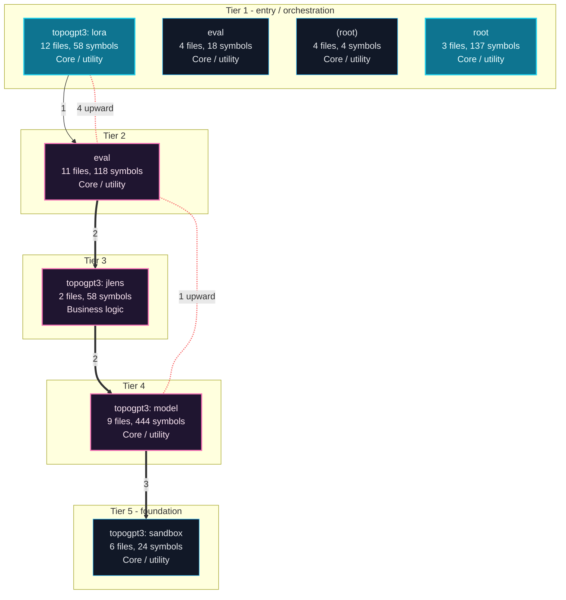
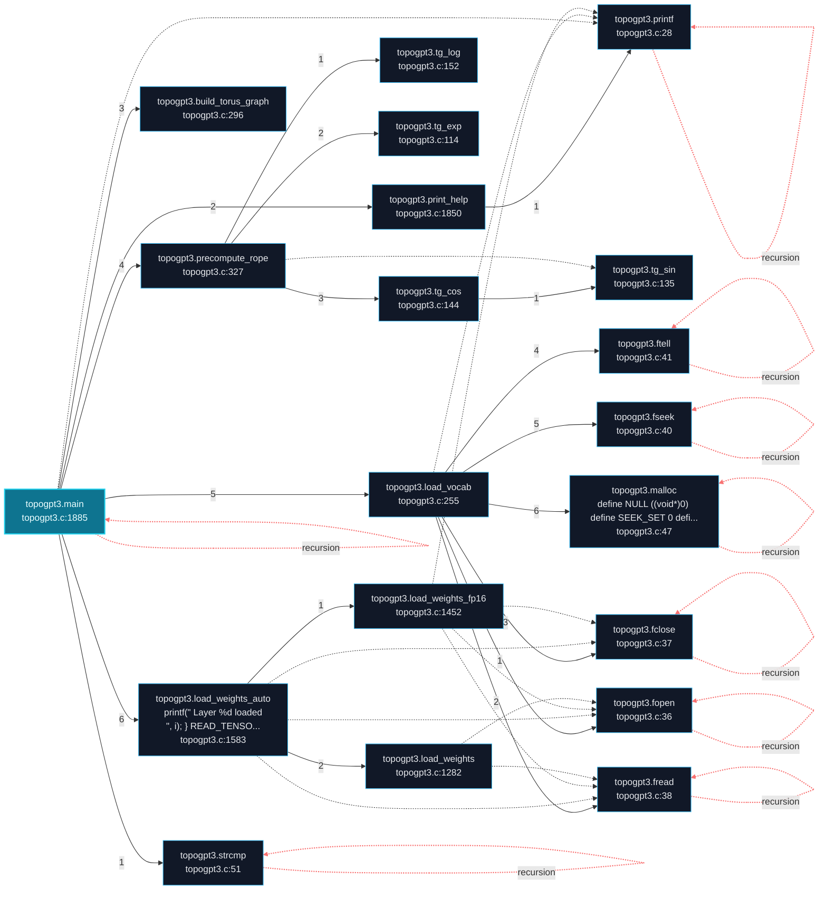
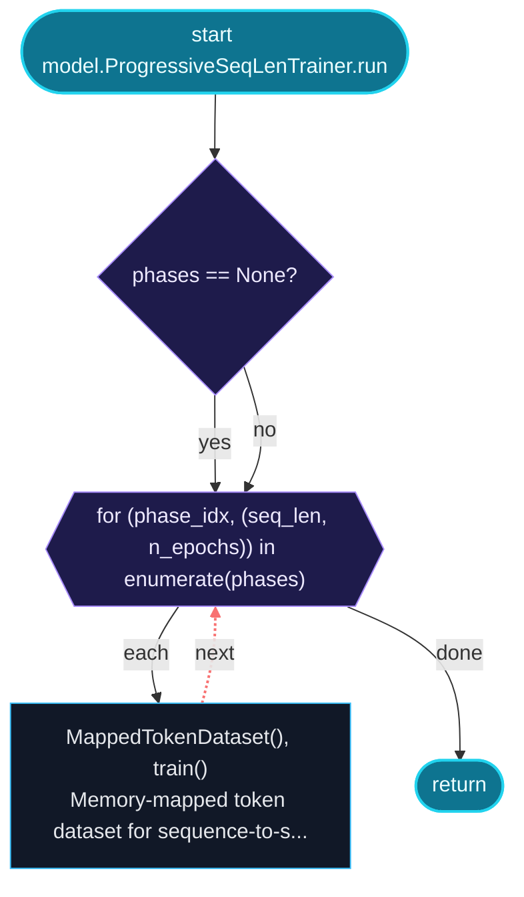
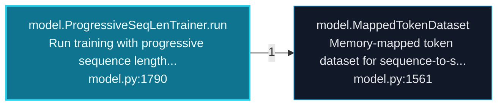
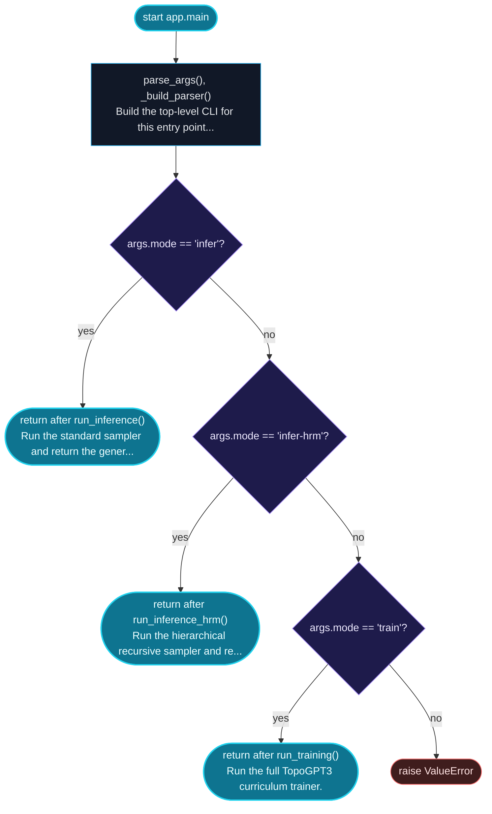
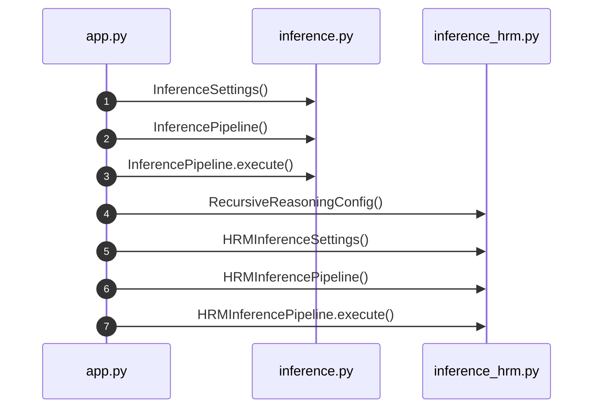

# TopoGPT3 Architecture and Execution Flows

[Back to index](index.md)

## Architecture Overview

8 components stacked in 5 dependency tiers (weighted Eades-Lin-Smyth ordering: arrows point from dependent to dependency, top to bottom). Labels are import counts, thick arrows the top quartile; 5 transitively implied edges are omitted. Dashed red arrows are upward dependencies: the smallest set of imports that closes every cycle and breaks the layering. Cyan components hold entry points. Interactive version: `readmenator-apidocs/index.html#/flows`.

Upward dependencies to fix first: `eval` -> `topogpt3: lora` (4 imports); `topogpt3: model` -> `eval` (1 imports)

---

## Execution Flows

Entry points are scored from `__main__` guards, `main` functions, entry-style names and files, and call-graph sources. Each flow walks resolved calls in call-site order (depth <= 4, <= 40 steps); numbers give the call order, dashed arrows revisit an already expanded callee, red arrows are recursion. Interactive version with zoom and per-node docs: `readmenator-apidocs/index.html#/flows`.

### `topogpt3.main`

`topogpt3.c:1885`, score 11: `main` in a compiled-language file; entry-style name `main`.

Call tree:

### `model.ProgressiveSeqLenTrainer.run`

`topogpt3/model.py:1790`, score 10: entry-style name `run`; call-graph source with 10 calls.

Control flow:

Call tree:

### `app.main`

`app.py:159`, score 9: entry-style name `main`; defined in entry file `app.py`; called from the `__main__` guard.

Control flow:

Call tree:

```mermaid
flowchart LR
    classDef default fill:#111827,stroke:#38bdf8,color:#e5e7eb;
    classDef entry fill:#0e7490,stroke:#22d3ee,color:#ecfeff,stroke-width:2px;
    classDef external fill:#1a1530,stroke:#a78bfa,color:#ede9fe;
    n_app_py__main["app.main<br/>Entry point invoked when the file is executed...<br/>app.py:159"]:::entry
    n_app_py___build_parser["app._build_parser<br/>Build the top-level CLI for this entry point...<br/>app.py:121"]:::default
    n_app_py__run_inference["app.run_inference<br/>Run the standard sampler and return the gener...<br/>app.py:46"]:::default
    n_topogpt3_inference_py__InferenceSettings["inference.InferenceSettings<br/>Centralized configuration container for the i...<br/>inference.py:42"]:::external
    n_topogpt3_inference_py__InferencePipeline["inference.InferencePipeline<br/>Orchestrator wiring loader, builder, engine a...<br/>inference.py:562"]:::external
    n_topogpt3_inference_py__execute["inference.InferencePipeline.execute<br/>Run the full inference pipeline end-to-end an...<br/>inference.py:571"]:::external
    n_topogpt3_inference_py__SourceModuleLoader["inference.SourceModuleLoader<br/>Resolves the TopoGPT3 runtime module via the...<br/>inference.py:212"]:::external
    n_topogpt3_inference_py__load["inference.SourceModuleLoader.load<br/>Return the topogpt3.train module which re-exp...<br/>inference.py:219"]:::external
    n_topogpt3_inference_py__SeedSynchronizer["inference.SeedSynchronizer<br/>Applies deterministic seeds across torch, CUD...<br/>inference.py:417"]:::external
    n_topogpt3_inference_py__apply["inference.SeedSynchronizer.apply<br/>Seed all relevant RNGs using the model packag...<br/>inference.py:426"]:::external
    n_topogpt3_inference_py__GaussPatchApplier["inference.GaussPatchApplier<br/>Applies the idempotent Gauss complex-multiply...<br/>inference.py:362"]:::external
    n_topogpt3_inference_py__apply_if_enabled["inference.GaussPatchApplier.apply_if_enabled<br/>Patch QuaternionSpectralLayer to use the 3-mu...<br/>inference.py:371"]:::external
    n_topogpt3_inference_py__CheckpointPaths["inference.CheckpointPaths<br/>Computes and validates checkpoint file paths...<br/>inference.py:228"]:::external
    n_topogpt3_inference_py__assert_ready["inference.CheckpointPaths.assert_ready<br/>Verify weights exist and the on-disk size lie...<br/>inference.py:255"]:::external
    n_topogpt3_inference_py__model_file["inference.CheckpointPaths.model_file<br/>Resolved path to the safetensors weights file...<br/>inference.py:243"]:::external
    n_topogpt3_inference_py__require_existing_file["inference.SecurePathResolver.require_existing_file<br/>Validate #96;path#96; points to an existing regular...<br/>inference.py:198"]:::external
    n_topogpt3_inference_py__WeightShapeProbe["inference.WeightShapeProbe<br/>Reads tensor metadata from safetensors to inf...<br/>inference.py:274"]:::external
    n_topogpt3_inference_py__detect_n_kv_heads["inference.WeightShapeProbe.detect_n_kv_heads<br/>Recover N_KV_HEADS used at training by inspec...<br/>inference.py:281"]:::external
    n_topogpt3_inference_py__resolve_under["inference.SecurePathResolver.resolve_under<br/>Join #96;parts#96; under #96;root#96; and return the cano...<br/>inference.py:182"]:::external
    n_topogpt3_inference_py__TokenizerFactory["inference.TokenizerFactory<br/>Builds a BPETokenizer instance using the conf...<br/>inference.py:349"]:::external
    n_topogpt3_inference_py__build_356["inference.TokenizerFactory.build<br/>Return an instance of BPETokenizer bound to t...<br/>inference.py:356"]:::external
    n_topogpt3_inference_py__TopoGPT2ConfigAligner["inference.TopoGPT2ConfigAligner<br/>Builds a TopoGPT2Config matching the loaded c...<br/>inference.py:318"]:::external
    n_topogpt3_inference_py__build_327["inference.TopoGPT2ConfigAligner.build<br/>Return a TopoGPT2Config dataclass ready to in...<br/>inference.py:327"]:::external
    n_topogpt3_inference_py__ModelAssembler["inference.ModelAssembler<br/>Instantiates the model and loads weights from...<br/>inference.py:380"]:::external
    n_topogpt3_inference_py__assemble["inference.ModelAssembler.assemble<br/>Build the TopoGPT2 graph, load weights into i...<br/>inference.py:389"]:::external
    n_topogpt3_inference_py__GenerationEngine["inference.GenerationEngine<br/>Runs autoregressive sampling against a loaded...<br/>inference.py:475"]:::external
    n_topogpt3_inference_py__run["inference.GenerationEngine.run<br/>Generate a completion for #96;prompt#96; and return...<br/>inference.py:483"]:::external
    n_topogpt3_inference_py__GenerationReport["inference.GenerationReport<br/>Quantitative summary of a single generation c...<br/>inference.py:461"]:::external
    n_topogpt3_inference_py__from_settings["inference.SamplingPolicy.from_settings<br/>Construct a SamplingPolicy from inference set...<br/>inference.py:450"]:::external
    n_topogpt3_inference_py__ResultRenderer["inference.ResultRenderer<br/>Prints a GenerationReport to stdout using set...<br/>inference.py:533"]:::external
    n_topogpt3_inference_py__render["inference.ResultRenderer.render<br/>Emit a banner with prompt and completion, plu...<br/>inference.py:540"]:::external
    n_topogpt3_inference_py__tokens_per_second["inference.GenerationReport.tokens_per_second<br/>Return throughput in tokens/sec, clamped to a...<br/>inference.py:470"]:::external
    n_app_py__run_inference_hrm["app.run_inference_hrm<br/>Run the hierarchical recursive sampler and re...<br/>app.py:71"]:::default
    n_topogpt3_inference_hrm_py__RecursiveReasoningConfig["inference_hrm.RecursiveReasoningConfig<br/>Hyperparameters governing the hierarchical re...<br/>inference_hrm.py:64"]:::external
    n_topogpt3_inference_hrm_py__HRMInferenceSettings["inference_hrm.HRMInferenceSettings<br/>Centralized configuration for the TopoGPT3.1...<br/>inference_hrm.py:134"]:::external
    n_topogpt3_inference_hrm_py__HRMInferencePipeline["inference_hrm.HRMInferencePipeline<br/>Orchestrator wiring loader, builder, reasoner...<br/>inference_hrm.py:1230"]:::external
    n_topogpt3_inference_hrm_py__execute["inference_hrm.HRMInferencePipeline.execute<br/>Run the full inference pipeline end-to-end an...<br/>inference_hrm.py:1239"]:::external
    n_topogpt3_inference_hrm_py__SourceModuleLoader["inference_hrm.SourceModuleLoader<br/>Resolves the TopoGPT3 runtime module via the...<br/>inference_hrm.py:397"]:::external
    n_app_py__main -->|"1"| n_app_py___build_parser
    n_app_py__main -->|"2"| n_app_py__run_inference
    n_app_py__run_inference -->|"1"| n_topogpt3_inference_py__InferenceSettings
    n_app_py__run_inference -->|"2"| n_topogpt3_inference_py__InferencePipeline
    n_app_py__run_inference -->|"3"| n_topogpt3_inference_py__execute
    n_topogpt3_inference_py__execute -->|"1"| n_topogpt3_inference_py__SourceModuleLoader
    n_topogpt3_inference_py__execute -->|"2"| n_topogpt3_inference_py__load
    n_topogpt3_inference_py__execute -->|"3"| n_topogpt3_inference_py__SeedSynchronizer
    n_topogpt3_inference_py__execute -->|"4"| n_topogpt3_inference_py__apply
    n_topogpt3_inference_py__execute -->|"5"| n_topogpt3_inference_py__GaussPatchApplier
    n_topogpt3_inference_py__execute -->|"6"| n_topogpt3_inference_py__apply_if_enabled
    n_topogpt3_inference_py__execute -->|"7"| n_topogpt3_inference_py__CheckpointPaths
    n_topogpt3_inference_py__execute -->|"8"| n_topogpt3_inference_py__assert_ready
    n_topogpt3_inference_py__assert_ready -->|"1"| n_topogpt3_inference_py__model_file
    n_topogpt3_inference_py__assert_ready -->|"2"| n_topogpt3_inference_py__require_existing_file
    n_topogpt3_inference_py__execute -->|"9"| n_topogpt3_inference_py__WeightShapeProbe
    n_topogpt3_inference_py__execute -->|"10"| n_topogpt3_inference_py__detect_n_kv_heads
    n_topogpt3_inference_py__execute -->|"11"| n_topogpt3_inference_py__model_file
    n_topogpt3_inference_py__model_file -->|"1"| n_topogpt3_inference_py__resolve_under
    n_topogpt3_inference_py__execute -->|"12"| n_topogpt3_inference_py__TokenizerFactory
    n_topogpt3_inference_py__execute -->|"13"| n_topogpt3_inference_py__build_356
    n_topogpt3_inference_py__execute -->|"14"| n_topogpt3_inference_py__TopoGPT2ConfigAligner
    n_topogpt3_inference_py__execute -->|"15"| n_topogpt3_inference_py__build_327
    n_topogpt3_inference_py__execute -->|"16"| n_topogpt3_inference_py__ModelAssembler
    n_topogpt3_inference_py__execute -->|"17"| n_topogpt3_inference_py__assemble
    n_topogpt3_inference_py__assemble -.-> n_topogpt3_inference_py__model_file
    n_topogpt3_inference_py__execute -->|"18"| n_topogpt3_inference_py__GenerationEngine
    n_topogpt3_inference_py__execute -->|"19"| n_topogpt3_inference_py__run
    n_topogpt3_inference_py__run -->|"1"| n_topogpt3_inference_py__GenerationReport
    n_topogpt3_inference_py__execute -->|"20"| n_topogpt3_inference_py__from_settings
    n_topogpt3_inference_py__execute -->|"21"| n_topogpt3_inference_py__ResultRenderer
    n_topogpt3_inference_py__execute -->|"22"| n_topogpt3_inference_py__render
    n_topogpt3_inference_py__render -->|"1"| n_topogpt3_inference_py__tokens_per_second
    n_app_py__main -->|"3"| n_app_py__run_inference_hrm
    n_app_py__run_inference_hrm -->|"1"| n_topogpt3_inference_hrm_py__RecursiveReasoningConfig
    n_app_py__run_inference_hrm -->|"2"| n_topogpt3_inference_hrm_py__HRMInferenceSettings
    n_app_py__run_inference_hrm -->|"3"| n_topogpt3_inference_hrm_py__HRMInferencePipeline
    n_app_py__run_inference_hrm -->|"4"| n_topogpt3_inference_hrm_py__execute
    n_topogpt3_inference_hrm_py__execute -.-> n_topogpt3_inference_py__load
    n_topogpt3_inference_hrm_py__execute -->|"1"| n_topogpt3_inference_hrm_py__SourceModuleLoader
```

Cross-file sequence:

---
