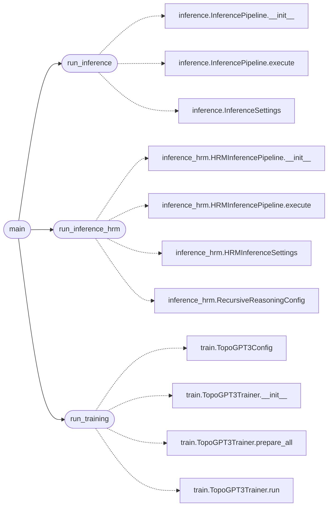

# `app`

> Source: [app.py:1](../../app.py#L1) | language `py` | coverage 100.0% | [API index](../index.md)

Drop-in entry point that demonstrates how to use the topogpt3 package.

This file lives outside the package on purpose. Copy it (or its sections)
into your own project after running ``pip install topogpt3``. Three usage
patterns are shown:

1. `[`run_inference`](#run_inference)` calls the standard autoregressive sampler.
2. `[`run_inference_hrm`](#run_inference_hrm)` calls the hierarchical recursive reasoning
   sampler that reuses the same checkpoint with no extra trained
   parameters.
3. `[`run_training`](#run_training)` launches the full curriculum trainer.

The script's main() exposes them through a tiny ``--mode`` CLI so the
file is runnable as-is for a quick smoke test once a checkpoint exists.

## Contents

- **Functions:** [`run_inference`](#run_inference), [`run_inference_hrm`](#run_inference_hrm), [`run_training`](#run_training), [`main`](#main)
- **Constants:** [`DEFAULT_CHECKPOINT_DIR`](#default_checkpoint_dir), [`DEFAULT_CHECKPOINT_SLOT`](#default_checkpoint_slot), [`DEFAULT_PROMPT`](#default_prompt), [`DEFAULT_MAX_NEW_TOKENS`](#default_max_new_tokens), [`DEFAULT_TEMPERATURE`](#default_temperature), [`DEFAULT_TOP_K`](#default_top_k), [`DEFAULT_REPETITION_PENALTY`](#default_repetition_penalty)

## Call Graph

Solid arrows stay in this module, dashed arrows leave it.



## Functions

<a id="run_inference"></a>

### `run_inference`

`function` | [app.py:46](../../app.py#L46)

```python
def run_inference(prompt: str = DEFAULT_PROMPT, checkpoint_dir: str = DEFAULT_CHECKPOINT_DIR, checkpoint_name: str = DEFAULT_CHECKPOINT_SLOT, max_new_tokens: int = DEFAULT_MAX_NEW_TOKENS, temperature: float = DEFAULT_TEMPERATURE, top_k: int = DEFAULT_TOP_K, repetition_penalty: float = DEFAULT_REPETITION_PENALTY, device: Optional[str] = None) -> str
```

Run the standard sampler and return the generated completion text.

**Parameters**

| Name | Type | Default | Description |
|---|---|---|---|
| `prompt` | `str` | `DEFAULT_PROMPT` |  |
| `checkpoint_dir` | `str` | `DEFAULT_CHECKPOINT_DIR` |  |
| `checkpoint_name` | `str` | `DEFAULT_CHECKPOINT_SLOT` |  |
| `max_new_tokens` | `int` | `DEFAULT_MAX_NEW_TOKENS` |  |
| `temperature` | `float` | `DEFAULT_TEMPERATURE` |  |
| `top_k` | `int` | `DEFAULT_TOP_K` |  |
| `repetition_penalty` | `float` | `DEFAULT_REPETITION_PENALTY` |  |
| `device` | `Optional[str]` | `None` |  |

**Returns:** `str`

*Calls:* [`InferencePipeline.__init__`](topogpt3.inference.py.md#inferencepipeline-__init__), [`InferencePipeline.execute`](topogpt3.inference.py.md#inferencepipeline-execute), [`InferenceSettings`](topogpt3.inference.py.md#inferencesettings)

*Called by:* [`main`](#main)

---

<a id="run_inference_hrm"></a>

### `run_inference_hrm`

`function` | [app.py:71](../../app.py#L71)

```python
def run_inference_hrm(prompt: str = DEFAULT_PROMPT, checkpoint_dir: str = DEFAULT_CHECKPOINT_DIR, checkpoint_name: str = DEFAULT_CHECKPOINT_SLOT, max_new_tokens: int = DEFAULT_MAX_NEW_TOKENS, temperature: float = DEFAULT_TEMPERATURE, top_k: int = DEFAULT_TOP_K, repetition_penalty: float = DEFAULT_REPETITION_PENALTY, high_level_iters: int = 2, low_level_iters: int = 3, low_level_window: int = 2, device: Optional[str] = None) -> str
```

Run the hierarchical recursive sampler and return the completion.

**Parameters**

| Name | Type | Default | Description |
|---|---|---|---|
| `prompt` | `str` | `DEFAULT_PROMPT` |  |
| `checkpoint_dir` | `str` | `DEFAULT_CHECKPOINT_DIR` |  |
| `checkpoint_name` | `str` | `DEFAULT_CHECKPOINT_SLOT` |  |
| `max_new_tokens` | `int` | `DEFAULT_MAX_NEW_TOKENS` |  |
| `temperature` | `float` | `DEFAULT_TEMPERATURE` |  |
| `top_k` | `int` | `DEFAULT_TOP_K` |  |
| `repetition_penalty` | `float` | `DEFAULT_REPETITION_PENALTY` |  |
| `high_level_iters` | `int` | `2` |  |
| `low_level_iters` | `int` | `3` |  |
| `low_level_window` | `int` | `2` |  |
| `device` | `Optional[str]` | `None` |  |

**Returns:** `str`

*Calls:* [`HRMInferencePipeline.__init__`](topogpt3.inference_hrm.py.md#hrminferencepipeline-__init__), [`HRMInferencePipeline.execute`](topogpt3.inference_hrm.py.md#hrminferencepipeline-execute), [`HRMInferenceSettings`](topogpt3.inference_hrm.py.md#hrminferencesettings), [`RecursiveReasoningConfig`](topogpt3.inference_hrm.py.md#recursivereasoningconfig)

*Called by:* [`main`](#main)

---

<a id="run_training"></a>

### `run_training`

`function` | [app.py:105](../../app.py#L105)

```python
def run_training(scale: str = 'small', start_tier: Optional[int] = None, device: Optional[str] = None, prepare_data: bool = False) -> None
```

Run the full TopoGPT3 curriculum trainer.

**Parameters**

| Name | Type | Default | Description |
|---|---|---|---|
| `scale` | `str` | `'small'` |  |
| `start_tier` | `Optional[int]` | `None` |  |
| `device` | `Optional[str]` | `None` |  |
| `prepare_data` | `bool` | `False` |  |

*Calls:* [`TopoGPT3Config`](topogpt3.train.py.md#topogpt3config), [`TopoGPT3Trainer.__init__`](topogpt3.train.py.md#topogpt3trainer-__init__), [`TopoGPT3Trainer.prepare_all`](topogpt3.train.py.md#topogpt3trainer-prepare_all), [`TopoGPT3Trainer.run`](topogpt3.train.py.md#topogpt3trainer-run)

*Called by:* [`main`](#main)

---

<a id="main"></a>

### `main`

`function` | [app.py:159](../../app.py#L159)

```python
def main(argv: Optional[Sequence[str]] = None) -> int
```

Entry point invoked when the file is executed as a script.

**Parameters**

| Name | Type | Default | Description |
|---|---|---|---|
| `argv` | `Optional[Sequence[str]]` | `None` |  |

**Returns:** `int`

**Raises**

- `ValueError`: (raised in the body, not documented)

*Calls:* [`run_inference`](#run_inference), [`run_inference_hrm`](#run_inference_hrm), [`run_training`](#run_training)

---

## Constants

<a id="default_checkpoint_dir"></a>

### `DEFAULT_CHECKPOINT_DIR`

`constant` | [app.py:37](../../app.py#L37)

```python
DEFAULT_CHECKPOINT_DIR = 'checkpoints_topogpt3'
```

---

<a id="default_checkpoint_slot"></a>

### `DEFAULT_CHECKPOINT_SLOT`

`constant` | [app.py:38](../../app.py#L38)

```python
DEFAULT_CHECKPOINT_SLOT = 'last'
```

---

<a id="default_prompt"></a>

### `DEFAULT_PROMPT`

`constant` | [app.py:39](../../app.py#L39)

```python
DEFAULT_PROMPT = 'def fibonacci(n):\n'
```

---

<a id="default_max_new_tokens"></a>

### `DEFAULT_MAX_NEW_TOKENS`

`constant` | [app.py:40](../../app.py#L40)

```python
DEFAULT_MAX_NEW_TOKENS = 200
```

---

<a id="default_temperature"></a>

### `DEFAULT_TEMPERATURE`

`constant` | [app.py:41](../../app.py#L41)

```python
DEFAULT_TEMPERATURE = 0.3
```

---

<a id="default_top_k"></a>

### `DEFAULT_TOP_K`

`constant` | [app.py:42](../../app.py#L42)

```python
DEFAULT_TOP_K = 50
```

---

<a id="default_repetition_penalty"></a>

### `DEFAULT_REPETITION_PENALTY`

`constant` | [app.py:43](../../app.py#L43)

```python
DEFAULT_REPETITION_PENALTY = 1.1
```

---
