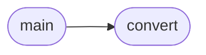

# `convert_weights`

> Source: [convert_weights.py:1](../../convert_weights.py#L1) | language `py` | coverage 33.3% | [API index](../index.md)

TopoGPT3 Weight Converter: safetensors -> flat float32 binary.

Usage:
    python convert_weights.py [--input model.safetensors] [--output topogpt3.weights]

Output format:
    Header: "TG3W" + uint32 version(1) + uint32 n_tensors
    For each tensor: uint32 name_len + char[name_len] + uint32 ndim + uint32 dims[ndim] + float32[data]

The C inference engine loads this file sequentially.

## Contents

- **Functions:** [`convert`](#convert), [`main`](#main)
- **Constants:** [`WEIGHT_ORDER`](#weight_order)

## Call Graph

Solid arrows stay in this module, dashed arrows leave it.



## Functions

<a id="convert"></a>

### `convert`

`function` | [convert_weights.py:102](../../convert_weights.py#L102)

```python
def convert(input_path: str, output_path: str)
```

**Parameters**

| Name | Type | Default | Description |
|---|---|---|---|
| `input_path` | `str` |  |  |
| `output_path` | `str` |  |  |

*Called by:* [`main`](#main)

---

<a id="main"></a>

### `main`

`function` | [convert_weights.py:160](../../convert_weights.py#L160)

```python
def main()
```

*Calls:* [`convert`](#convert)

---

## Constants

<a id="weight_order"></a>

### `WEIGHT_ORDER`

`constant` | [convert_weights.py:27](../../convert_weights.py#L27)

```python
WEIGHT_ORDER = ['token_embed.weight']
```

---
