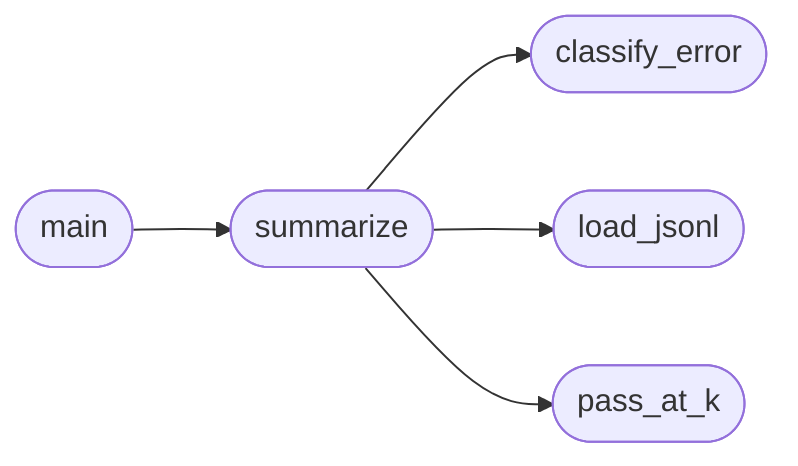

# `eval.analyze`

> Source: [eval/analyze.py:1](../../eval/analyze.py#L1) | language `py` | coverage 50.0% | [API index](../index.md)

Aggregate HumanEval result JSONL files into a summary table.

Reads one or more .jsonl files produced by harness.py and computes:
  - pass@1, pass@k (using the unbiased estimator from the HumanEval paper
    when k > 1)
  - mean latency, mean generation length, tok/s
  - per-error classification

## Contents

- **Functions:** [`pass_at_k`](#pass_at_k), [`classify_error`](#classify_error), [`load_jsonl`](#load_jsonl), [`summarize`](#summarize), [`main`](#main)

## Call Graph

Solid arrows stay in this module, dashed arrows leave it.



## Functions

<a id="pass_at_k"></a>

### `pass_at_k`

`function` | [eval/analyze.py:21](../../eval/analyze.py#L21)

```python
def pass_at_k(n: int, c: int, k: int) -> float
```

Unbiased estimator from the HumanEval paper.

pass@k = 1 - C(n-c, k) / C(n, k)   if n - c >= k else 1.0
n = total samples, c = correct samples, k = target

**Parameters**

| Name | Type | Default | Description |
|---|---|---|---|
| `n` | `int` |  |  |
| `c` | `int` |  |  |
| `k` | `int` |  |  |

**Returns:** `float`

*Called by:* [`summarize`](#summarize)

---

<a id="classify_error"></a>

### `classify_error`

`function` | [eval/analyze.py:32](../../eval/analyze.py#L32)

```python
def classify_error(msg: str, candidate_src: str) -> str
```

Heuristic single-label error classifier.

**Parameters**

| Name | Type | Default | Description |
|---|---|---|---|
| `msg` | `str` |  |  |
| `candidate_src` | `str` |  |  |

**Returns:** `str`

*Called by:* [`summarize`](#summarize)

---

<a id="load_jsonl"></a>

### `load_jsonl`

`function` | [eval/analyze.py:56](../../eval/analyze.py#L56)

```python
def load_jsonl(path: Path) -> List[dict]
```

**Parameters**

| Name | Type | Default | Description |
|---|---|---|---|
| `path` | `Path` |  |  |

**Returns:** `List[dict]`

*Called by:* [`summarize`](#summarize)

---

<a id="summarize"></a>

### `summarize`

`function` | [eval/analyze.py:61](../../eval/analyze.py#L61)

```python
def summarize(paths: List[Path]) -> dict
```

**Parameters**

| Name | Type | Default | Description |
|---|---|---|---|
| `paths` | `List[Path]` |  |  |

**Returns:** `dict`

*Calls:* [`classify_error`](#classify_error), [`load_jsonl`](#load_jsonl), [`pass_at_k`](#pass_at_k)

*Called by:* [`main`](#main)

---

<a id="main"></a>

### `main`

`function` | [eval/analyze.py:103](../../eval/analyze.py#L103)

```python
def main()
```

*Calls:* [`summarize`](#summarize)

---
