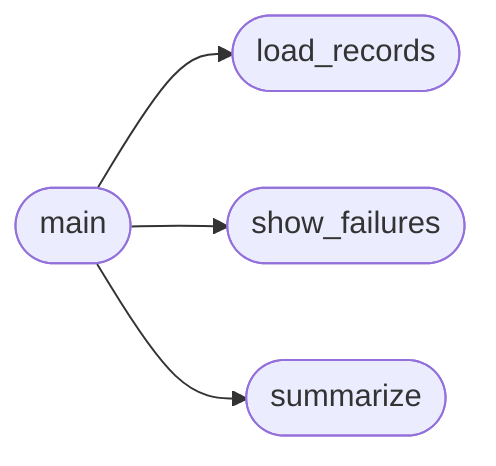

# `eval.analyze_results`

> Source: [eval/analyze_results.py:1](../../eval/analyze_results.py#L1) | language `py` | coverage 20.0% | [API index](../index.md)

Analyze a HumanEval JSONL produced by harness.py.

For each failed problem the report shows:
  - the prompt fed to the model
  - the generated candidate after extraction
  - the hidden test that failed
  - the captured stdout/stderr and traceback

This makes it easy to see *how* and *why* a candidate failed without
re-running the harness.

Usage:
    python eval/analyze_results.py eval/runs/run.jsonl
    python eval/analyze_results.py eval/runs/run.jsonl --summary
    python eval/analyze_results.py eval/runs/run.jsonl --task-id HumanEval/0

## Contents

- **Functions:** [`load_records`](#load_records), [`summarize`](#summarize), [`show_failures`](#show_failures), [`main`](#main)

## Call Graph

Solid arrows stay in this module, dashed arrows leave it.



## Functions

<a id="load_records"></a>

### `load_records`

`function` | [eval/analyze_results.py:26](../../eval/analyze_results.py#L26)

```python
def load_records(path: str)
```

**Parameters**

| Name | Type | Default | Description |
|---|---|---|---|
| `path` | `str` |  |  |

*Called by:* [`main`](#main)

---

<a id="summarize"></a>

### `summarize`

`function` | [eval/analyze_results.py:31](../../eval/analyze_results.py#L31)

```python
def summarize(records)
```

**Parameters**

| Name | Type | Default | Description |
|---|---|---|---|
| `records` |  |  |  |

*Called by:* [`main`](#main)

---

<a id="show_failures"></a>

### `show_failures`

`function` | [eval/analyze_results.py:44](../../eval/analyze_results.py#L44)

```python
def show_failures(records, task_id: str | None = None)
```

**Parameters**

| Name | Type | Default | Description |
|---|---|---|---|
| `records` |  |  |  |
| `task_id` | `str \| None` | `None` |  |

*Called by:* [`main`](#main)

---

<a id="main"></a>

### `main`

`function` | [eval/analyze_results.py:82](../../eval/analyze_results.py#L82)

```python
def main()
```

*Calls:* [`load_records`](#load_records), [`show_failures`](#show_failures), [`summarize`](#summarize)

---
