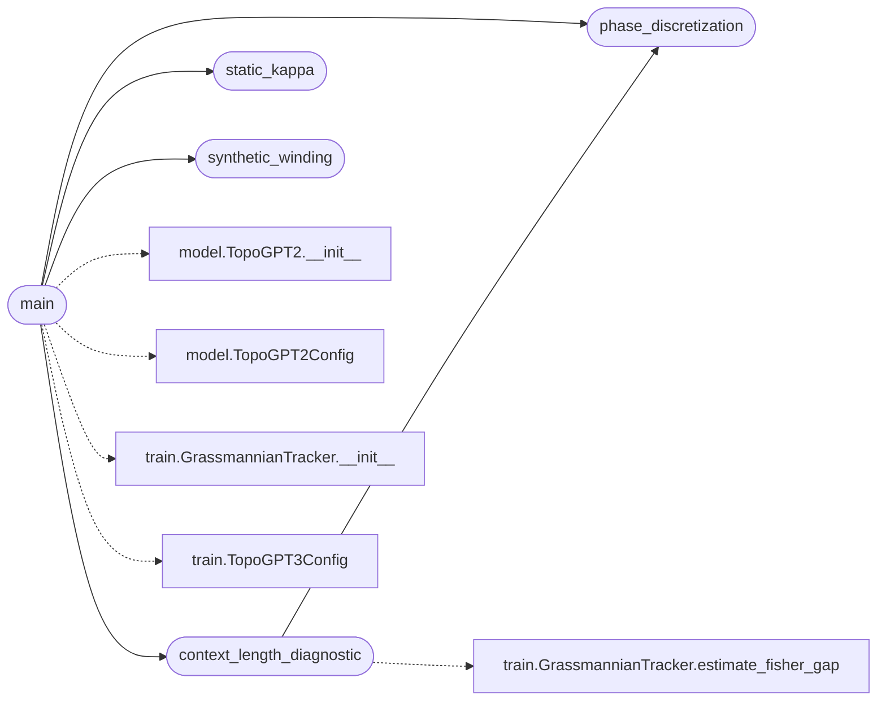

# `eval.diag_static`

> Source: [eval/diag_static.py:1](../../eval/diag_static.py#L1) | language `py` | coverage 50.0% | [API index](../index.md)

Diagnostico estatico de un checkpoint TopoGPT3 congelado.

Calcula sobre los pesos espectrales congelados (sin reentrenar):

  kappa_F   = sigma_max / sigma_min  del kernel espectral apilado
              (proxy del condition number de la Grassmanniana)
  delta     = max |theta - round(theta)|  sobre los arg det de overlaps
              (cuantifica cuanto se "discretizan" las fases complejas)
  W         = (1/2pi) sum arg det <U_n | U_{n+1}>  (winding acumulado
              sobre barridos en frecuencia — sin trayectoria temporal
              real, usamos un barrido sintetico sobre los modos FFT)
  r         = rango dominante por elbow de los valores singulares
  sigma_*   = valores singulares principales

NOTA IMPORTANTE: Este script NO reentrena. Trabaja unicamente con los
kernels espectrales cuaternionicos ya aprendidos. La "trayectoria" W
se define barriendo sobre los modos de frecuencia (no sobre pasos de
entrenamiento), asi que W aqui mide coherencia de fase intra-modelo,
no winding temporal. Esta distincion se reporta explicitamente en
el JSONL de salida.

Salida: eval/runs/diag_static_<timestamp>.jsonl

## Contents

- **Functions:** [`phase_discretization`](#phase_discretization), [`synthetic_winding`](#synthetic_winding), [`static_kappa`](#static_kappa), [`context_length_diagnostic`](#context_length_diagnostic), [`main`](#main)
- **Constants:** [`REPO_ROOT`](#repo_root)

## Call Graph

Solid arrows stay in this module, dashed arrows leave it.



## Functions

<a id="phase_discretization"></a>

### `phase_discretization`

`function` | [eval/diag_static.py:49](../../eval/diag_static.py#L49)

```python
def phase_discretization(K: torch.Tensor, n_samples: int = 1024, seed: int = 0) -> Dict[str, float]
```

Muestrea n_samples overlaps aleatorios <u_i | u_j> sobre los vectores singulares de K y mide cuanto se aleja su fase arg del reticulo 2*pi*Z.

delta = max |theta/2pi - round(theta/2pi)| sobre la muestra.

Tambien devuelve:
  delta_mean, delta_median, frac_near_integer (|.| < 0.05)

**Parameters**

| Name | Type | Default | Description |
|---|---|---|---|
| `K` | `torch.Tensor` |  |  |
| `n_samples` | `int` | `1024` |  |
| `seed` | `int` | `0` |  |

**Returns:** `Dict[str, float]`

*Called by:* [`context_length_diagnostic`](#context_length_diagnostic), [`main`](#main)

---

<a id="synthetic_winding"></a>

### `synthetic_winding`

`function` | [eval/diag_static.py:95](../../eval/diag_static.py#L95)

```python
def synthetic_winding(K: torch.Tensor, n_windows: int = 16, window_size: int | None = None) -> float
```

Como el checkpoint es estatico, no hay trayectoria temporal.

Construimos una pseudo-trayectoria deslizando una ventana sobre los modos de frecuencia (filas de K) y acumulando arg det del overlap entre ventanas consecutivas.

W = (1/2pi) sum_n arg det <U_{n} | U_{n+1}>

**Parameters**

| Name | Type | Default | Description |
|---|---|---|---|
| `K` | `torch.Tensor` |  |  |
| `n_windows` | `int` | `16` |  |
| `window_size` | `int \| None` | `None` |  |

**Returns:** `float`

*Called by:* [`main`](#main)

---

<a id="static_kappa"></a>

### `static_kappa`

`function` | [eval/diag_static.py:144](../../eval/diag_static.py#L144)

```python
def static_kappa(K: torch.Tensor) -> Dict[str, Any]
```

**Parameters**

| Name | Type | Default | Description |
|---|---|---|---|
| `K` | `torch.Tensor` |  |  |

**Returns:** `Dict[str, Any]`

*Called by:* [`main`](#main)

---

<a id="context_length_diagnostic"></a>

### `context_length_diagnostic`

`function` | [eval/diag_static.py:171](../../eval/diag_static.py#L171)

```python
def context_length_diagnostic(model: TopoGPT2, tracker: GrassmannianTracker, device: str = 'cuda', lengths: tuple[int, ...] = _CONTEXT_LENGTHS) -> Dict[str, Any]
```

**Parameters**

| Name | Type | Default | Description |
|---|---|---|---|
| `model` | `TopoGPT2` |  |  |
| `tracker` | `GrassmannianTracker` |  |  |
| `device` | `str` | `'cuda'` |  |
| `lengths` | `tuple[int, ...]` | `_CONTEXT_LENGTHS` |  |

**Returns:** `Dict[str, Any]`

*Calls:* [`phase_discretization`](#phase_discretization), [`GrassmannianTracker.estimate_fisher_gap`](topogpt3.train.py.md#grassmanniantracker-estimate_fisher_gap)

*Called by:* [`main`](#main)

---

<a id="main"></a>

### `main`

`function` | [eval/diag_static.py:248](../../eval/diag_static.py#L248)

```python
def main()
```

*Calls:* [`context_length_diagnostic`](#context_length_diagnostic), [`phase_discretization`](#phase_discretization), [`static_kappa`](#static_kappa), [`synthetic_winding`](#synthetic_winding), [`TopoGPT2.__init__`](topogpt3.model.py.md#topogpt2-__init__), [`TopoGPT2Config`](topogpt3.model.py.md#topogpt2config), [`GrassmannianTracker.__init__`](topogpt3.train.py.md#grassmanniantracker-__init__), [`TopoGPT3Config`](topogpt3.train.py.md#topogpt3config)

---

## Constants

<a id="repo_root"></a>

### `REPO_ROOT`

`constant` | [eval/diag_static.py:37](../../eval/diag_static.py#L37)

```python
REPO_ROOT = Path(__file__).resolve().parent.parent
```

---
