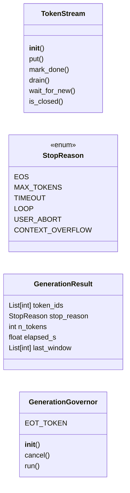
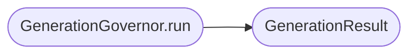

# `eval.governor`

> Source: [eval/governor.py:1](../../eval/governor.py#L1) | language `py` | coverage 62.5% | [API index](../index.md)

Streaming + governance for autoregressive generation.

Two classes that fix two real problems with the existing
[`topogpt3.inference`](topogpt3.inference.py.md) pipeline:

  - [`TokenStream`](#tokenstream) — a thread-safe queue that captures raw token IDs as
    they are produced by the model. Enables post-hoc prefix agreement
    and exact-match metrics that need the *raw* token stream (the
    current harness only stores the post-extracted candidate text,
    losing that information).

  - [`GenerationGovernor`](#generationgovernor) — wraps `model.generate` and exposes stop
    hooks: per-token timeout, loop detection (last K tokens repeat),
    and a user-callable cancel. Returns a [`GenerationResult`](#generationresult) with
    the stop reason so callers can distinguish "ran out of tokens"
    from "hit the safety hook" from "user aborted".

This is a Python port of the patterns in
`claude-code-main/src/utils/stream.ts` (Stream<T> AsyncIterator
wrapper) and `claude-code-main/src/query/stopHooks.ts`
(AsyncGenerator with `preventContinuation`). The TypeScript originals
are 76 and 473 lines respectively; this module is ~150 lines because
Python's GIL lets us avoid the manual promise queueing.

NOTE: This module does NOT modify `topogpt3/model.py`. The generation
loop is replicated here (not monkey-patched) so the original `generate`
remains the single source of truth for the production sampler.

## Contents

- **Classes:** [`TokenStream`](#tokenstream), [`GenerationResult`](#generationresult), [`GenerationGovernor`](#generationgovernor)
- **Enums:** [`StopReason`](#stopreason)
- **Functions:** [`make_loop_detector`](#make_loop_detector), [`make_timeout_hook`](#make_timeout_hook)

## Type Diagram



## Call Graph

Solid arrows stay in this module, dashed arrows leave it.



## Classes

<a id="tokenstream"></a>

### `TokenStream`

`class` | [eval/governor.py:45](../../eval/governor.py#L45)

```python
class TokenStream
```

Thread-safe single-producer / single-consumer queue of token IDs.

The producer (the generation loop) calls `put(tok)` for each new
token. Consumers can iterate via `iter_tokens(block=True)` or
[`drain`](#tokenstream-drain) to get everything emitted so far.

The stream tracks a monotonic counter so consumers can detect
"no new tokens since last call" cheaply.

**Members**

| Member | Kind | Summary |
|---|---|---|
| [`__init__`](#tokenstream-__init__) | constructor |  |
| [`put`](#tokenstream-put) | method |  |
| [`mark_done`](#tokenstream-mark_done) | method |  |
| [`drain`](#tokenstream-drain) | method | Return all tokens emitted so far, atomic snapshot. |
| [`wait_for_new`](#tokenstream-wait_for_new) | method | Block up to [`timeout`](eval.sandbox.py.md#sandboxconfig-timeout) seconds for a new token. |
| [`is_closed`](#tokenstream-is_closed) | method |  |

<a id="tokenstream-__init__"></a>

#### `TokenStream.__init__`

`constructor` | [eval/governor.py:56](../../eval/governor.py#L56)

```python
def __init__(self) -> None
```

*Called by:* [`test_cancel`](eval.governor_smoke.py.md#test_cancel), [`test_governor_basic`](eval.governor_smoke.py.md#test_governor_basic), [`test_loop_detector`](eval.governor_smoke.py.md#test_loop_detector), [`test_tokenstream_threadsafety`](eval.governor_smoke.py.md#test_tokenstream_threadsafety)

<a id="tokenstream-put"></a>

#### `TokenStream.put`

`method` | [eval/governor.py:62](../../eval/governor.py#L62)

```python
def put(self, tok: int) -> None
```

**Parameters**

| Name | Type | Default | Description |
|---|---|---|---|
| `tok` | `int` |  |  |

<a id="tokenstream-mark_done"></a>

#### `TokenStream.mark_done`

`method` | [eval/governor.py:67](../../eval/governor.py#L67)

```python
def mark_done(self) -> None
```

<a id="tokenstream-drain"></a>

#### `TokenStream.drain`

`method` | [eval/governor.py:72](../../eval/governor.py#L72)

```python
def drain(self) -> List[int]
```

Return all tokens emitted so far, atomic snapshot.

**Returns:** `List[int]`

*Called by:* [`test_governor_basic`](eval.governor_smoke.py.md#test_governor_basic), [`test_tokenstream_threadsafety`](eval.governor_smoke.py.md#test_tokenstream_threadsafety)

<a id="tokenstream-wait_for_new"></a>

#### `TokenStream.wait_for_new`

`method` | [eval/governor.py:77](../../eval/governor.py#L77)

```python
def wait_for_new(self, timeout: float = 0.05) -> bool
```

Block up to [`timeout`](eval.sandbox.py.md#sandboxconfig-timeout) seconds for a new token.

Returns True if a new token arrived (or stream closed), False on timeout.

**Parameters**

| Name | Type | Default | Description |
|---|---|---|---|
| `timeout` | `float` | `0.05` |  |

**Returns:** `bool`

<a id="tokenstream-is_closed"></a>

#### `TokenStream.is_closed`

`method` | [eval/governor.py:86](../../eval/governor.py#L86)

```python
def is_closed(self) -> bool
```

**Returns:** `bool`

*Called by:* [`test_governor_basic`](eval.governor_smoke.py.md#test_governor_basic)

---

<a id="generationresult"></a>

### `GenerationResult`

`class` `dataclass` | [eval/governor.py:109](../../eval/governor.py#L109)

Decorators: `@dataclass`

```python
class GenerationResult
```

Outcome of a governed generation.

**Attributes**

| Name | Type | Default | Description |
|---|---|---|---|
| [`token_ids`](#generationresult-token_ids) | `List[int]` |  |  |
| [`stop_reason`](#generationresult-stop_reason) | `StopReason` |  |  |
| [`n_tokens`](#generationresult-n_tokens) | `int` | `field(init=False)` |  |
| [`elapsed_s`](#generationresult-elapsed_s) | `float` | `0.0` |  |
| [`last_window`](#generationresult-last_window) | `List[int]` | `field(default_factory=list)` |  |

---

<a id="generationgovernor"></a>

### `GenerationGovernor`

`class` | [eval/governor.py:134](../../eval/governor.py#L134)

```python
class GenerationGovernor
```

Run a model's autoregressive generation loop with optional stop hooks and a streaming interface.

Usage:
    ts = TokenStream()
    governor = GenerationGovernor(
        model=model,
        ctx=prompt_tensor,
        stream=ts,
        max_new_tokens=256,
        temperature=0.2,
        top_k=40,
        repetition_penalty=1.1,
    )
    result = governor.run(stop_hooks=[loop_detector, timeout_hook])
    if result.stop_reason == StopReason.LOOP:
        ...

**Attributes**

| Name | Type | Default | Description |
|---|---|---|---|
| [`EOT_TOKEN`](#generationgovernor-eot_token) |  | `50256` |  |

**Members**

| Member | Kind | Summary |
|---|---|---|
| [`__init__`](#generationgovernor-__init__) | constructor |  |
| [`cancel`](#generationgovernor-cancel) | method | Asynchronously stop the generation. |
| [`run`](#generationgovernor-run) | method | Execute the generation loop. |

<a id="generationgovernor-__init__"></a>

#### `GenerationGovernor.__init__`

`constructor` | [eval/governor.py:156](../../eval/governor.py#L156)

```python
def __init__(self, model: torch.nn.Module, ctx: torch.Tensor, stream: TokenStream, max_new_tokens: int = 256, temperature: float = 0.8, top_k: int = 50, repetition_penalty: float = 1.0, max_seq_len: int = 512) -> None
```

**Parameters**

| Name | Type | Default | Description |
|---|---|---|---|
| `model` | `torch.nn.Module` |  |  |
| `ctx` | `torch.Tensor` |  |  |
| `stream` | `TokenStream` |  |  |
| `max_new_tokens` | `int` | `256` |  |
| `temperature` | `float` | `0.8` |  |
| `top_k` | `int` | `50` |  |
| `repetition_penalty` | `float` | `1.0` |  |
| `max_seq_len` | `int` | `512` |  |

*Called by:* [`test_cancel`](eval.governor_smoke.py.md#test_cancel), [`test_governor_basic`](eval.governor_smoke.py.md#test_governor_basic), [`test_loop_detector`](eval.governor_smoke.py.md#test_loop_detector)

<a id="generationgovernor-cancel"></a>

#### `GenerationGovernor.cancel`

`method` | [eval/governor.py:177](../../eval/governor.py#L177)

```python
def cancel(self) -> None
```

Asynchronously stop the generation.

Safe to call from any thread (e.g. a watchdog thread or the main UI loop).

<a id="generationgovernor-run"></a>

#### `GenerationGovernor.run`

`method` | [eval/governor.py:185](../../eval/governor.py#L185)

```python
def run(self, stop_hooks: Optional[List[StopHook]] = None) -> GenerationResult
```

Execute the generation loop.

Returns when the model emits EOS, hits max_new_tokens, a hook returns True, or cancel() is called.

**Parameters**

| Name | Type | Default | Description |
|---|---|---|---|
| `stop_hooks` | `Optional[List[StopHook]]` | `None` |  |

**Returns:** `GenerationResult`

*Calls:* [`GenerationResult`](#generationresult)

*Called by:* [`test_cancel`](eval.governor_smoke.py.md#test_cancel), [`test_governor_basic`](eval.governor_smoke.py.md#test_governor_basic), [`test_loop_detector`](eval.governor_smoke.py.md#test_loop_detector)

---

## Enums

<a id="stopreason"></a>

### `StopReason`

`enum` | [eval/governor.py:99](../../eval/governor.py#L99)

```python
class StopReason(str, Enum)
```

Bases: `str`, `Enum`

**Attributes**

| Name | Type | Default | Description |
|---|---|---|---|
| [`EOS`](#stopreason-eos) |  | `'eos'` |  |
| [`MAX_TOKENS`](#stopreason-max_tokens) |  | `'max_tokens'` |  |
| [`TIMEOUT`](#stopreason-timeout) |  | `'timeout'` |  |
| [`LOOP`](#stopreason-loop) |  | `'loop'` |  |
| [`USER_ABORT`](#stopreason-user_abort) |  | `'user_abort'` |  |
| [`CONTEXT_OVERFLOW`](#stopreason-context_overflow) |  | `'context_overflow'` |  |

---

## Functions

<a id="make_loop_detector"></a>

### `make_loop_detector`

`function` | [eval/governor.py:285](../../eval/governor.py#L285)

```python
def make_loop_detector(window: int = 32, min_repeats: int = 4) -> StopHook
```

Return True if the last `window` tokens contain a sub-sequence of length >= `min_repeats` that repeats consecutively.

Catches the "model is stuck in a loop" pathology where a 24M-param
model emits the same 4-token pattern indefinitely.

**Parameters**

| Name | Type | Default | Description |
|---|---|---|---|
| `window` | `int` | `32` |  |
| `min_repeats` | `int` | `4` |  |

**Returns:** `StopHook`

*Called by:* [`test_loop_detector`](eval.governor_smoke.py.md#test_loop_detector)

---

<a id="make_timeout_hook"></a>

### `make_timeout_hook`

`function` | [eval/governor.py:314](../../eval/governor.py#L314)

```python
def make_timeout_hook(per_token_s: float = 5.0) -> StopHook
```

Return True if the per-token wall time exceeds `per_token_s`.

Useful for catching token-generation stalls (rare on CPU, but happens under memory pressure).

**Parameters**

| Name | Type | Default | Description |
|---|---|---|---|
| `per_token_s` | `float` | `5.0` |  |

**Returns:** `StopHook`

---
