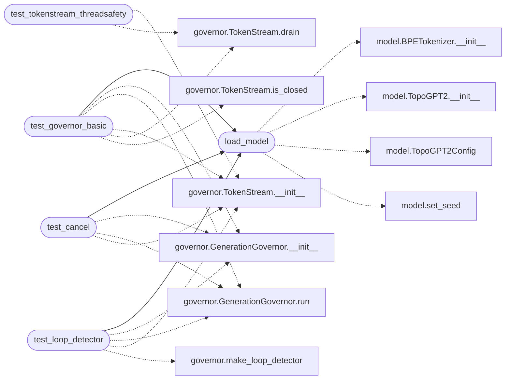

# `eval.governor_smoke`

> Source: [eval/governor_smoke.py:1](../../eval/governor_smoke.py#L1) | language `py` | coverage 16.7% | [API index](../index.md)

Smoke test for eval.governor (TokenStream + GenerationGovernor).

Verifies:
  - TokenStream threadsafety with a producer/consumer scenario
  - GenerationGovernor emits one StopReason per call
  - Loop detector actually fires
  - User cancel() works

## Contents

- **Functions:** [`load_model`](#load_model), [`test_tokenstream_threadsafety`](#test_tokenstream_threadsafety), [`test_governor_basic`](#test_governor_basic), [`test_loop_detector`](#test_loop_detector), [`test_cancel`](#test_cancel)

## Call Graph

Solid arrows stay in this module, dashed arrows leave it.



## Functions

<a id="load_model"></a>

### `load_model`

`function` | [eval/governor_smoke.py:30](../../eval/governor_smoke.py#L30)

```python
def load_model()
```

*Calls:* [`BPETokenizer.__init__`](topogpt3.model.py.md#bpetokenizer-__init__), [`TopoGPT2.__init__`](topogpt3.model.py.md#topogpt2-__init__), [`TopoGPT2Config`](topogpt3.model.py.md#topogpt2config), [`set_seed`](topogpt3.model.py.md#set_seed)

*Called by:* [`test_cancel`](#test_cancel), [`test_governor_basic`](#test_governor_basic), [`test_loop_detector`](#test_loop_detector)

---

<a id="test_tokenstream_threadsafety"></a>

### `test_tokenstream_threadsafety`

`function` | [eval/governor_smoke.py:49](../../eval/governor_smoke.py#L49)

```python
def test_tokenstream_threadsafety()
```

*Calls:* [`TokenStream.__init__`](eval.governor.py.md#tokenstream-__init__), [`TokenStream.drain`](eval.governor.py.md#tokenstream-drain)

---

<a id="test_governor_basic"></a>

### `test_governor_basic`

`function` | [eval/governor_smoke.py:79](../../eval/governor_smoke.py#L79)

```python
def test_governor_basic()
```

*Calls:* [`GenerationGovernor.__init__`](eval.governor.py.md#generationgovernor-__init__), [`GenerationGovernor.run`](eval.governor.py.md#generationgovernor-run), [`TokenStream.__init__`](eval.governor.py.md#tokenstream-__init__), [`TokenStream.drain`](eval.governor.py.md#tokenstream-drain), [`TokenStream.is_closed`](eval.governor.py.md#tokenstream-is_closed), [`load_model`](#load_model)

---

<a id="test_loop_detector"></a>

### `test_loop_detector`

`function` | [eval/governor_smoke.py:98](../../eval/governor_smoke.py#L98)

```python
def test_loop_detector()
```

*Calls:* [`GenerationGovernor.__init__`](eval.governor.py.md#generationgovernor-__init__), [`GenerationGovernor.run`](eval.governor.py.md#generationgovernor-run), [`TokenStream.__init__`](eval.governor.py.md#tokenstream-__init__), [`make_loop_detector`](eval.governor.py.md#make_loop_detector), [`load_model`](#load_model)

---

<a id="test_cancel"></a>

### `test_cancel`

`function` | [eval/governor_smoke.py:118](../../eval/governor_smoke.py#L118)

```python
def test_cancel()
```

*Calls:* [`GenerationGovernor.__init__`](eval.governor.py.md#generationgovernor-__init__), [`GenerationGovernor.run`](eval.governor.py.md#generationgovernor-run), [`TokenStream.__init__`](eval.governor.py.md#tokenstream-__init__), [`load_model`](#load_model)

---
