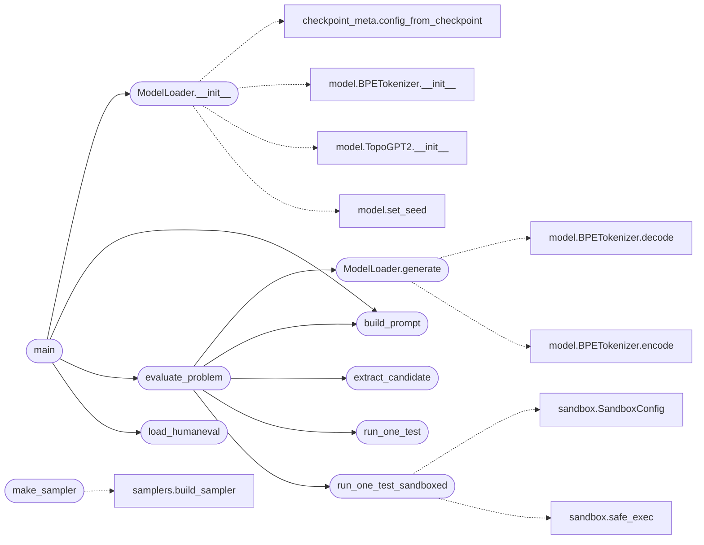

# `eval.harness`

> Source: [eval/harness.py:1](../../eval/harness.py#L1) | language `py` | coverage 61.5% | [API index](../index.md)

Harness for evaluating TopoGPT3 on HumanEval (164 problems).

Faithful to the official HumanEval protocol: for each problem we feed the
model the function signature and docstring, let it produce a completion,
extract the candidate function (everything from `def` up to a sentinel),
and run the hidden test against it. We do NOT use `entry_point` from the
dataset because the prompt we feed the model already contains it.

Two sampler modes are supported:
  - "standard" -> topogpt3.InferencePipeline
  - "hrm"      -> topogpt3.HRMInferencePipeline

Results are written to JSONL so multiple sampler configurations can share
a single HumanEval cache and be compared later.

## Contents

- **Classes:** [`ModelLoader`](#modelloader)
- **Functions:** [`load_humaneval`](#load_humaneval), [`build_prompt`](#build_prompt), [`extract_candidate`](#extract_candidate), [`run_one_test`](#run_one_test), [`run_one_test_sandboxed`](#run_one_test_sandboxed), [`make_sampler`](#make_sampler), [`completion_for_problem`](#completion_for_problem), [`evaluate_problem`](#evaluate_problem), [`main`](#main)
- **Constants:** [`HF_HE_REPO`](#hf_he_repo)

## Call Graph

Solid arrows stay in this module, dashed arrows leave it.



## Classes

<a id="modelloader"></a>

### `ModelLoader`

`class` | [eval/harness.py:229](../../eval/harness.py#L229)

```python
class ModelLoader
```

Build the model and tokenizer once, run many generations.

**Members**

| Member | Kind | Summary |
|---|---|---|
| [`__init__`](#modelloader-__init__) | constructor |  |
| [`generate`](#modelloader-generate) | method |  |

<a id="modelloader-__init__"></a>

#### `ModelLoader.__init__`

`constructor` | [eval/harness.py:232](../../eval/harness.py#L232)

```python
def __init__(self, ckpt_dir: str, ckpt_name: str = 'last', device: str = None)
```

**Parameters**

| Name | Type | Default | Description |
|---|---|---|---|
| `ckpt_dir` | `str` |  |  |
| `ckpt_name` | `str` | `'last'` |  |
| `device` | `str` | `None` |  |

*Calls:* [`config_from_checkpoint`](topogpt3.checkpoint_meta.py.md#config_from_checkpoint), [`BPETokenizer.__init__`](topogpt3.model.py.md#bpetokenizer-__init__), [`TopoGPT2.__init__`](topogpt3.model.py.md#topogpt2-__init__), [`set_seed`](topogpt3.model.py.md#set_seed)

*Called by:* [`main`](#main)

<a id="modelloader-generate"></a>

#### `ModelLoader.generate`

`method` | [eval/harness.py:257](../../eval/harness.py#L257)

Decorators: `@torch.no_grad()`

```python
def generate(self, prompt: str, max_new_tokens: int, temperature: float, top_k: int, repetition_penalty: float) -> tuple[str, dict]
```

**Parameters**

| Name | Type | Default | Description |
|---|---|---|---|
| `prompt` | `str` |  |  |
| `max_new_tokens` | `int` |  |  |
| `temperature` | `float` |  |  |
| `top_k` | `int` |  |  |
| `repetition_penalty` | `float` |  |  |

**Returns:** `tuple[str, dict]`

*Calls:* [`BPETokenizer.decode`](topogpt3.model.py.md#bpetokenizer-decode), [`BPETokenizer.encode`](topogpt3.model.py.md#bpetokenizer-encode)

*Called by:* [`evaluate_problem`](#evaluate_problem)

---

## Functions

<a id="load_humaneval"></a>

### `load_humaneval`

`function` | [eval/harness.py:54](../../eval/harness.py#L54)

```python
def load_humaneval(cache_dir: str = 'data/humaneval')
```

**Parameters**

| Name | Type | Default | Description |
|---|---|---|---|
| `cache_dir` | `str` | `'data/humaneval'` |  |

*Called by:* [`main`](#main), [`main`](eval.integration_smoke.py.md#main), [`main`](eval.noise_sweep.py.md#main), [`main`](eval.temp_sweep.py.md#main)

---

<a id="build_prompt"></a>

### `build_prompt`

`function` | [eval/harness.py:72](../../eval/harness.py#L72)

```python
def build_prompt(problem: dict) -> str
```

Return the exact prompt text fed to the model.

HumanEval's `prompt` field already contains the function signature and
docstring, with the body to be completed starting on the next line.

**Parameters**

| Name | Type | Default | Description |
|---|---|---|---|
| `problem` | `dict` |  |  |

**Returns:** `str`

*Called by:* [`evaluate_problem`](#evaluate_problem), [`main`](#main), [`main`](eval.noise_sweep.py.md#main), [`evaluate_problems`](eval.temp_sweep.py.md#evaluate_problems)

---

<a id="extract_candidate"></a>

### `extract_candidate`

`function` | [eval/harness.py:97](../../eval/harness.py#L97)

```python
def extract_candidate(prompt: str, completion: str) -> str
```

Combine prompt + completion into a single Python source string.

The completion may itself start with whitespace/indentation that
belongs inside the function body. We strip leading blank lines and
then concatenate; we also stop at the first top-level `def ` or
`class ` to avoid the model continuing with extra functions.

Robustness fixes:
  - Strip the special <|endoftext|> (GPT-2 EOT) token that the model
    emits at the end of every generation. Leaving it in the candidate
    produces a SyntaxError and zeroes the pass rate.
  - Drop any training-format delimiters (### Response, <|assistant|>,
    <|user|>) that leak from the instruction-tuning corpus.
  - Cut at the first top-level def/class/__main__ guard after the
    function body has started.

**Parameters**

| Name | Type | Default | Description |
|---|---|---|---|
| `prompt` | `str` |  |  |
| `completion` | `str` |  |  |

**Returns:** `str`

*Called by:* [`evaluate_problem`](#evaluate_problem), [`main`](eval.noise_sweep.py.md#main), [`evaluate_problems`](eval.temp_sweep.py.md#evaluate_problems)

---

<a id="run_one_test"></a>

### `run_one_test`

`function` | [eval/harness.py:154](../../eval/harness.py#L154)

```python
def run_one_test(problem: dict, candidate_src: str, timeout: float) -> tuple[bool, str, str, str, str]
```

Execute the candidate against the hidden test.

Returns (passed, message, stdout, stderr, traceback). We follow HumanEval's
[`evaluate`](topogpt3.eval_toolcall.py.md#evaluate) function: build namespace, exec the candidate, exec the test,
expect `check(candidate) == None`.

**Parameters**

| Name | Type | Default | Description |
|---|---|---|---|
| `problem` | `dict` |  |  |
| `candidate_src` | `str` |  |  |
| `timeout` | `float` |  |  |

**Returns:** `tuple[bool, str, str, str, str]`

*Called by:* [`evaluate_problem`](#evaluate_problem), [`main`](eval.integration_smoke.py.md#main), [`main`](eval.noise_sweep.py.md#main), [`evaluate_problems`](eval.temp_sweep.py.md#evaluate_problems)

---

<a id="run_one_test_sandboxed"></a>

### `run_one_test_sandboxed`

`function` | [eval/harness.py:178](../../eval/harness.py#L178)

```python
def run_one_test_sandboxed(problem: dict, candidate_src: str, timeout: float, sandbox_cfg=None) -> tuple[bool, str, str, str, str]
```

Sandboxed variant of [`run_one_test`](#run_one_test).

Runs the candidate in a subprocess with stripped builtins, AST pre-check, and OS-enforced timeout. Drop-in replacement: same 5-tuple return.

Enable by passing `--sandbox` to `harness.py` (not yet wired) or
by calling this function directly from your own evaluation script.

**Parameters**

| Name | Type | Default | Description |
|---|---|---|---|
| `problem` | `dict` |  |  |
| `candidate_src` | `str` |  |  |
| `timeout` | `float` |  |  |
| `sandbox_cfg` |  | `None` |  |

**Returns:** `tuple[bool, str, str, str, str]`

*Calls:* [`SandboxConfig`](eval.sandbox.py.md#sandboxconfig), [`safe_exec`](eval.sandbox.py.md#safe_exec)

*Called by:* [`evaluate_problem`](#evaluate_problem), [`main`](eval.integration_smoke.py.md#main)

---

<a id="make_sampler"></a>

### `make_sampler`

`function` | [eval/harness.py:205](../../eval/harness.py#L205)

```python
def make_sampler(mode: str, settings_kwargs: dict)
```

Backwards-compatible shim.

The real implementation lives in [`eval.samplers`](eval.samplers.py.md) as a decorator-based registry. We re-export here so existing imports of `from eval.harness import make_sampler` keep working. New code should import from [`eval.samplers`](eval.samplers.py.md).

**Parameters**

| Name | Type | Default | Description |
|---|---|---|---|
| `mode` | `str` |  |  |
| `settings_kwargs` | `dict` |  |  |

*Calls:* [`build_sampler`](eval.samplers.py.md#build_sampler)

---

<a id="completion_for_problem"></a>

### `completion_for_problem`

`function` | [eval/harness.py:215](../../eval/harness.py#L215)

```python
def completion_for_problem(sampler, prompt: str) -> tuple[str, dict]
```

Run a single completion and return (raw_output_text, metrics_dict).

**Parameters**

| Name | Type | Default | Description |
|---|---|---|---|
| `sampler` |  |  |  |
| `prompt` | `str` |  |  |

**Returns:** `tuple[str, dict]`

**Raises**

- `NotImplementedError`: (raised in the body, not documented)

---

<a id="evaluate_problem"></a>

### `evaluate_problem`

`function` | [eval/harness.py:290](../../eval/harness.py#L290)

```python
def evaluate_problem(problem: dict, loader: ModelLoader, args, sample_idx: int = 0) -> dict
```

**Parameters**

| Name | Type | Default | Description |
|---|---|---|---|
| `problem` | `dict` |  |  |
| `loader` | `ModelLoader` |  |  |
| `args` |  |  |  |
| `sample_idx` | `int` | `0` |  |

**Returns:** `dict`

*Calls:* [`ModelLoader.generate`](#modelloader-generate), [`build_prompt`](#build_prompt), [`extract_candidate`](#extract_candidate), [`run_one_test`](#run_one_test), [`run_one_test_sandboxed`](#run_one_test_sandboxed)

*Called by:* [`main`](#main)

---

<a id="main"></a>

### `main`

`function` | [eval/harness.py:343](../../eval/harness.py#L343)

```python
def main()
```

*Calls:* [`ModelLoader.__init__`](#modelloader-__init__), [`build_prompt`](#build_prompt), [`evaluate_problem`](#evaluate_problem), [`load_humaneval`](#load_humaneval)

---

## Constants

<a id="hf_he_repo"></a>

### `HF_HE_REPO`

`constant` | [eval/harness.py:51](../../eval/harness.py#L51)

```python
HF_HE_REPO = 'openai/openai_humaneval'
```

---
