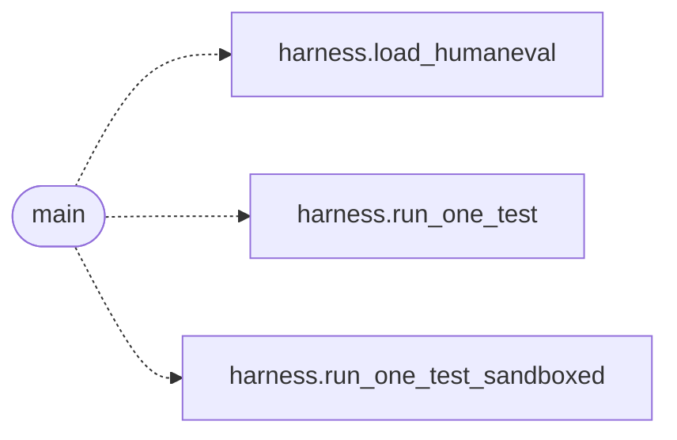

# `eval.integration_smoke`

> Source: [eval/integration_smoke.py:1](../../eval/integration_smoke.py#L1) | language `py` | coverage 50.0% | [API index](../index.md)

End-to-end smoke test of all P0+P1 components working together.

Verifies that [`run_one_test_sandboxed`](eval.harness.py.md#run_one_test_sandboxed) can run a *valid* HumanEval
candidate through the sandbox and get a pass=True result. This
exercises the integration of:
  - sandbox.py (P0)
  - harness.py integration (the new run_one_test_sandboxed)
  - HumanEval canonical protocol (prompt + completion + test)

## Contents

- **Functions:** [`main`](#main)

## Call Graph

Solid arrows stay in this module, dashed arrows leave it.



## Functions

<a id="main"></a>

### `main`

`function` | [eval/integration_smoke.py:18](../../eval/integration_smoke.py#L18)

```python
def main()
```

**Raises**

- `AssertionError`: (raised in the body, not documented)

*Calls:* [`load_humaneval`](eval.harness.py.md#load_humaneval), [`run_one_test`](eval.harness.py.md#run_one_test), [`run_one_test_sandboxed`](eval.harness.py.md#run_one_test_sandboxed)

---
