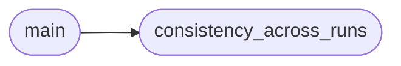

# `eval.noise_analysis`

> Source: [eval/noise_analysis.py:1](../../eval/noise_analysis.py#L1) | language `py` | coverage 66.7% | [API index](../index.md)

Analisis post-hoc del noise sweep.

Generaciones del MISMO prompt bajo distintos niveles de ruido -> comparar
con metricas que NO son pass@1 (porque los problemas triviales saturan):

  - generation_exact_match:  % de generaciones que matchean exactamente
                             el baseline (token por token)
  - prefix_agreement@50:    % de pares (baseline, noisy) que comparten
                            el mismo prefijo de 50 tokens
  - levenshtein_dist:       distancia de edicion normalizada al baseline
  - token_jaccard:          interseccion / union de tokens generados
  - bleu_1:                 unigrama precision
  - syntax_ok_rate:         % que pasa ast.parse (sintaxis Python valida)

Salida: eval/runs/noise_analysis_<tag>.json

## Contents

- **Functions:** [`consistency_across_runs`](#consistency_across_runs), [`main`](#main)
- **Constants:** [`REPO_ROOT`](#repo_root)

## Call Graph

Solid arrows stay in this module, dashed arrows leave it.



## Functions

<a id="consistency_across_runs"></a>

### `consistency_across_runs`

`function` | [eval/noise_analysis.py:47](../../eval/noise_analysis.py#L47)

```python
def consistency_across_runs(per_run: Dict[float, Dict[str, dict]]) -> Dict
```

Para cada problema, mira si pasa consistentemente a traves de los 4 niveles de ruido.

Devuelve: - always_pass, always_fail, mixed (count) - per_sigma_pass_lists: {sigma: {task_id: bool}}

**Parameters**

| Name | Type | Default | Description |
|---|---|---|---|
| `per_run` | `Dict[float, Dict[str, dict]]` |  |  |

**Returns:** `Dict`

*Called by:* [`main`](#main)

---

<a id="main"></a>

### `main`

`function` | [eval/noise_analysis.py:83](../../eval/noise_analysis.py#L83)

```python
def main()
```

*Calls:* [`consistency_across_runs`](#consistency_across_runs)

---

## Constants

<a id="repo_root"></a>

### `REPO_ROOT`

`constant` | [eval/noise_analysis.py:29](../../eval/noise_analysis.py#L29)

```python
REPO_ROOT = Path(__file__).resolve().parent.parent
```

---
