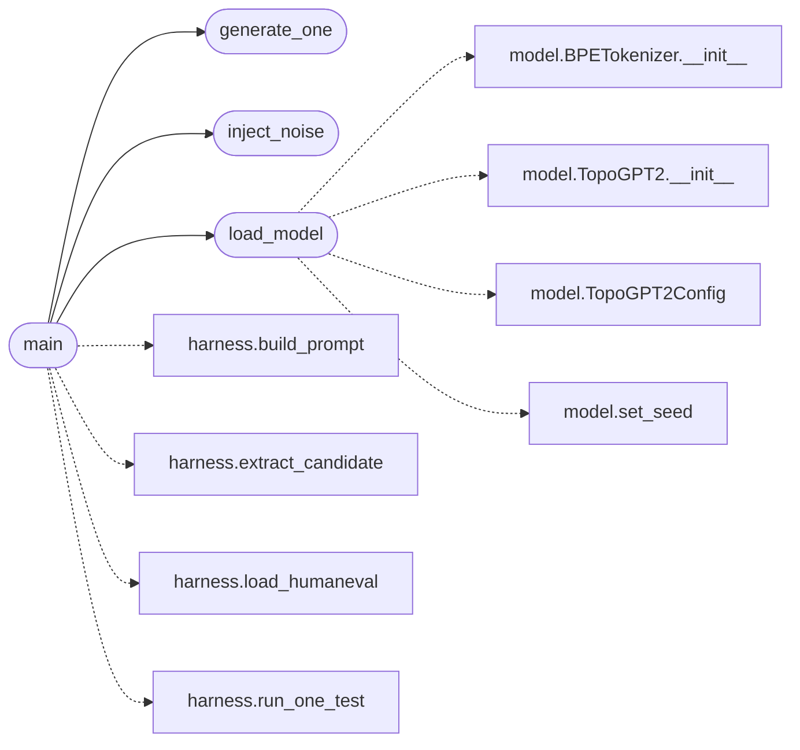

# `eval.noise_sweep`

> Source: [eval/noise_sweep.py:1](../../eval/noise_sweep.py#L1) | language `py` | coverage 60.0% | [API index](../index.md)

Barrido de ruido en los pesos espectrales del checkpoint TopoGPT3.

Para cada nivel sigma en --sigmas:
  1. Carga el checkpoint base (NO modifica el archivo, solo los pesos en RAM)
  2. Inyecta ruido gaussiano N(0, sigma) en los kernels espectrales
     cuaternionicos (kr_w/x/y/z, ki_w/x/y/z) y solo en ellos.
     Asi aislamos el efecto del ruido sobre la parte que el marco
     teorico dice que esta protegida topologicamente.
  3. Genera pass@1 (greedy, T=0) sobre los primeros N problemas de
     HumanEval (subset para mantener tiempo de pared manejable)
  4. Ejecuta los tests canonicos y mide pass rate

Salida: eval/runs/noise_<sigma>_<tag>.jsonl
        eval/runs/noise_sweep_<timestamp>.jsonl (resumen agregado)

## Contents

- **Functions:** [`inject_noise`](#inject_noise), [`load_model`](#load_model), [`generate_one`](#generate_one), [`main`](#main)
- **Constants:** [`REPO_ROOT`](#repo_root)

## Call Graph

Solid arrows stay in this module, dashed arrows leave it.



## Functions

<a id="inject_noise"></a>

### `inject_noise`

`function` | [eval/noise_sweep.py:46](../../eval/noise_sweep.py#L46)

```python
def inject_noise(model: TopoGPT2, sigma: float, seed: int) -> Dict[str, int]
```

Anade N(0, sigma) a TODOS los kernels espectrales (kr_*, ki_*).

Retorna un dict con conteo de tensores ruidosos y de parametros modificados.

**Parameters**

| Name | Type | Default | Description |
|---|---|---|---|
| `model` | `TopoGPT2` |  |  |
| `sigma` | `float` |  |  |
| `seed` | `int` |  |  |

**Returns:** `Dict[str, int]`

*Called by:* [`main`](#main)

---

<a id="load_model"></a>

### `load_model`

`function` | [eval/noise_sweep.py:74](../../eval/noise_sweep.py#L74)

```python
def load_model(ckpt_dir: str, ckpt_name: str, device: str)
```

Reconstruye TopoGPT2 alineado con el checkpoint, sin acceso a harness.ModelLoader (queremos un loader limpio que no comparta estado con corridas paralelas).

**Parameters**

| Name | Type | Default | Description |
|---|---|---|---|
| `ckpt_dir` | `str` |  |  |
| `ckpt_name` | `str` |  |  |
| `device` | `str` |  |  |

*Calls:* [`BPETokenizer.__init__`](topogpt3.model.py.md#bpetokenizer-__init__), [`TopoGPT2.__init__`](topogpt3.model.py.md#topogpt2-__init__), [`TopoGPT2Config`](topogpt3.model.py.md#topogpt2config), [`set_seed`](topogpt3.model.py.md#set_seed)

*Called by:* [`main`](#main), [`main`](eval.temp_sweep.py.md#main)

---

<a id="generate_one"></a>

### `generate_one`

`function` | [eval/noise_sweep.py:99](../../eval/noise_sweep.py#L99)

Decorators: `@torch.no_grad()`

```python
def generate_one(model, tok, prompt: str, max_new_tokens: int, device: str)
```

**Parameters**

| Name | Type | Default | Description |
|---|---|---|---|
| `model` |  |  |  |
| `tok` |  |  |  |
| `prompt` | `str` |  |  |
| `max_new_tokens` | `int` |  |  |
| `device` | `str` |  |  |

*Called by:* [`main`](#main)

---

<a id="main"></a>

### `main`

`function` | [eval/noise_sweep.py:117](../../eval/noise_sweep.py#L117)

```python
def main()
```

*Calls:* [`build_prompt`](eval.harness.py.md#build_prompt), [`extract_candidate`](eval.harness.py.md#extract_candidate), [`load_humaneval`](eval.harness.py.md#load_humaneval), [`run_one_test`](eval.harness.py.md#run_one_test), [`generate_one`](#generate_one), [`inject_noise`](#inject_noise), [`load_model`](#load_model)

---

## Constants

<a id="repo_root"></a>

### `REPO_ROOT`

`constant` | [eval/noise_sweep.py:29](../../eval/noise_sweep.py#L29)

```python
REPO_ROOT = Path(__file__).resolve().parent.parent
```

---
