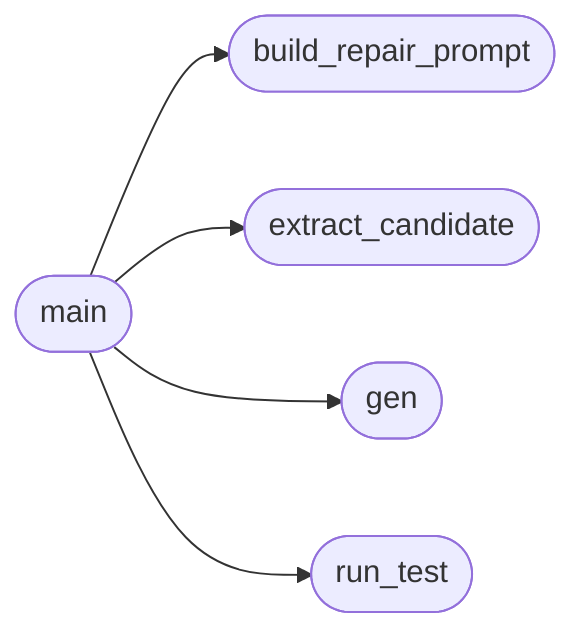

# `eval.repair`

> Source: [eval/repair.py:1](../../eval/repair.py#L1) | language `py` | coverage 16.7% | [API index](../index.md)

Self-repair loop on top of a greedy JSONL.

Takes the failed problems from --input, builds a rejection-feedback prompt
that contains:
  - the original HumanEval prompt (signature + docstring)
  - the candidate the model wrote on its first attempt
  - the traceback from the hidden test
  - a "# fix:" cue

and re-prompts the model to rewrite the function. Runs N rounds. Each
problem's *best* outcome across rounds is recorded.

Output: a new JSONL with the same shape as harness.py.

## Contents

- **Functions:** [`extract_candidate`](#extract_candidate), [`run_test`](#run_test), [`build_repair_prompt`](#build_repair_prompt), [`gen`](#gen), [`main`](#main)

## Call Graph

Solid arrows stay in this module, dashed arrows leave it.



## Functions

<a id="extract_candidate"></a>

### `extract_candidate`

`function` | [eval/repair.py:49](../../eval/repair.py#L49)

```python
def extract_candidate(prompt: str, completion: str) -> str
```

**Parameters**

| Name | Type | Default | Description |
|---|---|---|---|
| `prompt` | `str` |  |  |
| `completion` | `str` |  |  |

**Returns:** `str`

*Called by:* [`main`](#main)

---

<a id="run_test"></a>

### `run_test`

`function` | [eval/repair.py:75](../../eval/repair.py#L75)

```python
def run_test(problem: dict, candidate_src: str) -> Tuple[bool, str]
```

**Parameters**

| Name | Type | Default | Description |
|---|---|---|---|
| `problem` | `dict` |  |  |
| `candidate_src` | `str` |  |  |

**Returns:** `Tuple[bool, str]`

*Called by:* [`main`](#main)

---

<a id="build_repair_prompt"></a>

### `build_repair_prompt`

`function` | [eval/repair.py:89](../../eval/repair.py#L89)

```python
def build_repair_prompt(prompt: str, candidate: str, err: str, entry_point: str) -> str
```

**Parameters**

| Name | Type | Default | Description |
|---|---|---|---|
| `prompt` | `str` |  |  |
| `candidate` | `str` |  |  |
| `err` | `str` |  |  |
| `entry_point` | `str` |  |  |

**Returns:** `str`

*Called by:* [`main`](#main)

---

<a id="gen"></a>

### `gen`

`function` | [eval/repair.py:104](../../eval/repair.py#L104)

Decorators: `@torch.no_grad()`

```python
def gen(model, tok, text: str, max_new_tokens: int, temperature: float, top_k: int, rep_penalty: float) -> Tuple[str, int, float]
```

**Parameters**

| Name | Type | Default | Description |
|---|---|---|---|
| `model` |  |  |  |
| `tok` |  |  |  |
| `text` | `str` |  |  |
| `max_new_tokens` | `int` |  |  |
| `temperature` | `float` |  |  |
| `top_k` | `int` |  |  |
| `rep_penalty` | `float` |  |  |

**Returns:** `Tuple[str, int, float]`

*Called by:* [`main`](#main)

---

<a id="main"></a>

### `main`

`function` | [eval/repair.py:119](../../eval/repair.py#L119)

```python
def main()
```

*Calls:* [`build_repair_prompt`](#build_repair_prompt), [`extract_candidate`](#extract_candidate), [`gen`](#gen), [`run_test`](#run_test)

---
