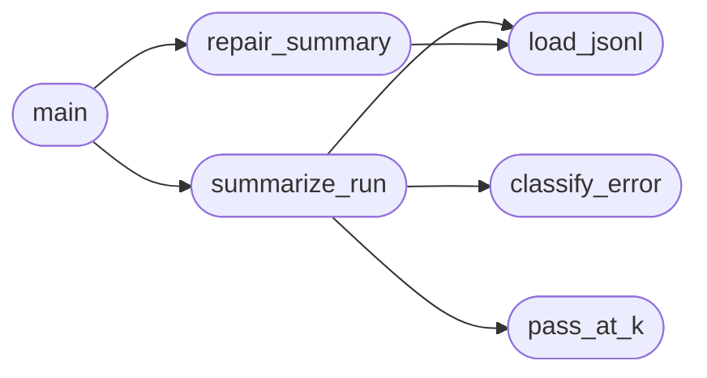

# `eval.report`

> Source: [eval/report.py:1](../../eval/report.py#L1) | language `py` | coverage 14.3% | [API index](../index.md)

Aggregate every JSONL in eval/runs into a final report.

Reads runs from the original pass@k runs, the HRM run, the repair run,
and produces:
  - pass@1 / pass@k tables
  - error-class breakdowns
  - wall-clock / throughput
  - a comparison standard vs HRM
  - a self-repair impact summary
  - emits REPORT.md next to the runs/

## Contents

- **Functions:** [`pass_at_k`](#pass_at_k), [`classify_error`](#classify_error), [`load_jsonl`](#load_jsonl), [`summarize_run`](#summarize_run), [`repair_summary`](#repair_summary), [`main`](#main)

## Call Graph

Solid arrows stay in this module, dashed arrows leave it.



## Functions

<a id="pass_at_k"></a>

### `pass_at_k`

`function` | [eval/report.py:25](../../eval/report.py#L25)

```python
def pass_at_k(n, c, k)
```

**Parameters**

| Name | Type | Default | Description |
|---|---|---|---|
| `n` |  |  |  |
| `c` |  |  |  |
| `k` |  |  |  |

*Called by:* [`summarize_run`](#summarize_run)

---

<a id="classify_error"></a>

### `classify_error`

`function` | [eval/report.py:31](../../eval/report.py#L31)

```python
def classify_error(msg)
```

**Parameters**

| Name | Type | Default | Description |
|---|---|---|---|
| `msg` |  |  |  |

*Called by:* [`summarize_run`](#summarize_run)

---

<a id="load_jsonl"></a>

### `load_jsonl`

`function` | [eval/report.py:52](../../eval/report.py#L52)

```python
def load_jsonl(p)
```

**Parameters**

| Name | Type | Default | Description |
|---|---|---|---|
| `p` |  |  |  |

*Called by:* [`repair_summary`](#repair_summary), [`summarize_run`](#summarize_run)

---

<a id="summarize_run"></a>

### `summarize_run`

`function` | [eval/report.py:56](../../eval/report.py#L56)

```python
def summarize_run(p)
```

**Parameters**

| Name | Type | Default | Description |
|---|---|---|---|
| `p` |  |  |  |

*Calls:* [`classify_error`](#classify_error), [`load_jsonl`](#load_jsonl), [`pass_at_k`](#pass_at_k)

*Called by:* [`main`](#main)

---

<a id="repair_summary"></a>

### `repair_summary`

`function` | [eval/report.py:90](../../eval/report.py#L90)

```python
def repair_summary(repair_path, baseline_path)
```

**Parameters**

| Name | Type | Default | Description |
|---|---|---|---|
| `repair_path` |  |  |  |
| `baseline_path` |  |  |  |

*Calls:* [`load_jsonl`](#load_jsonl)

*Called by:* [`main`](#main)

---

<a id="main"></a>

### `main`

`function` | [eval/report.py:117](../../eval/report.py#L117)

```python
def main()
```

*Calls:* [`repair_summary`](#repair_summary), [`summarize_run`](#summarize_run)

---
