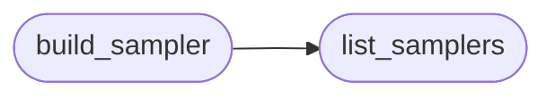

# `eval.samplers`

> Source: [eval/samplers.py:1](../../eval/samplers.py#L1) | language `py` | coverage 75.0% | [API index](../index.md)

Registry of sampler constructors for the HumanEval harness.

Replaces the hardcoded `if mode == "standard": ... elif mode == "hrm": ...`
chain in [`eval.harness.make_sampler`](eval.harness.py.md#make_sampler) with a decorator-based registry that
mirrors the pattern in `claude-code-main/src/tools.ts`.

The pattern:
  - `@register_sampler("name")` decorates a factory function that
    takes a `settings_kwargs` dict (already filtered for sampler-specific
    keys) and returns an object with a `run()` method (or just a sampler
    object that `harness.evaluate_problem` knows how to drive).
  - `build_sampler("name", settings_kwargs)` is the public entry point.
  - [`list_samplers`](#list_samplers) returns the registered names for `--help` output.

Adding a new sampler is then a one-decorator change, not an edit to
the harness's control flow.

## Contents

- **Functions:** [`register_sampler`](#register_sampler), [`list_samplers`](#list_samplers), [`build_sampler`](#build_sampler)
- **Constants:** [`SAMPLER_REGISTRY`](#sampler_registry)

## Call Graph

Solid arrows stay in this module, dashed arrows leave it.



## Functions

<a id="register_sampler"></a>

### `register_sampler`

`function` | [eval/samplers.py:36](../../eval/samplers.py#L36)

```python
def register_sampler(name: str, *, enabled_env: str | None = None)
```

Decorator.

Register a factory under `name`. If `enabled_env` is set, the factory is only registered when that env var is truthy. This mirrors the `feature('XXX')` gating in claude-code-main/src/tools.ts.

**Parameters**

| Name | Type | Default | Description |
|---|---|---|---|
| `name` | `str` |  |  |
| `enabled_env` | `str \| None` | `None` |  |

---

<a id="list_samplers"></a>

### `list_samplers`

`function` | [eval/samplers.py:86](../../eval/samplers.py#L86)

```python
def list_samplers() -> List[str]
```

**Returns:** `List[str]`

*Called by:* [`build_sampler`](#build_sampler)

---

<a id="build_sampler"></a>

### `build_sampler`

`function` | [eval/samplers.py:90](../../eval/samplers.py#L90)

```python
def build_sampler(mode: str, settings_kwargs: dict)
```

Construct a sampler.

Drop-in replacement for the old `make_sampler(mode, settings_kwargs)` in [`eval.harness`](eval.harness.py.md).

**Parameters**

| Name | Type | Default | Description |
|---|---|---|---|
| `mode` | `str` |  |  |
| `settings_kwargs` | `dict` |  |  |

**Raises**

- `ValueError`: (raised in the body, not documented)

*Calls:* [`list_samplers`](#list_samplers)

*Called by:* [`make_sampler`](eval.harness.py.md#make_sampler)

---

## Constants

<a id="sampler_registry"></a>

### `SAMPLER_REGISTRY`

`constant` | [eval/samplers.py:33](../../eval/samplers.py#L33)

```python
SAMPLER_REGISTRY: Dict[str, SamplerFactory] = {}
```

---
