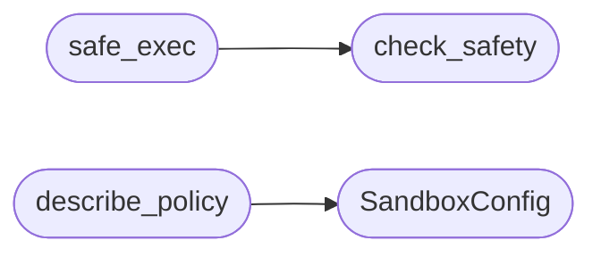

# `eval.sandbox`

> Source: [eval/sandbox.py:1](../../eval/sandbox.py#L1) | language `py` | coverage 80.0% | [API index](../index.md)

Sandbox for executing model-generated code during HumanEval evaluation.

This module replaces the bare `exec()` call in `eval/harness.py:run_one_test`
with a defence-in-depth check inspired by Claude Code's BashTool permission
gates (see `claude-code-main/src/tools/BashTool/bashSecurity.ts`).

The threat model:
  - A language model emits Python source as a "candidate function".
  - The candidate is `exec()`'d alongside a hidden test.
  - Without protection, the model can `import os; os.system('rm -rf /')`,
    read secrets, fork-bomb, or hang the evaluator forever.

Layered defences (each can be disabled independently for debugging):
  1. AST pre-check: parse the candidate, reject anything that imports
     dangerous modules, calls dangerous builtins, or shadows `__builtins__`.
  2. Builtin whitelist: even if the candidate parses, [`safe_exec`](#safe_exec) provides
     a stripped `__builtins__` without `open`, `exec`, `eval`, `__import__`,
     `compile`, `getattr` (controversial but standard).
  3. Subprocess isolation: [`safe_exec`](#safe_exec) runs the program in a child
     process so the OS enforces the timeout (vs. signal-based which the
     main thread can swallow).
  4. Output capture: stdout/stderr are piped, not inherited from the
     parent terminal.

Usage:
    from eval.sandbox import safe_exec, check_safety, SandboxConfig

    cfg = SandboxConfig(timeout=10.0, dry_run=False)
    ok, reason = check_safety(candidate_src, cfg)
    if not ok:
        return False, f"rejected by sandbox: {reason}", "", "", ""

    passed, msg, so, se, tb = safe_exec(program_src, cfg)

## Contents

- **Classes:** [`SandboxConfig`](#sandboxconfig)
- **Functions:** [`check_safety`](#check_safety), [`safe_exec`](#safe_exec), [`describe_policy`](#describe_policy)

## Call Graph

Solid arrows stay in this module, dashed arrows leave it.



## Classes

<a id="sandboxconfig"></a>

### `SandboxConfig`

`class` `dataclass` | [eval/sandbox.py:53](../../eval/sandbox.py#L53)

Decorators: `@dataclass`

```python
class SandboxConfig
```

One knob per defence layer.

Defaults match HumanEval-style eval.

**Attributes**

| Name | Type | Default | Description |
|---|---|---|---|
| [`timeout`](#sandboxconfig-timeout) | `float` | `20.0` |  |
| [`dry_run`](#sandboxconfig-dry_run) | `bool` | `False` |  |
| [`max_ast_depth`](#sandboxconfig-max_ast_depth) | `int` | `50` |  |
| [`max_program_bytes`](#sandboxconfig-max_program_bytes) | `int` | `200000` |  |
| [`allowed_builtin_names`](#sandboxconfig-allowed_builtin_names) | `Set[str]` | `field(default_factory=lambda: {'abs', 'all', 'any', 'ascii', 'bin', 'bool', 'bytearray', 'bytes', 'callable', 'chr', 'classmethod', 'complex', 'copyright', 'credits', 'dict', 'dir', 'divmod', 'enumerate', 'exit', 'filter', 'float', 'format', 'frozenset', 'hash', 'hex', 'id', 'int', 'isinstance', 'issubclass', 'iter', 'len', 'list', 'map', 'max', 'memoryview', 'min', 'next', 'object', 'oct', 'ord', 'pow', 'print', 'property', 'quit', 'range', 'repr', 'reversed', 'round', 'set', 'slice', 'sorted', 'staticmethod', 'str', 'sum', 'super', 'tuple', 'type', 'zip', '__build_class__', '__name__', '__doc__', '__loader__', '__spec__', '__file__', '__package__'})` |  |
| [`blocked_modules`](#sandboxconfig-blocked_modules) | `Set[str]` | `field(default_factory=lambda: {'os', 'sys', 'subprocess', 'socket', 'shutil', 'ctypes', 'cffi', 'multiprocessing', 'threading', 'requests', 'urllib', 'http', 'ftplib', 'smtplib', 'telnetlib', 'asyncio', 'signal', 'fcntl', 'resource', 'pwd', 'grp', 'termios', 'tty', 'pty', 'posix', 'importlib', 'code', 'codeop', 'pickle', 'shelve', 'marshal'})` |  |
| [`blocked_dunder_attrs`](#sandboxconfig-blocked_dunder_attrs) | `Set[str]` | `field(default_factory=lambda: {'__class__', '__bases__', '__subclasses__', '__globals__', '__code__', '__subclasses__', '__import__', '__builtins__', '__loader__', '__spec__', '__init_subclass__', '__set_name__'})` |  |

---

## Functions

<a id="check_safety"></a>

### `check_safety`

`function` | [eval/sandbox.py:133](../../eval/sandbox.py#L133)

```python
def check_safety(source: str, cfg: SandboxConfig) -> Tuple[bool, str]
```

Return (ok, reason).

[`reason`](topogpt3.inference_hrm.py.md#hierarchicalrecursivereasoner-reason) is "" when ok, else a human-readable one-line explanation. Reasons are stable (used in test fixtures).

**Parameters**

| Name | Type | Default | Description |
|---|---|---|---|
| `source` | `str` |  |  |
| `cfg` | `SandboxConfig` |  |  |

**Returns:** `Tuple[bool, str]`

*Called by:* [`safe_exec`](#safe_exec), [`main`](eval.sandbox_smoke.py.md#main)

---

<a id="safe_exec"></a>

### `safe_exec`

`function` | [eval/sandbox.py:270](../../eval/sandbox.py#L270)

```python
def safe_exec(program_src: str, cfg: SandboxConfig, extra_globals: Optional[Dict[str, object]] = None) -> Tuple[bool, str, str, str, str]
```

Execute `program_src` in a sandboxed child process.

Returns the same 5-tuple as [`eval.harness.run_one_test`](eval.harness.py.md#run_one_test) for drop-in compatibility.

The child is killed (SIGKILL) by the OS after `cfg.timeout` seconds.

**Parameters**

| Name | Type | Default | Description |
|---|---|---|---|
| `program_src` | `str` |  |  |
| `cfg` | `SandboxConfig` |  |  |
| `extra_globals` | `Optional[Dict[str, object]]` | `None` |  |

**Returns:** `Tuple[bool, str, str, str, str]`

*Calls:* [`check_safety`](#check_safety)

*Called by:* [`run_one_test_sandboxed`](eval.harness.py.md#run_one_test_sandboxed), [`main`](eval.sandbox_smoke.py.md#main), [`execute_tool`](topogpt3.tools_agent.py.md#execute_tool)

---

<a id="describe_policy"></a>

### `describe_policy`

`function` | [eval/sandbox.py:373](../../eval/sandbox.py#L373)

```python
def describe_policy(cfg: Optional[SandboxConfig] = None) -> str
```

**Parameters**

| Name | Type | Default | Description |
|---|---|---|---|
| `cfg` | `Optional[SandboxConfig]` | `None` |  |

**Returns:** `str`

*Calls:* [`SandboxConfig`](#sandboxconfig)

---
