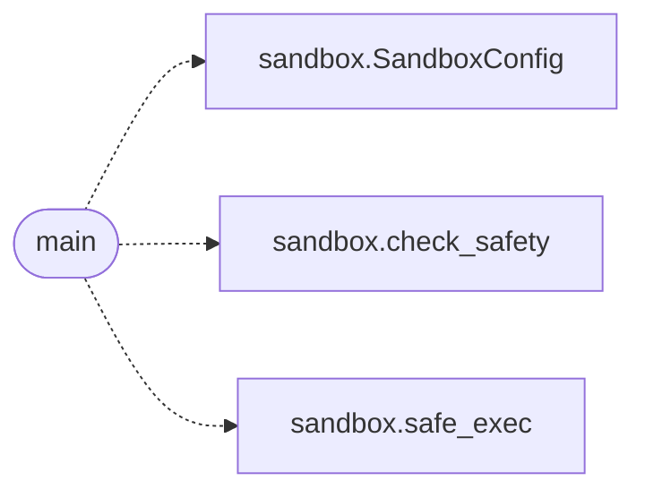

# `eval.sandbox_smoke`

> Source: [eval/sandbox_smoke.py:1](../../eval/sandbox_smoke.py#L1) | language `py` | coverage 50.0% | [API index](../index.md)

Smoke test for eval.sandbox.

Verifies all four defence layers:
  L1 (AST pre-check): blocked imports & dunder attrs are rejected
  L2 (builtin whitelist): open/exec/etc raise NameError in the child
  L3 (subprocess isolation): infinite loops are killed at OS level
  L4 (output capture): stdout/stderr from the candidate are returned

## Contents

- **Functions:** [`main`](#main)

## Call Graph

Solid arrows stay in this module, dashed arrows leave it.



## Functions

<a id="main"></a>

### `main`

`function` | [eval/sandbox_smoke.py:15](../../eval/sandbox_smoke.py#L15)

```python
def main()
```

*Calls:* [`SandboxConfig`](eval.sandbox.py.md#sandboxconfig), [`check_safety`](eval.sandbox.py.md#check_safety), [`safe_exec`](eval.sandbox.py.md#safe_exec)

---
