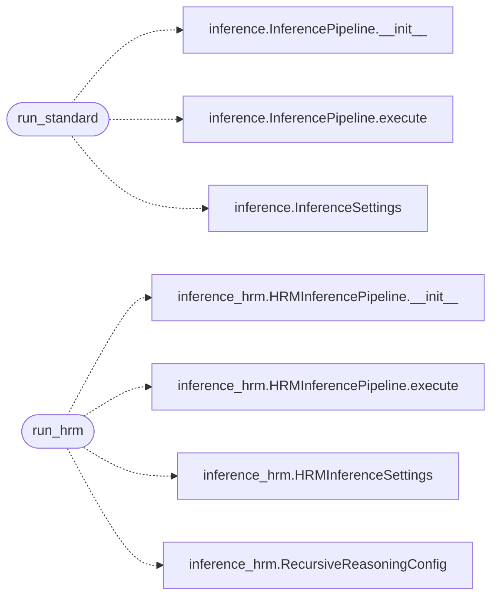

# `eval.smoke`

> Source: [eval/smoke.py:1](../../eval/smoke.py#L1) | language `py` | coverage 33.3% | [API index](../index.md)

Smoke test: load the TopoGPT3 checkpoint and produce a small completion.

Used as the first gate: if this fails we abort HumanEval.

## Contents

- **Functions:** [`run_standard`](#run_standard), [`run_hrm`](#run_hrm)

## Call Graph

Solid arrows stay in this module, dashed arrows leave it.



## Functions

<a id="run_standard"></a>

### `run_standard`

`function` | [eval/smoke.py:17](../../eval/smoke.py#L17)

```python
def run_standard()
```

*Calls:* [`InferencePipeline.__init__`](topogpt3.inference.py.md#inferencepipeline-__init__), [`InferencePipeline.execute`](topogpt3.inference.py.md#inferencepipeline-execute), [`InferenceSettings`](topogpt3.inference.py.md#inferencesettings)

---

<a id="run_hrm"></a>

### `run_hrm`

`function` | [eval/smoke.py:36](../../eval/smoke.py#L36)

```python
def run_hrm()
```

*Calls:* [`HRMInferencePipeline.__init__`](topogpt3.inference_hrm.py.md#hrminferencepipeline-__init__), [`HRMInferencePipeline.execute`](topogpt3.inference_hrm.py.md#hrminferencepipeline-execute), [`HRMInferenceSettings`](topogpt3.inference_hrm.py.md#hrminferencesettings), [`RecursiveReasoningConfig`](topogpt3.inference_hrm.py.md#recursivereasoningconfig)

---
