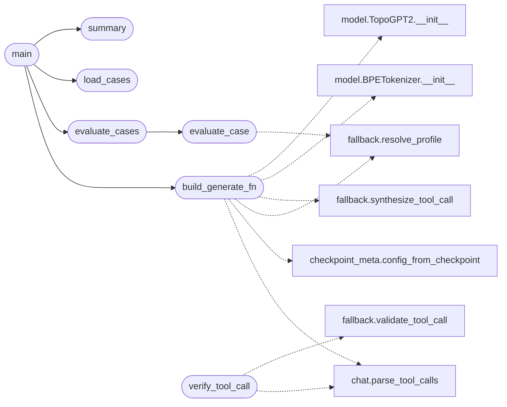

# `eval.tasks`

> Source: [eval/tasks.py:1](../../eval/tasks.py#L1) | language `py` | coverage 7.7% | [API index](../index.md)

Generic task eval: JSONL cases + safe verifiers.

Case schema (one JSON object per line):
    {"id": "...",
     "prompt": "user text",
     "profile": "topoexploit-apt-chain",     # optional, forwarded as model/profile
     "verifier": {
         "type": "apt_chain|tool_call|json|regex|exact|contains|python_ast",
         ...type-specific fields...
     }}

Verifiers are deterministic and never execute model output; ``python_ast``
only parses. Execution-based scoring belongs to the caller's sandbox.

## Contents

- **Functions:** [`verify_tool_call`](#verify_tool_call), [`verify_json`](#verify_json), [`verify_regex`](#verify_regex), [`verify_exact`](#verify_exact), [`verify_contains`](#verify_contains), [`verify_python_ast`](#verify_python_ast), [`load_cases`](#load_cases), [`evaluate_case`](#evaluate_case), [`evaluate_cases`](#evaluate_cases), [`summary`](#summary), [`build_generate_fn`](#build_generate_fn), [`main`](#main)
- **Constants:** [`VERIFIERS`](#verifiers)

## Call Graph

Solid arrows stay in this module, dashed arrows leave it.



## Functions

<a id="verify_tool_call"></a>

### `verify_tool_call`

`function` | [eval/tasks.py:50](../../eval/tasks.py#L50)

```python
def verify_tool_call(case: dict[str, Any], completion: str) -> tuple[bool, str]
```

**Parameters**

| Name | Type | Default | Description |
|---|---|---|---|
| `case` | `dict[str, Any]` |  |  |
| `completion` | `str` |  |  |

**Returns:** `tuple[bool, str]`

*Calls:* [`parse_tool_calls`](topogpt3.chat.py.md#parse_tool_calls), [`validate_tool_call`](topogpt3.fallback.py.md#validate_tool_call)

---

<a id="verify_json"></a>

### `verify_json`

`function` | [eval/tasks.py:78](../../eval/tasks.py#L78)

```python
def verify_json(case: dict[str, Any], completion: str) -> tuple[bool, str]
```

**Parameters**

| Name | Type | Default | Description |
|---|---|---|---|
| `case` | `dict[str, Any]` |  |  |
| `completion` | `str` |  |  |

**Returns:** `tuple[bool, str]`

---

<a id="verify_regex"></a>

### `verify_regex`

`function` | [eval/tasks.py:90](../../eval/tasks.py#L90)

```python
def verify_regex(case: dict[str, Any], completion: str) -> tuple[bool, str]
```

**Parameters**

| Name | Type | Default | Description |
|---|---|---|---|
| `case` | `dict[str, Any]` |  |  |
| `completion` | `str` |  |  |

**Returns:** `tuple[bool, str]`

---

<a id="verify_exact"></a>

### `verify_exact`

`function` | [eval/tasks.py:97](../../eval/tasks.py#L97)

```python
def verify_exact(case: dict[str, Any], completion: str) -> tuple[bool, str]
```

**Parameters**

| Name | Type | Default | Description |
|---|---|---|---|
| `case` | `dict[str, Any]` |  |  |
| `completion` | `str` |  |  |

**Returns:** `tuple[bool, str]`

---

<a id="verify_contains"></a>

### `verify_contains`

`function` | [eval/tasks.py:105](../../eval/tasks.py#L105)

```python
def verify_contains(case: dict[str, Any], completion: str) -> tuple[bool, str]
```

**Parameters**

| Name | Type | Default | Description |
|---|---|---|---|
| `case` | `dict[str, Any]` |  |  |
| `completion` | `str` |  |  |

**Returns:** `tuple[bool, str]`

---

<a id="verify_python_ast"></a>

### `verify_python_ast`

`function` | [eval/tasks.py:114](../../eval/tasks.py#L114)

```python
def verify_python_ast(case: dict[str, Any], completion: str) -> tuple[bool, str]
```

**Parameters**

| Name | Type | Default | Description |
|---|---|---|---|
| `case` | `dict[str, Any]` |  |  |
| `completion` | `str` |  |  |

**Returns:** `tuple[bool, str]`

---

<a id="load_cases"></a>

### `load_cases`

`function` | [eval/tasks.py:133](../../eval/tasks.py#L133)

```python
def load_cases(path: str | Path) -> list[dict[str, Any]]
```

**Parameters**

| Name | Type | Default | Description |
|---|---|---|---|
| `path` | `str \| Path` |  |  |

**Returns:** `list[dict[str, Any]]`

**Raises**

- `ValueError`: (raised in the body, not documented)

*Called by:* [`main`](#main)

---

<a id="evaluate_case"></a>

### `evaluate_case`

`function` | [eval/tasks.py:145](../../eval/tasks.py#L145)

```python
def evaluate_case(case: dict[str, Any], generate_fn: Callable[[str, str], str]) -> dict[str, Any]
```

**Parameters**

| Name | Type | Default | Description |
|---|---|---|---|
| `case` | `dict[str, Any]` |  |  |
| `generate_fn` | `Callable[[str, str], str]` |  |  |

**Returns:** `dict[str, Any]`

*Calls:* [`resolve_profile`](topogpt3.fallback.py.md#resolve_profile)

*Called by:* [`evaluate_cases`](#evaluate_cases)

---

<a id="evaluate_cases"></a>

### `evaluate_cases`

`function` | [eval/tasks.py:174](../../eval/tasks.py#L174)

```python
def evaluate_cases(cases: Iterable[dict[str, Any]], generate_fn: Callable[[str, str], str], limit: int | None = None) -> list[dict[str, Any]]
```

**Parameters**

| Name | Type | Default | Description |
|---|---|---|---|
| `cases` | `Iterable[dict[str, Any]]` |  |  |
| `generate_fn` | `Callable[[str, str], str]` |  |  |
| `limit` | `int \| None` | `None` |  |

**Returns:** `list[dict[str, Any]]`

*Calls:* [`evaluate_case`](#evaluate_case)

*Called by:* [`main`](#main)

---

<a id="summary"></a>

### `summary`

`function` | [eval/tasks.py:187](../../eval/tasks.py#L187)

```python
def summary(results: list[dict[str, Any]]) -> dict[str, Any]
```

**Parameters**

| Name | Type | Default | Description |
|---|---|---|---|
| `results` | `list[dict[str, Any]]` |  |  |

**Returns:** `dict[str, Any]`

*Called by:* [`main`](#main)

---

<a id="build_generate_fn"></a>

### `build_generate_fn`

`function` | [eval/tasks.py:197](../../eval/tasks.py#L197)

```python
def build_generate_fn(ckpt_dir: str, ckpt_name: str = 'last', device: str = 'cpu', max_new_tokens: int = 160)
```

**Parameters**

| Name | Type | Default | Description |
|---|---|---|---|
| `ckpt_dir` | `str` |  |  |
| `ckpt_name` | `str` | `'last'` |  |
| `device` | `str` | `'cpu'` |  |
| `max_new_tokens` | `int` | `160` |  |

*Calls:* [`parse_tool_calls`](topogpt3.chat.py.md#parse_tool_calls), [`config_from_checkpoint`](topogpt3.checkpoint_meta.py.md#config_from_checkpoint), [`resolve_profile`](topogpt3.fallback.py.md#resolve_profile), [`synthesize_tool_call`](topogpt3.fallback.py.md#synthesize_tool_call), [`BPETokenizer.__init__`](topogpt3.model.py.md#bpetokenizer-__init__), [`TopoGPT2.__init__`](topogpt3.model.py.md#topogpt2-__init__)

*Called by:* [`main`](#main)

---

<a id="main"></a>

### `main`

`function` | [eval/tasks.py:251](../../eval/tasks.py#L251)

```python
def main() -> int
```

**Returns:** `int`

*Calls:* [`build_generate_fn`](#build_generate_fn), [`evaluate_cases`](#evaluate_cases), [`load_cases`](#load_cases), [`summary`](#summary)

---

## Constants

<a id="verifiers"></a>

### `VERIFIERS`

`constant` | [eval/tasks.py:122](../../eval/tasks.py#L122)

```python
VERIFIERS
```

---
