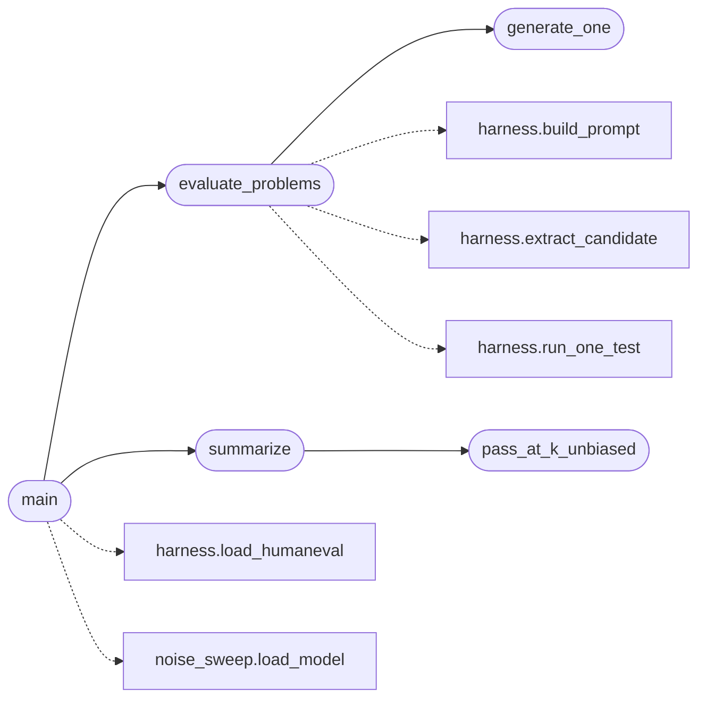

# `eval.temp_sweep`

> Source: [eval/temp_sweep.py:1](../../eval/temp_sweep.py#L1) | language `py` | coverage 16.7% | [API index](../index.md)

Barrido de temperatura x top-k sobre HumanEval.

Mide pass@1 en modo greedy (T=0) y pass@5 a temperaturas crecientes
para mapear la "fase" de generacion del modelo:

  - cristal: pass@1 alto, poca varianza entre samples
  - vidrio:  pass@1 bajo, alta varianza
  - caotico: pass@1 ~= 0, alta diversidad pero sin aciertos

Salida: eval/runs/temp_sweep_<tag>.jsonl (resumen)
        eval/runs/temp_<T>_top<k>_<tag>.jsonl (detalle por config)

## Contents

- **Functions:** [`generate_one`](#generate_one), [`evaluate_problems`](#evaluate_problems), [`pass_at_k_unbiased`](#pass_at_k_unbiased), [`summarize`](#summarize), [`main`](#main)
- **Constants:** [`REPO_ROOT`](#repo_root)

## Call Graph

Solid arrows stay in this module, dashed arrows leave it.



## Functions

<a id="generate_one"></a>

### `generate_one`

`function` | [eval/temp_sweep.py:39](../../eval/temp_sweep.py#L39)

Decorators: `@torch.no_grad()`

```python
def generate_one(model, tok, prompt, max_new_tokens, temperature, top_k, device, seed_offset)
```

**Parameters**

| Name | Type | Default | Description |
|---|---|---|---|
| `model` |  |  |  |
| `tok` |  |  |  |
| `prompt` |  |  |  |
| `max_new_tokens` |  |  |  |
| `temperature` |  |  |  |
| `top_k` |  |  |  |
| `device` |  |  |  |
| `seed_offset` |  |  |  |

*Called by:* [`evaluate_problems`](#evaluate_problems)

---

<a id="evaluate_problems"></a>

### `evaluate_problems`

`function` | [eval/temp_sweep.py:58](../../eval/temp_sweep.py#L58)

```python
def evaluate_problems(model, tok, problems, max_new_tokens, temperature, top_k, n_samples, device) -> List[dict]
```

**Parameters**

| Name | Type | Default | Description |
|---|---|---|---|
| `model` |  |  |  |
| `tok` |  |  |  |
| `problems` |  |  |  |
| `max_new_tokens` |  |  |  |
| `temperature` |  |  |  |
| `top_k` |  |  |  |
| `n_samples` |  |  |  |
| `device` |  |  |  |

**Returns:** `List[dict]`

*Calls:* [`build_prompt`](eval.harness.py.md#build_prompt), [`extract_candidate`](eval.harness.py.md#extract_candidate), [`run_one_test`](eval.harness.py.md#run_one_test), [`generate_one`](#generate_one)

*Called by:* [`main`](#main)

---

<a id="pass_at_k_unbiased"></a>

### `pass_at_k_unbiased`

`function` | [eval/temp_sweep.py:88](../../eval/temp_sweep.py#L88)

```python
def pass_at_k_unbiased(n: int, c: int, k: int) -> float
```

**Parameters**

| Name | Type | Default | Description |
|---|---|---|---|
| `n` | `int` |  |  |
| `c` | `int` |  |  |
| `k` | `int` |  |  |

**Returns:** `float`

*Called by:* [`summarize`](#summarize)

---

<a id="summarize"></a>

### `summarize`

`function` | [eval/temp_sweep.py:96](../../eval/temp_sweep.py#L96)

```python
def summarize(results: List[dict], n_samples: int) -> Dict
```

**Parameters**

| Name | Type | Default | Description |
|---|---|---|---|
| `results` | `List[dict]` |  |  |
| `n_samples` | `int` |  |  |

**Returns:** `Dict`

*Calls:* [`pass_at_k_unbiased`](#pass_at_k_unbiased)

*Called by:* [`main`](#main)

---

<a id="main"></a>

### `main`

`function` | [eval/temp_sweep.py:116](../../eval/temp_sweep.py#L116)

```python
def main()
```

*Calls:* [`load_humaneval`](eval.harness.py.md#load_humaneval), [`load_model`](eval.noise_sweep.py.md#load_model), [`evaluate_problems`](#evaluate_problems), [`summarize`](#summarize)

---

## Constants

<a id="repo_root"></a>

### `REPO_ROOT`

`constant` | [eval/temp_sweep.py:26](../../eval/temp_sweep.py#L26)

```python
REPO_ROOT = Path(__file__).resolve().parent.parent
```

---
