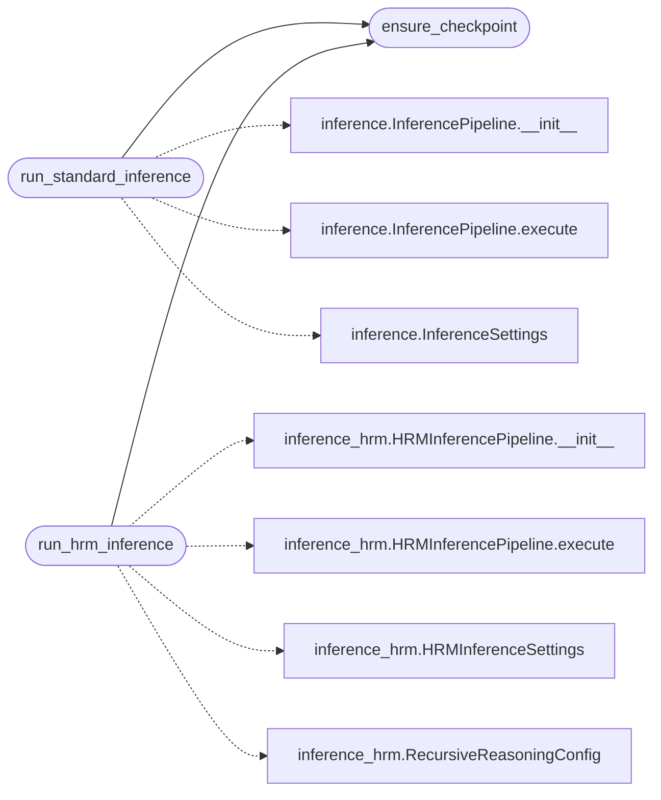

# `gradio_app`

> Source: [gradio_app.py:1](../../gradio_app.py#L1) | language `py` | coverage 100.0% | [API index](../index.md)

TopoGPT3 Gradio Interface for Hugging Face Spaces.

Drop-in Gradio app exposing both standard and HRM inference modes.
Designed for deployment on Hugging Face Spaces with automatic checkpoint
download from the Hub.

Usage:
    python gradio_app.py                          # local launch
    gradio_app.py  (as HF Spaces entry point)     # auto-detected

## Contents

- **Functions:** [`ensure_checkpoint`](#ensure_checkpoint), [`run_standard_inference`](#run_standard_inference), [`run_hrm_inference`](#run_hrm_inference), [`build_ui`](#build_ui)
- **Constants:** [`DEFAULT_CHECKPOINT_DIR`](#default_checkpoint_dir), [`HF_REPO`](#hf_repo), [`HF_CHECKPOINT_SUBPATH`](#hf_checkpoint_subpath)

## Call Graph

Solid arrows stay in this module, dashed arrows leave it.



## Functions

<a id="ensure_checkpoint"></a>

### `ensure_checkpoint`

`function` | [gradio_app.py:35](../../gradio_app.py#L35)

```python
def ensure_checkpoint() -> str
```

Return the path to the checkpoint directory, downloading if needed.

**Returns:** `str`

*Called by:* [`run_hrm_inference`](#run_hrm_inference), [`run_standard_inference`](#run_standard_inference)

---

<a id="run_standard_inference"></a>

### `run_standard_inference`

`function` | [gradio_app.py:59](../../gradio_app.py#L59)

```python
def run_standard_inference(prompt: str, max_new_tokens: int, temperature: float, top_k: int, repetition_penalty: float, auto_continue: bool) -> str
```

Run standard autoregressive inference.

**Parameters**

| Name | Type | Default | Description |
|---|---|---|---|
| `prompt` | `str` |  |  |
| `max_new_tokens` | `int` |  |  |
| `temperature` | `float` |  |  |
| `top_k` | `int` |  |  |
| `repetition_penalty` | `float` |  |  |
| `auto_continue` | `bool` |  |  |

**Returns:** `str`

*Calls:* [`ensure_checkpoint`](#ensure_checkpoint), [`InferencePipeline.__init__`](topogpt3.inference.py.md#inferencepipeline-__init__), [`InferencePipeline.execute`](topogpt3.inference.py.md#inferencepipeline-execute), [`InferenceSettings`](topogpt3.inference.py.md#inferencesettings)

---

<a id="run_hrm_inference"></a>

### `run_hrm_inference`

`function` | [gradio_app.py:95](../../gradio_app.py#L95)

```python
def run_hrm_inference(prompt: str, max_new_tokens: int, temperature: float, top_k: int, repetition_penalty: float, high_level_iters: int, low_level_iters: int, low_level_window: int, thinking: bool, auto_continue: bool) -> str
```

Run hierarchical recursive reasoning inference.

**Parameters**

| Name | Type | Default | Description |
|---|---|---|---|
| `prompt` | `str` |  |  |
| `max_new_tokens` | `int` |  |  |
| `temperature` | `float` |  |  |
| `top_k` | `int` |  |  |
| `repetition_penalty` | `float` |  |  |
| `high_level_iters` | `int` |  |  |
| `low_level_iters` | `int` |  |  |
| `low_level_window` | `int` |  |  |
| `thinking` | `bool` |  |  |
| `auto_continue` | `bool` |  |  |

**Returns:** `str`

*Calls:* [`ensure_checkpoint`](#ensure_checkpoint), [`HRMInferencePipeline.__init__`](topogpt3.inference_hrm.py.md#hrminferencepipeline-__init__), [`HRMInferencePipeline.execute`](topogpt3.inference_hrm.py.md#hrminferencepipeline-execute), [`HRMInferenceSettings`](topogpt3.inference_hrm.py.md#hrminferencesettings), [`RecursiveReasoningConfig`](topogpt3.inference_hrm.py.md#recursivereasoningconfig)

---

<a id="build_ui"></a>

### `build_ui`

`function` | [gradio_app.py:144](../../gradio_app.py#L144)

```python
def build_ui() -> gr.Blocks
```

Construct the Gradio Blocks interface.

**Returns:** `gr.Blocks`

---

## Constants

<a id="default_checkpoint_dir"></a>

### `DEFAULT_CHECKPOINT_DIR`

`constant` | [gradio_app.py:30](../../gradio_app.py#L30)

```python
DEFAULT_CHECKPOINT_DIR = 'checkpoints_topogpt3'
```

---

<a id="hf_repo"></a>

### `HF_REPO`

`constant` | [gradio_app.py:31](../../gradio_app.py#L31)

```python
HF_REPO = 'grisiscomeback/TopoGPT3'
```

---

<a id="hf_checkpoint_subpath"></a>

### `HF_CHECKPOINT_SUBPATH`

`constant` | [gradio_app.py:32](../../gradio_app.py#L32)

```python
HF_CHECKPOINT_SUBPATH = 'checkpoints_topogpt3/last'
```

---
