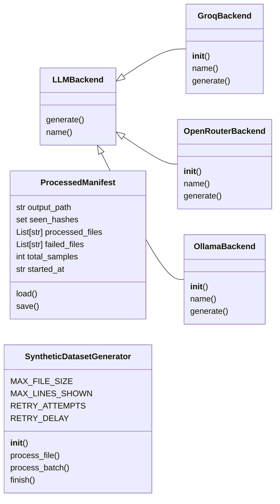
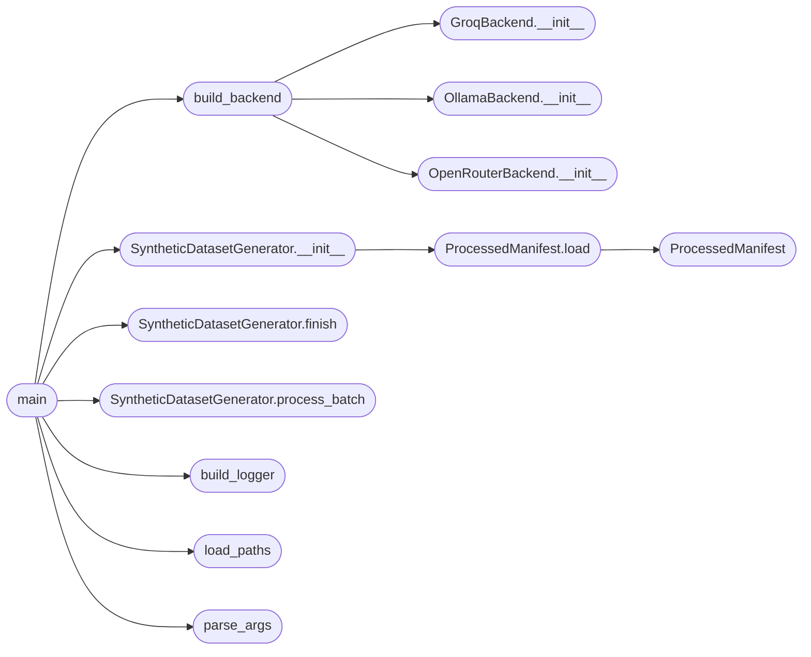

# `synthetic_dataset`

> Source: [synthetic_dataset.py:1](../../synthetic_dataset.py#L1) | language `py` | coverage 43.3% | [API index](../index.md)

Synthetic Dataset Generator for TopoGPT2.

Generates high-quality code instruction-tuning data from existing source files
using a multi-stage LLM pipeline:

    file → analysis → spec → chain-of-thought → vague question → JSONL

Each sample (JSONL line) contains:
{
    "instruction":  "vague natural question",
    "thinking":     "chain-of-thought reasoning",
    "spec":         "detailed spec-driven prompt",
    "todo":         ["task 1", "task 2", ...],
    "response":     "```language
original clean code
```",
    "file_path":    "src/foo/bar.py",
    "lang":         "python",
    "checksum":     "sha256 of original code",
}

Pipeline is designed for efficiency:
- One LLM call per file (master prompt, one-shot)
- Streaming JSONL writes (never holds full dataset in memory)
- SHA256 dedup across the full corpus
- Resumable: tracks processed files in a manifest
- Batch-friendly: process N files per run

Backend: Groq API (Llama-3.3-70B, fastest/cheapest) or OpenRouter.

## Contents

- **Classes:** [`LLMBackend`](#llmbackend), [`GroqBackend`](#groqbackend), [`OpenRouterBackend`](#openrouterbackend), [`OllamaBackend`](#ollamabackend), [`ProcessedManifest`](#processedmanifest), [`SyntheticDatasetGenerator`](#syntheticdatasetgenerator)
- **Functions:** [`build_backend`](#build_backend), [`validate_sample`](#validate_sample), [`build_logger`](#build_logger), [`parse_args`](#parse_args), [`load_paths`](#load_paths), [`main`](#main)

## Type Diagram



## Call Graph

Solid arrows stay in this module, dashed arrows leave it.



## Classes

<a id="llmbackend"></a>

### `LLMBackend`

`class` | [synthetic_dataset.py:61](../../synthetic_dataset.py#L61)

```python
class LLMBackend
```

Subclasses: [`GroqBackend`](#groqbackend), [`OllamaBackend`](#ollamabackend), [`OpenRouterBackend`](#openrouterbackend)

Abstract LLM backend.

Subclass for each provider.

**Members**

| Member | Kind | Summary |
|---|---|---|
| [`generate`](#llmbackend-generate) | method |  |
| [`name`](#llmbackend-name) | method |  |

<a id="llmbackend-generate"></a>

#### `LLMBackend.generate`

`method` | [synthetic_dataset.py:64](../../synthetic_dataset.py#L64)

```python
def generate(self, prompt: str, **kwargs) -> str
```

**Parameters**

| Name | Type | Default | Description |
|---|---|---|---|
| `prompt` | `str` |  |  |
| `**kwargs` |  |  |  |

**Returns:** `str`

**Raises**

- `NotImplementedError`: (raised in the body, not documented)

<a id="llmbackend-name"></a>

#### `LLMBackend.name`

`method` | [synthetic_dataset.py:67](../../synthetic_dataset.py#L67)

```python
def name(self) -> str
```

**Returns:** `str`

---

<a id="groqbackend"></a>

### `GroqBackend`

`class` | [synthetic_dataset.py:71](../../synthetic_dataset.py#L71)

```python
class GroqBackend(LLMBackend)
```

Bases: [`LLMBackend`](#llmbackend)

Groq API backend using requests.

Supports models: llama-3.3-70b-versatile, deepseek-r1.
Set GROQ_API_KEY env var.

**Members**

| Member | Kind | Summary |
|---|---|---|
| [`__init__`](#groqbackend-__init__) | constructor |  |
| [`name`](#groqbackend-name) | method |  |
| [`generate`](#groqbackend-generate) | method |  |

<a id="groqbackend-__init__"></a>

#### `GroqBackend.__init__`

`constructor` | [synthetic_dataset.py:78](../../synthetic_dataset.py#L78)

```python
def __init__(self, model: str = 'llama-3.3-70b-versatile', api_key: Optional[str] = None, max_tokens: int = 8192, temperature: float = 0.2, timeout: int = 120)
```

**Parameters**

| Name | Type | Default | Description |
|---|---|---|---|
| `model` | `str` | `'llama-3.3-70b-versatile'` |  |
| `api_key` | `Optional[str]` | `None` |  |
| `max_tokens` | `int` | `8192` |  |
| `temperature` | `float` | `0.2` |  |
| `timeout` | `int` | `120` |  |

*Called by:* [`build_backend`](#build_backend)

<a id="groqbackend-name"></a>

#### `GroqBackend.name`

`method` | [synthetic_dataset.py:95](../../synthetic_dataset.py#L95)

```python
def name(self) -> str
```

**Returns:** `str`

<a id="groqbackend-generate"></a>

#### `GroqBackend.generate`

`method` | [synthetic_dataset.py:98](../../synthetic_dataset.py#L98)

```python
def generate(self, prompt: str, **kwargs) -> str
```

**Parameters**

| Name | Type | Default | Description |
|---|---|---|---|
| `prompt` | `str` |  |  |
| `**kwargs` |  |  |  |

**Returns:** `str`

**Raises**

- `RuntimeError`: (raised in the body, not documented)

---

<a id="openrouterbackend"></a>

### `OpenRouterBackend`

`class` | [synthetic_dataset.py:121](../../synthetic_dataset.py#L121)

```python
class OpenRouterBackend(LLMBackend)
```

Bases: [`LLMBackend`](#llmbackend)

OpenRouter unified API backend.

Supports any OpenRouter model:
    anthropic/claude-3.5-sonnet,
    openai/gpt-4o,
    deepseek/deepseek-chat,
    google/gemini-2.0-flash-thinking,
Set OPENROUTER_API_KEY env var.

**Members**

| Member | Kind | Summary |
|---|---|---|
| [`__init__`](#openrouterbackend-__init__) | constructor |  |
| [`name`](#openrouterbackend-name) | method |  |
| [`generate`](#openrouterbackend-generate) | method |  |

<a id="openrouterbackend-__init__"></a>

#### `OpenRouterBackend.__init__`

`constructor` | [synthetic_dataset.py:132](../../synthetic_dataset.py#L132)

```python
def __init__(self, model: str = 'anthropic/claude-3.5-sonnet', api_key: Optional[str] = None, max_tokens: int = 8192, temperature: float = 0.2, timeout: int = 180)
```

**Parameters**

| Name | Type | Default | Description |
|---|---|---|---|
| `model` | `str` | `'anthropic/claude-3.5-sonnet'` |  |
| `api_key` | `Optional[str]` | `None` |  |
| `max_tokens` | `int` | `8192` |  |
| `temperature` | `float` | `0.2` |  |
| `timeout` | `int` | `180` |  |

*Called by:* [`build_backend`](#build_backend)

<a id="openrouterbackend-name"></a>

#### `OpenRouterBackend.name`

`method` | [synthetic_dataset.py:151](../../synthetic_dataset.py#L151)

```python
def name(self) -> str
```

**Returns:** `str`

<a id="openrouterbackend-generate"></a>

#### `OpenRouterBackend.generate`

`method` | [synthetic_dataset.py:154](../../synthetic_dataset.py#L154)

```python
def generate(self, prompt: str, **kwargs) -> str
```

**Parameters**

| Name | Type | Default | Description |
|---|---|---|---|
| `prompt` | `str` |  |  |
| `**kwargs` |  |  |  |

**Returns:** `str`

**Raises**

- `RuntimeError`: (raised in the body, not documented)

---

<a id="ollamabackend"></a>

### `OllamaBackend`

`class` | [synthetic_dataset.py:177](../../synthetic_dataset.py#L177)

```python
class OllamaBackend(LLMBackend)
```

Bases: [`LLMBackend`](#llmbackend)

Ollama local inference backend.

Supports any local model: llama3.1:8b, granite4.1:3b, etc.
Connects to Ollama server at OLLAMA_HOST (default: http://localhost:11434).

**Members**

| Member | Kind | Summary |
|---|---|---|
| [`__init__`](#ollamabackend-__init__) | constructor |  |
| [`name`](#ollamabackend-name) | method |  |
| [`generate`](#ollamabackend-generate) | method |  |

<a id="ollamabackend-__init__"></a>

#### `OllamaBackend.__init__`

`constructor` | [synthetic_dataset.py:184](../../synthetic_dataset.py#L184)

```python
def __init__(self, model: str = 'granite4.1:3b', host: str = 'http://localhost:11434', max_tokens: int = 8192, temperature: float = 0.2, timeout: int = 300)
```

**Parameters**

| Name | Type | Default | Description |
|---|---|---|---|
| `model` | `str` | `'granite4.1:3b'` |  |
| `host` | `str` | `'http://localhost:11434'` |  |
| `max_tokens` | `int` | `8192` |  |
| `temperature` | `float` | `0.2` |  |
| `timeout` | `int` | `300` |  |

*Called by:* [`build_backend`](#build_backend)

<a id="ollamabackend-name"></a>

#### `OllamaBackend.name`

`method` | [synthetic_dataset.py:198](../../synthetic_dataset.py#L198)

```python
def name(self) -> str
```

**Returns:** `str`

<a id="ollamabackend-generate"></a>

#### `OllamaBackend.generate`

`method` | [synthetic_dataset.py:201](../../synthetic_dataset.py#L201)

```python
def generate(self, prompt: str, **kwargs) -> str
```

**Parameters**

| Name | Type | Default | Description |
|---|---|---|---|
| `prompt` | `str` |  |  |
| `**kwargs` |  |  |  |

**Returns:** `str`

**Raises**

- `RuntimeError`: (raised in the body, not documented)

---

<a id="processedmanifest"></a>

### `ProcessedManifest`

`class` `dataclass` | [synthetic_dataset.py:364](../../synthetic_dataset.py#L364)

Decorators: `@dataclass`

```python
class ProcessedManifest
```

Tracks processed files for resumability.

**Attributes**

| Name | Type | Default | Description |
|---|---|---|---|
| [`output_path`](#processedmanifest-output_path) | `str` |  |  |
| [`seen_hashes`](#processedmanifest-seen_hashes) | `set` | `field(default_factory=set)` |  |
| [`processed_files`](#processedmanifest-processed_files) | `List[str]` | `field(default_factory=list)` |  |
| [`failed_files`](#processedmanifest-failed_files) | `List[str]` | `field(default_factory=list)` |  |
| [`total_samples`](#processedmanifest-total_samples) | `int` | `0` |  |
| [`started_at`](#processedmanifest-started_at) | `str` | `field(default_factory=lambda: datetime.now().isoformat())` |  |

**Members**

| Member | Kind | Summary |
|---|---|---|
| [`load`](#processedmanifest-load) | staticmethod |  |
| [`save`](#processedmanifest-save) | method |  |

<a id="processedmanifest-load"></a>

#### `ProcessedManifest.load`

`staticmethod` | [synthetic_dataset.py:374](../../synthetic_dataset.py#L374)

Decorators: `@staticmethod`

```python
def load(path: str) -> 'ProcessedManifest'
```

**Parameters**

| Name | Type | Default | Description |
|---|---|---|---|
| `path` | `str` |  |  |

**Returns:** `'ProcessedManifest'`

*Calls:* [`ProcessedManifest`](#processedmanifest)

*Called by:* [`SyntheticDatasetGenerator.__init__`](#syntheticdatasetgenerator-__init__)

<a id="processedmanifest-save"></a>

#### `ProcessedManifest.save`

`method` | [synthetic_dataset.py:387](../../synthetic_dataset.py#L387)

```python
def save(self, path: str)
```

**Parameters**

| Name | Type | Default | Description |
|---|---|---|---|
| `path` | `str` |  |  |

---

<a id="syntheticdatasetgenerator"></a>

### `SyntheticDatasetGenerator`

`class` | [synthetic_dataset.py:399](../../synthetic_dataset.py#L399)

```python
class SyntheticDatasetGenerator
```

Generates synthetic instruction-tuning data from source files.

Pipeline (one LLM call per file):
    file → MASTER_PROMPT → LLM → validate → dedup → JSONL

Features:
- Streaming JSONL writes (bounded RAM)
- SHA256 dedup across corpus
- Resumable (manifest tracks progress)
- Threaded request batching for throughput
- Configurable quality thresholds

**Attributes**

| Name | Type | Default | Description |
|---|---|---|---|
| [`MAX_FILE_SIZE`](#syntheticdatasetgenerator-max_file_size) |  | `48000` |  |
| [`MAX_LINES_SHOWN`](#syntheticdatasetgenerator-max_lines_shown) |  | `600` |  |
| [`RETRY_ATTEMPTS`](#syntheticdatasetgenerator-retry_attempts) |  | `3` |  |
| [`RETRY_DELAY`](#syntheticdatasetgenerator-retry_delay) |  | `5` |  |

**Members**

| Member | Kind | Summary |
|---|---|---|
| [`__init__`](#syntheticdatasetgenerator-__init__) | constructor |  |
| [`process_file`](#syntheticdatasetgenerator-process_file) | method | Process a single file. |
| [`process_batch`](#syntheticdatasetgenerator-process_batch) | method | Process a batch of files in parallel using thread pool. |
| [`finish`](#syntheticdatasetgenerator-finish) | method | Signal end of processing and flush writer. |

<a id="syntheticdatasetgenerator-__init__"></a>

#### `SyntheticDatasetGenerator.__init__`

`constructor` | [synthetic_dataset.py:418](../../synthetic_dataset.py#L418)

```python
def __init__(self, backend: LLMBackend, output_path: str, manifest_path: str, logger: logging.Logger, max_workers: int = 4, max_file_chars: int = MAX_FILE_SIZE)
```

**Parameters**

| Name | Type | Default | Description |
|---|---|---|---|
| `backend` | `LLMBackend` |  |  |
| `output_path` | `str` |  |  |
| `manifest_path` | `str` |  |  |
| `logger` | `logging.Logger` |  |  |
| `max_workers` | `int` | `4` |  |
| `max_file_chars` | `int` | `MAX_FILE_SIZE` |  |

*Calls:* [`ProcessedManifest.load`](#processedmanifest-load)

*Called by:* [`main`](#main)

<a id="syntheticdatasetgenerator-process_file"></a>

#### `SyntheticDatasetGenerator.process_file`

`method` | [synthetic_dataset.py:533](../../synthetic_dataset.py#L533)

```python
def process_file(self, path: str) -> bool
```

Process a single file.

Returns True if a sample was written.

**Parameters**

| Name | Type | Default | Description |
|---|---|---|---|
| `path` | `str` |  |  |

**Returns:** `bool`

<a id="syntheticdatasetgenerator-process_batch"></a>

#### `SyntheticDatasetGenerator.process_batch`

`method` | [synthetic_dataset.py:568](../../synthetic_dataset.py#L568)

```python
def process_batch(self, paths: list[str]) -> Dict[str, int]
```

Process a batch of files in parallel using thread pool.

**Parameters**

| Name | Type | Default | Description |
|---|---|---|---|
| `paths` | `list[str]` |  |  |

**Returns:** `Dict[str, int]`

*Called by:* [`main`](#main), [`main`](topogpt3.model.py.md#main)

<a id="syntheticdatasetgenerator-finish"></a>

#### `SyntheticDatasetGenerator.finish`

`method` | [synthetic_dataset.py:590](../../synthetic_dataset.py#L590)

```python
def finish(self) -> Dict[str, Any]
```

Signal end of processing and flush writer.

**Returns:** `Dict[str, Any]`

*Called by:* [`main`](#main), [`main`](topogpt3.model.py.md#main)

---

## Functions

<a id="build_backend"></a>

### `build_backend`

`function` | [synthetic_dataset.py:227](../../synthetic_dataset.py#L227)

```python
def build_backend(provider: str, model: str) -> LLMBackend
```

Factory for LLM backends.

**Parameters**

| Name | Type | Default | Description |
|---|---|---|---|
| `provider` | `str` |  |  |
| `model` | `str` |  |  |

**Returns:** `LLMBackend`

**Raises**

- `ValueError`: (raised in the body, not documented)

*Calls:* [`GroqBackend.__init__`](#groqbackend-__init__), [`OllamaBackend.__init__`](#ollamabackend-__init__), [`OpenRouterBackend.__init__`](#openrouterbackend-__init__)

*Called by:* [`main`](#main)

---

<a id="validate_sample"></a>

### `validate_sample`

`function` | [synthetic_dataset.py:330](../../synthetic_dataset.py#L330)

```python
def validate_sample(sample: Dict[str, Any]) -> tuple[bool, str]
```

Validate that a generated sample meets quality bar.

Returns (is_valid, reason).

**Parameters**

| Name | Type | Default | Description |
|---|---|---|---|
| `sample` | `Dict[str, Any]` |  |  |

**Returns:** `tuple[bool, str]`

---

<a id="build_logger"></a>

### `build_logger`

`function` | [synthetic_dataset.py:614](../../synthetic_dataset.py#L614)

```python
def build_logger(level: str = 'INFO') -> logging.Logger
```

**Parameters**

| Name | Type | Default | Description |
|---|---|---|---|
| `level` | `str` | `'INFO'` |  |

**Returns:** `logging.Logger`

*Called by:* [`main`](#main)

---

<a id="parse_args"></a>

### `parse_args`

`function` | [synthetic_dataset.py:625](../../synthetic_dataset.py#L625)

```python
def parse_args()
```

*Called by:* [`main`](#main)

---

<a id="load_paths"></a>

### `load_paths`

`function` | [synthetic_dataset.py:652](../../synthetic_dataset.py#L652)

```python
def load_paths(paths_arg: str, paths_file: str, max_files: int) -> List[str]
```

Load file paths from CLI args or file.

**Parameters**

| Name | Type | Default | Description |
|---|---|---|---|
| `paths_arg` | `str` |  |  |
| `paths_file` | `str` |  |  |
| `max_files` | `int` |  |  |

**Returns:** `List[str]`

**Raises**

- `ValueError`: (raised in the body, not documented)

*Called by:* [`main`](#main)

---

<a id="main"></a>

### `main`

`function` | [synthetic_dataset.py:667](../../synthetic_dataset.py#L667)

```python
def main()
```

*Calls:* [`SyntheticDatasetGenerator.__init__`](#syntheticdatasetgenerator-__init__), [`SyntheticDatasetGenerator.finish`](#syntheticdatasetgenerator-finish), [`SyntheticDatasetGenerator.process_batch`](#syntheticdatasetgenerator-process_batch), [`build_backend`](#build_backend), [`build_logger`](#build_logger), [`load_paths`](#load_paths), [`parse_args`](#parse_args)

---
