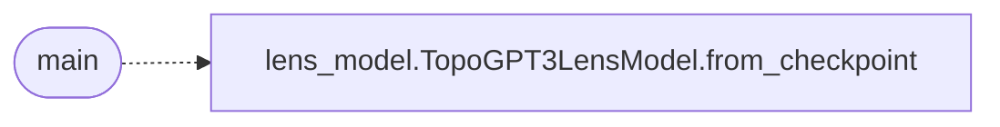

# `topogpt3.__main__`

> Source: [topogpt3/__main__.py:1](../../topogpt3/__main__.py#L1) | language `py` | coverage 50.0% | [API index](../index.md)

## Contents

- **Functions:** [`main`](#main)

## Call Graph

Solid arrows stay in this module, dashed arrows leave it.



## Functions

<a id="main"></a>

### `main`

`function` | [topogpt3/__main__.py:6](../../topogpt3/__main__.py#L6)

```python
def main() -> None
```

TopoGPT3 entry point.

Delegates to subcommands.

*Calls:* [`TopoGPT3LensModel.from_checkpoint`](topogpt3.lens_model.py.md#topogpt3lensmodel-from_checkpoint)

---
