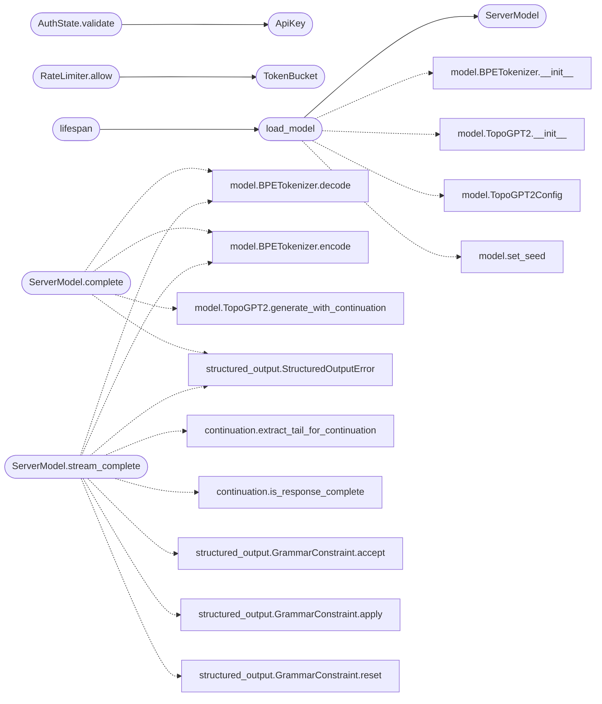

# `topogpt3.api_server`

> Source: [topogpt3/api_server.py:1](../../topogpt3/api_server.py#L1) | language `py` | coverage 3.8% | [API index](../index.md)

OpenAI-compatible HTTP API server so TopoGPT3 can be used as a backend for coding agents (e.g.

Pi, Aider, Continue, Codex CLI, etc.).

Security Posture
----------------
- **Authentication**: Bearer token (``Authorization: Bearer <key>``).
  Keys are loaded from ``--keys`` (comma-separated) or the
  ``TOPOGPT3_API_KEYS`` env var. Admin keys (prefixed ``admin:``) get
  higher rate limits. Constant-time comparison prevents timing leaks.
- **Authorization**: token-bucket rate limiter per-key and per-IP with
  configurable thresholds. After ``max_failures`` bad auth attempts an IP
  is banned for ``ban_window`` seconds.
- **Input hardening**: Pydantic schemas enforce strict types, min/max
  bounds, and length limits. Request body is capped server-side. Error
  responses never leak stack traces.
- **Headers**: ``X-Content-Type-Options: nosniff``,
  ``X-Frame-Options: DENY``, ``X-XSS-Protection: 1; mode=block``,
  ``Content-Security-Policy: default-src 'none'`` on every response.
  CORS policy allows nothing by default (configurable allow-origins).
- **Audit**: structured JSON log lines for every request (truncated
  bodies, no secrets).

Usage::

    TOPOGPT3_API_KEYS="sk-secret-key,admin:sk-admin-key" \
    python -m topogpt3 api_server \
        --checkpoint checkpoints_topogpt3/last \
        --port 8800

Pi / agent config::

    export PI_BASE_URL=http://localhost:8800/v1
    export PI_API_KEY=sk-secret-key

LazyOwn red-team checklist
--------------------------
- [ ] Auth bypass via missing Bearer header … 401
- [ ] Auth bypass via empty token … 401
- [ ] Auth bypass via timing attack on key comparison … prevented (secrets.compare_digest)
- [ ] Rate-limit bypass via spoofed X-Forwarded-For … rate-limited by real client IP
- [ ] Prompt injection to execute shell commands … impossible (no exec paths)
- [ ] TOCTOU on key file … keys read once at startup
- [ ] SSRF via the API … no outbound HTTP in inference path
- [ ] DoS via huge prompts … ``max_prompt_tokens`` cap
- [ ] DoS via connection exhaustion … uvicorn ``limit_concurrency``
- [ ] Information leak in error messages … ``include_in_schema=False`` on internal endpoints
- [ ] JSON injection in streaming chunks … validated via stdlib json

## Contents

- **Classes:** [`ApiKey`](#apikey), [`AuthState`](#authstate), [`TokenBucket`](#tokenbucket), [`RateLimiter`](#ratelimiter), [`IpBanner`](#ipbanner), [`CompletionRequest`](#completionrequest), [`Message`](#message), [`ChatCompletionRequest`](#chatcompletionrequest), [`ServerModel`](#servermodel)
- **Functions:** [`load_model`](#load_model), [`lifespan`](#lifespan), [`health`](#health), [`list_models`](#list_models), [`completions`](#completions), [`chat_completions`](#chat_completions), [`main`](#main)
- **Constants:** [`MAX_REQUEST_BODY`](#max_request_body), [`MAX_PROMPT_CHARS`](#max_prompt_chars), [`MAX_MESSAGES`](#max_messages), [`MAX_STOP_STRINGS`](#max_stop_strings), [`MAX_STOP_STRING_LEN`](#max_stop_string_len), [`MAX_CONTENT_LEN`](#max_content_len), [`MAX_OUTPUT_TOKENS`](#max_output_tokens), [`MAX_TEMPERATURE`](#max_temperature), [`BAN_WINDOW_S`](#ban_window_s), [`MAX_AUTH_FAILURES`](#max_auth_failures), [`MAX_CONCURRENT_REQUESTS`](#max_concurrent_requests), [`RATE_LIMIT_USER_RPS`](#rate_limit_user_rps), [`RATE_LIMIT_ADMIN_RPS`](#rate_limit_admin_rps), [`RATE_BUCKET_CAPACITY`](#rate_bucket_capacity)

## Type Diagram

```mermaid
classDiagram
    direction LR
    class ApiKey
    ApiKey : str key_hash
    ApiKey : str role
    class AuthState
    AuthState : Set[str] keys
    AuthState : Dict[str, ApiKey] by_hash
    AuthState : bool enabled
    AuthState : validate()
    class TokenBucket
    TokenBucket : float tokens
    TokenBucket : float last_refill
    TokenBucket : float rate
    TokenBucket : float capacity
    TokenBucket : consume()
    class RateLimiter
    RateLimiter : __init__()
    RateLimiter : allow()
    class IpBanner
    IpBanner : __init__()
    IpBanner : record_failure()
    IpBanner : is_banned()
    class CompletionRequest
    CompletionRequest : model_config
    CompletionRequest : str model
    CompletionRequest : str prompt
    CompletionRequest : int max_tokens
    CompletionRequest : float temperature
    CompletionRequest : int top_k
    CompletionRequest : float repetition_penalty
    CompletionRequest : Any stop
    CompletionRequest : bool stream
    CompletionRequest : bool auto_continue
    CompletionRequest : int max_continuations
    CompletionRequest : int  None seed
    CompletionRequest : Any response_format
    CompletionRequest : Any so_args
    class Message
    Message : model_config
    Message : str role
    Message : str  list[dict] content
    class ChatCompletionRequest
    ChatCompletionRequest : model_config
    ChatCompletionRequest : str model
    ChatCompletionRequest : list[Message] messages
    ChatCompletionRequest : int max_tokens
    ChatCompletionRequest : float temperature
    ChatCompletionRequest : int top_k
    ChatCompletionRequest : float repetition_penalty
    ChatCompletionRequest : Any stop
    ChatCompletionRequest : bool stream
    ChatCompletionRequest : bool auto_continue
    ChatCompletionRequest : int max_continuations
    ChatCompletionRequest : int  None seed
    ChatCompletionRequest : Any response_format
    ChatCompletionRequest : Any so_args
    ChatCompletionRequest : Any tools
    ChatCompletionRequest : bool open_thinking
    class ServerModel
    ServerModel : TopoGPT2 model
    ServerModel : BPETokenizer tokenizer
    ServerModel : str device
    ServerModel : str checkpoint
    ServerModel : complete()
    ServerModel : stream_complete()
```



## Call Graph

Solid arrows stay in this module, dashed arrows leave it.



## Classes

<a id="apikey"></a>

### `ApiKey`

`class` `dataclass` | [topogpt3/api_server.py:142](../../topogpt3/api_server.py#L142)

Decorators: `@dataclass`

```python
class ApiKey
```

**Attributes**

| Name | Type | Default | Description |
|---|---|---|---|
| [`key_hash`](#apikey-key_hash) | `str` |  |  |
| [`role`](#apikey-role) | `str` |  |  |

---

<a id="authstate"></a>

### `AuthState`

`class` `dataclass` | [topogpt3/api_server.py:148](../../topogpt3/api_server.py#L148)

Decorators: `@dataclass`

```python
class AuthState
```

**Attributes**

| Name | Type | Default | Description |
|---|---|---|---|
| [`keys`](#authstate-keys) | `Set[str]` | `field(default_factory=set)` |  |
| [`by_hash`](#authstate-by_hash) | `Dict[str, ApiKey]` | `field(default_factory=dict)` |  |
| [`enabled`](#authstate-enabled) | `bool` | `True` |  |

**Members**

| Member | Kind | Summary |
|---|---|---|
| [`validate`](#authstate-validate) | method |  |

<a id="authstate-validate"></a>

#### `AuthState.validate`

`method` | [topogpt3/api_server.py:153](../../topogpt3/api_server.py#L153)

```python
def validate(self, raw: str | None) -> ApiKey
```

**Parameters**

| Name | Type | Default | Description |
|---|---|---|---|
| `raw` | `str \| None` |  |  |

**Returns:** `ApiKey`

**Raises**

- `HTTPException`: (raised in the body, not documented)

*Calls:* [`ApiKey`](#apikey)

---

<a id="tokenbucket"></a>

### `TokenBucket`

`class` `dataclass` | [topogpt3/api_server.py:207](../../topogpt3/api_server.py#L207)

Decorators: `@dataclass`

```python
class TokenBucket
```

**Attributes**

| Name | Type | Default | Description |
|---|---|---|---|
| [`tokens`](#tokenbucket-tokens) | `float` |  |  |
| [`last_refill`](#tokenbucket-last_refill) | `float` |  |  |
| [`rate`](#tokenbucket-rate) | `float` |  |  |
| [`capacity`](#tokenbucket-capacity) | `float` |  |  |

**Members**

| Member | Kind | Summary |
|---|---|---|
| [`consume`](#tokenbucket-consume) | method |  |

<a id="tokenbucket-consume"></a>

#### `TokenBucket.consume`

`method` | [topogpt3/api_server.py:213](../../topogpt3/api_server.py#L213)

```python
def consume(self, n: float = 1.0) -> bool
```

**Parameters**

| Name | Type | Default | Description |
|---|---|---|---|
| `n` | `float` | `1.0` |  |

**Returns:** `bool`

---

<a id="ratelimiter"></a>

### `RateLimiter`

`class` | [topogpt3/api_server.py:224](../../topogpt3/api_server.py#L224)

```python
class RateLimiter
```

**Members**

| Member | Kind | Summary |
|---|---|---|
| [`__init__`](#ratelimiter-__init__) | constructor |  |
| [`allow`](#ratelimiter-allow) | method |  |

<a id="ratelimiter-__init__"></a>

#### `RateLimiter.__init__`

`constructor` | [topogpt3/api_server.py:225](../../topogpt3/api_server.py#L225)

```python
def __init__(self, user_rps: float, admin_rps: float, capacity: float)
```

**Parameters**

| Name | Type | Default | Description |
|---|---|---|---|
| `user_rps` | `float` |  |  |
| `admin_rps` | `float` |  |  |
| `capacity` | `float` |  |  |

<a id="ratelimiter-allow"></a>

#### `RateLimiter.allow`

`method` | [topogpt3/api_server.py:238](../../topogpt3/api_server.py#L238)

```python
def allow(self, key: str, role: str = 'user') -> bool
```

**Parameters**

| Name | Type | Default | Description |
|---|---|---|---|
| `key` | `str` |  |  |
| `role` | `str` | `'user'` |  |

**Returns:** `bool`

*Calls:* [`TokenBucket`](#tokenbucket)

---

<a id="ipbanner"></a>

### `IpBanner`

`class` | [topogpt3/api_server.py:255](../../topogpt3/api_server.py#L255)

```python
class IpBanner
```

**Members**

| Member | Kind | Summary |
|---|---|---|
| [`__init__`](#ipbanner-__init__) | constructor |  |
| [`record_failure`](#ipbanner-record_failure) | method |  |
| [`is_banned`](#ipbanner-is_banned) | method |  |

<a id="ipbanner-__init__"></a>

#### `IpBanner.__init__`

`constructor` | [topogpt3/api_server.py:256](../../topogpt3/api_server.py#L256)

```python
def __init__(self, max_failures: int = MAX_AUTH_FAILURES, window: float = BAN_WINDOW_S)
```

**Parameters**

| Name | Type | Default | Description |
|---|---|---|---|
| `max_failures` | `int` | `MAX_AUTH_FAILURES` |  |
| `window` | `float` | `BAN_WINDOW_S` |  |

<a id="ipbanner-record_failure"></a>

#### `IpBanner.record_failure`

`method` | [topogpt3/api_server.py:262](../../topogpt3/api_server.py#L262)

```python
def record_failure(self, ip: str) -> None
```

**Parameters**

| Name | Type | Default | Description |
|---|---|---|---|
| `ip` | `str` |  |  |

<a id="ipbanner-is_banned"></a>

#### `IpBanner.is_banned`

`method` | [topogpt3/api_server.py:270](../../topogpt3/api_server.py#L270)

```python
def is_banned(self, ip: str) -> bool
```

**Parameters**

| Name | Type | Default | Description |
|---|---|---|---|
| `ip` | `str` |  |  |

**Returns:** `bool`

---

<a id="completionrequest"></a>

### `CompletionRequest`

`class` | [topogpt3/api_server.py:296](../../topogpt3/api_server.py#L296)

```python
class CompletionRequest(BaseModel)
```

Bases: `BaseModel`

**Attributes**

| Name | Type | Default | Description |
|---|---|---|---|
| [`model_config`](#completionrequest-model_config) |  | `{'extra': 'allow'}` |  |
| [`model`](#completionrequest-model) | `str` | `'topogpt3'` |  |
| [`prompt`](#completionrequest-prompt) | `str` | `Field(default='', max_length=MAX_PROMPT_CHARS)` |  |
| [`max_tokens`](#completionrequest-max_tokens) | `int` | `Field(default=512, ge=1, le=MAX_OUTPUT_TOKENS)` |  |
| [`temperature`](#completionrequest-temperature) | `float` | `Field(default=0.7, ge=0.0, le=MAX_TEMPERATURE)` |  |
| [`top_k`](#completionrequest-top_k) | `int` | `Field(default=50, ge=0, le=200)` |  |
| [`repetition_penalty`](#completionrequest-repetition_penalty) | `float` | `Field(default=1.1, ge=0.5, le=3.0)` |  |
| [`stop`](#completionrequest-stop) | `Any` | `None` |  |
| [`stream`](#completionrequest-stream) | `bool` | `False` |  |
| [`auto_continue`](#completionrequest-auto_continue) | `bool` | `False` |  |
| [`max_continuations`](#completionrequest-max_continuations) | `int` | `Field(default=3, ge=0, le=10)` |  |
| [`seed`](#completionrequest-seed) | `int \| None` | `Field(default=None, ge=0, le=2 ** 63 - 1)` |  |
| [`response_format`](#completionrequest-response_format) | `Any` | `None` |  |
| [`so_args`](#completionrequest-so_args) | `Any` | `None` |  |

---

<a id="message"></a>

### `Message`

`class` | [topogpt3/api_server.py:318](../../topogpt3/api_server.py#L318)

```python
class Message(BaseModel)
```

Bases: `BaseModel`

**Attributes**

| Name | Type | Default | Description |
|---|---|---|---|
| [`model_config`](#message-model_config) |  | `{'extra': 'allow'}` |  |
| [`role`](#message-role) | `str` | `Field(default='user', pattern='^(system\|user\|assistant)$')` |  |
| [`content`](#message-content) | `str \| list[dict]` | `Field(default='')` |  |

---

<a id="chatcompletionrequest"></a>

### `ChatCompletionRequest`

`class` | [topogpt3/api_server.py:324](../../topogpt3/api_server.py#L324)

```python
class ChatCompletionRequest(BaseModel)
```

Bases: `BaseModel`

**Attributes**

| Name | Type | Default | Description |
|---|---|---|---|
| [`model_config`](#chatcompletionrequest-model_config) |  | `{'extra': 'allow'}` |  |
| [`model`](#chatcompletionrequest-model) | `str` | `'topogpt3'` |  |
| [`messages`](#chatcompletionrequest-messages) | `list[Message]` | `Field(default_factory=list, max_length=MAX_MESSAGES)` |  |
| [`max_tokens`](#chatcompletionrequest-max_tokens) | `int` | `Field(default=512, ge=1, le=MAX_OUTPUT_TOKENS)` |  |
| [`temperature`](#chatcompletionrequest-temperature) | `float` | `Field(default=0.7, ge=0.0, le=MAX_TEMPERATURE)` |  |
| [`top_k`](#chatcompletionrequest-top_k) | `int` | `Field(default=50, ge=0, le=200)` |  |
| [`repetition_penalty`](#chatcompletionrequest-repetition_penalty) | `float` | `Field(default=1.1, ge=0.5, le=3.0)` |  |
| [`stop`](#chatcompletionrequest-stop) | `Any` | `None` |  |
| [`stream`](#chatcompletionrequest-stream) | `bool` | `False` |  |
| [`auto_continue`](#chatcompletionrequest-auto_continue) | `bool` | `False` |  |
| [`max_continuations`](#chatcompletionrequest-max_continuations) | `int` | `Field(default=3, ge=0, le=10)` |  |
| [`seed`](#chatcompletionrequest-seed) | `int \| None` | `Field(default=None, ge=0, le=2 ** 63 - 1)` |  |
| [`response_format`](#chatcompletionrequest-response_format) | `Any` | `None` |  |
| [`so_args`](#chatcompletionrequest-so_args) | `Any` | `None` |  |
| [`tools`](#chatcompletionrequest-tools) | `Any` | `None` |  |
| [`open_thinking`](#chatcompletionrequest-open_thinking) | `bool` | `False` |  |

---

<a id="servermodel"></a>

### `ServerModel`

`class` `dataclass` | [topogpt3/api_server.py:369](../../topogpt3/api_server.py#L369)

Decorators: `@dataclass`

```python
class ServerModel
```

**Attributes**

| Name | Type | Default | Description |
|---|---|---|---|
| [`model`](#servermodel-model) | `TopoGPT2` |  |  |
| [`tokenizer`](#servermodel-tokenizer) | `BPETokenizer` |  |  |
| [`device`](#servermodel-device) | `str` |  |  |
| [`checkpoint`](#servermodel-checkpoint) | `str` |  |  |

**Members**

| Member | Kind | Summary |
|---|---|---|
| [`complete`](#servermodel-complete) | method |  |
| [`stream_complete`](#servermodel-stream_complete) | method |  |

<a id="servermodel-complete"></a>

#### `ServerModel.complete`

`method` | [topogpt3/api_server.py:443](../../topogpt3/api_server.py#L443)

Decorators: `@torch.no_grad()`

```python
def complete(self, prompt: str, *, max_new_tokens: int = 512, temperature: float = 0.7, top_k: int = 50, repetition_penalty: float = 1.1, stop: list[str] | None = None, auto_continue: bool = False, max_continuations: int = 3, seed: int | None = None, constraint: GrammarConstraint | None = None) -> str
```

**Parameters**

| Name | Type | Default | Description |
|---|---|---|---|
| `prompt` | `str` |  |  |
| `max_new_tokens` | `int` | `512` |  |
| `temperature` | `float` | `0.7` |  |
| `top_k` | `int` | `50` |  |
| `repetition_penalty` | `float` | `1.1` |  |
| `stop` | `list[str] \| None` | `None` |  |
| `auto_continue` | `bool` | `False` |  |
| `max_continuations` | `int` | `3` |  |
| `seed` | `int \| None` | `None` |  |
| `constraint` | `GrammarConstraint \| None` | `None` |  |

**Returns:** `str`

**Raises**

- [`StructuredOutputError`](topogpt3.structured_output.py.md#structuredoutputerror): (raised in the body, not documented)

*Calls:* [`BPETokenizer.decode`](topogpt3.model.py.md#bpetokenizer-decode), [`BPETokenizer.encode`](topogpt3.model.py.md#bpetokenizer-encode), [`TopoGPT2.generate_with_continuation`](topogpt3.model.py.md#topogpt2-generate_with_continuation), [`StructuredOutputError`](topogpt3.structured_output.py.md#structuredoutputerror)

<a id="servermodel-stream_complete"></a>

#### `ServerModel.stream_complete`

`method` `generator` | [topogpt3/api_server.py:497](../../topogpt3/api_server.py#L497)

Decorators: `@torch.no_grad()`

```python
def stream_complete(self, prompt: str, *, max_new_tokens: int = 512, temperature: float = 0.7, top_k: int = 50, repetition_penalty: float = 1.1, stop: list[str] | None = None, auto_continue: bool = False, max_continuations: int = 3, seed: int | None = None, constraint: GrammarConstraint | None = None)
```

**Parameters**

| Name | Type | Default | Description |
|---|---|---|---|
| `prompt` | `str` |  |  |
| `max_new_tokens` | `int` | `512` |  |
| `temperature` | `float` | `0.7` |  |
| `top_k` | `int` | `50` |  |
| `repetition_penalty` | `float` | `1.1` |  |
| `stop` | `list[str] \| None` | `None` |  |
| `auto_continue` | `bool` | `False` |  |
| `max_continuations` | `int` | `3` |  |
| `seed` | `int \| None` | `None` |  |
| `constraint` | `GrammarConstraint \| None` | `None` |  |

**Raises**

- [`StructuredOutputError`](topogpt3.structured_output.py.md#structuredoutputerror): (raised in the body, not documented)

*Calls:* [`extract_tail_for_continuation`](topogpt3.continuation.py.md#extract_tail_for_continuation), [`is_response_complete`](topogpt3.continuation.py.md#is_response_complete), [`BPETokenizer.decode`](topogpt3.model.py.md#bpetokenizer-decode), [`BPETokenizer.encode`](topogpt3.model.py.md#bpetokenizer-encode), [`GrammarConstraint.accept`](topogpt3.structured_output.py.md#grammarconstraint-accept), [`GrammarConstraint.apply`](topogpt3.structured_output.py.md#grammarconstraint-apply), [`GrammarConstraint.reset`](topogpt3.structured_output.py.md#grammarconstraint-reset), [`StructuredOutputError`](topogpt3.structured_output.py.md#structuredoutputerror)

---

## Functions

<a id="load_model"></a>

### `load_model`

`function` | [topogpt3/api_server.py:650](../../topogpt3/api_server.py#L650)

```python
def load_model(checkpoint: str, device: str | None = None) -> ServerModel
```

**Parameters**

| Name | Type | Default | Description |
|---|---|---|---|
| `checkpoint` | `str` |  |  |
| `device` | `str \| None` | `None` |  |

**Returns:** `ServerModel`

*Calls:* [`ServerModel`](#servermodel), [`BPETokenizer.__init__`](topogpt3.model.py.md#bpetokenizer-__init__), [`TopoGPT2.__init__`](topogpt3.model.py.md#topogpt2-__init__), [`TopoGPT2Config`](topogpt3.model.py.md#topogpt2config), [`set_seed`](topogpt3.model.py.md#set_seed)

*Called by:* [`lifespan`](#lifespan)

---

<a id="lifespan"></a>

### `lifespan`

`function` `async` `generator` | [topogpt3/api_server.py:671](../../topogpt3/api_server.py#L671)

Decorators: `@asynccontextmanager`

```python
async def lifespan(app: FastAPI)
```

**Parameters**

| Name | Type | Default | Description |
|---|---|---|---|
| `app` | `FastAPI` |  |  |

*Calls:* [`load_model`](#load_model)

---

<a id="health"></a>

### `health`

`function` `async` | [topogpt3/api_server.py:800](../../topogpt3/api_server.py#L800)

Decorators: `@app.get('/health')`

```python
async def health(request: Request)
```

**Parameters**

| Name | Type | Default | Description |
|---|---|---|---|
| `request` | `Request` |  |  |

---

<a id="list_models"></a>

### `list_models`

`function` `async` | [topogpt3/api_server.py:807](../../topogpt3/api_server.py#L807)

Decorators: `@app.get('/v1/models')`

```python
async def list_models(request: Request)
```

**Parameters**

| Name | Type | Default | Description |
|---|---|---|---|
| `request` | `Request` |  |  |

---

<a id="completions"></a>

### `completions`

`function` `async` | [topogpt3/api_server.py:824](../../topogpt3/api_server.py#L824)

Decorators: `@app.post('/v1/completions')`

```python
async def completions(req: CompletionRequest, request: Request)
```

**Parameters**

| Name | Type | Default | Description |
|---|---|---|---|
| `req` | `CompletionRequest` |  |  |
| `request` | `Request` |  |  |

---

<a id="chat_completions"></a>

### `chat_completions`

`function` `async` | [topogpt3/api_server.py:884](../../topogpt3/api_server.py#L884)

Decorators: `@app.post('/v1/chat/completions')`

```python
async def chat_completions(req: ChatCompletionRequest, request: Request)
```

**Parameters**

| Name | Type | Default | Description |
|---|---|---|---|
| `req` | `ChatCompletionRequest` |  |  |
| `request` | `Request` |  |  |

---

<a id="main"></a>

### `main`

`function` | [topogpt3/api_server.py:1097](../../topogpt3/api_server.py#L1097)

```python
def main()
```

---

## Constants

<a id="max_request_body"></a>

### `MAX_REQUEST_BODY`

`constant` | [topogpt3/api_server.py:96](../../topogpt3/api_server.py#L96)

```python
MAX_REQUEST_BODY = 256 * 1024
```

---

<a id="max_prompt_chars"></a>

### `MAX_PROMPT_CHARS`

`constant` | [topogpt3/api_server.py:97](../../topogpt3/api_server.py#L97)

```python
MAX_PROMPT_CHARS = 64 * 1024
```

---

<a id="max_messages"></a>

### `MAX_MESSAGES`

`constant` | [topogpt3/api_server.py:98](../../topogpt3/api_server.py#L98)

```python
MAX_MESSAGES = 200
```

---

<a id="max_stop_strings"></a>

### `MAX_STOP_STRINGS`

`constant` | [topogpt3/api_server.py:99](../../topogpt3/api_server.py#L99)

```python
MAX_STOP_STRINGS = 10
```

---

<a id="max_stop_string_len"></a>

### `MAX_STOP_STRING_LEN`

`constant` | [topogpt3/api_server.py:100](../../topogpt3/api_server.py#L100)

```python
MAX_STOP_STRING_LEN = 128
```

---

<a id="max_content_len"></a>

### `MAX_CONTENT_LEN`

`constant` | [topogpt3/api_server.py:101](../../topogpt3/api_server.py#L101)

```python
MAX_CONTENT_LEN = 32 * 1024
```

---

<a id="max_output_tokens"></a>

### `MAX_OUTPUT_TOKENS`

`constant` | [topogpt3/api_server.py:102](../../topogpt3/api_server.py#L102)

```python
MAX_OUTPUT_TOKENS = 4096
```

---

<a id="max_temperature"></a>

### `MAX_TEMPERATURE`

`constant` | [topogpt3/api_server.py:103](../../topogpt3/api_server.py#L103)

```python
MAX_TEMPERATURE = 2.0
```

---

<a id="ban_window_s"></a>

### `BAN_WINDOW_S`

`constant` | [topogpt3/api_server.py:104](../../topogpt3/api_server.py#L104)

```python
BAN_WINDOW_S = 3600
```

---

<a id="max_auth_failures"></a>

### `MAX_AUTH_FAILURES`

`constant` | [topogpt3/api_server.py:105](../../topogpt3/api_server.py#L105)

```python
MAX_AUTH_FAILURES = 10
```

---

<a id="max_concurrent_requests"></a>

### `MAX_CONCURRENT_REQUESTS`

`constant` | [topogpt3/api_server.py:106](../../topogpt3/api_server.py#L106)

```python
MAX_CONCURRENT_REQUESTS = 8
```

---

<a id="rate_limit_user_rps"></a>

### `RATE_LIMIT_USER_RPS`

`constant` | [topogpt3/api_server.py:109](../../topogpt3/api_server.py#L109)

```python
RATE_LIMIT_USER_RPS = 10.0
```

---

<a id="rate_limit_admin_rps"></a>

### `RATE_LIMIT_ADMIN_RPS`

`constant` | [topogpt3/api_server.py:110](../../topogpt3/api_server.py#L110)

```python
RATE_LIMIT_ADMIN_RPS = 50.0
```

---

<a id="rate_bucket_capacity"></a>

### `RATE_BUCKET_CAPACITY`

`constant` | [topogpt3/api_server.py:111](../../topogpt3/api_server.py#L111)

```python
RATE_BUCKET_CAPACITY = 60
```

---
