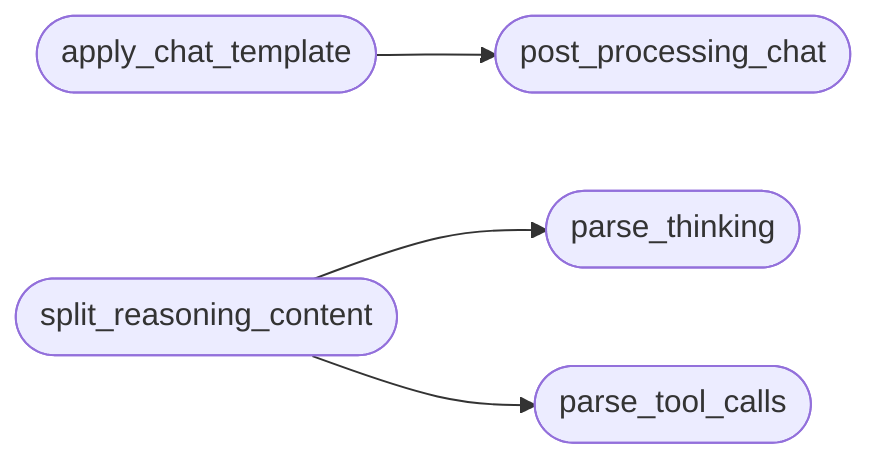

# `topogpt3.chat`

> Source: [topogpt3/chat.py:1](../../topogpt3/chat.py#L1) | language `py` | coverage 57.1% | [API index](../index.md)

Chat template + special tokens for TopoGPT3.

Identity preserved: TopoGPT3 keeps its tiktoken GPT-2 BPE tokenizer.
These helpers work at the *string* level, so no vocab retraining is needed.
`<tool_call>`, `<tool_response>`, `<think>` and `<|bufferN|>` are plain text
markers that the existing BPE encodes as ordinary subwords; the SFT mask,
the API parser and the agent rollout understand them structurally.

## Contents

- **Functions:** [`pre_processing_chat`](#pre_processing_chat), [`post_processing_chat`](#post_processing_chat), [`apply_chat_template`](#apply_chat_template), [`parse_tool_calls`](#parse_tool_calls), [`parse_thinking`](#parse_thinking), [`split_reasoning_content`](#split_reasoning_content)
- **Constants:** [`BOS`](#bos), [`EOS`](#eos), [`THINK_OPEN`](#think_open), [`THINK_CLOSE`](#think_close), [`TOOL_CALL_OPEN`](#tool_call_open), [`TOOL_CALL_CLOSE`](#tool_call_close), [`TOOL_RESPONSE_OPEN`](#tool_response_open), [`TOOL_RESPONSE_CLOSE`](#tool_response_close), [`BUFFER_TOKENS`](#buffer_tokens), [`SPECTRAL_WARNING_TOKEN`](#spectral_warning_token), [`HRM_THINK_TOKEN_OPEN`](#hrm_think_token_open), [`SYSTEM_PROMPTS`](#system_prompts), [`THINK_RE`](#think_re), [`TOOL_CALL_RE`](#tool_call_re)

## Call Graph

Solid arrows stay in this module, dashed arrows leave it.



## Functions

<a id="pre_processing_chat"></a>

### `pre_processing_chat`

`function` | [topogpt3/chat.py:43](../../topogpt3/chat.py#L43)

```python
def pre_processing_chat(conversations: list[dict[str, Any]], add_system_ratio: float = 0.2) -> list[dict[str, Any]]
```

Randomly prepend a system prompt (skip when tools present).

**Parameters**

| Name | Type | Default | Description |
|---|---|---|---|
| `conversations` | `list[dict[str, Any]]` |  |  |
| `add_system_ratio` | `float` | `0.2` |  |

**Returns:** `list[dict[str, Any]]`

---

<a id="post_processing_chat"></a>

### `post_processing_chat`

`function` | [topogpt3/chat.py:54](../../topogpt3/chat.py#L54)

```python
def post_processing_chat(prompt: str, empty_think_ratio: float = 0.2) -> str
```

**Parameters**

| Name | Type | Default | Description |
|---|---|---|---|
| `prompt` | `str` |  |  |
| `empty_think_ratio` | `float` | `0.2` |  |

**Returns:** `str`

*Called by:* [`apply_chat_template`](#apply_chat_template)

---

<a id="apply_chat_template"></a>

### `apply_chat_template`

`function` | [topogpt3/chat.py:112](../../topogpt3/chat.py#L112)

```python
def apply_chat_template(messages: list[dict[str, Any]], tools: list[dict[str, Any]] | None = None, add_generation_prompt: bool = False, open_thinking: bool = False) -> str
```

Render messages with tool definitions, thinking and tool-call blocks.

Supports roles: system/user/assistant/tool + reasoning_content,
tool_calls (list or json str), open_thinking switch.

**Parameters**

| Name | Type | Default | Description |
|---|---|---|---|
| `messages` | `list[dict[str, Any]]` |  |  |
| `tools` | `list[dict[str, Any]] \| None` | `None` |  |
| `add_generation_prompt` | `bool` | `False` |  |
| `open_thinking` | `bool` | `False` |  |

**Returns:** `str`

*Calls:* [`post_processing_chat`](#post_processing_chat)

*Called by:* [`run_case`](topogpt3.eval_toolcall.py.md#run_case), [`rollout_multiturn`](topogpt3.tools_agent.py.md#rollout_multiturn), [`main`](topogpt3.train_agent.py.md#main)

---

<a id="parse_tool_calls"></a>

### `parse_tool_calls`

`function` | [topogpt3/chat.py:160](../../topogpt3/chat.py#L160)

```python
def parse_tool_calls(text: str) -> list[dict[str, Any]]
```

**Parameters**

| Name | Type | Default | Description |
|---|---|---|---|
| `text` | `str` |  |  |

**Returns:** `list[dict[str, Any]]`

*Called by:* [`build_generate_fn`](eval.tasks.py.md#build_generate_fn), [`verify_tool_call`](eval.tasks.py.md#verify_tool_call), [`split_reasoning_content`](#split_reasoning_content), [`run_case`](topogpt3.eval_toolcall.py.md#run_case), [`score_candidate`](topogpt3.fallback.py.md#score_candidate), [`tool_calls_payload`](topogpt3.fallback.py.md#tool_calls_payload), [`tool_call_reward`](topogpt3.rewards.py.md#tool_call_reward), [`rollout_multiturn`](topogpt3.tools_agent.py.md#rollout_multiturn), [`main`](topogpt3.train_agent.py.md#main)

---

<a id="parse_thinking"></a>

### `parse_thinking`

`function` | [topogpt3/chat.py:170](../../topogpt3/chat.py#L170)

```python
def parse_thinking(text: str) -> dict[str, str]
```

**Parameters**

| Name | Type | Default | Description |
|---|---|---|---|
| `text` | `str` |  |  |

**Returns:** `dict[str, str]`

*Called by:* [`split_reasoning_content`](#split_reasoning_content)

---

<a id="split_reasoning_content"></a>

### `split_reasoning_content`

`function` | [topogpt3/chat.py:178](../../topogpt3/chat.py#L178)

```python
def split_reasoning_content(text: str) -> dict[str, Any]
```

Split generated text into reasoning_content / content / tool_calls (API).

**Parameters**

| Name | Type | Default | Description |
|---|---|---|---|
| `text` | `str` |  |  |

**Returns:** `dict[str, Any]`

*Calls:* [`parse_thinking`](#parse_thinking), [`parse_tool_calls`](#parse_tool_calls)

*Called by:* [`split_response`](topogpt3.fallback.py.md#split_response)

---

## Constants

<a id="bos"></a>

### `BOS`

`constant` | [topogpt3/chat.py:16](../../topogpt3/chat.py#L16)

```python
BOS = '<|im_start|>'
```

---

<a id="eos"></a>

### `EOS`

`constant` | [topogpt3/chat.py:17](../../topogpt3/chat.py#L17)

```python
EOS = '<|im_end|>'
```

---

<a id="think_open"></a>

### `THINK_OPEN`

`constant` | [topogpt3/chat.py:18](../../topogpt3/chat.py#L18)

```python
THINK_OPEN = '<think>'
```

---

<a id="think_close"></a>

### `THINK_CLOSE`

`constant` | [topogpt3/chat.py:19](../../topogpt3/chat.py#L19)

```python
THINK_CLOSE = '</think>'
```

---

<a id="tool_call_open"></a>

### `TOOL_CALL_OPEN`

`constant` | [topogpt3/chat.py:20](../../topogpt3/chat.py#L20)

```python
TOOL_CALL_OPEN = '<tool_call>'
```

---

<a id="tool_call_close"></a>

### `TOOL_CALL_CLOSE`

`constant` | [topogpt3/chat.py:21](../../topogpt3/chat.py#L21)

```python
TOOL_CALL_CLOSE = '</tool_call>'
```

---

<a id="tool_response_open"></a>

### `TOOL_RESPONSE_OPEN`

`constant` | [topogpt3/chat.py:22](../../topogpt3/chat.py#L22)

```python
TOOL_RESPONSE_OPEN = '<tool_response>'
```

---

<a id="tool_response_close"></a>

### `TOOL_RESPONSE_CLOSE`

`constant` | [topogpt3/chat.py:23](../../topogpt3/chat.py#L23)

```python
TOOL_RESPONSE_CLOSE = '</tool_response>'
```

---

<a id="buffer_tokens"></a>

### `BUFFER_TOKENS`

`constant` | [topogpt3/chat.py:26](../../topogpt3/chat.py#L26)

```python
BUFFER_TOKENS = [f'<|buffer{i}|>' for i in range(1, 9)]
```

---

<a id="spectral_warning_token"></a>

### `SPECTRAL_WARNING_TOKEN`

`constant` | [topogpt3/chat.py:29](../../topogpt3/chat.py#L29)

```python
SPECTRAL_WARNING_TOKEN = '<spectral_drift_warning>'
```

---

<a id="hrm_think_token_open"></a>

### `HRM_THINK_TOKEN_OPEN`

`constant` | [topogpt3/chat.py:30](../../topogpt3/chat.py#L30)

```python
HRM_THINK_TOKEN_OPEN = THINK_OPEN
```

---

<a id="system_prompts"></a>

### `SYSTEM_PROMPTS`

`constant` | [topogpt3/chat.py:32](../../topogpt3/chat.py#L32)

```python
SYSTEM_PROMPTS
```

---

<a id="think_re"></a>

### `THINK_RE`

`constant` | [topogpt3/chat.py:39](../../topogpt3/chat.py#L39)

```python
THINK_RE = re.compile('<think>(.*?)</think>', re.DOTALL)
```

---

<a id="tool_call_re"></a>

### `TOOL_CALL_RE`

`constant` | [topogpt3/chat.py:40](../../topogpt3/chat.py#L40)

```python
TOOL_CALL_RE = re.compile('<tool_call>(.*?)</tool_call>', re.DOTALL)
```

---
