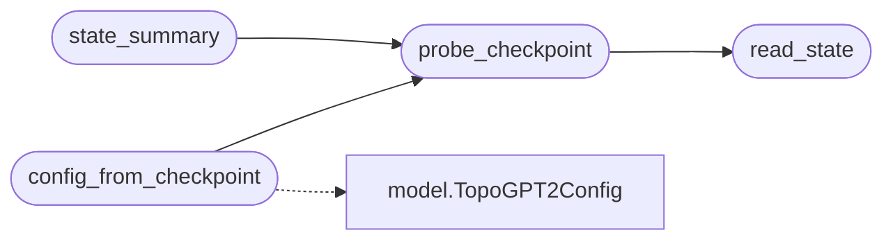

# `topogpt3.checkpoint_meta`

> Source: [topogpt3/checkpoint_meta.py:1](../../topogpt3/checkpoint_meta.py#L1) | language `py` | coverage 66.7% | [API index](../index.md)

Checkpoint architecture discovery shared by inference, API and trainers.

The checkpoints store architecture in two places: ``state.json`` (scale only
for some trainers) and the safetensors shapes. Relying on a hardcoded scale
silently loads a wrong model, so every entrypoint should use this module.

## Contents

- **Functions:** [`read_state`](#read_state), [`probe_checkpoint`](#probe_checkpoint), [`config_from_checkpoint`](#config_from_checkpoint), [`state_summary`](#state_summary), [`config_dict`](#config_dict)

## Call Graph

Solid arrows stay in this module, dashed arrows leave it.



## Functions

<a id="read_state"></a>

### `read_state`

`function` | [topogpt3/checkpoint_meta.py:24](../../topogpt3/checkpoint_meta.py#L24)

```python
def read_state(checkpoint_dir: str | Path) -> dict[str, Any]
```

**Parameters**

| Name | Type | Default | Description |
|---|---|---|---|
| `checkpoint_dir` | `str \| Path` |  |  |

**Returns:** `dict[str, Any]`

*Called by:* [`probe_checkpoint`](#probe_checkpoint)

---

<a id="probe_checkpoint"></a>

### `probe_checkpoint`

`function` | [topogpt3/checkpoint_meta.py:35](../../topogpt3/checkpoint_meta.py#L35)

```python
def probe_checkpoint(checkpoint_dir: str | Path) -> dict[str, Any]
```

Infer scale, dimensions and KV heads from ``state.json`` + weights.

**Parameters**

| Name | Type | Default | Description |
|---|---|---|---|
| `checkpoint_dir` | `str \| Path` |  |  |

**Returns:** `dict[str, Any]`

**Raises**

- `FileNotFoundError`: (raised in the body, not documented)

*Calls:* [`read_state`](#read_state)

*Called by:* [`config_from_checkpoint`](#config_from_checkpoint), [`state_summary`](#state_summary)

---

<a id="config_from_checkpoint"></a>

### `config_from_checkpoint`

`function` | [topogpt3/checkpoint_meta.py:81](../../topogpt3/checkpoint_meta.py#L81)

```python
def config_from_checkpoint(checkpoint_dir: str | Path, device: str = 'cpu', scale: str | None = None)
```

Build a `[`TopoGPT2Config`](topogpt3.model.py.md#topogpt2config)` that matches the checkpoint on disk.

**Parameters**

| Name | Type | Default | Description |
|---|---|---|---|
| `checkpoint_dir` | `str \| Path` |  |  |
| `device` | `str` | `'cpu'` |  |
| `scale` | `str \| None` | `None` |  |

*Calls:* [`probe_checkpoint`](#probe_checkpoint), [`TopoGPT2Config`](topogpt3.model.py.md#topogpt2config)

*Called by:* [`ModelLoader.__init__`](eval.harness.py.md#modelloader-__init__), [`build_generate_fn`](eval.tasks.py.md#build_generate_fn), [`load_model`](topogpt3.api_server.py.md#load_model), [`TopoGPT2ConfigAligner.build`](topogpt3.inference.py.md#topogpt2configaligner-build), [`TopoGPT2ConfigAligner.build`](topogpt3.inference_hrm.py.md#topogpt2configaligner-build), [`resize_embeddings`](topogpt3.tokenizer_tools.py.md#resize_embeddings), [`main`](topogpt3.train_agent.py.md#main), [`main`](topogpt3.train_distill.py.md#main), [`load_model`](topogpt3.train_dpo.py.md#load_model), [`main`](topogpt3.train_grpo.py.md#main), [`load_base`](topogpt3.train_lora.py.md#load_base), [`main`](topogpt3.train_ppo.py.md#main)

---

<a id="state_summary"></a>

### `state_summary`

`function` | [topogpt3/checkpoint_meta.py:120](../../topogpt3/checkpoint_meta.py#L120)

```python
def state_summary(checkpoint_dir: str | Path) -> dict[str, Any]
```

Small JSON-friendly summary for logs and /v1/models metadata.

**Parameters**

| Name | Type | Default | Description |
|---|---|---|---|
| `checkpoint_dir` | `str \| Path` |  |  |

**Returns:** `dict[str, Any]`

*Calls:* [`probe_checkpoint`](#probe_checkpoint)

---

<a id="config_dict"></a>

### `config_dict`

`function` | [topogpt3/checkpoint_meta.py:129](../../topogpt3/checkpoint_meta.py#L129)

```python
def config_dict(cfg: Any) -> dict[str, Any]
```

**Parameters**

| Name | Type | Default | Description |
|---|---|---|---|
| `cfg` | `Any` |  |  |

**Returns:** `dict[str, Any]`

---
