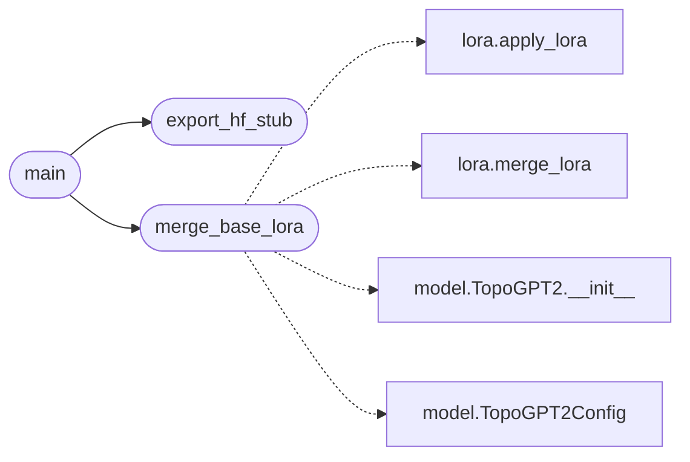

# `topogpt3.convert`

> Source: [topogpt3/convert.py:1](../../topogpt3/convert.py#L1) | language `py` | coverage 25.0% | [API index](../index.md)

Export / convert utilities for TopoGPT3 checkpoints.

TopoGPT3 keeps its own safetensors slot; this adds:
  - merge_lora CLI (base + LoRA -> merged safetensors dir)
  - export_hf_stub: writes config.json + tokenizer stub for HF/vLLM loaders
  - export_gguf_note: real-valued projection note for llama.cpp/C-engine path
No architecture rewrite: weights are preserved verbatim.

## Contents

- **Functions:** [`merge_base_lora`](#merge_base_lora), [`export_hf_stub`](#export_hf_stub), [`main`](#main)

## Call Graph

Solid arrows stay in this module, dashed arrows leave it.



## Functions

<a id="merge_base_lora"></a>

### `merge_base_lora`

`function` | [topogpt3/convert.py:19](../../topogpt3/convert.py#L19)

```python
def merge_base_lora(base_dir: str, lora_path: str, out_dir: str)
```

**Parameters**

| Name | Type | Default | Description |
|---|---|---|---|
| `base_dir` | `str` |  |  |
| `lora_path` | `str` |  |  |
| `out_dir` | `str` |  |  |

*Calls:* [`apply_lora`](topogpt3.lora.py.md#apply_lora), [`merge_lora`](topogpt3.lora.py.md#merge_lora), [`TopoGPT2.__init__`](topogpt3.model.py.md#topogpt2-__init__), [`TopoGPT2Config`](topogpt3.model.py.md#topogpt2config)

*Called by:* [`main`](#main)

---

<a id="export_hf_stub"></a>

### `export_hf_stub`

`function` | [topogpt3/convert.py:38](../../topogpt3/convert.py#L38)

```python
def export_hf_stub(ckpt_dir: str, out_dir: str)
```

**Parameters**

| Name | Type | Default | Description |
|---|---|---|---|
| `ckpt_dir` | `str` |  |  |
| `out_dir` | `str` |  |  |

*Called by:* [`main`](#main)

---

<a id="main"></a>

### `main`

`function` | [topogpt3/convert.py:49](../../topogpt3/convert.py#L49)

```python
def main()
```

*Calls:* [`export_hf_stub`](#export_hf_stub), [`merge_base_lora`](#merge_base_lora)

---
