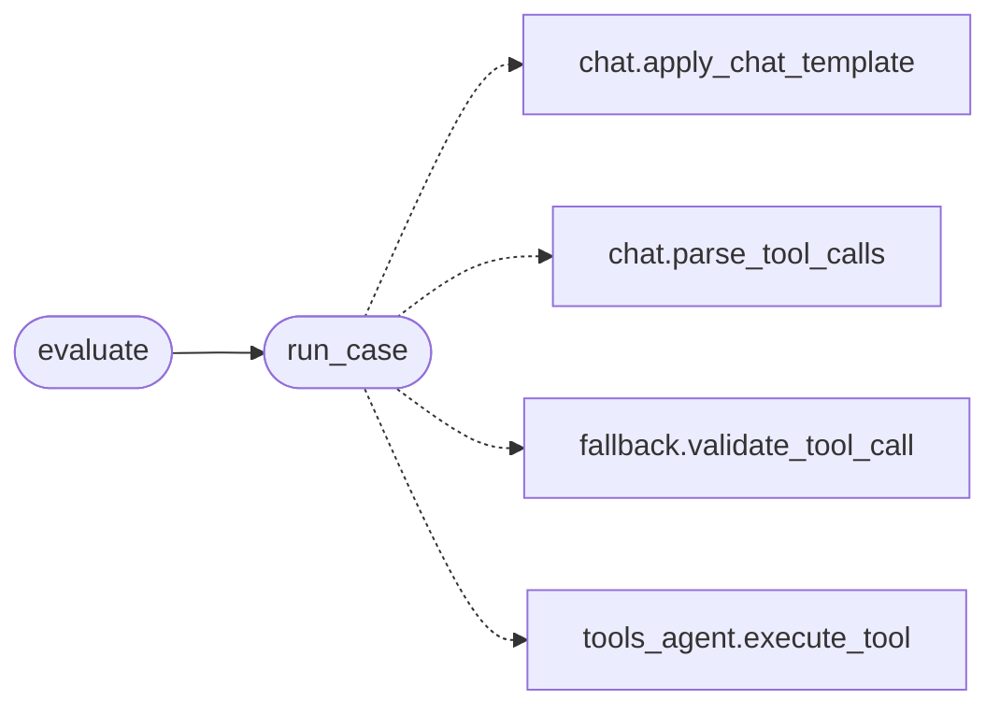

# `topogpt3.eval_toolcall`

> Source: [topogpt3/eval_toolcall.py:1](../../topogpt3/eval_toolcall.py#L1) | language `py` | coverage 33.3% | [API index](../index.md)

Tool-call evaluation for TopoGPT3 agents.

Runs TOOLS cases through a generate_fn and checks name/args parsing,
including apt_chain cases (LazyOwn fallback contract).

## Contents

- **Functions:** [`run_case`](#run_case), [`evaluate`](#evaluate)
- **Constants:** [`CASES`](#cases)

## Call Graph

Solid arrows stay in this module, dashed arrows leave it.



## Functions

<a id="run_case"></a>

### `run_case`

`function` | [topogpt3/eval_toolcall.py:36](../../topogpt3/eval_toolcall.py#L36)

```python
def run_case(generate_fn, prompt: str, expect_tool: str, expect_args: dict | None = None)
```

**Parameters**

| Name | Type | Default | Description |
|---|---|---|---|
| `generate_fn` |  |  |  |
| `prompt` | `str` |  |  |
| `expect_tool` | `str` |  |  |
| `expect_args` | `dict \| None` | `None` |  |

*Calls:* [`apply_chat_template`](topogpt3.chat.py.md#apply_chat_template), [`parse_tool_calls`](topogpt3.chat.py.md#parse_tool_calls), [`validate_tool_call`](topogpt3.fallback.py.md#validate_tool_call), [`execute_tool`](topogpt3.tools_agent.py.md#execute_tool)

*Called by:* [`evaluate`](#evaluate)

---

<a id="evaluate"></a>

### `evaluate`

`function` | [topogpt3/eval_toolcall.py:91](../../topogpt3/eval_toolcall.py#L91)

```python
def evaluate(generate_fn)
```

**Parameters**

| Name | Type | Default | Description |
|---|---|---|---|
| `generate_fn` |  |  |  |

*Calls:* [`run_case`](#run_case)

---

## Constants

<a id="cases"></a>

### `CASES`

`constant` | [topogpt3/eval_toolcall.py:15](../../topogpt3/eval_toolcall.py#L15)

```python
CASES
```

---
