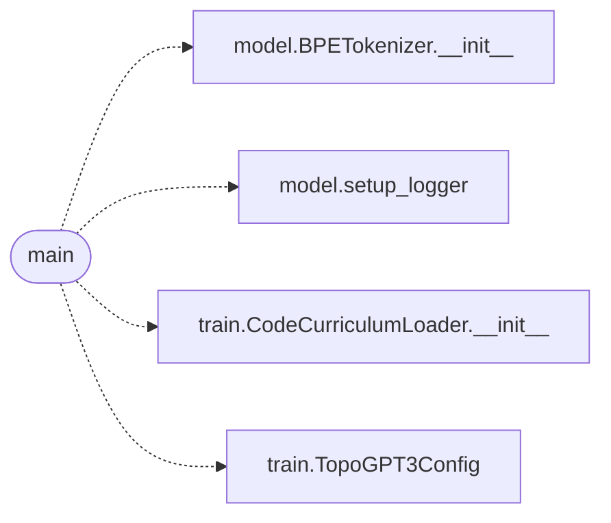

# `topogpt3.export_chat`

> Source: [topogpt3/export_chat.py:1](../../topogpt3/export_chat.py#L1) | language `py` | coverage 50.0% | [API index](../index.md)

Export the real 4-tier curriculum (HF) to chat JSONL for the heritage trainers.

Reuses CodeCurriculumLoader's dataset IDs + fallback chain, but emits
conversations instead of token bins:

  - sft_all.jsonl      tiers 0..2 (instruction -> user/assistant)
  - rlaif_all.jsonl    tiers 0..2 prompts (assistant left open)
  - dpo_all.jsonl      chosen=ground truth, rejected=truncated 50%
                       (weak but honest bootstrap signal; replace with human
                       prefs when available)
  - pretrain_tier3.jsonl  raw code (tier 3 has no instructions)

Usage:
  python -m topogpt3 export-chat --out-dir data/chat --max-per-tier 20000

## Contents

- **Functions:** [`main`](#main)

## Call Graph

Solid arrows stay in this module, dashed arrows leave it.



## Functions

<a id="main"></a>

### `main`

`function` | [topogpt3/export_chat.py:81](../../topogpt3/export_chat.py#L81)

```python
def main()
```

**Raises**

- `SystemExit`: (raised in the body, not documented)

*Calls:* [`BPETokenizer.__init__`](topogpt3.model.py.md#bpetokenizer-__init__), [`setup_logger`](topogpt3.model.py.md#setup_logger), [`CodeCurriculumLoader.__init__`](topogpt3.train.py.md#codecurriculumloader-__init__), [`TopoGPT3Config`](topogpt3.train.py.md#topogpt3config)

---
