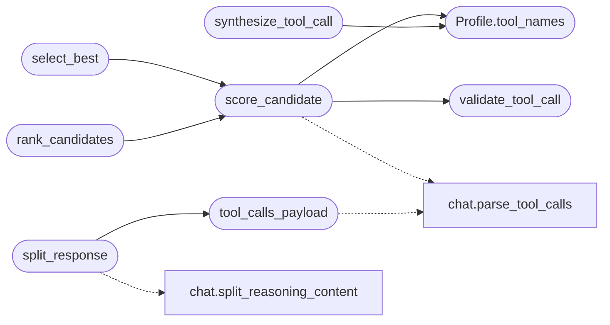

# `topogpt3.fallback`

> Source: [topogpt3/fallback.py:1](../../topogpt3/fallback.py#L1) | language `py` | coverage 41.7% | [API index](../index.md)

Local-fallback profiles, apt_chain tooling and deterministic reranking.

Everything here is model-side: LazyOwn/TopoSwarm only need to point their
OpenAI-compatible client at ``/v1``. No changes in those repositories.

## Contents

- **Classes:** [`Profile`](#profile)
- **Functions:** [`resolve_profile`](#resolve_profile), [`models_payload`](#models_payload), [`validate_tool_call`](#validate_tool_call), [`score_candidate`](#score_candidate), [`select_best`](#select_best), [`tool_calls_payload`](#tool_calls_payload), [`split_response`](#split_response), [`rank_candidates`](#rank_candidates), [`synthesize_tool_call`](#synthesize_tool_call)
- **Constants:** [`MAX_TOOL_TEXT`](#max_tool_text), [`APT_CHAIN_TOOL`](#apt_chain_tool), [`RUN_COMMAND_TOOL`](#run_command_tool), [`READ_FACTS_TOOL`](#read_facts_tool), [`LAZYOWN_TOOLS`](#lazyown_tools), [`BASE_SYSTEM`](#base_system), [`TOOL_SYSTEM`](#tool_system), [`EXPLOIT_SYSTEM`](#exploit_system), [`PROFILES`](#profiles), [`ALIASES`](#aliases)

## Call Graph

Solid arrows stay in this module, dashed arrows leave it.



## Classes

<a id="profile"></a>

### `Profile`

`class` `dataclass` | [topogpt3/fallback.py:110](../../topogpt3/fallback.py#L110)

Decorators: `@dataclass(frozen=True)`

```python
class Profile
```

**Attributes**

| Name | Type | Default | Description |
|---|---|---|---|
| [`name`](#profile-name) | `str` |  |  |
| [`system`](#profile-system) | `str` |  |  |
| [`tools`](#profile-tools) | `tuple[dict[str, Any], ...]` | `()` |  |
| [`temperature`](#profile-temperature) | `float` | `0.2` |  |
| [`top_k`](#profile-top_k) | `int` | `40` |  |
| [`repetition_penalty`](#profile-repetition_penalty) | `float` | `1.0` |  |
| [`max_tokens`](#profile-max_tokens) | `int` | `256` |  |
| [`stop`](#profile-stop) | `tuple[str, ...]` | `()` |  |
| [`prefer_code`](#profile-prefer_code) | `bool` | `False` |  |
| [`require_tool`](#profile-require_tool) | `bool` | `False` |  |
| [`verifier`](#profile-verifier) | `str` | `'general'` |  |
| [`best_of`](#profile-best_of) | `int` | `1` |  |
| [`min_new_tokens`](#profile-min_new_tokens) | `int` | `0` |  |

**Members**

| Member | Kind | Summary |
|---|---|---|
| [`tool_names`](#profile-tool_names) | method |  |

<a id="profile-tool_names"></a>

#### `Profile.tool_names`

`method` | [topogpt3/fallback.py:125](../../topogpt3/fallback.py#L125)

```python
def tool_names(self) -> set[str]
```

**Returns:** `set[str]`

*Called by:* [`score_candidate`](#score_candidate), [`synthesize_tool_call`](#synthesize_tool_call)

---

## Functions

<a id="resolve_profile"></a>

### `resolve_profile`

`function` | [topogpt3/fallback.py:221](../../topogpt3/fallback.py#L221)

```python
def resolve_profile(model: str | None) -> Profile
```

**Parameters**

| Name | Type | Default | Description |
|---|---|---|---|
| `model` | `str \| None` |  |  |

**Returns:** `Profile`

*Called by:* [`build_generate_fn`](eval.tasks.py.md#build_generate_fn), [`evaluate_case`](eval.tasks.py.md#evaluate_case)

---

<a id="models_payload"></a>

### `models_payload`

`function` | [topogpt3/fallback.py:227](../../topogpt3/fallback.py#L227)

```python
def models_payload(default_checkpoint: str = '') -> list[dict[str, Any]]
```

**Parameters**

| Name | Type | Default | Description |
|---|---|---|---|
| `default_checkpoint` | `str` | `''` |  |

**Returns:** `list[dict[str, Any]]`

*Called by:* [`list_models`](topogpt3.api_server.py.md#list_models)

---

<a id="validate_tool_call"></a>

### `validate_tool_call`

`function` | [topogpt3/fallback.py:256](../../topogpt3/fallback.py#L256)

```python
def validate_tool_call(call: dict[str, Any], allowed: set[str] | None = None) -> tuple[bool, str]
```

**Parameters**

| Name | Type | Default | Description |
|---|---|---|---|
| `call` | `dict[str, Any]` |  |  |
| `allowed` | `set[str] \| None` | `None` |  |

**Returns:** `tuple[bool, str]`

*Called by:* [`verify_tool_call`](eval.tasks.py.md#verify_tool_call), [`run_case`](topogpt3.eval_toolcall.py.md#run_case), [`score_candidate`](#score_candidate), [`tool_call_reward`](topogpt3.rewards.py.md#tool_call_reward)

---

<a id="score_candidate"></a>

### `score_candidate`

`function` | [topogpt3/fallback.py:325](../../topogpt3/fallback.py#L325)

```python
def score_candidate(text: str, profile: Profile, prompt: str = '', allowed_tools: set[str] | None = None) -> tuple[float, dict[str, Any]]
```

Deterministic, dependency-free candidate score (higher is better).

**Parameters**

| Name | Type | Default | Description |
|---|---|---|---|
| `text` | `str` |  |  |
| `profile` | `Profile` |  |  |
| `prompt` | `str` | `''` |  |
| `allowed_tools` | `set[str] \| None` | `None` |  |

**Returns:** `tuple[float, dict[str, Any]]`

*Calls:* [`parse_tool_calls`](topogpt3.chat.py.md#parse_tool_calls), [`Profile.tool_names`](#profile-tool_names), [`validate_tool_call`](#validate_tool_call)

*Called by:* [`rank_candidates`](#rank_candidates), [`select_best`](#select_best)

---

<a id="select_best"></a>

### `select_best`

`function` | [topogpt3/fallback.py:404](../../topogpt3/fallback.py#L404)

```python
def select_best(candidates: Sequence[str], profile: Profile, prompt: str = '', allowed_tools: set[str] | None = None) -> tuple[int, str, float, dict[str, Any]]
```

**Parameters**

| Name | Type | Default | Description |
|---|---|---|---|
| `candidates` | `Sequence[str]` |  |  |
| `profile` | `Profile` |  |  |
| `prompt` | `str` | `''` |  |
| `allowed_tools` | `set[str] \| None` | `None` |  |

**Returns:** `tuple[int, str, float, dict[str, Any]]`

*Calls:* [`score_candidate`](#score_candidate)

---

<a id="tool_calls_payload"></a>

### `tool_calls_payload`

`function` | [topogpt3/fallback.py:418](../../topogpt3/fallback.py#L418)

```python
def tool_calls_payload(text: str) -> list[dict[str, Any]]
```

Convert parsed calls into OpenAI `[`tool_calls`](topogpt3.api_server.py.md#message-tool_calls)` response objects.

**Parameters**

| Name | Type | Default | Description |
|---|---|---|---|
| `text` | `str` |  |  |

**Returns:** `list[dict[str, Any]]`

*Calls:* [`parse_tool_calls`](topogpt3.chat.py.md#parse_tool_calls)

*Called by:* [`chat_completions`](topogpt3.api_server.py.md#chat_completions), [`split_response`](#split_response)

---

<a id="split_response"></a>

### `split_response`

`function` | [topogpt3/fallback.py:435](../../topogpt3/fallback.py#L435)

```python
def split_response(text: str) -> dict[str, Any]
```

**Parameters**

| Name | Type | Default | Description |
|---|---|---|---|
| `text` | `str` |  |  |

**Returns:** `dict[str, Any]`

*Calls:* [`split_reasoning_content`](topogpt3.chat.py.md#split_reasoning_content), [`tool_calls_payload`](#tool_calls_payload)

*Called by:* [`chat_completions`](topogpt3.api_server.py.md#chat_completions)

---

<a id="rank_candidates"></a>

### `rank_candidates`

`function` | [topogpt3/fallback.py:441](../../topogpt3/fallback.py#L441)

```python
def rank_candidates(candidates: Sequence[str], profile: Profile, prompt: str = '', allowed_tools: set[str] | None = None) -> list[tuple[float, int, str, dict[str, Any]]]
```

Score and sort candidates (best first) preserving original indices.

**Parameters**

| Name | Type | Default | Description |
|---|---|---|---|
| `candidates` | `Sequence[str]` |  |  |
| `profile` | `Profile` |  |  |
| `prompt` | `str` | `''` |  |
| `allowed_tools` | `set[str] \| None` | `None` |  |

**Returns:** `list[tuple[float, int, str, dict[str, Any]]]`

*Calls:* [`score_candidate`](#score_candidate)

*Called by:* [`chat_completions`](topogpt3.api_server.py.md#chat_completions), [`completions`](topogpt3.api_server.py.md#completions)

---

<a id="synthesize_tool_call"></a>

### `synthesize_tool_call`

`function` | [topogpt3/fallback.py:456](../../topogpt3/fallback.py#L456)

```python
def synthesize_tool_call(profile: Profile, prompt: str) -> dict[str, Any] | None
```

Deterministic last-resort call for require_tool profiles.

The base checkpoints are not instruction-tuned, so a constrained profile
may finish without emitting a valid call. For fallback deployments the
API synthesizes a conservative call from the prompt instead of failing.

**Parameters**

| Name | Type | Default | Description |
|---|---|---|---|
| `profile` | `Profile` |  |  |
| `prompt` | `str` |  |  |

**Returns:** `dict[str, Any] | None`

*Calls:* [`Profile.tool_names`](#profile-tool_names)

*Called by:* [`build_generate_fn`](eval.tasks.py.md#build_generate_fn), [`chat_completions`](topogpt3.api_server.py.md#chat_completions)

---

## Constants

<a id="max_tool_text"></a>

### `MAX_TOOL_TEXT`

`constant` | [topogpt3/fallback.py:18](../../topogpt3/fallback.py#L18)

```python
MAX_TOOL_TEXT = 8192
```

---

<a id="apt_chain_tool"></a>

### `APT_CHAIN_TOOL`

`constant` | [topogpt3/fallback.py:21](../../topogpt3/fallback.py#L21)

```python
APT_CHAIN_TOOL: dict[str, Any]
```

---

<a id="run_command_tool"></a>

### `RUN_COMMAND_TOOL`

`constant` | [topogpt3/fallback.py:66](../../topogpt3/fallback.py#L66)

```python
RUN_COMMAND_TOOL: dict[str, Any]
```

---

<a id="read_facts_tool"></a>

### `READ_FACTS_TOOL`

`constant` | [topogpt3/fallback.py:87](../../topogpt3/fallback.py#L87)

```python
READ_FACTS_TOOL: dict[str, Any]
```

---

<a id="lazyown_tools"></a>

### `LAZYOWN_TOOLS`

`constant` | [topogpt3/fallback.py:100](../../topogpt3/fallback.py#L100)

```python
LAZYOWN_TOOLS = [APT_CHAIN_TOOL, RUN_COMMAND_TOOL, READ_FACTS_TOOL]
```

---

<a id="base_system"></a>

### `BASE_SYSTEM`

`constant` | [topogpt3/fallback.py:133](../../topogpt3/fallback.py#L133)

```python
BASE_SYSTEM = 'Local fallback assistant. Be concise and deterministic.'
```

---

<a id="tool_system"></a>

### `TOOL_SYSTEM`

`constant` | [topogpt3/fallback.py:135](../../topogpt3/fallback.py#L135)

```python
TOOL_SYSTEM
```

---

<a id="exploit_system"></a>

### `EXPLOIT_SYSTEM`

`constant` | [topogpt3/fallback.py:142](../../topogpt3/fallback.py#L142)

```python
EXPLOIT_SYSTEM
```

---

<a id="profiles"></a>

### `PROFILES`

`constant` | [topogpt3/fallback.py:147](../../topogpt3/fallback.py#L147)

```python
PROFILES: dict[str, Profile]
```

---

<a id="aliases"></a>

### `ALIASES`

`constant` | [topogpt3/fallback.py:206](../../topogpt3/fallback.py#L206)

```python
ALIASES
```

---
