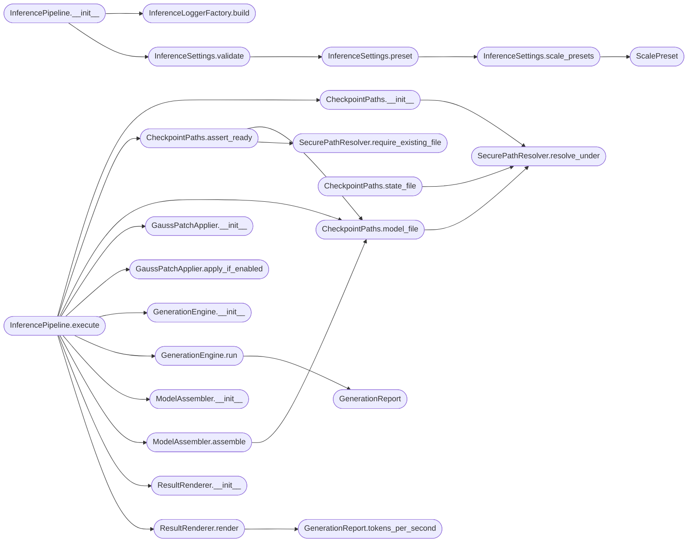

# `topogpt3.inference`

> Source: [topogpt3/inference.py:1](../../topogpt3/inference.py#L1) | language `py` | coverage 80.0% | [API index](../index.md)

TopoGPT3 inference engine.

Production-grade autoregressive code completion pipeline for TopoGPT3
checkpoints. Loads weights from safetensors, aligns the underlying TopoGPT2
architecture against the stored tensors, optionally applies the Gauss
complex-multiply patch for numerical parity with training, and performs
sampling with repetition penalty and top-k filtering.

The pipeline is decomposed into single-responsibility collaborators wired by
an orchestrator. All paths, sampling parameters, safety bounds and string
identifiers live inside InferenceSettings so that business logic contains no
magic numbers or hardcoded constants.

## Contents

- **Classes:** [`ScalePreset`](#scalepreset), [`InferenceSettings`](#inferencesettings), [`InferenceLoggerFactory`](#inferenceloggerfactory), [`SecurePathResolver`](#securepathresolver), [`SourceModuleLoader`](#sourcemoduleloader), [`CheckpointPaths`](#checkpointpaths), [`WeightShapeProbe`](#weightshapeprobe), [`TopoGPT2ConfigAligner`](#topogpt2configaligner), [`TokenizerFactory`](#tokenizerfactory), [`GaussPatchApplier`](#gausspatchapplier), [`ModelAssembler`](#modelassembler), [`SeedSynchronizer`](#seedsynchronizer), [`SamplingPolicy`](#samplingpolicy), [`GenerationReport`](#generationreport), [`GenerationEngine`](#generationengine), [`ResultRenderer`](#resultrenderer), [`InferencePipeline`](#inferencepipeline), [`CliArgumentParser`](#cliargumentparser)
- **Functions:** [`main`](#main)

## Type Diagram

```mermaid
classDiagram
    direction LR
    class ScalePreset
    ScalePreset : int d_model
    ScalePreset : int n_heads
    ScalePreset : int n_layers
    ScalePreset : int max_seq_len
    class InferenceSettings
    InferenceSettings : str model_scale
    InferenceSettings : str device
    InferenceSettings : int seed
    InferenceSettings : str checkpoint_dir
    InferenceSettings : str checkpoint_name
    InferenceSettings : str model_filename
    InferenceSettings : str state_filename
    InferenceSettings : str topogpt3_source_filename
    InferenceSettings : str topogpt2_source_filename
    InferenceSettings : str source_directory
    InferenceSettings : str tokenizer_encoding
    InferenceSettings : str weight_probe_key
    InferenceSettings : bool apply_gauss_patch_at_load
    InferenceSettings : bool strict_state_dict
    InferenceSettings : str prompt
    InferenceSettings : int max_new_tokens
    InferenceSettings : float temperature
    InferenceSettings : int top_k
    InferenceSettings : float repetition_penalty
    InferenceSettings : bool auto_continue
    InferenceSettings : int max_continuations
    InferenceSettings : int continuation_tail_lines
    InferenceSettings : str log_level
    InferenceSettings : str log_name
    class InferenceLoggerFactory
    InferenceLoggerFactory : build()
    class SecurePathResolver
    SecurePathResolver : resolve_under()
    SecurePathResolver : require_existing_file()
    class SourceModuleLoader
    SourceModuleLoader : __init__()
    SourceModuleLoader : load()
    class CheckpointPaths
    CheckpointPaths : __init__()
    CheckpointPaths : slot_dir()
    CheckpointPaths : model_file()
    CheckpointPaths : state_file()
    CheckpointPaths : assert_ready()
    class WeightShapeProbe
    WeightShapeProbe : __init__()
    WeightShapeProbe : detect_n_kv_heads()
    class TopoGPT2ConfigAligner
    TopoGPT2ConfigAligner : __init__()
    TopoGPT2ConfigAligner : build()
    class TokenizerFactory
    TokenizerFactory : __init__()
    TokenizerFactory : build()
    class GaussPatchApplier
    GaussPatchApplier : __init__()
    GaussPatchApplier : apply_if_enabled()
    class ModelAssembler
    ModelAssembler : __init__()
    ModelAssembler : assemble()
    class SeedSynchronizer
    SeedSynchronizer : __init__()
    SeedSynchronizer : apply()
    class SamplingPolicy
    SamplingPolicy : int max_new_tokens
    SamplingPolicy : float temperature
    SamplingPolicy : int top_k
    SamplingPolicy : float repetition_penalty
    SamplingPolicy : from_settings()
    class GenerationReport
    GenerationReport : str prompt
    GenerationReport : str output
    GenerationReport : int prompt_tokens
    GenerationReport : int new_tokens
    GenerationReport : float elapsed_seconds
    GenerationReport : tokens_per_second()
    class GenerationEngine
    GenerationEngine : __init__()
    GenerationEngine : run()
    class ResultRenderer
    ResultRenderer : __init__()
    ResultRenderer : render()
    class InferencePipeline
    InferencePipeline : __init__()
    InferencePipeline : execute()
    class CliArgumentParser
    CliArgumentParser : build_parser()
    CliArgumentParser : parse()
```



## Call Graph

Solid arrows stay in this module, dashed arrows leave it.



## Classes

<a id="scalepreset"></a>

### `ScalePreset`

`class` `dataclass` | [topogpt3/inference.py:32](../../topogpt3/inference.py#L32)

Decorators: `@dataclass(frozen=True)`

```python
class ScalePreset
```

Immutable architecture preset for a named model scale.

**Attributes**

| Name | Type | Default | Description |
|---|---|---|---|
| [`d_model`](#scalepreset-d_model) | `int` |  |  |
| [`n_heads`](#scalepreset-n_heads) | `int` |  |  |
| [`n_layers`](#scalepreset-n_layers) | `int` |  |  |
| [`max_seq_len`](#scalepreset-max_seq_len) | `int` |  |  |

---

<a id="inferencesettings"></a>

### `InferenceSettings`

`class` `dataclass` | [topogpt3/inference.py:42](../../topogpt3/inference.py#L42)

Decorators: `@dataclass`

```python
class InferenceSettings
```

Centralized configuration container for the inference pipeline.

Every value consumed downstream resides here. Adding a new tunable means
extending this class; no other module should embed literals.

**Attributes**

| Name | Type | Default | Description |
|---|---|---|---|
| [`model_scale`](#inferencesettings-model_scale) | `str` | `'small'` |  |
| [`device`](#inferencesettings-device) | `str` | `field(default_factory=lambda: 'cuda' if torch.cuda.is_available() else 'cpu')` |  |
| [`seed`](#inferencesettings-seed) | `int` | `42` |  |
| [`checkpoint_dir`](#inferencesettings-checkpoint_dir) | `str` | `'checkpoints_topogpt3'` |  |
| [`checkpoint_name`](#inferencesettings-checkpoint_name) | `str` | `'last'` |  |
| [`model_filename`](#inferencesettings-model_filename) | `str` | `'model.safetensors'` |  |
| [`state_filename`](#inferencesettings-state_filename) | `str` | `'state.json'` |  |
| [`topogpt3_source_filename`](#inferencesettings-topogpt3_source_filename) | `str` | `'train.py'` |  |
| [`topogpt2_source_filename`](#inferencesettings-topogpt2_source_filename) | `str` | `'model.py'` |  |
| [`source_directory`](#inferencesettings-source_directory) | `str` | `'.'` |  |
| [`tokenizer_encoding`](#inferencesettings-tokenizer_encoding) | `str` | `'gpt2'` |  |
| [`weight_probe_key`](#inferencesettings-weight_probe_key) | `str` | `'layers.0.attn.k_proj.weight'` |  |
| [`apply_gauss_patch_at_load`](#inferencesettings-apply_gauss_patch_at_load) | `bool` | `True` |  |
| [`strict_state_dict`](#inferencesettings-strict_state_dict) | `bool` | `False` |  |
| [`prompt`](#inferencesettings-prompt) | `str` | `'def main('` |  |
| [`max_new_tokens`](#inferencesettings-max_new_tokens) | `int` | `256` |  |
| [`temperature`](#inferencesettings-temperature) | `float` | `0.3` |  |
| [`top_k`](#inferencesettings-top_k) | `int` | `50` |  |
| [`repetition_penalty`](#inferencesettings-repetition_penalty) | `float` | `1.1` |  |
| [`auto_continue`](#inferencesettings-auto_continue) | `bool` | `False` |  |
| [`max_continuations`](#inferencesettings-max_continuations) | `int` | `3` |  |
| [`continuation_tail_lines`](#inferencesettings-continuation_tail_lines) | `int` | `2` |  |
| [`log_level`](#inferencesettings-log_level) | `str` | `'INFO'` |  |
| [`log_name`](#inferencesettings-log_name) | `str` | `'TopoGPT3Inference'` |  |
| [`log_format`](#inferencesettings-log_format) | `str` | `'%(asctime)s \| %(levelname)s \| %(name)s \| %(message)s'` |  |
| [`log_date_format`](#inferencesettings-log_date_format) | `str` | `'%Y-%m-%d %H:%M:%S'` |  |
| [`result_separator_char`](#inferencesettings-result_separator_char) | `str` | `'='` |  |
| [`result_separator_width`](#inferencesettings-result_separator_width) | `int` | `72` |  |
| [`prompt_label`](#inferencesettings-prompt_label) | `str` | `'PROMPT'` |  |
| [`completion_label`](#inferencesettings-completion_label) | `str` | `'COMPLETION'` |  |
| [`elapsed_floor_seconds`](#inferencesettings-elapsed_floor_seconds) | `float` | `0.001` |  |
| [`min_max_new_tokens`](#inferencesettings-min_max_new_tokens) | `int` | `1` |  |
| [`max_max_new_tokens`](#inferencesettings-max_max_new_tokens) | `int` | `8192` |  |
| [`min_temperature`](#inferencesettings-min_temperature) | `float` | `0.001` |  |
| [`max_temperature`](#inferencesettings-max_temperature) | `float` | `5.0` |  |
| [`min_top_k`](#inferencesettings-min_top_k) | `int` | `0` |  |
| [`min_repetition_penalty`](#inferencesettings-min_repetition_penalty) | `float` | `0.5` |  |
| [`max_repetition_penalty`](#inferencesettings-max_repetition_penalty) | `float` | `5.0` |  |
| [`max_checkpoint_bytes`](#inferencesettings-max_checkpoint_bytes) | `int` | `50 * 1024 ** 3` |  |
| [`min_checkpoint_bytes`](#inferencesettings-min_checkpoint_bytes) | `int` | `1024` |  |
| [`runtime_module_alias`](#inferencesettings-runtime_module_alias) | `str` | `'topogpt3_inference_runtime'` |  |

**Members**

| Member | Kind | Summary |
|---|---|---|
| [`scale_presets`](#inferencesettings-scale_presets) | staticmethod | Return the architecture preset table indexed by scale name. |
| [`preset`](#inferencesettings-preset) | method | Return the resolved preset for the configured model scale. |
| [`validate`](#inferencesettings-validate) | method | Raise ValueError if any setting falls outside its safety bounds. |

<a id="inferencesettings-scale_presets"></a>

#### `InferenceSettings.scale_presets`

`staticmethod` | [topogpt3/inference.py:103](../../topogpt3/inference.py#L103)

Decorators: `@staticmethod`

```python
def scale_presets() -> Mapping[str, ScalePreset]
```

Return the architecture preset table indexed by scale name.

**Returns:** `Mapping[str, ScalePreset]`

*Calls:* [`ScalePreset`](#scalepreset)

*Called by:* [`CliArgumentParser.build_parser`](#cliargumentparser-build_parser), [`InferenceSettings.preset`](#inferencesettings-preset)

<a id="inferencesettings-preset"></a>

#### `InferenceSettings.preset`

`method` | [topogpt3/inference.py:116](../../topogpt3/inference.py#L116)

```python
def preset(self) -> ScalePreset
```

Return the resolved preset for the configured model scale.

**Returns:** `ScalePreset`

**Raises**

- `ValueError`: (raised in the body, not documented)

*Calls:* [`InferenceSettings.scale_presets`](#inferencesettings-scale_presets)

*Called by:* [`InferenceSettings.validate`](#inferencesettings-validate)

<a id="inferencesettings-validate"></a>

#### `InferenceSettings.validate`

`method` | [topogpt3/inference.py:126](../../topogpt3/inference.py#L126)

```python
def validate(self) -> None
```

Raise ValueError if any setting falls outside its safety bounds.

**Raises**

- `ValueError`: (raised in the body, not documented)

*Calls:* [`InferenceSettings.preset`](#inferencesettings-preset)

*Called by:* [`InferencePipeline.__init__`](#inferencepipeline-__init__)

---

<a id="inferenceloggerfactory"></a>

### `InferenceLoggerFactory`

`class` | [topogpt3/inference.py:158](../../topogpt3/inference.py#L158)

```python
class InferenceLoggerFactory
```

Builds a stdout-attached logger from inference settings.

**Members**

| Member | Kind | Summary |
|---|---|---|
| [`build`](#inferenceloggerfactory-build) | staticmethod | Return a configured Logger with a single deduplicated stdout handler. |

<a id="inferenceloggerfactory-build"></a>

#### `InferenceLoggerFactory.build`

`staticmethod` | [topogpt3/inference.py:162](../../topogpt3/inference.py#L162)

Decorators: `@staticmethod`

```python
def build(settings: InferenceSettings) -> logging.Logger
```

Return a configured Logger with a single deduplicated stdout handler.

**Parameters**

| Name | Type | Default | Description |
|---|---|---|---|
| `settings` | `InferenceSettings` |  |  |

**Returns:** `logging.Logger`

*Called by:* [`InferencePipeline.__init__`](#inferencepipeline-__init__)

---

<a id="securepathresolver"></a>

### `SecurePathResolver`

`class` | [topogpt3/inference.py:178](../../topogpt3/inference.py#L178)

```python
class SecurePathResolver
```

Resolves filesystem paths while rejecting traversal outside their root.

**Members**

| Member | Kind | Summary |
|---|---|---|
| [`resolve_under`](#securepathresolver-resolve_under) | staticmethod | Join `parts` under `root` and return the canonical resolved path. |
| [`require_existing_file`](#securepathresolver-require_existing_file) | staticmethod | Validate `path` points to an existing regular file with the expected suffix. |

<a id="securepathresolver-resolve_under"></a>

#### `SecurePathResolver.resolve_under`

`staticmethod` | [topogpt3/inference.py:182](../../topogpt3/inference.py#L182)

Decorators: `@staticmethod`

```python
def resolve_under(root: Path, *parts: str) -> Path
```

Join `parts` under `root` and return the canonical resolved path.

Raises ValueError if the resolved path escapes `root`.

**Parameters**

| Name | Type | Default | Description |
|---|---|---|---|
| `root` | `Path` |  |  |
| `*parts` | `str` |  |  |

**Returns:** `Path`

**Raises**

- `ValueError`: (raised in the body, not documented)

*Called by:* [`CheckpointPaths.__init__`](#checkpointpaths-__init__), [`CheckpointPaths.model_file`](#checkpointpaths-model_file), [`CheckpointPaths.state_file`](#checkpointpaths-state_file), [`CheckpointPaths.__init__`](topogpt3.inference_hrm.py.md#checkpointpaths-__init__), [`CheckpointPaths.model_file`](topogpt3.inference_hrm.py.md#checkpointpaths-model_file), [`CheckpointPaths.state_file`](topogpt3.inference_hrm.py.md#checkpointpaths-state_file)

<a id="securepathresolver-require_existing_file"></a>

#### `SecurePathResolver.require_existing_file`

`staticmethod` | [topogpt3/inference.py:198](../../topogpt3/inference.py#L198)

Decorators: `@staticmethod`

```python
def require_existing_file(path: Path, expected_suffix: Optional[str] = None) -> Path
```

Validate `path` points to an existing regular file with the expected suffix.

**Parameters**

| Name | Type | Default | Description |
|---|---|---|---|
| `path` | `Path` |  |  |
| `expected_suffix` | `Optional[str]` | `None` |  |

**Returns:** `Path`

**Raises**

- `FileNotFoundError`: (raised in the body, not documented)
- `ValueError`: (raised in the body, not documented)

*Called by:* [`CheckpointPaths.assert_ready`](#checkpointpaths-assert_ready), [`CheckpointPaths.assert_ready`](topogpt3.inference_hrm.py.md#checkpointpaths-assert_ready)

---

<a id="sourcemoduleloader"></a>

### `SourceModuleLoader`

`class` | [topogpt3/inference.py:212](../../topogpt3/inference.py#L212)

```python
class SourceModuleLoader
```

Resolves the TopoGPT3 runtime module via the package import system.

**Members**

| Member | Kind | Summary |
|---|---|---|
| [`__init__`](#sourcemoduleloader-__init__) | constructor |  |
| [`load`](#sourcemoduleloader-load) | method | Return the topogpt3.train module which re-exports model symbols. |

<a id="sourcemoduleloader-__init__"></a>

#### `SourceModuleLoader.__init__`

`constructor` | [topogpt3/inference.py:215](../../topogpt3/inference.py#L215)

```python
def __init__(self, settings: InferenceSettings, logger: logging.Logger)
```

**Parameters**

| Name | Type | Default | Description |
|---|---|---|---|
| `settings` | `InferenceSettings` |  |  |
| `logger` | `logging.Logger` |  |  |

*Called by:* [`InferencePipeline.execute`](#inferencepipeline-execute)

<a id="sourcemoduleloader-load"></a>

#### `SourceModuleLoader.load`

`method` | [topogpt3/inference.py:219](../../topogpt3/inference.py#L219)

```python
def load(self) -> Any
```

Return the topogpt3.train module which re-exports model symbols.

**Returns:** `Any`

*Called by:* [`InferencePipeline.execute`](#inferencepipeline-execute), [`HRMInferencePipeline.execute`](topogpt3.inference_hrm.py.md#hrminferencepipeline-execute)

---

<a id="checkpointpaths"></a>

### `CheckpointPaths`

`class` | [topogpt3/inference.py:228](../../topogpt3/inference.py#L228)

```python
class CheckpointPaths
```

Computes and validates checkpoint file paths under a single root.

**Members**

| Member | Kind | Summary |
|---|---|---|
| [`__init__`](#checkpointpaths-__init__) | constructor |  |
| [`slot_dir`](#checkpointpaths-slot_dir) | property | Directory holding the active checkpoint slot. |
| [`model_file`](#checkpointpaths-model_file) | method | Resolved path to the safetensors weights file inside the slot. |
| [`state_file`](#checkpointpaths-state_file) | method | Resolved path to the JSON training-state file inside the slot. |
| [`assert_ready`](#checkpointpaths-assert_ready) | method | Verify weights exist and the on-disk size lies within safety bounds. |

<a id="checkpointpaths-__init__"></a>

#### `CheckpointPaths.__init__`

`constructor` | [topogpt3/inference.py:231](../../topogpt3/inference.py#L231)

```python
def __init__(self, settings: InferenceSettings)
```

**Parameters**

| Name | Type | Default | Description |
|---|---|---|---|
| `settings` | `InferenceSettings` |  |  |

*Calls:* [`SecurePathResolver.resolve_under`](#securepathresolver-resolve_under)

*Called by:* [`InferencePipeline.execute`](#inferencepipeline-execute)

<a id="checkpointpaths-slot_dir"></a>

#### `CheckpointPaths.slot_dir`

`property` | [topogpt3/inference.py:239](../../topogpt3/inference.py#L239)

Decorators: `@property`

```python
def slot_dir(self) -> Path
```

Directory holding the active checkpoint slot.

**Returns:** `Path`

<a id="checkpointpaths-model_file"></a>

#### `CheckpointPaths.model_file`

`method` | [topogpt3/inference.py:243](../../topogpt3/inference.py#L243)

```python
def model_file(self) -> Path
```

Resolved path to the safetensors weights file inside the slot.

**Returns:** `Path`

*Calls:* [`SecurePathResolver.resolve_under`](#securepathresolver-resolve_under)

*Called by:* [`CheckpointPaths.assert_ready`](#checkpointpaths-assert_ready), [`InferencePipeline.execute`](#inferencepipeline-execute), [`ModelAssembler.assemble`](#modelassembler-assemble), [`CheckpointPaths.assert_ready`](topogpt3.inference_hrm.py.md#checkpointpaths-assert_ready), [`HRMInferencePipeline.execute`](topogpt3.inference_hrm.py.md#hrminferencepipeline-execute), [`ModelAssembler.assemble`](topogpt3.inference_hrm.py.md#modelassembler-assemble)

<a id="checkpointpaths-state_file"></a>

#### `CheckpointPaths.state_file`

`method` | [topogpt3/inference.py:249](../../topogpt3/inference.py#L249)

```python
def state_file(self) -> Path
```

Resolved path to the JSON training-state file inside the slot.

**Returns:** `Path`

*Calls:* [`SecurePathResolver.resolve_under`](#securepathresolver-resolve_under)

<a id="checkpointpaths-assert_ready"></a>

#### `CheckpointPaths.assert_ready`

`method` | [topogpt3/inference.py:255](../../topogpt3/inference.py#L255)

```python
def assert_ready(self) -> None
```

Verify weights exist and the on-disk size lies within safety bounds.

**Raises**

- `ValueError`: (raised in the body, not documented)

*Calls:* [`CheckpointPaths.model_file`](#checkpointpaths-model_file), [`SecurePathResolver.require_existing_file`](#securepathresolver-require_existing_file)

*Called by:* [`InferencePipeline.execute`](#inferencepipeline-execute), [`HRMInferencePipeline.execute`](topogpt3.inference_hrm.py.md#hrminferencepipeline-execute)

---

<a id="weightshapeprobe"></a>

### `WeightShapeProbe`

`class` | [topogpt3/inference.py:274](../../topogpt3/inference.py#L274)

```python
class WeightShapeProbe
```

Reads tensor metadata from safetensors to infer architecture details.

**Members**

| Member | Kind | Summary |
|---|---|---|
| [`__init__`](#weightshapeprobe-__init__) | constructor |  |
| [`detect_n_kv_heads`](#weightshapeprobe-detect_n_kv_heads) | method | Recover N_KV_HEADS used at training by inspecting the k_proj shape. |

<a id="weightshapeprobe-__init__"></a>

#### `WeightShapeProbe.__init__`

`constructor` | [topogpt3/inference.py:277](../../topogpt3/inference.py#L277)

```python
def __init__(self, settings: InferenceSettings, logger: logging.Logger)
```

**Parameters**

| Name | Type | Default | Description |
|---|---|---|---|
| `settings` | `InferenceSettings` |  |  |
| `logger` | `logging.Logger` |  |  |

*Called by:* [`InferencePipeline.execute`](#inferencepipeline-execute)

<a id="weightshapeprobe-detect_n_kv_heads"></a>

#### `WeightShapeProbe.detect_n_kv_heads`

`method` | [topogpt3/inference.py:281](../../topogpt3/inference.py#L281)

```python
def detect_n_kv_heads(self, weights_path: Path, d_model: int, n_heads: int) -> Optional[int]
```

Recover N_KV_HEADS used at training by inspecting the k_proj shape.

Returns None when the probe key is absent, signalling the caller to
fall back to scale defaults rather than guess.

**Parameters**

| Name | Type | Default | Description |
|---|---|---|---|
| `weights_path` | `Path` |  |  |
| `d_model` | `int` |  |  |
| `n_heads` | `int` |  |  |

**Returns:** `Optional[int]`

**Raises**

- `ValueError`: (raised in the body, not documented)

*Called by:* [`InferencePipeline.execute`](#inferencepipeline-execute), [`HRMInferencePipeline.execute`](topogpt3.inference_hrm.py.md#hrminferencepipeline-execute)

---

<a id="topogpt2configaligner"></a>

### `TopoGPT2ConfigAligner`

`class` | [topogpt3/inference.py:318](../../topogpt3/inference.py#L318)

```python
class TopoGPT2ConfigAligner
```

Builds a TopoGPT2Config matching the loaded checkpoint and tokenizer.

**Members**

| Member | Kind | Summary |
|---|---|---|
| [`__init__`](#topogpt2configaligner-__init__) | constructor |  |
| [`build`](#topogpt2configaligner-build) | method | Return a TopoGPT2Config dataclass ready to instantiate the model. |

<a id="topogpt2configaligner-__init__"></a>

#### `TopoGPT2ConfigAligner.__init__`

`constructor` | [topogpt3/inference.py:321](../../topogpt3/inference.py#L321)

```python
def __init__(self, settings: InferenceSettings, source_module: Any, logger: logging.Logger)
```

**Parameters**

| Name | Type | Default | Description |
|---|---|---|---|
| `settings` | `InferenceSettings` |  |  |
| `source_module` | `Any` |  |  |
| `logger` | `logging.Logger` |  |  |

*Called by:* [`InferencePipeline.execute`](#inferencepipeline-execute)

<a id="topogpt2configaligner-build"></a>

#### `TopoGPT2ConfigAligner.build`

`method` | [topogpt3/inference.py:327](../../topogpt3/inference.py#L327)

```python
def build(self, n_kv_heads: Optional[int], vocab_size: int) -> Any
```

Return a TopoGPT2Config dataclass ready to instantiate the model.

**Parameters**

| Name | Type | Default | Description |
|---|---|---|---|
| `n_kv_heads` | `Optional[int]` |  |  |
| `vocab_size` | `int` |  |  |

**Returns:** `Any`

*Called by:* [`InferencePipeline.execute`](#inferencepipeline-execute), [`HRMInferencePipeline.execute`](topogpt3.inference_hrm.py.md#hrminferencepipeline-execute)

---

<a id="tokenizerfactory"></a>

### `TokenizerFactory`

`class` | [topogpt3/inference.py:349](../../topogpt3/inference.py#L349)

```python
class TokenizerFactory
```

Builds a BPETokenizer instance using the configured encoding.

**Members**

| Member | Kind | Summary |
|---|---|---|
| [`__init__`](#tokenizerfactory-__init__) | constructor |  |
| [`build`](#tokenizerfactory-build) | method | Return an instance of BPETokenizer bound to the configured encoding. |

<a id="tokenizerfactory-__init__"></a>

#### `TokenizerFactory.__init__`

`constructor` | [topogpt3/inference.py:352](../../topogpt3/inference.py#L352)

```python
def __init__(self, settings: InferenceSettings, source_module: Any)
```

**Parameters**

| Name | Type | Default | Description |
|---|---|---|---|
| `settings` | `InferenceSettings` |  |  |
| `source_module` | `Any` |  |  |

*Called by:* [`InferencePipeline.execute`](#inferencepipeline-execute)

<a id="tokenizerfactory-build"></a>

#### `TokenizerFactory.build`

`method` | [topogpt3/inference.py:356](../../topogpt3/inference.py#L356)

```python
def build(self) -> Any
```

Return an instance of BPETokenizer bound to the configured encoding.

**Returns:** `Any`

*Called by:* [`InferencePipeline.execute`](#inferencepipeline-execute), [`HRMInferencePipeline.execute`](topogpt3.inference_hrm.py.md#hrminferencepipeline-execute)

---

<a id="gausspatchapplier"></a>

### `GaussPatchApplier`

`class` | [topogpt3/inference.py:362](../../topogpt3/inference.py#L362)

```python
class GaussPatchApplier
```

Applies the idempotent Gauss complex-multiply patch when enabled.

**Members**

| Member | Kind | Summary |
|---|---|---|
| [`__init__`](#gausspatchapplier-__init__) | constructor |  |
| [`apply_if_enabled`](#gausspatchapplier-apply_if_enabled) | method | Patch QuaternionSpectralLayer to use the 3-multiply Gauss contract. |

<a id="gausspatchapplier-__init__"></a>

#### `GaussPatchApplier.__init__`

`constructor` | [topogpt3/inference.py:365](../../topogpt3/inference.py#L365)

```python
def __init__(self, settings: InferenceSettings, source_module: Any, logger: logging.Logger)
```

**Parameters**

| Name | Type | Default | Description |
|---|---|---|---|
| `settings` | `InferenceSettings` |  |  |
| `source_module` | `Any` |  |  |
| `logger` | `logging.Logger` |  |  |

*Called by:* [`InferencePipeline.execute`](#inferencepipeline-execute)

<a id="gausspatchapplier-apply_if_enabled"></a>

#### `GaussPatchApplier.apply_if_enabled`

`method` | [topogpt3/inference.py:371](../../topogpt3/inference.py#L371)

```python
def apply_if_enabled(self) -> None
```

Patch QuaternionSpectralLayer to use the 3-multiply Gauss contract.

*Called by:* [`InferencePipeline.execute`](#inferencepipeline-execute), [`HRMInferencePipeline.execute`](topogpt3.inference_hrm.py.md#hrminferencepipeline-execute)

---

<a id="modelassembler"></a>

### `ModelAssembler`

`class` | [topogpt3/inference.py:380](../../topogpt3/inference.py#L380)

```python
class ModelAssembler
```

Instantiates the model and loads weights from safetensors.

**Members**

| Member | Kind | Summary |
|---|---|---|
| [`__init__`](#modelassembler-__init__) | constructor |  |
| [`assemble`](#modelassembler-assemble) | method | Build the TopoGPT2 graph, load weights into it, and return it in eval mode. |

<a id="modelassembler-__init__"></a>

#### `ModelAssembler.__init__`

`constructor` | [topogpt3/inference.py:383](../../topogpt3/inference.py#L383)

```python
def __init__(self, settings: InferenceSettings, source_module: Any, logger: logging.Logger)
```

**Parameters**

| Name | Type | Default | Description |
|---|---|---|---|
| `settings` | `InferenceSettings` |  |  |
| `source_module` | `Any` |  |  |
| `logger` | `logging.Logger` |  |  |

*Called by:* [`InferencePipeline.execute`](#inferencepipeline-execute)

<a id="modelassembler-assemble"></a>

#### `ModelAssembler.assemble`

`method` | [topogpt3/inference.py:389](../../topogpt3/inference.py#L389)

```python
def assemble(self, aligned_cfg: Any, paths: CheckpointPaths) -> torch.nn.Module
```

Build the TopoGPT2 graph, load weights into it, and return it in eval mode.

**Parameters**

| Name | Type | Default | Description |
|---|---|---|---|
| `aligned_cfg` | `Any` |  |  |
| `paths` | `CheckpointPaths` |  |  |

**Returns:** `torch.nn.Module`

*Calls:* [`CheckpointPaths.model_file`](#checkpointpaths-model_file)

*Called by:* [`InferencePipeline.execute`](#inferencepipeline-execute), [`HRMInferencePipeline.execute`](topogpt3.inference_hrm.py.md#hrminferencepipeline-execute)

---

<a id="seedsynchronizer"></a>

### `SeedSynchronizer`

`class` | [topogpt3/inference.py:417](../../topogpt3/inference.py#L417)

```python
class SeedSynchronizer
```

Applies deterministic seeds across torch, CUDA and the model package.

**Members**

| Member | Kind | Summary |
|---|---|---|
| [`__init__`](#seedsynchronizer-__init__) | constructor |  |
| [`apply`](#seedsynchronizer-apply) | method | Seed all relevant RNGs using the model package helper when available. |

<a id="seedsynchronizer-__init__"></a>

#### `SeedSynchronizer.__init__`

`constructor` | [topogpt3/inference.py:420](../../topogpt3/inference.py#L420)

```python
def __init__(self, settings: InferenceSettings, source_module: Any, logger: logging.Logger)
```

**Parameters**

| Name | Type | Default | Description |
|---|---|---|---|
| `settings` | `InferenceSettings` |  |  |
| `source_module` | `Any` |  |  |
| `logger` | `logging.Logger` |  |  |

*Called by:* [`InferencePipeline.execute`](#inferencepipeline-execute)

<a id="seedsynchronizer-apply"></a>

#### `SeedSynchronizer.apply`

`method` | [topogpt3/inference.py:426](../../topogpt3/inference.py#L426)

```python
def apply(self) -> None
```

Seed all relevant RNGs using the model package helper when available.

*Called by:* [`InferencePipeline.execute`](#inferencepipeline-execute), [`HRMInferencePipeline.execute`](topogpt3.inference_hrm.py.md#hrminferencepipeline-execute)

---

<a id="samplingpolicy"></a>

### `SamplingPolicy`

`class` `dataclass` | [topogpt3/inference.py:441](../../topogpt3/inference.py#L441)

Decorators: `@dataclass(frozen=True)`

```python
class SamplingPolicy
```

Immutable sampling parameters consumed by the generation engine.

**Attributes**

| Name | Type | Default | Description |
|---|---|---|---|
| [`max_new_tokens`](#samplingpolicy-max_new_tokens) | `int` |  |  |
| [`temperature`](#samplingpolicy-temperature) | `float` |  |  |
| [`top_k`](#samplingpolicy-top_k) | `int` |  |  |
| [`repetition_penalty`](#samplingpolicy-repetition_penalty) | `float` |  |  |

**Members**

| Member | Kind | Summary |
|---|---|---|
| [`from_settings`](#samplingpolicy-from_settings) | classmethod | Construct a SamplingPolicy from inference settings. |

<a id="samplingpolicy-from_settings"></a>

#### `SamplingPolicy.from_settings`

`classmethod` | [topogpt3/inference.py:450](../../topogpt3/inference.py#L450)

Decorators: `@classmethod`

```python
def from_settings(cls, settings: InferenceSettings) -> 'SamplingPolicy'
```

Construct a SamplingPolicy from inference settings.

**Parameters**

| Name | Type | Default | Description |
|---|---|---|---|
| `settings` | `InferenceSettings` |  |  |

**Returns:** `'SamplingPolicy'`

*Called by:* [`InferencePipeline.execute`](#inferencepipeline-execute), [`HRMInferencePipeline.execute`](topogpt3.inference_hrm.py.md#hrminferencepipeline-execute)

---

<a id="generationreport"></a>

### `GenerationReport`

`class` `dataclass` | [topogpt3/inference.py:461](../../topogpt3/inference.py#L461)

Decorators: `@dataclass(frozen=True)`

```python
class GenerationReport
```

Quantitative summary of a single generation call.

**Attributes**

| Name | Type | Default | Description |
|---|---|---|---|
| [`prompt`](#generationreport-prompt) | `str` |  |  |
| [`output`](#generationreport-output) | `str` |  |  |
| [`prompt_tokens`](#generationreport-prompt_tokens) | `int` |  |  |
| [`new_tokens`](#generationreport-new_tokens) | `int` |  |  |
| [`elapsed_seconds`](#generationreport-elapsed_seconds) | `float` |  |  |

**Members**

| Member | Kind | Summary |
|---|---|---|
| [`tokens_per_second`](#generationreport-tokens_per_second) | method | Return throughput in tokens/sec, clamped to avoid divide-by-zero. |

<a id="generationreport-tokens_per_second"></a>

#### `GenerationReport.tokens_per_second`

`method` | [topogpt3/inference.py:470](../../topogpt3/inference.py#L470)

```python
def tokens_per_second(self, elapsed_floor: float) -> float
```

Return throughput in tokens/sec, clamped to avoid divide-by-zero.

**Parameters**

| Name | Type | Default | Description |
|---|---|---|---|
| `elapsed_floor` | `float` |  |  |

**Returns:** `float`

*Called by:* [`ResultRenderer.render`](#resultrenderer-render), [`ResultRenderer.render`](topogpt3.inference_hrm.py.md#resultrenderer-render)

---

<a id="generationengine"></a>

### `GenerationEngine`

`class` | [topogpt3/inference.py:475](../../topogpt3/inference.py#L475)

```python
class GenerationEngine
```

Runs autoregressive sampling against a loaded model and tokenizer.

**Members**

| Member | Kind | Summary |
|---|---|---|
| [`__init__`](#generationengine-__init__) | constructor |  |
| [`run`](#generationengine-run) | method | Generate a completion for [`prompt`](#inferencesettings-prompt) and return a GenerationReport. |

<a id="generationengine-__init__"></a>

#### `GenerationEngine.__init__`

`constructor` | [topogpt3/inference.py:478](../../topogpt3/inference.py#L478)

```python
def __init__(self, settings: InferenceSettings, logger: logging.Logger)
```

**Parameters**

| Name | Type | Default | Description |
|---|---|---|---|
| `settings` | `InferenceSettings` |  |  |
| `logger` | `logging.Logger` |  |  |

*Called by:* [`InferencePipeline.execute`](#inferencepipeline-execute)

<a id="generationengine-run"></a>

#### `GenerationEngine.run`

`method` | [topogpt3/inference.py:483](../../topogpt3/inference.py#L483)

Decorators: `@torch.no_grad()`

```python
def run(self, model: torch.nn.Module, tokenizer: Any, prompt: str, policy: SamplingPolicy) -> GenerationReport
```

Generate a completion for [`prompt`](#inferencesettings-prompt) and return a GenerationReport.

**Parameters**

| Name | Type | Default | Description |
|---|---|---|---|
| `model` | `torch.nn.Module` |  |  |
| `tokenizer` | `Any` |  |  |
| `prompt` | `str` |  |  |
| `policy` | `SamplingPolicy` |  |  |

**Returns:** `GenerationReport`

**Raises**

- `ValueError`: (raised in the body, not documented)

*Calls:* [`GenerationReport`](#generationreport)

*Called by:* [`InferencePipeline.execute`](#inferencepipeline-execute)

---

<a id="resultrenderer"></a>

### `ResultRenderer`

`class` | [topogpt3/inference.py:533](../../topogpt3/inference.py#L533)

```python
class ResultRenderer
```

Prints a GenerationReport to stdout using settings-defined formatting.

**Members**

| Member | Kind | Summary |
|---|---|---|
| [`__init__`](#resultrenderer-__init__) | constructor |  |
| [`render`](#resultrenderer-render) | method | Emit a banner with prompt and completion, plus a throughput log line. |

<a id="resultrenderer-__init__"></a>

#### `ResultRenderer.__init__`

`constructor` | [topogpt3/inference.py:536](../../topogpt3/inference.py#L536)

```python
def __init__(self, settings: InferenceSettings, logger: logging.Logger)
```

**Parameters**

| Name | Type | Default | Description |
|---|---|---|---|
| `settings` | `InferenceSettings` |  |  |
| `logger` | `logging.Logger` |  |  |

*Called by:* [`InferencePipeline.execute`](#inferencepipeline-execute)

<a id="resultrenderer-render"></a>

#### `ResultRenderer.render`

`method` | [topogpt3/inference.py:540](../../topogpt3/inference.py#L540)

```python
def render(self, report: GenerationReport) -> None
```

Emit a banner with prompt and completion, plus a throughput log line.

**Parameters**

| Name | Type | Default | Description |
|---|---|---|---|
| `report` | `GenerationReport` |  |  |

*Calls:* [`GenerationReport.tokens_per_second`](#generationreport-tokens_per_second)

*Called by:* [`InferencePipeline.execute`](#inferencepipeline-execute), [`HRMInferencePipeline.execute`](topogpt3.inference_hrm.py.md#hrminferencepipeline-execute)

---

<a id="inferencepipeline"></a>

### `InferencePipeline`

`class` | [topogpt3/inference.py:562](../../topogpt3/inference.py#L562)

```python
class InferencePipeline
```

Orchestrator wiring loader, builder, engine and renderer.

**Members**

| Member | Kind | Summary |
|---|---|---|
| [`__init__`](#inferencepipeline-__init__) | constructor |  |
| [`execute`](#inferencepipeline-execute) | method | Run the full inference pipeline end-to-end and return the report. |

<a id="inferencepipeline-__init__"></a>

#### `InferencePipeline.__init__`

`constructor` | [topogpt3/inference.py:565](../../topogpt3/inference.py#L565)

```python
def __init__(self, settings: InferenceSettings, logger: Optional[logging.Logger] = None)
```

**Parameters**

| Name | Type | Default | Description |
|---|---|---|---|
| `settings` | `InferenceSettings` |  |  |
| `logger` | `Optional[logging.Logger]` | `None` |  |

*Calls:* [`InferenceLoggerFactory.build`](#inferenceloggerfactory-build), [`InferenceSettings.validate`](#inferencesettings-validate)

*Called by:* [`run_inference`](app.py.md#run_inference), [`run_standard`](eval.smoke.py.md#run_standard), [`run_standard_inference`](gradio_app.py.md#run_standard_inference), [`main`](#main)

<a id="inferencepipeline-execute"></a>

#### `InferencePipeline.execute`

`method` | [topogpt3/inference.py:571](../../topogpt3/inference.py#L571)

```python
def execute(self) -> GenerationReport
```

Run the full inference pipeline end-to-end and return the report.

**Returns:** `GenerationReport`

*Calls:* [`CheckpointPaths.__init__`](#checkpointpaths-__init__), [`CheckpointPaths.assert_ready`](#checkpointpaths-assert_ready), [`CheckpointPaths.model_file`](#checkpointpaths-model_file), [`GaussPatchApplier.__init__`](#gausspatchapplier-__init__), [`GaussPatchApplier.apply_if_enabled`](#gausspatchapplier-apply_if_enabled), [`GenerationEngine.__init__`](#generationengine-__init__), [`GenerationEngine.run`](#generationengine-run), [`ModelAssembler.__init__`](#modelassembler-__init__), [`ModelAssembler.assemble`](#modelassembler-assemble), [`ResultRenderer.__init__`](#resultrenderer-__init__), [`ResultRenderer.render`](#resultrenderer-render), [`SamplingPolicy.from_settings`](#samplingpolicy-from_settings) and 10 more

*Called by:* [`run_inference`](app.py.md#run_inference), [`run_standard`](eval.smoke.py.md#run_standard), [`run_standard_inference`](gradio_app.py.md#run_standard_inference), [`main`](#main)

---

<a id="cliargumentparser"></a>

### `CliArgumentParser`

`class` | [topogpt3/inference.py:615](../../topogpt3/inference.py#L615)

```python
class CliArgumentParser
```

Translates command-line arguments into an InferenceSettings instance.

**Members**

| Member | Kind | Summary |
|---|---|---|
| [`build_parser`](#cliargumentparser-build_parser) | staticmethod | Return the configured argparse.ArgumentParser. |
| [`parse`](#cliargumentparser-parse) | staticmethod | Parse `argv` (or sys.argv) and return a populated InferenceSettings. |

<a id="cliargumentparser-build_parser"></a>

#### `CliArgumentParser.build_parser`

`staticmethod` | [topogpt3/inference.py:619](../../topogpt3/inference.py#L619)

Decorators: `@staticmethod`

```python
def build_parser() -> argparse.ArgumentParser
```

Return the configured argparse.ArgumentParser.

**Returns:** `argparse.ArgumentParser`

*Calls:* [`InferenceSettings`](#inferencesettings), [`InferenceSettings.scale_presets`](#inferencesettings-scale_presets)

*Called by:* [`CliArgumentParser.parse`](#cliargumentparser-parse), [`CliArgumentParser.parse`](topogpt3.inference_hrm.py.md#cliargumentparser-parse)

<a id="cliargumentparser-parse"></a>

#### `CliArgumentParser.parse`

`staticmethod` | [topogpt3/inference.py:698](../../topogpt3/inference.py#L698)

Decorators: `@staticmethod`

```python
def parse(argv: Optional[List[str]] = None) -> InferenceSettings
```

Parse `argv` (or sys.argv) and return a populated InferenceSettings.

**Parameters**

| Name | Type | Default | Description |
|---|---|---|---|
| `argv` | `Optional[List[str]]` | `None` |  |

**Returns:** `InferenceSettings`

*Calls:* [`CliArgumentParser.build_parser`](#cliargumentparser-build_parser), [`InferenceSettings`](#inferencesettings)

*Called by:* [`main`](#main), [`main`](topogpt3.inference_hrm.py.md#main)

---

## Functions

<a id="main"></a>

### `main`

`function` | [topogpt3/inference.py:721](../../topogpt3/inference.py#L721)

```python
def main(argv: Optional[List[str]] = None) -> int
```

CLI entry point.

Returns a process exit code.

**Parameters**

| Name | Type | Default | Description |
|---|---|---|---|
| `argv` | `Optional[List[str]]` | `None` |  |

**Returns:** `int`

*Calls:* [`CliArgumentParser.parse`](#cliargumentparser-parse), [`InferencePipeline.__init__`](#inferencepipeline-__init__), [`InferencePipeline.execute`](#inferencepipeline-execute)

---
