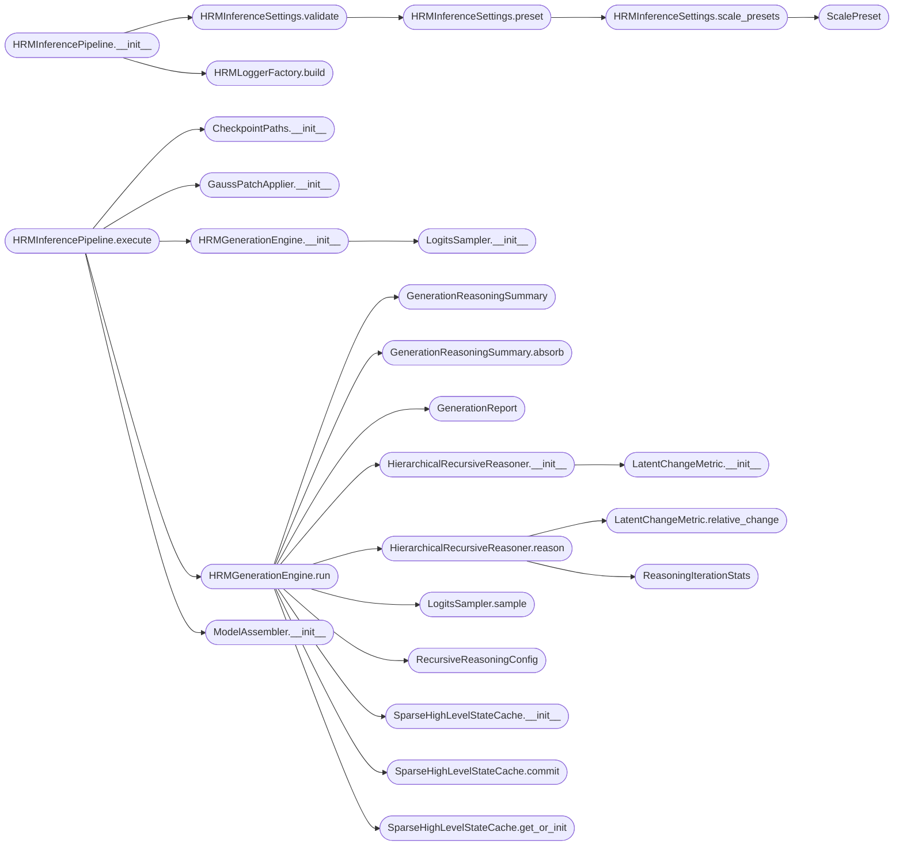

# `topogpt3.inference_hrm`

> Source: [topogpt3/inference_hrm.py:1](../../topogpt3/inference_hrm.py#L1) | language `py` | coverage 79.7% | [API index](../index.md)

TopoGPT3.1: Hierarchical Recursive Reasoning Inference Engine.

This module extends TopoGPT3 with a parameter-free hierarchical recursive
reasoning pipeline inspired by:

    * Hierarchical Reasoning Model (HRM), Sapient Intelligence: a biologically
      motivated two-speed architecture with a slow high-level loop and a fast
      low-level loop.
    * Tiny Recursive Model (TRM) and Generative Recursive Reasoning Models
      (GRAM): latent-space recurrence that iterates token vectors until they
      reach an attractor before projecting them outward.

The pipeline is intentionally built so that the underlying TopoGPT2 weight
matrices remain bit-identical to those produced by the TopoGPT3 trainer. No
new learnable parameters are introduced. The pretrained transformer layers
are repurposed as the recurrent step function of a hierarchical fixed-point
iteration whose halting condition is the empirical stabilization of the
latent state.

The high-level slow state is persisted across multiple emitted tokens to
achieve sparse temporal reasoning: the full network is iterated only at
configurable intervals, while a short suffix of layers refines the low-level
state at every emitted token.

All configurable values reside in dedicated configuration dataclasses; no
magic numbers or hardcoded constants are embedded in business logic. Path
resolution rejects traversal escapes. State dict loading defers strictness
to settings, so an architecturally aligned TopoGPT3 checkpoint loads
unchanged.

Usage:

    python3 inference_hrm.py --prompt "def fibonacci(" --hrm-h-iters 4 \
        --hrm-l-iters 6 --hrm-l-window 3 --max-new 256

## Contents

- **Classes:** [`ScalePreset`](#scalepreset), [`RecursiveReasoningConfig`](#recursivereasoningconfig), [`HRMInferenceSettings`](#hrminferencesettings), [`HRMLoggerFactory`](#hrmloggerfactory), [`SecurePathResolver`](#securepathresolver), [`SourceModuleLoader`](#sourcemoduleloader), [`CheckpointPaths`](#checkpointpaths), [`WeightShapeProbe`](#weightshapeprobe), [`TopoGPT2ConfigAligner`](#topogpt2configaligner), [`TokenizerFactory`](#tokenizerfactory), [`GaussPatchApplier`](#gausspatchapplier), [`ModelAssembler`](#modelassembler), [`SeedSynchronizer`](#seedsynchronizer), [`LatentChangeMetric`](#latentchangemetric), [`ReasoningIterationStats`](#reasoningiterationstats), [`GenerationReasoningSummary`](#generationreasoningsummary), [`SparseHighLevelStateCache`](#sparsehighlevelstatecache), [`HierarchicalRecursiveReasoner`](#hierarchicalrecursivereasoner), [`LogitsSampler`](#logitssampler), [`SamplingPolicy`](#samplingpolicy), [`GenerationReport`](#generationreport), [`HRMGenerationEngine`](#hrmgenerationengine), [`ResultRenderer`](#resultrenderer), [`HRMInferencePipeline`](#hrminferencepipeline), [`CliArgumentParser`](#cliargumentparser)
- **Functions:** [`main`](#main)

## Type Diagram

```mermaid
classDiagram
    direction LR
    class ScalePreset
    ScalePreset : int d_model
    ScalePreset : int n_heads
    ScalePreset : int n_layers
    ScalePreset : int max_seq_len
    class RecursiveReasoningConfig
    RecursiveReasoningConfig : bool enabled
    RecursiveReasoningConfig : int max_high_level_iters
    RecursiveReasoningConfig : int max_low_level_iters
    RecursiveReasoningConfig : int low_level_window
    RecursiveReasoningConfig : int high_level_window
    RecursiveReasoningConfig : float low_level_step
    RecursiveReasoningConfig : float high_level_step
    RecursiveReasoningConfig : float attractor_low_epsilon
    RecursiveReasoningConfig : float attractor_high_epsilon
    RecursiveReasoningConfig : int high_level_persist_tokens
    RecursiveReasoningConfig : float cache_warm_start_weight
    RecursiveReasoningConfig : float max_drift_relative
    RecursiveReasoningConfig : float latent_change_eps
    RecursiveReasoningConfig : int safety_max_total_iterations
    RecursiveReasoningConfig : int minimum_low_level_iters
    RecursiveReasoningConfig : int minimum_high_level_iters
    RecursiveReasoningConfig : bool diagnostic_logging
    class HRMInferenceSettings
    HRMInferenceSettings : str model_scale
    HRMInferenceSettings : str device
    HRMInferenceSettings : int seed
    HRMInferenceSettings : str checkpoint_dir
    HRMInferenceSettings : str checkpoint_name
    HRMInferenceSettings : str model_filename
    HRMInferenceSettings : str state_filename
    HRMInferenceSettings : str topogpt31_source_filename
    HRMInferenceSettings : str topogpt3_source_filename
    HRMInferenceSettings : str topogpt2_source_filename
    HRMInferenceSettings : str source_directory
    HRMInferenceSettings : str tokenizer_encoding
    HRMInferenceSettings : str weight_probe_key
    HRMInferenceSettings : bool apply_gauss_patch_at_load
    HRMInferenceSettings : bool strict_state_dict
    HRMInferenceSettings : str prompt
    HRMInferenceSettings : int max_new_tokens
    HRMInferenceSettings : float temperature
    HRMInferenceSettings : int top_k
    HRMInferenceSettings : float repetition_penalty
    HRMInferenceSettings : int end_of_text_token_id
    HRMInferenceSettings : bool auto_continue
    HRMInferenceSettings : int max_continuations
    HRMInferenceSettings : int continuation_tail_lines
    class HRMLoggerFactory
    HRMLoggerFactory : build()
    class SecurePathResolver
    SecurePathResolver : resolve_under()
    SecurePathResolver : require_existing_file()
    class SourceModuleLoader
    SourceModuleLoader : __init__()
    SourceModuleLoader : load()
    class CheckpointPaths
    CheckpointPaths : __init__()
    CheckpointPaths : slot_dir()
    CheckpointPaths : model_file()
    CheckpointPaths : state_file()
    CheckpointPaths : assert_ready()
    class WeightShapeProbe
    WeightShapeProbe : __init__()
    WeightShapeProbe : detect_n_kv_heads()
    class TopoGPT2ConfigAligner
    TopoGPT2ConfigAligner : __init__()
    TopoGPT2ConfigAligner : build()
    class TokenizerFactory
    TokenizerFactory : __init__()
    TokenizerFactory : build()
    class GaussPatchApplier
    GaussPatchApplier : __init__()
    GaussPatchApplier : apply_if_enabled()
    class ModelAssembler
    ModelAssembler : __init__()
    ModelAssembler : assemble()
    class SeedSynchronizer
    SeedSynchronizer : __init__()
    SeedSynchronizer : apply()
    class LatentChangeMetric
    LatentChangeMetric : __init__()
    LatentChangeMetric : relative_change()
    class ReasoningIterationStats
    ReasoningIterationStats : int high_level_iters
    ReasoningIterationStats : int low_level_iters_total
    ReasoningIterationStats : bool converged_high_level
    ReasoningIterationStats : bool halted_by_safety_cap
    ReasoningIterationStats : float final_high_level_change
    ReasoningIterationStats : float final_low_level_change
    ReasoningIterationStats : bool h_reused_from_cache
    class GenerationReasoningSummary
    GenerationReasoningSummary : int tokens_generated
    GenerationReasoningSummary : int total_high_level_iters
    GenerationReasoningSummary : int total_low_level_iters
    GenerationReasoningSummary : int safety_halts
    GenerationReasoningSummary : int high_level_convergences
    GenerationReasoningSummary : int h_cache_reuses
    GenerationReasoningSummary : absorb()
    class SparseHighLevelStateCache
    SparseHighLevelStateCache : __init__()
    SparseHighLevelStateCache : get_or_init()
    SparseHighLevelStateCache : commit()
    SparseHighLevelStateCache : invalidate()
    class HierarchicalRecursiveReasoner
    HierarchicalRecursiveReasoner : __init__()
    HierarchicalRecursiveReasoner : num_layers()
    HierarchicalRecursiveReasoner : reason()
    class LogitsSampler
    LogitsSampler : __init__()
    LogitsSampler : sample()
    class SamplingPolicy
    SamplingPolicy : int max_new_tokens
    SamplingPolicy : float temperature
    SamplingPolicy : int top_k
    SamplingPolicy : float repetition_penalty
    SamplingPolicy : int end_of_text_token_id
    SamplingPolicy : from_settings()
    class GenerationReport
    GenerationReport : str prompt
    GenerationReport : str output
    GenerationReport : int prompt_tokens
    GenerationReport : int new_tokens
    GenerationReport : float elapsed_seconds
    GenerationReport : GenerationReasoningSummary reasoning_summary
    GenerationReport : tokens_per_second()
    class HRMGenerationEngine
    HRMGenerationEngine : __init__()
    HRMGenerationEngine : run()
    class ResultRenderer
    ResultRenderer : __init__()
    ResultRenderer : render()
    class HRMInferencePipeline
    HRMInferencePipeline : __init__()
    HRMInferencePipeline : execute()
```



## Call Graph

Solid arrows stay in this module, dashed arrows leave it.



## Classes

<a id="scalepreset"></a>

### `ScalePreset`

`class` `dataclass` | [topogpt3/inference_hrm.py:56](../../topogpt3/inference_hrm.py#L56)

Decorators: `@dataclass(frozen=True)`

```python
class ScalePreset
```

Immutable architecture preset for a named model scale.

**Attributes**

| Name | Type | Default | Description |
|---|---|---|---|
| [`d_model`](#scalepreset-d_model) | `int` |  |  |
| [`n_heads`](#scalepreset-n_heads) | `int` |  |  |
| [`n_layers`](#scalepreset-n_layers) | `int` |  |  |
| [`max_seq_len`](#scalepreset-max_seq_len) | `int` |  |  |

---

<a id="recursivereasoningconfig"></a>

### `RecursiveReasoningConfig`

`class` `dataclass` | [topogpt3/inference_hrm.py:66](../../topogpt3/inference_hrm.py#L66)

Decorators: `@dataclass(frozen=True)`

```python
class RecursiveReasoningConfig
```

Hyperparameters governing the hierarchical recursive thinking loop.

The semantics follow the HRM and GRAM literature, adapted to operate
safely with zero additional learnable parameters on a model that was
not trained with recurrence in its computational graph. The reasoner
performs damped fixed-point iteration entirely in the residual-stream
space produced by the baseline forward pass; deep activations are never
fed back into the token-embedding-input layers, preserving the trained
activation distribution at every layer boundary.

**Attributes**

| Name | Type | Default | Description |
|---|---|---|---|
| [`enabled`](#recursivereasoningconfig-enabled) | `bool` | `True` | master switch; when False the pipeline degrades to the standard non-recursive autoregressive loop. |
| [`max_high_level_iters`](#recursivereasoningconfig-max_high_level_iters) | `int` | `0` | maximum slow-loop iterations per emitted token. Each iteration applies a deeper trailing window of layers. |
| [`max_low_level_iters`](#recursivereasoningconfig-max_low_level_iters) | `int` | `0` | maximum fast-loop iterations per high-level step. Each iteration applies the short trailing window of layers. |
| [`low_level_window`](#recursivereasoningconfig-low_level_window) | `int` | `2` | number of trailing transformer layers iterated by the low-level fast loop. |
| [`high_level_window`](#recursivereasoningconfig-high_level_window) | `int` | `4` | number of trailing transformer layers iterated by the high-level slow loop. Should be greater than or equal to low_level_window so the hierarchy matches the HRM coarse/fine split. |
| [`low_level_step`](#recursivereasoningconfig-low_level_step) | `float` | `0.1` | damping coefficient in [0, 1] for the low-level update rule z <- z + step * (window(z) - z). |
| [`high_level_step`](#recursivereasoningconfig-high_level_step) | `float` | `0.1` | damping coefficient for the high-level update. |
| [`attractor_low_epsilon`](#recursivereasoningconfig-attractor_low_epsilon) | `float` | `0.005` | relative L2 change threshold that declares the low-level state converged. |
| [`attractor_high_epsilon`](#recursivereasoningconfig-attractor_high_epsilon) | `float` | `0.01` | relative L2 change threshold that declares the high-level state converged. |
| [`high_level_persist_tokens`](#recursivereasoningconfig-high_level_persist_tokens) | `int` | `4` | tokens during which the refinement vector is reused as a warm start before being re-initialized to zero. This is the sparse temporal-memory dimension. |
| [`cache_warm_start_weight`](#recursivereasoningconfig-cache_warm_start_weight) | `float` | `0.5` | scalar in [0, 1] applied to the cached refinement before warm-starting the next token's iteration. |
| [`max_drift_relative`](#recursivereasoningconfig-max_drift_relative) | `float` | `0.3` | relative L2 distance ceiling between the iterated latent and the baseline latent; exceeding it triggers a reset to the baseline state and aborts thinking for the current token. |
| [`latent_change_eps`](#recursivereasoningconfig-latent_change_eps) | `float` | `1e-08` | floor used in the denominator of relative change computations to avoid division by zero. |
| [`safety_max_total_iterations`](#recursivereasoningconfig-safety_max_total_iterations) | `int` | `256` | hard cap on total layer invocations per emitted token regardless of configured iters. |
| [`minimum_low_level_iters`](#recursivereasoningconfig-minimum_low_level_iters) | `int` | `0` | floor on low-level iterations before convergence checks may halt the loop. |
| [`minimum_high_level_iters`](#recursivereasoningconfig-minimum_high_level_iters) | `int` | `0` | floor on high-level iterations before convergence checks may halt the loop. |
| [`diagnostic_logging`](#recursivereasoningconfig-diagnostic_logging) | `bool` | `False` | when True, emits per-token iteration statistics. |

---

<a id="hrminferencesettings"></a>

### `HRMInferenceSettings`

`class` `dataclass` | [topogpt3/inference_hrm.py:136](../../topogpt3/inference_hrm.py#L136)

Decorators: `@dataclass`

```python
class HRMInferenceSettings
```

Centralized configuration for the TopoGPT3.1 inference pipeline.

Every value consumed downstream resides here. Extending the pipeline with
a new tunable means extending this dataclass; no other module should
embed literals.

**Attributes**

| Name | Type | Default | Description |
|---|---|---|---|
| [`model_scale`](#hrminferencesettings-model_scale) | `str` | `'auto'` |  |
| [`device`](#hrminferencesettings-device) | `str` | `field(default_factory=lambda: 'cuda' if torch.cuda.is_available() else 'cpu')` |  |
| [`seed`](#hrminferencesettings-seed) | `int` | `42` |  |
| [`checkpoint_dir`](#hrminferencesettings-checkpoint_dir) | `str` | `'checkpoints_topogpt3'` |  |
| [`checkpoint_name`](#hrminferencesettings-checkpoint_name) | `str` | `'last'` |  |
| [`model_filename`](#hrminferencesettings-model_filename) | `str` | `'model.safetensors'` |  |
| [`state_filename`](#hrminferencesettings-state_filename) | `str` | `'state.json'` |  |
| [`topogpt31_source_filename`](#hrminferencesettings-topogpt31_source_filename) | `str` | `'inference_hrm.py'` |  |
| [`topogpt3_source_filename`](#hrminferencesettings-topogpt3_source_filename) | `str` | `'train.py'` |  |
| [`topogpt2_source_filename`](#hrminferencesettings-topogpt2_source_filename) | `str` | `'model.py'` |  |
| [`source_directory`](#hrminferencesettings-source_directory) | `str` | `'.'` |  |
| [`tokenizer_encoding`](#hrminferencesettings-tokenizer_encoding) | `str` | `'gpt2'` |  |
| [`weight_probe_key`](#hrminferencesettings-weight_probe_key) | `str` | `'layers.0.attn.k_proj.weight'` |  |
| [`apply_gauss_patch_at_load`](#hrminferencesettings-apply_gauss_patch_at_load) | `bool` | `True` |  |
| [`strict_state_dict`](#hrminferencesettings-strict_state_dict) | `bool` | `False` |  |
| [`prompt`](#hrminferencesettings-prompt) | `str` | `'def main('` |  |
| [`max_new_tokens`](#hrminferencesettings-max_new_tokens) | `int` | `256` |  |
| [`temperature`](#hrminferencesettings-temperature) | `float` | `0.3` |  |
| [`top_k`](#hrminferencesettings-top_k) | `int` | `50` |  |
| [`repetition_penalty`](#hrminferencesettings-repetition_penalty) | `float` | `1.1` |  |
| [`end_of_text_token_id`](#hrminferencesettings-end_of_text_token_id) | `int` | `50256` |  |
| [`auto_continue`](#hrminferencesettings-auto_continue) | `bool` | `False` |  |
| [`max_continuations`](#hrminferencesettings-max_continuations) | `int` | `3` |  |
| [`continuation_tail_lines`](#hrminferencesettings-continuation_tail_lines) | `int` | `2` |  |
| [`thinking_mode`](#hrminferencesettings-thinking_mode) | `bool` | `False` |  |
| [`reasoning`](#hrminferencesettings-reasoning) | `RecursiveReasoningConfig` | `field(default_factory=RecursiveReasoningConfig)` |  |
| [`log_level`](#hrminferencesettings-log_level) | `str` | `'INFO'` |  |
| [`log_name`](#hrminferencesettings-log_name) | `str` | `'TopoGPT3.1Inference'` |  |
| [`log_format`](#hrminferencesettings-log_format) | `str` | `'%(asctime)s \| %(levelname)s \| %(name)s \| %(message)s'` |  |
| [`log_date_format`](#hrminferencesettings-log_date_format) | `str` | `'%Y-%m-%d %H:%M:%S'` |  |
| [`result_separator_char`](#hrminferencesettings-result_separator_char) | `str` | `'='` |  |
| [`result_separator_width`](#hrminferencesettings-result_separator_width) | `int` | `72` |  |
| [`prompt_label`](#hrminferencesettings-prompt_label) | `str` | `'PROMPT'` |  |
| [`completion_label`](#hrminferencesettings-completion_label) | `str` | `'COMPLETION'` |  |
| [`reasoning_label`](#hrminferencesettings-reasoning_label) | `str` | `'REASONING_STATS'` |  |
| [`elapsed_floor_seconds`](#hrminferencesettings-elapsed_floor_seconds) | `float` | `0.001` |  |
| [`min_max_new_tokens`](#hrminferencesettings-min_max_new_tokens) | `int` | `1` |  |
| [`max_max_new_tokens`](#hrminferencesettings-max_max_new_tokens) | `int` | `8192` |  |
| [`min_temperature`](#hrminferencesettings-min_temperature) | `float` | `0.001` |  |
| [`max_temperature`](#hrminferencesettings-max_temperature) | `float` | `5.0` |  |
| [`min_top_k`](#hrminferencesettings-min_top_k) | `int` | `0` |  |
| [`min_repetition_penalty`](#hrminferencesettings-min_repetition_penalty) | `float` | `0.5` |  |
| [`max_repetition_penalty`](#hrminferencesettings-max_repetition_penalty) | `float` | `5.0` |  |
| [`max_checkpoint_bytes`](#hrminferencesettings-max_checkpoint_bytes) | `int` | `50 * 1024 ** 3` |  |
| [`min_checkpoint_bytes`](#hrminferencesettings-min_checkpoint_bytes) | `int` | `1024` |  |
| [`min_hrm_h_iters`](#hrminferencesettings-min_hrm_h_iters) | `int` | `0` |  |
| [`max_hrm_h_iters`](#hrminferencesettings-max_hrm_h_iters) | `int` | `32` |  |
| [`min_hrm_l_iters`](#hrminferencesettings-min_hrm_l_iters) | `int` | `0` |  |
| [`max_hrm_l_iters`](#hrminferencesettings-max_hrm_l_iters) | `int` | `64` |  |
| [`min_hrm_l_window`](#hrminferencesettings-min_hrm_l_window) | `int` | `1` |  |
| [`max_hrm_l_window`](#hrminferencesettings-max_hrm_l_window) | `int` | `64` |  |
| [`min_hrm_h_window`](#hrminferencesettings-min_hrm_h_window) | `int` | `1` |  |
| [`max_hrm_h_window`](#hrminferencesettings-max_hrm_h_window) | `int` | `64` |  |
| [`min_hrm_persist`](#hrminferencesettings-min_hrm_persist) | `int` | `1` |  |
| [`max_hrm_persist`](#hrminferencesettings-max_hrm_persist) | `int` | `256` |  |
| [`min_hrm_step`](#hrminferencesettings-min_hrm_step) | `float` | `0.0` |  |
| [`max_hrm_step`](#hrminferencesettings-max_hrm_step) | `float` | `1.0` |  |
| [`min_hrm_warm_start`](#hrminferencesettings-min_hrm_warm_start) | `float` | `0.0` |  |
| [`max_hrm_warm_start`](#hrminferencesettings-max_hrm_warm_start) | `float` | `1.0` |  |
| [`min_hrm_drift`](#hrminferencesettings-min_hrm_drift) | `float` | `0.0` |  |
| [`max_hrm_drift`](#hrminferencesettings-max_hrm_drift) | `float` | `10.0` |  |
| [`runtime_module_alias`](#hrminferencesettings-runtime_module_alias) | `str` | `'topogpt3_runtime_hrm'` |  |

**Members**

| Member | Kind | Summary |
|---|---|---|
| [`scale_presets`](#hrminferencesettings-scale_presets) | staticmethod | Return the architecture preset table indexed by scale name. |
| [`preset`](#hrminferencesettings-preset) | method | Return the resolved preset for the configured model scale. |
| [`validate`](#hrminferencesettings-validate) | method | Raise ValueError if any setting falls outside its safety bounds. |

<a id="hrminferencesettings-scale_presets"></a>

#### `HRMInferenceSettings.scale_presets`

`staticmethod` | [topogpt3/inference_hrm.py:223](../../topogpt3/inference_hrm.py#L223)

Decorators: `@staticmethod`

```python
def scale_presets() -> Mapping[str, ScalePreset]
```

Return the architecture preset table indexed by scale name.

**Returns:** `Mapping[str, ScalePreset]`

*Calls:* [`ScalePreset`](#scalepreset)

*Called by:* [`CliArgumentParser.build_parser`](#cliargumentparser-build_parser), [`HRMInferenceSettings.preset`](#hrminferencesettings-preset)

<a id="hrminferencesettings-preset"></a>

#### `HRMInferenceSettings.preset`

`method` | [topogpt3/inference_hrm.py:234](../../topogpt3/inference_hrm.py#L234)

```python
def preset(self) -> ScalePreset
```

Return the resolved preset for the configured model scale.

**Returns:** `ScalePreset`

**Raises**

- `ValueError`: (raised in the body, not documented)

*Calls:* [`HRMInferenceSettings.scale_presets`](#hrminferencesettings-scale_presets)

*Called by:* [`HRMInferenceSettings.validate`](#hrminferencesettings-validate)

<a id="hrminferencesettings-validate"></a>

#### `HRMInferenceSettings.validate`

`method` | [topogpt3/inference_hrm.py:244](../../topogpt3/inference_hrm.py#L244)

```python
def validate(self) -> None
```

Raise ValueError if any setting falls outside its safety bounds.

**Raises**

- `ValueError`: (raised in the body, not documented)

*Calls:* [`HRMInferenceSettings.preset`](#hrminferencesettings-preset)

*Called by:* [`HRMInferencePipeline.__init__`](#hrminferencepipeline-__init__)

---

<a id="hrmloggerfactory"></a>

### `HRMLoggerFactory`

`class` | [topogpt3/inference_hrm.py:343](../../topogpt3/inference_hrm.py#L343)

```python
class HRMLoggerFactory
```

Builds a stdout-attached logger from inference settings.

**Members**

| Member | Kind | Summary |
|---|---|---|
| [`build`](#hrmloggerfactory-build) | staticmethod | Return a configured Logger with a single deduplicated stdout handler. |

<a id="hrmloggerfactory-build"></a>

#### `HRMLoggerFactory.build`

`staticmethod` | [topogpt3/inference_hrm.py:347](../../topogpt3/inference_hrm.py#L347)

Decorators: `@staticmethod`

```python
def build(settings: HRMInferenceSettings) -> logging.Logger
```

Return a configured Logger with a single deduplicated stdout handler.

**Parameters**

| Name | Type | Default | Description |
|---|---|---|---|
| `settings` | `HRMInferenceSettings` |  |  |

**Returns:** `logging.Logger`

*Called by:* [`HRMInferencePipeline.__init__`](#hrminferencepipeline-__init__)

---

<a id="securepathresolver"></a>

### `SecurePathResolver`

`class` | [topogpt3/inference_hrm.py:365](../../topogpt3/inference_hrm.py#L365)

```python
class SecurePathResolver
```

Resolves filesystem paths while rejecting traversal outside their root.

**Members**

| Member | Kind | Summary |
|---|---|---|
| [`resolve_under`](#securepathresolver-resolve_under) | staticmethod | Join parts under root and return the canonical resolved path. |
| [`require_existing_file`](#securepathresolver-require_existing_file) | staticmethod | Validate path points to an existing regular file with the expected suffix. |

<a id="securepathresolver-resolve_under"></a>

#### `SecurePathResolver.resolve_under`

`staticmethod` | [topogpt3/inference_hrm.py:369](../../topogpt3/inference_hrm.py#L369)

Decorators: `@staticmethod`

```python
def resolve_under(root: Path, *parts: str) -> Path
```

Join parts under root and return the canonical resolved path.

Raises ValueError if the resolved path escapes root.

**Parameters**

| Name | Type | Default | Description |
|---|---|---|---|
| `root` | `Path` |  |  |
| `*parts` | `str` |  |  |

**Returns:** `Path`

**Raises**

- `ValueError`: (raised in the body, not documented)

<a id="securepathresolver-require_existing_file"></a>

#### `SecurePathResolver.require_existing_file`

`staticmethod` | [topogpt3/inference_hrm.py:385](../../topogpt3/inference_hrm.py#L385)

Decorators: `@staticmethod`

```python
def require_existing_file(path: Path, expected_suffix: str | None = None) -> Path
```

Validate path points to an existing regular file with the expected suffix.

**Parameters**

| Name | Type | Default | Description |
|---|---|---|---|
| `path` | `Path` |  |  |
| `expected_suffix` | `str \| None` | `None` |  |

**Returns:** `Path`

**Raises**

- `FileNotFoundError`: (raised in the body, not documented)
- `ValueError`: (raised in the body, not documented)

---

<a id="sourcemoduleloader"></a>

### `SourceModuleLoader`

`class` | [topogpt3/inference_hrm.py:398](../../topogpt3/inference_hrm.py#L398)

```python
class SourceModuleLoader
```

Resolves the TopoGPT3 runtime module via the package import system.

**Members**

| Member | Kind | Summary |
|---|---|---|
| [`__init__`](#sourcemoduleloader-__init__) | constructor |  |
| [`load`](#sourcemoduleloader-load) | method | Return the topogpt3.train module which re-exports model symbols. |

<a id="sourcemoduleloader-__init__"></a>

#### `SourceModuleLoader.__init__`

`constructor` | [topogpt3/inference_hrm.py:401](../../topogpt3/inference_hrm.py#L401)

```python
def __init__(self, settings: HRMInferenceSettings, logger: logging.Logger)
```

**Parameters**

| Name | Type | Default | Description |
|---|---|---|---|
| `settings` | `HRMInferenceSettings` |  |  |
| `logger` | `logging.Logger` |  |  |

*Called by:* [`HRMInferencePipeline.execute`](#hrminferencepipeline-execute)

<a id="sourcemoduleloader-load"></a>

#### `SourceModuleLoader.load`

`method` | [topogpt3/inference_hrm.py:405](../../topogpt3/inference_hrm.py#L405)

```python
def load(self) -> Any
```

Return the topogpt3.train module which re-exports model symbols.

**Returns:** `Any`

---

<a id="checkpointpaths"></a>

### `CheckpointPaths`

`class` | [topogpt3/inference_hrm.py:416](../../topogpt3/inference_hrm.py#L416)

```python
class CheckpointPaths
```

Computes and validates checkpoint file paths under a single root.

**Members**

| Member | Kind | Summary |
|---|---|---|
| [`__init__`](#checkpointpaths-__init__) | constructor |  |
| [`slot_dir`](#checkpointpaths-slot_dir) | property | Directory holding the active checkpoint slot. |
| [`model_file`](#checkpointpaths-model_file) | method | Resolved path to the safetensors weights file inside the slot. |
| [`state_file`](#checkpointpaths-state_file) | method | Resolved path to the JSON training-state file inside the slot. |
| [`assert_ready`](#checkpointpaths-assert_ready) | method | Verify weights exist and the on-disk size lies within safety bounds. |

<a id="checkpointpaths-__init__"></a>

#### `CheckpointPaths.__init__`

`constructor` | [topogpt3/inference_hrm.py:419](../../topogpt3/inference_hrm.py#L419)

```python
def __init__(self, settings: HRMInferenceSettings)
```

**Parameters**

| Name | Type | Default | Description |
|---|---|---|---|
| `settings` | `HRMInferenceSettings` |  |  |

*Calls:* [`SecurePathResolver.resolve_under`](topogpt3.inference.py.md#securepathresolver-resolve_under)

*Called by:* [`HRMInferencePipeline.execute`](#hrminferencepipeline-execute)

<a id="checkpointpaths-slot_dir"></a>

#### `CheckpointPaths.slot_dir`

`property` | [topogpt3/inference_hrm.py:428](../../topogpt3/inference_hrm.py#L428)

Decorators: `@property`

```python
def slot_dir(self) -> Path
```

Directory holding the active checkpoint slot.

**Returns:** `Path`

<a id="checkpointpaths-model_file"></a>

#### `CheckpointPaths.model_file`

`method` | [topogpt3/inference_hrm.py:432](../../topogpt3/inference_hrm.py#L432)

```python
def model_file(self) -> Path
```

Resolved path to the safetensors weights file inside the slot.

**Returns:** `Path`

*Calls:* [`SecurePathResolver.resolve_under`](topogpt3.inference.py.md#securepathresolver-resolve_under)

<a id="checkpointpaths-state_file"></a>

#### `CheckpointPaths.state_file`

`method` | [topogpt3/inference_hrm.py:439](../../topogpt3/inference_hrm.py#L439)

```python
def state_file(self) -> Path
```

Resolved path to the JSON training-state file inside the slot.

**Returns:** `Path`

*Calls:* [`SecurePathResolver.resolve_under`](topogpt3.inference.py.md#securepathresolver-resolve_under)

<a id="checkpointpaths-assert_ready"></a>

#### `CheckpointPaths.assert_ready`

`method` | [topogpt3/inference_hrm.py:446](../../topogpt3/inference_hrm.py#L446)

```python
def assert_ready(self) -> None
```

Verify weights exist and the on-disk size lies within safety bounds.

**Raises**

- `ValueError`: (raised in the body, not documented)

*Calls:* [`CheckpointPaths.model_file`](topogpt3.inference.py.md#checkpointpaths-model_file), [`SecurePathResolver.require_existing_file`](topogpt3.inference.py.md#securepathresolver-require_existing_file)

---

<a id="weightshapeprobe"></a>

### `WeightShapeProbe`

`class` | [topogpt3/inference_hrm.py:464](../../topogpt3/inference_hrm.py#L464)

```python
class WeightShapeProbe
```

Reads tensor metadata from safetensors to infer architecture details.

**Members**

| Member | Kind | Summary |
|---|---|---|
| [`__init__`](#weightshapeprobe-__init__) | constructor |  |
| [`detect_n_kv_heads`](#weightshapeprobe-detect_n_kv_heads) | method | Recover N_KV_HEADS used at training by inspecting the k_proj shape. |

<a id="weightshapeprobe-__init__"></a>

#### `WeightShapeProbe.__init__`

`constructor` | [topogpt3/inference_hrm.py:467](../../topogpt3/inference_hrm.py#L467)

```python
def __init__(self, settings: HRMInferenceSettings, logger: logging.Logger)
```

**Parameters**

| Name | Type | Default | Description |
|---|---|---|---|
| `settings` | `HRMInferenceSettings` |  |  |
| `logger` | `logging.Logger` |  |  |

*Called by:* [`HRMInferencePipeline.execute`](#hrminferencepipeline-execute)

<a id="weightshapeprobe-detect_n_kv_heads"></a>

#### `WeightShapeProbe.detect_n_kv_heads`

`method` | [topogpt3/inference_hrm.py:471](../../topogpt3/inference_hrm.py#L471)

```python
def detect_n_kv_heads(self, weights_path: Path, d_model: int, n_heads: int) -> int | None
```

Recover N_KV_HEADS used at training by inspecting the k_proj shape.

Returns None when the probe key is absent, signalling the caller to
fall back to scale defaults rather than guess.

**Parameters**

| Name | Type | Default | Description |
|---|---|---|---|
| `weights_path` | `Path` |  |  |
| `d_model` | `int` |  |  |
| `n_heads` | `int` |  |  |

**Returns:** `int | None`

**Raises**

- `ValueError`: (raised in the body, not documented)

---

<a id="topogpt2configaligner"></a>

### `TopoGPT2ConfigAligner`

`class` | [topogpt3/inference_hrm.py:511](../../topogpt3/inference_hrm.py#L511)

```python
class TopoGPT2ConfigAligner
```

Builds a TopoGPT2Config matching the loaded checkpoint and tokenizer.

**Members**

| Member | Kind | Summary |
|---|---|---|
| [`__init__`](#topogpt2configaligner-__init__) | constructor |  |
| [`build`](#topogpt2configaligner-build) | method | Return a TopoGPT2Config dataclass ready to instantiate the model. |

<a id="topogpt2configaligner-__init__"></a>

#### `TopoGPT2ConfigAligner.__init__`

`constructor` | [topogpt3/inference_hrm.py:514](../../topogpt3/inference_hrm.py#L514)

```python
def __init__(self, settings: HRMInferenceSettings, source_module: Any, logger: logging.Logger)
```

**Parameters**

| Name | Type | Default | Description |
|---|---|---|---|
| `settings` | `HRMInferenceSettings` |  |  |
| `source_module` | `Any` |  |  |
| `logger` | `logging.Logger` |  |  |

*Called by:* [`HRMInferencePipeline.execute`](#hrminferencepipeline-execute)

<a id="topogpt2configaligner-build"></a>

#### `TopoGPT2ConfigAligner.build`

`method` | [topogpt3/inference_hrm.py:521](../../topogpt3/inference_hrm.py#L521)

```python
def build(self, n_kv_heads: int | None, vocab_size: int) -> Any
```

Return a TopoGPT2Config dataclass ready to instantiate the model.

**Parameters**

| Name | Type | Default | Description |
|---|---|---|---|
| `n_kv_heads` | `int \| None` |  |  |
| `vocab_size` | `int` |  |  |

**Returns:** `Any`

*Calls:* [`config_from_checkpoint`](topogpt3.checkpoint_meta.py.md#config_from_checkpoint)

---

<a id="tokenizerfactory"></a>

### `TokenizerFactory`

`class` | [topogpt3/inference_hrm.py:570](../../topogpt3/inference_hrm.py#L570)

```python
class TokenizerFactory
```

Builds a BPETokenizer instance using the configured encoding.

**Members**

| Member | Kind | Summary |
|---|---|---|
| [`__init__`](#tokenizerfactory-__init__) | constructor |  |
| [`build`](#tokenizerfactory-build) | method | Return an instance of BPETokenizer bound to the configured encoding. |

<a id="tokenizerfactory-__init__"></a>

#### `TokenizerFactory.__init__`

`constructor` | [topogpt3/inference_hrm.py:573](../../topogpt3/inference_hrm.py#L573)

```python
def __init__(self, settings: HRMInferenceSettings, source_module: Any)
```

**Parameters**

| Name | Type | Default | Description |
|---|---|---|---|
| `settings` | `HRMInferenceSettings` |  |  |
| `source_module` | `Any` |  |  |

*Called by:* [`HRMInferencePipeline.execute`](#hrminferencepipeline-execute)

<a id="tokenizerfactory-build"></a>

#### `TokenizerFactory.build`

`method` | [topogpt3/inference_hrm.py:577](../../topogpt3/inference_hrm.py#L577)

```python
def build(self) -> Any
```

Return an instance of BPETokenizer bound to the configured encoding.

**Returns:** `Any`

---

<a id="gausspatchapplier"></a>

### `GaussPatchApplier`

`class` | [topogpt3/inference_hrm.py:583](../../topogpt3/inference_hrm.py#L583)

```python
class GaussPatchApplier
```

Applies the idempotent Gauss complex-multiply patch when enabled.

**Members**

| Member | Kind | Summary |
|---|---|---|
| [`__init__`](#gausspatchapplier-__init__) | constructor |  |
| [`apply_if_enabled`](#gausspatchapplier-apply_if_enabled) | method | Patch QuaternionSpectralLayer to use the 3-multiply Gauss contract. |

<a id="gausspatchapplier-__init__"></a>

#### `GaussPatchApplier.__init__`

`constructor` | [topogpt3/inference_hrm.py:586](../../topogpt3/inference_hrm.py#L586)

```python
def __init__(self, settings: HRMInferenceSettings, source_module: Any, logger: logging.Logger)
```

**Parameters**

| Name | Type | Default | Description |
|---|---|---|---|
| `settings` | `HRMInferenceSettings` |  |  |
| `source_module` | `Any` |  |  |
| `logger` | `logging.Logger` |  |  |

*Called by:* [`HRMInferencePipeline.execute`](#hrminferencepipeline-execute)

<a id="gausspatchapplier-apply_if_enabled"></a>

#### `GaussPatchApplier.apply_if_enabled`

`method` | [topogpt3/inference_hrm.py:593](../../topogpt3/inference_hrm.py#L593)

```python
def apply_if_enabled(self) -> None
```

Patch QuaternionSpectralLayer to use the 3-multiply Gauss contract.

---

<a id="modelassembler"></a>

### `ModelAssembler`

`class` | [topogpt3/inference_hrm.py:602](../../topogpt3/inference_hrm.py#L602)

```python
class ModelAssembler
```

Instantiates the model and loads weights from safetensors.

**Members**

| Member | Kind | Summary |
|---|---|---|
| [`__init__`](#modelassembler-__init__) | constructor |  |
| [`assemble`](#modelassembler-assemble) | method | Build the TopoGPT2 graph, load weights into it, and return it in eval mode. |

<a id="modelassembler-__init__"></a>

#### `ModelAssembler.__init__`

`constructor` | [topogpt3/inference_hrm.py:605](../../topogpt3/inference_hrm.py#L605)

```python
def __init__(self, settings: HRMInferenceSettings, source_module: Any, logger: logging.Logger)
```

**Parameters**

| Name | Type | Default | Description |
|---|---|---|---|
| `settings` | `HRMInferenceSettings` |  |  |
| `source_module` | `Any` |  |  |
| `logger` | `logging.Logger` |  |  |

*Called by:* [`HRMInferencePipeline.execute`](#hrminferencepipeline-execute)

<a id="modelassembler-assemble"></a>

#### `ModelAssembler.assemble`

`method` | [topogpt3/inference_hrm.py:612](../../topogpt3/inference_hrm.py#L612)

```python
def assemble(self, aligned_cfg: Any, paths: CheckpointPaths) -> torch.nn.Module
```

Build the TopoGPT2 graph, load weights into it, and return it in eval mode.

**Parameters**

| Name | Type | Default | Description |
|---|---|---|---|
| `aligned_cfg` | `Any` |  |  |
| `paths` | `CheckpointPaths` |  |  |

**Returns:** `torch.nn.Module`

*Calls:* [`CheckpointPaths.model_file`](topogpt3.inference.py.md#checkpointpaths-model_file)

---

<a id="seedsynchronizer"></a>

### `SeedSynchronizer`

`class` | [topogpt3/inference_hrm.py:643](../../topogpt3/inference_hrm.py#L643)

```python
class SeedSynchronizer
```

Applies deterministic seeds across torch, CUDA and the model package.

**Members**

| Member | Kind | Summary |
|---|---|---|
| [`__init__`](#seedsynchronizer-__init__) | constructor |  |
| [`apply`](#seedsynchronizer-apply) | method | Seed all relevant RNGs using the model package helper when available. |

<a id="seedsynchronizer-__init__"></a>

#### `SeedSynchronizer.__init__`

`constructor` | [topogpt3/inference_hrm.py:646](../../topogpt3/inference_hrm.py#L646)

```python
def __init__(self, settings: HRMInferenceSettings, source_module: Any, logger: logging.Logger)
```

**Parameters**

| Name | Type | Default | Description |
|---|---|---|---|
| `settings` | `HRMInferenceSettings` |  |  |
| `source_module` | `Any` |  |  |
| `logger` | `logging.Logger` |  |  |

*Called by:* [`HRMInferencePipeline.execute`](#hrminferencepipeline-execute)

<a id="seedsynchronizer-apply"></a>

#### `SeedSynchronizer.apply`

`method` | [topogpt3/inference_hrm.py:653](../../topogpt3/inference_hrm.py#L653)

```python
def apply(self) -> None
```

Seed all relevant RNGs using the model package helper when available.

---

<a id="latentchangemetric"></a>

### `LatentChangeMetric`

`class` | [topogpt3/inference_hrm.py:668](../../topogpt3/inference_hrm.py#L668)

```python
class LatentChangeMetric
```

Computes the relative L2 distance between two latent tensors.

**Members**

| Member | Kind | Summary |
|---|---|---|
| [`__init__`](#latentchangemetric-__init__) | constructor |  |
| [`relative_change`](#latentchangemetric-relative_change) | method | Return \|\|current - previous\|\| / max(\|\|previous\|\|, epsilon_floor). |

<a id="latentchangemetric-__init__"></a>

#### `LatentChangeMetric.__init__`

`constructor` | [topogpt3/inference_hrm.py:671](../../topogpt3/inference_hrm.py#L671)

```python
def __init__(self, epsilon_floor: float)
```

**Parameters**

| Name | Type | Default | Description |
|---|---|---|---|
| `epsilon_floor` | `float` |  |  |

**Raises**

- `ValueError`: (raised in the body, not documented)

*Called by:* [`HierarchicalRecursiveReasoner.__init__`](#hierarchicalrecursivereasoner-__init__)

<a id="latentchangemetric-relative_change"></a>

#### `LatentChangeMetric.relative_change`

`method` | [topogpt3/inference_hrm.py:676](../../topogpt3/inference_hrm.py#L676)

```python
def relative_change(self, current: torch.Tensor, previous: torch.Tensor) -> float
```

Return ||current - previous|| / max(||previous||, epsilon_floor).

**Parameters**

| Name | Type | Default | Description |
|---|---|---|---|
| `current` | `torch.Tensor` |  |  |
| `previous` | `torch.Tensor` |  |  |

**Returns:** `float`

**Raises**

- `ValueError`: (raised in the body, not documented)

*Called by:* [`HierarchicalRecursiveReasoner.reason`](#hierarchicalrecursivereasoner-reason)

---

<a id="reasoningiterationstats"></a>

### `ReasoningIterationStats`

`class` `dataclass` | [topogpt3/inference_hrm.py:691](../../topogpt3/inference_hrm.py#L691)

Decorators: `@dataclass`

```python
class ReasoningIterationStats
```

Aggregated counters describing a single token's reasoning episode.

**Attributes**

| Name | Type | Default | Description |
|---|---|---|---|
| [`high_level_iters`](#reasoningiterationstats-high_level_iters) | `int` | `0` |  |
| [`low_level_iters_total`](#reasoningiterationstats-low_level_iters_total) | `int` | `0` |  |
| [`converged_high_level`](#reasoningiterationstats-converged_high_level) | `bool` | `False` |  |
| [`halted_by_safety_cap`](#reasoningiterationstats-halted_by_safety_cap) | `bool` | `False` |  |
| [`final_high_level_change`](#reasoningiterationstats-final_high_level_change) | `float` | `float('nan')` |  |
| [`final_low_level_change`](#reasoningiterationstats-final_low_level_change) | `float` | `float('nan')` |  |
| [`h_reused_from_cache`](#reasoningiterationstats-h_reused_from_cache) | `bool` | `False` |  |

---

<a id="generationreasoningsummary"></a>

### `GenerationReasoningSummary`

`class` `dataclass` | [topogpt3/inference_hrm.py:704](../../topogpt3/inference_hrm.py#L704)

Decorators: `@dataclass`

```python
class GenerationReasoningSummary
```

Aggregated statistics over the full generation episode.

**Attributes**

| Name | Type | Default | Description |
|---|---|---|---|
| [`tokens_generated`](#generationreasoningsummary-tokens_generated) | `int` | `0` |  |
| [`total_high_level_iters`](#generationreasoningsummary-total_high_level_iters) | `int` | `0` |  |
| [`total_low_level_iters`](#generationreasoningsummary-total_low_level_iters) | `int` | `0` |  |
| [`safety_halts`](#generationreasoningsummary-safety_halts) | `int` | `0` |  |
| [`high_level_convergences`](#generationreasoningsummary-high_level_convergences) | `int` | `0` |  |
| [`h_cache_reuses`](#generationreasoningsummary-h_cache_reuses) | `int` | `0` |  |

**Members**

| Member | Kind | Summary |
|---|---|---|
| [`absorb`](#generationreasoningsummary-absorb) | method | Fold a per-token sample into the running totals. |

<a id="generationreasoningsummary-absorb"></a>

#### `GenerationReasoningSummary.absorb`

`method` | [topogpt3/inference_hrm.py:714](../../topogpt3/inference_hrm.py#L714)

```python
def absorb(self, sample: ReasoningIterationStats) -> None
```

Fold a per-token sample into the running totals.

**Parameters**

| Name | Type | Default | Description |
|---|---|---|---|
| `sample` | `ReasoningIterationStats` |  |  |

*Called by:* [`HRMGenerationEngine.run`](#hrmgenerationengine-run)

---

<a id="sparsehighlevelstatecache"></a>

### `SparseHighLevelStateCache`

`class` | [topogpt3/inference_hrm.py:727](../../topogpt3/inference_hrm.py#L727)

```python
class SparseHighLevelStateCache
```

Persists the high-level latent state across consecutive emitted tokens.

The cache is reset whenever its age in tokens reaches the configured
persistence horizon, at which point the next reasoning episode begins
with a zero high-level state. This is the temporal-sparsity mechanism:
expensive full-stack passes are amortized across multiple emissions.

**Members**

| Member | Kind | Summary |
|---|---|---|
| [`__init__`](#sparsehighlevelstatecache-__init__) | constructor |  |
| [`get_or_init`](#sparsehighlevelstatecache-get_or_init) | method | Return the cached high-level state or a zeroed one when stale. |
| [`commit`](#sparsehighlevelstatecache-commit) | method | Store a fresh high-level state and increment the cache age. |
| [`invalidate`](#sparsehighlevelstatecache-invalidate) | method | Drop any cached state and reset the age counter. |

<a id="sparsehighlevelstatecache-__init__"></a>

#### `SparseHighLevelStateCache.__init__`

`constructor` | [topogpt3/inference_hrm.py:736](../../topogpt3/inference_hrm.py#L736)

```python
def __init__(self, persist_tokens: int)
```

**Parameters**

| Name | Type | Default | Description |
|---|---|---|---|
| `persist_tokens` | `int` |  |  |

**Raises**

- `ValueError`: (raised in the body, not documented)

*Called by:* [`HRMGenerationEngine.run`](#hrmgenerationengine-run)

<a id="sparsehighlevelstatecache-get_or_init"></a>

#### `SparseHighLevelStateCache.get_or_init`

`method` | [topogpt3/inference_hrm.py:743](../../topogpt3/inference_hrm.py#L743)

```python
def get_or_init(self, reference: torch.Tensor) -> tuple[torch.Tensor, bool]
```

Return the cached high-level state or a zeroed one when stale.

The boolean flag indicates whether the returned tensor came from a
live cache hit (True) or a fresh zero initialization (False).

**Parameters**

| Name | Type | Default | Description |
|---|---|---|---|
| `reference` | `torch.Tensor` |  |  |

**Returns:** `tuple[torch.Tensor, bool]`

*Called by:* [`HRMGenerationEngine.run`](#hrmgenerationengine-run)

<a id="sparsehighlevelstatecache-commit"></a>

#### `SparseHighLevelStateCache.commit`

`method` | [topogpt3/inference_hrm.py:761](../../topogpt3/inference_hrm.py#L761)

```python
def commit(self, new_state: torch.Tensor) -> None
```

Store a fresh high-level state and increment the cache age.

**Parameters**

| Name | Type | Default | Description |
|---|---|---|---|
| `new_state` | `torch.Tensor` |  |  |

*Called by:* [`HRMGenerationEngine.run`](#hrmgenerationengine-run)

<a id="sparsehighlevelstatecache-invalidate"></a>

#### `SparseHighLevelStateCache.invalidate`

`method` | [topogpt3/inference_hrm.py:766](../../topogpt3/inference_hrm.py#L766)

```python
def invalidate(self) -> None
```

Drop any cached state and reset the age counter.

---

<a id="hierarchicalrecursivereasoner"></a>

### `HierarchicalRecursiveReasoner`

`class` | [topogpt3/inference_hrm.py:772](../../topogpt3/inference_hrm.py#L772)

```python
class HierarchicalRecursiveReasoner
```

Parameter-free hierarchical recursive reasoning over a trained stack.

The reasoner does not own any learnable parameters. It treats the trained
TopoGPT2 transformer layers as a deterministic recurrent step function
and composes them into a two-speed damped fixed-point iteration that
mirrors HRM, while never violating the activation distribution the
trained layers expect.

Algorithm per emitted token:

    1. Run the standard full forward pass once to obtain the baseline
       residual-stream latent z_base and the per-layer kv caches that
       will cross the token boundary. z_base is the trained model's
       native answer for this position.
    2. If recursion is disabled or both iteration budgets are zero,
       return z_base unchanged.
    3. Optionally warm-start z by adding a fraction of the cached
       refinement vector from previous tokens (sparse temporal memory).
    4. Hierarchical refinement, all in residual-stream space:
          for h_step in range(max_high_level_iters):
              for l_step in range(max_low_level_iters):
                  z <- z + low_level_step * (W_low(z) - z)
              z <- z + high_level_step * (W_high(z) - z)
       where W_low and W_high are the last low_level_window and
       high_level_window trained layers respectively, invoked with the
       prefix kv cache treated as immutable. Each update is damped, so
       layer inputs remain close to the trained residual-stream
       distribution.
    5. Hard divergence guard: if the iterated latent drifts farther
       from the baseline than max_drift_relative, reset to the baseline
       and abort thinking for this token. This eliminates the
       catastrophic-attractor failure mode without retraining.
    6. Attractor halting per loop, plus a global cap on total layer
       invocations.

The cached refinement returned to the sparse cache is z_final - z_base,
a small residual-stream displacement that persists across configurable
horizons to amortize thinking effort over multiple tokens.

**Members**

| Member | Kind | Summary |
|---|---|---|
| [`__init__`](#hierarchicalrecursivereasoner-__init__) | constructor |  |
| [`num_layers`](#hierarchicalrecursivereasoner-num_layers) | property | Return the number of trained transformer layers. |
| [`reason`](#hierarchicalrecursivereasoner-reason) | method | Run hierarchical recursive thinking for a single emission step. |

<a id="hierarchicalrecursivereasoner-__init__"></a>

#### `HierarchicalRecursiveReasoner.__init__`

`constructor` | [topogpt3/inference_hrm.py:813](../../topogpt3/inference_hrm.py#L813)

```python
def __init__(self, layers: list[torch.nn.Module], final_norm: torch.nn.Module, reasoning_config: RecursiveReasoningConfig, logger: logging.Logger)
```

**Parameters**

| Name | Type | Default | Description |
|---|---|---|---|
| `layers` | `list[torch.nn.Module]` |  |  |
| `final_norm` | `torch.nn.Module` |  |  |
| `reasoning_config` | `RecursiveReasoningConfig` |  |  |
| `logger` | `logging.Logger` |  |  |

**Raises**

- `ValueError`: (raised in the body, not documented)

*Calls:* [`LatentChangeMetric.__init__`](#latentchangemetric-__init__)

*Called by:* [`HRMGenerationEngine.run`](#hrmgenerationengine-run)

<a id="hierarchicalrecursivereasoner-num_layers"></a>

#### `HierarchicalRecursiveReasoner.num_layers`

`property` | [topogpt3/inference_hrm.py:837](../../topogpt3/inference_hrm.py#L837)

Decorators: `@property`

```python
def num_layers(self) -> int
```

Return the number of trained transformer layers.

**Returns:** `int`

<a id="hierarchicalrecursivereasoner-reason"></a>

#### `HierarchicalRecursiveReasoner.reason`

`method` | [topogpt3/inference_hrm.py:884](../../topogpt3/inference_hrm.py#L884)

```python
def reason(self, z_initial: torch.Tensor, base_kvs: list[tuple[torch.Tensor, torch.Tensor] | None], cached_refinement: torch.Tensor | None, position_offset: int | None = None) -> tuple[torch.Tensor, list[tuple[torch.Tensor, torch.Tensor]], torch.Tensor, ReasoningIterationStats]
```

Run hierarchical recursive thinking for a single emission step.

**Parameters**

| Name | Type | Default | Description |
|---|---|---|---|
| `z_initial` | `torch.Tensor` |  | token embedding of the new position, shape [B, 1, D]. |
| `base_kvs` | `list[tuple[torch.Tensor, torch.Tensor] \| None]` |  | per-layer kv cache for all previously emitted tokens, treated as immutable during thinking iterations. |
| `cached_refinement` | `torch.Tensor \| None` |  | persistent refinement displacement from prior tokens, or None to skip the warm start. |
| `position_offset` | `int \| None` | `None` |  |

**Returns:** `tuple[torch.Tensor, list[tuple[torch.Tensor, torch.Tensor]], torch.Tensor, ReasoningIterationStats]` - A tuple (z_final, committed_kvs, refinement_for_cache, stats):
z_final is the latent state about to enter the final norm
and lm head; committed_kvs is the new per-layer kv cache
including this token's K and V from the baseline pass;
refinement_for_cache is z_final - z_baseline, to be
persisted across tokens; stats holds the loop counters.

*Calls:* [`LatentChangeMetric.relative_change`](#latentchangemetric-relative_change), [`ReasoningIterationStats`](#reasoningiterationstats)

*Called by:* [`HRMGenerationEngine.run`](#hrmgenerationengine-run)

---

<a id="logitssampler"></a>

### `LogitsSampler`

`class` | [topogpt3/inference_hrm.py:1010](../../topogpt3/inference_hrm.py#L1010)

```python
class LogitsSampler
```

Applies temperature, repetition penalty, top-k filtering and multinomial draw.

**Members**

| Member | Kind | Summary |
|---|---|---|
| [`__init__`](#logitssampler-__init__) | constructor |  |
| [`sample`](#logitssampler-sample) | method | Return a sampled token id tensor of shape [B, 1] from raw logits [B, V]. |

<a id="logitssampler-__init__"></a>

#### `LogitsSampler.__init__`

`constructor` | [topogpt3/inference_hrm.py:1013](../../topogpt3/inference_hrm.py#L1013)

```python
def __init__(self, logger: logging.Logger)
```

**Parameters**

| Name | Type | Default | Description |
|---|---|---|---|
| `logger` | `logging.Logger` |  |  |

*Called by:* [`HRMGenerationEngine.__init__`](#hrmgenerationengine-__init__)

<a id="logitssampler-sample"></a>

#### `LogitsSampler.sample`

`method` | [topogpt3/inference_hrm.py:1016](../../topogpt3/inference_hrm.py#L1016)

```python
def sample(self, logits: torch.Tensor, token_history: torch.Tensor, temperature: float, top_k: int, repetition_penalty: float) -> torch.Tensor
```

Return a sampled token id tensor of shape [B, 1] from raw logits [B, V].

**Parameters**

| Name | Type | Default | Description |
|---|---|---|---|
| `logits` | `torch.Tensor` |  |  |
| `token_history` | `torch.Tensor` |  |  |
| `temperature` | `float` |  |  |
| `top_k` | `int` |  |  |
| `repetition_penalty` | `float` |  |  |

**Returns:** `torch.Tensor`

**Raises**

- `ValueError`: (raised in the body, not documented)

*Called by:* [`HRMGenerationEngine.run`](#hrmgenerationengine-run)

---

<a id="samplingpolicy"></a>

### `SamplingPolicy`

`class` `dataclass` | [topogpt3/inference_hrm.py:1044](../../topogpt3/inference_hrm.py#L1044)

Decorators: `@dataclass(frozen=True)`

```python
class SamplingPolicy
```

Immutable sampling parameters consumed by the generation engine.

**Attributes**

| Name | Type | Default | Description |
|---|---|---|---|
| [`max_new_tokens`](#samplingpolicy-max_new_tokens) | `int` |  |  |
| [`temperature`](#samplingpolicy-temperature) | `float` |  |  |
| [`top_k`](#samplingpolicy-top_k) | `int` |  |  |
| [`repetition_penalty`](#samplingpolicy-repetition_penalty) | `float` |  |  |
| [`end_of_text_token_id`](#samplingpolicy-end_of_text_token_id) | `int` |  |  |

**Members**

| Member | Kind | Summary |
|---|---|---|
| [`from_settings`](#samplingpolicy-from_settings) | classmethod | Construct a SamplingPolicy from inference settings. |

<a id="samplingpolicy-from_settings"></a>

#### `SamplingPolicy.from_settings`

`classmethod` | [topogpt3/inference_hrm.py:1054](../../topogpt3/inference_hrm.py#L1054)

Decorators: `@classmethod`

```python
def from_settings(cls, settings: HRMInferenceSettings) -> SamplingPolicy
```

Construct a SamplingPolicy from inference settings.

**Parameters**

| Name | Type | Default | Description |
|---|---|---|---|
| `settings` | `HRMInferenceSettings` |  |  |

**Returns:** `SamplingPolicy`

---

<a id="generationreport"></a>

### `GenerationReport`

`class` `dataclass` | [topogpt3/inference_hrm.py:1066](../../topogpt3/inference_hrm.py#L1066)

Decorators: `@dataclass(frozen=True)`

```python
class GenerationReport
```

Quantitative summary of a single generation call.

**Attributes**

| Name | Type | Default | Description |
|---|---|---|---|
| [`prompt`](#generationreport-prompt) | `str` |  |  |
| [`output`](#generationreport-output) | `str` |  |  |
| [`prompt_tokens`](#generationreport-prompt_tokens) | `int` |  |  |
| [`new_tokens`](#generationreport-new_tokens) | `int` |  |  |
| [`elapsed_seconds`](#generationreport-elapsed_seconds) | `float` |  |  |
| [`reasoning_summary`](#generationreport-reasoning_summary) | `GenerationReasoningSummary` |  |  |

**Members**

| Member | Kind | Summary |
|---|---|---|
| [`tokens_per_second`](#generationreport-tokens_per_second) | method | Return throughput in tokens/sec, clamped to avoid divide-by-zero. |

<a id="generationreport-tokens_per_second"></a>

#### `GenerationReport.tokens_per_second`

`method` | [topogpt3/inference_hrm.py:1076](../../topogpt3/inference_hrm.py#L1076)

```python
def tokens_per_second(self, elapsed_floor: float) -> float
```

Return throughput in tokens/sec, clamped to avoid divide-by-zero.

**Parameters**

| Name | Type | Default | Description |
|---|---|---|---|
| `elapsed_floor` | `float` |  |  |

**Returns:** `float`

---

<a id="hrmgenerationengine"></a>

### `HRMGenerationEngine`

`class` | [topogpt3/inference_hrm.py:1081](../../topogpt3/inference_hrm.py#L1081)

```python
class HRMGenerationEngine
```

Runs autoregressive sampling driven by hierarchical recursive reasoning.

The engine reimplements the prompt encoding and token emission loop so
that the per-token latent state can be intercepted before final norm and
LM-head projection. The intercepted state is handed to a
HierarchicalRecursiveReasoner, which iterates the trained layer stack in
a two-speed loop until the attractor is reached. The final stabilized
latent is then projected to logits and sampled in the standard fashion.

**Members**

| Member | Kind | Summary |
|---|---|---|
| [`__init__`](#hrmgenerationengine-__init__) | constructor |  |
| [`run`](#hrmgenerationengine-run) | method | Generate a completion for prompt and return a GenerationReport. |

<a id="hrmgenerationengine-__init__"></a>

#### `HRMGenerationEngine.__init__`

`constructor` | [topogpt3/inference_hrm.py:1092](../../topogpt3/inference_hrm.py#L1092)

```python
def __init__(self, settings: HRMInferenceSettings, logger: logging.Logger)
```

**Parameters**

| Name | Type | Default | Description |
|---|---|---|---|
| `settings` | `HRMInferenceSettings` |  |  |
| `logger` | `logging.Logger` |  |  |

*Calls:* [`LogitsSampler.__init__`](#logitssampler-__init__)

*Called by:* [`HRMInferencePipeline.execute`](#hrminferencepipeline-execute)

<a id="hrmgenerationengine-run"></a>

#### `HRMGenerationEngine.run`

`method` | [topogpt3/inference_hrm.py:1128](../../topogpt3/inference_hrm.py#L1128)

Decorators: `@torch.no_grad()`

```python
def run(self, model: torch.nn.Module, tokenizer: Any, prompt: str, policy: SamplingPolicy) -> GenerationReport
```

Generate a completion for prompt and return a GenerationReport.

**Parameters**

| Name | Type | Default | Description |
|---|---|---|---|
| `model` | `torch.nn.Module` |  |  |
| `tokenizer` | `Any` |  |  |
| `prompt` | `str` |  |  |
| `policy` | `SamplingPolicy` |  |  |

**Returns:** `GenerationReport`

**Raises**

- `ValueError`: (raised in the body, not documented)

*Calls:* [`extract_tail_for_continuation`](topogpt3.continuation.py.md#extract_tail_for_continuation), [`is_response_complete`](topogpt3.continuation.py.md#is_response_complete), [`GenerationReasoningSummary`](#generationreasoningsummary), [`GenerationReasoningSummary.absorb`](#generationreasoningsummary-absorb), [`GenerationReport`](#generationreport), [`HierarchicalRecursiveReasoner.__init__`](#hierarchicalrecursivereasoner-__init__), [`HierarchicalRecursiveReasoner.reason`](#hierarchicalrecursivereasoner-reason), [`LogitsSampler.sample`](#logitssampler-sample), [`RecursiveReasoningConfig`](#recursivereasoningconfig), [`SparseHighLevelStateCache.__init__`](#sparsehighlevelstatecache-__init__), [`SparseHighLevelStateCache.commit`](#sparsehighlevelstatecache-commit), [`SparseHighLevelStateCache.get_or_init`](#sparsehighlevelstatecache-get_or_init)

*Called by:* [`HRMInferencePipeline.execute`](#hrminferencepipeline-execute)

---

<a id="resultrenderer"></a>

### `ResultRenderer`

`class` | [topogpt3/inference_hrm.py:1289](../../topogpt3/inference_hrm.py#L1289)

```python
class ResultRenderer
```

Prints a GenerationReport to stdout using settings-defined formatting.

**Members**

| Member | Kind | Summary |
|---|---|---|
| [`__init__`](#resultrenderer-__init__) | constructor |  |
| [`render`](#resultrenderer-render) | method | Emit a banner with prompt, completion, throughput and reasoning stats. |

<a id="resultrenderer-__init__"></a>

#### `ResultRenderer.__init__`

`constructor` | [topogpt3/inference_hrm.py:1292](../../topogpt3/inference_hrm.py#L1292)

```python
def __init__(self, settings: HRMInferenceSettings, logger: logging.Logger)
```

**Parameters**

| Name | Type | Default | Description |
|---|---|---|---|
| `settings` | `HRMInferenceSettings` |  |  |
| `logger` | `logging.Logger` |  |  |

*Called by:* [`HRMInferencePipeline.execute`](#hrminferencepipeline-execute)

<a id="resultrenderer-render"></a>

#### `ResultRenderer.render`

`method` | [topogpt3/inference_hrm.py:1296](../../topogpt3/inference_hrm.py#L1296)

```python
def render(self, report: GenerationReport) -> None
```

Emit a banner with prompt, completion, throughput and reasoning stats.

**Parameters**

| Name | Type | Default | Description |
|---|---|---|---|
| `report` | `GenerationReport` |  |  |

*Calls:* [`GenerationReport.tokens_per_second`](topogpt3.inference.py.md#generationreport-tokens_per_second)

---

<a id="hrminferencepipeline"></a>

### `HRMInferencePipeline`

`class` | [topogpt3/inference_hrm.py:1336](../../topogpt3/inference_hrm.py#L1336)

```python
class HRMInferencePipeline
```

Orchestrator wiring loader, builder, reasoner, engine and renderer.

**Members**

| Member | Kind | Summary |
|---|---|---|
| [`__init__`](#hrminferencepipeline-__init__) | constructor |  |
| [`execute`](#hrminferencepipeline-execute) | method | Run the full inference pipeline end-to-end and return the report. |

<a id="hrminferencepipeline-__init__"></a>

#### `HRMInferencePipeline.__init__`

`constructor` | [topogpt3/inference_hrm.py:1339](../../topogpt3/inference_hrm.py#L1339)

```python
def __init__(self, settings: HRMInferenceSettings, logger: logging.Logger | None = None)
```

**Parameters**

| Name | Type | Default | Description |
|---|---|---|---|
| `settings` | `HRMInferenceSettings` |  |  |
| `logger` | `logging.Logger \| None` | `None` |  |

*Calls:* [`HRMInferenceSettings.validate`](#hrminferencesettings-validate), [`HRMLoggerFactory.build`](#hrmloggerfactory-build)

*Called by:* [`run_inference_hrm`](app.py.md#run_inference_hrm), [`run_hrm`](eval.smoke.py.md#run_hrm), [`run_hrm_inference`](gradio_app.py.md#run_hrm_inference), [`main`](#main)

<a id="hrminferencepipeline-execute"></a>

#### `HRMInferencePipeline.execute`

`method` | [topogpt3/inference_hrm.py:1346](../../topogpt3/inference_hrm.py#L1346)

```python
def execute(self) -> GenerationReport
```

Run the full inference pipeline end-to-end and return the report.

**Returns:** `GenerationReport`

*Calls:* [`CheckpointPaths.assert_ready`](topogpt3.inference.py.md#checkpointpaths-assert_ready), [`CheckpointPaths.model_file`](topogpt3.inference.py.md#checkpointpaths-model_file), [`GaussPatchApplier.apply_if_enabled`](topogpt3.inference.py.md#gausspatchapplier-apply_if_enabled), [`ModelAssembler.assemble`](topogpt3.inference.py.md#modelassembler-assemble), [`ResultRenderer.render`](topogpt3.inference.py.md#resultrenderer-render), [`SamplingPolicy.from_settings`](topogpt3.inference.py.md#samplingpolicy-from_settings), [`SeedSynchronizer.apply`](topogpt3.inference.py.md#seedsynchronizer-apply), [`SourceModuleLoader.load`](topogpt3.inference.py.md#sourcemoduleloader-load), [`TokenizerFactory.build`](topogpt3.inference.py.md#tokenizerfactory-build), [`TopoGPT2ConfigAligner.build`](topogpt3.inference.py.md#topogpt2configaligner-build), [`WeightShapeProbe.detect_n_kv_heads`](topogpt3.inference.py.md#weightshapeprobe-detect_n_kv_heads), [`CheckpointPaths.__init__`](#checkpointpaths-__init__) and 10 more

*Called by:* [`run_inference_hrm`](app.py.md#run_inference_hrm), [`run_hrm`](eval.smoke.py.md#run_hrm), [`run_hrm_inference`](gradio_app.py.md#run_hrm_inference), [`main`](#main)

---

<a id="cliargumentparser"></a>

### `CliArgumentParser`

`class` | [topogpt3/inference_hrm.py:1402](../../topogpt3/inference_hrm.py#L1402)

```python
class CliArgumentParser
```

Translates command-line arguments into an HRMInferenceSettings instance.

**Members**

| Member | Kind | Summary |
|---|---|---|
| [`build_parser`](#cliargumentparser-build_parser) | staticmethod | Return the configured argparse.ArgumentParser. |
| [`parse`](#cliargumentparser-parse) | staticmethod | Parse argv (or sys.argv) and return a populated HRMInferenceSettings. |

<a id="cliargumentparser-build_parser"></a>

#### `CliArgumentParser.build_parser`

`staticmethod` | [topogpt3/inference_hrm.py:1406](../../topogpt3/inference_hrm.py#L1406)

Decorators: `@staticmethod`

```python
def build_parser() -> argparse.ArgumentParser
```

Return the configured argparse.ArgumentParser.

**Returns:** `argparse.ArgumentParser`

*Calls:* [`HRMInferenceSettings`](#hrminferencesettings), [`HRMInferenceSettings.scale_presets`](#hrminferencesettings-scale_presets)

<a id="cliargumentparser-parse"></a>

#### `CliArgumentParser.parse`

`staticmethod` | [topogpt3/inference_hrm.py:1611](../../topogpt3/inference_hrm.py#L1611)

Decorators: `@staticmethod`

```python
def parse(argv: list[str] | None = None) -> HRMInferenceSettings
```

Parse argv (or sys.argv) and return a populated HRMInferenceSettings.

**Parameters**

| Name | Type | Default | Description |
|---|---|---|---|
| `argv` | `list[str] \| None` | `None` |  |

**Returns:** `HRMInferenceSettings`

*Calls:* [`CliArgumentParser.build_parser`](topogpt3.inference.py.md#cliargumentparser-build_parser), [`HRMInferenceSettings`](#hrminferencesettings), [`RecursiveReasoningConfig`](#recursivereasoningconfig)

---

## Functions

<a id="main"></a>

### `main`

`function` | [topogpt3/inference_hrm.py:1657](../../topogpt3/inference_hrm.py#L1657)

```python
def main(argv: list[str] | None = None) -> int
```

CLI entry point.

Returns a process exit code.

**Parameters**

| Name | Type | Default | Description |
|---|---|---|---|
| `argv` | `list[str] \| None` | `None` |  |

**Returns:** `int`

*Calls:* [`CliArgumentParser.parse`](topogpt3.inference.py.md#cliargumentparser-parse), [`HRMInferencePipeline.__init__`](#hrminferencepipeline-__init__), [`HRMInferencePipeline.execute`](#hrminferencepipeline-execute)

---
