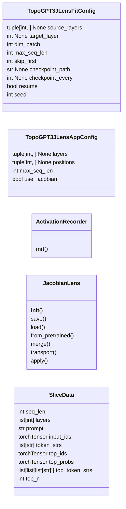
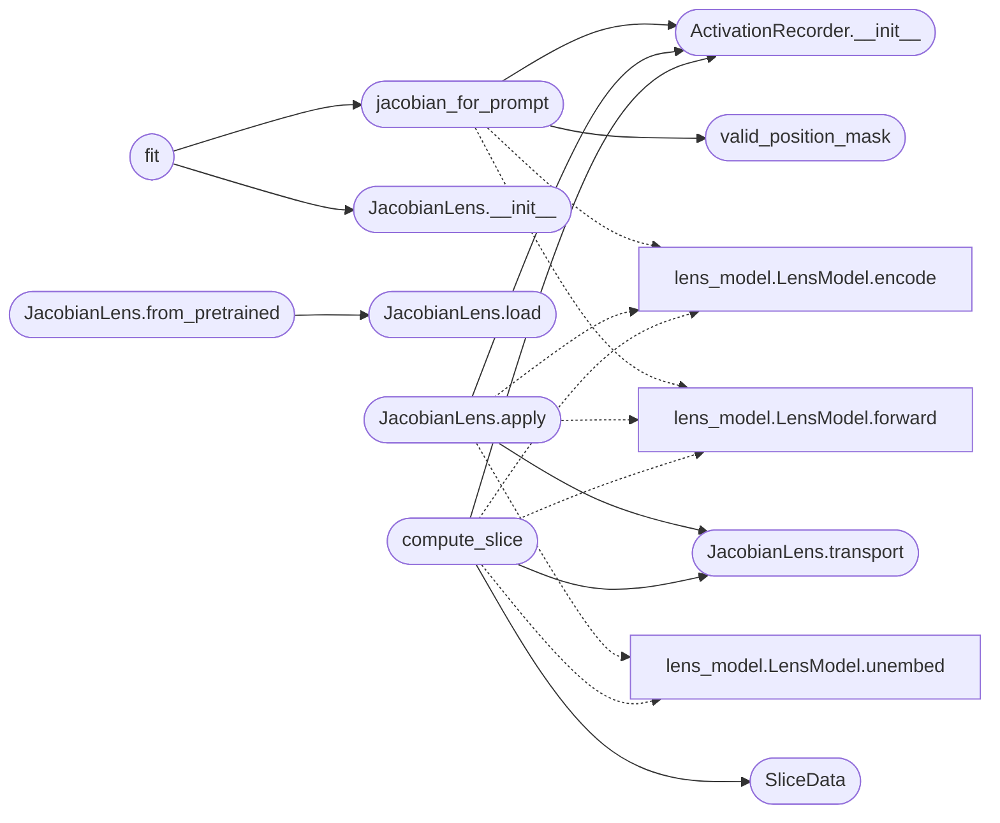

# `topogpt3.jlens`

> Source: [topogpt3/jlens.py:1](../../topogpt3/jlens.py#L1) | language `py` | coverage 89.5% | [API index](../index.md)

## Contents

- **Classes:** [`TopoGPT3JLensFitConfig`](#topogpt3jlensfitconfig), [`TopoGPT3JLensAppConfig`](#topogpt3jlensappconfig), [`ActivationRecorder`](#activationrecorder), [`JacobianLens`](#jacobianlens), [`SliceData`](#slicedata)
- **Functions:** [`valid_position_mask`](#valid_position_mask), [`jacobian_for_prompt`](#jacobian_for_prompt), [`fit`](#fit), [`compute_slice`](#compute_slice), [`text_slice`](#text_slice)

## Type Diagram



## Call Graph

Solid arrows stay in this module, dashed arrows leave it.



## Classes

<a id="topogpt3jlensfitconfig"></a>

### `TopoGPT3JLensFitConfig`

`class` `dataclass` | [topogpt3/jlens.py:37](../../topogpt3/jlens.py#L37)

Decorators: `@dataclass(frozen=True)`

```python
class TopoGPT3JLensFitConfig
```

Centralized configuration for Jacobian lens fitting.

Every value consumed downstream resides here. Adding a new tunable means
extending this class; no other module should embed literals.

**Attributes**

| Name | Type | Default | Description |
|---|---|---|---|
| [`source_layers`](#topogpt3jlensfitconfig-source_layers) | `tuple[int, ...] \| None` | `None` |  |
| [`target_layer`](#topogpt3jlensfitconfig-target_layer) | `int \| None` | `None` |  |
| [`dim_batch`](#topogpt3jlensfitconfig-dim_batch) | `int` | `8` |  |
| [`max_seq_len`](#topogpt3jlensfitconfig-max_seq_len) | `int` | `128` |  |
| [`skip_first`](#topogpt3jlensfitconfig-skip_first) | `int` | `SKIP_FIRST_N_POSITIONS` |  |
| [`checkpoint_path`](#topogpt3jlensfitconfig-checkpoint_path) | `str \| None` | `None` |  |
| [`checkpoint_every`](#topogpt3jlensfitconfig-checkpoint_every) | `int \| None` | `1` |  |
| [`resume`](#topogpt3jlensfitconfig-resume) | `bool` | `True` |  |
| [`seed`](#topogpt3jlensfitconfig-seed) | `int` | `42` |  |

---

<a id="topogpt3jlensappconfig"></a>

### `TopoGPT3JLensAppConfig`

`class` `dataclass` | [topogpt3/jlens.py:56](../../topogpt3/jlens.py#L56)

Decorators: `@dataclass(frozen=True)`

```python
class TopoGPT3JLensAppConfig
```

Centralized configuration for Jacobian lens application.

Every value consumed downstream resides here. Adding a new tunable means
extending this class; no other module should embed literals.

**Attributes**

| Name | Type | Default | Description |
|---|---|---|---|
| [`layers`](#topogpt3jlensappconfig-layers) | `tuple[int, ...] \| None` | `None` |  |
| [`positions`](#topogpt3jlensappconfig-positions) | `tuple[int, ...] \| None` | `None` |  |
| [`max_seq_len`](#topogpt3jlensappconfig-max_seq_len) | `int` | `512` |  |
| [`use_jacobian`](#topogpt3jlensappconfig-use_jacobian) | `bool` | `True` |  |

---

<a id="activationrecorder"></a>

### `ActivationRecorder`

`class` | [topogpt3/jlens.py:69](../../topogpt3/jlens.py#L69)

```python
class ActivationRecorder
```

Captures residual-stream tensors at the given block indices.

Registers a forward hook on each requested block on ``__enter__`` and
removes them on ``__exit__``. On the next forward pass each block's output
is stored in ``activations``, keyed by block index. Stored tensors are
not detached, so they can be passed straight to ``torch.autograd.grad``.

**Parameters**

| Name | Type | Default | Description |
|---|---|---|---|
| `blocks` |  |  | The sequence of residual blocks (e.g. ``model.layers``). |
| `at` |  |  | Block indices to record at. |
| `start_graph_at` |  |  | If given, the captured tensor at this index is marked ``requires_grad_(True)`` before downstream blocks see it. When the model's parameters all have ``requires_grad=False``, this makes the captured residual the leaf that roots the autograd graph, so the retained graph spans only this block onward. |

**Members**

| Member | Kind | Summary |
|---|---|---|
| [`__init__`](#activationrecorder-__init__) | constructor |  |

<a id="activationrecorder-__init__"></a>

#### `ActivationRecorder.__init__`

`constructor` | [topogpt3/jlens.py:87](../../topogpt3/jlens.py#L87)

```python
def __init__(self, blocks: Sequence[nn.Module], at: Iterable[int], *, start_graph_at: int | None = None) -> None
```

**Parameters**

| Name | Type | Default | Description |
|---|---|---|---|
| `blocks` | `Sequence[nn.Module]` |  | The sequence of residual blocks (e.g. ``model.layers``). |
| `at` | `Iterable[int]` |  | Block indices to record at. |
| `start_graph_at` | `int \| None` | `None` | If given, the captured tensor at this index is marked ``requires_grad_(True)`` before downstream blocks see it. When the model's parameters all have ``requires_grad=False``, this makes the captured residual the leaf that roots the autograd graph, so the retained graph spans only this block onward. |

*Called by:* [`JacobianLens.apply`](#jacobianlens-apply), [`compute_slice`](#compute_slice), [`jacobian_for_prompt`](#jacobian_for_prompt)

---

<a id="jacobianlens"></a>

### `JacobianLens`

`class` | [topogpt3/jlens.py:459](../../topogpt3/jlens.py#L459)

```python
class JacobianLens
```

A fitted Jacobian lens: per-layer ``J_l`` matrices and the readout method.

**Members**

| Member | Kind | Summary |
|---|---|---|
| [`__init__`](#jacobianlens-__init__) | constructor |  |
| [`save`](#jacobianlens-save) | method | Save to ``path``. |
| [`load`](#jacobianlens-load) | classmethod | Load a lens previously written by `[`save`](#jacobianlens-save)`. |
| [`from_pretrained`](#jacobianlens-from_pretrained) | classmethod | Load a lens from a local file, a local directory, or a HuggingFace Hub ``repo_id``. |
| [`merge`](#jacobianlens-merge) | classmethod | Combine lenses fitted on disjoint prompt subsets into one (``n_prompts``-weighted mean of the inputs). |
| [`transport`](#jacobianlens-transport) | method | Map a residual at ``layer`` into the final-layer basis: ``J_l @ h``. |
| [`apply`](#jacobianlens-apply) | method | Run ``model`` on `[`prompt`](#slicedata-prompt)` and return lens logits at `[`positions`](#topogpt3jlensappconfig-positions)`. |

<a id="jacobianlens-__init__"></a>

#### `JacobianLens.__init__`

`constructor` | [topogpt3/jlens.py:470](../../topogpt3/jlens.py#L470)

```python
def __init__(self, jacobians: dict[int, torch.Tensor], *, n_prompts: int, d_model: int) -> None
```

**Parameters**

| Name | Type | Default | Description |
|---|---|---|---|
| `jacobians` | `dict[int, torch.Tensor]` |  |  |
| `n_prompts` | `int` |  |  |
| `d_model` | `int` |  |  |

*Called by:* [`fit`](#fit)

<a id="jacobianlens-save"></a>

#### `JacobianLens.save`

`method` | [topogpt3/jlens.py:489](../../topogpt3/jlens.py#L489)

```python
def save(self, path: str, *, dtype: torch.dtype = torch.float16) -> None
```

Save to ``path``.

Jacobians are stored as ``dtype`` (default fp16).

**Parameters**

| Name | Type | Default | Description |
|---|---|---|---|
| `path` | `str` |  |  |
| `dtype` | `torch.dtype` | `torch.float16` |  |

<a id="jacobianlens-load"></a>

#### `JacobianLens.load`

`classmethod` | [topogpt3/jlens.py:504](../../topogpt3/jlens.py#L504)

Decorators: `@classmethod`

```python
def load(cls, path: str) -> JacobianLens
```

Load a lens previously written by `[`save`](#jacobianlens-save)`.

**Parameters**

| Name | Type | Default | Description |
|---|---|---|---|
| `path` | `str` |  |  |

**Returns:** `JacobianLens`

**Raises**

- `ValueError`: (raised in the body, not documented)

*Called by:* [`JacobianLens.from_pretrained`](#jacobianlens-from_pretrained)

<a id="jacobianlens-from_pretrained"></a>

#### `JacobianLens.from_pretrained`

`classmethod` | [topogpt3/jlens.py:519](../../topogpt3/jlens.py#L519)

Decorators: `@classmethod`

```python
def from_pretrained(cls, name_or_path: str, *, filename: str = 'lens.pt', revision: str | None = None) -> JacobianLens
```

Load a lens from a local file, a local directory, or a HuggingFace Hub ``repo_id``.

``filename`` is the path inside the directory or repo; ignored when
``name_or_path`` is itself a file. ``revision`` selects a Hub branch,
tag, or commit.

**Parameters**

| Name | Type | Default | Description |
|---|---|---|---|
| `name_or_path` | `str` |  |  |
| `filename` | `str` | `'lens.pt'` |  |
| `revision` | `str \| None` | `None` |  |

**Returns:** `JacobianLens`

*Calls:* [`JacobianLens.load`](#jacobianlens-load)

<a id="jacobianlens-merge"></a>

#### `JacobianLens.merge`

`classmethod` | [topogpt3/jlens.py:543](../../topogpt3/jlens.py#L543)

Decorators: `@classmethod`

```python
def merge(cls, lenses: Sequence[JacobianLens]) -> JacobianLens
```

Combine lenses fitted on disjoint prompt subsets into one (``n_prompts``-weighted mean of the inputs).

**Parameters**

| Name | Type | Default | Description |
|---|---|---|---|
| `lenses` | `Sequence[JacobianLens]` |  | Lenses to merge. Must agree on `[`source_layers`](#topogpt3jlensfitconfig-source_layers)` and ``d_model``. |

**Returns:** `JacobianLens`

**Raises**

- `ValueError`: If ``lenses`` is empty or the inputs disagree on shape.

<a id="jacobianlens-transport"></a>

#### `JacobianLens.transport`

`method` | [topogpt3/jlens.py:574](../../topogpt3/jlens.py#L574)

```python
def transport(self, residual: torch.Tensor, layer: int) -> torch.Tensor
```

Map a residual at ``layer`` into the final-layer basis: ``J_l @ h``.

**Parameters**

| Name | Type | Default | Description |
|---|---|---|---|
| `residual` | `torch.Tensor` |  | Tensor of shape ``[..., d_model]``. |
| `layer` | `int` |  | Source layer index (must be in `[`source_layers`](#topogpt3jlensfitconfig-source_layers)`). |

**Returns:** `torch.Tensor`

*Called by:* [`JacobianLens.apply`](#jacobianlens-apply), [`compute_slice`](#compute_slice)

<a id="jacobianlens-apply"></a>

#### `JacobianLens.apply`

`method` | [topogpt3/jlens.py:585](../../topogpt3/jlens.py#L585)

Decorators: `@torch.no_grad()`

```python
def apply(self, model: LensModel, prompt: str, *, layers: Sequence[int] | None = None, positions: Sequence[int] | None = None, max_seq_len: int = 512, use_jacobian: bool = True) -> tuple[dict[int, torch.Tensor], torch.Tensor, torch.Tensor]
```

Run ``model`` on `[`prompt`](#slicedata-prompt)` and return lens logits at `[`positions`](#topogpt3jlensappconfig-positions)`.

**Parameters**

| Name | Type | Default | Description |
|---|---|---|---|
| `model` | `LensModel` |  | The model to read out from. |
| `prompt` | `str` |  | Input text. |
| `layers` | `Sequence[int] \| None` | `None` | Layers to read out at. Defaults to all of `[`source_layers`](#topogpt3jlensfitconfig-source_layers)`. Must be a subset of `[`source_layers`](#topogpt3jlensfitconfig-source_layers)` when `[`use_jacobian`](#topogpt3jlensappconfig-use_jacobian)` is True. |
| `positions` | `Sequence[int] \| None` | `None` | Token positions to read out (Python indexing into the sequence; negative indices count from the end). None returns every position. |
| `max_seq_len` | `int` | `512` | Truncate the prompt to this many tokens. |
| `use_jacobian` | `bool` | `True` | If False, skip the ``J_l`` transport (vanilla logit-lens baseline). |

**Returns:** `tuple[dict[int, torch.Tensor], torch.Tensor, torch.Tensor]` - A triple ``(lens_logits, model_logits, input_ids)``. ``lens_logits``
maps each requested layer to a ``[n_positions, vocab_size]`` tensor;
``model_logits`` is the model's actual final-layer logits at the
same positions (same shape).

**Raises**

- `ValueError`: If any requested layer is out of range for the model, or (with use_jacobian) not in source_layers.

*Calls:* [`ActivationRecorder.__init__`](#activationrecorder-__init__), [`JacobianLens.transport`](#jacobianlens-transport), [`LensModel.encode`](topogpt3.lens_model.py.md#lensmodel-encode), [`LensModel.forward`](topogpt3.lens_model.py.md#lensmodel-forward), [`LensModel.unembed`](topogpt3.lens_model.py.md#lensmodel-unembed)

---

<a id="slicedata"></a>

### `SliceData`

`class` `dataclass` | [topogpt3/jlens.py:664](../../topogpt3/jlens.py#L664)

Decorators: `@dataclass`

```python
class SliceData
```

Text-format slice data: top-K token predictions per (position, layer).

`[`layers`](#topogpt3jlensappconfig-layers)` always includes the model's final layer (the actual model
output) so divergences from lens-transported earlier layers are visible.

**Attributes**

| Name | Type | Default | Description |
|---|---|---|---|
| [`seq_len`](#slicedata-seq_len) | `int` |  | Number of token positions in the slice. |
| [`layers`](#slicedata-layers) | `list[int]` |  | Layer indices shown (includes final layer). |
| [`prompt`](#slicedata-prompt) | `str` |  | The input prompt text. |
| [`input_ids`](#slicedata-input_ids) | `torch.Tensor` |  | Tensor ``[1, seq_len]`` of token IDs. |
| [`token_strs`](#slicedata-token_strs) | `list[str]` |  | Decoded strings for each token position. |
| [`top_ids`](#slicedata-top_ids) | `torch.Tensor` |  | ``[seq_len, n_layers, top_n]`` top token IDs per cell. |
| [`top_probs`](#slicedata-top_probs) | `torch.Tensor` |  | ``[seq_len, n_layers, top_n]`` softmax probabilities. |
| [`top_token_strs`](#slicedata-top_token_strs) | `list[list[list[str]]]` | `field(default_factory=list)` | ``[seq_len, n_layers, top_n]`` decoded token strings for each prediction. Empty string if tokenizer was unavailable. |
| [`top_n`](#slicedata-top_n) | `int` | `field(default=5, init=False)` |  |

---

## Functions

<a id="valid_position_mask"></a>

### `valid_position_mask`

`function` | [topogpt3/jlens.py:132](../../topogpt3/jlens.py#L132)

```python
def valid_position_mask(seq_len: int, *, skip_first: int = SKIP_FIRST_N_POSITIONS) -> torch.Tensor
```

Boolean mask over sequence positions to include in the Jacobian average.

Early positions are dominated by attention-sink behaviour and the final
position has no next-token target, so both are excluded.

**Parameters**

| Name | Type | Default | Description |
|---|---|---|---|
| `seq_len` | `int` |  | Length of the tokenized prompt. |
| `skip_first` | `int` | `SKIP_FIRST_N_POSITIONS` | Number of leading positions to exclude. |

**Returns:** `torch.Tensor` - Boolean tensor of shape ``[seq_len]``.

**Raises**

- `ValueError`: If `[`skip_first`](#topogpt3jlensfitconfig-skip_first)` is negative or the prompt is too short to leave any valid positions.

*Called by:* [`jacobian_for_prompt`](#jacobian_for_prompt)

---

<a id="jacobian_for_prompt"></a>

### `jacobian_for_prompt`

`function` | [topogpt3/jlens.py:187](../../topogpt3/jlens.py#L187)

```python
def jacobian_for_prompt(model: LensModel, prompt: str, source_layers: Sequence[int], *, target_layer: int | None = None, dim_batch: int = 8, max_seq_len: int = 128, skip_first: int = SKIP_FIRST_N_POSITIONS) -> tuple[dict[int, torch.Tensor], int, int]
```

Compute the per-layer Jacobian estimator ``J_l`` for one prompt.

Runs one forward pass on the prompt replicated `[`dim_batch`](#topogpt3jlensfitconfig-dim_batch)` times along
the batch axis, retains the graph, then runs ``ceil(d_model / dim_batch)``
backward passes against it. Each backward computes `[`dim_batch`](#topogpt3jlensfitconfig-dim_batch)` rows of
``J_l`` at once: batch element ``b`` carries a one-hot cotangent at output
dimension ``dim_start + b``, set at every valid target position.

**Parameters**

| Name | Type | Default | Description |
|---|---|---|---|
| `model` | `LensModel` |  | The model to compute Jacobians for. |
| `prompt` | `str` |  | Input text. |
| `source_layers` | `Sequence[int]` |  | Layer indices ``l`` to compute ``J_l`` at. |
| `target_layer` | `int \| None` | `None` | Layer to take gradients with respect to. Defaults to the final layer; negative indices count from the end. |
| `dim_batch` | `int` | `8` | Output dimensions computed per backward pass. |
| `max_seq_len` | `int` | `128` | Truncate the prompt to this many tokens. |
| `skip_first` | `int` | `SKIP_FIRST_N_POSITIONS` | Leading positions to exclude. |

**Returns:** `tuple[dict[int, torch.Tensor], int, int]` - ``(jacobians, seq_len, n_valid_positions)``. ``jacobians`` maps each
source layer to a ``[d_model, d_model]`` fp32 CPU tensor.

*Calls:* [`ActivationRecorder.__init__`](#activationrecorder-__init__), [`valid_position_mask`](#valid_position_mask), [`LensModel.encode`](topogpt3.lens_model.py.md#lensmodel-encode), [`LensModel.forward`](topogpt3.lens_model.py.md#lensmodel-forward)

*Called by:* [`fit`](#fit)

---

<a id="fit"></a>

### `fit`

`function` | [topogpt3/jlens.py:291](../../topogpt3/jlens.py#L291)

```python
def fit(model: LensModel, prompts: Sequence[str], *, source_layers: Sequence[int] | None = None, target_layer: int | None = None, dim_batch: int = 8, max_seq_len: int = 128, skip_first: int = SKIP_FIRST_N_POSITIONS, checkpoint_path: str | None = None, checkpoint_every: int | None = 1, resume: bool = True) -> JacobianLens
```

Fit ``J_l`` over a list of prompts and return a JacobianLens.

Per-prompt Jacobians from `[`jacobian_for_prompt`](#jacobian_for_prompt)` are accumulated as a
running mean. If `[`checkpoint_path`](#topogpt3jlensfitconfig-checkpoint_path)` is set, the running sum is written
every `[`checkpoint_every`](#topogpt3jlensfitconfig-checkpoint_every)` prompts (atomic) and resumed from on restart.

**Parameters**

| Name | Type | Default | Description |
|---|---|---|---|
| `model` | `LensModel` |  | The model to fit on. |
| `prompts` | `Sequence[str]` |  | Text prompts to average over. |
| `source_layers` | `Sequence[int] \| None` | `None` | Layers to fit at. Defaults to every layer below `[`target_layer`](#topogpt3jlensfitconfig-target_layer)`; negative indices count from the end. |
| `target_layer` | `int \| None` | `None` | See `[`jacobian_for_prompt`](#jacobian_for_prompt)`. |
| `dim_batch` | `int` | `8` | See `[`jacobian_for_prompt`](#jacobian_for_prompt)`. |
| `max_seq_len` | `int` | `128` | Truncate each prompt to this many tokens. |
| `skip_first` | `int` | `SKIP_FIRST_N_POSITIONS` | See `[`jacobian_for_prompt`](#jacobian_for_prompt)`. |
| `checkpoint_path` | `str \| None` | `None` | If set, write a resumable checkpoint here. |
| `checkpoint_every` | `int \| None` | `1` | Write checkpoint every N prompts (default 1). |
| `resume` | `bool` | `True` | If True and checkpoint_path exists, resume from it. |

**Returns:** `JacobianLens` - The fitted JacobianLens.

**Raises**

- `ValueError`: If no prompts are long enough to fit on, or if checkpoint settings mismatch.

*Calls:* [`JacobianLens.__init__`](#jacobianlens-__init__), [`jacobian_for_prompt`](#jacobian_for_prompt)

---

<a id="compute_slice"></a>

### `compute_slice`

`function` | [topogpt3/jlens.py:705](../../topogpt3/jlens.py#L705)

Decorators: `@torch.no_grad()`

```python
def compute_slice(model: LensModel, lens: JacobianLens, prompt: str, *, top_n: int = 5, max_seq_len: int = 512) -> SliceData
```

Compute a position x layer slice of top-K token predictions.

For each layer in the fitted lens, projects the residual at each position
through the Jacobian into the final-layer basis, then unembeds to get
logits and softmax probabilities. Returns the top-N predicted token IDs
and their probabilities per (position, layer) cell.

**Parameters**

| Name | Type | Default | Description |
|---|---|---|---|
| `model` | `LensModel` |  | The model to read out from. |
| `lens` | `JacobianLens` |  | A fitted JacobianLens. |
| `prompt` | `str` |  | Input text. |
| `top_n` | `int` | `5` | Top tokens to keep per (position, layer) cell. |
| `max_seq_len` | `int` | `512` | Truncate the prompt to this many tokens. |

**Returns:** `SliceData` - A SliceData instance with arrays indexed ``[seq_len, n_layers, top_n]``.

*Calls:* [`ActivationRecorder.__init__`](#activationrecorder-__init__), [`JacobianLens.transport`](#jacobianlens-transport), [`SliceData`](#slicedata), [`LensModel.encode`](topogpt3.lens_model.py.md#lensmodel-encode), [`LensModel.forward`](topogpt3.lens_model.py.md#lensmodel-forward), [`LensModel.unembed`](topogpt3.lens_model.py.md#lensmodel-unembed)

---

<a id="text_slice"></a>

### `text_slice`

`function` | [topogpt3/jlens.py:789](../../topogpt3/jlens.py#L789)

```python
def text_slice(slice_data: SliceData, tokenizer: Any = None, n_cols: int = 3) -> str
```

Render a SliceData as a readable text table showing decoded words.

For each token position, shows what each layer predicts as the next token.
The first column shows the actual input token; subsequent columns show the
top-1 prediction at each layer with its softmax probability. Token strings
are read from ``slice_data.top_token_strs`` (always populated by
`[`compute_slice`](#compute_slice)`).

**Parameters**

| Name | Type | Default | Description |
|---|---|---|---|
| `slice_data` | `SliceData` |  | The slice to render. |
| `tokenizer` | `Any` | `None` | Legacy parameter, ignored. Top token strings are already stored in ``slice_data.top_token_strs``. |
| `n_cols` | `int` | `3` | Number of layer columns to show (default 3). |

**Returns:** `str` - A multi-line string table.

---
