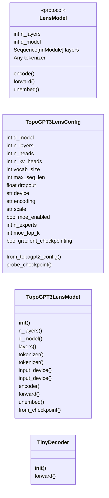
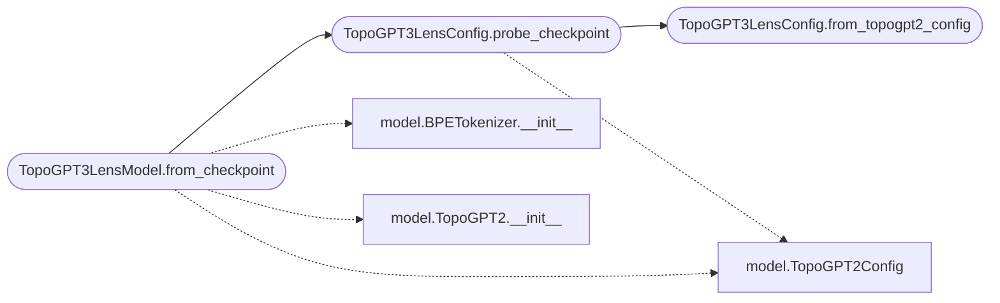

# `topogpt3.lens_model`

> Source: [topogpt3/lens_model.py:1](../../topogpt3/lens_model.py#L1) | language `py` | coverage 59.1% | [API index](../index.md)

## Contents

- **Classes:** [`TopoGPT3LensConfig`](#topogpt3lensconfig), [`TopoGPT3LensModel`](#topogpt3lensmodel), [`TinyDecoder`](#tinydecoder)
- **Protocols:** [`LensModel`](#lensmodel)

## Type Diagram



## Call Graph

Solid arrows stay in this module, dashed arrows leave it.



## Classes

<a id="topogpt3lensconfig"></a>

### `TopoGPT3LensConfig`

`class` `dataclass` | [topogpt3/lens_model.py:59](../../topogpt3/lens_model.py#L59)

Decorators: `@dataclass(frozen=True)`

```python
class TopoGPT3LensConfig
```

Centralized configuration for the TopoGPT3 lens model adapter.

Every value consumed downstream resides here. Adding a new tunable means
extending this class; no other module should embed literals.

**Attributes**

| Name | Type | Default | Description |
|---|---|---|---|
| [`d_model`](#topogpt3lensconfig-d_model) | `int` | `256` |  |
| [`n_layers`](#topogpt3lensconfig-n_layers) | `int` | `6` |  |
| [`n_heads`](#topogpt3lensconfig-n_heads) | `int` | `8` |  |
| [`n_kv_heads`](#topogpt3lensconfig-n_kv_heads) | `int` | `0` |  |
| [`vocab_size`](#topogpt3lensconfig-vocab_size) | `int` | `50257` |  |
| [`max_seq_len`](#topogpt3lensconfig-max_seq_len) | `int` | `256` |  |
| [`dropout`](#topogpt3lensconfig-dropout) | `float` | `0.1` |  |
| [`device`](#topogpt3lensconfig-device) | `str` | `field(default_factory=lambda: 'cuda' if torch.cuda.is_available() else 'cpu')` |  |
| [`encoding`](#topogpt3lensconfig-encoding) | `str` | `'gpt2'` |  |
| [`scale`](#topogpt3lensconfig-scale) | `str` | `'small'` |  |
| [`moe_enabled`](#topogpt3lensconfig-moe_enabled) | `bool` | `True` |  |
| [`n_experts`](#topogpt3lensconfig-n_experts) | `int` | `4` |  |
| [`moe_top_k`](#topogpt3lensconfig-moe_top_k) | `int` | `2` |  |
| [`gradient_checkpointing`](#topogpt3lensconfig-gradient_checkpointing) | `bool` | `True` |  |

**Members**

| Member | Kind | Summary |
|---|---|---|
| [`from_topogpt2_config`](#topogpt3lensconfig-from_topogpt2_config) | classmethod | Construct a lens config from a TopoGPT2Config dataclass. |
| [`probe_checkpoint`](#topogpt3lensconfig-probe_checkpoint) | classmethod | Probe a checkpoint directory and infer lens config from state.json. |

<a id="topogpt3lensconfig-from_topogpt2_config"></a>

#### `TopoGPT3LensConfig.from_topogpt2_config`

`classmethod` | [topogpt3/lens_model.py:84](../../topogpt3/lens_model.py#L84)

Decorators: `@classmethod`

```python
def from_topogpt2_config(cls, cfg: Any) -> TopoGPT3LensConfig
```

Construct a lens config from a TopoGPT2Config dataclass.

**Parameters**

| Name | Type | Default | Description |
|---|---|---|---|
| `cfg` | `Any` |  |  |

**Returns:** `TopoGPT3LensConfig`

*Called by:* [`TopoGPT3LensConfig.probe_checkpoint`](#topogpt3lensconfig-probe_checkpoint)

<a id="topogpt3lensconfig-probe_checkpoint"></a>

#### `TopoGPT3LensConfig.probe_checkpoint`

`classmethod` | [topogpt3/lens_model.py:104](../../topogpt3/lens_model.py#L104)

Decorators: `@classmethod`

```python
def probe_checkpoint(cls, checkpoint_dir: str = 'checkpoints_topogpt3', *, state_filename: str = 'state.json') -> TopoGPT3LensConfig
```

Probe a checkpoint directory and infer lens config from state.json.

**Parameters**

| Name | Type | Default | Description |
|---|---|---|---|
| `checkpoint_dir` | `str` | `'checkpoints_topogpt3'` | Path to the checkpoint slot directory. |
| `state_filename` | `str` | `'state.json'` | JSON file containing training config. |

**Returns:** `TopoGPT3LensConfig` - A TopoGPT3LensConfig matching the checkpoint.

**Raises**

- `FileNotFoundError`: If state.json is missing.
- `ValueError`: If required fields are absent from the state.

*Calls:* [`TopoGPT3LensConfig.from_topogpt2_config`](#topogpt3lensconfig-from_topogpt2_config), [`TopoGPT2Config`](topogpt3.model.py.md#topogpt2config)

*Called by:* [`TopoGPT3LensModel.from_checkpoint`](#topogpt3lensmodel-from_checkpoint)

---

<a id="topogpt3lensmodel"></a>

### `TopoGPT3LensModel`

`class` | [topogpt3/lens_model.py:161](../../topogpt3/lens_model.py#L161)

```python
class TopoGPT3LensModel(nn.Module)
```

Bases: `nn.Module`

LensModel adapter over a loaded TopoGPT2 model.

Wraps a TopoGPT2 instance and implements the LensModel protocol for use
with ActivationRecorder, JacobianLens fitting, and apply().

The adapter owns no parameters --- all weights live in the wrapped model.
Call ``.eval()`` and set ``requires_grad_(False)`` on the wrapped model
before fitting.

**Members**

| Member | Kind | Summary |
|---|---|---|
| [`__init__`](#topogpt3lensmodel-__init__) | constructor |  |
| [`n_layers`](#topogpt3lensmodel-n_layers) | property |  |
| [`d_model`](#topogpt3lensmodel-d_model) | property |  |
| [`layers`](#topogpt3lensmodel-layers) | property |  |
| [`tokenizer`](#topogpt3lensmodel-tokenizer) | property |  |
| [`tokenizer`](#topogpt3lensmodel-tokenizer) | property |  |
| [`input_device`](#topogpt3lensmodel-input_device) | property |  |
| [`input_device`](#topogpt3lensmodel-input_device) | property |  |
| [`encode`](#topogpt3lensmodel-encode) | method | Tokenize text to input_ids of shape ``[1, seq_len]``. |
| [`forward`](#topogpt3lensmodel-forward) | method | Run the residual stack on `[`input_ids`](topogpt3.jlens.py.md#slicedata-input_ids)`. |
| [`unembed`](#topogpt3lensmodel-unembed) | method | Map residual ``[..., d_model]`` to logits ``[..., vocab_size]``. |
| [`from_checkpoint`](#topogpt3lensmodel-from_checkpoint) | classmethod | Build a TopoGPT3LensModel from a checkpoint directory. |

<a id="topogpt3lensmodel-__init__"></a>

#### `TopoGPT3LensModel.__init__`

`constructor` | [topogpt3/lens_model.py:172](../../topogpt3/lens_model.py#L172)

```python
def __init__(self, model: nn.Module, tokenizer: Any | None = None) -> None
```

**Parameters**

| Name | Type | Default | Description |
|---|---|---|---|
| `model` | `nn.Module` |  |  |
| `tokenizer` | `Any \| None` | `None` |  |

<a id="topogpt3lensmodel-n_layers"></a>

#### `TopoGPT3LensModel.n_layers`

`property` | [topogpt3/lens_model.py:184](../../topogpt3/lens_model.py#L184)

Decorators: `@property`

```python
def n_layers(self) -> int
```

**Returns:** `int`

<a id="topogpt3lensmodel-d_model"></a>

#### `TopoGPT3LensModel.d_model`

`property` | [topogpt3/lens_model.py:188](../../topogpt3/lens_model.py#L188)

Decorators: `@property`

```python
def d_model(self) -> int
```

**Returns:** `int`

<a id="topogpt3lensmodel-layers"></a>

#### `TopoGPT3LensModel.layers`

`property` | [topogpt3/lens_model.py:192](../../topogpt3/lens_model.py#L192)

Decorators: `@property`

```python
def layers(self) -> nn.ModuleList
```

**Returns:** `nn.ModuleList`

<a id="topogpt3lensmodel-tokenizer"></a>

#### `TopoGPT3LensModel.tokenizer`

`property` | [topogpt3/lens_model.py:200](../../topogpt3/lens_model.py#L200)

Decorators: `@tokenizer.setter`

```python
def tokenizer(self, tok: Any) -> None
```

**Parameters**

| Name | Type | Default | Description |
|---|---|---|---|
| `tok` | `Any` |  |  |

<a id="topogpt3lensmodel-tokenizer"></a>

#### `TopoGPT3LensModel.tokenizer`

`property` | [topogpt3/lens_model.py:200](../../topogpt3/lens_model.py#L200)

Decorators: `@tokenizer.setter`

```python
def tokenizer(self, tok: Any) -> None
```

**Parameters**

| Name | Type | Default | Description |
|---|---|---|---|
| `tok` | `Any` |  |  |

<a id="topogpt3lensmodel-input_device"></a>

#### `TopoGPT3LensModel.input_device`

`property` | [topogpt3/lens_model.py:210](../../topogpt3/lens_model.py#L210)

Decorators: `@input_device.setter`

```python
def input_device(self, device: torch.device) -> None
```

**Parameters**

| Name | Type | Default | Description |
|---|---|---|---|
| `device` | `torch.device` |  |  |

<a id="topogpt3lensmodel-input_device"></a>

#### `TopoGPT3LensModel.input_device`

`property` | [topogpt3/lens_model.py:210](../../topogpt3/lens_model.py#L210)

Decorators: `@input_device.setter`

```python
def input_device(self, device: torch.device) -> None
```

**Parameters**

| Name | Type | Default | Description |
|---|---|---|---|
| `device` | `torch.device` |  |  |

<a id="topogpt3lensmodel-encode"></a>

#### `TopoGPT3LensModel.encode`

`method` | [topogpt3/lens_model.py:213](../../topogpt3/lens_model.py#L213)

```python
def encode(self, text: str, *, max_length: int = 512) -> torch.Tensor
```

Tokenize text to input_ids of shape ``[1, seq_len]``.

Uses BPETokenizer if available, otherwise falls back to a byte-level
encoding compatible with GPT-2 BPE tokenization.

**Parameters**

| Name | Type | Default | Description |
|---|---|---|---|
| `text` | `str` |  |  |
| `max_length` | `int` | `512` |  |

**Returns:** `torch.Tensor`

<a id="topogpt3lensmodel-forward"></a>

#### `TopoGPT3LensModel.forward`

`method` | [topogpt3/lens_model.py:228](../../topogpt3/lens_model.py#L228)

```python
def forward(self, input_ids: torch.Tensor) -> torch.Tensor
```

Run the residual stack on `[`input_ids`](topogpt3.jlens.py.md#slicedata-input_ids)`.

Returns hidden states of shape ``[batch, seq_len, d_model]``
(pre-final-norm, pre-LM-head). The autograd graph is retained through
all layers when grad is enabled.

**Parameters**

| Name | Type | Default | Description |
|---|---|---|---|
| `input_ids` | `torch.Tensor` |  |  |

**Returns:** `torch.Tensor`

<a id="topogpt3lensmodel-unembed"></a>

#### `TopoGPT3LensModel.unembed`

`method` | [topogpt3/lens_model.py:237](../../topogpt3/lens_model.py#L237)

```python
def unembed(self, residual: torch.Tensor) -> torch.Tensor
```

Map residual ``[..., d_model]`` to logits ``[..., vocab_size]``.

Applies the model's final norm and LM head projection.

**Parameters**

| Name | Type | Default | Description |
|---|---|---|---|
| `residual` | `torch.Tensor` |  |  |

**Returns:** `torch.Tensor`

<a id="topogpt3lensmodel-from_checkpoint"></a>

#### `TopoGPT3LensModel.from_checkpoint`

`classmethod` | [topogpt3/lens_model.py:246](../../topogpt3/lens_model.py#L246)

Decorators: `@classmethod`

```python
def from_checkpoint(cls, checkpoint_dir: str = 'checkpoints_topogpt3', *, device: str | None = None, encoding: str = 'gpt2', strict: bool = False) -> TopoGPT3LensModel
```

Build a TopoGPT3LensModel from a checkpoint directory.

Probes state.json for configuration, instantiates the model, loads
safetensors weights, and wraps the result.

**Parameters**

| Name | Type | Default | Description |
|---|---|---|---|
| `checkpoint_dir` | `str` | `'checkpoints_topogpt3'` | Path to the checkpoint slot directory. |
| `device` | `str \| None` | `None` | Target device. Defaults to cuda if available else cpu. |
| `encoding` | `str` | `'gpt2'` | Tokenizer encoding name (passed to BPETokenizer). |
| `strict` | `bool` | `False` | Whether to enforce strict state dict loading. |

**Returns:** `TopoGPT3LensModel` - A TopoGPT3LensModel in eval mode with requires_grad_(False).

**Raises**

- `FileNotFoundError`: If model.safetensors or state.json is missing.

*Calls:* [`TopoGPT3LensConfig.probe_checkpoint`](#topogpt3lensconfig-probe_checkpoint), [`BPETokenizer.__init__`](topogpt3.model.py.md#bpetokenizer-__init__), [`TopoGPT2.__init__`](topogpt3.model.py.md#topogpt2-__init__), [`TopoGPT2Config`](topogpt3.model.py.md#topogpt2config)

*Called by:* [`main`](topogpt3.__main__.py.md#main)

---

<a id="tinydecoder"></a>

### `TinyDecoder`

`class` | [topogpt3/lens_model.py:306](../../topogpt3/lens_model.py#L306)

```python
class TinyDecoder(nn.Module)
```

Bases: `nn.Module`

A tiny CPU-only decoder for end-to-end tests.

Implements the LensModel protocol indirectly (wrapped by
TopoGPT3LensModel). Residual blocks are ``h + 0.1 * linear(h)``:
the small gain keeps the Jacobian well-conditioned so the late-layer
``diag(J) ~= 1`` property holds.

**Members**

| Member | Kind | Summary |
|---|---|---|
| [`__init__`](#tinydecoder-__init__) | constructor |  |
| [`forward`](#tinydecoder-forward) | method |  |

<a id="tinydecoder-__init__"></a>

#### `TinyDecoder.__init__`

`constructor` | [topogpt3/lens_model.py:315](../../topogpt3/lens_model.py#L315)

```python
def __init__(self, n_layers: int = 4, d_model: int = 8, vocab_size: int = 32, seed: int = 0) -> None
```

**Parameters**

| Name | Type | Default | Description |
|---|---|---|---|
| `n_layers` | `int` | `4` |  |
| `d_model` | `int` | `8` |  |
| `vocab_size` | `int` | `32` |  |
| `seed` | `int` | `0` |  |

<a id="tinydecoder-forward"></a>

#### `TinyDecoder.forward`

`method` | [topogpt3/lens_model.py:344](../../topogpt3/lens_model.py#L344)

```python
def forward(self, token_ids: torch.Tensor, past_kvs: Any = None) -> tuple[torch.Tensor, torch.Tensor, list]
```

**Parameters**

| Name | Type | Default | Description |
|---|---|---|---|
| `token_ids` | `torch.Tensor` |  |  |
| `past_kvs` | `Any` | `None` |  |

**Returns:** `tuple[torch.Tensor, torch.Tensor, list]`

---

## Protocols

<a id="lensmodel"></a>

### `LensModel`

`protocol` | [topogpt3/lens_model.py:23](../../topogpt3/lens_model.py#L23)

```python
class LensModel(Protocol)
```

Bases: `Protocol`

What the lens needs from a model.

**Attributes**

| Name | Type | Default | Description |
|---|---|---|---|
| [`n_layers`](#lensmodel-n_layers) | `int` |  | Number of residual blocks. |
| [`d_model`](#lensmodel-d_model) | `int` |  | Residual-stream width. |
| [`layers`](#lensmodel-layers) | `Sequence[nn.Module]` |  | The residual blocks, indexable by integer; what ActivationRecorder hooks. |
| [`tokenizer`](#lensmodel-tokenizer) | `Any` |  | Tokenizer used by the visualisation helpers; must provide ``decode(token_ids) -> str``. Fitting and apply() never touch it. |

**Members**

| Member | Kind | Summary |
|---|---|---|
| [`encode`](#lensmodel-encode) | method | Tokenize ``text`` to `[`input_ids`](topogpt3.jlens.py.md#slicedata-input_ids)` of shape ``[1, seq_len]`` on the model's input device. |
| [`forward`](#lensmodel-forward) | method | Run the residual stack on `[`input_ids`](topogpt3.jlens.py.md#slicedata-input_ids)` (no LM head). |
| [`unembed`](#lensmodel-unembed) | method | Map a residual-stream tensor ``[..., d_model]`` to logits ``[..., vocab_size]`` (final norm + LM head). |

<a id="lensmodel-encode"></a>

#### `LensModel.encode`

`method` | [topogpt3/lens_model.py:40](../../topogpt3/lens_model.py#L40)

```python
def encode(self, text: str, *, max_length: int = ...) -> torch.Tensor
```

Tokenize ``text`` to `[`input_ids`](topogpt3.jlens.py.md#slicedata-input_ids)` of shape ``[1, seq_len]`` on the model's input device.

**Parameters**

| Name | Type | Default | Description |
|---|---|---|---|
| `text` | `str` |  |  |
| `max_length` | `int` | `...` |  |

**Returns:** `torch.Tensor`

*Called by:* [`JacobianLens.apply`](topogpt3.jlens.py.md#jacobianlens-apply), [`compute_slice`](topogpt3.jlens.py.md#compute_slice), [`jacobian_for_prompt`](topogpt3.jlens.py.md#jacobian_for_prompt)

<a id="lensmodel-forward"></a>

#### `LensModel.forward`

`method` | [topogpt3/lens_model.py:45](../../topogpt3/lens_model.py#L45)

```python
def forward(self, input_ids: torch.Tensor) -> Any
```

Run the residual stack on `[`input_ids`](topogpt3.jlens.py.md#slicedata-input_ids)` (no LM head).

Must build an autograd graph through layers when grad is enabled, and must be deterministic across batch elements (eval mode, dropout off) --- the fitting estimator replicates the prompt along the batch axis.

**Parameters**

| Name | Type | Default | Description |
|---|---|---|---|
| `input_ids` | `torch.Tensor` |  |  |

**Returns:** `Any`

*Called by:* [`JacobianLens.apply`](topogpt3.jlens.py.md#jacobianlens-apply), [`compute_slice`](topogpt3.jlens.py.md#compute_slice), [`jacobian_for_prompt`](topogpt3.jlens.py.md#jacobian_for_prompt)

<a id="lensmodel-unembed"></a>

#### `LensModel.unembed`

`method` | [topogpt3/lens_model.py:52](../../topogpt3/lens_model.py#L52)

```python
def unembed(self, residual: torch.Tensor) -> torch.Tensor
```

Map a residual-stream tensor ``[..., d_model]`` to logits ``[..., vocab_size]`` (final norm + LM head).

**Parameters**

| Name | Type | Default | Description |
|---|---|---|---|
| `residual` | `torch.Tensor` |  |  |

**Returns:** `torch.Tensor`

*Called by:* [`JacobianLens.apply`](topogpt3.jlens.py.md#jacobianlens-apply), [`compute_slice`](topogpt3.jlens.py.md#compute_slice)

---
