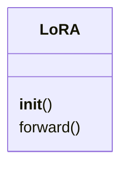
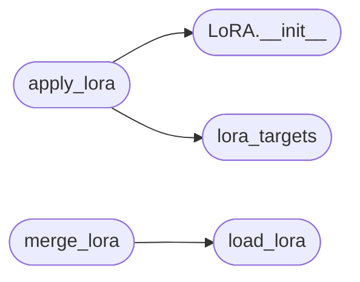

# `topogpt3.lora`

> Source: [topogpt3/lora.py:1](../../topogpt3/lora.py#L1) | language `py` | coverage 36.4% | [API index](../index.md)

Native LoRA for TopoGPT3.

Quaternion-safe: in addition to plain nn.Linear, it descends into
QuaternionLinear's four sub-linears (Ww/Wx/Wy/Wz) and SwiGLU projections,
so the spectral/torus identity is preserved — adapters are purely additive
deltas initialized at zero, base weights untouched until explicit merge.

## Contents

- **Classes:** [`LoRA`](#lora)
- **Functions:** [`lora_targets`](#lora_targets), [`apply_lora`](#apply_lora), [`lora_parameters`](#lora_parameters), [`freeze_non_lora`](#freeze_non_lora), [`save_lora`](#save_lora), [`load_lora`](#load_lora), [`merge_lora`](#merge_lora)

## Type Diagram



## Call Graph

Solid arrows stay in this module, dashed arrows leave it.



## Classes

<a id="lora"></a>

### `LoRA`

`class` | [topogpt3/lora.py:16](../../topogpt3/lora.py#L16)

```python
class LoRA(nn.Module)
```

Bases: `nn.Module`

**Members**

| Member | Kind | Summary |
|---|---|---|
| [`__init__`](#lora-__init__) | constructor |  |
| [`forward`](#lora-forward) | method |  |

<a id="lora-__init__"></a>

#### `LoRA.__init__`

`constructor` | [topogpt3/lora.py:17](../../topogpt3/lora.py#L17)

```python
def __init__(self, in_features: int, out_features: int, rank: int = 16)
```

**Parameters**

| Name | Type | Default | Description |
|---|---|---|---|
| `in_features` | `int` |  |  |
| `out_features` | `int` |  |  |
| `rank` | `int` | `16` |  |

*Called by:* [`apply_lora`](#apply_lora)

<a id="lora-forward"></a>

#### `LoRA.forward`

`method` | [topogpt3/lora.py:25](../../topogpt3/lora.py#L25)

```python
def forward(self, x)
```

**Parameters**

| Name | Type | Default | Description |
|---|---|---|---|
| `x` |  |  |  |

---

## Functions

<a id="lora_targets"></a>

### `lora_targets`

`function` `generator` | [topogpt3/lora.py:34](../../topogpt3/lora.py#L34)

```python
def lora_targets(model: nn.Module, include_mlp: bool = False)
```

Yield (name, nn.Linear) candidates.

Default targets square Q/K/V/O projections; include_mlp=True also adapts SwiGLU gate/up/down + torus proj.
QuaternionLinear sub-linears are square by construction (D_QUAT x D_QUAT)
and are included by default.

**Parameters**

| Name | Type | Default | Description |
|---|---|---|---|
| `model` | `nn.Module` |  |  |
| `include_mlp` | `bool` | `False` |  |

*Called by:* [`apply_lora`](#apply_lora)

---

<a id="apply_lora"></a>

### `apply_lora`

`function` | [topogpt3/lora.py:54](../../topogpt3/lora.py#L54)

```python
def apply_lora(model: nn.Module, rank: int = 16, include_mlp: bool = False) -> List[str]
```

Monkey-patch target linears with additive LoRA.

Returns patched names.

**Parameters**

| Name | Type | Default | Description |
|---|---|---|---|
| `model` | `nn.Module` |  |  |
| `rank` | `int` | `16` |  |
| `include_mlp` | `bool` | `False` |  |

**Returns:** `List[str]`

*Calls:* [`LoRA.__init__`](#lora-__init__), [`lora_targets`](#lora_targets)

*Called by:* [`merge_base_lora`](topogpt3.convert.py.md#merge_base_lora), [`main`](topogpt3.train_lora.py.md#main)

---

<a id="lora_parameters"></a>

### `lora_parameters`

`function` `generator` | [topogpt3/lora.py:73](../../topogpt3/lora.py#L73)

```python
def lora_parameters(model: nn.Module)
```

**Parameters**

| Name | Type | Default | Description |
|---|---|---|---|
| `model` | `nn.Module` |  |  |

*Called by:* [`main`](topogpt3.train_lora.py.md#main)

---

<a id="freeze_non_lora"></a>

### `freeze_non_lora`

`function` | [topogpt3/lora.py:80](../../topogpt3/lora.py#L80)

```python
def freeze_non_lora(model: nn.Module) -> None
```

**Parameters**

| Name | Type | Default | Description |
|---|---|---|---|
| `model` | `nn.Module` |  |  |

*Called by:* [`main`](topogpt3.train_lora.py.md#main)

---

<a id="save_lora"></a>

### `save_lora`

`function` | [topogpt3/lora.py:88](../../topogpt3/lora.py#L88)

```python
def save_lora(model: nn.Module, path: str) -> None
```

**Parameters**

| Name | Type | Default | Description |
|---|---|---|---|
| `model` | `nn.Module` |  |  |
| `path` | `str` |  |  |

*Called by:* [`main`](topogpt3.train_lora.py.md#main)

---

<a id="load_lora"></a>

### `load_lora`

`function` | [topogpt3/lora.py:99](../../topogpt3/lora.py#L99)

```python
def load_lora(model: nn.Module, path: str, device=None) -> None
```

**Parameters**

| Name | Type | Default | Description |
|---|---|---|---|
| `model` | `nn.Module` |  |  |
| `path` | `str` |  |  |
| `device` |  | `None` |  |

*Called by:* [`merge_lora`](#merge_lora)

---

<a id="merge_lora"></a>

### `merge_lora`

`function` | [topogpt3/lora.py:110](../../topogpt3/lora.py#L110)

```python
def merge_lora(model: nn.Module, lora_path: str, save_path: str) -> None
```

Merge LoRA deltas into base weights and save (fp16, no .lora. keys).

**Parameters**

| Name | Type | Default | Description |
|---|---|---|---|
| `model` | `nn.Module` |  |  |
| `lora_path` | `str` |  |  |
| `save_path` | `str` |  |  |

*Calls:* [`load_lora`](#load_lora)

*Called by:* [`merge_base_lora`](topogpt3.convert.py.md#merge_base_lora)

---
