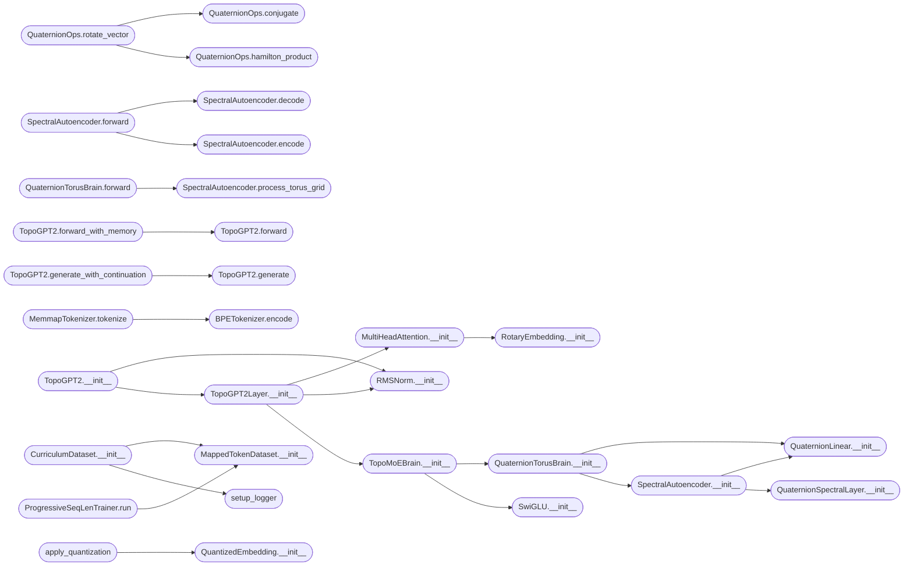

# `topogpt3.model`

> Source: [topogpt3/model.py:1](../../topogpt3/model.py#L1) | language `py` | coverage 54.2% | [API index](../index.md)

TopoGPT2: Quaternion-Enhanced Topological Transformer Language Model

Author: Gris Iscomeback
Email: grisiscomeback@gmail.com
License: GPL v3

Mejoras sobre topogpt.py:
- Álgebra de cuaterniones completa (QuaternionLinear, QuaternionSpectralLayer)
  con producto de Hamilton en el dominio de frecuencia para capturar la
  espectrografía de los datos con kernels reales e imaginarios cruzados.
- SpectralAutoencoder: encoder/decoder espectral que comprime y reconstruye
  las representaciones en el dominio de frecuencia.
- QuaternionTorusBrain VECTORIZADA (sin bucles sobre seq_len): proyección
  geométrica sobre el toro con asignación blanda usando distancias circulares,
  message-passing con rotaciones de cuaterniones.
- 8 nodos (RADIAL=2 × ANGULAR=4), 4 ángulos, 2 radiales (spec del usuario).
- Rotary Position Embeddings (RoPE).
- Flash-attention (scaled_dot_product_attention de PyTorch 2.0+).
- RMSNorm en lugar de LayerNorm (estilo LLaMA).
- Tokenizador BPE via tiktoken (vocab GPT-2, 50k tokens).
- Descargador de corpus: TinyStories, WikiText-103, raw file.
- Entrenamiento con AMP (mixed precision) + acumulación de gradientes.
- Presets de escala: micro, small, medium, gpt2.

## Contents

- **Classes:** [`TopoGPT2Config`](#topogpt2config), [`QuaternionOps`](#quaternionops), [`QuaternionLinear`](#quaternionlinear), [`QuaternionSpectralLayer`](#quaternionspectrallayer), [`SpectralAutoencoder`](#spectralautoencoder), [`QuaternionTorusBrain`](#quaterniontorusbrain), [`RotaryEmbedding`](#rotaryembedding), [`RMSNorm`](#rmsnorm), [`SwiGLU`](#swiglu), [`TopoMoEBrain`](#topomoebrain), [`MultiHeadAttention`](#multiheadattention), [`TopoGPT2Layer`](#topogpt2layer), [`TopoGPT2`](#topogpt2), [`BPETokenizer`](#bpetokenizer), [`FileManifest`](#filemanifest), [`MemmapTokenizer`](#memmaptokenizer), [`MappedTokenDataset`](#mappedtokendataset), [`TextFilter`](#textfilter), [`CurriculumDataset`](#curriculumdataset), [`ProgressiveSeqLenTrainer`](#progressiveseqlentrainer), [`SpeculativeDecoder`](#speculativedecoder), [`QuantizedEmbedding`](#quantizedembedding), [`CurriculumTrainer`](#curriculumtrainer), [`CheckpointManager`](#checkpointmanager), [`TopoGPT2Trainer`](#topogpt2trainer), [`MechanisticMetrics`](#mechanisticmetrics), [`Phase0_KernelOptimizer`](#phase0_kerneloptimizer), [`Phase1_BatchProspector`](#phase1_batchprospector), [`Phase2_SeedMiner`](#phase2_seedminer), [`Phase4_AnnealingRefiner`](#phase4_annealingrefiner), [`TopoPhasePipelineV2`](#topophasepipelinev2), [`TopoPhasePipeline`](#topophasepipeline)
- **Functions:** [`setup_logger`](#setup_logger), [`set_seed`](#set_seed), [`build_file_tiers`](#build_file_tiers), [`apply_quantization`](#apply_quantization), [`main`](#main)

## Type Diagram

```mermaid
classDiagram
    direction LR
    class TopoGPT2Config
    TopoGPT2Config : str DEVICE
    TopoGPT2Config : int RANDOM_SEED
    TopoGPT2Config : bool USE_AMP
    TopoGPT2Config : str SCALE
    TopoGPT2Config : int VOCAB_SIZE
    TopoGPT2Config : int MAX_SEQ_LEN
    TopoGPT2Config : int D_MODEL
    TopoGPT2Config : int N_HEADS
    TopoGPT2Config : int N_KV_HEADS
    TopoGPT2Config : int N_LAYERS
    TopoGPT2Config : float DROPOUT
    TopoGPT2Config : bool MOE_ENABLED
    TopoGPT2Config : int N_EXPERTS
    TopoGPT2Config : int MOE_TOP_K
    TopoGPT2Config : float MOE_AUX_LOSS_WEIGHT
    TopoGPT2Config : int TORUS_GRID_SIZE
    TopoGPT2Config : int TORUS_RADIAL_BINS
    TopoGPT2Config : int TORUS_ANGULAR_BINS
    TopoGPT2Config : float SPECTRAL_LATENT_RATIO
    TopoGPT2Config : float SPECTRAL_KERNEL_INIT_SCALE
    TopoGPT2Config : int NUM_SPECTRAL_LAYERS
    TopoGPT2Config : float AE_RECON_WEIGHT
    TopoGPT2Config : int BATCH_SIZE
    TopoGPT2Config : int GRAD_ACCUM_STEPS
    class QuaternionOps
    QuaternionOps : hamilton_product()
    QuaternionOps : normalize()
    QuaternionOps : conjugate()
    QuaternionOps : rotate_vector()
    class QuaternionLinear
    QuaternionLinear : __init__()
    QuaternionLinear : forward()
    class QuaternionSpectralLayer
    QuaternionSpectralLayer : __init__()
    QuaternionSpectralLayer : forward()
    class SpectralAutoencoder
    SpectralAutoencoder : __init__()
    SpectralAutoencoder : encode()
    SpectralAutoencoder : decode()
    SpectralAutoencoder : forward()
    SpectralAutoencoder : process_torus_grid()
    class QuaternionTorusBrain
    QuaternionTorusBrain : __init__()
    QuaternionTorusBrain : forward()
    class RotaryEmbedding
    RotaryEmbedding : __init__()
    RotaryEmbedding : enable_yarn()
    RotaryEmbedding : forward()
    class RMSNorm
    RMSNorm : __init__()
    RMSNorm : forward()
    class SwiGLU
    SwiGLU : __init__()
    SwiGLU : forward()
    class TopoMoEBrain
    TopoMoEBrain : __init__()
    TopoMoEBrain : forward()
    class MultiHeadAttention
    MultiHeadAttention : __init__()
    MultiHeadAttention : forward()
    class TopoGPT2Layer
    TopoGPT2Layer : __init__()
    TopoGPT2Layer : forward()
    class TopoGPT2
    TopoGPT2 : __init__()
    TopoGPT2 : forward()
    TopoGPT2 : forward_with_memory()
    TopoGPT2 : count_params()
    TopoGPT2 : generate()
    TopoGPT2 : generate_with_continuation()
    class BPETokenizer
    BPETokenizer : __init__()
    BPETokenizer : encode()
    BPETokenizer : decode()
    BPETokenizer : eot_token()
    class FileManifest
    FileManifest : __init__()
    FileManifest : scan()
    class MemmapTokenizer
    MemmapTokenizer : CHUNK_TOKENS
    MemmapTokenizer : __init__()
    MemmapTokenizer : tokenize()
    class MappedTokenDataset
    MappedTokenDataset : __init__()
    class TextFilter
    TextFilter : __init__()
    TextFilter : filter_file()
    TextFilter : report()
    class CurriculumDataset
    CurriculumDataset : __init__()
    CurriculumDataset : set_tier()
    class ProgressiveSeqLenTrainer
    ProgressiveSeqLenTrainer : __init__()
    ProgressiveSeqLenTrainer : run()
    class SpeculativeDecoder
    SpeculativeDecoder : __init__()
    SpeculativeDecoder : generate()
    class QuantizedEmbedding
    QuantizedEmbedding : __init__()
    QuantizedEmbedding : forward()
    class CurriculumTrainer
    CurriculumTrainer : __init__()
    CurriculumTrainer : cache_tokens()
    CurriculumTrainer : model()
    CurriculumTrainer : optimizer()
    CurriculumTrainer : scaler()
    CurriculumTrainer : amp_dtype()
    CurriculumTrainer : completed_epochs()
    CurriculumTrainer : completed_epochs()
    CurriculumTrainer : global_step()
    CurriculumTrainer : global_step()
    CurriculumTrainer : best_val_loss()
    CurriculumTrainer : best_val_loss()
    CurriculumTrainer : history()
    CurriculumTrainer : ckpt_mgr()
    CurriculumTrainer : resume()
    CurriculumTrainer : evaluate()
    CurriculumTrainer : train()
    CurriculumTrainer : run_curriculum()
    class CheckpointManager
    CheckpointManager : LATEST
    CheckpointManager : BEST
    CheckpointManager : __init__()
    CheckpointManager : patch_config_for_resume()
    CheckpointManager : should_save()
    CheckpointManager : save()
    CheckpointManager : load_latest()
    CheckpointManager : load_best()
    CheckpointManager : has_checkpoint()
```



## Call Graph

Solid arrows stay in this module, dashed arrows leave it.



## Classes

<a id="topogpt2config"></a>

### `TopoGPT2Config`

`class` `dataclass` | [topogpt3/model.py:56](../../topogpt3/model.py#L56)

Decorators: `@dataclass`

```python
class TopoGPT2Config
```

Configuración completa para TopoGPT2.

**Attributes**

| Name | Type | Default | Description |
|---|---|---|---|
| [`DEVICE`](#topogpt2config-device) | `str` | `'cuda' if torch.cuda.is_available() else 'cpu'` |  |
| [`RANDOM_SEED`](#topogpt2config-random_seed) | `int` | `42` |  |
| [`USE_AMP`](#topogpt2config-use_amp) | `bool` | `True` |  |
| [`SCALE`](#topogpt2config-scale) | `str` | `'small'` |  |
| [`VOCAB_SIZE`](#topogpt2config-vocab_size) | `int` | `50257` |  |
| [`MAX_SEQ_LEN`](#topogpt2config-max_seq_len) | `int` | `512` |  |
| [`D_MODEL`](#topogpt2config-d_model) | `int` | `256` |  |
| [`N_HEADS`](#topogpt2config-n_heads) | `int` | `8` |  |
| [`N_KV_HEADS`](#topogpt2config-n_kv_heads) | `int` | `0` |  |
| [`N_LAYERS`](#topogpt2config-n_layers) | `int` | `6` |  |
| [`DROPOUT`](#topogpt2config-dropout) | `float` | `0.1` |  |
| [`MOE_ENABLED`](#topogpt2config-moe_enabled) | `bool` | `True` |  |
| [`N_EXPERTS`](#topogpt2config-n_experts) | `int` | `4` |  |
| [`MOE_TOP_K`](#topogpt2config-moe_top_k) | `int` | `2` |  |
| [`MOE_AUX_LOSS_WEIGHT`](#topogpt2config-moe_aux_loss_weight) | `float` | `0.01` |  |
| [`TORUS_GRID_SIZE`](#topogpt2config-torus_grid_size) | `int` | `8` |  |
| [`TORUS_RADIAL_BINS`](#topogpt2config-torus_radial_bins) | `int` | `2` |  |
| [`TORUS_ANGULAR_BINS`](#topogpt2config-torus_angular_bins) | `int` | `4` |  |
| [`SPECTRAL_LATENT_RATIO`](#topogpt2config-spectral_latent_ratio) | `float` | `0.5` |  |
| [`SPECTRAL_KERNEL_INIT_SCALE`](#topogpt2config-spectral_kernel_init_scale) | `float` | `0.02` |  |
| [`NUM_SPECTRAL_LAYERS`](#topogpt2config-num_spectral_layers) | `int` | `2` |  |
| [`AE_RECON_WEIGHT`](#topogpt2config-ae_recon_weight) | `float` | `0.01` |  |
| [`BATCH_SIZE`](#topogpt2config-batch_size) | `int` | `4` |  |
| [`GRAD_ACCUM_STEPS`](#topogpt2config-grad_accum_steps) | `int` | `8` |  |
| [`LEARNING_RATE`](#topogpt2config-learning_rate) | `float` | `0.0003` |  |
| [`WEIGHT_DECAY`](#topogpt2config-weight_decay) | `float` | `0.1` |  |
| [`EPOCHS`](#topogpt2config-epochs) | `int` | `10` |  |
| [`WARMUP_RATIO`](#topogpt2config-warmup_ratio) | `float` | `0.05` |  |
| [`GRADIENT_CLIP_NORM`](#topogpt2config-gradient_clip_norm) | `float` | `1.0` |  |
| [`GRADIENT_CHECKPOINTING`](#topogpt2config-gradient_checkpointing) | `bool` | `True` |  |
| [`CURRICULUM_ENABLED`](#topogpt2config-curriculum_enabled) | `bool` | `True` |  |
| [`CURRICULUM_SHORT_LINES`](#topogpt2config-curriculum_short_lines) | `int` | `50` |  |
| [`CURRICULUM_MED_LINES`](#topogpt2config-curriculum_med_lines) | `int` | `300` |  |
| [`ATTN_WINDOW`](#topogpt2config-attn_window) | `int` | `0` |  |
| [`N_MEMORY_TOKENS`](#topogpt2config-n_memory_tokens) | `int` | `0` |  |
| [`MEMORY_SEGMENT_LEN`](#topogpt2config-memory_segment_len) | `int` | `0` |  |
| [`PROGRESSIVE_SEQ`](#topogpt2config-progressive_seq) | `bool` | `True` |  |
| [`PROGRESSIVE_SEQ_STEPS`](#topogpt2config-progressive_seq_steps) | `Tuple[int, int, int]` | `(128, 256, 512)` |  |
| [`PROGRESSIVE_SEQ_EPOCHS`](#topogpt2config-progressive_seq_epochs) | `Tuple[int, int, int]` | `(3, 3, 4)` |  |
| [`FILTER_MAX_LINE_LEN`](#topogpt2config-filter_max_line_len) | `int` | `500` |  |
| [`FILTER_ENTROPY_MIN`](#topogpt2config-filter_entropy_min) | `float` | `3.5` |  |
| [`FILTER_ENTROPY_MAX`](#topogpt2config-filter_entropy_max) | `float` | `6.5` |  |
| [`FILTER_SPECIAL_TOKEN_RATIO_MAX`](#topogpt2config-filter_special_token_ratio_max) | `float` | `0.25` |  |
| [`FILTER_ENABLE_DEDUP`](#topogpt2config-filter_enable_dedup) | `bool` | `True` |  |
| [`QUANTIZE_EMBEDDINGS`](#topogpt2config-quantize_embeddings) | `bool` | `True` |  |
| [`QUANTIZE_FFN`](#topogpt2config-quantize_ffn) | `bool` | `False` |  |
| [`QUANT_EMBED_BITS`](#topogpt2config-quant_embed_bits) | `int` | `8` |  |
| [`SPEC_DECODE_ENABLED`](#topogpt2config-spec_decode_enabled) | `bool` | `False` |  |
| [`SPEC_DECODE_DRAFT_SCALE`](#topogpt2config-spec_decode_draft_scale) | `str` | `'micro'` |  |
| [`SPEC_DECODE_K`](#topogpt2config-spec_decode_k) | `int` | `5` |  |
| [`CORPUS`](#topogpt2config-corpus) | `str` | `'directory'` |  |
| [`CORPUS_ROOT`](#topogpt2config-corpus_root) | `str` | `'./src'` |  |
| [`CORPUS_FILE`](#topogpt2config-corpus_file) | `str` | `''` |  |
| [`CORPUS_MIN_FILE_CHARS`](#topogpt2config-corpus_min_file_chars) | `int` | `30` |  |
| [`DATA_DIR`](#topogpt2config-data_dir) | `str` | `'data_topogpt2'` |  |
| [`MAX_TRAIN_TOKENS`](#topogpt2config-max_train_tokens) | `int` | `500000000` |  |
| [`CHECKPOINT_DIR`](#topogpt2config-checkpoint_dir) | `str` | `'checkpoints_topogpt2'` |  |
| [`CHECKPOINT_INTERVAL_MINUTES`](#topogpt2config-checkpoint_interval_minutes) | `int` | `10` |  |
| [`MAX_CHECKPOINTS`](#topogpt2config-max_checkpoints) | `int` | `5` |  |
| [`LOG_INTERVAL_STEPS`](#topogpt2config-log_interval_steps) | `int` | `100` |  |
| [`EVAL_INTERVAL_STEPS`](#topogpt2config-eval_interval_steps) | `int` | `500` |  |
| [`LOG_LEVEL`](#topogpt2config-log_level) | `str` | `'INFO'` |  |
| [`T_INIT`](#topogpt2config-t_init) | `float` | `1.0` |  |

---

<a id="quaternionops"></a>

### `QuaternionOps`

`class` | [topogpt3/model.py:214](../../topogpt3/model.py#L214)

```python
class QuaternionOps
```

Operaciones de cuaterniones puras en PyTorch.

Representación: [..., 4]  donde last dim = [w, x, y, z] q = w + x*i + y*j + z*k

**Members**

| Member | Kind | Summary |
|---|---|---|
| [`hamilton_product`](#quaternionops-hamilton_product) | staticmethod | Producto de Hamilton q1 ⊗ q2. |
| [`normalize`](#quaternionops-normalize) | staticmethod |  |
| [`conjugate`](#quaternionops-conjugate) | staticmethod |  |
| [`rotate_vector`](#quaternionops-rotate_vector) | staticmethod | Rota vector 3D v por cuaternión unitario q. v:[...,3] q:[...,4] |

<a id="quaternionops-hamilton_product"></a>

#### `QuaternionOps.hamilton_product`

`staticmethod` | [topogpt3/model.py:222](../../topogpt3/model.py#L222)

Decorators: `@staticmethod`

```python
def hamilton_product(q1: torch.Tensor, q2: torch.Tensor) -> torch.Tensor
```

Producto de Hamilton q1 ⊗ q2.

Ambos [..., 4].

**Parameters**

| Name | Type | Default | Description |
|---|---|---|---|
| `q1` | `torch.Tensor` |  |  |
| `q2` | `torch.Tensor` |  |  |

**Returns:** `torch.Tensor`

*Called by:* [`QuaternionOps.rotate_vector`](#quaternionops-rotate_vector)

<a id="quaternionops-normalize"></a>

#### `QuaternionOps.normalize`

`staticmethod` | [topogpt3/model.py:234](../../topogpt3/model.py#L234)

Decorators: `@staticmethod`

```python
def normalize(q: torch.Tensor, eps: float = 1e-08) -> torch.Tensor
```

**Parameters**

| Name | Type | Default | Description |
|---|---|---|---|
| `q` | `torch.Tensor` |  |  |
| `eps` | `float` | `1e-08` |  |

**Returns:** `torch.Tensor`

<a id="quaternionops-conjugate"></a>

#### `QuaternionOps.conjugate`

`staticmethod` | [topogpt3/model.py:238](../../topogpt3/model.py#L238)

Decorators: `@staticmethod`

```python
def conjugate(q: torch.Tensor) -> torch.Tensor
```

**Parameters**

| Name | Type | Default | Description |
|---|---|---|---|
| `q` | `torch.Tensor` |  |  |

**Returns:** `torch.Tensor`

*Called by:* [`QuaternionOps.rotate_vector`](#quaternionops-rotate_vector)

<a id="quaternionops-rotate_vector"></a>

#### `QuaternionOps.rotate_vector`

`staticmethod` | [topogpt3/model.py:243](../../topogpt3/model.py#L243)

Decorators: `@staticmethod`

```python
def rotate_vector(v: torch.Tensor, q: torch.Tensor) -> torch.Tensor
```

Rota vector 3D v por cuaternión unitario q. v:[...,3] q:[...,4]

**Parameters**

| Name | Type | Default | Description |
|---|---|---|---|
| `v` | `torch.Tensor` |  |  |
| `q` | `torch.Tensor` |  |  |

**Returns:** `torch.Tensor`

*Calls:* [`QuaternionOps.conjugate`](#quaternionops-conjugate), [`QuaternionOps.hamilton_product`](#quaternionops-hamilton_product)

---

<a id="quaternionlinear"></a>

### `QuaternionLinear`

`class` | [topogpt3/model.py:253](../../topogpt3/model.py#L253)

```python
class QuaternionLinear(nn.Module)
```

Bases: `nn.Module`

Capa lineal con pesos cuaterniones.

Implementa la multiplicación W * x en el álgebra de cuaterniones:
- W = Ww + Wx*i + Wy*j + Wz*k  (cuaternión de pesos)
- x = xw + xx*i + xy*j + xz*k  (cuaternión de entrada)
- out = W * x  (producto de Hamilton extendido a vectores)

Parámetros: 4 matrices reales de forma [out_q, in_q]

**Members**

| Member | Kind | Summary |
|---|---|---|
| [`__init__`](#quaternionlinear-__init__) | constructor |  |
| [`forward`](#quaternionlinear-forward) | method | x: [..., in_features] → [..., out_features] |

<a id="quaternionlinear-__init__"></a>

#### `QuaternionLinear.__init__`

`constructor` | [topogpt3/model.py:265](../../topogpt3/model.py#L265)

```python
def __init__(self, in_features: int, out_features: int, bias: bool = True)
```

**Parameters**

| Name | Type | Default | Description |
|---|---|---|---|
| `in_features` | `int` |  |  |
| `out_features` | `int` |  |  |
| `bias` | `bool` | `True` |  |

*Called by:* [`QuaternionTorusBrain.__init__`](#quaterniontorusbrain-__init__), [`SpectralAutoencoder.__init__`](#spectralautoencoder-__init__)

<a id="quaternionlinear-forward"></a>

#### `QuaternionLinear.forward`

`method` | [topogpt3/model.py:281](../../topogpt3/model.py#L281)

```python
def forward(self, x: torch.Tensor) -> torch.Tensor
```

x: [..., in_features] → [..., out_features]

**Parameters**

| Name | Type | Default | Description |
|---|---|---|---|
| `x` | `torch.Tensor` |  |  |

**Returns:** `torch.Tensor`

---

<a id="quaternionspectrallayer"></a>

### `QuaternionSpectralLayer`

`class` | [topogpt3/model.py:298](../../topogpt3/model.py#L298)

```python
class QuaternionSpectralLayer(nn.Module)
```

Bases: `nn.Module`

Convolución espectral 2D con cuaterniones y producto de Hamilton completo.

Operación en dominio de frecuencia:
    P(k) = W(k) ⊗ X(k)  (producto de Hamilton de cuaterniones complejos)

Donde:
    X(k) = FFT2(x) con 4 canales cuaterniones [Xw, Xx, Xy, Xz]
    W(k) = kernel complejo aprendible con componentes [Ww, Wx, Wy, Wz]

Reglas del producto de Hamilton en dominio de frecuencia:
    Pw = Ww·Xw - Wx·Xx - Wy·Xy - Wz·Xz
    Px = Ww·Xx + Wx·Xw + Wy·Xz - Wz·Xy
    Py = Ww·Xy - Wx·Xz + Wy·Xw + Wz·Xx
    Pz = Ww·Xz + Wx·Xy - Wy·Xx + Wz·Xw

Cada Wc es un kernel complejo (partes real e imaginaria independientes).

**Members**

| Member | Kind | Summary |
|---|---|---|
| [`__init__`](#quaternionspectrallayer-__init__) | constructor |  |
| [`forward`](#quaternionspectrallayer-forward) | method | x: [B, 4*in_q, H, W] (4 canales cuaterniones sobre grid espacial) → [B, 4*out_q, H, W] |

<a id="quaternionspectrallayer-__init__"></a>

#### `QuaternionSpectralLayer.__init__`

`constructor` | [topogpt3/model.py:318](../../topogpt3/model.py#L318)

```python
def __init__(self, in_q: int, out_q: int, grid_h: int, grid_w: int, init_scale: float = 0.02)
```

**Parameters**

| Name | Type | Default | Description |
|---|---|---|---|
| `in_q` | `int` |  |  |
| `out_q` | `int` |  |  |
| `grid_h` | `int` |  |  |
| `grid_w` | `int` |  |  |
| `init_scale` | `float` | `0.02` |  |

*Called by:* [`SpectralAutoencoder.__init__`](#spectralautoencoder-__init__)

<a id="quaternionspectrallayer-forward"></a>

#### `QuaternionSpectralLayer.forward`

`method` | [topogpt3/model.py:344](../../topogpt3/model.py#L344)

```python
def forward(self, x: torch.Tensor) -> torch.Tensor
```

x: [B, 4*in_q, H, W]  (4 canales cuaterniones sobre grid espacial) → [B, 4*out_q, H, W]

**Parameters**

| Name | Type | Default | Description |
|---|---|---|---|
| `x` | `torch.Tensor` |  |  |

**Returns:** `torch.Tensor`

---

<a id="spectralautoencoder"></a>

### `SpectralAutoencoder`

`class` | [topogpt3/model.py:385](../../topogpt3/model.py#L385)

```python
class SpectralAutoencoder(nn.Module)
```

Bases: `nn.Module`

Autoencoder espectral con cuaterniones.

Opera en dos niveles:
1. Espectral 1D sobre el vector de features (FFT sobre dim D_MODEL):
   captura la espectrografía global del embedding.
2. Espectral 2D sobre el grid del toro (QuaternionSpectralLayer):
   captura correlaciones espaciales en la topología.

Devuelve (latent, recon_loss) para regularización.

**Members**

| Member | Kind | Summary |
|---|---|---|
| [`__init__`](#spectralautoencoder-__init__) | constructor |  |
| [`encode`](#spectralautoencoder-encode) | method | x: [..., D_MODEL] → latent: [..., D_LAT] |
| [`decode`](#spectralautoencoder-decode) | method | z: [..., D_LAT] → recon: [..., D_MODEL] |
| [`forward`](#spectralautoencoder-forward) | method | Devuelve (latent, recon_loss) |
| [`process_torus_grid`](#spectralautoencoder-process_torus_grid) | method | Procesa el grid del toro con QuaternionSpectralLayer. grid: [B, 4*D_QUAT, RADIAL, ANGULAR] → [B, 4*D_QUAT, RADIAL, ANGULAR] |

<a id="spectralautoencoder-__init__"></a>

#### `SpectralAutoencoder.__init__`

`constructor` | [topogpt3/model.py:398](../../topogpt3/model.py#L398)

```python
def __init__(self, config: TopoGPT2Config)
```

**Parameters**

| Name | Type | Default | Description |
|---|---|---|---|
| `config` | `TopoGPT2Config` |  |  |

*Calls:* [`QuaternionLinear.__init__`](#quaternionlinear-__init__), [`QuaternionSpectralLayer.__init__`](#quaternionspectrallayer-__init__)

*Called by:* [`QuaternionTorusBrain.__init__`](#quaterniontorusbrain-__init__)

<a id="spectralautoencoder-encode"></a>

#### `SpectralAutoencoder.encode`

`method` | [topogpt3/model.py:436](../../topogpt3/model.py#L436)

```python
def encode(self, x: torch.Tensor) -> torch.Tensor
```

x: [..., D_MODEL] → latent: [..., D_LAT]

**Parameters**

| Name | Type | Default | Description |
|---|---|---|---|
| `x` | `torch.Tensor` |  |  |

**Returns:** `torch.Tensor`

*Called by:* [`SpectralAutoencoder.forward`](#spectralautoencoder-forward)

<a id="spectralautoencoder-decode"></a>

#### `SpectralAutoencoder.decode`

`method` | [topogpt3/model.py:441](../../topogpt3/model.py#L441)

```python
def decode(self, z: torch.Tensor) -> torch.Tensor
```

z: [..., D_LAT] → recon: [..., D_MODEL]

**Parameters**

| Name | Type | Default | Description |
|---|---|---|---|
| `z` | `torch.Tensor` |  |  |

**Returns:** `torch.Tensor`

*Called by:* [`SpectralAutoencoder.forward`](#spectralautoencoder-forward)

<a id="spectralautoencoder-forward"></a>

#### `SpectralAutoencoder.forward`

`method` | [topogpt3/model.py:446](../../topogpt3/model.py#L446)

```python
def forward(self, x: torch.Tensor) -> Tuple[torch.Tensor, torch.Tensor]
```

Devuelve (latent, recon_loss)

**Parameters**

| Name | Type | Default | Description |
|---|---|---|---|
| `x` | `torch.Tensor` |  |  |

**Returns:** `Tuple[torch.Tensor, torch.Tensor]`

*Calls:* [`SpectralAutoencoder.decode`](#spectralautoencoder-decode), [`SpectralAutoencoder.encode`](#spectralautoencoder-encode)

<a id="spectralautoencoder-process_torus_grid"></a>

#### `SpectralAutoencoder.process_torus_grid`

`method` | [topogpt3/model.py:453](../../topogpt3/model.py#L453)

```python
def process_torus_grid(self, grid: torch.Tensor) -> torch.Tensor
```

Procesa el grid del toro con QuaternionSpectralLayer. grid: [B, 4*D_QUAT, RADIAL, ANGULAR]  →  [B, 4*D_QUAT, RADIAL, ANGULAR]

**Parameters**

| Name | Type | Default | Description |
|---|---|---|---|
| `grid` | `torch.Tensor` |  |  |

**Returns:** `torch.Tensor`

*Called by:* [`QuaternionTorusBrain.forward`](#quaterniontorusbrain-forward)

---

<a id="quaterniontorusbrain"></a>

### `QuaternionTorusBrain`

`class` | [topogpt3/model.py:468](../../topogpt3/model.py#L468)

```python
class QuaternionTorusBrain(nn.Module)
```

Bases: `nn.Module`

Reemplaza el MLP en cada capa del transformer.

Pipeline (completamente vectorizado sobre batch Y secuencia):

1. Flatten: [B, S, D] → [B·S, D]
2. SpectralAutoencoder: filtrado espectral 1D + compresión cuaternión
3. Proyección al toro:
   - Calcula 2 ángulos (phi1, phi2) ∈ [-π, π]²
   - Asignación blanda a los 8 nodos via distancia circular en el toro
4. Construye grid de nodos: [B·S, N_NODES=8, D_MODEL]
5. QuaternionSpectralLayer 2D sobre el grid [B·S, 4*D_QUAT, RADIAL, ANGULAR]
6. Message-passing con rotaciones cuaterniones sobre el grafo toro
7. Readout: atención sobre los 8 nodos → [B·S, D_MODEL]
8. Reshape: [B·S, D] → [B, S, D]

**Members**

| Member | Kind | Summary |
|---|---|---|
| [`__init__`](#quaterniontorusbrain-__init__) | constructor |  |
| [`forward`](#quaterniontorusbrain-forward) | method | x: [B, S, D_MODEL] → output: [B, S, D_MODEL], recon_loss: scalar |

<a id="quaterniontorusbrain-__init__"></a>

#### `QuaternionTorusBrain.__init__`

`constructor` | [topogpt3/model.py:486](../../topogpt3/model.py#L486)

```python
def __init__(self, d_model: int, config: TopoGPT2Config)
```

**Parameters**

| Name | Type | Default | Description |
|---|---|---|---|
| `d_model` | `int` |  |  |
| `config` | `TopoGPT2Config` |  |  |

*Calls:* [`QuaternionLinear.__init__`](#quaternionlinear-__init__), [`SpectralAutoencoder.__init__`](#spectralautoencoder-__init__)

*Called by:* [`TopoMoEBrain.__init__`](#topomoebrain-__init__)

<a id="quaterniontorusbrain-forward"></a>

#### `QuaternionTorusBrain.forward`

`method` | [topogpt3/model.py:624](../../topogpt3/model.py#L624)

```python
def forward(self, x: torch.Tensor) -> Tuple[torch.Tensor, torch.Tensor]
```

x: [B, S, D_MODEL] → output: [B, S, D_MODEL], recon_loss: scalar

**Parameters**

| Name | Type | Default | Description |
|---|---|---|---|
| `x` | `torch.Tensor` |  |  |

**Returns:** `Tuple[torch.Tensor, torch.Tensor]`

*Calls:* [`SpectralAutoencoder.process_torus_grid`](#spectralautoencoder-process_torus_grid)

---

<a id="rotaryembedding"></a>

### `RotaryEmbedding`

`class` | [topogpt3/model.py:685](../../topogpt3/model.py#L685)

```python
class RotaryEmbedding(nn.Module)
```

Bases: `nn.Module`

Rotary Position Embeddings (RoPE) - Su et al., 2021.

Codifica la posicion como rotaciones del espacio de atencion, naturalmente relativas y sin parametros extra.

Las caches _cos/_sin se registran como buffers no-persistentes con
nombres que no colisionan con checkpoints antiguos (que usaban
'cos_cache'/'sin_cache'). Esto permite cambiar MAX_SEQ_LEN sin
errores de shape al cargar checkpoints previos.

**Members**

| Member | Kind | Summary |
|---|---|---|
| [`__init__`](#rotaryembedding-__init__) | constructor |  |
| [`enable_yarn`](#rotaryembedding-enable_yarn) | method | Enable YaRN extrapolation post-hoc (rebuilds cache in place). |
| [`forward`](#rotaryembedding-forward) | method | q, k: [B, n_heads, S_q/S_k, d_head] offset: posicion inicial (para KV cache: longitud del cache existente) Aplica posiciones [offset .. offset+S-1] a q y k. |

<a id="rotaryembedding-__init__"></a>

#### `RotaryEmbedding.__init__`

`constructor` | [topogpt3/model.py:697](../../topogpt3/model.py#L697)

```python
def __init__(self, d_head: int, max_seq_len: int = 2048, base: int = 10000, yarn_factor: float = 1.0, yarn_orig_max: int = 2048)
```

**Parameters**

| Name | Type | Default | Description |
|---|---|---|---|
| `d_head` | `int` |  |  |
| `max_seq_len` | `int` | `2048` |  |
| `base` | `int` | `10000` |  |
| `yarn_factor` | `float` | `1.0` |  |
| `yarn_orig_max` | `int` | `2048` |  |

*Called by:* [`MultiHeadAttention.__init__`](#multiheadattention-__init__)

<a id="rotaryembedding-enable_yarn"></a>

#### `RotaryEmbedding.enable_yarn`

`method` | [topogpt3/model.py:716](../../topogpt3/model.py#L716)

```python
def enable_yarn(self, factor: float = 16.0, orig_max: int = 2048) -> None
```

Enable YaRN extrapolation post-hoc (rebuilds cache in place).

**Parameters**

| Name | Type | Default | Description |
|---|---|---|---|
| `factor` | `float` | `16.0` |  |
| `orig_max` | `int` | `2048` |  |

*Calls:* [`YaRNConfig`](topogpt3.yarn.py.md#yarnconfig), [`apply_yarn_to_rope`](topogpt3.yarn.py.md#apply_yarn_to_rope)

<a id="rotaryembedding-forward"></a>

#### `RotaryEmbedding.forward`

`method` | [topogpt3/model.py:736](../../topogpt3/model.py#L736)

```python
def forward(self, q: torch.Tensor, k: torch.Tensor, seq_len: int, offset: int = 0) -> Tuple[torch.Tensor, torch.Tensor]
```

q, k: [B, n_heads, S_q/S_k, d_head] offset: posicion inicial (para KV cache: longitud del cache existente) Aplica posiciones [offset .. offset+S-1] a q y k.

**Parameters**

| Name | Type | Default | Description |
|---|---|---|---|
| `q` | `torch.Tensor` |  |  |
| `k` | `torch.Tensor` |  |  |
| `seq_len` | `int` |  |  |
| `offset` | `int` | `0` |  |

**Returns:** `Tuple[torch.Tensor, torch.Tensor]`

---

<a id="rmsnorm"></a>

### `RMSNorm`

`class` | [topogpt3/model.py:760](../../topogpt3/model.py#L760)

```python
class RMSNorm(nn.Module)
```

Bases: `nn.Module`

Root Mean Square Layer Normalization (sin bias).

Más estable que LayerNorm.

**Members**

| Member | Kind | Summary |
|---|---|---|
| [`__init__`](#rmsnorm-__init__) | constructor |  |
| [`forward`](#rmsnorm-forward) | method |  |

<a id="rmsnorm-__init__"></a>

#### `RMSNorm.__init__`

`constructor` | [topogpt3/model.py:763](../../topogpt3/model.py#L763)

```python
def __init__(self, d_model: int, eps: float = 1e-06)
```

**Parameters**

| Name | Type | Default | Description |
|---|---|---|---|
| `d_model` | `int` |  |  |
| `eps` | `float` | `1e-06` |  |

*Called by:* [`TopoGPT2.__init__`](#topogpt2-__init__), [`TopoGPT2Layer.__init__`](#topogpt2layer-__init__)

<a id="rmsnorm-forward"></a>

#### `RMSNorm.forward`

`method` | [topogpt3/model.py:768](../../topogpt3/model.py#L768)

```python
def forward(self, x: torch.Tensor) -> torch.Tensor
```

**Parameters**

| Name | Type | Default | Description |
|---|---|---|---|
| `x` | `torch.Tensor` |  |  |

**Returns:** `torch.Tensor`

---

<a id="swiglu"></a>

### `SwiGLU`

`class` | [topogpt3/model.py:777](../../topogpt3/model.py#L777)

```python
class SwiGLU(nn.Module)
```

Bases: `nn.Module`

SwiGLU: SiLU(gate(x)) * up(x) -> down Usado en LLaMA 2/3, Qwen, Mistral en lugar de GELU-FFN.

Dimension interna: 8/3 * d_model (convención LLaMA, redondeada a múltiplo de 4).

**Members**

| Member | Kind | Summary |
|---|---|---|
| [`__init__`](#swiglu-__init__) | constructor |  |
| [`forward`](#swiglu-forward) | method |  |

<a id="swiglu-__init__"></a>

#### `SwiGLU.__init__`

`constructor` | [topogpt3/model.py:784](../../topogpt3/model.py#L784)

```python
def __init__(self, d_model: int, expansion: float = 8 / 3, dropout: float = 0.0)
```

**Parameters**

| Name | Type | Default | Description |
|---|---|---|---|
| `d_model` | `int` |  |  |
| `expansion` | `float` | `8 / 3` |  |
| `dropout` | `float` | `0.0` |  |

*Called by:* [`TopoMoEBrain.__init__`](#topomoebrain-__init__)

<a id="swiglu-forward"></a>

#### `SwiGLU.forward`

`method` | [topogpt3/model.py:798](../../topogpt3/model.py#L798)

```python
def forward(self, x: torch.Tensor) -> torch.Tensor
```

**Parameters**

| Name | Type | Default | Description |
|---|---|---|---|
| `x` | `torch.Tensor` |  |  |

**Returns:** `torch.Tensor`

---

<a id="topomoebrain"></a>

### `TopoMoEBrain`

`class` | [topogpt3/model.py:806](../../topogpt3/model.py#L806)

```python
class TopoMoEBrain(nn.Module)
```

Bases: `nn.Module`

Mixture of Experts sobre la capa topologica.

Arquitectura (inspirada en DeepSeek-MoE / Mixtral):
  - 1 experto compartido: QuaternionTorusBrain (siempre activo)
  - N_EXPERTS expertos SwiGLU ligeros (activacion esparsa: Top-K por token)
  - Router: Linear(D, N_EXPERTS) + softmax → top-K

Load-balancing loss (auxiliar): penaliza si un experto acapara todos los tokens.
Activa MOE_TOP_K de N_EXPERTS expertos por token.

Sin MoE (MOE_ENABLED=False): se comporta como QuaternionTorusBrain puro.

**Members**

| Member | Kind | Summary |
|---|---|---|
| [`__init__`](#topomoebrain-__init__) | constructor |  |
| [`forward`](#topomoebrain-forward) | method | x: [B, S, D] → output: [B, S, D], aux_loss: escalar |

<a id="topomoebrain-__init__"></a>

#### `TopoMoEBrain.__init__`

`constructor` | [topogpt3/model.py:821](../../topogpt3/model.py#L821)

```python
def __init__(self, d_model: int, config: 'TopoGPT2Config')
```

**Parameters**

| Name | Type | Default | Description |
|---|---|---|---|
| `d_model` | `int` |  |  |
| `config` | `'TopoGPT2Config'` |  |  |

*Calls:* [`QuaternionTorusBrain.__init__`](#quaterniontorusbrain-__init__), [`SwiGLU.__init__`](#swiglu-__init__)

*Called by:* [`TopoGPT2Layer.__init__`](#topogpt2layer-__init__)

<a id="topomoebrain-forward"></a>

#### `TopoMoEBrain.forward`

`method` | [topogpt3/model.py:884](../../topogpt3/model.py#L884)

```python
def forward(self, x: torch.Tensor) -> Tuple[torch.Tensor, torch.Tensor]
```

x: [B, S, D] → output: [B, S, D], aux_loss: escalar

**Parameters**

| Name | Type | Default | Description |
|---|---|---|---|
| `x` | `torch.Tensor` |  |  |

**Returns:** `Tuple[torch.Tensor, torch.Tensor]`

---

<a id="multiheadattention"></a>

### `MultiHeadAttention`

`class` | [topogpt3/model.py:911](../../topogpt3/model.py#L911)

```python
class MultiHeadAttention(nn.Module)
```

Bases: `nn.Module`

Multi-head attention con: - Flash Attention (scaled_dot_product_attention de PyTorch 2.0+) - Rotary Position Embeddings (RoPE) - GQA (Grouped Query Attention): N_KV_HEADS < N_HEADS, reduce VRAM de K/V - KV Cache para inferencia autoregresiva eficiente - Temperatura termodinámica aprendible

**Members**

| Member | Kind | Summary |
|---|---|---|
| [`__init__`](#multiheadattention-__init__) | constructor |  |
| [`forward`](#multiheadattention-forward) | method |  |

<a id="multiheadattention-__init__"></a>

#### `MultiHeadAttention.__init__`

`constructor` | [topogpt3/model.py:921](../../topogpt3/model.py#L921)

```python
def __init__(self, d_model: int, n_heads: int, config: 'TopoGPT2Config')
```

**Parameters**

| Name | Type | Default | Description |
|---|---|---|---|
| `d_model` | `int` |  |  |
| `n_heads` | `int` |  |  |
| `config` | `'TopoGPT2Config'` |  |  |

*Calls:* [`RotaryEmbedding.__init__`](#rotaryembedding-__init__)

*Called by:* [`TopoGPT2Layer.__init__`](#topogpt2layer-__init__)

<a id="multiheadattention-forward"></a>

#### `MultiHeadAttention.forward`

`method` | [topogpt3/model.py:940](../../topogpt3/model.py#L940)

```python
def forward(self, x: torch.Tensor, is_causal: bool = True, past_kv: Optional[Tuple[torch.Tensor, torch.Tensor]] = None) -> Tuple[torch.Tensor, Tuple[torch.Tensor, torch.Tensor]]
```

**Parameters**

| Name | Type | Default | Description |
|---|---|---|---|
| `x` | `torch.Tensor` |  | [B, S, D] |
| `is_causal` | `bool` | `True` | usar mascara causal |
| `past_kv` | `Optional[Tuple[torch.Tensor, torch.Tensor]]` | `None` | (K_cache, V_cache) de pasos anteriores o None |

**Returns:** `out` - [B, S, D]
kv_cache: (K, V) completos para cachear en generate()

---

<a id="topogpt2layer"></a>

### `TopoGPT2Layer`

`class` | [topogpt3/model.py:1015](../../topogpt3/model.py#L1015)

```python
class TopoGPT2Layer(nn.Module)
```

Bases: `nn.Module`

Capa del transformer con TopoMoEBrain (TopoBrain + MoE SwiGLU experts).

Esquema pre-norm (estilo LLaMA):
    x = x + Attention_GQA(RMSNorm(x))
    x = x + TopoMoEBrain(RMSNorm(x))

**Members**

| Member | Kind | Summary |
|---|---|---|
| [`__init__`](#topogpt2layer-__init__) | constructor |  |
| [`forward`](#topogpt2layer-forward) | method | Retorna (x_out, aux_loss, kv_cache). |

<a id="topogpt2layer-__init__"></a>

#### `TopoGPT2Layer.__init__`

`constructor` | [topogpt3/model.py:1024](../../topogpt3/model.py#L1024)

```python
def __init__(self, d_model: int, n_heads: int, config: 'TopoGPT2Config')
```

**Parameters**

| Name | Type | Default | Description |
|---|---|---|---|
| `d_model` | `int` |  |  |
| `n_heads` | `int` |  |  |
| `config` | `'TopoGPT2Config'` |  |  |

*Calls:* [`MultiHeadAttention.__init__`](#multiheadattention-__init__), [`RMSNorm.__init__`](#rmsnorm-__init__), [`TopoMoEBrain.__init__`](#topomoebrain-__init__)

*Called by:* [`TopoGPT2.__init__`](#topogpt2-__init__)

<a id="topogpt2layer-forward"></a>

#### `TopoGPT2Layer.forward`

`method` | [topogpt3/model.py:1042](../../topogpt3/model.py#L1042)

```python
def forward(self, x: torch.Tensor, past_kv: Optional[Tuple] = None) -> Tuple[torch.Tensor, torch.Tensor, Tuple]
```

Retorna (x_out, aux_loss, kv_cache).

Con gradient checkpointing en training (solo cuando no hay KV cache).

**Parameters**

| Name | Type | Default | Description |
|---|---|---|---|
| `x` | `torch.Tensor` |  |  |
| `past_kv` | `Optional[Tuple]` | `None` |  |

**Returns:** `Tuple[torch.Tensor, torch.Tensor, Tuple]`

---

<a id="topogpt2"></a>

### `TopoGPT2`

`class` | [topogpt3/model.py:1062](../../topogpt3/model.py#L1062)

```python
class TopoGPT2(nn.Module)
```

Bases: `nn.Module`

TopoGPT2: Transformer de lenguaje con TopoBrain cuaternión-espectral.

Arquitectura:
    Embedding de tokens + RoPE (en Attention)
    N_LAYERS × TopoGPT2Layer (Attention + QuaternionTorusBrain)
    RMSNorm final
    Proyección a vocabulario (weight-tied con embeddings)

**Members**

| Member | Kind | Summary |
|---|---|---|
| [`__init__`](#topogpt2-__init__) | constructor |  |
| [`forward`](#topogpt2-forward) | method | token_ids: [B, S] (enteros) past_kvs: lista de (K, V) por capa, o None para entrenamiento → logits: [B, S, VOCAB_SIZE], aux_loss: scalar, new_kvs: list[(K,V)] |
| [`forward_with_memory`](#topogpt2-forward_with_memory) | method | Process long sequences with latent memory-token context compression. |
| [`count_params`](#topogpt2-count_params) | method |  |
| [`generate`](#topogpt2-generate) | method | Autoregressive generation with KV cache and top-k sampling. |
| [`generate_with_continuation`](#topogpt2-generate_with_continuation) | method |  |

<a id="topogpt2-__init__"></a>

#### `TopoGPT2.__init__`

`constructor` | [topogpt3/model.py:1073](../../topogpt3/model.py#L1073)

```python
def __init__(self, config: TopoGPT2Config)
```

**Parameters**

| Name | Type | Default | Description |
|---|---|---|---|
| `config` | `TopoGPT2Config` |  |  |

*Calls:* [`RMSNorm.__init__`](#rmsnorm-__init__), [`TopoGPT2Layer.__init__`](#topogpt2layer-__init__)

*Called by:* [`main`](eval.diag_static.py.md#main), [`load_model`](eval.governor_smoke.py.md#load_model), [`ModelLoader.__init__`](eval.harness.py.md#modelloader-__init__), [`load_model`](eval.noise_sweep.py.md#load_model), [`load_model`](topogpt3.api_server.py.md#load_model), [`merge_base_lora`](topogpt3.convert.py.md#merge_base_lora), [`TopoGPT3LensModel.from_checkpoint`](topogpt3.lens_model.py.md#topogpt3lensmodel-from_checkpoint), [`Phase1_BatchProspector.prospect`](#phase1_batchprospector-prospect), [`Phase2_SeedMiner.mine`](#phase2_seedminer-mine), [`TopoPhasePipeline.run`](#topophasepipeline-run), [`TopoPhasePipelineV2.run`](#topophasepipelinev2-run), [`TopoGPT3Trainer.__init__`](topogpt3.train.py.md#topogpt3trainer-__init__) and 6 more

<a id="topogpt2-forward"></a>

#### `TopoGPT2.forward`

`method` | [topogpt3/model.py:1105](../../topogpt3/model.py#L1105)

```python
def forward(self, token_ids: torch.Tensor, past_kvs: Optional[List[Optional[Tuple]]] = None) -> Tuple[torch.Tensor, torch.Tensor, List[Tuple]]
```

token_ids: [B, S]  (enteros) past_kvs:  lista de (K, V) por capa, o None para entrenamiento → logits: [B, S, VOCAB_SIZE], aux_loss: scalar, new_kvs: list[(K,V)]

**Parameters**

| Name | Type | Default | Description |
|---|---|---|---|
| `token_ids` | `torch.Tensor` |  |  |
| `past_kvs` | `Optional[List[Optional[Tuple]]]` | `None` |  |

**Returns:** `Tuple[torch.Tensor, torch.Tensor, List[Tuple]]`

*Called by:* [`TopoGPT2.forward_with_memory`](#topogpt2-forward_with_memory)

<a id="topogpt2-forward_with_memory"></a>

#### `TopoGPT2.forward_with_memory`

`method` | [topogpt3/model.py:1128](../../topogpt3/model.py#L1128)

```python
def forward_with_memory(self, token_ids: torch.Tensor) -> Tuple[torch.Tensor, torch.Tensor]
```

Process long sequences with latent memory-token context compression.

Splits [`token_ids`](eval.governor.py.md#generationresult-token_ids) [B, S] into segments of size MEMORY_SEGMENT_LEN.
Each segment is processed with N_MEMORY_TOKENS prepended. The output
at memory-token positions after segment k becomes the memory-state
input for segment k+1, compressing all prior context into a fixed-size
latent vector.

Returns (logits [B, S, VOCAB_SIZE], aux_loss).

**Parameters**

| Name | Type | Default | Description |
|---|---|---|---|
| `token_ids` | `torch.Tensor` |  |  |

**Returns:** `Tuple[torch.Tensor, torch.Tensor]`

*Calls:* [`TopoGPT2.forward`](#topogpt2-forward)

<a id="topogpt2-count_params"></a>

#### `TopoGPT2.count_params`

`method` | [topogpt3/model.py:1178](../../topogpt3/model.py#L1178)

```python
def count_params(self) -> Dict[str, int]
```

**Returns:** `Dict[str, int]`

<a id="topogpt2-generate"></a>

#### `TopoGPT2.generate`

`method` | [topogpt3/model.py:1184](../../topogpt3/model.py#L1184)

Decorators: `@torch.no_grad()`

```python
def generate(self, token_ids: torch.Tensor, max_new_tokens: int = 200, temperature: float = 0.8, top_k: int = 50, repetition_penalty: float = 1.0) -> torch.Tensor
```

Autoregressive generation with KV cache and top-k sampling.

**Parameters**

| Name | Type | Default | Description |
|---|---|---|---|
| `token_ids` | `torch.Tensor` |  | [B, S_prompt] prompt tokens. |
| `max_new_tokens` | `int` | `200` | Maximum tokens to generate. |
| `temperature` | `float` | `0.8` | Sampling temperature (lower = more deterministic). |
| `top_k` | `int` | `50` | Top-k filtering (0 = disabled). |
| `repetition_penalty` | `float` | `1.0` | Penalty for repeating tokens (>1 = penalize). |

**Returns:** `torch.Tensor` - [B, S_prompt + generated] full token sequence.

*Called by:* [`ServerModel.complete`](topogpt3.api_server.py.md#servermodel-complete), [`TopoGPT2.generate_with_continuation`](#topogpt2-generate_with_continuation), [`main`](topogpt3.train_agent.py.md#main)

<a id="topogpt2-generate_with_continuation"></a>

#### `TopoGPT2.generate_with_continuation`

`method` | [topogpt3/model.py:1235](../../topogpt3/model.py#L1235)

Decorators: `@torch.no_grad()`

```python
def generate_with_continuation(self, token_ids: torch.Tensor, tokenizer: Any, max_new_tokens: int = 200, temperature: float = 0.8, top_k: int = 50, repetition_penalty: float = 1.0, max_continuations: int = 3, tail_lines: int = 2) -> torch.Tensor
```

**Parameters**

| Name | Type | Default | Description |
|---|---|---|---|
| `token_ids` | `torch.Tensor` |  |  |
| `tokenizer` | `Any` |  |  |
| `max_new_tokens` | `int` | `200` |  |
| `temperature` | `float` | `0.8` |  |
| `top_k` | `int` | `50` |  |
| `repetition_penalty` | `float` | `1.0` |  |
| `max_continuations` | `int` | `3` |  |
| `tail_lines` | `int` | `2` |  |

**Returns:** `torch.Tensor`

*Calls:* [`extract_tail_for_continuation`](topogpt3.continuation.py.md#extract_tail_for_continuation), [`is_response_complete`](topogpt3.continuation.py.md#is_response_complete), [`TopoGPT2.generate`](#topogpt2-generate)

*Called by:* [`ServerModel.complete`](topogpt3.api_server.py.md#servermodel-complete)

---

<a id="bpetokenizer"></a>

### `BPETokenizer`

`class` | [topogpt3/model.py:1279](../../topogpt3/model.py#L1279)

```python
class BPETokenizer
```

Wrapper alrededor de tiktoken (GPT-2 compatible).

**Members**

| Member | Kind | Summary |
|---|---|---|
| [`__init__`](#bpetokenizer-__init__) | constructor |  |
| [`encode`](#bpetokenizer-encode) | method |  |
| [`decode`](#bpetokenizer-decode) | method |  |
| [`eot_token`](#bpetokenizer-eot_token) | method |  |

<a id="bpetokenizer-__init__"></a>

#### `BPETokenizer.__init__`

`constructor` | [topogpt3/model.py:1282](../../topogpt3/model.py#L1282)

```python
def __init__(self, encoding: str = 'gpt2')
```

**Parameters**

| Name | Type | Default | Description |
|---|---|---|---|
| `encoding` | `str` | `'gpt2'` |  |

**Raises**

- `ImportError`: (raised in the body, not documented)

*Called by:* [`load_model`](eval.governor_smoke.py.md#load_model), [`ModelLoader.__init__`](eval.harness.py.md#modelloader-__init__), [`load_model`](eval.noise_sweep.py.md#load_model), [`load_model`](topogpt3.api_server.py.md#load_model), [`main`](topogpt3.export_chat.py.md#main), [`TopoGPT3LensModel.from_checkpoint`](topogpt3.lens_model.py.md#topogpt3lensmodel-from_checkpoint), [`main`](#main), [`TopoGPT3Trainer.__init__`](topogpt3.train.py.md#topogpt3trainer-__init__), [`main`](topogpt3.train_agent.py.md#main), [`main`](topogpt3.train_distill.py.md#main), [`main`](topogpt3.train_dpo.py.md#main), [`main`](topogpt3.train_grpo.py.md#main) and 2 more

<a id="bpetokenizer-encode"></a>

#### `BPETokenizer.encode`

`method` | [topogpt3/model.py:1290](../../topogpt3/model.py#L1290)

```python
def encode(self, text: str) -> List[int]
```

**Parameters**

| Name | Type | Default | Description |
|---|---|---|---|
| `text` | `str` |  |  |

**Returns:** `List[int]`

*Called by:* [`ModelLoader.generate`](eval.harness.py.md#modelloader-generate), [`ServerModel.complete`](topogpt3.api_server.py.md#servermodel-complete), [`ServerModel.stream_complete`](topogpt3.api_server.py.md#servermodel-stream_complete), [`MemmapTokenizer.tokenize`](#memmaptokenizer-tokenize), [`main`](#main), [`main`](topogpt3.train_agent.py.md#main), [`main`](topogpt3.train_grpo.py.md#main), [`main`](topogpt3.train_ppo.py.md#main)

<a id="bpetokenizer-decode"></a>

#### `BPETokenizer.decode`

`method` | [topogpt3/model.py:1293](../../topogpt3/model.py#L1293)

```python
def decode(self, tokens: List[int]) -> str
```

**Parameters**

| Name | Type | Default | Description |
|---|---|---|---|
| `tokens` | `List[int]` |  |  |

**Returns:** `str`

*Called by:* [`ModelLoader.generate`](eval.harness.py.md#modelloader-generate), [`ServerModel.complete`](topogpt3.api_server.py.md#servermodel-complete), [`ServerModel.stream_complete`](topogpt3.api_server.py.md#servermodel-stream_complete), [`main`](#main), [`main`](topogpt3.train_agent.py.md#main), [`main`](topogpt3.train_grpo.py.md#main), [`main`](topogpt3.train_ppo.py.md#main)

<a id="bpetokenizer-eot_token"></a>

#### `BPETokenizer.eot_token`

`method` | [topogpt3/model.py:1296](../../topogpt3/model.py#L1296)

```python
def eot_token(self) -> int
```

**Returns:** `int`

---

<a id="filemanifest"></a>

### `FileManifest`

`class` | [topogpt3/model.py:1405](../../topogpt3/model.py#L1405)

```python
class FileManifest
```

Disk-cached manifest of text files found in a directory tree.

**Members**

| Member | Kind | Summary |
|---|---|---|
| [`__init__`](#filemanifest-__init__) | constructor |  |
| [`scan`](#filemanifest-scan) | method | Walk directory tree collecting text file paths. |

<a id="filemanifest-__init__"></a>

#### `FileManifest.__init__`

`constructor` | [topogpt3/model.py:1408](../../topogpt3/model.py#L1408)

```python
def __init__(self, root: str, cache_dir: str, logger: logging.Logger)
```

**Parameters**

| Name | Type | Default | Description |
|---|---|---|---|
| `root` | `str` |  |  |
| `cache_dir` | `str` |  |  |
| `logger` | `logging.Logger` |  |  |

*Called by:* [`main`](#main)

<a id="filemanifest-scan"></a>

#### `FileManifest.scan`

`method` | [topogpt3/model.py:1415](../../topogpt3/model.py#L1415)

```python
def scan(self, force: bool = False) -> List[str]
```

Walk directory tree collecting text file paths.

Cached to disk.

**Parameters**

| Name | Type | Default | Description |
|---|---|---|---|
| `force` | `bool` | `False` |  |

**Returns:** `List[str]`

*Called by:* [`main`](#main)

---

<a id="memmaptokenizer"></a>

### `MemmapTokenizer`

`class` | [topogpt3/model.py:1472](../../topogpt3/model.py#L1472)

```python
class MemmapTokenizer
```

Tokenizes file paths into a memory-mapped numpy array on disk.

Uses incremental file reading and batched writing to avoid loading
all tokens into RAM. Tokens are stored as raw int64 on disk and
accessed via numpy memmap (OS-level paging, near-zero RAM footprint).

**Attributes**

| Name | Type | Default | Description |
|---|---|---|---|
| [`CHUNK_TOKENS`](#memmaptokenizer-chunk_tokens) |  | `2000000` |  |

**Members**

| Member | Kind | Summary |
|---|---|---|
| [`__init__`](#memmaptokenizer-__init__) | constructor |  |
| [`tokenize`](#memmaptokenizer-tokenize) | method | Tokenize all files and return a memory-mapped numpy array. |

<a id="memmaptokenizer-__init__"></a>

#### `MemmapTokenizer.__init__`

`constructor` | [topogpt3/model.py:1482](../../topogpt3/model.py#L1482)

```python
def __init__(self, cache_dir: str, logger: logging.Logger)
```

**Parameters**

| Name | Type | Default | Description |
|---|---|---|---|
| `cache_dir` | `str` |  |  |
| `logger` | `logging.Logger` |  |  |

*Called by:* [`CurriculumTrainer.run_curriculum`](#curriculumtrainer-run_curriculum), [`main`](#main)

<a id="memmaptokenizer-tokenize"></a>

#### `MemmapTokenizer.tokenize`

`method` | [topogpt3/model.py:1487](../../topogpt3/model.py#L1487)

```python
def tokenize(self, file_paths: List[str], tokenizer: 'BPETokenizer', cache_key: str, max_tokens: int, min_chars: int = 20) -> np.ndarray
```

Tokenize all files and return a memory-mapped numpy array.

**Parameters**

| Name | Type | Default | Description |
|---|---|---|---|
| `file_paths` | `List[str]` |  | List of absolute file paths to tokenize. |
| `tokenizer` | `'BPETokenizer'` |  | BPE tokenizer instance. |
| `cache_key` | `str` |  | Unique key for caching tokens to disk. |
| `max_tokens` | `int` |  | Maximum number of tokens to produce. |
| `min_chars` | `int` | `20` | Skip files with fewer characters. |

**Returns:** `np.ndarray` - np.ndarray backed by a memmap on disk. Only accessed pages
are loaded into RAM by the OS virtual memory system.

*Calls:* [`BPETokenizer.encode`](#bpetokenizer-encode)

*Called by:* [`main`](#main)

---

<a id="mappedtokendataset"></a>

### `MappedTokenDataset`

`class` | [topogpt3/model.py:1561](../../topogpt3/model.py#L1561)

```python
class MappedTokenDataset(torch.utils.data.Dataset)
```

Bases: `torch.utils.data.Dataset`

Memory-mapped token dataset for sequence-to-sequence LM training.

The token array is backed by a numpy memmap file on disk.
Only accessed slices are paged into RAM by the OS. The .copy()
in __getitem__ ensures the returned torch.Tensor owns its memory,
which is required for DataLoader collation with worker processes.

**Members**

| Member | Kind | Summary |
|---|---|---|
| [`__init__`](#mappedtokendataset-__init__) | constructor |  |

<a id="mappedtokendataset-__init__"></a>

#### `MappedTokenDataset.__init__`

`constructor` | [topogpt3/model.py:1570](../../topogpt3/model.py#L1570)

```python
def __init__(self, tokens: np.ndarray, seq_len: int)
```

**Parameters**

| Name | Type | Default | Description |
|---|---|---|---|
| `tokens` | `np.ndarray` |  |  |
| `seq_len` | `int` |  |  |

*Called by:* [`CurriculumDataset.__init__`](#curriculumdataset-__init__), [`ProgressiveSeqLenTrainer.run`](#progressiveseqlentrainer-run), [`main`](#main)

---

<a id="textfilter"></a>

### `TextFilter`

`class` | [topogpt3/model.py:1595](../../topogpt3/model.py#L1595)

```python
class TextFilter
```

Filters low-quality files from the corpus based on multiple heuristics.

**Members**

| Member | Kind | Summary |
|---|---|---|
| [`__init__`](#textfilter-__init__) | constructor |  |
| [`filter_file`](#textfilter-filter_file) | method | Read and evaluate a file. |
| [`report`](#textfilter-report) | method |  |

<a id="textfilter-__init__"></a>

#### `TextFilter.__init__`

`constructor` | [topogpt3/model.py:1598](../../topogpt3/model.py#L1598)

```python
def __init__(self, config: 'TopoGPT2Config', logger: logging.Logger)
```

**Parameters**

| Name | Type | Default | Description |
|---|---|---|---|
| `config` | `'TopoGPT2Config'` |  |  |
| `logger` | `logging.Logger` |  |  |

*Called by:* [`main`](#main)

<a id="textfilter-filter_file"></a>

#### `TextFilter.filter_file`

`method` | [topogpt3/model.py:1645](../../topogpt3/model.py#L1645)

```python
def filter_file(self, path: str, tokenizer: Optional['BPETokenizer'] = None) -> Optional[str]
```

Read and evaluate a file.

Returns text if passed, None if filtered.

**Parameters**

| Name | Type | Default | Description |
|---|---|---|---|
| `path` | `str` |  |  |
| `tokenizer` | `Optional['BPETokenizer']` | `None` |  |

**Returns:** `Optional[str]`

*Called by:* [`main`](#main)

<a id="textfilter-report"></a>

#### `TextFilter.report`

`method` | [topogpt3/model.py:1685](../../topogpt3/model.py#L1685)

```python
def report(self) -> Dict[str, int]
```

**Returns:** `Dict[str, int]`

*Called by:* [`main`](#main)

---

<a id="curriculumdataset"></a>

### `CurriculumDataset`

`class` | [topogpt3/model.py:1699](../../topogpt3/model.py#L1699)

```python
class CurriculumDataset(torch.utils.data.Dataset)
```

Bases: `torch.utils.data.Dataset`

Tiered dataset that exposes short/medium/all files based on line count.

Works as a wrapper around MappedTokenDataset. Provides __getitem__ that
only samples from the active tier, avoiding dataset duplication.

**Members**

| Member | Kind | Summary |
|---|---|---|
| [`__init__`](#curriculumdataset-__init__) | constructor |  |
| [`set_tier`](#curriculumdataset-set_tier) | method |  |

<a id="curriculumdataset-__init__"></a>

#### `CurriculumDataset.__init__`

`constructor` | [topogpt3/model.py:1706](../../topogpt3/model.py#L1706)

```python
def __init__(self, tokens: np.ndarray, seq_len: int, file_tiers: Dict[int, List[int]], active_tier: int = 0, logger: Optional[logging.Logger] = None)
```

**Parameters**

| Name | Type | Default | Description |
|---|---|---|---|
| `tokens` | `np.ndarray` |  |  |
| `seq_len` | `int` |  |  |
| `file_tiers` | `Dict[int, List[int]]` |  |  |
| `active_tier` | `int` | `0` |  |
| `logger` | `Optional[logging.Logger]` | `None` |  |

*Calls:* [`MappedTokenDataset.__init__`](#mappedtokendataset-__init__), [`setup_logger`](#setup_logger)

<a id="curriculumdataset-set_tier"></a>

#### `CurriculumDataset.set_tier`

`method` | [topogpt3/model.py:1722](../../topogpt3/model.py#L1722)

```python
def set_tier(self, tier: int)
```

**Parameters**

| Name | Type | Default | Description |
|---|---|---|---|
| `tier` | `int` |  |  |

---

<a id="progressiveseqlentrainer"></a>

### `ProgressiveSeqLenTrainer`

`class` | [topogpt3/model.py:1763](../../topogpt3/model.py#L1763)

```python
class ProgressiveSeqLenTrainer
```

Trainer that dynamically adjusts MAX_SEQ_LEN across training phases.

Phase schedule (configurable):
    phase 0: seq_len=128, epochs=3
    phase 1: seq_len=256, epochs=3
    phase 2: seq_len=512, epochs=4

Each phase rebuilds the DataLoader with the new sequence length.

**Members**

| Member | Kind | Summary |
|---|---|---|
| [`__init__`](#progressiveseqlentrainer-__init__) | constructor |  |
| [`run`](#progressiveseqlentrainer-run) | method | Run training with progressive sequence length across phases. |

<a id="progressiveseqlentrainer-__init__"></a>

#### `ProgressiveSeqLenTrainer.__init__`

`constructor` | [topogpt3/model.py:1774](../../topogpt3/model.py#L1774)

```python
def __init__(self, base_trainer: 'TopoGPT2Trainer')
```

**Parameters**

| Name | Type | Default | Description |
|---|---|---|---|
| `base_trainer` | `'TopoGPT2Trainer'` |  |  |

<a id="progressiveseqlentrainer-run"></a>

#### `ProgressiveSeqLenTrainer.run`

`method` | [topogpt3/model.py:1790](../../topogpt3/model.py#L1790)

```python
def run(self, train_paths: List[str], val_paths: List[str], tokenizer: 'BPETokenizer', file_tiers: Optional[Dict[int, List[int]]] = None, phases: Optional[Tuple[Tuple[int, int], ...]] = None) -> Dict
```

Run training with progressive sequence length across phases.

**Parameters**

| Name | Type | Default | Description |
|---|---|---|---|
| `train_paths` | `List[str]` |  |  |
| `val_paths` | `List[str]` |  |  |
| `tokenizer` | `'BPETokenizer'` |  |  |
| `file_tiers` | `Optional[Dict[int, List[int]]]` | `None` |  |
| `phases` | `Optional[Tuple[Tuple[int, int], ...]]` | `None` |  |

**Returns:** `Dict`

*Calls:* [`MappedTokenDataset.__init__`](#mappedtokendataset-__init__)

---

<a id="speculativedecoder"></a>

### `SpeculativeDecoder`

`class` | [topogpt3/model.py:1839](../../topogpt3/model.py#L1839)

```python
class SpeculativeDecoder
```

Speculative decoding with a small draft model.

Draft model uses SPEC_DECODE_DRAFT_SCALE (e.g. 'micro').
The draft generates K tokens, then the target model verifies them
in a single forward pass. Accepted tokens are kept; rejected ones
trigger a fallback to the target model sampling.

**Members**

| Member | Kind | Summary |
|---|---|---|
| [`__init__`](#speculativedecoder-__init__) | constructor |  |
| [`generate`](#speculativedecoder-generate) | method | Autoregressive generation via speculative decoding. |

<a id="speculativedecoder-__init__"></a>

#### `SpeculativeDecoder.__init__`

`constructor` | [topogpt3/model.py:1848](../../topogpt3/model.py#L1848)

```python
def __init__(self, target_model: 'TopoGPT2', config: 'TopoGPT2Config', logger: logging.Logger)
```

**Parameters**

| Name | Type | Default | Description |
|---|---|---|---|
| `target_model` | `'TopoGPT2'` |  |  |
| `config` | `'TopoGPT2Config'` |  |  |
| `logger` | `logging.Logger` |  |  |

<a id="speculativedecoder-generate"></a>

#### `SpeculativeDecoder.generate`

`method` | [topogpt3/model.py:1870](../../topogpt3/model.py#L1870)

Decorators: `@torch.no_grad()`

```python
def generate(self, token_ids: torch.Tensor, max_new_tokens: int = 200, temperature: float = 0.8, top_k: int = 50, repetition_penalty: float = 1.0) -> torch.Tensor
```

Autoregressive generation via speculative decoding.

Each round: draft generates K tokens, target verifies all K in
one O(1) forward pass (longest context), then samples the first
rejection from the target.

**Parameters**

| Name | Type | Default | Description |
|---|---|---|---|
| `token_ids` | `torch.Tensor` |  |  |
| `max_new_tokens` | `int` | `200` |  |
| `temperature` | `float` | `0.8` |  |
| `top_k` | `int` | `50` |  |
| `repetition_penalty` | `float` | `1.0` |  |

**Returns:** `torch.Tensor`

---

<a id="quantizedembedding"></a>

### `QuantizedEmbedding`

`class` | [topogpt3/model.py:1954](../../topogpt3/model.py#L1954)

```python
class QuantizedEmbedding(nn.Module)
```

Bases: `nn.Module`

Wrapper around nn.Embedding that applies dynamic quantization.

Applies int8 quantization to the embedding weight matrix after loading.
Supports both embed (int8) and FFN (int4) quantization modes.

**Members**

| Member | Kind | Summary |
|---|---|---|
| [`__init__`](#quantizedembedding-__init__) | constructor |  |
| [`forward`](#quantizedembedding-forward) | method |  |

<a id="quantizedembedding-__init__"></a>

#### `QuantizedEmbedding.__init__`

`constructor` | [topogpt3/model.py:1961](../../topogpt3/model.py#L1961)

```python
def __init__(self, embed: nn.Embedding, mode: str = 'int8')
```

**Parameters**

| Name | Type | Default | Description |
|---|---|---|---|
| `embed` | `nn.Embedding` |  |  |
| `mode` | `str` | `'int8'` |  |

*Called by:* [`apply_quantization`](#apply_quantization)

<a id="quantizedembedding-forward"></a>

#### `QuantizedEmbedding.forward`

`method` | [topogpt3/model.py:1990](../../topogpt3/model.py#L1990)

```python
def forward(self, indices: torch.Tensor) -> torch.Tensor
```

**Parameters**

| Name | Type | Default | Description |
|---|---|---|---|
| `indices` | `torch.Tensor` |  |  |

**Returns:** `torch.Tensor`

---

<a id="curriculumtrainer"></a>

### `CurriculumTrainer`

`class` | [topogpt3/model.py:2022](../../topogpt3/model.py#L2022)

```python
class CurriculumTrainer
```

Extends TopoGPT2Trainer with curriculum + progressive seq len support.

Provides:
- Tokens cache for progressive sequence length rebuilding
- Curriculum dataset wrapping (short / medium / all tiers)

**Members**

| Member | Kind | Summary |
|---|---|---|
| [`__init__`](#curriculumtrainer-__init__) | constructor |  |
| [`cache_tokens`](#curriculumtrainer-cache_tokens) | method |  |
| [`model`](#curriculumtrainer-model) | property |  |
| [`optimizer`](#curriculumtrainer-optimizer) | property |  |
| [`scaler`](#curriculumtrainer-scaler) | property |  |
| [`amp_dtype`](#curriculumtrainer-amp_dtype) | property |  |
| [`completed_epochs`](#curriculumtrainer-completed_epochs) | property |  |
| [`completed_epochs`](#curriculumtrainer-completed_epochs) | property |  |
| [`global_step`](#curriculumtrainer-global_step) | property |  |
| [`global_step`](#curriculumtrainer-global_step) | property |  |
| [`best_val_loss`](#curriculumtrainer-best_val_loss) | property |  |
| [`best_val_loss`](#curriculumtrainer-best_val_loss) | property |  |
| [`history`](#curriculumtrainer-history) | property |  |
| [`ckpt_mgr`](#curriculumtrainer-ckpt_mgr) | property |  |
| [`resume`](#curriculumtrainer-resume) | method |  |
| [`evaluate`](#curriculumtrainer-evaluate) | method |  |
| [`train`](#curriculumtrainer-train) | method |  |
| [`run_curriculum`](#curriculumtrainer-run_curriculum) | method | Top-level entry point: curriculum + progressive seq len. |

<a id="curriculumtrainer-__init__"></a>

#### `CurriculumTrainer.__init__`

`constructor` | [topogpt3/model.py:2030](../../topogpt3/model.py#L2030)

```python
def __init__(self, model, config, tokenizer=None)
```

**Parameters**

| Name | Type | Default | Description |
|---|---|---|---|
| `model` |  |  |  |
| `config` |  |  |  |
| `tokenizer` |  | `None` |  |

*Calls:* [`TopoGPT2Trainer.__init__`](#topogpt2trainer-__init__)

*Called by:* [`TopoPhasePipelineV2.run`](#topophasepipelinev2-run)

<a id="curriculumtrainer-cache_tokens"></a>

#### `CurriculumTrainer.cache_tokens`

`method` | [topogpt3/model.py:2037](../../topogpt3/model.py#L2037)

```python
def cache_tokens(self, key: str, tokens: np.ndarray)
```

**Parameters**

| Name | Type | Default | Description |
|---|---|---|---|
| `key` | `str` |  |  |
| `tokens` | `np.ndarray` |  |  |

*Called by:* [`TopoPhasePipelineV2.run`](#topophasepipelinev2-run)

<a id="curriculumtrainer-model"></a>

#### `CurriculumTrainer.model`

`property` | [topogpt3/model.py:2041](../../topogpt3/model.py#L2041)

Decorators: `@property`

```python
def model(self)
```

*Called by:* [`MechanisticMetrics.compute_kappa`](#mechanisticmetrics-compute_kappa), [`Phase1_BatchProspector.prospect`](#phase1_batchprospector-prospect), [`Phase2_SeedMiner.mine`](#phase2_seedminer-mine), [`Phase4_AnnealingRefiner.refine`](#phase4_annealingrefiner-refine), [`GrassmannianTracker.estimate_fisher_gap`](topogpt3.train.py.md#grassmanniantracker-estimate_fisher_gap), [`main`](topogpt3.train_agent.py.md#main), [`main`](topogpt3.train_dpo.py.md#main), [`main`](topogpt3.train_grpo.py.md#main)

<a id="curriculumtrainer-optimizer"></a>

#### `CurriculumTrainer.optimizer`

`property` | [topogpt3/model.py:2045](../../topogpt3/model.py#L2045)

Decorators: `@property`

```python
def optimizer(self)
```

<a id="curriculumtrainer-scaler"></a>

#### `CurriculumTrainer.scaler`

`property` | [topogpt3/model.py:2049](../../topogpt3/model.py#L2049)

Decorators: `@property`

```python
def scaler(self)
```

<a id="curriculumtrainer-amp_dtype"></a>

#### `CurriculumTrainer.amp_dtype`

`property` | [topogpt3/model.py:2053](../../topogpt3/model.py#L2053)

Decorators: `@property`

```python
def amp_dtype(self)
```

<a id="curriculumtrainer-completed_epochs"></a>

#### `CurriculumTrainer.completed_epochs`

`property` | [topogpt3/model.py:2061](../../topogpt3/model.py#L2061)

Decorators: `@completed_epochs.setter`

```python
def completed_epochs(self, v)
```

**Parameters**

| Name | Type | Default | Description |
|---|---|---|---|
| `v` |  |  |  |

<a id="curriculumtrainer-completed_epochs"></a>

#### `CurriculumTrainer.completed_epochs`

`property` | [topogpt3/model.py:2061](../../topogpt3/model.py#L2061)

Decorators: `@completed_epochs.setter`

```python
def completed_epochs(self, v)
```

**Parameters**

| Name | Type | Default | Description |
|---|---|---|---|
| `v` |  |  |  |

<a id="curriculumtrainer-global_step"></a>

#### `CurriculumTrainer.global_step`

`property` | [topogpt3/model.py:2069](../../topogpt3/model.py#L2069)

Decorators: `@global_step.setter`

```python
def global_step(self, v)
```

**Parameters**

| Name | Type | Default | Description |
|---|---|---|---|
| `v` |  |  |  |

<a id="curriculumtrainer-global_step"></a>

#### `CurriculumTrainer.global_step`

`property` | [topogpt3/model.py:2069](../../topogpt3/model.py#L2069)

Decorators: `@global_step.setter`

```python
def global_step(self, v)
```

**Parameters**

| Name | Type | Default | Description |
|---|---|---|---|
| `v` |  |  |  |

<a id="curriculumtrainer-best_val_loss"></a>

#### `CurriculumTrainer.best_val_loss`

`property` | [topogpt3/model.py:2077](../../topogpt3/model.py#L2077)

Decorators: `@best_val_loss.setter`

```python
def best_val_loss(self, v)
```

**Parameters**

| Name | Type | Default | Description |
|---|---|---|---|
| `v` |  |  |  |

<a id="curriculumtrainer-best_val_loss"></a>

#### `CurriculumTrainer.best_val_loss`

`property` | [topogpt3/model.py:2077](../../topogpt3/model.py#L2077)

Decorators: `@best_val_loss.setter`

```python
def best_val_loss(self, v)
```

**Parameters**

| Name | Type | Default | Description |
|---|---|---|---|
| `v` |  |  |  |

<a id="curriculumtrainer-history"></a>

#### `CurriculumTrainer.history`

`property` | [topogpt3/model.py:2081](../../topogpt3/model.py#L2081)

Decorators: `@property`

```python
def history(self)
```

<a id="curriculumtrainer-ckpt_mgr"></a>

#### `CurriculumTrainer.ckpt_mgr`

`property` | [topogpt3/model.py:2085](../../topogpt3/model.py#L2085)

Decorators: `@property`

```python
def ckpt_mgr(self)
```

<a id="curriculumtrainer-resume"></a>

#### `CurriculumTrainer.resume`

`method` | [topogpt3/model.py:2088](../../topogpt3/model.py#L2088)

```python
def resume(self) -> bool
```

**Returns:** `bool`

*Calls:* [`TopoGPT2Trainer.resume`](#topogpt2trainer-resume)

*Called by:* [`TopoPhasePipelineV2.run`](#topophasepipelinev2-run)

<a id="curriculumtrainer-evaluate"></a>

#### `CurriculumTrainer.evaluate`

`method` | [topogpt3/model.py:2100](../../topogpt3/model.py#L2100)

```python
def evaluate(self, dataloader)
```

**Parameters**

| Name | Type | Default | Description |
|---|---|---|---|
| `dataloader` |  |  |  |

*Calls:* [`TopoGPT2Trainer.evaluate`](#topogpt2trainer-evaluate)

<a id="curriculumtrainer-train"></a>

#### `CurriculumTrainer.train`

`method` | [topogpt3/model.py:2145](../../topogpt3/model.py#L2145)

```python
def train(self, train_dl, val_dl)
```

**Parameters**

| Name | Type | Default | Description |
|---|---|---|---|
| `train_dl` |  |  |  |
| `val_dl` |  |  |  |

*Calls:* [`TopoGPT2Trainer.train`](#topogpt2trainer-train)

*Called by:* [`TopoPhasePipelineV2.run`](#topophasepipelinev2-run)

<a id="curriculumtrainer-run_curriculum"></a>

#### `CurriculumTrainer.run_curriculum`

`method` | [topogpt3/model.py:2148](../../topogpt3/model.py#L2148)

```python
def run_curriculum(self, train_paths: List[str], val_paths: List[str], tokenizer: 'BPETokenizer', phases: Optional[Tuple[Tuple[int, int], ...]] = None)
```

Top-level entry point: curriculum + progressive seq len.

**Parameters**

| Name | Type | Default | Description |
|---|---|---|---|
| `train_paths` | `List[str]` |  |  |
| `val_paths` | `List[str]` |  |  |
| `tokenizer` | `'BPETokenizer'` |  |  |
| `phases` | `Optional[Tuple[Tuple[int, int], ...]]` | `None` |  |

*Calls:* [`MemmapTokenizer.__init__`](#memmaptokenizer-__init__)

---

<a id="checkpointmanager"></a>

### `CheckpointManager`

`class` | [topogpt3/model.py:2174](../../topogpt3/model.py#L2174)

```python
class CheckpointManager
```

Gestiona checkpoints de forma acumulativa y segura.

Estructura en disco:
    checkpoints_topogpt2/
      latest/
        model.safetensors   <- pesos del modelo (formato seguro, sin pickle)
        optimizer.pt        <- estado del optimizador (requiere .pt)
        state.json          <- metadatos: epoch, step, historial, config
      best/
        model.safetensors
        state.json
      step_NNNNN/           <- snapshots periodicos (rotados)
        model.safetensors
        optimizer.pt
        state.json

El historial se ACUMULA entre sesiones de entrenamiento: cada --resume
agrega nuevas entradas a train_loss[], val_loss[], etc.

**Attributes**

| Name | Type | Default | Description |
|---|---|---|---|
| [`LATEST`](#checkpointmanager-latest) |  | `'latest'` |  |
| [`BEST`](#checkpointmanager-best) |  | `'best'` |  |

**Members**

| Member | Kind | Summary |
|---|---|---|
| [`__init__`](#checkpointmanager-__init__) | constructor |  |
| [`patch_config_for_resume`](#checkpointmanager-patch_config_for_resume) | method | Lee el checkpoint 'latest' y ajusta cfg.N_KV_HEADS / cfg.GQA_GROUPS para que coincidan con la arquitectura guardada. |
| [`should_save`](#checkpointmanager-should_save) | method |  |
| [`save`](#checkpointmanager-save) | method | Guarda checkpoint completo. |
| [`load_latest`](#checkpointmanager-load_latest) | method | Carga el ultimo checkpoint guardado. |
| [`load_best`](#checkpointmanager-load_best) | method | Carga el mejor modelo guardado (solo pesos, sin optimizador). |
| [`has_checkpoint`](#checkpointmanager-has_checkpoint) | method |  |

<a id="checkpointmanager-__init__"></a>

#### `CheckpointManager.__init__`

`constructor` | [topogpt3/model.py:2199](../../topogpt3/model.py#L2199)

```python
def __init__(self, config: TopoGPT2Config, logger: logging.Logger)
```

**Parameters**

| Name | Type | Default | Description |
|---|---|---|---|
| `config` | `TopoGPT2Config` |  |  |
| `logger` | `logging.Logger` |  |  |

*Called by:* [`TopoGPT2Trainer.__init__`](#topogpt2trainer-__init__), [`TopoPhasePipeline.run`](#topophasepipeline-run)

<a id="checkpointmanager-patch_config_for_resume"></a>

#### `CheckpointManager.patch_config_for_resume`

`method` | [topogpt3/model.py:2209](../../topogpt3/model.py#L2209)

```python
def patch_config_for_resume(self, cfg: 'TopoGPT2Config') -> None
```

Lee el checkpoint 'latest' y ajusta cfg.N_KV_HEADS / cfg.GQA_GROUPS para que coincidan con la arquitectura guardada.

Necesario cuando el codigo cambio GQA despues de guardar el checkpoint.

**Parameters**

| Name | Type | Default | Description |
|---|---|---|---|
| `cfg` | `'TopoGPT2Config'` |  |  |

*Called by:* [`TopoPhasePipeline.run`](#topophasepipeline-run)

<a id="checkpointmanager-should_save"></a>

#### `CheckpointManager.should_save`

`method` | [topogpt3/model.py:2310](../../topogpt3/model.py#L2310)

```python
def should_save(self) -> bool
```

**Returns:** `bool`

*Called by:* [`TopoGPT2Trainer.train`](#topogpt2trainer-train)

<a id="checkpointmanager-save"></a>

#### `CheckpointManager.save`

`method` | [topogpt3/model.py:2313](../../topogpt3/model.py#L2313)

```python
def save(self, model: 'TopoGPT2', optimizer, state: Dict, is_best: bool = False) -> str
```

Guarda checkpoint completo.

state debe contener al menos: completed_epochs, global_step,
best_val_loss, history, config.

**Parameters**

| Name | Type | Default | Description |
|---|---|---|---|
| `model` | `'TopoGPT2'` |  |  |
| `optimizer` |  |  |  |
| `state` | `Dict` |  |  |
| `is_best` | `bool` | `False` |  |

**Returns:** `str`

*Called by:* [`TopoGPT2Trainer.train`](#topogpt2trainer-train)

<a id="checkpointmanager-load_latest"></a>

#### `CheckpointManager.load_latest`

`method` | [topogpt3/model.py:2358](../../topogpt3/model.py#L2358)

```python
def load_latest(self, model: 'TopoGPT2', optimizer) -> Dict
```

Carga el ultimo checkpoint guardado.

Devuelve el state dict (vacio si no hay checkpoint).

**Parameters**

| Name | Type | Default | Description |
|---|---|---|---|
| `model` | `'TopoGPT2'` |  |  |
| `optimizer` |  |  |  |

**Returns:** `Dict`

*Called by:* [`TopoGPT2Trainer.resume`](#topogpt2trainer-resume)

<a id="checkpointmanager-load_best"></a>

#### `CheckpointManager.load_best`

`method` | [topogpt3/model.py:2385](../../topogpt3/model.py#L2385)

```python
def load_best(self, model: 'TopoGPT2') -> Dict
```

Carga el mejor modelo guardado (solo pesos, sin optimizador).

**Parameters**

| Name | Type | Default | Description |
|---|---|---|---|
| `model` | `'TopoGPT2'` |  |  |

**Returns:** `Dict`

<a id="checkpointmanager-has_checkpoint"></a>

#### `CheckpointManager.has_checkpoint`

`method` | [topogpt3/model.py:2397](../../topogpt3/model.py#L2397)

```python
def has_checkpoint(self) -> bool
```

**Returns:** `bool`

*Called by:* [`TopoGPT2Trainer.resume`](#topogpt2trainer-resume), [`TopoPhasePipeline.run`](#topophasepipeline-run)

---

<a id="topogpt2trainer"></a>

### `TopoGPT2Trainer`

`class` | [topogpt3/model.py:2407](../../topogpt3/model.py#L2407)

```python
class TopoGPT2Trainer
```

Entrenador acumulativo y resumible.

Caracteristicas:
- Checkpoint automatico en safetensors cada N minutos + cada epoch
- Historial acumulativo entre sesiones (--resume agrega al historial existente)
- Guarda el mejor modelo en checkpoints/best/ automaticamente
- LR schedule: cosine con warmup relativo a los steps de ESTA sesion
- Mixed Precision (AMP) + acumulacion de gradientes

**Members**

| Member | Kind | Summary |
|---|---|---|
| [`__init__`](#topogpt2trainer-__init__) | constructor |  |
| [`resume`](#topogpt2trainer-resume) | method | Carga el ultimo checkpoint disponible. |
| [`train`](#topogpt2trainer-train) | method | Entrena cfg.EPOCHS epocas adicionales a partir de completed_epochs. |
| [`evaluate`](#topogpt2trainer-evaluate) | method |  |

<a id="topogpt2trainer-__init__"></a>

#### `TopoGPT2Trainer.__init__`

`constructor` | [topogpt3/model.py:2419](../../topogpt3/model.py#L2419)

```python
def __init__(self, model: 'TopoGPT2', config: TopoGPT2Config, tokenizer: Optional['BPETokenizer'] = None)
```

**Parameters**

| Name | Type | Default | Description |
|---|---|---|---|
| `model` | `'TopoGPT2'` |  |  |
| `config` | `TopoGPT2Config` |  |  |
| `tokenizer` | `Optional['BPETokenizer']` | `None` |  |

*Calls:* [`CheckpointManager.__init__`](#checkpointmanager-__init__), [`MechanisticMetrics.__init__`](#mechanisticmetrics-__init__), [`setup_logger`](#setup_logger)

*Called by:* [`CurriculumTrainer.__init__`](#curriculumtrainer-__init__), [`TopoPhasePipeline.run`](#topophasepipeline-run)

<a id="topogpt2trainer-resume"></a>

#### `TopoGPT2Trainer.resume`

`method` | [topogpt3/model.py:2454](../../topogpt3/model.py#L2454)

```python
def resume(self) -> bool
```

Carga el ultimo checkpoint disponible.

Restaura: pesos del modelo, estado del optimizador, historial acumulado, epoch/step completados y mejor val_loss. Devuelve True si se cargo un checkpoint, False si empieza de cero.

**Returns:** `bool`

*Calls:* [`CheckpointManager.has_checkpoint`](#checkpointmanager-has_checkpoint), [`CheckpointManager.load_latest`](#checkpointmanager-load_latest)

*Called by:* [`CurriculumTrainer.resume`](#curriculumtrainer-resume), [`TopoPhasePipeline.run`](#topophasepipeline-run)

<a id="topogpt2trainer-train"></a>

#### `TopoGPT2Trainer.train`

`method` | [topogpt3/model.py:2502](../../topogpt3/model.py#L2502)

```python
def train(self, train_dl: torch.utils.data.DataLoader, val_dl: torch.utils.data.DataLoader) -> Dict[str, List[float]]
```

Entrena cfg.EPOCHS epocas adicionales a partir de completed_epochs.

El historial se acumula sobre sesiones previas.

**Parameters**

| Name | Type | Default | Description |
|---|---|---|---|
| `train_dl` | `torch.utils.data.DataLoader` |  |  |
| `val_dl` | `torch.utils.data.DataLoader` |  |  |

**Returns:** `Dict[str, List[float]]`

*Calls:* [`CheckpointManager.save`](#checkpointmanager-save), [`CheckpointManager.should_save`](#checkpointmanager-should_save), [`MechanisticMetrics.compute_all`](#mechanisticmetrics-compute_all), [`MechanisticMetrics.format_log`](#mechanisticmetrics-format_log), [`MechanisticMetrics.update_grad_buffer`](#mechanisticmetrics-update_grad_buffer), [`TopoGPT2Trainer.evaluate`](#topogpt2trainer-evaluate)

*Called by:* [`CurriculumTrainer.train`](#curriculumtrainer-train), [`TopoPhasePipeline.run`](#topophasepipeline-run)

<a id="topogpt2trainer-evaluate"></a>

#### `TopoGPT2Trainer.evaluate`

`method` | [topogpt3/model.py:2670](../../topogpt3/model.py#L2670)

Decorators: `@torch.no_grad()`

```python
def evaluate(self, dataloader) -> Tuple[float, float]
```

**Parameters**

| Name | Type | Default | Description |
|---|---|---|---|
| `dataloader` |  |  |  |

**Returns:** `Tuple[float, float]`

*Called by:* [`CurriculumTrainer.evaluate`](#curriculumtrainer-evaluate), [`TopoGPT2Trainer.train`](#topogpt2trainer-train)

---

<a id="mechanisticmetrics"></a>

### `MechanisticMetrics`

`class` | [topogpt3/model.py:2700](../../topogpt3/model.py#L2700)

```python
class MechanisticMetrics
```

Calcula todas las metricas del diagrama de fases de Book.md.

Todas las metricas se derivan de cantidades medibles (pesos, gradientes):

delta  (δ): margen de discretizacion.  max|w - round(w)|
            δ≈0 -> cristal;  δ≈0.49 -> vidrio frio
kappa  (κ): numero de condicion de la covarianza del gradiente.
            κ≈1 -> cristalino;  κ>>1 -> amorfo
T_eff:      temperatura efectiva = (lr/2) * Var(gradiente).
            T_eff→0 -> congelado; T_eff alto -> ruidoso
alpha  (α): indice de pureza = -log(δ + ε).
            α=20 -> perfecto; α<1 -> vidrio
berry:      fase de Berry de los kernels espectrales imaginarios.
            |berry|>π/2 con winding≠0 -> insulador topologico
lc:         complejidad local = 1 - similitud coseno promedio entre filas.
sp:         superposicion = correlacion promedio inter-fila de pesos.

**Members**

| Member | Kind | Summary |
|---|---|---|
| [`__init__`](#mechanisticmetrics-__init__) | constructor |  |
| [`compute_delta`](#mechanisticmetrics-compute_delta) | method |  |
| [`compute_alpha`](#mechanisticmetrics-compute_alpha) | method |  |
| [`update_grad_buffer`](#mechanisticmetrics-update_grad_buffer) | method | Captura gradientes de forma segura, ignorando tensores corruptos. |
| [`compute_t_eff`](#mechanisticmetrics-compute_t_eff) | method | T_eff = lr/2 * Var(gradiente). |
| [`compute_kappa`](#mechanisticmetrics-compute_kappa) | method | κ = λ_max / λ_min de la covarianza del gradiente. |
| [`compute_berry_phase`](#mechanisticmetrics-compute_berry_phase) | method | Fase de Berry de los kernels espectrales imaginarios. |
| [`compute_lc`](#mechanisticmetrics-compute_lc) | method | Complejidad local: 1 - similitud coseno promedio entre filas de pesos. |
| [`compute_sp`](#mechanisticmetrics-compute_sp) | method | Superposicion: correlacion inter-fila promedio (entrelazamiento de features). |
| [`classify_phase`](#mechanisticmetrics-classify_phase) | method | Clasificacion de fase segun Book.md: |
| [`compute_all`](#mechanisticmetrics-compute_all) | method | Calcula todas las metricas. compute_kappa=True hace pasadas backward adicionales (caro, usar cada N epochs). |
| [`format_log`](#mechanisticmetrics-format_log) | method |  |

<a id="mechanisticmetrics-__init__"></a>

#### `MechanisticMetrics.__init__`

`constructor` | [topogpt3/model.py:2720](../../topogpt3/model.py#L2720)

```python
def __init__(self, config: 'TopoGPT2Config')
```

**Parameters**

| Name | Type | Default | Description |
|---|---|---|---|
| `config` | `'TopoGPT2Config'` |  |  |

*Called by:* [`Phase1_BatchProspector.prospect`](#phase1_batchprospector-prospect), [`Phase2_SeedMiner.mine`](#phase2_seedminer-mine), [`Phase4_AnnealingRefiner.refine`](#phase4_annealingrefiner-refine), [`TopoGPT2Trainer.__init__`](#topogpt2trainer-__init__)

<a id="mechanisticmetrics-compute_delta"></a>

#### `MechanisticMetrics.compute_delta`

`method` | [topogpt3/model.py:2728](../../topogpt3/model.py#L2728)

```python
def compute_delta(self, model: nn.Module) -> float
```

**Parameters**

| Name | Type | Default | Description |
|---|---|---|---|
| `model` | `nn.Module` |  |  |

**Returns:** `float`

*Called by:* [`MechanisticMetrics.compute_all`](#mechanisticmetrics-compute_all), [`Phase1_BatchProspector.prospect`](#phase1_batchprospector-prospect), [`Phase2_SeedMiner.mine`](#phase2_seedminer-mine), [`Phase4_AnnealingRefiner.refine`](#phase4_annealingrefiner-refine)

<a id="mechanisticmetrics-compute_alpha"></a>

#### `MechanisticMetrics.compute_alpha`

`method` | [topogpt3/model.py:2735](../../topogpt3/model.py#L2735)

```python
def compute_alpha(self, delta: float) -> float
```

**Parameters**

| Name | Type | Default | Description |
|---|---|---|---|
| `delta` | `float` |  |  |

**Returns:** `float`

*Called by:* [`MechanisticMetrics.compute_all`](#mechanisticmetrics-compute_all)

<a id="mechanisticmetrics-update_grad_buffer"></a>

#### `MechanisticMetrics.update_grad_buffer`

`method` | [topogpt3/model.py:2740](../../topogpt3/model.py#L2740)

```python
def update_grad_buffer(self, model: nn.Module) -> None
```

Captura gradientes de forma segura, ignorando tensores corruptos.

**Parameters**

| Name | Type | Default | Description |
|---|---|---|---|
| `model` | `nn.Module` |  |  |

*Called by:* [`Phase1_BatchProspector.prospect`](#phase1_batchprospector-prospect), [`Phase2_SeedMiner.mine`](#phase2_seedminer-mine), [`Phase4_AnnealingRefiner.refine`](#phase4_annealingrefiner-refine), [`TopoGPT2Trainer.train`](#topogpt2trainer-train)

<a id="mechanisticmetrics-compute_t_eff"></a>

#### `MechanisticMetrics.compute_t_eff`

`method` | [topogpt3/model.py:2766](../../topogpt3/model.py#L2766)

```python
def compute_t_eff(self, lr: float) -> float
```

T_eff = lr/2 * Var(gradiente).

Temperatura termodinamica efectiva.

**Parameters**

| Name | Type | Default | Description |
|---|---|---|---|
| `lr` | `float` |  |  |

**Returns:** `float`

*Called by:* [`MechanisticMetrics.compute_all`](#mechanisticmetrics-compute_all), [`Phase1_BatchProspector.prospect`](#phase1_batchprospector-prospect), [`Phase2_SeedMiner.mine`](#phase2_seedminer-mine), [`Phase4_AnnealingRefiner.refine`](#phase4_annealingrefiner-refine)

<a id="mechanisticmetrics-compute_kappa"></a>

#### `MechanisticMetrics.compute_kappa`

`method` | [topogpt3/model.py:2774](../../topogpt3/model.py#L2774)

```python
def compute_kappa(self, model: nn.Module, dataloader, n_batches: int = 5) -> float
```

κ = λ_max / λ_min de la covarianza del gradiente.

Parámetro de orden para cristalización (κ≈1 = cristal). Nota: requiere pasadas backward adicionales. Se ejecuta con protección para no corromper el estado AMP del trainer principal.

**Parameters**

| Name | Type | Default | Description |
|---|---|---|---|
| `model` | `nn.Module` |  |  |
| `dataloader` |  |  |  |
| `n_batches` | `int` | `5` |  |

**Returns:** `float`

*Calls:* [`CurriculumTrainer.model`](#curriculumtrainer-model)

*Called by:* [`MechanisticMetrics.compute_all`](#mechanisticmetrics-compute_all)

<a id="mechanisticmetrics-compute_berry_phase"></a>

#### `MechanisticMetrics.compute_berry_phase`

`method` | [topogpt3/model.py:2832](../../topogpt3/model.py#L2832)

```python
def compute_berry_phase(self, model: nn.Module) -> float
```

Fase de Berry de los kernels espectrales imaginarios.

Surge de los parametros ki_w, ki_x, ki_y, ki_z de QuaternionSpectralLayer. |berry|>pi/2 con winding!=0 indica estructura topologica.

**Parameters**

| Name | Type | Default | Description |
|---|---|---|---|
| `model` | `nn.Module` |  |  |

**Returns:** `float`

*Called by:* [`MechanisticMetrics.compute_all`](#mechanisticmetrics-compute_all)

<a id="mechanisticmetrics-compute_lc"></a>

#### `MechanisticMetrics.compute_lc`

`method` | [topogpt3/model.py:2845](../../topogpt3/model.py#L2845)

```python
def compute_lc(self, model: nn.Module) -> float
```

Complejidad local: 1 - similitud coseno promedio entre filas de pesos.

**Parameters**

| Name | Type | Default | Description |
|---|---|---|---|
| `model` | `nn.Module` |  |  |

**Returns:** `float`

*Called by:* [`MechanisticMetrics.compute_all`](#mechanisticmetrics-compute_all)

<a id="mechanisticmetrics-compute_sp"></a>

#### `MechanisticMetrics.compute_sp`

`method` | [topogpt3/model.py:2859](../../topogpt3/model.py#L2859)

```python
def compute_sp(self, model: nn.Module) -> float
```

Superposicion: correlacion inter-fila promedio (entrelazamiento de features).

**Parameters**

| Name | Type | Default | Description |
|---|---|---|---|
| `model` | `nn.Module` |  |  |

**Returns:** `float`

*Called by:* [`MechanisticMetrics.compute_all`](#mechanisticmetrics-compute_all)

<a id="mechanisticmetrics-classify_phase"></a>

#### `MechanisticMetrics.classify_phase`

`method` | [topogpt3/model.py:2875](../../topogpt3/model.py#L2875)

```python
def classify_phase(self, delta: float, kappa: float, berry: float) -> str
```

Clasificacion de fase segun Book.md:

discrete_crystal:       delta<0.05, kappa<1.5
topological_insulator:  |berry|>pi/2, winding!=0
cold_glass:             kappa>>1, delta>0.3
functional_glass:       intermedio (lo mas comun en LM)

**Parameters**

| Name | Type | Default | Description |
|---|---|---|---|
| `delta` | `float` |  |  |
| `kappa` | `float` |  |  |
| `berry` | `float` |  |  |

**Returns:** `str`

*Called by:* [`MechanisticMetrics.compute_all`](#mechanisticmetrics-compute_all)

<a id="mechanisticmetrics-compute_all"></a>

#### `MechanisticMetrics.compute_all`

`method` | [topogpt3/model.py:2894](../../topogpt3/model.py#L2894)

```python
def compute_all(self, model: nn.Module, lr: float, dataloader=None, compute_kappa: bool = False) -> Dict[str, Any]
```

Calcula todas las metricas. compute_kappa=True hace pasadas backward adicionales (caro, usar cada N epochs).

**Parameters**

| Name | Type | Default | Description |
|---|---|---|---|
| `model` | `nn.Module` |  |  |
| `lr` | `float` |  |  |
| `dataloader` |  | `None` |  |
| `compute_kappa` | `bool` | `False` |  |

**Returns:** `Dict[str, Any]`

*Calls:* [`MechanisticMetrics.classify_phase`](#mechanisticmetrics-classify_phase), [`MechanisticMetrics.compute_alpha`](#mechanisticmetrics-compute_alpha), [`MechanisticMetrics.compute_berry_phase`](#mechanisticmetrics-compute_berry_phase), [`MechanisticMetrics.compute_delta`](#mechanisticmetrics-compute_delta), [`MechanisticMetrics.compute_kappa`](#mechanisticmetrics-compute_kappa), [`MechanisticMetrics.compute_lc`](#mechanisticmetrics-compute_lc), [`MechanisticMetrics.compute_sp`](#mechanisticmetrics-compute_sp), [`MechanisticMetrics.compute_t_eff`](#mechanisticmetrics-compute_t_eff)

*Called by:* [`TopoGPT2Trainer.train`](#topogpt2trainer-train)

<a id="mechanisticmetrics-format_log"></a>

#### `MechanisticMetrics.format_log`

`method` | [topogpt3/model.py:2919](../../topogpt3/model.py#L2919)

```python
def format_log(self, m: Dict[str, Any]) -> str
```

**Parameters**

| Name | Type | Default | Description |
|---|---|---|---|
| `m` | `Dict[str, Any]` |  |  |

**Returns:** `str`

*Called by:* [`TopoGPT2Trainer.train`](#topogpt2trainer-train)

---

<a id="phase0_kerneloptimizer"></a>

### `Phase0_KernelOptimizer`

`class` | [topogpt3/model.py:2937](../../topogpt3/model.py#L2937)

```python
class Phase0_KernelOptimizer
```

Encuentra el ratio imaginario/real optimo para los kernels espectrales.

Analogia con main.py: evalua la transicion GOE→GUE en el espacio
de kernels. Un ratio optimo promueve estructura topologica (insulador)
vs estructura amorfa (vidrio).

Metodo: calibra con un mini-batch y mide la varianza del gradiente
en funcion del ratio. Ratios que minimizan la varianza de gradiente
(maxima coherencia espectral) son preferibles.

No entrena: solo inicializa los kernels con distintos ratios y mide.
Tiempo tipico: < 30 segundos.

**Attributes**

| Name | Type | Default | Description |
|---|---|---|---|
| [`RATIOS_TO_TEST`](#phase0_kerneloptimizer-ratios_to_test) |  | `[0.05, 0.1, 0.18, 0.3, 0.5]` |  |

**Members**

| Member | Kind | Summary |
|---|---|---|
| [`__init__`](#phase0_kerneloptimizer-__init__) | constructor |  |
| [`optimize`](#phase0_kerneloptimizer-optimize) | method | Retorna el mejor ratio de inicializacion de kernels espectrales. |

<a id="phase0_kerneloptimizer-__init__"></a>

#### `Phase0_KernelOptimizer.__init__`

`constructor` | [topogpt3/model.py:2955](../../topogpt3/model.py#L2955)

```python
def __init__(self, config: 'TopoGPT2Config', logger: logging.Logger)
```

**Parameters**

| Name | Type | Default | Description |
|---|---|---|---|
| `config` | `'TopoGPT2Config'` |  |  |
| `logger` | `logging.Logger` |  |  |

*Called by:* [`TopoPhasePipeline.run`](#topophasepipeline-run)

<a id="phase0_kerneloptimizer-optimize"></a>

#### `Phase0_KernelOptimizer.optimize`

`method` | [topogpt3/model.py:2988](../../topogpt3/model.py#L2988)

```python
def optimize(self, dataloader) -> float
```

Retorna el mejor ratio de inicializacion de kernels espectrales.

**Parameters**

| Name | Type | Default | Description |
|---|---|---|---|
| `dataloader` |  |  |  |

**Returns:** `float`

*Called by:* [`TopoPhasePipeline.run`](#topophasepipeline-run)

---

<a id="phase1_batchprospector"></a>

### `Phase1_BatchProspector`

`class` | [topogpt3/model.py:3012](../../topogpt3/model.py#L3012)

```python
class Phase1_BatchProspector
```

Encuentra el batch size optimo testando candidatos con pocos pasos.

De main.py: el batch size regula la temperatura del horno de cristalizacion.
Batch sizes demasiado chicos -> ruido excesivo (vidrio frio).
Batch sizes demasiado grandes -> sin presion annealing (amorfos).
La ventana optima empirica de main.py: [24, 128] para Strassen.

Para LM, testeamos candidatos midiendo:
- delta (δ): velocidad de descenso en prospect_steps pasos
- T_eff: temperatura efectiva del gradiente

Tiempo tipico: < 2 minutos para 3 candidatos × 30 pasos.

**Members**

| Member | Kind | Summary |
|---|---|---|
| [`__init__`](#phase1_batchprospector-__init__) | constructor |  |
| [`prospect`](#phase1_batchprospector-prospect) | method | Retorna el mejor batch size segun delta y T_eff. |

<a id="phase1_batchprospector-__init__"></a>

#### `Phase1_BatchProspector.__init__`

`constructor` | [topogpt3/model.py:3028](../../topogpt3/model.py#L3028)

```python
def __init__(self, config: 'TopoGPT2Config', logger: logging.Logger)
```

**Parameters**

| Name | Type | Default | Description |
|---|---|---|---|
| `config` | `'TopoGPT2Config'` |  |  |
| `logger` | `logging.Logger` |  |  |

*Called by:* [`TopoPhasePipeline.run`](#topophasepipeline-run)

<a id="phase1_batchprospector-prospect"></a>

#### `Phase1_BatchProspector.prospect`

`method` | [topogpt3/model.py:3032](../../topogpt3/model.py#L3032)

```python
def prospect(self, candidates: List[int], train_dataset, prospect_steps: int = 30) -> int
```

Retorna el mejor batch size segun delta y T_eff.

**Parameters**

| Name | Type | Default | Description |
|---|---|---|---|
| `candidates` | `List[int]` |  |  |
| `train_dataset` |  |  |  |
| `prospect_steps` | `int` | `30` |  |

**Returns:** `int`

*Calls:* [`CurriculumTrainer.model`](#curriculumtrainer-model), [`MechanisticMetrics.__init__`](#mechanisticmetrics-__init__), [`MechanisticMetrics.compute_delta`](#mechanisticmetrics-compute_delta), [`MechanisticMetrics.compute_t_eff`](#mechanisticmetrics-compute_t_eff), [`MechanisticMetrics.update_grad_buffer`](#mechanisticmetrics-update_grad_buffer), [`TopoGPT2.__init__`](#topogpt2-__init__)

*Called by:* [`TopoPhasePipeline.run`](#topophasepipeline-run)

---

<a id="phase2_seedminer"></a>

### `Phase2_SeedMiner`

`class` | [topogpt3/model.py:3095](../../topogpt3/model.py#L3095)

```python
class Phase2_SeedMiner
```

Encuentra semillas prometedoras midiendo la trayectoria de delta.

De main.py: una semilla "buena" muestra delta descendente en los
primeros N pasos (enfriamiento). Una semilla "mala" se estanca en
el plateau vidrioso (~0.49).

Criterio de seleccion:
1. Semillas con delta_velocity < 0 (enfriando) AND kappa bajo.
2. Si no hay, semillas solo enfriando.
3. Fallback: semilla con menor delta final.

Tiempo tipico: < 3 minutos para 5 semillas × 50 pasos.

**Members**

| Member | Kind | Summary |
|---|---|---|
| [`__init__`](#phase2_seedminer-__init__) | constructor |  |
| [`mine`](#phase2_seedminer-mine) | method | Retorna la semilla con la mejor trayectoria de delta. |

<a id="phase2_seedminer-__init__"></a>

#### `Phase2_SeedMiner.__init__`

`constructor` | [topogpt3/model.py:3111](../../topogpt3/model.py#L3111)

```python
def __init__(self, config: 'TopoGPT2Config', logger: logging.Logger)
```

**Parameters**

| Name | Type | Default | Description |
|---|---|---|---|
| `config` | `'TopoGPT2Config'` |  |  |
| `logger` | `logging.Logger` |  |  |

*Called by:* [`TopoPhasePipeline.run`](#topophasepipeline-run)

<a id="phase2_seedminer-mine"></a>

#### `Phase2_SeedMiner.mine`

`method` | [topogpt3/model.py:3115](../../topogpt3/model.py#L3115)

```python
def mine(self, seed_start: int, n_seeds: int, train_dataset, prospect_steps: int = 50) -> int
```

Retorna la semilla con la mejor trayectoria de delta.

**Parameters**

| Name | Type | Default | Description |
|---|---|---|---|
| `seed_start` | `int` |  |  |
| `n_seeds` | `int` |  |  |
| `train_dataset` |  |  |  |
| `prospect_steps` | `int` | `50` |  |

**Returns:** `int`

*Calls:* [`CurriculumTrainer.model`](#curriculumtrainer-model), [`MechanisticMetrics.__init__`](#mechanisticmetrics-__init__), [`MechanisticMetrics.compute_delta`](#mechanisticmetrics-compute_delta), [`MechanisticMetrics.compute_t_eff`](#mechanisticmetrics-compute_t_eff), [`MechanisticMetrics.update_grad_buffer`](#mechanisticmetrics-update_grad_buffer), [`TopoGPT2.__init__`](#topogpt2-__init__), [`set_seed`](#set_seed)

*Called by:* [`TopoPhasePipeline.run`](#topophasepipeline-run)

---

<a id="phase4_annealingrefiner"></a>

### `Phase4_AnnealingRefiner`

`class` | [topogpt3/model.py:3177](../../topogpt3/model.py#L3177)

```python
class Phase4_AnnealingRefiner
```

Refinamiento post-entrenamiento mediante recocido simulado.

De main.py: despues de que el modelo converge, una fase de annealing
con criterio de aceptacion de Metropolis puede empujar los pesos
hacia estados de menor energia libre (menor delta o mejor val_loss).

Aceptacion de Metropolis:
    si Δloss < 0: siempre acepta (mejora)
    si Δloss >= 0: acepta con prob exp(-Δloss / T)

La temperatura T decae exponencialmente: T(t) = T0 * cooling_rate^t

Al rechazar: restaura el mejor estado conocido.
Si se estanca: perturbacion termica (ruido gaussiano en pesos).

Tiempo: proporcional a refine_epochs (user-controlled).

**Members**

| Member | Kind | Summary |
|---|---|---|
| [`__init__`](#phase4_annealingrefiner-__init__) | constructor |  |
| [`refine`](#phase4_annealingrefiner-refine) | method | Ejecuta refine_epochs epocas de recocido simulado. |

<a id="phase4_annealingrefiner-__init__"></a>

#### `Phase4_AnnealingRefiner.__init__`

`constructor` | [topogpt3/model.py:3197](../../topogpt3/model.py#L3197)

```python
def __init__(self, trainer: 'TopoGPT2Trainer', t0: float = 0.5, cooling_rate: float = 0.95, stagnation_patience: int = 5)
```

**Parameters**

| Name | Type | Default | Description |
|---|---|---|---|
| `trainer` | `'TopoGPT2Trainer'` |  |  |
| `t0` | `float` | `0.5` |  |
| `cooling_rate` | `float` | `0.95` |  |
| `stagnation_patience` | `int` | `5` |  |

*Called by:* [`TopoPhasePipeline.run`](#topophasepipeline-run), [`TopoPhasePipelineV2.run`](#topophasepipelinev2-run)

<a id="phase4_annealingrefiner-refine"></a>

#### `Phase4_AnnealingRefiner.refine`

`method` | [topogpt3/model.py:3206](../../topogpt3/model.py#L3206)

```python
def refine(self, train_dl, val_dl, refine_epochs: int) -> Dict
```

Ejecuta refine_epochs epocas de recocido simulado.

Retorna el historial de refinamiento.

**Parameters**

| Name | Type | Default | Description |
|---|---|---|---|
| `train_dl` |  |  |  |
| `val_dl` |  |  |  |
| `refine_epochs` | `int` |  |  |

**Returns:** `Dict`

*Calls:* [`CurriculumTrainer.model`](#curriculumtrainer-model), [`MechanisticMetrics.__init__`](#mechanisticmetrics-__init__), [`MechanisticMetrics.compute_delta`](#mechanisticmetrics-compute_delta), [`MechanisticMetrics.compute_t_eff`](#mechanisticmetrics-compute_t_eff), [`MechanisticMetrics.update_grad_buffer`](#mechanisticmetrics-update_grad_buffer)

*Called by:* [`TopoPhasePipeline.run`](#topophasepipeline-run), [`TopoPhasePipelineV2.run`](#topophasepipelinev2-run)

---

<a id="topophasepipelinev2"></a>

### `TopoPhasePipelineV2`

`class` | [topogpt3/model.py:3338](../../topogpt3/model.py#L3338)

```python
class TopoPhasePipelineV2
```

Pipeline with curriculum learning and progressive sequence length.

Replaces TopoPhasePipeline when --curriculum or --progressive-seq-len is set.
Handles:
- Text quality filtering before tokenization (via TextFilter)
- Curriculum tiers (short/medium/all files)
- Progressive MAX_SEQ_LEN across phases: 128->256->512
- Tokens cached in memory for fast DataLoader rebuilding per phase

**Members**

| Member | Kind | Summary |
|---|---|---|
| [`__init__`](#topophasepipelinev2-__init__) | constructor |  |
| [`run`](#topophasepipelinev2-run) | method |  |

<a id="topophasepipelinev2-__init__"></a>

#### `TopoPhasePipelineV2.__init__`

`constructor` | [topogpt3/model.py:3349](../../topogpt3/model.py#L3349)

```python
def __init__(self, config: 'TopoGPT2Config', train_tokens: np.ndarray, val_tokens: np.ndarray, tokenizer: 'BPETokenizer', logger: logging.Logger, curriculum_tiers: Optional[Dict[int, List[int]]] = None, progressive_seq: bool = True)
```

**Parameters**

| Name | Type | Default | Description |
|---|---|---|---|
| `config` | `'TopoGPT2Config'` |  |  |
| `train_tokens` | `np.ndarray` |  |  |
| `val_tokens` | `np.ndarray` |  |  |
| `tokenizer` | `'BPETokenizer'` |  |  |
| `logger` | `logging.Logger` |  |  |
| `curriculum_tiers` | `Optional[Dict[int, List[int]]]` | `None` |  |
| `progressive_seq` | `bool` | `True` |  |

*Called by:* [`main`](#main)

<a id="topophasepipelinev2-run"></a>

#### `TopoPhasePipelineV2.run`

`method` | [topogpt3/model.py:3385](../../topogpt3/model.py#L3385)

```python
def run(self, run_prospect: bool = False, refine_epochs: int = 0, resume: bool = False, prospect_steps: int = 50, probe_seeds: int = 3, seed_start: int = 1) -> 'CurriculumTrainer'
```

**Parameters**

| Name | Type | Default | Description |
|---|---|---|---|
| `run_prospect` | `bool` | `False` |  |
| `refine_epochs` | `int` | `0` |  |
| `resume` | `bool` | `False` |  |
| `prospect_steps` | `int` | `50` |  |
| `probe_seeds` | `int` | `3` |  |
| `seed_start` | `int` | `1` |  |

**Returns:** `'CurriculumTrainer'`

*Calls:* [`CurriculumTrainer.__init__`](#curriculumtrainer-__init__), [`CurriculumTrainer.cache_tokens`](#curriculumtrainer-cache_tokens), [`CurriculumTrainer.resume`](#curriculumtrainer-resume), [`CurriculumTrainer.train`](#curriculumtrainer-train), [`Phase4_AnnealingRefiner.__init__`](#phase4_annealingrefiner-__init__), [`Phase4_AnnealingRefiner.refine`](#phase4_annealingrefiner-refine), [`TopoGPT2.__init__`](#topogpt2-__init__), [`set_seed`](#set_seed)

---

<a id="topophasepipeline"></a>

### `TopoPhasePipeline`

`class` | [topogpt3/model.py:3467](../../topogpt3/model.py#L3467)

```python
class TopoPhasePipeline
```

Orquesta las 5 fases de entrenamiento segun main.py + Book.md.

Fases:
  0  Kernel ratio optimization  (GOE-GUE spectral calibration)
  1  Batch size prospecting      (temperatura del horno de cristalizacion)
  2  Seed mining                 (seleccion de semilla enfriante)
  3  Full training               (entrenamiento principal con metricas)
  4  Annealing refinement        (recocido simulado post-entrenamiento)

Las fases 0-2 son rapidas (prospecting). La fase 3 es el grueso.
La fase 4 es opcional (--refine).

Para no ser prohibitivo:
  --prospect         activa fases 0, 1, 2 antes del entrenamiento
  --refine-epochs N  activa fase 4 con N epocas de annealing
  Sin flags: solo fase 3 (comportamiento original, identico a antes)

**Members**

| Member | Kind | Summary |
|---|---|---|
| [`__init__`](#topophasepipeline-__init__) | constructor |  |
| [`run`](#topophasepipeline-run) | method | Ejecuta el pipeline completo. |

<a id="topophasepipeline-__init__"></a>

#### `TopoPhasePipeline.__init__`

`constructor` | [topogpt3/model.py:3487](../../topogpt3/model.py#L3487)

```python
def __init__(self, config: 'TopoGPT2Config', train_dataset, val_dataset, tokenizer: 'BPETokenizer', logger: logging.Logger)
```

**Parameters**

| Name | Type | Default | Description |
|---|---|---|---|
| `config` | `'TopoGPT2Config'` |  |  |
| `train_dataset` |  |  |  |
| `val_dataset` |  |  |  |
| `tokenizer` | `'BPETokenizer'` |  |  |
| `logger` | `logging.Logger` |  |  |

*Called by:* [`main`](#main)

<a id="topophasepipeline-run"></a>

#### `TopoPhasePipeline.run`

`method` | [topogpt3/model.py:3509](../../topogpt3/model.py#L3509)

```python
def run(self, run_prospect: bool = False, refine_epochs: int = 0, resume: bool = False, prospect_steps: int = 50, probe_seeds: int = 3, seed_start: int = 1) -> 'TopoGPT2Trainer'
```

Ejecuta el pipeline completo.

Retorna el trainer con el modelo entrenado.

**Parameters**

| Name | Type | Default | Description |
|---|---|---|---|
| `run_prospect` | `bool` | `False` |  |
| `refine_epochs` | `int` | `0` |  |
| `resume` | `bool` | `False` |  |
| `prospect_steps` | `int` | `50` |  |
| `probe_seeds` | `int` | `3` |  |
| `seed_start` | `int` | `1` |  |

**Returns:** `'TopoGPT2Trainer'`

*Calls:* [`CheckpointManager.__init__`](#checkpointmanager-__init__), [`CheckpointManager.has_checkpoint`](#checkpointmanager-has_checkpoint), [`CheckpointManager.patch_config_for_resume`](#checkpointmanager-patch_config_for_resume), [`Phase0_KernelOptimizer.__init__`](#phase0_kerneloptimizer-__init__), [`Phase0_KernelOptimizer.optimize`](#phase0_kerneloptimizer-optimize), [`Phase1_BatchProspector.__init__`](#phase1_batchprospector-__init__), [`Phase1_BatchProspector.prospect`](#phase1_batchprospector-prospect), [`Phase2_SeedMiner.__init__`](#phase2_seedminer-__init__), [`Phase2_SeedMiner.mine`](#phase2_seedminer-mine), [`Phase4_AnnealingRefiner.__init__`](#phase4_annealingrefiner-__init__), [`Phase4_AnnealingRefiner.refine`](#phase4_annealingrefiner-refine), [`TopoGPT2.__init__`](#topogpt2-__init__) and 4 more

*Called by:* [`main`](#main)

---

## Functions

<a id="setup_logger"></a>

### `setup_logger`

`function` | [topogpt3/model.py:192](../../topogpt3/model.py#L192)

```python
def setup_logger(name: str, level: str = 'INFO') -> logging.Logger
```

**Parameters**

| Name | Type | Default | Description |
|---|---|---|---|
| `name` | `str` |  |  |
| `level` | `str` | `'INFO'` |  |

**Returns:** `logging.Logger`

*Called by:* [`main`](topogpt3.export_chat.py.md#main), [`CurriculumDataset.__init__`](#curriculumdataset-__init__), [`TopoGPT2Trainer.__init__`](#topogpt2trainer-__init__), [`apply_quantization`](#apply_quantization), [`main`](#main), [`TopoGPT3Trainer.__init__`](topogpt3.train.py.md#topogpt3trainer-__init__)

---

<a id="set_seed"></a>

### `set_seed`

`function` | [topogpt3/model.py:202](../../topogpt3/model.py#L202)

```python
def set_seed(seed: int, device: str)
```

**Parameters**

| Name | Type | Default | Description |
|---|---|---|---|
| `seed` | `int` |  |  |
| `device` | `str` |  |  |

*Called by:* [`load_model`](eval.governor_smoke.py.md#load_model), [`ModelLoader.__init__`](eval.harness.py.md#modelloader-__init__), [`load_model`](eval.noise_sweep.py.md#load_model), [`load_model`](topogpt3.api_server.py.md#load_model), [`Phase2_SeedMiner.mine`](#phase2_seedminer-mine), [`TopoPhasePipeline.run`](#topophasepipeline-run), [`TopoPhasePipelineV2.run`](#topophasepipelinev2-run), [`TopoGPT3Trainer.__init__`](topogpt3.train.py.md#topogpt3trainer-__init__)

---

<a id="build_file_tiers"></a>

### `build_file_tiers`

`function` | [topogpt3/model.py:1737](../../topogpt3/model.py#L1737)

```python
def build_file_tiers(paths: List[str], short: int, med: int) -> Dict[int, List[int]]
```

Classify file paths into complexity tiers by line count.

Returns dict: tier -> list of file indices in that tier.
Tier 0 = short (<=short lines), tier 1 = medium, tier 2 = all.

**Parameters**

| Name | Type | Default | Description |
|---|---|---|---|
| `paths` | `List[str]` |  |  |
| `short` | `int` |  |  |
| `med` | `int` |  |  |

**Returns:** `Dict[int, List[int]]`

*Called by:* [`main`](#main)

---

<a id="apply_quantization"></a>

### `apply_quantization`

`function` | [topogpt3/model.py:1994](../../topogpt3/model.py#L1994)

```python
def apply_quantization(model: 'TopoGPT2', config: 'TopoGPT2Config') -> 'TopoGPT2'
```

Quantize embedding and lm_head layers for reduced VRAM usage.

**Parameters**

| Name | Type | Default | Description |
|---|---|---|---|
| `model` | `'TopoGPT2'` |  |  |
| `config` | `'TopoGPT2Config'` |  |  |

**Returns:** `'TopoGPT2'`

*Calls:* [`QuantizedEmbedding.__init__`](#quantizedembedding-__init__), [`setup_logger`](#setup_logger)

---

<a id="main"></a>

### `main`

`function` | [topogpt3/model.py:3589](../../topogpt3/model.py#L3589)

```python
def main()
```

*Calls:* [`SyntheticDatasetGenerator.finish`](synthetic_dataset.py.md#syntheticdatasetgenerator-finish), [`SyntheticDatasetGenerator.process_batch`](synthetic_dataset.py.md#syntheticdatasetgenerator-process_batch), [`BPETokenizer.__init__`](#bpetokenizer-__init__), [`BPETokenizer.decode`](#bpetokenizer-decode), [`BPETokenizer.encode`](#bpetokenizer-encode), [`FileManifest.__init__`](#filemanifest-__init__), [`FileManifest.scan`](#filemanifest-scan), [`MappedTokenDataset.__init__`](#mappedtokendataset-__init__), [`MemmapTokenizer.__init__`](#memmaptokenizer-__init__), [`MemmapTokenizer.tokenize`](#memmaptokenizer-tokenize), [`TextFilter.__init__`](#textfilter-__init__), [`TextFilter.filter_file`](#textfilter-filter_file) and 7 more

---
