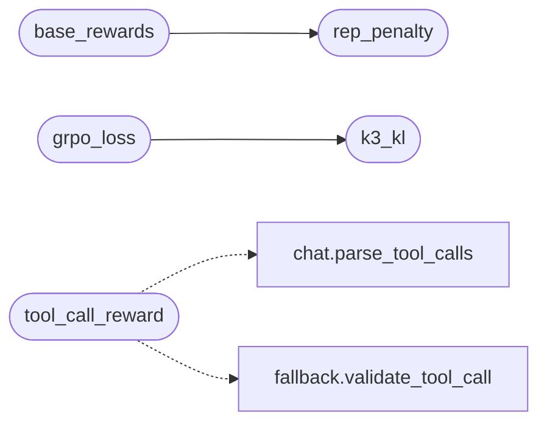

# `topogpt3.rewards`

> Source: [topogpt3/rewards.py:1](../../topogpt3/rewards.py#L1) | language `py` | coverage 53.8% | [API index](../index.md)

Reward + advantage + loss helpers for TopoGPT3 group-RL.

Adds an *optional* spectral-coherence bonus unique to TopoGPT3 identity:
rewards answers whose generation kept Fisher gap healthy / drift bounded
(when diagnostics are supplied). Defaults to 0 so the base reward
is reproduced exactly when no geometry stats are passed.

## Contents

- **Functions:** [`rep_penalty`](#rep_penalty), [`base_rewards`](#base_rewards), [`spectral_bonus`](#spectral_bonus), [`grpo_advantages`](#grpo_advantages), [`k3_kl`](#k3_kl), [`grpo_loss`](#grpo_loss), [`logits_to_log_probs`](#logits_to_log_probs), [`dpo_loss_fn`](#dpo_loss_fn), [`distillation_loss`](#distillation_loss), [`tool_call_reward`](#tool_call_reward), [`verifier_reward`](#verifier_reward), [`execution_reward`](#execution_reward)

## Call Graph

Solid arrows stay in this module, dashed arrows leave it.



## Functions

<a id="rep_penalty"></a>

### `rep_penalty`

`function` | [topogpt3/rewards.py:17](../../topogpt3/rewards.py#L17)

```python
def rep_penalty(text: str, n: int = 3, cap: float = 0.5) -> float
```

**Parameters**

| Name | Type | Default | Description |
|---|---|---|---|
| `text` | `str` |  |  |
| `n` | `int` | `3` |  |
| `cap` | `float` | `0.5` |  |

**Returns:** `float`

*Called by:* [`base_rewards`](#base_rewards), [`agent_reward`](topogpt3.train_agent.py.md#agent_reward)

---

<a id="base_rewards"></a>

### `base_rewards`

`function` | [topogpt3/rewards.py:25](../../topogpt3/rewards.py#L25)

```python
def base_rewards(prompts, completions, reward_fn=None, device='cpu')
```

Group-RL reward skeleton: length + thinking + RM - repetition.

**Parameters**

| Name | Type | Default | Description |
|---|---|---|---|
| `prompts` |  |  |  |
| `completions` |  |  |  |
| `reward_fn` |  | `None` |  |
| `device` |  | `'cpu'` |  |

*Calls:* [`rep_penalty`](#rep_penalty)

*Called by:* [`main`](topogpt3.train_grpo.py.md#main), [`main`](topogpt3.train_ppo.py.md#main)

---

<a id="spectral_bonus"></a>

### `spectral_bonus`

`function` | [topogpt3/rewards.py:55](../../topogpt3/rewards.py#L55)

```python
def spectral_bonus(fisher_gap: float | None = None, drift: float | None = None, w_fisher: float = 0.05, w_drift: float = 0.05) -> float
```

Small bonus preserving topological identity (0 when stats absent).

**Parameters**

| Name | Type | Default | Description |
|---|---|---|---|
| `fisher_gap` | `float \| None` | `None` |  |
| `drift` | `float \| None` | `None` |  |
| `w_fisher` | `float` | `0.05` |  |
| `w_drift` | `float` | `0.05` |  |

**Returns:** `float`

---

<a id="grpo_advantages"></a>

### `grpo_advantages`

`function` | [topogpt3/rewards.py:70](../../topogpt3/rewards.py#L70)

```python
def grpo_advantages(rewards: torch.Tensor, num_generations: int)
```

**Parameters**

| Name | Type | Default | Description |
|---|---|---|---|
| `rewards` | `torch.Tensor` |  |  |
| `num_generations` | `int` |  |  |

*Called by:* [`main`](topogpt3.train_agent.py.md#main), [`main`](topogpt3.train_grpo.py.md#main)

---

<a id="k3_kl"></a>

### `k3_kl`

`function` | [topogpt3/rewards.py:77](../../topogpt3/rewards.py#L77)

```python
def k3_kl(ref_logp: torch.Tensor, new_logp: torch.Tensor)
```

**Parameters**

| Name | Type | Default | Description |
|---|---|---|---|
| `ref_logp` | `torch.Tensor` |  |  |
| `new_logp` | `torch.Tensor` |  |  |

*Called by:* [`grpo_loss`](#grpo_loss), [`main`](topogpt3.train_ppo.py.md#main)

---

<a id="grpo_loss"></a>

### `grpo_loss`

`function` | [topogpt3/rewards.py:82](../../topogpt3/rewards.py#L82)

```python
def grpo_loss(new_logp, old_logp, ref_logp, adv, mask, beta=0.1, eps=0.2, loss_type='cispo', eps_high=5.0)
```

**Parameters**

| Name | Type | Default | Description |
|---|---|---|---|
| `new_logp` |  |  |  |
| `old_logp` |  |  |  |
| `ref_logp` |  |  |  |
| `adv` |  |  |  |
| `mask` |  |  |  |
| `beta` |  | `0.1` |  |
| `eps` |  | `0.2` |  |
| `loss_type` |  | `'cispo'` |  |
| `eps_high` |  | `5.0` |  |

*Calls:* [`k3_kl`](#k3_kl)

*Called by:* [`main`](topogpt3.train_agent.py.md#main), [`main`](topogpt3.train_grpo.py.md#main)

---

<a id="logits_to_log_probs"></a>

### `logits_to_log_probs`

`function` | [topogpt3/rewards.py:107](../../topogpt3/rewards.py#L107)

```python
def logits_to_log_probs(logits: torch.Tensor, labels: torch.Tensor)
```

**Parameters**

| Name | Type | Default | Description |
|---|---|---|---|
| `logits` | `torch.Tensor` |  |  |
| `labels` | `torch.Tensor` |  |  |

*Called by:* [`main`](topogpt3.train_dpo.py.md#main)

---

<a id="dpo_loss_fn"></a>

### `dpo_loss_fn`

`function` | [topogpt3/rewards.py:113](../../topogpt3/rewards.py#L113)

```python
def dpo_loss_fn(ref_lp, pol_lp, mask, beta=0.15)
```

**Parameters**

| Name | Type | Default | Description |
|---|---|---|---|
| `ref_lp` |  |  |  |
| `pol_lp` |  |  |  |
| `mask` |  |  |  |
| `beta` |  | `0.15` |  |

*Called by:* [`main`](topogpt3.train_dpo.py.md#main)

---

<a id="distillation_loss"></a>

### `distillation_loss`

`function` | [topogpt3/rewards.py:122](../../topogpt3/rewards.py#L122)

```python
def distillation_loss(student_logits, teacher_logits, mask, labels=None, alpha: float = 0.5, temp: float = 1.5)
```

White-box distill: CE + T^2*KL on masked response tokens.

**Parameters**

| Name | Type | Default | Description |
|---|---|---|---|
| `student_logits` |  |  |  |
| `teacher_logits` |  |  |  |
| `mask` |  |  |  |
| `labels` |  | `None` |  |
| `alpha` | `float` | `0.5` |  |
| `temp` | `float` | `1.5` |  |

*Called by:* [`main`](topogpt3.train_distill.py.md#main)

---

<a id="tool_call_reward"></a>

### `tool_call_reward`

`function` | [topogpt3/rewards.py:151](../../topogpt3/rewards.py#L151)

```python
def tool_call_reward(text: str, allowed_tools: set | None = None, require_tool: bool = False) -> float
```

Reward valid tool-call blocks (fallback profiles / apt_chain).

**Parameters**

| Name | Type | Default | Description |
|---|---|---|---|
| `text` | `str` |  |  |
| `allowed_tools` | `set \| None` | `None` |  |
| `require_tool` | `bool` | `False` |  |

**Returns:** `float`

*Calls:* [`parse_tool_calls`](topogpt3.chat.py.md#parse_tool_calls), [`validate_tool_call`](topogpt3.fallback.py.md#validate_tool_call)

*Called by:* [`agent_reward`](topogpt3.train_agent.py.md#agent_reward)

---

<a id="verifier_reward"></a>

### `verifier_reward`

`function` | [topogpt3/rewards.py:176](../../topogpt3/rewards.py#L176)

```python
def verifier_reward(text: str, mode: str = 'general') -> float
```

Cheap deterministic verifiers: code AST / JSON / regex pass.

**Parameters**

| Name | Type | Default | Description |
|---|---|---|---|
| `text` | `str` |  |  |
| `mode` | `str` | `'general'` |  |

**Returns:** `float`

*Called by:* [`agent_reward`](topogpt3.train_agent.py.md#agent_reward)

---

<a id="execution_reward"></a>

### `execution_reward`

`function` | [topogpt3/rewards.py:202](../../topogpt3/rewards.py#L202)

```python
def execution_reward(results: list) -> float
```

Reward sandboxed tool executions: +1 per passed tool result.

**Parameters**

| Name | Type | Default | Description |
|---|---|---|---|
| `results` | `list` |  |  |

**Returns:** `float`

*Called by:* [`agent_reward`](topogpt3.train_agent.py.md#agent_reward)

---
