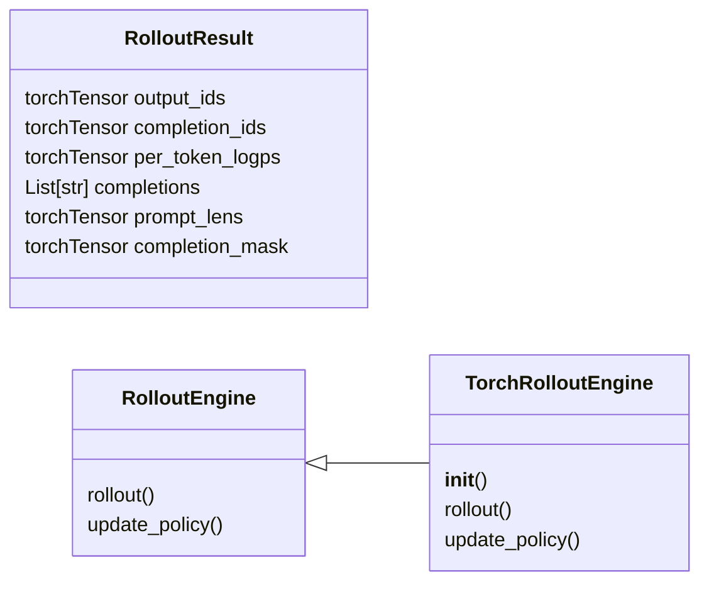
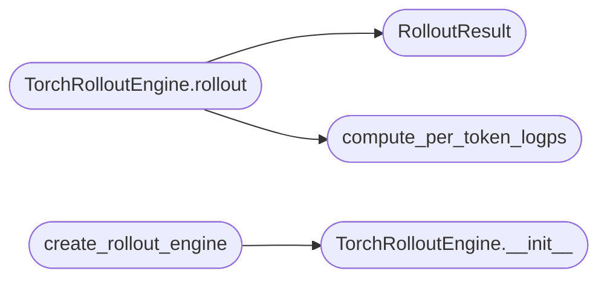

# `topogpt3.rollout`

> Source: [topogpt3/rollout.py:1](../../topogpt3/rollout.py#L1) | language `py` | coverage 9.1% | [API index](../index.md)

Rollout engine for TopoGPT3 RL self-sampling.

Works with TopoGPT2.generate(token_ids [B,S]) instead of HF generate.
No architecture change: sampling reuses the model's own generate/HRM path.

## Contents

- **Classes:** [`RolloutResult`](#rolloutresult), [`RolloutEngine`](#rolloutengine), [`TorchRolloutEngine`](#torchrolloutengine)
- **Functions:** [`compute_per_token_logps`](#compute_per_token_logps), [`create_rollout_engine`](#create_rollout_engine)

## Type Diagram



## Call Graph

Solid arrows stay in this module, dashed arrows leave it.



## Classes

<a id="rolloutresult"></a>

### `RolloutResult`

`class` `dataclass` | [topogpt3/rollout.py:18](../../topogpt3/rollout.py#L18)

Decorators: `@dataclass`

```python
class RolloutResult
```

**Attributes**

| Name | Type | Default | Description |
|---|---|---|---|
| [`output_ids`](#rolloutresult-output_ids) | `torch.Tensor` |  |  |
| [`completion_ids`](#rolloutresult-completion_ids) | `torch.Tensor` |  |  |
| [`per_token_logps`](#rolloutresult-per_token_logps) | `torch.Tensor` |  |  |
| [`completions`](#rolloutresult-completions) | `List[str]` |  |  |
| [`prompt_lens`](#rolloutresult-prompt_lens) | `torch.Tensor` |  |  |
| [`completion_mask`](#rolloutresult-completion_mask) | `torch.Tensor` |  |  |

---

<a id="rolloutengine"></a>

### `RolloutEngine`

`class` `abstract` | [topogpt3/rollout.py:39](../../topogpt3/rollout.py#L39)

```python
class RolloutEngine(ABC)
```

Bases: `ABC`

Subclasses: [`TorchRolloutEngine`](#torchrolloutengine)

**Members**

| Member | Kind | Summary |
|---|---|---|
| [`rollout`](#rolloutengine-rollout) | method |  |
| [`update_policy`](#rolloutengine-update_policy) | method |  |

<a id="rolloutengine-rollout"></a>

#### `RolloutEngine.rollout`

`method` `abstract` | [topogpt3/rollout.py:41](../../topogpt3/rollout.py#L41)

Decorators: `@abstractmethod`

```python
def rollout(self, prompt_ids, num_generations=4, max_new_tokens=256, temperature=0.8, tokenizer=None) -> RolloutResult
```

**Parameters**

| Name | Type | Default | Description |
|---|---|---|---|
| `prompt_ids` |  |  |  |
| `num_generations` |  | `4` |  |
| `max_new_tokens` |  | `256` |  |
| `temperature` |  | `0.8` |  |
| `tokenizer` |  | `None` |  |

**Returns:** `RolloutResult`

<a id="rolloutengine-update_policy"></a>

#### `RolloutEngine.update_policy`

`method` `abstract` | [topogpt3/rollout.py:46](../../topogpt3/rollout.py#L46)

Decorators: `@abstractmethod`

```python
def update_policy(self, model) -> None
```

**Parameters**

| Name | Type | Default | Description |
|---|---|---|---|
| `model` |  |  |  |

---

<a id="torchrolloutengine"></a>

### `TorchRolloutEngine`

`class` | [topogpt3/rollout.py:50](../../topogpt3/rollout.py#L50)

```python
class TorchRolloutEngine(RolloutEngine)
```

Bases: [`RolloutEngine`](#rolloutengine)

**Members**

| Member | Kind | Summary |
|---|---|---|
| [`__init__`](#torchrolloutengine-__init__) | constructor |  |
| [`rollout`](#torchrolloutengine-rollout) | method |  |
| [`update_policy`](#torchrolloutengine-update_policy) | method |  |

<a id="torchrolloutengine-__init__"></a>

#### `TorchRolloutEngine.__init__`

`constructor` | [topogpt3/rollout.py:51](../../topogpt3/rollout.py#L51)

```python
def __init__(self, policy_model, tokenizer, device='cpu', decode=None)
```

**Parameters**

| Name | Type | Default | Description |
|---|---|---|---|
| `policy_model` |  |  |  |
| `tokenizer` |  |  |  |
| `device` |  | `'cpu'` |  |
| `decode` |  | `None` |  |

*Called by:* [`create_rollout_engine`](#create_rollout_engine)

<a id="torchrolloutengine-rollout"></a>

#### `TorchRolloutEngine.rollout`

`method` | [topogpt3/rollout.py:57](../../topogpt3/rollout.py#L57)

```python
def rollout(self, prompt_ids, num_generations=4, max_new_tokens=256, temperature=0.8, tokenizer=None) -> RolloutResult
```

**Parameters**

| Name | Type | Default | Description |
|---|---|---|---|
| `prompt_ids` |  |  |  |
| `num_generations` |  | `4` |  |
| `max_new_tokens` |  | `256` |  |
| `temperature` |  | `0.8` |  |
| `tokenizer` |  | `None` |  |

**Returns:** `RolloutResult`

*Calls:* [`RolloutResult`](#rolloutresult), [`compute_per_token_logps`](#compute_per_token_logps)

<a id="torchrolloutengine-update_policy"></a>

#### `TorchRolloutEngine.update_policy`

`method` | [topogpt3/rollout.py:79](../../topogpt3/rollout.py#L79)

```python
def update_policy(self, model) -> None
```

**Parameters**

| Name | Type | Default | Description |
|---|---|---|---|
| `model` |  |  |  |

---

## Functions

<a id="compute_per_token_logps"></a>

### `compute_per_token_logps`

`function` | [topogpt3/rollout.py:27](../../topogpt3/rollout.py#L27)

```python
def compute_per_token_logps(model, input_ids: torch.Tensor, n_keep: int) -> torch.Tensor
```

**Parameters**

| Name | Type | Default | Description |
|---|---|---|---|
| `model` |  |  |  |
| `input_ids` | `torch.Tensor` |  |  |
| `n_keep` | `int` |  |  |

**Returns:** `torch.Tensor`

*Called by:* [`TorchRolloutEngine.rollout`](#torchrolloutengine-rollout)

---

<a id="create_rollout_engine"></a>

### `create_rollout_engine`

`function` | [topogpt3/rollout.py:83](../../topogpt3/rollout.py#L83)

```python
def create_rollout_engine(policy_model, tokenizer, device='cpu', **kw)
```

**Parameters**

| Name | Type | Default | Description |
|---|---|---|---|
| `policy_model` |  |  |  |
| `tokenizer` |  |  |  |
| `device` |  | `'cpu'` |  |
| `**kw` |  |  |  |

*Calls:* [`TorchRolloutEngine.__init__`](#torchrolloutengine-__init__)

*Called by:* [`main`](topogpt3.train_grpo.py.md#main), [`main`](topogpt3.train_ppo.py.md#main)

---
