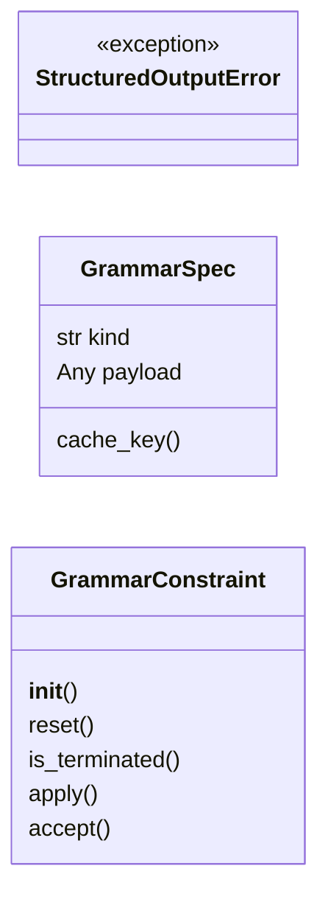
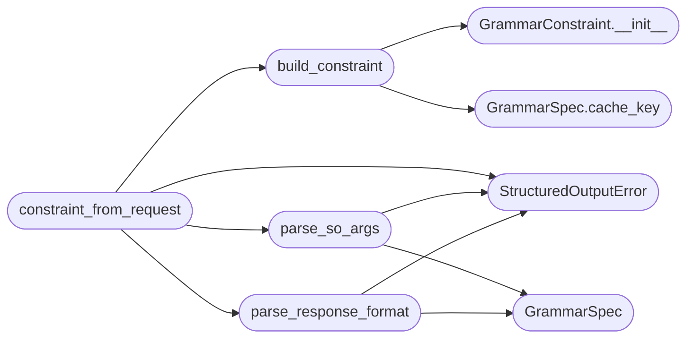

# `topogpt3.structured_output`

> Source: [topogpt3/structured_output.py:1](../../topogpt3/structured_output.py#L1) | language `py` | coverage 64.3% | [API index](../index.md)

Constrained decoding for the TopoGPT3 OpenAI-compatible server.

DeepInfer exposes structured output through ``SamplingParams.so_args``
(``json`` / ``regex`` / ``ebnf``). This module mirrors that surface and also
understands OpenAI-style ``response_format`` payloads:

    {"type": "text"}
    {"type": "json_object"}
    {"type": "json_schema", "json_schema": {"name": "...", "schema": {...}}}
    {"type": "regex", "regex": "[A-Z]{2}-[0-9]{3}"}
    {"type": "grammar", "grammar": "root ::= ..."}

``xgrammar`` is imported lazily. The server keeps working without it; only
requests that ask for a constraint fail with a clear error.

## Contents

- **Classes:** [`GrammarSpec`](#grammarspec), [`GrammarConstraint`](#grammarconstraint)
- **Exceptions:** [`StructuredOutputError`](#structuredoutputerror)
- **Functions:** [`parse_response_format`](#parse_response_format), [`parse_so_args`](#parse_so_args), [`build_constraint`](#build_constraint), [`constraint_from_request`](#constraint_from_request)
- **Constants:** [`MAX_CACHED_GRAMMARS`](#max_cached_grammars)

## Type Diagram



## Call Graph

Solid arrows stay in this module, dashed arrows leave it.



## Classes

<a id="grammarspec"></a>

### `GrammarSpec`

`class` `dataclass` | [topogpt3/structured_output.py:32](../../topogpt3/structured_output.py#L32)

Decorators: `@dataclass(frozen=True)`

```python
class GrammarSpec
```

**Attributes**

| Name | Type | Default | Description |
|---|---|---|---|
| [`kind`](#grammarspec-kind) | `str` |  |  |
| [`payload`](#grammarspec-payload) | `Any` | `None` |  |

**Members**

| Member | Kind | Summary |
|---|---|---|
| [`cache_key`](#grammarspec-cache_key) | method |  |

<a id="grammarspec-cache_key"></a>

#### `GrammarSpec.cache_key`

`method` | [topogpt3/structured_output.py:36](../../topogpt3/structured_output.py#L36)

```python
def cache_key(self) -> str
```

**Returns:** `str`

*Called by:* [`build_constraint`](#build_constraint)

---

<a id="grammarconstraint"></a>

### `GrammarConstraint`

`class` | [topogpt3/structured_output.py:182](../../topogpt3/structured_output.py#L182)

```python
class GrammarConstraint
```

Per-request xgrammar matcher that masks logits in place.

**Members**

| Member | Kind | Summary |
|---|---|---|
| [`__init__`](#grammarconstraint-__init__) | constructor |  |
| [`reset`](#grammarconstraint-reset) | method |  |
| [`is_terminated`](#grammarconstraint-is_terminated) | property |  |
| [`apply`](#grammarconstraint-apply) | method | Mask disallowed tokens in ``logits`` with ``-inf`` in place. |
| [`accept`](#grammarconstraint-accept) | method | Feed an emitted token to the matcher. |

<a id="grammarconstraint-__init__"></a>

#### `GrammarConstraint.__init__`

`constructor` | [topogpt3/structured_output.py:185](../../topogpt3/structured_output.py#L185)

```python
def __init__(self, xg: Any, compiled: Any, vocab_size: int)
```

**Parameters**

| Name | Type | Default | Description |
|---|---|---|---|
| `xg` | `Any` |  |  |
| `compiled` | `Any` |  |  |
| `vocab_size` | `int` |  |  |

*Called by:* [`build_constraint`](#build_constraint)

<a id="grammarconstraint-reset"></a>

#### `GrammarConstraint.reset`

`method` | [topogpt3/structured_output.py:197](../../topogpt3/structured_output.py#L197)

```python
def reset(self) -> None
```

*Called by:* [`ServerModel.stream_complete`](topogpt3.api_server.py.md#servermodel-stream_complete)

<a id="grammarconstraint-is_terminated"></a>

#### `GrammarConstraint.is_terminated`

`property` | [topogpt3/structured_output.py:201](../../topogpt3/structured_output.py#L201)

Decorators: `@property`

```python
def is_terminated(self) -> bool
```

**Returns:** `bool`

<a id="grammarconstraint-apply"></a>

#### `GrammarConstraint.apply`

`method` | [topogpt3/structured_output.py:204](../../topogpt3/structured_output.py#L204)

```python
def apply(self, logits: Any) -> None
```

Mask disallowed tokens in ``logits`` with ``-inf`` in place.

**Parameters**

| Name | Type | Default | Description |
|---|---|---|---|
| `logits` | `Any` |  |  |

*Called by:* [`ServerModel.stream_complete`](topogpt3.api_server.py.md#servermodel-stream_complete)

<a id="grammarconstraint-accept"></a>

#### `GrammarConstraint.accept`

`method` | [topogpt3/structured_output.py:211](../../topogpt3/structured_output.py#L211)

```python
def accept(self, token_id: int) -> bool
```

Feed an emitted token to the matcher.

Returns False if it is invalid.

**Parameters**

| Name | Type | Default | Description |
|---|---|---|---|
| `token_id` | `int` |  |  |

**Returns:** `bool`

*Called by:* [`ServerModel.stream_complete`](topogpt3.api_server.py.md#servermodel-stream_complete)

---

## Exceptions

<a id="structuredoutputerror"></a>

### `StructuredOutputError`

`exception` | [topogpt3/structured_output.py:27](../../topogpt3/structured_output.py#L27)

```python
class StructuredOutputError(ValueError)
```

Bases: `ValueError`

Invalid or unsupported structured-output request.

---

## Functions

<a id="parse_response_format"></a>

### `parse_response_format`

`function` | [topogpt3/structured_output.py:56](../../topogpt3/structured_output.py#L56)

```python
def parse_response_format(response_format: Any) -> GrammarSpec | None
```

Translate an OpenAI ``response_format`` payload into a GrammarSpec.

**Parameters**

| Name | Type | Default | Description |
|---|---|---|---|
| `response_format` | `Any` |  |  |

**Returns:** `GrammarSpec | None`

**Raises**

- [`StructuredOutputError`](#structuredoutputerror): (raised in the body, not documented)

*Calls:* [`GrammarSpec`](#grammarspec), [`StructuredOutputError`](#structuredoutputerror)

*Called by:* [`constraint_from_request`](#constraint_from_request)

---

<a id="parse_so_args"></a>

### `parse_so_args`

`function` | [topogpt3/structured_output.py:93](../../topogpt3/structured_output.py#L93)

```python
def parse_so_args(so_args: Any) -> GrammarSpec | None
```

Translate a DeepInfer-style ``so_args`` payload into a GrammarSpec.

**Parameters**

| Name | Type | Default | Description |
|---|---|---|---|
| `so_args` | `Any` |  |  |

**Returns:** `GrammarSpec | None`

**Raises**

- [`StructuredOutputError`](#structuredoutputerror): (raised in the body, not documented)

*Calls:* [`GrammarSpec`](#grammarspec), [`StructuredOutputError`](#structuredoutputerror)

*Called by:* [`constraint_from_request`](#constraint_from_request)

---

<a id="build_constraint"></a>

### `build_constraint`

`function` | [topogpt3/structured_output.py:218](../../topogpt3/structured_output.py#L218)

```python
def build_constraint(tokenizer: Any, spec: GrammarSpec | None) -> GrammarConstraint | None
```

Compile ``spec`` (cached) and return a fresh matcher for one request.

**Parameters**

| Name | Type | Default | Description |
|---|---|---|---|
| `tokenizer` | `Any` |  |  |
| `spec` | `GrammarSpec \| None` |  |  |

**Returns:** `GrammarConstraint | None`

*Calls:* [`GrammarConstraint.__init__`](#grammarconstraint-__init__), [`GrammarSpec.cache_key`](#grammarspec-cache_key)

*Called by:* [`constraint_from_request`](#constraint_from_request)

---

<a id="constraint_from_request"></a>

### `constraint_from_request`

`function` | [topogpt3/structured_output.py:240](../../topogpt3/structured_output.py#L240)

```python
def constraint_from_request(tokenizer: Any, response_format: Any = None, so_args: Any = None) -> GrammarConstraint | None
```

Resolve either request surface into a ready-to-use constraint.

**Parameters**

| Name | Type | Default | Description |
|---|---|---|---|
| `tokenizer` | `Any` |  |  |
| `response_format` | `Any` | `None` |  |
| `so_args` | `Any` | `None` |  |

**Returns:** `GrammarConstraint | None`

**Raises**

- [`StructuredOutputError`](#structuredoutputerror): (raised in the body, not documented)

*Calls:* [`StructuredOutputError`](#structuredoutputerror), [`build_constraint`](#build_constraint), [`parse_response_format`](#parse_response_format), [`parse_so_args`](#parse_so_args)

---

## Constants

<a id="max_cached_grammars"></a>

### `MAX_CACHED_GRAMMARS`

`constant` | [topogpt3/structured_output.py:24](../../topogpt3/structured_output.py#L24)

```python
MAX_CACHED_GRAMMARS = 64
```

---
