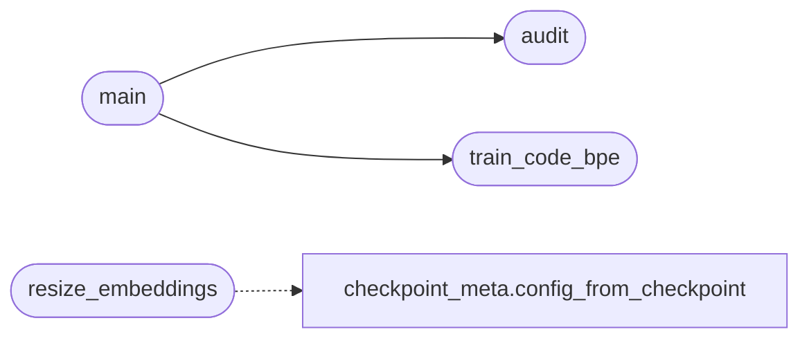

# `topogpt3.tokenizer_tools`

> Source: [topogpt3/tokenizer_tools.py:1](../../topogpt3/tokenizer_tools.py#L1) | language `py` | coverage 66.7% | [API index](../index.md)

Tokenizer efficiency toolkit.

Three utilities for the GPT-2 BPE situation of TopoGPT3/TopoExploit:

1. `[`audit`](#audit)` -- measures how much of the parameter budget goes to the
   shared embedding table and chars/token on a corpus.
2. `[`train_code_bpe`](#train_code_bpe)` -- trains a smaller code-aware BPE (HF ``tokenizers``
   optional dependency) and writes a tokenizer artifact.
3. `[`resize_embeddings`](#resize_embeddings)` -- maps an old-vocab checkpoint into a new vocab
   (longest-prefix match on token bytes) so retraining starts warm.

Retraining from scratch is required for any vocab change; these utilities
only prepare it.

## Contents

- **Functions:** [`audit`](#audit), [`train_code_bpe`](#train_code_bpe), [`load_tokenizer_artifact`](#load_tokenizer_artifact), [`resize_embeddings`](#resize_embeddings), [`main`](#main)

## Call Graph

Solid arrows stay in this module, dashed arrows leave it.



## Functions

<a id="audit"></a>

### `audit`

`function` | [topogpt3/tokenizer_tools.py:27](../../topogpt3/tokenizer_tools.py#L27)

```python
def audit(checkpoint_dir: str, corpus_files: Iterable[str] | None = None, sample_chars: int = 200000) -> dict[str, Any]
```

Embedding share + chars/token stats for the gpt2 BPE identity.

**Parameters**

| Name | Type | Default | Description |
|---|---|---|---|
| `checkpoint_dir` | `str` |  |  |
| `corpus_files` | `Iterable[str] \| None` | `None` |  |
| `sample_chars` | `int` | `200000` |  |

**Returns:** `dict[str, Any]`

*Called by:* [`main`](#main)

---

<a id="train_code_bpe"></a>

### `train_code_bpe`

`function` | [topogpt3/tokenizer_tools.py:76](../../topogpt3/tokenizer_tools.py#L76)

```python
def train_code_bpe(corpus_files: list[str], out_dir: str, vocab_size: int = 16000) -> dict[str, Any]
```

Train a compact BPE with HF tokenizers (optional dependency).

**Parameters**

| Name | Type | Default | Description |
|---|---|---|---|
| `corpus_files` | `list[str]` |  |  |
| `out_dir` | `str` |  |  |
| `vocab_size` | `int` | `16000` |  |

**Returns:** `dict[str, Any]`

**Raises**

- `SystemExit`: (raised in the body, not documented)

*Called by:* [`main`](#main)

---

<a id="load_tokenizer_artifact"></a>

### `load_tokenizer_artifact`

`function` | [topogpt3/tokenizer_tools.py:110](../../topogpt3/tokenizer_tools.py#L110)

```python
def load_tokenizer_artifact(path: str | Path)
```

**Parameters**

| Name | Type | Default | Description |
|---|---|---|---|
| `path` | `str \| Path` |  |  |

---

<a id="resize_embeddings"></a>

### `resize_embeddings`

`function` | [topogpt3/tokenizer_tools.py:135](../../topogpt3/tokenizer_tools.py#L135)

```python
def resize_embeddings(checkpoint_dir: str, new_vocab: list[bytes], out_dir: str) -> dict[str, Any]
```

Warm-start a checkpoint on a new vocab via longest-prefix byte match.

**Parameters**

| Name | Type | Default | Description |
|---|---|---|---|
| `checkpoint_dir` | `str` |  |  |
| `new_vocab` | `list[bytes]` |  |  |
| `out_dir` | `str` |  |  |

**Returns:** `dict[str, Any]`

**Raises**

- `SystemExit`: (raised in the body, not documented)

*Calls:* [`config_from_checkpoint`](topogpt3.checkpoint_meta.py.md#config_from_checkpoint)

---

<a id="main"></a>

### `main`

`function` | [topogpt3/tokenizer_tools.py:183](../../topogpt3/tokenizer_tools.py#L183)

```python
def main() -> int
```

**Returns:** `int`

*Calls:* [`audit`](#audit), [`train_code_bpe`](#train_code_bpe)

---
