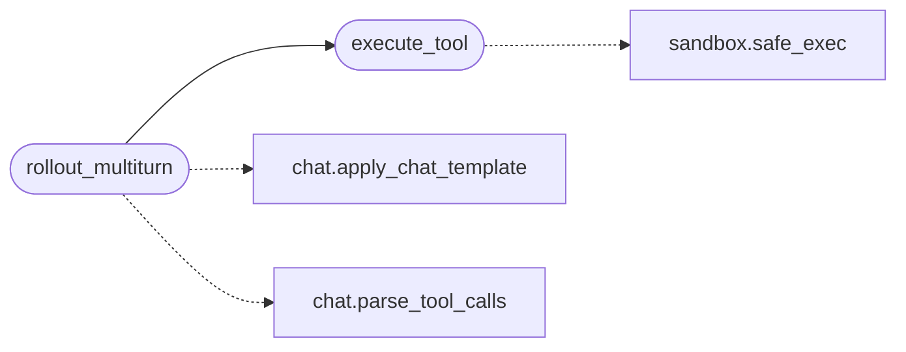

# `topogpt3.tools_agent`

> Source: [topogpt3/tools_agent.py:1](../../topogpt3/tools_agent.py#L1) | language `py` | coverage 66.7% | [API index](../index.md)

Code-first tool definitions for TopoGPT3 Agent-RL.

Keeps TopoGPT3 identity: primary tool is sandboxed Python execution
(eval/sandbox.py + Pi harness); mock tools kept for offline use.

## Contents

- **Functions:** [`execute_tool`](#execute_tool), [`rollout_multiturn`](#rollout_multiturn)
- **Constants:** [`TOOLS`](#tools), [`MOCK`](#mock), [`CHECK_ARGS`](#check_args)

## Call Graph

Solid arrows stay in this module, dashed arrows leave it.



## Functions

<a id="execute_tool"></a>

### `execute_tool`

`function` | [topogpt3/tools_agent.py:96](../../topogpt3/tools_agent.py#L96)

```python
def execute_tool(name: str, args: dict[str, Any]) -> dict[str, Any] | None
```

**Parameters**

| Name | Type | Default | Description |
|---|---|---|---|
| `name` | `str` |  |  |
| `args` | `dict[str, Any]` |  |  |

**Returns:** `dict[str, Any] | None`

*Calls:* [`safe_exec`](eval.sandbox.py.md#safe_exec)

*Called by:* [`run_case`](topogpt3.eval_toolcall.py.md#run_case), [`rollout_multiturn`](#rollout_multiturn), [`main`](topogpt3.train_agent.py.md#main)

---

<a id="rollout_multiturn"></a>

### `rollout_multiturn`

`function` | [topogpt3/tools_agent.py:117](../../topogpt3/tools_agent.py#L117)

```python
def rollout_multiturn(generate_fn, tokenizer, messages: list[dict[str, Any]], tools=None, max_turns: int = 3, max_new_tokens: int = 256, open_thinking: bool = False)
```

generate_fn(prompt_text)->text.

Returns (full_text, tool_trace).

**Parameters**

| Name | Type | Default | Description |
|---|---|---|---|
| `generate_fn` |  |  |  |
| `tokenizer` |  |  |  |
| `messages` | `list[dict[str, Any]]` |  |  |
| `tools` |  | `None` |  |
| `max_turns` | `int` | `3` |  |
| `max_new_tokens` | `int` | `256` |  |
| `open_thinking` | `bool` | `False` |  |

*Calls:* [`apply_chat_template`](topogpt3.chat.py.md#apply_chat_template), [`parse_tool_calls`](topogpt3.chat.py.md#parse_tool_calls), [`execute_tool`](#execute_tool)

---

## Constants

<a id="tools"></a>

### `TOOLS`

`constant` | [topogpt3/tools_agent.py:24](../../topogpt3/tools_agent.py#L24)

```python
TOOLS
```

---

<a id="mock"></a>

### `MOCK`

`constant` | [topogpt3/tools_agent.py:47](../../topogpt3/tools_agent.py#L47)

```python
MOCK
```

---

<a id="check_args"></a>

### `CHECK_ARGS`

`constant` | [topogpt3/tools_agent.py:86](../../topogpt3/tools_agent.py#L86)

```python
CHECK_ARGS
```

---
