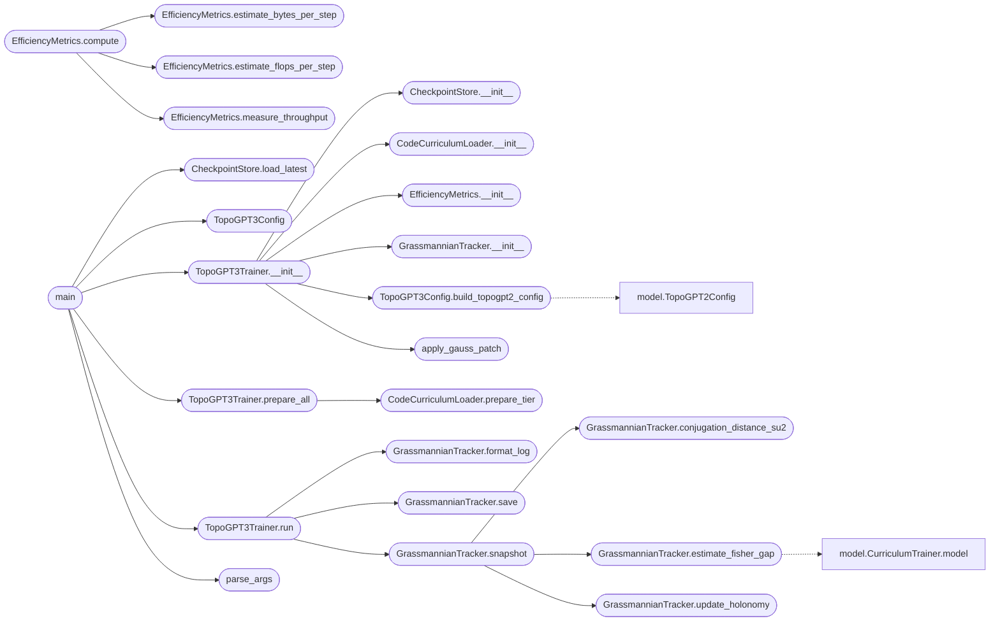

# `topogpt3.train`

> Source: [topogpt3/train.py:1](../../topogpt3/train.py#L1) | language `py` | coverage 47.2% | [API index](../index.md)

TopoGPT3: Grassmannian / Berry-Holonomy extension of TopoGPT2

Author: Gris Iscomeback
License: GPL v3

Lo nuevo respecto a model.py
---------------------------------
1. Espacio base: Grassmanniana Gr(r, N) sobre el tensor de kernels espectrales
   K(theta) en C^{N_f x N_c}. El estado geometrico vive en U_r(theta) en St(r,N)/U(r),
   con r elegido dinamicamente por el "elbow" del espectro singular de K.
2. Fisher gap funcional:    Delta_F(theta) = lambda_r(Sigma_F) - lambda_{r+1}(Sigma_F)
   estimado por covarianza empirica de gradientes (mini-batch) o por scores.
3. Conexion de Berry discreta:  A_n = i * U_n^dagger (U_{n+1} - U_n)
   y holonomia acumulada      U_Gamma = P prod_n exp(-i A_n)  en U(r).
4. Distancia de conjugacion en SU(2) (cuaternionico, r=1 efectivo):
       d_conj(U1, U2) = min_{g in SU(2)} || U1 - g U2 g^{-1} ||_F
5. Winding W como proxy heuristico barato (rol secundario).
6. Curriculum por dataset, de mas simple a mas dificil:
       Tier 1: CodeAlpaca               (instrucciones cortas)
       Tier 2: Code-Feedback-Filtered   (chat / explicacion paso a paso)
       Tier 3: Magicoder-Evol-Instruct-110K (problemas complejos)
       Tier 4: Tiny-The-Stack           (codigo real multilenguaje)
   Cada tier mantiene splits train / val / holdout *disjuntos*.
   El conjunto HOLDOUT nunca se ve durante entrenamiento; se usa
   solo para medir generalizacion verdadera al final de cada tier
   y al final del pipeline.

Diseno
------
- Reutiliza la arquitectura TopoGPT2 (tokenizador BPE, modelo cuaternionico
  con torus + spectral autoencoder) cargandola dinamicamente desde model.py.
- Anade encima la maquinaria geometrica nueva en GrassmannianTracker.
- Entrenamiento orquestado por TopoGPT3Trainer que itera 4 tiers en orden,
  con seq_len progresivo y evaluacion en holdout disjunto.

CLI
---
    python train.py --prepare-data            descarga + tokeniza los 4 tiers
    python train.py --train                   entrena el curriculum completo
    python train.py --train --start-tier 2    arranca desde un tier concreto
    python train.py --eval-holdout            evalua sobre holdouts disjuntos
    python train.py --resume                  reanuda desde el ultimo checkpoint

## Contents

- **Classes:** [`TopoGPT3Config`](#topogpt3config), [`GrassmannianTracker`](#grassmanniantracker), [`EfficiencyMetrics`](#efficiencymetrics), [`CodeCurriculumLoader`](#codecurriculumloader), [`BlockTokenDataset`](#blocktokendataset), [`CheckpointStore`](#checkpointstore), [`TopoGPT3Trainer`](#topogpt3trainer)
- **Functions:** [`apply_gauss_patch`](#apply_gauss_patch), [`parse_args`](#parse_args), [`main`](#main)

## Type Diagram

```mermaid
classDiagram
    direction LR
    class TopoGPT3Config
    TopoGPT3Config : str SCALE
    TopoGPT3Config : str DEVICE
    TopoGPT3Config : int RANDOM_SEED
    TopoGPT3Config : bool USE_AMP
    TopoGPT3Config : bool GRADIENT_CHECKPOINTING
    TopoGPT3Config : int BATCH_SIZE
    TopoGPT3Config : int GRAD_ACCUM_STEPS
    TopoGPT3Config : float LEARNING_RATE
    TopoGPT3Config : float WEIGHT_DECAY
    TopoGPT3Config : float GRADIENT_CLIP_NORM
    TopoGPT3Config : float WARMUP_RATIO
    TopoGPT3Config : Tuple[int, int, int, int] TIER_EPOCHS
    TopoGPT3Config : Tuple[int, int, int, int] TIER_SEQ_LEN
    TopoGPT3Config : Tuple[str, str, str, str] TIER_NAMES
    TopoGPT3Config : str HF_CODEALPACA
    TopoGPT3Config : str HF_CODE_FEEDBACK
    TopoGPT3Config : str HF_MAGICODER
    TopoGPT3Config : str HF_TINY_STACK
    TopoGPT3Config : Tuple[str, ] HF_TINY_STACK_FALLBACKS
    TopoGPT3Config : float VAL_FRACTION
    TopoGPT3Config : float HOLDOUT_FRACTION
    TopoGPT3Config : int SPLIT_SEED
    TopoGPT3Config : Tuple[int, int, int, int] MAX_TOKENS_PER_TIER
    TopoGPT3Config : int GRASS_TRACK_EVERY
    class GrassmannianTracker
    GrassmannianTracker : __init__()
    GrassmannianTracker : estimate_fisher_gap()
    GrassmannianTracker : update_holonomy()
    GrassmannianTracker : conjugation_distance_su2()
    GrassmannianTracker : snapshot()
    GrassmannianTracker : format_log()
    GrassmannianTracker : save()
    class EfficiencyMetrics
    EfficiencyMetrics : __init__()
    EfficiencyMetrics : measure_throughput()
    EfficiencyMetrics : estimate_flops_per_step()
    EfficiencyMetrics : estimate_bytes_per_step()
    EfficiencyMetrics : compute()
    EfficiencyMetrics : format_log()
    class CodeCurriculumLoader
    CodeCurriculumLoader : __init__()
    CodeCurriculumLoader : prepare_tier()
    CodeCurriculumLoader : open_memmap()
    class BlockTokenDataset
    BlockTokenDataset : __init__()
    class CheckpointStore
    CheckpointStore : __init__()
    CheckpointStore : save()
    CheckpointStore : load_latest()
    CheckpointStore : should_save()
    class TopoGPT3Trainer
    TopoGPT3Trainer : __init__()
    TopoGPT3Trainer : prepare_all()
    TopoGPT3Trainer : run()
```



## Call Graph

Solid arrows stay in this module, dashed arrows leave it.



## Classes

<a id="topogpt3config"></a>

### `TopoGPT3Config`

`class` `dataclass` | [topogpt3/train.py:83](../../topogpt3/train.py#L83)

Decorators: `@dataclass`

```python
class TopoGPT3Config
```

Configuracion del pipeline TopoGPT3 (Grassmanniana + curriculum).

**Attributes**

| Name | Type | Default | Description |
|---|---|---|---|
| [`SCALE`](#topogpt3config-scale) | `str` | `'small'` |  |
| [`DEVICE`](#topogpt3config-device) | `str` | `'cuda' if torch.cuda.is_available() else 'cpu'` |  |
| [`RANDOM_SEED`](#topogpt3config-random_seed) | `int` | `42` |  |
| [`USE_AMP`](#topogpt3config-use_amp) | `bool` | `True` |  |
| [`GRADIENT_CHECKPOINTING`](#topogpt3config-gradient_checkpointing) | `bool` | `True` |  |
| [`BATCH_SIZE`](#topogpt3config-batch_size) | `int` | `4` |  |
| [`GRAD_ACCUM_STEPS`](#topogpt3config-grad_accum_steps) | `int` | `8` |  |
| [`LEARNING_RATE`](#topogpt3config-learning_rate) | `float` | `0.0003` |  |
| [`WEIGHT_DECAY`](#topogpt3config-weight_decay) | `float` | `0.1` |  |
| [`GRADIENT_CLIP_NORM`](#topogpt3config-gradient_clip_norm) | `float` | `1.0` |  |
| [`WARMUP_RATIO`](#topogpt3config-warmup_ratio) | `float` | `0.05` |  |
| [`TIER_EPOCHS`](#topogpt3config-tier_epochs) | `Tuple[int, int, int, int]` | `(2, 2, 3, 3)` |  |
| [`TIER_SEQ_LEN`](#topogpt3config-tier_seq_len) | `Tuple[int, int, int, int]` | `(128, 192, 256, 256)` |  |
| [`TIER_NAMES`](#topogpt3config-tier_names) | `Tuple[str, str, str, str]` | `('codealpaca', 'code_feedback', 'magicoder_evol', 'tiny_the_stack')` |  |
| [`HF_CODEALPACA`](#topogpt3config-hf_codealpaca) | `str` | `'sahil2801/CodeAlpaca-20k'` |  |
| [`HF_CODE_FEEDBACK`](#topogpt3config-hf_code_feedback) | `str` | `'m-a-p/CodeFeedback-Filtered-Instruction'` |  |
| [`HF_MAGICODER`](#topogpt3config-hf_magicoder) | `str` | `'ise-uiuc/Magicoder-Evol-Instruct-110K'` |  |
| [`HF_TINY_STACK`](#topogpt3config-hf_tiny_stack) | `str` | `'bigcode/the-stack-smol'` |  |
| [`HF_TINY_STACK_FALLBACKS`](#topogpt3config-hf_tiny_stack_fallbacks) | `Tuple[str, ...]` | `('codeparrot/codeparrot-clean-valid', 'flytech/python-codes-25k', 'iamtarun/python_code_instructions_18k_alpaca')` |  |
| [`VAL_FRACTION`](#topogpt3config-val_fraction) | `float` | `0.05` |  |
| [`HOLDOUT_FRACTION`](#topogpt3config-holdout_fraction) | `float` | `0.05` |  |
| [`SPLIT_SEED`](#topogpt3config-split_seed) | `int` | `1337` |  |
| [`MAX_TOKENS_PER_TIER`](#topogpt3config-max_tokens_per_tier) | `Tuple[int, int, int, int]` | `(20000000, 80000000, 100000000, 500000000)` |  |
| [`GRASS_TRACK_EVERY`](#topogpt3config-grass_track_every) | `int` | `200` |  |
| [`GRASS_MAX_RANK`](#topogpt3config-grass_max_rank) | `int` | `16` |  |
| [`GRASS_ELBOW_RATIO`](#topogpt3config-grass_elbow_ratio) | `float` | `0.05` |  |
| [`GRASS_FISHER_BATCHES`](#topogpt3config-grass_fisher_batches) | `int` | `40` |  |
| [`GRASS_FISHER_GRADS`](#topogpt3config-grass_fisher_grads) | `int` | `64` |  |
| [`USE_GAUSS_COMPLEX_MULT`](#topogpt3config-use_gauss_complex_mult) | `bool` | `True` |  |
| [`EFFICIENCY_THROUGHPUT_BATCHES`](#topogpt3config-efficiency_throughput_batches) | `int` | `20` |  |
| [`GRADIENT_CHECKPOINTING_FACTOR`](#topogpt3config-gradient_checkpointing_factor) | `int` | `12` |  |
| [`PROGRESSIVE_WINDOW`](#topogpt3config-progressive_window) | `Tuple[int, int, int, int]` | `(64, 96, 128, 128)` |  |
| [`DATA_CACHE`](#topogpt3config-data_cache) | `str` | `'data_topogpt3'` |  |
| [`CHECKPOINT_DIR`](#topogpt3config-checkpoint_dir) | `str` | `'checkpoints_topogpt3'` |  |
| [`LOG_FILE`](#topogpt3config-log_file) | `str` | `'topogpt3_history.jsonl'` |  |
| [`LOG_INTERVAL_STEPS`](#topogpt3config-log_interval_steps) | `int` | `50` |  |
| [`CHECKPOINT_EVERY_MIN`](#topogpt3config-checkpoint_every_min) | `int` | `15` |  |
| [`MAX_CHECKPOINTS`](#topogpt3config-max_checkpoints) | `int` | `5` |  |
| [`MAX_TRAIN_BATCHES_PER_EPOCH`](#topogpt3config-max_train_batches_per_epoch) | `int` | `0` |  |
| [`MAX_EVAL_BATCHES`](#topogpt3config-max_eval_batches) | `int` | `200` |  |

**Members**

| Member | Kind | Summary |
|---|---|---|
| [`build_topogpt2_config`](#topogpt3config-build_topogpt2_config) | method |  |

<a id="topogpt3config-build_topogpt2_config"></a>

#### `TopoGPT3Config.build_topogpt2_config`

`method` | [topogpt3/train.py:170](../../topogpt3/train.py#L170)

```python
def build_topogpt2_config(self, max_seq_len: int, attn_window: Optional[int] = None) -> TopoGPT2Config
```

**Parameters**

| Name | Type | Default | Description |
|---|---|---|---|
| `max_seq_len` | `int` |  |  |
| `attn_window` | `Optional[int]` | `None` |  |

**Returns:** `TopoGPT2Config`

*Calls:* [`TopoGPT2Config`](topogpt3.model.py.md#topogpt2config)

*Called by:* [`TopoGPT3Trainer.__init__`](#topogpt3trainer-__init__)

---

<a id="grassmanniantracker"></a>

### `GrassmannianTracker`

`class` | [topogpt3/train.py:197](../../topogpt3/train.py#L197)

```python
class GrassmannianTracker
```

Observables geometricos sobre la trayectoria SGD.

En cada snapshot:
  - Apila los kernels espectrales (kr_*, ki_*) del modelo en
    K(theta) en C^{N_f x N_c}.
  - SVD truncada -> U_r(theta) en St(r,N).
  - Rango r dinamico por elbow de los valores singulares.
  - Gap funcional Delta_F estimado por covarianza de gradientes
    muestrales (proxy de la matriz de Fisher).
  - Conexion de Berry discreta entre snapshots consecutivos:
       A_n = i * U_n^dagger (U_{n+1} - U_n)
    Holonomia acumulada U_Gamma = P prod_n exp(-i A_n) en U(r).
  - Distancia de conjugacion en SU(2) (r=1 efectivo cuaternionico).
  - Winding W como proxy barato.

Todos los calculos viven en CPU/float32 para no contaminar AMP.

**Members**

| Member | Kind | Summary |
|---|---|---|
| [`__init__`](#grassmanniantracker-__init__) | constructor |  |
| [`estimate_fisher_gap`](#grassmanniantracker-estimate_fisher_gap) | method | Sigma_F ~= (1/M) sum_m g_m g_m^T (covarianza muestral de gradientes). |
| [`update_holonomy`](#grassmanniantracker-update_holonomy) | method | Holonomia discreta: T_n = U_n^dagger U_{n+1} en C^{r x r} (transporte paralelo discreto) U_Gamma <- T_n * U_Gamma (acumulado) Tras cada paso, U_Gamma se... |
| [`conjugation_distance_su2`](#grassmanniantracker-conjugation_distance_su2) | staticmethod | Para U1, U2 en U(1)/U(2): d_conj(U1, U2) = min_g \|\| U1 - g U2 g^{-1} \|\|_F. |
| [`snapshot`](#grassmanniantracker-snapshot) | method |  |
| [`format_log`](#grassmanniantracker-format_log) | method |  |
| [`save`](#grassmanniantracker-save) | method |  |

<a id="grassmanniantracker-__init__"></a>

#### `GrassmannianTracker.__init__`

`constructor` | [topogpt3/train.py:217](../../topogpt3/train.py#L217)

```python
def __init__(self, config: TopoGPT3Config, logger: logging.Logger)
```

**Parameters**

| Name | Type | Default | Description |
|---|---|---|---|
| `config` | `TopoGPT3Config` |  |  |
| `logger` | `logging.Logger` |  |  |

*Called by:* [`main`](eval.diag_static.py.md#main), [`TopoGPT3Trainer.__init__`](#topogpt3trainer-__init__)

<a id="grassmanniantracker-estimate_fisher_gap"></a>

#### `GrassmannianTracker.estimate_fisher_gap`

`method` | [topogpt3/train.py:313](../../topogpt3/train.py#L313)

```python
def estimate_fisher_gap(self, model: nn.Module, dataloader: Iterable, vocab_size: int, r_target: int) -> Tuple[float, torch.Tensor, int]
```

Sigma_F ~= (1/M) sum_m g_m g_m^T  (covarianza muestral de gradientes).

Delta_F = lambda_{r_eff} - lambda_{r_eff+1}, donde r_eff = min(r_target, M-2) para no salir del rango efectivo del estimador con M gradientes. Devuelve (gap, eigs_desc, r_eff).

**Parameters**

| Name | Type | Default | Description |
|---|---|---|---|
| `model` | `nn.Module` |  |  |
| `dataloader` | `Iterable` |  |  |
| `vocab_size` | `int` |  |  |
| `r_target` | `int` |  |  |

**Returns:** `Tuple[float, torch.Tensor, int]`

*Calls:* [`CurriculumTrainer.model`](topogpt3.model.py.md#curriculumtrainer-model)

*Called by:* [`context_length_diagnostic`](eval.diag_static.py.md#context_length_diagnostic), [`GrassmannianTracker.snapshot`](#grassmanniantracker-snapshot)

<a id="grassmanniantracker-update_holonomy"></a>

#### `GrassmannianTracker.update_holonomy`

`method` | [topogpt3/train.py:386](../../topogpt3/train.py#L386)

```python
def update_holonomy(self, U_new: torch.Tensor) -> Optional[torch.Tensor]
```

Holonomia discreta: T_n = U_n^dagger U_{n+1}  en C^{r x r}  (transporte paralelo discreto) U_Gamma <- T_n * U_Gamma  (acumulado) Tras cada paso, U_Gamma se proyecta a U(r) para evitar deriva numerica.

**Parameters**

| Name | Type | Default | Description |
|---|---|---|---|
| `U_new` | `torch.Tensor` |  |  |

**Returns:** `Optional[torch.Tensor]`

*Called by:* [`GrassmannianTracker.snapshot`](#grassmanniantracker-snapshot)

<a id="grassmanniantracker-conjugation_distance_su2"></a>

#### `GrassmannianTracker.conjugation_distance_su2`

`staticmethod` | [topogpt3/train.py:412](../../topogpt3/train.py#L412)

Decorators: `@staticmethod`

```python
def conjugation_distance_su2(U1: torch.Tensor, U2: torch.Tensor) -> float
```

Para U1, U2 en U(1)/U(2):  d_conj(U1, U2) = min_g || U1 - g U2 g^{-1} ||_F.

En U(1) coincide con |U1 - U2|. En SU(2) se reduce a comparar |Tr(U1)| con |Tr(U2)| (clase de conjugacion).

**Parameters**

| Name | Type | Default | Description |
|---|---|---|---|
| `U1` | `torch.Tensor` |  |  |
| `U2` | `torch.Tensor` |  |  |

**Returns:** `float`

*Called by:* [`GrassmannianTracker.snapshot`](#grassmanniantracker-snapshot)

<a id="grassmanniantracker-snapshot"></a>

#### `GrassmannianTracker.snapshot`

`method` | [topogpt3/train.py:445](../../topogpt3/train.py#L445)

```python
def snapshot(self, model: nn.Module, step: int, dataloader: Optional[Iterable] = None, vocab_size: Optional[int] = None) -> Dict[str, Any]
```

**Parameters**

| Name | Type | Default | Description |
|---|---|---|---|
| `model` | `nn.Module` |  |  |
| `step` | `int` |  |  |
| `dataloader` | `Optional[Iterable]` | `None` |  |
| `vocab_size` | `Optional[int]` | `None` |  |

**Returns:** `Dict[str, Any]`

*Calls:* [`GrassmannianTracker.conjugation_distance_su2`](#grassmanniantracker-conjugation_distance_su2), [`GrassmannianTracker.estimate_fisher_gap`](#grassmanniantracker-estimate_fisher_gap), [`GrassmannianTracker.update_holonomy`](#grassmanniantracker-update_holonomy)

*Called by:* [`TopoGPT3Trainer.run`](#topogpt3trainer-run)

<a id="grassmanniantracker-format_log"></a>

#### `GrassmannianTracker.format_log`

`method` | [topogpt3/train.py:500](../../topogpt3/train.py#L500)

```python
def format_log(self, snap: Dict[str, Any]) -> str
```

**Parameters**

| Name | Type | Default | Description |
|---|---|---|---|
| `snap` | `Dict[str, Any]` |  |  |

**Returns:** `str`

*Called by:* [`TopoGPT3Trainer.run`](#topogpt3trainer-run)

<a id="grassmanniantracker-save"></a>

#### `GrassmannianTracker.save`

`method` | [topogpt3/train.py:522](../../topogpt3/train.py#L522)

```python
def save(self, path: str) -> None
```

**Parameters**

| Name | Type | Default | Description |
|---|---|---|---|
| `path` | `str` |  |  |

*Called by:* [`TopoGPT3Trainer.run`](#topogpt3trainer-run)

---

<a id="efficiencymetrics"></a>

### `EfficiencyMetrics`

`class` | [topogpt3/train.py:585](../../topogpt3/train.py#L585)

```python
class EfficiencyMetrics
```

Mide y calcula los tres ratios pedidos:

perf_per_param  =  (1 / val_ppl) / params_M
  perf_per_FLOP   =  tokens_per_sec / FLOPs_per_sec_aprox
  perf_per_BW     =  tokens_per_sec / bytes_moved_per_sec_aprox

FLOPs estimados con la heuristica de Kaplan/Hoffmann:
    FLOPs_forward_per_token ~= 2 * N_no_embed
    FLOPs_total_per_token  ~= 6 * N_no_embed       (forward + backward)
Bandwidth estimada como params_bytes leidos + activations_bytes movidas por step.
tokens_per_sec se cronometra empiricamente sobre el dataloader.

**Members**

| Member | Kind | Summary |
|---|---|---|
| [`__init__`](#efficiencymetrics-__init__) | constructor |  |
| [`measure_throughput`](#efficiencymetrics-measure_throughput) | method | Devuelve (tokens_por_segundo, segundos_por_step). |
| [`estimate_flops_per_step`](#efficiencymetrics-estimate_flops_per_step) | method | Heuristica: 6 * N_no_embed * tokens (forward + backward). |
| [`estimate_bytes_per_step`](#efficiencymetrics-estimate_bytes_per_step) | method | Bandwidth aproximada: lectura de pesos + activaciones por step. |
| [`compute`](#efficiencymetrics-compute) | method |  |
| [`format_log`](#efficiencymetrics-format_log) | method |  |

<a id="efficiencymetrics-__init__"></a>

#### `EfficiencyMetrics.__init__`

`constructor` | [topogpt3/train.py:600](../../topogpt3/train.py#L600)

```python
def __init__(self, model: nn.Module, config: TopoGPT3Config, logger: logging.Logger, gauss_enabled: bool)
```

**Parameters**

| Name | Type | Default | Description |
|---|---|---|---|
| `model` | `nn.Module` |  |  |
| `config` | `TopoGPT3Config` |  |  |
| `logger` | `logging.Logger` |  |  |
| `gauss_enabled` | `bool` |  |  |

*Called by:* [`TopoGPT3Trainer.__init__`](#topogpt3trainer-__init__)

<a id="efficiencymetrics-measure_throughput"></a>

#### `EfficiencyMetrics.measure_throughput`

`method` | [topogpt3/train.py:619](../../topogpt3/train.py#L619)

Decorators: `@torch.no_grad()`

```python
def measure_throughput(self, dataloader, vocab_size: int) -> Tuple[float, float]
```

Devuelve (tokens_por_segundo, segundos_por_step).

**Parameters**

| Name | Type | Default | Description |
|---|---|---|---|
| `dataloader` |  |  |  |
| `vocab_size` | `int` |  |  |

**Returns:** `Tuple[float, float]`

*Called by:* [`EfficiencyMetrics.compute`](#efficiencymetrics-compute)

<a id="efficiencymetrics-estimate_flops_per_step"></a>

#### `EfficiencyMetrics.estimate_flops_per_step`

`method` | [topogpt3/train.py:651](../../topogpt3/train.py#L651)

```python
def estimate_flops_per_step(self, batch_size: int, seq_len: int) -> int
```

Heuristica: 6 * N_no_embed * tokens (forward + backward).

**Parameters**

| Name | Type | Default | Description |
|---|---|---|---|
| `batch_size` | `int` |  |  |
| `seq_len` | `int` |  |  |

**Returns:** `int`

*Called by:* [`EfficiencyMetrics.compute`](#efficiencymetrics-compute)

<a id="efficiencymetrics-estimate_bytes_per_step"></a>

#### `EfficiencyMetrics.estimate_bytes_per_step`

`method` | [topogpt3/train.py:656](../../topogpt3/train.py#L656)

```python
def estimate_bytes_per_step(self, batch_size: int, seq_len: int, dtype_bytes: int = 2) -> int
```

Bandwidth aproximada: lectura de pesos + activaciones por step.

Asume AMP fp16 (2 bytes); pesos fp32 (4 bytes) leidos una vez.

**Parameters**

| Name | Type | Default | Description |
|---|---|---|---|
| `batch_size` | `int` |  |  |
| `seq_len` | `int` |  |  |
| `dtype_bytes` | `int` | `2` |  |

**Returns:** `int`

*Called by:* [`EfficiencyMetrics.compute`](#efficiencymetrics-compute)

<a id="efficiencymetrics-compute"></a>

#### `EfficiencyMetrics.compute`

`method` | [topogpt3/train.py:664](../../topogpt3/train.py#L664)

```python
def compute(self, dataloader, vocab_size: int, val_loss: float, val_ppl: float, val_acc: float, batch_size: int, seq_len: int) -> Dict[str, Any]
```

**Parameters**

| Name | Type | Default | Description |
|---|---|---|---|
| `dataloader` |  |  |  |
| `vocab_size` | `int` |  |  |
| `val_loss` | `float` |  |  |
| `val_ppl` | `float` |  |  |
| `val_acc` | `float` |  |  |
| `batch_size` | `int` |  |  |
| `seq_len` | `int` |  |  |

**Returns:** `Dict[str, Any]`

*Calls:* [`EfficiencyMetrics.estimate_bytes_per_step`](#efficiencymetrics-estimate_bytes_per_step), [`EfficiencyMetrics.estimate_flops_per_step`](#efficiencymetrics-estimate_flops_per_step), [`EfficiencyMetrics.measure_throughput`](#efficiencymetrics-measure_throughput)

<a id="efficiencymetrics-format_log"></a>

#### `EfficiencyMetrics.format_log`

`method` | [topogpt3/train.py:696](../../topogpt3/train.py#L696)

```python
def format_log(self, m: Dict[str, Any]) -> str
```

**Parameters**

| Name | Type | Default | Description |
|---|---|---|---|
| `m` | `Dict[str, Any]` |  |  |

**Returns:** `str`

---

<a id="codecurriculumloader"></a>

### `CodeCurriculumLoader`

`class` | [topogpt3/train.py:713](../../topogpt3/train.py#L713)

```python
class CodeCurriculumLoader
```

Carga los 4 datasets, normaliza cada ejemplo a una unica cadena de texto, tokeniza con BPE y produce splits train / val / holdout disjuntos.

Politica de normalizacion por dataset:
      - CodeAlpaca:           "### Instruction
{i}
### Input
{x}
### Response
{o}"
      - Code-Feedback:        concat de turnos: "<usr> ... </usr>
<asst> ... </asst>"
      - Magicoder-Evol:       "### Problem
{p}
### Solution
{s}"
      - Tiny-The-Stack:       texto crudo del archivo (truncado a 32k chars/file)

    Cache en disco: tokens_{tier}_{split}.bin (int32 memmap) + manifest .json.
    El HOLDOUT se separa con seed fija antes de tokenizar para garantizar
    que la misma muestra nunca aparezca en train o val entre corridas.

**Members**

| Member | Kind | Summary |
|---|---|---|
| [`__init__`](#codecurriculumloader-__init__) | constructor |  |
| [`prepare_tier`](#codecurriculumloader-prepare_tier) | method |  |
| [`open_memmap`](#codecurriculumloader-open_memmap) | method |  |

<a id="codecurriculumloader-__init__"></a>

#### `CodeCurriculumLoader.__init__`

`constructor` | [topogpt3/train.py:729](../../topogpt3/train.py#L729)

```python
def __init__(self, config: TopoGPT3Config, tokenizer: BPETokenizer, logger: logging.Logger)
```

**Parameters**

| Name | Type | Default | Description |
|---|---|---|---|
| `config` | `TopoGPT3Config` |  |  |
| `tokenizer` | `BPETokenizer` |  |  |
| `logger` | `logging.Logger` |  |  |

*Called by:* [`main`](topogpt3.export_chat.py.md#main), [`TopoGPT3Trainer.__init__`](#topogpt3trainer-__init__)

<a id="codecurriculumloader-prepare_tier"></a>

#### `CodeCurriculumLoader.prepare_tier`

`method` | [topogpt3/train.py:891](../../topogpt3/train.py#L891)

```python
def prepare_tier(self, tier_index: int, force: bool = False) -> Dict[str, int]
```

**Parameters**

| Name | Type | Default | Description |
|---|---|---|---|
| `tier_index` | `int` |  |  |
| `force` | `bool` | `False` |  |

**Returns:** `Dict[str, int]`

**Raises**

- `RuntimeError`: (raised in the body, not documented)

*Called by:* [`TopoGPT3Trainer.prepare_all`](#topogpt3trainer-prepare_all)

<a id="codecurriculumloader-open_memmap"></a>

#### `CodeCurriculumLoader.open_memmap`

`method` | [topogpt3/train.py:986](../../topogpt3/train.py#L986)

```python
def open_memmap(self, tier: str, split: str) -> np.memmap
```

**Parameters**

| Name | Type | Default | Description |
|---|---|---|---|
| `tier` | `str` |  |  |
| `split` | `str` |  |  |

**Returns:** `np.memmap`

**Raises**

- `FileNotFoundError`: (raised in the body, not documented)

---

<a id="blocktokendataset"></a>

### `BlockTokenDataset`

`class` | [topogpt3/train.py:1000](../../topogpt3/train.py#L1000)

```python
class BlockTokenDataset(torch.utils.data.Dataset)
```

Bases: `torch.utils.data.Dataset`

Dataset autoregresivo sobre un stream de tokens.

Cada item es (x, y) con shape [seq_len].

**Members**

| Member | Kind | Summary |
|---|---|---|
| [`__init__`](#blocktokendataset-__init__) | constructor |  |

<a id="blocktokendataset-__init__"></a>

#### `BlockTokenDataset.__init__`

`constructor` | [topogpt3/train.py:1006](../../topogpt3/train.py#L1006)

```python
def __init__(self, tokens: np.memmap, seq_len: int)
```

**Parameters**

| Name | Type | Default | Description |
|---|---|---|---|
| `tokens` | `np.memmap` |  |  |
| `seq_len` | `int` |  |  |

---

<a id="checkpointstore"></a>

### `CheckpointStore`

`class` | [topogpt3/train.py:1027](../../topogpt3/train.py#L1027)

```python
class CheckpointStore
```

Persiste pesos del modelo + estado del trainer (sin AMP scaler para portabilidad).

**Members**

| Member | Kind | Summary |
|---|---|---|
| [`__init__`](#checkpointstore-__init__) | constructor |  |
| [`save`](#checkpointstore-save) | method | Guarda checkpoint atomico en <root>/last/ sobreescribiendo el anterior. |
| [`load_latest`](#checkpointstore-load_latest) | method |  |
| [`should_save`](#checkpointstore-should_save) | method |  |

<a id="checkpointstore-__init__"></a>

#### `CheckpointStore.__init__`

`constructor` | [topogpt3/train.py:1030](../../topogpt3/train.py#L1030)

```python
def __init__(self, root: str, max_keep: int, logger: logging.Logger)
```

**Parameters**

| Name | Type | Default | Description |
|---|---|---|---|
| `root` | `str` |  |  |
| `max_keep` | `int` |  |  |
| `logger` | `logging.Logger` |  |  |

*Called by:* [`TopoGPT3Trainer.__init__`](#topogpt3trainer-__init__)

<a id="checkpointstore-save"></a>

#### `CheckpointStore.save`

`method` | [topogpt3/train.py:1037](../../topogpt3/train.py#L1037)

```python
def save(self, tag: str, model: nn.Module, optimizer: torch.optim.Optimizer, state: Dict[str, Any]) -> None
```

Guarda checkpoint atomico en <root>/last/ sobreescribiendo el anterior.

El argumento `tag` se conserva por compatibilidad pero se ignora: solo
existe un checkpoint llamado `last` y los pesos en safetensors.

**Parameters**

| Name | Type | Default | Description |
|---|---|---|---|
| `tag` | `str` |  |  |
| `model` | `nn.Module` |  |  |
| `optimizer` | `torch.optim.Optimizer` |  |  |
| `state` | `Dict[str, Any]` |  |  |

<a id="checkpointstore-load_latest"></a>

#### `CheckpointStore.load_latest`

`method` | [topogpt3/train.py:1071](../../topogpt3/train.py#L1071)

```python
def load_latest(self, model: nn.Module, optimizer: torch.optim.Optimizer) -> Optional[Dict[str, Any]]
```

**Parameters**

| Name | Type | Default | Description |
|---|---|---|---|
| `model` | `nn.Module` |  |  |
| `optimizer` | `torch.optim.Optimizer` |  |  |

**Returns:** `Optional[Dict[str, Any]]`

*Called by:* [`main`](#main)

<a id="checkpointstore-should_save"></a>

#### `CheckpointStore.should_save`

`method` | [topogpt3/train.py:1095](../../topogpt3/train.py#L1095)

```python
def should_save(self, interval_min: int) -> bool
```

**Parameters**

| Name | Type | Default | Description |
|---|---|---|---|
| `interval_min` | `int` |  |  |

**Returns:** `bool`

---

<a id="topogpt3trainer"></a>

### `TopoGPT3Trainer`

`class` | [topogpt3/train.py:1103](../../topogpt3/train.py#L1103)

```python
class TopoGPT3Trainer
```

Orquesta el curriculum sobre los 4 tiers.

Pipeline por tier:
  1. Abre memmap de tokens (train/val/holdout).
  2. Construye DataLoaders con seq_len(tier).
  3. Entrena TIER_EPOCHS[tier] epocas con AMP + grad accum.
  4. Cada GRASS_TRACK_EVERY steps: snapshot Grassmanniano.
  5. Al final de cada epoca: eval en VAL.
  6. Al final del tier: eval en HOLDOUT (datos nunca vistos).
  7. Checkpoint y avanza al siguiente tier.

Al final del pipeline: eval en HOLDOUT *combinado* de los 4 tiers.

**Members**

| Member | Kind | Summary |
|---|---|---|
| [`__init__`](#topogpt3trainer-__init__) | constructor |  |
| [`prepare_all`](#topogpt3trainer-prepare_all) | method | Prepara cada tier; un fallo en uno no detiene los demas. |
| [`run`](#topogpt3trainer-run) | method |  |

<a id="topogpt3trainer-__init__"></a>

#### `TopoGPT3Trainer.__init__`

`constructor` | [topogpt3/train.py:1119](../../topogpt3/train.py#L1119)

```python
def __init__(self, config: TopoGPT3Config, start_tier: Optional[int] = None)
```

**Parameters**

| Name | Type | Default | Description |
|---|---|---|---|
| `config` | `TopoGPT3Config` |  |  |
| `start_tier` | `Optional[int]` | `None` |  |

**Raises**

- `ValueError`: (raised in the body, not documented)

*Calls:* [`BPETokenizer.__init__`](topogpt3.model.py.md#bpetokenizer-__init__), [`TopoGPT2.__init__`](topogpt3.model.py.md#topogpt2-__init__), [`set_seed`](topogpt3.model.py.md#set_seed), [`setup_logger`](topogpt3.model.py.md#setup_logger), [`CheckpointStore.__init__`](#checkpointstore-__init__), [`CodeCurriculumLoader.__init__`](#codecurriculumloader-__init__), [`EfficiencyMetrics.__init__`](#efficiencymetrics-__init__), [`GrassmannianTracker.__init__`](#grassmanniantracker-__init__), [`TopoGPT3Config.build_topogpt2_config`](#topogpt3config-build_topogpt2_config), [`apply_gauss_patch`](#apply_gauss_patch)

*Called by:* [`run_training`](app.py.md#run_training), [`main`](#main)

<a id="topogpt3trainer-prepare_all"></a>

#### `TopoGPT3Trainer.prepare_all`

`method` | [topogpt3/train.py:1174](../../topogpt3/train.py#L1174)

```python
def prepare_all(self, force: bool = False) -> None
```

Prepara cada tier; un fallo en uno no detiene los demas.

**Parameters**

| Name | Type | Default | Description |
|---|---|---|---|
| `force` | `bool` | `False` |  |

*Calls:* [`CodeCurriculumLoader.prepare_tier`](#codecurriculumloader-prepare_tier)

*Called by:* [`run_training`](app.py.md#run_training), [`main`](#main)

<a id="topogpt3trainer-run"></a>

#### `TopoGPT3Trainer.run`

`method` | [topogpt3/train.py:1449](../../topogpt3/train.py#L1449)

```python
def run(self) -> None
```

*Calls:* [`GrassmannianTracker.format_log`](#grassmanniantracker-format_log), [`GrassmannianTracker.save`](#grassmanniantracker-save), [`GrassmannianTracker.snapshot`](#grassmanniantracker-snapshot)

*Called by:* [`run_training`](app.py.md#run_training), [`main`](#main)

---

## Functions

<a id="apply_gauss_patch"></a>

### `apply_gauss_patch`

`function` | [topogpt3/train.py:568](../../topogpt3/train.py#L568)

```python
def apply_gauss_patch(logger: Optional[logging.Logger] = None) -> None
```

Activa la version Gauss de _contract en QuaternionSpectralLayer.

Idempotente: solo parchea una vez por proceso.

**Parameters**

| Name | Type | Default | Description |
|---|---|---|---|
| `logger` | `Optional[logging.Logger]` | `None` |  |

*Called by:* [`TopoGPT3Trainer.__init__`](#topogpt3trainer-__init__)

---

<a id="parse_args"></a>

### `parse_args`

`function` | [topogpt3/train.py:1538](../../topogpt3/train.py#L1538)

```python
def parse_args() -> argparse.Namespace
```

**Returns:** `argparse.Namespace`

*Called by:* [`main`](#main)

---

<a id="main"></a>

### `main`

`function` | [topogpt3/train.py:1567](../../topogpt3/train.py#L1567)

```python
def main() -> None
```

*Calls:* [`CheckpointStore.load_latest`](#checkpointstore-load_latest), [`TopoGPT3Config`](#topogpt3config), [`TopoGPT3Trainer.__init__`](#topogpt3trainer-__init__), [`TopoGPT3Trainer.prepare_all`](#topogpt3trainer-prepare_all), [`TopoGPT3Trainer.run`](#topogpt3trainer-run), [`parse_args`](#parse_args)

---
