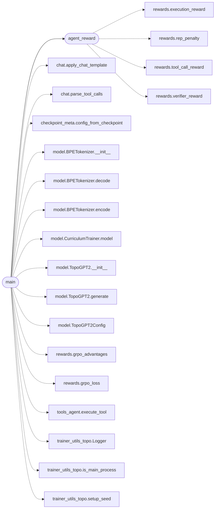

# `topogpt3.train_agent`

> Source: [topogpt3/train_agent.py:1](../../topogpt3/train_agent.py#L1) | language `py` | coverage 66.7% | [API index](../index.md)

Agentic RL for TopoGPT3 (multi-turn Tool-Use).

Rollout: prompt -> generate -> parse <tool_call> -> execute (run_python
sandbox + mock tools) -> append <tool_response> -> repeat (max_turns=3).
Reward: tool use + completion - repetition.
Loss: same GRPO/CISPO as train_grpo (no Critic -> quaternion-safe).
Observations (tool outputs) are masked out of the policy loss.

## Contents

- **Functions:** [`agent_reward`](#agent_reward), [`main`](#main)

## Call Graph

Solid arrows stay in this module, dashed arrows leave it.



## Functions

<a id="agent_reward"></a>

### `agent_reward`

`function` | [topogpt3/train_agent.py:41](../../topogpt3/train_agent.py#L41)

```python
def agent_reward(text: str, gt: str, used_tools: bool, tool_results: list | None = None, allowed_tools: set | None = None, require_tool: bool = False, verifier: str = 'general') -> float
```

Format + ground-truth + valid tool calls + sandboxed execution.

**Parameters**

| Name | Type | Default | Description |
|---|---|---|---|
| `text` | `str` |  |  |
| `gt` | `str` |  |  |
| `used_tools` | `bool` |  |  |
| `tool_results` | `list \| None` | `None` |  |
| `allowed_tools` | `set \| None` | `None` |  |
| `require_tool` | `bool` | `False` |  |
| `verifier` | `str` | `'general'` |  |

**Returns:** `float`

*Calls:* [`execution_reward`](topogpt3.rewards.py.md#execution_reward), [`rep_penalty`](topogpt3.rewards.py.md#rep_penalty), [`tool_call_reward`](topogpt3.rewards.py.md#tool_call_reward), [`verifier_reward`](topogpt3.rewards.py.md#verifier_reward)

*Called by:* [`main`](#main)

---

<a id="main"></a>

### `main`

`function` | [topogpt3/train_agent.py:67](../../topogpt3/train_agent.py#L67)

```python
def main()
```

*Calls:* [`apply_chat_template`](topogpt3.chat.py.md#apply_chat_template), [`parse_tool_calls`](topogpt3.chat.py.md#parse_tool_calls), [`config_from_checkpoint`](topogpt3.checkpoint_meta.py.md#config_from_checkpoint), [`BPETokenizer.__init__`](topogpt3.model.py.md#bpetokenizer-__init__), [`BPETokenizer.decode`](topogpt3.model.py.md#bpetokenizer-decode), [`BPETokenizer.encode`](topogpt3.model.py.md#bpetokenizer-encode), [`CurriculumTrainer.model`](topogpt3.model.py.md#curriculumtrainer-model), [`TopoGPT2.__init__`](topogpt3.model.py.md#topogpt2-__init__), [`TopoGPT2.generate`](topogpt3.model.py.md#topogpt2-generate), [`TopoGPT2Config`](topogpt3.model.py.md#topogpt2config), [`grpo_advantages`](topogpt3.rewards.py.md#grpo_advantages), [`grpo_loss`](topogpt3.rewards.py.md#grpo_loss) and 5 more

---
