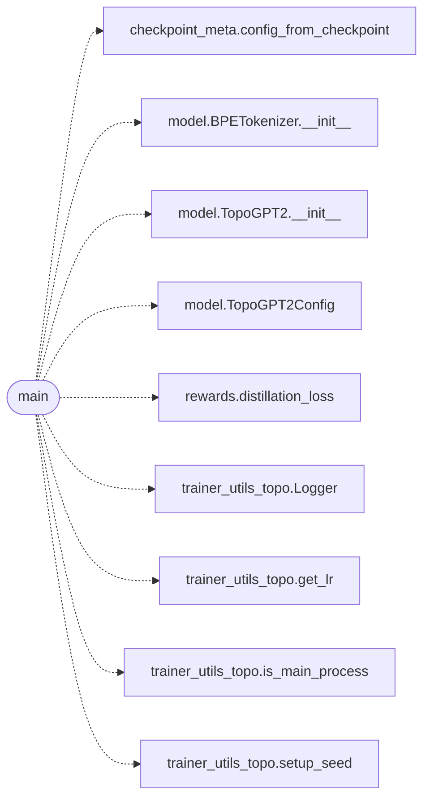

# `topogpt3.train_distill`

> Source: [topogpt3/train_distill.py:1](../../topogpt3/train_distill.py#L1) | language `py` | coverage 50.0% | [API index](../index.md)

White-box distillation for TopoGPT3.

Teacher: any HF causal LM (e.g. Qwen/StarCoder) or a larger TopoGPT2.
Student: TopoGPT2 quaternion/spectral — learns to mimic teacher geometry
in logit space while keeping its own spectral diagnostics intact.

## Contents

- **Functions:** [`main`](#main)

## Call Graph

Solid arrows stay in this module, dashed arrows leave it.



## Functions

<a id="main"></a>

### `main`

`function` | [topogpt3/train_distill.py:27](../../topogpt3/train_distill.py#L27)

```python
def main()
```

**Raises**

- `SystemExit`: (raised in the body, not documented)

*Calls:* [`config_from_checkpoint`](topogpt3.checkpoint_meta.py.md#config_from_checkpoint), [`BPETokenizer.__init__`](topogpt3.model.py.md#bpetokenizer-__init__), [`TopoGPT2.__init__`](topogpt3.model.py.md#topogpt2-__init__), [`TopoGPT2Config`](topogpt3.model.py.md#topogpt2config), [`distillation_loss`](topogpt3.rewards.py.md#distillation_loss), [`Logger`](topogpt3.trainer_utils_topo.py.md#logger), [`get_lr`](topogpt3.trainer_utils_topo.py.md#get_lr), [`is_main_process`](topogpt3.trainer_utils_topo.py.md#is_main_process), [`setup_seed`](topogpt3.trainer_utils_topo.py.md#setup_seed)

---
