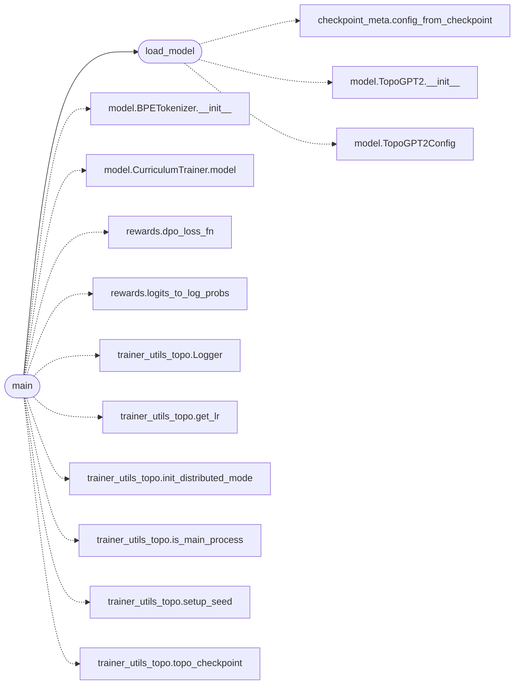

# `topogpt3.train_dpo`

> Source: [topogpt3/train_dpo.py:1](../../topogpt3/train_dpo.py#L1) | language `py` | coverage 33.3% | [API index](../index.md)

DPO for TopoGPT3.

Policy + frozen ref share TopoGPT2 quaternion/spectral weights; only preference direction is learned.

## Contents

- **Functions:** [`load_model`](#load_model), [`main`](#main)

## Call Graph

Solid arrows stay in this module, dashed arrows leave it.



## Functions

<a id="load_model"></a>

### `load_model`

`function` | [topogpt3/train_dpo.py:31](../../topogpt3/train_dpo.py#L31)

```python
def load_model(checkpoint, device)
```

**Parameters**

| Name | Type | Default | Description |
|---|---|---|---|
| `checkpoint` |  |  |  |
| `device` |  |  |  |

*Calls:* [`config_from_checkpoint`](topogpt3.checkpoint_meta.py.md#config_from_checkpoint), [`TopoGPT2.__init__`](topogpt3.model.py.md#topogpt2-__init__), [`TopoGPT2Config`](topogpt3.model.py.md#topogpt2config)

*Called by:* [`main`](#main)

---

<a id="main"></a>

### `main`

`function` | [topogpt3/train_dpo.py:43](../../topogpt3/train_dpo.py#L43)

```python
def main()
```

*Calls:* [`BPETokenizer.__init__`](topogpt3.model.py.md#bpetokenizer-__init__), [`CurriculumTrainer.model`](topogpt3.model.py.md#curriculumtrainer-model), [`dpo_loss_fn`](topogpt3.rewards.py.md#dpo_loss_fn), [`logits_to_log_probs`](topogpt3.rewards.py.md#logits_to_log_probs), [`load_model`](#load_model), [`Logger`](topogpt3.trainer_utils_topo.py.md#logger), [`get_lr`](topogpt3.trainer_utils_topo.py.md#get_lr), [`init_distributed_mode`](topogpt3.trainer_utils_topo.py.md#init_distributed_mode), [`is_main_process`](topogpt3.trainer_utils_topo.py.md#is_main_process), [`setup_seed`](topogpt3.trainer_utils_topo.py.md#setup_seed), [`topo_checkpoint`](topogpt3.trainer_utils_topo.py.md#topo_checkpoint)

---
