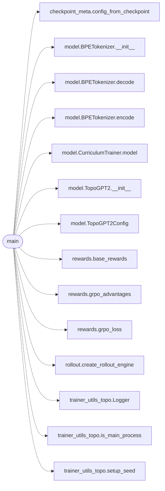

# `topogpt3.train_grpo`

> Source: [topogpt3/train_grpo.py:1](../../topogpt3/train_grpo.py#L1) | language `py` | coverage 50.0% | [API index](../index.md)

GRPO / CISPO for TopoGPT3.

Group-relative advantages, k3 KL to frozen ref, no Critic needed —
ideal for complex/quaternion weights that are hard to stabilize with a
value head. Spectral bonus is opt-in (default 0 = base behavior).

## Contents

- **Functions:** [`main`](#main)

## Call Graph

Solid arrows stay in this module, dashed arrows leave it.



## Functions

<a id="main"></a>

### `main`

`function` | [topogpt3/train_grpo.py:32](../../topogpt3/train_grpo.py#L32)

```python
def main()
```

*Calls:* [`config_from_checkpoint`](topogpt3.checkpoint_meta.py.md#config_from_checkpoint), [`BPETokenizer.__init__`](topogpt3.model.py.md#bpetokenizer-__init__), [`BPETokenizer.decode`](topogpt3.model.py.md#bpetokenizer-decode), [`BPETokenizer.encode`](topogpt3.model.py.md#bpetokenizer-encode), [`CurriculumTrainer.model`](topogpt3.model.py.md#curriculumtrainer-model), [`TopoGPT2.__init__`](topogpt3.model.py.md#topogpt2-__init__), [`TopoGPT2Config`](topogpt3.model.py.md#topogpt2config), [`base_rewards`](topogpt3.rewards.py.md#base_rewards), [`grpo_advantages`](topogpt3.rewards.py.md#grpo_advantages), [`grpo_loss`](topogpt3.rewards.py.md#grpo_loss), [`create_rollout_engine`](topogpt3.rollout.py.md#create_rollout_engine), [`Logger`](topogpt3.trainer_utils_topo.py.md#logger) and 2 more

---
