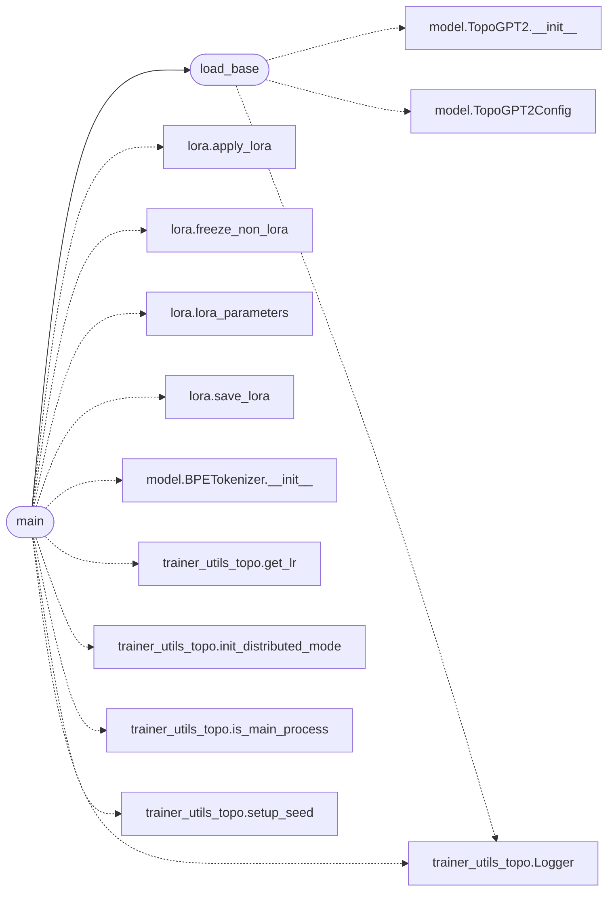

# `topogpt3.train_lora`

> Source: [topogpt3/train_lora.py:1](../../topogpt3/train_lora.py#L1) | language `py` | coverage 33.3% | [API index](../index.md)

SFT with native LoRA for TopoGPT3.

Freezes quaternion/spectral base, trains only LoRA deltas. DDP + AMP ready.

## Contents

- **Functions:** [`load_base`](#load_base), [`main`](#main)

## Call Graph

Solid arrows stay in this module, dashed arrows leave it.



## Functions

<a id="load_base"></a>

### `load_base`

`function` | [topogpt3/train_lora.py:25](../../topogpt3/train_lora.py#L25)

```python
def load_base(checkpoint: str, device: str)
```

**Parameters**

| Name | Type | Default | Description |
|---|---|---|---|
| `checkpoint` | `str` |  |  |
| `device` | `str` |  |  |

*Calls:* [`TopoGPT2.__init__`](topogpt3.model.py.md#topogpt2-__init__), [`TopoGPT2Config`](topogpt3.model.py.md#topogpt2config), [`Logger`](topogpt3.trainer_utils_topo.py.md#logger)

*Called by:* [`main`](#main)

---

<a id="main"></a>

### `main`

`function` | [topogpt3/train_lora.py:36](../../topogpt3/train_lora.py#L36)

```python
def main()
```

*Calls:* [`apply_lora`](topogpt3.lora.py.md#apply_lora), [`freeze_non_lora`](topogpt3.lora.py.md#freeze_non_lora), [`lora_parameters`](topogpt3.lora.py.md#lora_parameters), [`save_lora`](topogpt3.lora.py.md#save_lora), [`BPETokenizer.__init__`](topogpt3.model.py.md#bpetokenizer-__init__), [`load_base`](#load_base), [`Logger`](topogpt3.trainer_utils_topo.py.md#logger), [`get_lr`](topogpt3.trainer_utils_topo.py.md#get_lr), [`init_distributed_mode`](topogpt3.trainer_utils_topo.py.md#init_distributed_mode), [`is_main_process`](topogpt3.trainer_utils_topo.py.md#is_main_process), [`setup_seed`](topogpt3.trainer_utils_topo.py.md#setup_seed)

---
