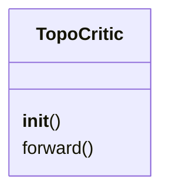
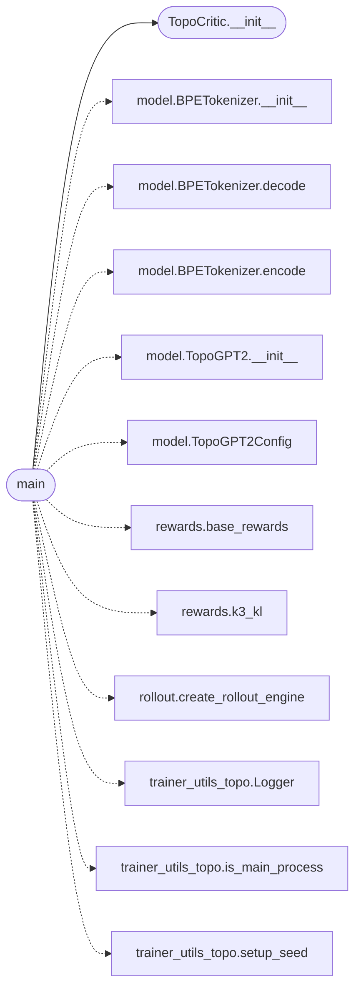

# `topogpt3.train_ppo`

> Source: [topogpt3/train_ppo.py:1](../../topogpt3/train_ppo.py#L1) | language `py` | coverage 20.0% | [API index](../index.md)

PPO for TopoGPT3.

Critic = frozen TopoGPT2 trunk + fresh Linear value head (quaternion trunk
untouched by value gradients except through shared trunk).
GAE + clipped actor + clipped value + k3 KL to ref.

## Contents

- **Classes:** [`TopoCritic`](#topocritic)
- **Functions:** [`main`](#main)

## Type Diagram



## Call Graph

Solid arrows stay in this module, dashed arrows leave it.



## Classes

<a id="topocritic"></a>

### `TopoCritic`

`class` | [topogpt3/train_ppo.py:29](../../topogpt3/train_ppo.py#L29)

```python
class TopoCritic(nn.Module)
```

Bases: `nn.Module`

**Members**

| Member | Kind | Summary |
|---|---|---|
| [`__init__`](#topocritic-__init__) | constructor |  |
| [`forward`](#topocritic-forward) | method |  |

<a id="topocritic-__init__"></a>

#### `TopoCritic.__init__`

`constructor` | [topogpt3/train_ppo.py:30](../../topogpt3/train_ppo.py#L30)

```python
def __init__(self, trunk: TopoGPT2)
```

**Parameters**

| Name | Type | Default | Description |
|---|---|---|---|
| `trunk` | `TopoGPT2` |  |  |

*Called by:* [`main`](#main)

<a id="topocritic-forward"></a>

#### `TopoCritic.forward`

`method` | [topogpt3/train_ppo.py:36](../../topogpt3/train_ppo.py#L36)

```python
def forward(self, ids)
```

**Parameters**

| Name | Type | Default | Description |
|---|---|---|---|
| `ids` |  |  |  |

---

## Functions

<a id="main"></a>

### `main`

`function` | [topogpt3/train_ppo.py:45](../../topogpt3/train_ppo.py#L45)

```python
def main()
```

*Calls:* [`BPETokenizer.__init__`](topogpt3.model.py.md#bpetokenizer-__init__), [`BPETokenizer.decode`](topogpt3.model.py.md#bpetokenizer-decode), [`BPETokenizer.encode`](topogpt3.model.py.md#bpetokenizer-encode), [`TopoGPT2.__init__`](topogpt3.model.py.md#topogpt2-__init__), [`TopoGPT2Config`](topogpt3.model.py.md#topogpt2config), [`base_rewards`](topogpt3.rewards.py.md#base_rewards), [`k3_kl`](topogpt3.rewards.py.md#k3_kl), [`create_rollout_engine`](topogpt3.rollout.py.md#create_rollout_engine), [`TopoCritic.__init__`](#topocritic-__init__), [`Logger`](topogpt3.trainer_utils_topo.py.md#logger), [`is_main_process`](topogpt3.trainer_utils_topo.py.md#is_main_process), [`setup_seed`](topogpt3.trainer_utils_topo.py.md#setup_seed)

---
