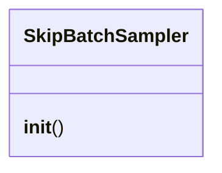

# `topogpt3.trainer_utils_topo`

> Source: [topogpt3/trainer_utils_topo.py:1](../../topogpt3/trainer_utils_topo.py#L1) | language `py` | coverage 22.2% | [API index](../index.md)

Shared training utilities for TopoGPT3 advanced trainers.

Adapted to TopoGPT3 checkpoints (safetensors slot `last/` + legacy step_*)
with DDP / cross-GPU resume / wandb-continuity helpers.
Architecture-agnostic: never touches Quaternion/Spectral layers.

## Contents

- **Classes:** [`SkipBatchSampler`](#skipbatchsampler)
- **Functions:** [`Logger`](#logger), [`is_main_process`](#is_main_process), [`get_lr`](#get_lr), [`setup_seed`](#setup_seed), [`init_distributed_mode`](#init_distributed_mode), [`topo_checkpoint`](#topo_checkpoint)

## Type Diagram



## Call Graph

Solid arrows stay in this module, dashed arrows leave it.


## Classes

<a id="skipbatchsampler"></a>

### `SkipBatchSampler`

`class` | [topogpt3/trainer_utils_topo.py:52](../../topogpt3/trainer_utils_topo.py#L52)

```python
class SkipBatchSampler(Sampler)
```

Bases: `Sampler`

**Members**

| Member | Kind | Summary |
|---|---|---|
| [`__init__`](#skipbatchsampler-__init__) | constructor |  |

<a id="skipbatchsampler-__init__"></a>

#### `SkipBatchSampler.__init__`

`constructor` | [topogpt3/trainer_utils_topo.py:53](../../topogpt3/trainer_utils_topo.py#L53)

```python
def __init__(self, sampler, batch_size: int, skip_batches: int = 0)
```

**Parameters**

| Name | Type | Default | Description |
|---|---|---|---|
| `sampler` |  |  |  |
| `batch_size` | `int` |  |  |
| `skip_batches` | `int` | `0` |  |

---

## Functions

<a id="logger"></a>

### `Logger`

`function` | [topogpt3/trainer_utils_topo.py:20](../../topogpt3/trainer_utils_topo.py#L20)

```python
def Logger(content, quiet: bool = False)
```

**Parameters**

| Name | Type | Default | Description |
|---|---|---|---|
| `content` |  |  |  |
| `quiet` | `bool` | `False` |  |

*Called by:* [`main`](topogpt3.train_agent.py.md#main), [`main`](topogpt3.train_distill.py.md#main), [`main`](topogpt3.train_dpo.py.md#main), [`main`](topogpt3.train_grpo.py.md#main), [`load_base`](topogpt3.train_lora.py.md#load_base), [`main`](topogpt3.train_lora.py.md#main), [`main`](topogpt3.train_ppo.py.md#main), [`topo_checkpoint`](#topo_checkpoint)

---

<a id="is_main_process"></a>

### `is_main_process`

`function` | [topogpt3/trainer_utils_topo.py:25](../../topogpt3/trainer_utils_topo.py#L25)

```python
def is_main_process() -> bool
```

**Returns:** `bool`

*Called by:* [`main`](topogpt3.train_agent.py.md#main), [`main`](topogpt3.train_distill.py.md#main), [`main`](topogpt3.train_dpo.py.md#main), [`main`](topogpt3.train_grpo.py.md#main), [`main`](topogpt3.train_lora.py.md#main), [`main`](topogpt3.train_ppo.py.md#main)

---

<a id="get_lr"></a>

### `get_lr`

`function` | [topogpt3/trainer_utils_topo.py:29](../../topogpt3/trainer_utils_topo.py#L29)

```python
def get_lr(current_step: int, total_steps: int, lr: float) -> float
```

**Parameters**

| Name | Type | Default | Description |
|---|---|---|---|
| `current_step` | `int` |  |  |
| `total_steps` | `int` |  |  |
| `lr` | `float` |  |  |

**Returns:** `float`

*Called by:* [`main`](topogpt3.train_distill.py.md#main), [`main`](topogpt3.train_dpo.py.md#main), [`main`](topogpt3.train_lora.py.md#main)

---

<a id="setup_seed"></a>

### `setup_seed`

`function` | [topogpt3/trainer_utils_topo.py:34](../../topogpt3/trainer_utils_topo.py#L34)

```python
def setup_seed(seed: int)
```

**Parameters**

| Name | Type | Default | Description |
|---|---|---|---|
| `seed` | `int` |  |  |

*Called by:* [`main`](topogpt3.train_agent.py.md#main), [`main`](topogpt3.train_distill.py.md#main), [`main`](topogpt3.train_dpo.py.md#main), [`main`](topogpt3.train_grpo.py.md#main), [`main`](topogpt3.train_lora.py.md#main), [`main`](topogpt3.train_ppo.py.md#main)

---

<a id="init_distributed_mode"></a>

### `init_distributed_mode`

`function` | [topogpt3/trainer_utils_topo.py:43](../../topogpt3/trainer_utils_topo.py#L43)

```python
def init_distributed_mode() -> int
```

**Returns:** `int`

*Called by:* [`main`](topogpt3.train_dpo.py.md#main), [`main`](topogpt3.train_lora.py.md#main)

---

<a id="topo_checkpoint"></a>

### `topo_checkpoint`

`function` | [topogpt3/trainer_utils_topo.py:77](../../topogpt3/trainer_utils_topo.py#L77)

```python
def topo_checkpoint(save_dir: str, weight: str, model=None, optimizer=None, scheduler=None, scaler=None, epoch: int = 0, step: int = 0, wandb=None, extra: Optional[dict] = None)
```

Atomic double-save: fp16 weights + resume state (weights + optim).

Handles world_size rescale on load (delegated to train.py CheckpointStore
when present; here we store world_size so future loaders can rescale).

**Parameters**

| Name | Type | Default | Description |
|---|---|---|---|
| `save_dir` | `str` |  |  |
| `weight` | `str` |  |  |
| `model` |  | `None` |  |
| `optimizer` |  | `None` |  |
| `scheduler` |  | `None` |  |
| `scaler` |  | `None` |  |
| `epoch` | `int` | `0` |  |
| `step` | `int` | `0` |  |
| `wandb` |  | `None` |  |
| `extra` | `Optional[dict]` | `None` |  |

*Calls:* [`Logger`](#logger)

*Called by:* [`main`](topogpt3.train_dpo.py.md#main)

---
